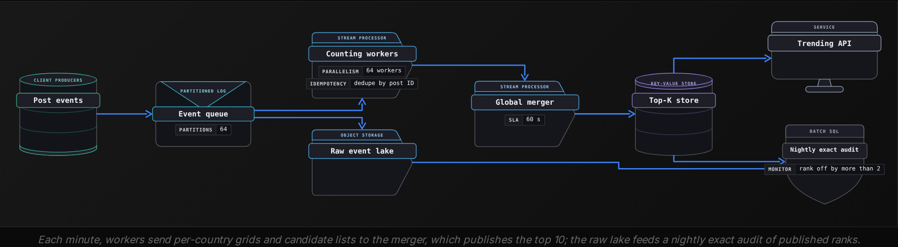

# Frequency Counting: Advanced

Dalia is 40 minutes into a system design round at X, the company formerly called Twitter, when the interviewer turns to the whiteboard. 'Assume 500 million posts a day. Every minute, show the 10 hashtags rising fastest in each country. You get a fleet of stream workers with a few gigabytes of memory each. Go.' Dalia knows `Counter` and `most_common` cold. She also knows a dict holding every hashtag ever posted won't fit on a single machine, that a celebrity tag can pin a worker at full load, and that the follow-up will be 'how wrong are your numbers allowed to be?' The question is a frequency count dressed as a distributed system. A strong answer sizes a sketch, bounds its error in real numbers, finds the heavy tags without storing the light ones, and says exactly where exactness is worth its price.


<br>

### What you will be able to do

Size a Count-Min Sketch from an error target and state its one-sided guarantee in numbers

Find majority and heavy-hitter candidates in constant or k - 1 space, then verify them

Profile key frequencies to choose between broadcast, shuffle, salted and pre-aggregated plans

Defend an approximate or exact count by tying its error budget to the decision it drives

Design a sharded, windowed top-K monitor that merges sketches without losing global winners


<br>

---

## Count-Min Sketch Estimation

A Count-Min Sketch answers a single question, 'about how many times has item x appeared?', from a fixed grid of counters whose size depends on the error you accept and never on how many distinct items arrive. The grid has `d` rows and `w` columns, and each row owns a separate hash function that maps an item to a column. Adding an item increments the item's column in every row, `d` increments in total. Estimating reads those same `d` cells and returns the smallest.

Each cell an item touches holds that item's count plus the counts of every other item that hashed there. Collisions can only add, so each of the d readings is an upper bound, and the minimum is the tightest bound the grid can offer. That's why the sketch never undercounts, and why an estimate of 0 proves the item never arrived.

The program below streams 8 events into a grid of 3 rows and 4 columns. Its hash, `((a * x + b) % 11) % 4`, is small enough to check by hand. Before the query loop runs, predict the estimate it prints for each of the 5 items, including item 8, which never appears in the stream.

https://github.com/user-attachments/assets/fef368a2-4076-4c17-a0ae-b25253ef7349

*Each event bumps 1 cell per row; each query takes the minimum of 3 cells.*

The output reads `4 4 5`, `2 2 2`, `9 1 1`, `7 1 1`, `8 0 1`: item, true count, estimate. Items 2, 9 and 7 come back exact because each has at least 1 row where nothing else landed in its cell. Item 4 prints 5 against a true 4. In row 0 it shares column 2 with item 9, in row 1 column 0 with item 7, in row 2 column 1 with item 2, so every reading is inflated and the minimum still carries 1 extra. Item 8 prints 1 through the same mechanism: its 3 cells were all filled by other items. That is the complete error model, overestimates of varying size and never an underestimate.


<br>

### The guarantee, in numbers

Choose 2 targets: an additive error fraction ε and a failure probability δ. Size the grid as `w = ceil(e / ε)` and `d = ceil(ln(1 / δ))`, with e as Euler's number. For any single queried item, the estimate then exceeds the true count by at most ε \* N with probability at least 1 - δ, where N is the total number of increments.

> Why those formulas hold
>
> - In a single row, the mass other items add to x's cell has expected value at most N / w when the row's hash is pairwise independent.
> - Markov's inequality bounds the chance that this excess exceeds e \* N / w by 1 / e.
> - Setting w = e / ε turns that threshold into ε \* N, so a row fails with probability at most 1 / e.
> - Rows hash independently, so all d rows fail together with probability at most e^-d, which equals δ when d = ln(1 / δ).

```sql
import math


def cms_dimensions(epsilon, delta):
    width = math.ceil(math.e / epsilon)
    depth = math.ceil(math.log(1 / delta))
    return width, depth


print(cms_dimensions(0.001, 0.01))
```

It prints `(2719, 5)`, a grid of 13,595 counters. At 4 bytes per counter the sketch occupies roughly 54 KB, and that figure holds whether the stream carries 1,000 distinct hashtags or 1 billion. Depth grows with the log of 1 / δ, so tightening confidence from 99% to 99.99% adds only 5 rows, while halving ε doubles the width.

- **1,000,000** — overcount bound at N = 1B, ε = 0.001

That bound is additive in N, which makes it generous to heavy items and harsh on light ones. A tag with 50 million uses lands within 2% of its truth. A tag with 2,000 uses can come back more than 500 times its true count. The sketch sizes heavy items well and can't certify that a rare item is rare, so it suits heavy-hitter questions and fails long-tail ones.


<br>

### Hashing that survives a merge

Sketches built on separate workers merge by cell-wise addition, and the summed grid equals the grid a single worker would have built from the combined stream. That holds only when every worker sends each item to identical columns. Python salts the built-in `hash()` of strings per process unless `PYTHONHASHSEED` is fixed, so 2 workers would scatter the same hashtag into different cells and their sum would be noise. Derive columns from a stable digest instead, seeded by the row number.

```sql
import hashlib


def column(item, row, width):
    key = f"{row}:{item}".encode()
    digest = hashlib.blake2b(key, digest_size=8).digest()
    return int.from_bytes(digest, "big") % width
```

Conservative update changes the add step. On each add, read the item's current estimate m, then raise each of its d counters to m + 1 only if it sits below that value. Counters already above m + 1 were inflated by collisions and stay put, which cuts overestimation sharply on skewed streams. The price is linearity: such a grid can no longer accept decrements, and 2 merged grids remain a valid upper bound but a looser one than conservative update over the combined stream would produce.

> **TIP**
>
> State the guarantee as one sentence with numbers: 'with 99% probability no estimate exceeds the truth by more than 0.1% of all events, none is ever below it, and the grid costs 54 KB.' Then say what you'll do about rare items, because that's the follow-up.


<br>

---

## Heavy Hitters via Boyer-Moore

Count-Min estimates any item you name and cannot tell you which items to name. Heavy-hitter detection runs the other direction: which items exceed a given fraction of the stream? The smallest case is majority, an item filling more than half of n events, and Boyer-Moore voting finds it with 2 variables, a candidate and a counter, in a single left-to-right scan.

The rules: when the counter is 0, adopt the current item as candidate; a match increments; a mismatch decrements. Read each decrement as cancelling a copy of the candidate against a copy of some other item. A true majority outnumbers every other item combined, so cancellation cannot exhaust it, and it's still standing at the end. The converse doesn't hold: with no majority present, the scan still ends with a candidate, picked by arrival order. That makes a second counting pass mandatory whenever the answer must be correct.

The animation runs the vote and the verification on 2 streams of 7 events. Predict each stream's final candidate, then whether the second pass keeps it.

https://github.com/user-attachments/assets/b4377218-6667-4f0e-a25f-408ec94abc7c

*The vote finds a candidate; the recount decides whether it is real.*

The first stream ends on `a` with a counter of 1, and verification finds 4 of 7, so it prints `a`. The second stream ends on `d`, an item that appears once: `a` zeroed the counter at position 6 and `d` arrived next. Verification finds 1 of 7 and prints `None`. Without that second pass the function would have reported `d` as the majority of a stream that has none.


<br>

### Beyond majority: Misra-Gries

Generalize the cancellation to find every item above n / k. Keep at most k - 1 counters. A tracked item increments its counter. An untracked item takes a free slot if there is one. When the slots are full, the newcomer is discarded and every tracked counter loses 1, with counters at 0 dropped. Each such step throws away k occurrences together, the newcomer plus a copy from each slot, so at most n / k steps can happen. That bound gives 2 guarantees: every item above n / k is still tracked at the end, and every stored count falls short of the truth by at most n / k.

```sql
def misra_gries(stream, k):
    counters = {}
    for x in stream:
        if x in counters:
            counters[x] += 1
        elif len(counters) < k - 1:
            counters[x] = 1
        else:
            for key in list(counters):
                counters[key] -= 1
                if counters[key] == 0:
                    del counters[key]
    return counters
```

| event | action | counters after |
| --- | --- | --- |
| a | new slot | a:1 |
| a | increment | a:2 |
| b | new slot | a:2, b:1 |
| c | slots full: all lose 1 | a:1 |
| a | increment | a:2 |
| b | new slot | a:2, b:1 |
| d | slots full: all lose 1 | a:1 |
| a | increment | a:2 |
| b | new slot | a:2, b:1 |

The stream has 9 events, with k = 3 and threshold n / k = 3. Item `a` occurs 4 times, clears the threshold, and survives with a stored 2; the 2 decrement steps account for the gap, each having removed a copy of `a`. Item `b` occurs exactly 3 times and happens to survive with 1, but nothing guaranteed it, since the promise covers only items strictly above n / k. Where Count-Min errs high, Misra-Gries errs low, so the 2 summaries together bracket a true count from both sides.

| ✓ Misra-Gries | ✗ Count-Min |
| --- | --- |
| • Enumerates the heavy items itself<br><br>• Memory: k - 1 counters, whatever the number of distinct items<br><br>• Error: low by up to n / k, never high<br><br>• Deterministic: no hash, no failure probability<br><br>• Merge: add counters, subtract the k-th largest, drop non-positive | • Estimates a named item; can't list items<br><br>• Memory: w \* d counters, set by ε and δ<br><br>• Error: high by up to ε \* N, never low<br><br>• Randomized: the bound holds with chance 1 - δ<br><br>• Merge: add grids cell by cell |

The Misra-Gries merge matters for the distributed design later. Add the 2 counter sets; if more than k - 1 keys remain, subtract the k-th largest value from every counter and drop those that fall to 0 or below. The merged summary keeps the n / k guarantee over the combined stream, so workers can summarize locally and a coordinator can combine them.

The data engineering version of this question rarely says 'majority'. It says: find any client producing more than 1% of the API calls in this hour, on a worker with a fixed memory budget. That's Misra-Gries with k = 100 and 99 counters, a few kilobytes no matter how many clients exist, followed by an exact recount of 99 names if the hour can be replayed.

> **TIP**
>
> Listen for the phrasing. 'More than half' with constant extra space is Boyer-Moore. 'More than n / 3' needs 2 candidates; 'more than n / k' needs k - 1. When the input can be re-read, verify the survivors with an exact count; on a one-pass stream, report each survivor with its n / k error bound instead.


<br>

---

## Join and Aggregation Strategy

Distributed joins and group-bys send each row to a worker by hashing its key, which makes worker load a frequency sum: each worker carries the combined count of every key that hashes to it. Flat key frequencies give flat load. A key holding 30% of the rows puts at least 30% of the work on whichever worker receives it, and the stage ends when that worker ends, however many others sit idle.


<br>

### Profile the join key first

The plan depends on 3 numbers about the key: how many distinct keys exist, what share the largest single key holds, and how per-key counts spread across percentiles. The query below gathers them in a single pass over a day of events.

```sql
WITH per_key AS (
  SELECT
    user_id,
    COUNT(*) AS n
  FROM events
  WHERE event_date = DATE '2026-10-25'
  GROUP BY user_id
)

SELECT
  COUNT(*) AS distinct_keys,
  SUM(n) AS total_rows,
  MAX(n) AS max_rows_per_key,
  APPROX_PERCENTILE(n, 0.99) AS p99_rows_per_key,
  CAST(MAX(n) AS DOUBLE) / SUM(n) AS top_key_share
FROM per_key
```

`top_key_share` is the figure to compare. With P workers on a stage, perfect balance hands each worker 1 / P of the rows. If the top key's share exceeds 1 / P, no choice of hash function helps, because plain hash partitioning keeps a key's rows together. At 200 workers the line is 0.5%, and a key carrying 3% of the rows leaves its worker with at least 6 times its balanced load.

| what the profile shows | plan | what it costs |
| --- | --- | --- |
| the smaller side fits in worker memory, tens of MB | broadcast the small side; the large side never shuffles | a copy of the small side on every worker |
| both sides large, top key share far below 1 / P | shuffle hash join on the key | a full shuffle of both sides |
| both sides large, a few keys above 1 / P | salt the hot keys only | hot keys' small-side rows copied S times |
| hot keys in a group-by with sum, count, min or max | partial aggregation before the shuffle | an in-memory pass per worker, little network |
| hot keys in a distinct count per key | pre-group by key and value, or a mergeable distinct sketch | an extra stage, or about 2% error |


<br>

### Salting hot keys, and its bill

Salting splits a hot key into S sub-keys. Each large-side row of that key draws a random salt from 0 to S - 1, each small-side row of that key is copied S times with salts 0 to S - 1, and the join condition becomes key plus salt. The hot key's rows can now spread across up to S workers. The animation measures the effect for 5 keys on 4 partitions, using key modulo 4 as the partition function, with S = 4 applied only to keys above 2,000 rows.

https://github.com/user-attachments/assets/f731ab66-6c6b-4c72-a8fe-fde7ea5c0435

*Partition loads before and after salting key 1 into 4 sub-keys.*

Before salting, partition 1 holds 9,250 of the 10,300 rows, because key 1 alone contributes 9,000. After salting, key 1 lands on all 4 partitions at 2,250 apiece, and the maximum drops to 2,650 against a balanced 2,575. Salting the cold keys as well would buy almost nothing in balance while copying their small-side rows S times, which is why the threshold exists. The SQL below applies the same idea with 8 salts to a revenue-by-country join, reading hot keys from a small `hot_keys` table that a profile like the one above produces.

```sql
WITH salted_events AS (
  SELECT
    e.user_id,
    e.amount,
    IF(
      h.user_id IS NULL,
      0,
      CAST(FLOOR(RAND() * 8) AS BIGINT)
    ) AS salt
  FROM events AS e
  LEFT JOIN hot_keys AS h
    ON e.user_id = h.user_id
),
salted_users AS (
  SELECT
    u.user_id,
    u.country,
    s.salt
  FROM users AS u
  LEFT JOIN hot_keys AS h
    ON u.user_id = h.user_id
  CROSS JOIN UNNEST(IF(h.user_id IS NULL, SEQUENCE(0, 0), SEQUENCE(0, 7))) AS s(salt)
)

SELECT
  su.country,
  SUM(se.amount) AS revenue
FROM salted_events AS se
JOIN salted_users AS su
  ON se.user_id = su.user_id
    AND se.salt = su.salt
GROUP BY su.country
```

*The large-side salt must come from a random draw or a non-key column. A salt computed from the key itself sends every row of that key to the same sub-key and leaves the skew untouched.*


<br>

### Aggregations collapse hot keys early

A group-by has an advantage a join lacks. When the aggregate is decomposable, each upstream worker pre-aggregates its rows and ships a single partial row per key. A key with 90 million rows spread over 200 upstream workers then crosses the network as 200 partial sums. Distributed SQL engines commonly apply this partial aggregation automatically for `sum`, `count`, `min` and `max`. Skew returns when the aggregate needs every row of the key: exact `count(DISTINCT ...)`, exact percentiles, `array_agg`. Those are the cases where the profile sends you to a 2-stage plan or an approximate aggregate.

> What the answer should contain
>
> - The measured top key share, set against 1 / P for the stage
> - Which side gets replicated, and by how many rows or MB
> - Why only the hot keys are salted
> - Whether the aggregate is decomposable, and the plan if it is not


<br>

---

## Approximate vs Exact Counting

Approximation is a product decision with an engineering price. A defensible choice names 3 things: the decision the number feeds, the size of error that would change that decision, and the cost of removing the error. Quote '2% error' without the first 2 and it means nothing to the person who has to act on it.


<br>

### The memory arithmetic

Count distinct users for a day in which 1 billion distinct 8-byte IDs arrive. An exact hash set must hold every ID: 8 GB of raw keys before the table's empty slots and per-entry overhead, which commonly double or triple it. A HyperLogLog sketch with 4,096 registers estimates the same cardinality with a standard error of 1.04 / sqrt(4096), about 1.6%, and its state does not grow when the user base does. The memory gap is more than a million to one.

- **3 KB** — HyperLogLog state at 1.6% error


<br>

### Match the error budget to the consumer

| number | decision it feeds | tolerable error | choice |
| --- | --- | --- | --- |
| trending tag ranking | which 10 tags appear | small, if clear winners keep their ranks | sketch plus exact counters for candidates |
| daily active users on a dashboard | trend reading, capacity planning | 1 to 2% | HyperLogLog, stored as mergeable state |
| ad impressions billed to an advertiser | an invoice | zero | exact, deduplicated by event ID |
| card transactions per minute for fraud | block or allow a payment | low for flagged cards | sketch to flag, exact counters on flagged cards |
| rows per partition at a quality gate | pipeline passes or fails | zero | exact count(\*) |

The rows ending in an exact choice share a trait: the number becomes money, an action against a specific customer, or a pass/fail gate. The rows ending in a sketch feed rankings, trends and screening, where a person or a later exact step absorbs small errors. When unsure, ask what happens downstream if the number runs 2% high, and who notices.


<br>

### Mergeability decides the storage format

Distinct counts don't add. Monday's 40 million users plus Tuesday's 42 million overstates the 2-day figure, because most users appear on both days. A team that stores only each day's `approx_distinct` result can't answer a weekly question without rescanning raw events. Store the sketch state, and weekly, monthly and per-region rollups become merges of small binary values.

```sql
INSERT INTO daily_user_sketches
SELECT
    event_date,
    CAST(approx_set(user_id) AS VARBINARY) AS users_hll
FROM events
WHERE event_date = DATE '2026-10-25'
GROUP BY event_date
```

```sql
SELECT
  CARDINALITY(MERGE(CAST(users_hll AS HYPERLOGLOG))) AS weekly_users
FROM daily_user_sketches
WHERE event_date BETWEEN DATE '2026-10-19'
AND DATE '2026-10-25'
```

The weekly query reads 7 rows of a few kilobytes each, where an exact weekly distinct would reread 7 days of events and shuffle every user ID. The same reasoning covers Count-Min grids and Misra-Gries summaries: if a rollup across time or regions is likely, persist the mergeable state alongside the scalar result.


<br>

### Sketch to nominate, count exactly to confirm

A design can use both. A sketch nominates candidates cheaply and an exact count confirms the few that matter, which is the Boyer-Moore verification pass scaled up. A trending service can hold exact counters for its current 1,000 candidates while a Count-Min grid covers the long tail, so displayed figures come from dedicated counters seeded with the sketch's estimate at admission, and the sketch's job shrinks to choosing who gets a counter. Billing can stay exact while its anomaly alerts run on sketches: a 1% error on an alert threshold costs a few minutes of someone's attention, and a 1% error on an invoice costs a customer.


<br>

### Defending the choice aloud

- Name the consumer and the decision: 'this feeds a ranked list of 10 tags, and nobody is billed from it.'
- Translate the error into the consumer's units: 'at 1 billion events, no tag is overstated by more than 1 million.'
- Show where the error can and cannot flip the decision: 'ranks 9 to 12 may swap; the top 5 are separated by more than the bound.'
- Price the exact alternative in memory, shuffle volume and latency.
- Offer the audit: a nightly exact job that measures the sketch's real drift.

| ✓ Do | ✗ Don't |
| --- | --- |
| • Persist mergeable sketch state when rollups across days or regions are likely<br><br>• Quote error in the consumer's units, with its probability attached<br><br>• Audit sketch output against an exact batch recount on sampled days<br><br>• Keep anything that becomes money or a compliance record exact | • Add daily distinct counts together to report a weekly figure<br><br>• Ask an additive-error sketch whether a rare item is rare<br><br>• Call a sketch accurate without a number and a confidence<br><br>• Merge sketches built with different seeds, widths or depths |


<br>

---

## Design a Real-Time Top-K Monitor

Restate the intro's question with numbers: 500 million posts a day is about 5,800 per second on average, with bursts several times higher; the output is the top 10 hashtags per country, refreshed every minute over a sliding 60-minute window. A complete answer works through 5 decisions in order: how events are partitioned, what each worker keeps, how partial results merge, how the window slides, and how the system checks itself.



Posts flow into a partitioned queue. Counting workers consume it, and every minute each one ships, per country, a Count-Min grid plus a short list of candidate tags. A merger sums the grids, re-scores the candidates, and writes the top 10 per country to a serving store behind the API. The raw events also land in a lake, where a nightly batch job recounts exactly and flags drift.


<br>

### Decision 1: partition by tag or at random

| ✓ Partition by hashtag | ✗ Partition at random or by post ID |
| --- | --- |
| • Each tag's count lives on a single worker, so local counts are global<br><br>• No merge step for counts<br><br>• A viral tag pins its worker: the join skew problem, now in a stream<br><br>• Rebalancing moves counting state between workers | • Load stays even however skewed the tags are<br><br>• Every worker sees a slice of every tag<br><br>• Partial counts must merge every minute<br><br>• The merge must not miss tags that are moderate everywhere |

At this volume random partitioning is the safer default. Hashtag frequency is the same skewed distribution the join profile measured, and paying for a minute-level merge buys immunity to the viral tag.


<br>

### Decision 2: what a worker keeps per minute

Per country, each worker keeps a Count-Min grid for the current minute and m candidates: a dict from tag to estimate, with a min-heap to find the smallest. On each post it updates the grid and reads the tag's estimate. A tag already in the dict has its estimate raised in place, so the m slots never hold one hot tag twice, and stale heap entries are skipped on pop. An untracked tag evicts the smallest candidate only if its estimate beats it. At the minute boundary the worker ships the grid and candidates, then starts fresh. At ε = 0.001 and δ = 0.01 each grid is 54 KB, so 64 workers times 200 countries ship roughly 700 MB a minute: an argument for sizing ε per country, with a plain dict where a minute holds a few thousand posts.


<br>

### Decision 3: merging without losing winners

Adding grids merges counts. Merging candidate lists is where designs fail. If each worker reports its local top 2 and the merger sums whatever arrives, a tag that ranks third everywhere disappears, even when its global total beats every reported tag. The program reproduces the failure with 3 workers and K = 2, then reruns it with 3 candidates per worker.

https://github.com/user-attachments/assets/fc574df3-f714-41b1-b3bc-3c070cd6406d

*Local top-m lists merged by summing the counts each worker reports.*

With 2 candidates per worker the merger crowns `a` at 85 and `c` at 50, while `x`, at 30 on every worker, never reaches it. With 3 candidates, `x` arrives at 90 and the merged answer matches the exact one. Production systems set m well above K, for instance 100 candidates for a top 10, and score every tag in the union from the merged grid instead of summing reported counts: a tag listed by 40 workers and missing from the other 24 still has posts on those 24.


<br>

### Decision 4: sliding the window

Keep the last 60 minute-grids per country in a ring at the merger, about 650 MB across 200 countries. Each minute, add the newest grid to the hour grid and subtract the one leaving the window; subtraction is exact for standard grids and breaks a conservative-update grid. A grid estimates named tags and can't list them, so the merger also keeps the union of candidates reported by the minutes still in the ring and re-scores that set against the hour grid. 'Rising fastest' compares each score with a baseline such as the same hour last week, ranking by ratio with a minimum-count floor so a tag moving from 1 to 5 doesn't outrank one moving from 20,000 to 80,000. A late post goes into a correction grid for its own minute, added to that minute's slot.


<br>

### Decision 5: how the system checks itself

- Retries: producers resend on timeout, so workers drop repeated post IDs inside a short dedupe window before counting.
- Audit: a nightly batch job recomputes the exact hourly top 10 per country from the raw lake and alerts when a published rank is off by more than 2 positions.
- Merger load: its work is grid addition, fixed by grid size, country count and worker count, so a viral hour costs it nothing extra.
- Failure: a lost worker's minute is a missing grid; the merger publishes with 63 of 64 and marks the minute partial instead of stalling.

The audit's exact side is a ranked group-by over the raw lake, one hour per run.

```sql
WITH hourly AS (
  SELECT
    country,
    hashtag,
    COUNT(*) AS posts
  FROM post_hashtags
  WHERE event_hour = TIMESTAMP '2026-10-25 14:00:00'
  GROUP BY country, hashtag
)

SELECT
  country,
  hashtag,
  posts
FROM (
  SELECT
    country,
    hashtag,
    posts,
    ROW_NUMBER() OVER (
      PARTITION BY country
      ORDER BY posts DESC
    ) AS rnk
  FROM hourly
) AS ranked
WHERE rnk <= 10
```

> **TIP**
>
> Close by restating the guarantee in product terms: 'with 99% probability each displayed tag is overstated by at most 0.1% of that country's hourly posts, the list refreshes every 60 seconds, and a nightly exact job reports any rank drift.'


<br>

---

## Putting It All Together

An ad-serving platform shows each advertiser a live panel of its 20 most-viewed creatives over the last hour, refreshed every minute, and bills the same advertisers monthly on impression counts.

- The live panel is the top-K monitor: impressions partitioned at random, per-minute Count-Min grids, oversampled candidate lists and a 60-grid ring at the merger.
- A single viral creative is a hot key, and the same top-key share test that decides salting in a join decides whether workers or the merger need relief.
- The invoice stays exact and deduplicated by impression ID, because the error budget for money is zero, while the panel carries a stated ε \* N bound.
- Per-worker Misra-Gries summaries can replace the candidate heap, giving a deterministic lower bound to pair with Count-Min's upper bound.
- The nightly audit compares the panel's published ranks with exact counts from the billing pipeline, so the exact system checks the approximate one.


<br>

---

## Key Takeaways

- Count-Min never undercounts; with w = ceil(e / ε) and d = ceil(ln(1 / δ)), its overcount stays under ε \* N with probability 1 - δ, and its error is additive, so rare items drown.
- Boyer-Moore and Misra-Gries nominate heavy items in constant or k - 1 space, undercount by at most n / k, and need a verification pass before an answer is exact.
- Partition load is a frequency sum: compare the top key's share with 1 / P before choosing broadcast, shuffle, salting or partial aggregation.
- Defend approximation by naming the decision, the error that would flip it and the price of exactness, and persist mergeable sketch state when rollups are likely.
- A distributed top-K merges grids by addition, oversamples candidates, re-scores them from the merged grid, and audits itself against exact batch counts.
