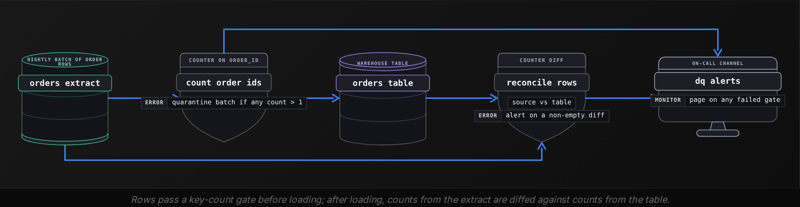

# Frequency Counting: Beginner

Ines is 20 minutes into a data engineering phone screen at Google when the interviewer pastes a list of 12 search queries into the shared editor. "Return the 3 queries that appear most often," he says. She writes a loop over a plain dict, hits a KeyError on the first new query, patches it with `.get()`, then sorts every pair and slices off the top 3. It runs. The follow-ups come quickly: why not `Counter`? Which query wins when 2 of them tie for third place? What changes if the list holds yesterday's logs instead of 12 strings? Every question tests the same knowledge: what a counting map does on each item, what each tool returns for a key it has never stored, and how much memory the map needs.


<br>

### What you will be able to do

Choose between a plain dict, defaultdict(int) and Counter, and predict what each returns for an unseen key

Solve valid-anagram and group-anagram problems in linear time and name the follow-ups that come next

Return the top K frequent elements in Python and SQL, with a tie-break you can explain

Use counts to check a pipeline batch for duplicate keys and missing rows, and to spot values nobody planned for

Predict the output or traceback of the 5 most common counting bugs


<br>

---

## dict vs Counter

Frequency counting is a single loop over the input. Each item becomes a key in a hash map, and the value stored under that key goes up by 1. With n items that is n lookups at O(1) average cost each, so the count runs in O(n) time. Memory follows d, the number of distinct keys, and ignores n: 10 million click events spread over 4 event types leave a map holding 4 entries.


<br>

### The mechanism, step by step

Watch the plain-dict version run. The line that matters is `counts.get(e, 0) + 1`: on a key's first appearance `get` supplies the 0, and every later appearance reads the stored count and writes it back plus 1.

https://github.com/user-attachments/assets/eb1b8f5f-229b-446a-9954-1c67d79afd0b

*6 events, 3 distinct keys: the map grows by distinct key, never by event.*

The last 2 lines are the part interviewers probe. Asking `get` for a key that was never counted returns the default you passed and leaves the map at 3 entries. Writing `counts["refund"]` instead raises `KeyError: 'refund'`, because a plain dict has no value for a key it does not hold and no rule for inventing one.


<br>

### Same count, 3 tools

The `collections` module adds 2 alternatives to the plain dict. On this input all 3 tools finish with identical counts. They part ways on unseen keys and on what the finished map can do.

```sql
from collections import Counter, defaultdict

events = ["click", "view", "click", "buy", "view", "click"]

dd = defaultdict(int)
for e in events:
    dd[e] += 1

c = Counter(events)

print(dict(dd))
print(c)
print(c.most_common(1))
```

| Operation | dict | defaultdict(int) | Counter |
| --- | --- | --- | --- |
| m[k] += 1, k unseen | KeyError | k becomes 1 | k becomes 1 |
| read m[k], k unseen | KeyError | returns 0 and stores k | returns 0, stores nothing |
| build from a list in 1 call | no | no | Counter(items) |
| top K by count | write it yourself | write it yourself | most_common(k) |
| a - b on 2 maps | TypeError | TypeError | positive differences only |
| isinstance(m, dict) | True | True | True |


<br>

### The read that changes the dictionary

The second row of that table causes real bugs. When a key is missing, `defaultdict(int)` calls `int()` to get 0 and stores that 0 before handing it back, so a read inserts a key. `Counter` defines `__missing__` to return 0 and store nothing. Predict the final line of this program before you look at the answer:

```sql
from collections import Counter, defaultdict

seen_dd = defaultdict(int, {"click": 3, "view": 2})
seen_c = Counter({"click": 3, "view": 2})

for status in ["click", "refund", "chargeback"]:
    if seen_dd[status] == 0:
        print("dd missing", status)
    if seen_c[status] == 0:
        print("c missing", status)

print(len(seen_dd), len(seen_c))
```

> Answer
>
> The final line is `4 2`. Both maps report refund and chargeback as missing, so the 4 lines before it alternate between dd and c. Every test of a status `seen_dd` did not hold (refund, chargeback) also stored that key with count 0. A job that reports `len(seen_dd)` as its distinct event types would claim 4 types when only 2 ever occurred.


<br>

### Choosing in the interview

| ✓ Reach for Counter when | ✗ Write the dict loop when |
| --- | --- |
| • The task is to count an iterable and read the result<br><br>• You need the top K, which most_common(k) returns in 1 call<br><br>• You compare or subtract 2 sets of counts<br><br>• Reading an unseen key must leave the map unchanged | • The interviewer asks for the count without imports<br><br>• Each count sits inside a larger record, such as {'count': 3, 'last_seen': ts}<br><br>• You are asked to walk through the O(n) mechanism line by line<br><br>• The value per key is something other than an int, such as a running sum of amounts |

> **TIP**
>
> Name the choice in 1 sentence: "I'll use Counter because unseen keys read as 0 without being stored and most_common gives me the top K; underneath it is the same dict loop, which I can write out if you prefer."


<br>

---

## Anagrams by Character Count

A pair of strings are anagrams when every character appears in both the same number of times: "listen" and "silent" use the same 6 letters exactly once each. Position plays no part, so the question reduces to comparing 2 frequency maps, which `Counter` supports directly with `==`. Equality between 2 Counters means the same keys holding the same counts.

```sql
from collections import Counter


def is_anagram(s, t):
    if len(s) != len(t):
        return False
    return Counter(s) == Counter(t)


print(is_anagram("listen", "silent"))
print(is_anagram("rat", "car"))
print(is_anagram("aab", "abb"))
```

Predict the 3 lines first. The output is `True`, `False`, `False`. Look closely at the last pair: "aab" and "abb" have the same length and the same set of letters, and only the counts differ, 2 a's against 1. A check written as `set(s) == set(t)` returns True for that pair, and it is the wrong answer interviewers plant this test case to catch.

| Approach | Time | Extra space | When to use it |
| --- | --- | --- | --- |
| Counter(s) == Counter(t) | O(n) | O(k), k distinct characters | Default answer |
| sorted(s) == sorted(t) | O(n log n) | O(n) for 2 sorted lists | Mention it, then explain the log factor |
| 1 dict: +1 per char of s, -1 per char of t, then check all zero | O(n) | O(k) | When asked to use a single map |
| list of 26 ints indexed by ord(ch) - ord('a') | O(n) | O(1), always 26 slots | Lowercase a to z only, stated up front |

The length guard runs in O(1) and returns before any map is built when the sizes differ. Equality alone would also return False for unequal lengths, so the guard saves work without changing any result; say that if the interviewer asks why it's there.


<br>

### One map that counts up and down

The third row of the table is the version to write when the interviewer asks for a single map and no imports. Characters of s add 1, characters of t subtract 1, and the strings are anagrams when every balance ends at 0.

```sql
def is_anagram_one_map(s, t):
    if len(s) != len(t):
        return False
    balance = {}
    for ch in s:
        balance[ch] = balance.get(ch, 0) + 1
    for ch in t:
        balance[ch] = balance.get(ch, 0) - 1
    return all(v == 0 for v in balance.values())


print(is_anagram_one_map("aab", "abb"))
print(is_anagram_one_map("night", "thing"))
```

It prints `False`, then `True`. For "aab" and "abb" the map finishes as `{'a': 1, 'b': -1}`: the surplus a and the missing b both show up as nonzero balances. Because the lengths match, the second loop can stop early. The first balance to drop below 0 means t holds that character more often than s does, so the function can return False on the spot. Keys whose balance reaches 0 stay in the map, which matters again when the last section looks at leftover zeros.


<br>

### The escalation path

A correct yes/no answer usually earns a harder version of the same question. The follow-ups arrive in a fairly fixed order, and each keeps the count at its center while changing what sits around it.

What comes after is_anagram

- **1. Normalize the input** *Is "Dormitory" an anagram of "dirty room"?*\
  Lowercase and drop non-letters before counting: Counter(ch for ch in s.lower() if ch.isalnum()). Ask whether case matters and whether spaces or punctuation count, because the interviewer is checking that you ask.
- **2. Group anagrams** *Bucket a list of words by anagram class*\
  Every word needs a hashable key that comes out identical for all members of its class. The rest of this section builds it.
- **3. Find anagram positions** *Every index in a long text where a rearrangement of a short pattern starts*\
  Rebuilding a Counter at each of n positions costs O(n x m) for a pattern of length m. The next tier of this track keeps 1 count updated as the start index moves forward.


<br>

### Group anagrams: choosing the key

Grouping maps a key to the list of words that share it, so every member of an anagram class has to produce the same key, and that key has to be hashable. The tempting first attempt uses the Counter itself. Predict what this raises:

```sql
from collections import Counter

groups = {}
groups[Counter("eat")] = ["eat"]
```

> Answer
>
> `TypeError: unhashable type: 'Counter'`. A Counter is a mutable dict, and Python refuses mutable keys because a key whose contents changed after insertion would sit in the wrong hash slot and never be found again. Convert the counts into an immutable value first.

| Key expression | Key for "eat" | Cost per word of length m |
| --- | --- | --- |
| "".join(sorted(w)) | 'aet' | O(m log m) |
| tuple(sorted(Counter(w).items())) | (('a', 1), ('e', 1), ('t', 1)) | O(m), plus sorting at most 26 pairs |
| frozenset(Counter(w).items()) | a frozenset of 3 (char, count) pairs | O(m) |
| tuple of 26 counts, a to z only | (1, 0, 0, 0, 1, ...) with t at slot 19 | O(m) |

The sorted string is the clearest key to say aloud, and its log factor stays small on real words: log2 of 10 is about 3, so sorting a 10-letter word costs a few dozen comparisons. The 26-count tuple only pays off on strings hundreds of characters long over a fixed alphabet. Here is the sorted-key version grouping 6 words:

https://github.com/user-attachments/assets/b33f6c18-b709-4785-83fc-8a5a6d7ecbc4

*Every word in a class sorts to the same string, so it lands in the same list.*

Output follows first-seen order, so the "aet" group prints first because "eat" arrived first, and "bat" ends up alone. `defaultdict(list)` fits grouping because every read of `groups[key]` is followed by an append, so inserting on read never leaves an empty entry behind.

> **TIP**
>
> Comparing 2 frequency maps is a multiset equality check, and it reappears in pipelines whenever 2 batches should hold the same records in any order. The pipeline section uses it to reconcile a source extract against a loaded table.


<br>

---

## Top-K Frequent Elements

Top-K frequent elements runs in 2 phases: count every item, then select the K keys with the largest counts. Counting is the O(n) loop from the first section. The choices all come in selection, and so does the question about ties that an interviewer expects you to answer precisely.

```sql
from collections import Counter

codes = ["E500", "E404", "E500", "E503", "E404", "E500", "E401", "E503"]

counts = Counter(codes)
print(counts.most_common(2))
print(counts.most_common(3))
```

Predict both lines, paying attention to the second slot. The output is `[('E500', 3), ('E404', 2)]` and then `[('E500', 3), ('E404', 2), ('E503', 2)]`. E404 and E503 both appear twice, and `most_common` breaks the tie by first appearance in the input: E404 arrived at index 1, E503 at index 3. Reverse the list and `most_common(2)` returns E503 instead, so the answer depends on row order, which most pipelines never promise.


<br>

### A tie-break you can defend

Sort on a tuple that states the rule: count descending, then code ascending. Negating the count turns the descending part into an ascending sort, so a single `sorted` call handles both keys.

```sql
from collections import Counter

codes = ["E500", "E404", "E500", "E503", "E404", "E500", "E401", "E503"]


def top_k(counts, k):
    ranked = sorted(counts.items(), key=lambda kv: (-kv[1], kv[0]))
    return ranked[:k]


print(top_k(Counter(codes), 2))
print(top_k(Counter(reversed(codes)), 2))
```

Both lines print `[('E500', 3), ('E404', 2)]`. Row order no longer reaches the result, which is the property a daily report or a unit test needs. The `reversed` call stands in for a batch whose rows arrived in a different order.


<br>

### Sort everything or keep a heap of K

Sorting all d distinct keys costs O(d log d). A min-heap capped at K entries costs O(d log K): push each key, and whenever the heap holds K + 1 entries, pop the smallest, so the heap always holds the K largest seen so far. `most_common(k)` already works this way through `heapq.nlargest`; `most_common()` with no argument sorts everything. Watch the heap run on the 4 error codes and predict which of the tied codes survives.

https://github.com/user-attachments/assets/1cb03ca9-ccef-42be-978e-10d707999267

*The heap root is the weakest survivor; anything pushed past K entries evicts it.*

It prints `[(3, 'E500'), (2, 'E503')]`. When the third push leaves 3 entries, Python compares `(2, 'E404')` with `(2, 'E503')` by their second element, finds 'E404' smaller, and evicts it. The same counts produced E404 through `most_common` and E503 through the heap, so the tie rule is a decision you make and state. When the interviewer accepts any order among ties, `most_common(k)` is fine once you have said so out loud; when they want stable output, write the sort key.

| Method | Selection cost | Tied keys resolved by |
| --- | --- | --- |
| most_common(k) | O(d log k) | first appearance in the input |
| most_common()[:k] | O(d log d) | first appearance in the input |
| sorted on (-count, key) | O(d log d) | key ascending, the rule you wrote |
| heap of (count, key) capped at k | O(d log k) | smaller key evicted first |


<br>

### When every tie at the cutoff belongs in the answer

A common follow-up drops the fixed size: return every code whose count reaches the Kth highest, so ties at the cutoff all come back and the answer can hold more than K entries. On the 8 error codes with K = 2, the second-highest count is 2, held by both E404 and E503, so the answer lists 3 codes. The method takes 2 steps: read the count at position K in the descending list of counts, then keep every key at or above it.

```sql
from collections import Counter

codes = ["E500", "E404", "E500", "E503", "E404", "E500", "E401", "E503"]


def top_k_with_ties(counts, k):
    if k <= 0 or not counts:
        return []
    ranked = sorted(counts.values(), reverse=True)
    cutoff = ranked[min(k, len(ranked)) - 1]
    return sorted(
        [(key, n) for key, n in counts.items() if n >= cutoff],
        key=lambda kv: (-kv[1], kv[0]),
    )


print(top_k_with_ties(Counter(codes), 2))
print(top_k_with_ties(Counter(codes), 10))
```

It prints `[('E500', 3), ('E404', 2), ('E503', 2)]`, then all 4 codes ending with `('E401', 1)`. The second call asks for 10 from a map of 4 keys. `min(k, len(ranked))` clamps the index, because `ranked[9]` would raise `IndexError: list index out of range`. `most_common(10)` handles the same request by returning all 4 pairs without an error, and `most_common(0)` returns an empty list. Interviewers test both edges, so state what your function returns for K = 0 and for K larger than the number of distinct keys before they ask.


<br>

### The same question in a pipeline

Top-K is the shape of most questions about what dominates a dataset: the 10 error codes behind most failed requests, the products driving yesterday's revenue, the customer IDs that own the most rows in a table. The last one matters for joins and for partitioned writes. If a single customer ID holds 30% of the rows, the worker that receives that key does 30% of the join while the others wait, and a top-K count over the join key spots it before the job runs.

In SQL, counting is a GROUP BY and selection is an ORDER BY with LIMIT. The tie problem carries over: rows tied at the cutoff can come back in any order between runs unless a second sort column breaks the tie.

```sql
SELECT
  error_code,
  COUNT(*) AS occurrences
FROM app_logs
WHERE log_date = DATE '2026-10-23'
GROUP BY error_code
ORDER BY occurrences DESC, error_code
LIMIT 10
```

> **TIP**
>
> When the data already sits in a table, run the GROUP BY where it lives. The Python version fits a batch that is already in memory inside a transform step, such as the records one task received, and both versions need the same explicit tie-break.


<br>

---

## Counting in Data Pipelines

Inside a pipeline, counting answers quality questions before bad data lands: whether the primary key is unique, whether every source row arrived, whether a column started carrying a value nobody planned for. Each check builds a frequency map and compares it with an expectation, and each one fails loudly, naming the offending keys, so the on-call engineer starts from evidence instead of a bare row count.




<br>

### Check 1: duplicate keys

```sql
from collections import Counter

orders = [
    {"order_id": 101, "status": "paid"},
    {"order_id": 102, "status": "paid"},
    {"order_id": 103, "status": "refunded"},
    {"order_id": 102, "status": "paid"},
]

id_counts = Counter(row["order_id"] for row in orders)
dupes = {oid: n for oid, n in id_counts.items() if n > 1}
print(dupes)
```

It prints {102: 2}. Comparing len(set(ids)) with len(ids) would only say that some ID repeats; the counts name which IDs and how many copies, which is what the quarantine report needs. The table-side twin is `GROUP BY` order_id `HAVING` COUNT(\*) > 1.


<br>

### Check 2: did every row arrive?

Reconciliation is the anagram comparison applied to rows: source and target should hold the same multiset of rows, in any order. Subtracting 2 Counters answers it in both directions, because `a - b` keeps only the keys where a holds more copies than b. Each row goes in as a tuple of its fields so it can be used as a key.

https://github.com/user-attachments/assets/43b5eb65-4e2a-4813-ba0d-799f79e5509a

*Each subtraction keeps only the rows one side holds more copies of.*

- **4 vs 4** — row totals, source and target
- **4** — row copies the 2 sides disagree on

The output is `[((102, 'paid'), 1), ((104, 'paid'), 1)]` for missing and `[((103, 'refunded'), 1), ((104, 'pending'), 1)]` for extra. Order 104 appears on both sides because its status changed between extract and load. Order 103 was loaded twice. A check that compares only row totals passes this batch, because a lost row and a doubled row cancel out in the totals.

The fields inside each tuple decide what the check can see. Count order_id alone and the same batch gives `{102: 1}` missing and `{103: 1}` extra, while order 104 matches on both sides and its status change slips through. Key on the ID to confirm that every order arrived; key on the full row to confirm that every order arrived unchanged. Running both separates the cases: the key-level diff names lost and doubled orders, and the row-level diff adds the edited ones.


<br>

### Check 3: values nobody planned for

```sql
from collections import Counter

statuses = ["paid", "paid", "refunded", "PAID", "paid", None, "chargeback"]
allowed = {"paid", "refunded", "pending"}

profile = Counter(statuses)
unexpected = {s: n for s, n in profile.items() if s not in allowed}
print(unexpected)
```

It prints `{'PAID': 1, None: 1, 'chargeback': 1}`, so a single pass catches a casing variant and a null alongside a new upstream status. `None` is hashable, so nulls get a key of their own and an honest count. A set difference would flag the same 3 values, while the counts tell you whether 'PAID' is 1 stray row or 40% of the batch, which decides between patching the value and stopping the load.


<br>

### What the map costs in memory

A Counter keeps 1 entry per distinct key, whatever the row count. Counting a status column across 500 million rows leaves a handful of entries; counting user IDs across the same rows leaves an entry for every user, and every entry costs a hash slot on top of the key object and its int count. Estimate d before counting, then check that d entries fit in the worker's memory. Keyed by order_id, a nightly batch of 50,000 orders makes a map of 50,000 entries, which any worker can hold; keyed by session ID, a year of clickstream can produce billions of entries. The next tier of this track covers what to do when the map outgrows memory.

> **TIP**
>
> Sort a diff before printing or asserting on it. Counter output follows counts and insertion order, so the same data arriving in a different row order prints the diff in a different order, and a test comparing printed output turns flaky.


<br>

---

## Common Counting Mistakes

These 5 bugs produce most of the wrong counts in interview answers and in production jobs, and every one of them runs without complaint on the happy-path test data. Each comes with a short program: predict its output or its traceback, then check the answer under it.


<br>

### Bug 1: incrementing a key that is not there

```sql
counts = {}
for word in ["error", "warn", "error"]:
    counts[word] += 1
print(counts)
```

> Answer
>
> `KeyError: 'error'`, raised on the first pass through the loop, so `print` never runs. `counts[word] += 1` reads the old value before writing the new one, and the read fails. `counts.get(word, 0) + 1` fixes it; so do `defaultdict(int)` and `Counter`. The traceback names the key, which tells you the first item that reached the loop.


<br>

### Bug 2: counting characters instead of words

```sql
from collections import Counter

c = Counter()
c.update("timeout")
c.update(["timeout"])
print(c["timeout"], c["t"], len(c))
```

> Answer
>
> `1 2 7`. A string is an iterable of characters, so `update("timeout")` adds t twice and i, m, e, o, u once each, 6 keys. Only the list adds the word as 1 key. The same slip appears as `Counter(line)` where `Counter(line.split())` was meant.


<br>

### Bug 3: keys that differ only in formatting

```sql
from collections import Counter

countries = ["US", "us", "US ", "CA", "ca"]
print(Counter(countries).most_common(1))
print(Counter(c.strip().upper() for c in countries).most_common(1))
```

> Answer
>
> `[('US', 1)]`, then `[('US', 3)]`. Unnormalized, all 5 strings are distinct keys with count 1, and 'US' wins the tie only by arriving first. Normalize before counting, and decide the rule (case, whitespace, nulls) as part of the answer. In a pipeline the unnormalized version splits 1 country across 3 rows of the report.


<br>

### Bug 4: zero counts left behind

```sql
from collections import Counter

stock = Counter({"apple": 2, "pear": 1})
stock.subtract(["pear"])
print(stock == Counter({"apple": 2}))
print(len(stock))

for item in stock:
    if stock[item] == 0:
        del stock[item]
```

> Answer
>
> On Python 3.10 and later: `True`, then `2`, then `RuntimeError: dictionary changed size during iteration`. `subtract` keeps pear at 0. Since 3.10, `==` treats a missing key as equal to a key holding 0, so the equality check hides the leftover zero, while iteration still sees 2 keys, as do `len` and `keys()`. On Python 3.9 the first line prints `False`, because 3.9 compares Counters as plain dicts, and an interviewer may still expect that answer. The loop raises on the step after deleting pear. Drop zeros with `stock = +stock`.

Zeros appear wherever counts go down: a decrementing anagram check, a running inventory, a reconciliation that subtracts in place. Unary plus returns a new Counter holding only positive counts, which also removes negatives left by `subtract`. A dict comprehension filtering `v > 0` works too; deleting keys from the map you are iterating never does.


<br>

### Bug 5: rows that cannot be keys

```sql
from collections import Counter

rows = [{"id": 1, "status": "paid"}, {"id": 1, "status": "paid"}]
print(Counter(rows))
```

> Answer
>
> `TypeError: unhashable type: 'dict'`. Turn each row into a tuple first: `Counter((r["id"], r["status"]) for r in rows)` prints `Counter({(1, 'paid'): 2})`. Pick fields in a fixed order, since 2 equal dicts built in different key orders give different tuples from `tuple(r.items())`.


<br>

### Test inputs that expose each bug

Each bug above survives some fixture built from clean, uniform values. The table pairs every bug with the input that hides it and the input that exposes it, which is the test case to add, or to name when the interviewer asks how you would test your function.

| Bug | Input that hides it | Input that exposes it |
| --- | --- | --- |
| 1: increment without a default | an empty list, which never enters the loop | any list with at least 1 item |
| 2: bare string passed to update | single-character items such as ["a", "b"] | multi-character words such as "timeout" |
| 3: unnormalized keys | fixtures typed in one consistent case | values with mixed case and trailing spaces |
| 4: zero counts left behind | counts that only go up | a subtraction that brings a key to 0 |
| 5: dict rows as keys | rows already built as tuples | rows parsed from JSON, which arrive as dicts |

| ✓ Do | ✗ Don't |
| --- | --- |
| • Use Counter for counting and say you can write the dict loop underneath<br><br>• Normalize keys (strip, case, null rule) before the first count<br><br>• State a tie-break and encode it as a sort key such as (-count, key)<br><br>• Turn rows into tuples of named fields before counting them<br><br>• Remove zero counts with +c before comparing or measuring len | • Increment a plain dict key without a default<br><br>• Pass a bare string where a list of words was meant<br><br>• Trust most_common to break ties the same way on reordered input<br><br>• Delete keys from a Counter while looping over it<br><br>• Read a defaultdict to test for absence when len() matters later |


<br>

---

## Putting It All Together

An online retailer loads the previous day's checkout orders into its warehouse every night, and a morning dashboard shows the 10 most frequent payment failure codes. One night the checkout service retries a batch, a new failure code appears upstream, and a few order statuses change between extract and load.

- The order_id gate counts keys with Counter and quarantines the retried batch because several IDs now have a count of 2.
- Failure codes are stripped and uppercased before counting, so 'card_declined' and 'CARD_DECLINED ' land on 1 key.
- A profile of the failure-code column against the allowed set of codes surfaces the new code with its count.
- Subtracting Counters of row tuples in both directions shows the changed statuses as 1 missing and 1 extra row each.
- The dashboard's top 10 sorts on (-count, code), so tied codes keep the same rank no matter how the rows arrived.


<br>

---

## Key Takeaways

- A frequency count is 1 pass over n items into a hash map; time is O(n) and memory grows with distinct keys, not rows.
- Counter reads unseen keys as 0 without storing them; defaultdict(int) stores them; a plain dict raises KeyError.
- Anagram checks compare 2 frequency maps, and grouping needs an immutable key such as the sorted string.
- Top-K is a count plus a selection, and in both Python and SQL the tie rule is a choice you have to state.
- In pipelines, counts find duplicate keys and unplanned values, and they show rows lost or doubled between source and target.
