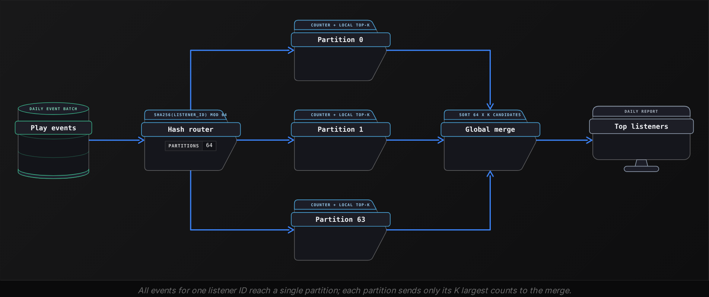

# Frequency Counting: Intermediate

Ines is 40 minutes into a data engineering loop at Spotify when the interviewer slides over a list of play events and asks for the 10 most-played tracks. She reaches for `Counter.most_common(10)` and gets a nod, then the follow-up: do it in linear time, and explain why that is possible at all. Next comes a twist on the same log: return the first listener in the stream who has played exactly once so far, updated after every event. Then the interviewer widens the lens. The real log holds 500 million distinct listener IDs. What happens to her Counter, and what would she run instead? Every question is frequency counting, and each one turns on a detail the plain version hides: count bounds, order, window bookkeeping, the shape of the counts, and memory per key.


<br>

### What you will be able to do

Implement top-K in O(n) with count-indexed buckets and say when a heap is the better choice

Return the first unique element by input position, over a string and over an unbounded stream

Maintain counts inside a fixed or variable window with O(1) work per step

Read a frequency-of-frequencies profile to tell duplicates, double loads and hot keys apart

Estimate a Counter's memory from its distinct-key count and partition the work when it won't fit


<br>

---

## O(n) Top-K with Bucket Sort

The heap solution to top-K costs O(m log k) after counting, where m is the number of distinct elements. Bucket sort removes the log factor with one observation: in a list of n items no element can appear more than n times, so every count is an integer from 1 to n. A bounded integer can be an array index, and placing something at an index needs no comparisons.


<br>

### Index the elements by their count

Count with a `Counter`, then build a list of buckets where `buckets[c]` holds every element seen exactly `c` times. Reading the buckets from the highest index down yields elements in descending frequency, and the read stops once `k` are collected. Sizing the list by `max(counts.values()) + 1` instead of `n + 1` keeps it as short as the data allows.

https://github.com/user-attachments/assets/bf6694c6-e9ad-49e8-8a78-e1b47ce5e352

*Counts index the buckets; the walk runs from bucket 4 down and stops at k = 2.*

On this log of 9 page events, `home` appears 4 times, `cart` and `search` 2 times each, and `pay` 1 time. The walk takes `home` from bucket 4, passes the empty bucket 3, and takes `cart` from bucket 2, which reaches k = 2 before `search` is read. The tie between `cart` and `search` was broken by insertion order: `cart` was counted first, so it sits first in its bucket.

> Predict before you run it
>
> - `top_k(events, 3)` returns `['home', 'cart', 'search']`: bucket 2 supplies both tied elements in insertion order.
> - `top_k(events, 10)` returns all 4 elements, because the walk empties bucket 1 and falls through to the last `return`.
> - `top_k([], 2)` raises `ValueError`: `max()` receives an empty sequence before any bucket exists.

> **TIP**
>
> Ask about ties before coding. When 2 elements share the count at position k, the bucket method returns whichever was counted first and a heap returns whichever its comparison favours, so 2 correct-looking solutions can disagree. A stated rule, such as alphabetical within a count, makes the output testable.


<br>

### What each approach costs

| Approach | After counting | Extra space | Weak spot |
| --- | --- | --- | --- |
| Sort all items | O(m log m) | O(m) | Sorts all m elements to keep k |
| Counter.most_common(k) | O(m log k) | O(k) | Approaches the sort as k nears m |
| Bucket by count | O(m + max count) | O(m + max count) | 1 huge count makes a long, mostly empty list |

`Counter.most_common(k)` is already the heap method: with an argument it calls `heapq.nlargest`, and without one it sorts every item. Counting is O(n) in all 3 rows, so the comparison is about the step after it. With 1 million distinct elements and k = 10, the heap makes on the order of 1 million × log2(10), about 3.3 million comparisons, and a full sort roughly 20 million. The bucket walk makes 1 append per distinct element plus 1 step per bucket, and compares no counts at all.

#### Saying it in one breath

Interviewers grade the explanation as much as the code. A complete version: counts are integers bounded by n, so they index a list directly; bucket c holds the elements counted c times; reading from the top bucket down gives frequency order with no comparisons; counting is O(n), filling is O(m), the walk is O(max count), and since each of those is at most n, the total is O(n).


<br>

### The one-line bug interviewers wait for

Writing the buckets as `[[]] * size` looks equivalent to the comprehension and breaks the function. Multiplying a list repeats the reference to the inner list, so every slot points at one shared list object. Predict both lines before reading on.

```sql
buckets = [[]] * 4
buckets[2].append("cart")
print(buckets)
print(buckets[0] is buckets[3])
```

It prints `[['cart'], ['cart'], ['cart'], ['cart']]`, then `True`. Inside `top_k` the same mistake puts every element into every bucket, so the walk returns the first k elements counted, whatever their frequency. `[[] for _ in range(size)]` evaluates `[]` once per slot and creates 4 separate lists.


<br>

### When the heap is the better answer

Bucket sort allocates a slot per possible count, so its memory follows the largest count while the heap's follows k. A clickstream where 1 bot fires 50 million events forces a 50-million-slot list, each slot an empty list object, to rank a few thousand pages. Keying the buckets with a `defaultdict(list)` stores only the counts that occur, at the price of sorting those counts, which are far fewer than the elements. The strong answer gives the O(n) method, then names skew as the case where `most_common(k)` or sparse buckets win.

Same pattern, other wording

- Top k frequent words in a batch of support tickets
- Sort characters by frequency, which is the bucket walk with no k
- The 5 error codes that fired most in the last hour of logs
- The k most active users, where tied users must be reported together


<br>

---

## First Unique Character

The question: given a string, return the index of the first character that appears exactly once, or -1 when none does. First means first by position in the input. A structure that drops input order, such as a set or the sorted keys of a dict, can hand back a unique character that is not the earliest one.


<br>

### Count, then scan the input again

```sql
from collections import Counter


def first_unique_index(s):
    counts = Counter(s)
    for i, ch in enumerate(s):
        if counts[ch] == 1:
            return i
    return -1


print(first_unique_index("pipeline"))
print(first_unique_index("aabb"))
print(first_unique_index(""))
```

It prints `4`, `-1`, `-1`. In `pipeline`, the letters `p`, `i` and `e` appear 2 times each, and `l` at index 4 comes before `n` at index 6. The empty string never enters the loop and falls through to `-1`. The counting pass is O(n), and the scan is O(n) in the worst case, when the unique character sits last or does not exist. Extra space is O(a) for a distinct characters, at most 26 for lowercase English.


<br>

### Scanning the Counter instead of the string

Dicts keep insertion order from Python 3.7 on, and a Counter built from a string inserts each character at its first occurrence. Looping over `counts` and returning the first key with count 1 therefore finds the same character as the scan over `s`, in at most a steps instead of n. That loop knows the character and loses the index, since the Counter stores no positions, so returning an index needs a second dict of first positions.

```sql
def first_unique_index(s):
    first_pos = {}
    counts = {}
    for i, ch in enumerate(s):
        first_pos.setdefault(ch, i)
        counts[ch] = counts.get(ch, 0) + 1
    for ch, c in counts.items():
        if c == 1:
            return first_pos[ch]
    return -1
```

On a 10-million-character string with 40 distinct characters, the dict loop makes at most 40 steps where a rescan of `s` can make up to 10 million. Both versions are O(n) overall, so the gain is a constant factor, and naming it tells the interviewer that the order guarantee behind it is understood.

| ✓ Keeps input order | ✗ Loses input order |
| --- | --- |
| • A second pass over the input<br><br>• A dict or Counter, read in insertion order<br><br>• An OrderedDict<br><br>• min(counts, key=counts.get): the earliest of the rarest keys, so check that its count is 1 before returning it | • set(s): string hashes are salted per process, so its order changes between runs<br><br>• sorted(counts): alphabetical order<br><br>• counts.most_common()[-1]: the stable descending sort puts the last-counted unique at the end, the latest one |


<br>

### The streaming version

The escalation turns the string into an unbounded stream and asks for the first unique element after every arrival. A second pass is no longer possible, so the answer has to be maintained: a count per element, plus an ordered collection holding the elements whose count is currently 1. An element joins that collection on its first arrival and leaves on its second; the answer is whatever sits at the front.

https://github.com/user-attachments/assets/8d605819-29a6-40a8-ad5b-d7a31c18b990

*The front of uniques is the answer after every arrival.*

On the stream `a b a c b d` the answers are `a a b b c c`. The 3rd arrival removes `a` and promotes `b`; the 5th removes `b` and promotes `c`; `d` joins behind `c`. Each arrival costs a constant number of dict operations, so the stream runs in O(1) amortized per element and O(d) space for d distinct elements seen.

> **TIP**
>
> Use OrderedDict for the uniques. A plain dict also keeps order, but each delete leaves a dead slot in its entry array, and `next(iter(d))` walks past every dead slot at the front until the next resize compacts them. OrderedDict links its keys in a list, so reading its first key is O(1) however many keys were deleted.

Predict `first_unique_stream(["x", "x"])` before running it. The 1st arrival makes `x` the answer; the 2nd deletes it and leaves the collection empty, so `next(iter(uniques), None)` falls back to its default and the result is `['x', None]`. Without that default, `next` raises `StopIteration` on the 2nd arrival.

In a pipeline the same structure finds the oldest record in a micro-batch whose key hasn't repeated, such as the earliest order with no correction event yet. Its `seen` dict keeps every key ever observed, so a stream that runs for months grows without limit. Production versions expire keys after a time window, which changes the question from first unique ever to first unique within the window.

> Clarify before coding
>
> - Case: are `A` and `a` 1 character? If so, count `s.casefold()`.
> - Scope: do spaces and punctuation count, or only letters?
> - Output: an index or the character itself, and the value to return when nothing is unique.


<br>

---

## Counting Inside a Sliding Window

Substring questions with a frequency condition, such as an anagram of `p` appearing, at most k distinct characters, or every required character covered, share one mechanism. A window slides over the input, and its counts change by the element entering on the right and the element leaving on the left. Recounting every window costs O(n × w) for width w; updating the counts costs O(1) per step, so the scan is O(n).

| Question | Window | Condition kept in the counts |
| --- | --- | --- |
| Every start index of an anagram of p | Fixed at len(p) | Window counts equal the counts of p |
| Longest substring with at most k distinct | Grows and shrinks | Number of keys at most k |
| Shortest substring covering every character of t | Grows and shrinks | Every count of t met or exceeded |
| Distinct users in each block of 1,000 events | Fixed at 1,000 | Number of keys |


<br>

### Fixed width: every anagram start

https://github.com/user-attachments/assets/92b140f3-2c59-45cd-b70c-dddfd515f132

*1 character enters and 1 leaves per step; zero counts are deleted.*

For `s = "cbaebabacd"` and `p = "abc"` the function returns `[0, 6]`, the windows `cba` and `bac`. Each step adds `s[right]`, and once the window would exceed 3 characters it removes `s[right - 3]`. The next example shows why the `del` runs when a count reaches 0.


<br>

### A zero count is still a key

Decrementing a Counter to 0 leaves the key in place. Predict both lines on Python 3.9.

```sql
from collections import Counter

window = Counter("ab")
window["b"] -= 1
print(window == Counter("a"))
print(len(window))
```

It prints `False`, then `2`. Before 3.10, Counter used the plain dict `==`, so `{'a': 1, 'b': 0}` and `{'a': 1}` compare unequal; 3.10 changed Counter equality to treat a missing key as 0, which makes the first line `True` there. The `len` is 2 on every version, so code that reads `len(counts)` as the distinct count is wrong on all of them. Deleting each key at 0 makes both checks right everywhere.


<br>

### Comparing windows in O(1) per step

`window == need` compares up to a entries per step for an alphabet of size a, which makes the scan O(n × a). For 26 letters that factor is a constant, and many interviewers stop there. For windows over 50,000 product IDs it is not. The fix keeps 1 integer, `matched`, counting the keys of `need` whose window count equals the needed count, and adjusts it only for the 2 keys that change each step.

```sql
from collections import Counter


def anagram_starts_fast(s, p):
    need = Counter(p)
    window = Counter()
    k = len(p)
    matched = 0
    starts = []
    for right, ch in enumerate(s):
        if ch in need:
            window[ch] += 1
            if window[ch] == need[ch]:
                matched += 1
            elif window[ch] == need[ch] + 1:
                matched -= 1
        if right >= k:
            out = s[right - k]
            if out in need:
                if window[out] == need[out]:
                    matched -= 1
                window[out] -= 1
                if window[out] == need[out]:
                    matched += 1
        if matched == len(need):
            starts.append(right - k + 1)
    return starts
```

A key moving onto its needed count adds 1 to `matched`, and a key moving off it in either direction subtracts 1. Since the window holds exactly `len(p)` characters, all keys of `need` matching means no other character can be inside, so `matched == len(need)` is the whole test. Characters outside `need` are never stored, which also caps the Counter at the size of `need`.

> **TIP**
>
> The shortest covering substring uses the same `matched` idea with met-or-exceeded in place of equal: grow the right edge until every key of `need` is covered, then shrink the left edge while coverage holds, recording the width at each shrink.


<br>

### Variable width: longest stretch with k distinct

When the condition is a limit instead of a target, the window grows on the right and shrinks on the left only while the limit is broken. Every index enters once and leaves at most once, so the inner `while` adds O(n) across the entire scan.

```sql
from collections import defaultdict


def longest_at_most_k_distinct(s, k):
    counts = defaultdict(int)
    left = best = 0
    for right, ch in enumerate(s):
        counts[ch] += 1
        while len(counts) > k:
            counts[s[left]] -= 1
            if counts[s[left]] == 0:
                del counts[s[left]]
            left += 1
        best = max(best, right - left + 1)
    return best


print(longest_at_most_k_distinct("eceba", 2))
```

It prints `3`, for `ece`. Over a list of event types, the same loop answers a pipeline question: the longest stretch of a session that touches at most 2 services. `len(counts)` equals the distinct count here only because every zero is deleted.

| ✓ Do | ✗ Don't |
| --- | --- |
| • Delete a key when its window count reaches 0<br><br>• Keep a matched counter when the alphabet is large<br><br>• Name the entering and leaving index before writing the loop | • Rebuild a Counter for every window position<br><br>• Compare Counters with == on 3.9 after decrementing<br><br>• Shrink a variable window with if where a while is needed |


<br>

---

## Frequency of Frequencies

A Counter says how often each key appears. Counting its values says how many keys appear 1 time, how many 2 times, how many 50,000 times. `Counter(counts.values())` is the entire implementation, and its output is a histogram of the data's shape that stays short however many keys exist.

- **4,471** — most distinct counts in 10M rows

The bound is arithmetic. If d different frequencies occur, the smallest total that can produce them is 1 + 2 + ... + d = d(d + 1) / 2 rows, so d grows with the square root of the row count, about the square root of 2n. A profile of n rows therefore has at most that many lines, which is short beside millions of keys but still too long for a single log line at the bound. Real batches usually sit far below it, with a few dozen distinct counts or fewer, and that's what makes the profile practical to log or attach to an alert.


<br>

### Profiling a primary key

https://github.com/user-attachments/assets/2e431db5-f1a9-4b30-a287-1939c5a573f0

*Counting the counts turns 7 keys into a 3-line profile.*

The batch holds 10 rows and 7 distinct order IDs. The profile reads 5 keys at 1 occurrence, 1 at 2 and 1 at 3, so 2 keys are duplicated and 3 rows must go before `order_id` is unique. Those 2 sums are what a dedup step and its alert need: duplicated keys measure how many entities are affected, and extra rows measure how far the row count is inflated.


<br>

### Reading the shape

| Profile shape | Likely cause | Next check |
| --- | --- | --- |
| Every key at count 1 | The key is unique | None |
| Every key at count 2 | The whole batch was loaded twice | Compare load IDs or source file names |
| Most at 1, a few at 2 | Retries or late corrections for some keys | Diff the 2 rows of each duplicated key |
| Most at 1, 1 key at 50,000 | A sentinel such as 'unknown', or a hot key | Inspect the top key before any join on it |
| Every key at the same count above 2 | An upstream join fanned out every row | Check that join for a missing key column |

A plain duplicate count can't tell these cases apart. A batch with 1,000 extra rows could hold 1,000 keys each loaded 2 times, or 1 sentinel value repeated 1,001 times. The profile shows 1,000 keys at count 2 in the first case and 1 key at count 1,001 in the second, and the fixes differ: dedup by key and load time, or repair the upstream default that wrote the sentinel.

Where the profile runs in a pipeline

- After a load: assert that every key sits at count 1 before publishing the table
- Before a join: any dimension key above count 1 multiplies the fact rows it matches
- Across days: a rising share of keys at count 2 points to a retry storm upstream
- On a join key: the largest count is the minimum number of rows the worker owning that key receives, so 1 hot key sets a floor on the slowest worker's load


<br>

### The interview form: equalize with 1 removal

A classic puzzle: a string is valid if every character appears the same number of times, or if deleting 1 character makes that true. Trying every deletion costs O(n × a). The profile cuts it to a few cases, because 1 deletion lowers exactly 1 count by 1.

```sql
from collections import Counter


def is_valid(s):
    freq = Counter(Counter(s).values())
    if len(freq) == 1:
        return True
    if len(freq) > 2:
        return False
    low, high = sorted(freq)
    if low == 1 and freq[low] == 1:
        return True
    return high == low + 1 and freq[high] == 1


print(is_valid("aabbc"))
print(is_valid("aabbcd"))
print(is_valid("aabbccc"))
```

It prints `True`, `False`, `True`. In `aabbc` the lone `c` can go and take its key with it; in `aabbccc` 1 `c` can go, bringing 3 down to 2; in `aabbcd` 2 characters sit at count 1, and no single deletion fixes both. `sorted(freq)` sorts at most 2 keys here, so everything after counting is O(1).

> **TIP**
>
> The 2 passing cases are the ones interviewers probe: 1 key at count 1 that can vanish entirely, or 1 key exactly 1 above all the others. State both before writing the conditions, then test a string with a single distinct character, which the first branch accepts.


<br>

---

## When Counter Fails at Scale

A Counter runs out of memory long before it runs out of time, and its memory is set by the number of distinct keys, whatever the row count. 10 billion rows over 2,000 error codes fit in a few hundred kilobytes. The same rows keyed by listener ID can yield hundreds of millions of keys, and each one costs a string, an int and a hash-table slot.


<br>

### What 1 distinct key costs

| Part of 1 entry | Bytes, approx. | Where the number comes from |
| --- | --- | --- |
| Key: 13-character ASCII string | 62 | 49 bytes of overhead plus 1 per character |
| Value: a count above 256 | 28 | Ints from -5 to 256 are cached and shared; larger ones up to 2\*\*30 - 1 take 28 bytes each |
| Hash table entry and index slot | 30 to 60 | 24-byte entry plus index bytes, with spare capacity after each resize |
| Total per distinct key | about 120 to 150 | 64-bit CPython; varies with key length |

- **60 GB+** — Counter for 500M listener IDs

Every row of that table can be checked with `sys.getsizeof` on a 64-bit build. A worker with 16 GB runs out somewhere above 100 million such keys, so the interview's 500 million listeners have no exact single-process answer in plain Python. Replacing string keys with integer IDs cuts the key from about 62 bytes to 28, which brings the total to around 90 to 120 bytes per key and 500 million IDs to around 45 GB or more: a constant-factor saving that leaves the growth unchanged.

Time is the smaller worry. Building a Counter from an iterable runs its counting loop in C through a helper in the `_collections` module, which is faster than a Python loop doing `counts[x] += 1`. The per-key memory multiplied by cardinality is what ends the approach.


<br>

### Chunking does not shrink the result

A frequent first proposal reads the data in chunks, counts each chunk, and adds the partial Counters with `total.update(part)`. That bounds the memory spent reading, but `total` still ends with 1 entry per distinct key, so the peak stays where it was. Chunked counting buys parallelism, because chunks can be counted on separate workers, and leaves the final memory unchanged.


<br>

### Partition the keys, then count each partition

The fix splits the key space instead of the rows. A stable hash sends every occurrence of a key to the same 1 of P partitions, so each partition's Counter holds around 1/P of the distinct keys and its counts are already final. Top-K then needs only each partition's local top-K: a key in the global top K is in the top K of its own partition, because no other partition holds any of its occurrences.

https://github.com/user-attachments/assets/dbd54122-a6f5-4689-a40f-51a41c7d75ae

*Each user ID lands in 1 partition, so local top-2 lists contain the global top 2.*

The local lists depend on where SHA-256 sends each ID, and the global answer does not: `u7` with 4 events and `u2` with 3 come out on top for any partitioning. The router cannot use Python's built-in `hash()`, because string hashing is salted per process, so 2 workers would route 1 ID to 2 different partitions.



With 64 partitions, each counter holds about 7.8 million of the 500 million IDs, around 1 GB at the table's per-key cost, and the merge sorts at most 64 × K candidates. Partitions can run on separate machines or 1 after another on the same machine, since none reads another's data.


<br>

### Pushing the count into the query engine

Where the data already sits in a distributed table, the same plan is one query. Grouping by `listener_id` makes the engine hash-partition rows by that key across its workers, count within each partition, and gather the top rows, which is the animation's design run on many machines.

```sql
SELECT
  listener_id,
  COUNT(*) AS plays
FROM play_events
WHERE event_date = DATE '2026-10-25'
GROUP BY listener_id
ORDER BY plays DESC
LIMIT 10
```

When the interviewer adds that an approximate answer is acceptable, fixed-memory approximate counters trade a bounded error for memory that stays flat as cardinality grows. Their design and error guarantees belong to the advanced lesson of this track; at this level, naming the trade is the expected answer.

> A complete scale answer
>
> - Estimate: distinct keys × around 120 to 150 bytes, compared against the worker's memory
> - Shrink the keys when the estimate is close: integer IDs in place of strings
> - Partition by a stable hash of the key when exact counts are required
> - Run it as a GROUP BY where the data already lives
> - Name approximate counting as the option when exact counts are not required


<br>

---

## Putting It All Together

A music streaming service publishes a daily chart of the 100 most-played tracks per country from a play log keyed by play_id, and its trust team flags listener accounts that replay 1 track in tight loops to inflate the chart.

- Before any ranking, the frequency-of-frequencies profile of play_id must show every key at count 1; every key at count 2 means the day's file landed twice and the chart would double every track.
- Tracks per country fit in 1 Counter, so ranking is a choice between the bucket walk and a heap; a viral track with a huge count makes the bucket list long, which favours most_common ( 100 ) .
- The loop detector is a sliding window over each listener's plays: counts per track inside the last 50 plays, flagging any track whose count crosses a threshold, with keys deleted at 0.
- The first-unique stream finds the earliest listener in the hour with a single play, the cohort a re-engagement email targets.
- Listener IDs in the hundreds of millions overflow a single Counter at 120 to 150 bytes per key, so per-listener counts are hash-partitioned by listener ID or run as a GROUP BY.


<br>

---

## Key Takeaways

- Counts are integers no larger than n, so they can index buckets: top-K becomes O(n) with no comparisons, at the cost of a list as long as the largest count.
- First unique means first by input position: rescan the input or read a dict in insertion order, and for a stream keep the current uniques in an OrderedDict.
- A window's counts change by 1 entry and 1 exit per step; delete keys at 0 so len ( ) is the distinct count and Counter equality holds on 3.9, and track matched when the alphabet is large.
- Counter ( counts . values ( ) ) compresses any number of keys into a profile of at most about the square root of 2n lines, and its shape names the duplication pattern.
- Counter memory follows distinct keys at about 120 to 150 bytes each; for exact answers beyond 1 machine, partition by a stable hash or let a GROUP BY do it.
