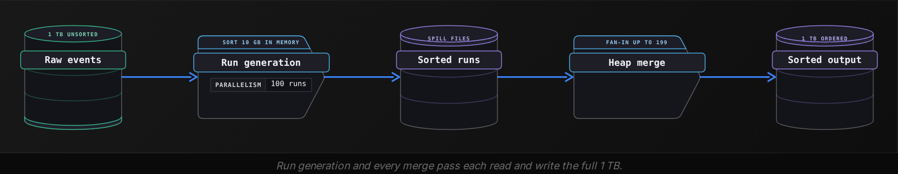
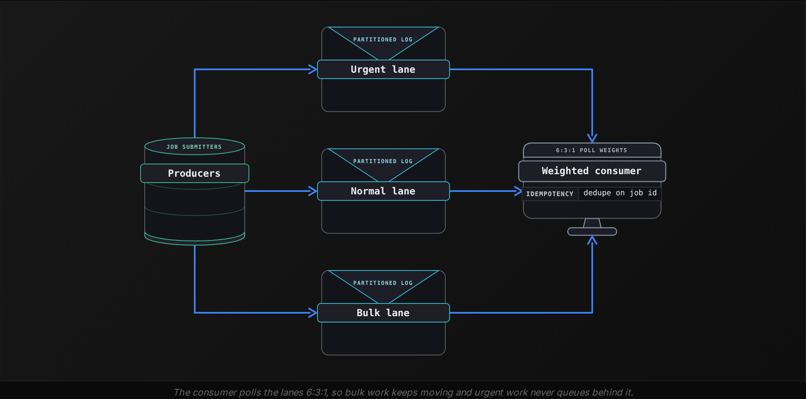
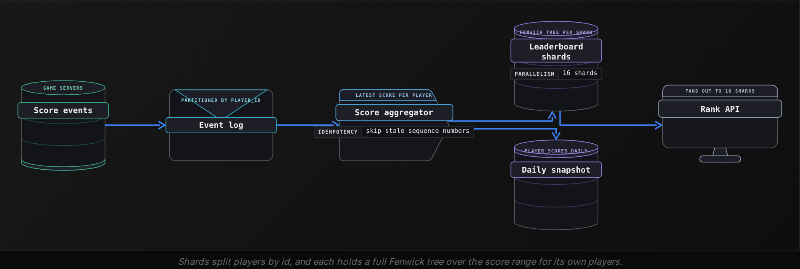

# Heap & Top-K: Advanced

Ines is 40 minutes into a data engineering loop at Uber when the interviewer writes the prompt: every city streams trip ETAs, and the operations dashboard needs the median of each city's last 10,000 trips, refreshed on every new trip, plus a live board of the 100 drivers with the most completed trips this week. She sketches 2 heaps for the median and a size-100 heap for the board. Then the follow-ups arrive. How does she evict the trip leaving the window when a heap only removes its top? What happens to memory when stale entries never surface? The ETA history outgrows RAM, so how many merge passes does sorting it take? With 2 servers each holding a heap, which one knows the global top? Every answer turns on a single structure pushed past its textbook limits.


<br>

### What you will be able to do

Implement a sliding window median with lazy deletion, prove its amortized bound, and name the input that defeats it

Choose between delete-by-value and delete-by-entry, and reprioritize a heapq queue without breaking heap order

Size runs, buffers and fan-in for an external sort, then compute its merge passes and total I/O

Explain when merged local top-K results are exact, and what CAP forces on a global priority queue

Design a real-time leaderboard by choosing its structure from the queries and the score domain


<br>

---

## Two-Heap Running Median

Interviewers rarely say "sliding window median". They ask for p50 latency over the last 10,000 requests, or an anomaly baseline a single outlier cannot drag. Both reduce to 1 contract: for a stream of n values and a window of k, emit the median after every arrival for well under the O(k) cost of touching the whole window.

| Approach | Cost per arrival | Where it breaks |
| --- | --- | --- |
| Re-sort the window | O(k log k) | At k = 10,000, roughly 133,000 comparisons per value |
| bisect insort plus list remove | O(log k) search, O(k) shift | Every insert and delete moves up to k pointers |
| 2 heaps, delete by search | O(k) | Locating the outgoing value scans a heap list |
| 2 heaps, lazy deletion | O(log n) amortized | Stale entries pile up without a compaction rule |

The bisect row deserves a fair hearing. Its O(k) term is a contiguous memory move per insert and per delete, cheap at k = 10,000, so for 1 window in 1 process it is defensible. The heaps pay off when k reaches the millions, or when 50,000 per-key windows share a process. Name your regime before writing code: it is part of the answer being scored.


<br>

### The invariant, stated in live counts

lo is a max-heap of the smaller half, stored negated, and hi is a min-heap of the larger half. After every step, 2 rules hold: every live value in the lower heap is at most every live value in the upper heap, and live(lo) equals live(hi) or exceeds it by 1. Both rules count only live entries. Deletion only records the outgoing value in the delayed Counter, so len(lo) no longer measures the lower half. Balance runs on the size counters, which change at deletion time, and no line may read lo[0] or hi[0] until pruning has popped every stale entry sitting on top.

Before playing the run, predict 2 things for the window [9, 7, 2]: the median it prints, and how many entries the 2 heaps physically store when k is 3.

https://github.com/user-attachments/assets/c1883e1f-2d5a-4489-83a8-cb68d9bfd1ea

*Window k = 3 over 6 values; stored counts physical heap entries, stale ones included.*

The median is 7, and the heaps store 5 entries for a 3-value window. Values 1 and 4 left the window while buried under 7 in `lo`, so they wait in `delayed` until they surface. At the next arrival, rebalancing moves 7 to `hi`, which exposes 4 and lets pruning pop it, while 1 stays buried. Correctness required only pruning before every read of a top, and a live top for the side test `out <= -lo[0]`, which decides which counter a departure decrements.

#### Follow-ups the same code must survive

- Duplicates: delayed counts copies, so 3 departed 7s take 3 prunes.
- Time-based windows: a deque of (timestamp, value) drives departures, and 1 arrival can evict many.
- Many evictions per arrival: rebalance in a while loop until the size rule holds.
- Per-key windows: a heap pair per key, so compaction decides memory across 50,000 keys.


<br>

### Proving the bound, and where it breaks

Amortized cost per arrival

- Each arrival pushes once and rebalancing moves at most 1 entry, so n arrivals make at most 2n pushes.
- Every pop removes an entry some push created, so pops also total at most 2n, however unevenly they cluster.
- A push or pop costs O(log S), where S is the physical heap size with stale entries included.
- S never exceeds the pushes so far, so total work is O(n log n): O(log n) amortized per arrival.

Real inputs reach the O(log n) bound. Feed the code a strictly increasing stream, such as a cumulative byte counter. Each new value lands in `hi`, each departing value is the window minimum buried deep in `lo`, and rebalancing moves the top of `hi` into `lo`, while nothing ever pops `lo`. After 10 million arrivals it stores roughly 10 million entries for a window of 10,000, and every push pays the logarithm of that size.

> Compaction restores O(log k)
>
> Count stale entries per heap. When they outnumber live ones, rebuild that heap from its live entries with heapify, an O(S) pass that discards at least S/2 stale entries, each already paid for by a push, so it adds O(1) amortized per push. Each heap stays under about twice its live size, and every operation costs O(log k).

> **TIP**
>
> For an even k, read the median as (-lo[0] + hi[0]) / 2 after pruning both heaps. An odd window never reads the top of hi, so a stale hi top surfaces only for even k, as a wrong average with no error raised.


<br>

---

## Lazy Deletion from a Heap

Lazy deletion trades exact heap size for removal of any entry in O(log n) amortized, using nothing beyond push and pop. The median window used one form of it. Production queues need a second form, plus reprioritization, plus a policy for the stale entries both forms leave behind.

| ✓ Delete by value | ✗ Delete by entry |
| --- | --- |
| • A Counter maps each value to the copies awaiting removal<br><br>• Pruning pops the top while its pending count is positive<br><br>• Fits interchangeable values, such as numbers in a median window<br><br>• Fails when 2 records share a priority but differ in identity | • A dict maps each task to its current heap entry<br><br>• Removal overwrites the entry's task field with a sentinel<br><br>• Pruning pops entries whose task field holds the sentinel<br><br>• Fits schedulers, retry queues and any update keyed by an id |


<br>

### Reprioritization as retire plus push

Changing a task's priority takes 2 operations: retire the old entry in O(1) by overwriting its task field, then push a fresh entry in O(log n). The Python heapq documentation describes this recipe in its priority queue notes. Each entry is a 3-item list: priority, a sequence number from `itertools.count`, and the task. It is a list because retirement mutates the entry in place. The unique sequence number stops every comparison before the third field, so overwriting that field cannot disturb heap order.

The run below queues 3 tasks, then moves load_users from priority 5 to 1. Predict the order of the 3 pops and how many entries the heap still stores at the end.

https://github.com/user-attachments/assets/3d7f7f8f-7e18-40ca-85ca-129cf9c14ad5

*load_users moves from priority 5 to 1; its old entry stays in the heap, retired.*

The pops return load_users at 1, load_orders at 3 and refresh_dash at 4, and the heap ends holding 1 entry with no live task: the retired [5, 1, None] entry. A peek has the same duty as pop: it must discard retired entries before reporting `pq[0]`, or it names a task that no longer exists. Live size comes from `len(finder)`, because `len(pq)` counts the retired entry too.


<br>

### The traceback the sequence number prevents

Drop the sequence number and the payload becomes the tiebreaker. Predict the result of the second push here.

```sql
import heapq

pq = []
heapq.heappush(pq, [2, {"job": "load_orders"}])
heapq.heappush(pq, [2, {"job": "load_users"}])
```

Both priorities equal 2, so list comparison moves on to the dicts, and the second push raises TypeError: '<' not supported between instances of 'dict' and 'dict'. An orderable payload hides the bug instead of raising it: with string task ids, tasks of equal priority dequeue alphabetically, a fairness rule nobody chose. With [2, next(seq), payload] every comparison stops at the sequence number, and ties run in arrival order.


<br>

### What stale entries cost, and when to compact

Each operation costs O(log S), where S counts live and retired entries together. Every update adds 1 retired entry and only pops remove them, so the ratio of updates to pops sets the heap's size. A retry scheduler that reschedules each task 1 or 2 times stays near its live size, while a queue that reprioritizes 10,000 tasks 1 million times between pops holds about 1 million entries and needs the heapify compaction from the median window.

Each update makes 1 push and each push is popped at most once, so m operations cost O(m log S). Lazy Dijkstra on a graph with V vertices and E edges, the only form heapq supports since it has no decrease-key, is this queue in action: up to E pushes, a heap of up to E entries, and O(E log E) total, which equals O(E log V) because E is at most V squared.

| Design | Update cost | Memory | Code you own |
| --- | --- | --- | --- |
| Lazy deletion on heapq | O(log S) amortized | Live plus retired entries | About 20 lines |
| Indexed heap with position map | O(log n) worst case | Live entries plus 1 position per task | Your own sift-up and sift-down |

In an interview, lead with lazy deletion and name the indexed heap as the upgrade when memory must stay near the live size or each update has a hard latency bound. The indexed heap rewrites a dict of positions on every swap, roughly doubling the work per sift, and an off-by-one there corrupts the heap with no error raised.


<br>

---

## External Sort Design at Scale

The prompt arrives as "sort 1 TB of click events by user_id on a box with 10 GB of usable memory", or "deduplicate a file larger than RAM", or "merge 100 sorted daily partitions". Each is an external sort: run generation, then a heap-driven K-way merge. The design comes down to 3 numbers, run length, fan-in and buffer size, each a tradeoff you can price.




<br>

### Run generation: size chunks by in-memory bytes

A run is a chunk read into memory, sorted and spilled. Its length should be the largest chunk whose in-memory form fits, and in Python that form dwarfs the bytes on disk. On 64-bit CPython, `sys.getsizeof` reports 64 bytes for a 3-tuple, 28 for a small int, 24 for a float and 57 for an 8-character str: about 170 bytes for a record a compact file stores in around 20, so a run holds around 8 times fewer records than file sizes predict. Divide usable memory by bytes per record measured in the representation you sort. Sizing chunks from file bytes overruns memory on the first chunk, before a single run is written.

Replacement selection, the classic heap technique for run generation, keeps a heap of M records, each tagged with a run number. It writes the smallest record of the current run, reads the next input, and tags the newcomer with the current run if it is at least the value last written, or with the next run otherwise. Knuth's analysis in The Art of Computer Programming gives an expected run length of 2M on random input, and nearly sorted input can produce a single run. Predict the runs for 9 values with room for 3.

https://github.com/user-attachments/assets/e2655afe-6c96-498f-8a3b-abccc7c0efbc

*Each heap entry is (run number, value).*

The output is [[1, 3, 5, 7, 8, 9], [2, 4, 6]]: a first run of 6 values from memory for 3, where plain chunking writes 3 runs of 3. The heap entry is (run, value), so tuple order sorts by run first, and every record tagged for the next run waits behind all of the current run's records. Halving the run count can remove a whole merge pass, which at 1 TB is 2 TB of I/O saved.


<br>

### Fan-in, buffers and the pass count

The merge holds 1 input buffer per run plus 1 output buffer, so fan-in is memory divided by buffer size, minus 1. Each pass divides the run count by the fan-in, rounding up, and reads and writes the full dataset once. With p merge passes over N bytes, total I/O is 2N(1 + p), counting run generation.

```sql
import math


def merge_passes(runs, fan_in):
    passes = 0
    while runs > 1:
        runs = math.ceil(runs / fan_in)
        passes += 1
    return passes


def plan(data_mb, memory_mb, buffer_mb):
    runs = math.ceil(data_mb / memory_mb)
    fan_in = memory_mb // buffer_mb - 1
    passes = merge_passes(runs, fan_in)
    total_io_mb = 2 * data_mb * (1 + passes)
    return runs, fan_in, passes, total_io_mb


print(plan(1_000_000, 10_000, 50))
print(plan(1_000_000, 1_000, 50))
```

The 2 calls print (100, 199, 1, 4000000) and (1000, 19, 3, 8000000), rows 1 and 3 of the table, which adds a larger and a smaller buffer.

| Memory | Buffer per run | Fan-in | Runs | Merge passes | Total I/O |
| --- | --- | --- | --- | --- | --- |
| 10 GB | 50 MB | 199 | 100 | 1 | 4 TB |
| 10 GB | 500 MB | 19 | 100 | 2 | 6 TB |
| 1 GB | 50 MB | 19 | 1,000 | 3 | 8 TB |
| 1 GB | 5 MB | 199 | 1,000 | 2 | 6 TB |

Smaller buffers raise fan-in and cut passes, but every refill becomes a separate read. A pass over 1 TB in 5 MB reads issues 200,000 requests; in 50 MB reads, 20,000. On a disk with millisecond seeks, or an object store with per-request latency, the 5 MB plan on the 1 GB box can lose to the 50 MB plan despite needing 1 pass fewer. Choose the buffer so a refill's transfer time dominates its request latency, then accept the fan-in that leaves.

> The heap's CPU cost ignores fan-in
>
> A merge of fan-in k spends about log2 k comparisons per record per pass, and it takes about log_k R passes to reduce R runs to 1. Multiply them and each record costs about log2 R comparisons whatever k you pick, so CPU is set by the run count and fan-in is purely an I/O decision.

- **~6.6** — comparisons per record at 100 runs

> **TIP**
>
> First ask whether the consumer needs order at all: a top 100 over 1 TB needs 1 pass and a size-100 heap, and a GROUP BY needs hash partitioning. Sort when the output must be ordered, merge-joined or deduplicated in key order.


<br>

---

## Distributed Priority Queues

Spread a priority queue across 20 machines and the heap stops being the hard part: no single process sees every entry, so the global minimum becomes a question of agreement. Interviewers phrase it as trending hashtags across a cluster, urgent jobs that jump the queue, or session timeouts firing in event-time order, and each phrasing answers who owns the top differently.

| Design | Who owns the top | Order guarantee | Main cost |
| --- | --- | --- | --- |
| Single leader heap | 1 leader node | Exact and global | Throughput capped at the leader's pop rate |
| Priority lanes on a log | No node; consumers weight the lanes | FIFO per lane, approximate across lanes | Extra topics and poll-weight tuning |
| Per-partition heaps plus a merge | Each partition, for its own keys | Exact per key, exact top-K after the merge | Key-based routing and a merge stage |


<br>

### Local top-K merges are exact only for partitioned keys

The standard plan computes a top-K on each partition, ships the small lists to 1 place and merges them, the K-way merge at cluster scale. It is correct under 1 condition: each key's full score lives on exactly 1 partition. In the run below, key z is split across 2 partitions with 8 on each. Predict which keys the merge reports as the top 2, and which keys truly lead.

https://github.com/user-attachments/assets/2155df62-1c01-499f-9b84-7f4fa7bb5d2a

*Key z holds 8 on each partition.*

Each partition reports its local top 2 honestly, and the merge returns x and w at 10. The true leader is z at 16, which neither partition ranked because each held only 8. The fix routes every event by a hash of its key before counting, so each key's total is final where it is computed. Then the union of local lists contains the global answer: a key in the global top K is beaten by fewer than K keys anywhere, so by fewer than K on its own partition, which places it in that partition's local top K.


<br>

### Priority on a partitioned log

A partitioned log delivers each partition in append order, so an urgent message appended behind 2 million queued messages waits behind all of them, a priority inversion built into the storage format. Designs that need priority split the log into lanes, a topic per priority tier, with consumers polling the urgent lane first and the lower lanes on weighted shares so they never starve. Order is FIFO within a lane and approximate across lanes, bounded by the work a consumer has in flight when urgent messages arrive.




<br>

### Timers: a heap inside every stream task

Event-time stream processors keep a priority queue of timers in each parallel task, ordered by timestamp. A session window registers a timer at its last event plus the gap, and the task pops and fires it once the watermark passes that timestamp. The watermark is itself a minimum: a task reading 4 partitions advances only to the smallest of their 4 watermarks, so 1 idle partition holds back every timer in the task. Timers are keyed state, checkpointed with the task, so millions of open sessions put millions of timers in each checkpoint.


<br>

### What CAP forces on a global priority queue

CAP states that when a network partition splits a replicated system, it must choose between consistency, where every read reflects the latest write, and availability, where every reachable node keeps answering. A strict global priority queue promises that each pop returns the current minimum and that no 2 consumers receive the same entry. Both are consistency promises: a pop is a read-modify-write every replica must agree on, which takes a consensus round per pop or a single leader owning the heap. On a split, the side cut off from the leader must refuse pops.

Most pipelines choose availability, letting every partition's local heap keep serving pops through a split, and engineer around the cost: idempotent consumers absorb duplicates, lanes bound priority inversion, and routing each key to 1 partition keeps per-key order exact while global order stays approximate. Strict global priority is worth its cost where a duplicate pop becomes a real-world error, such as assigning a fixed pool of GPUs or seats, where 2 consumers popping the same slot is a double booking.


<br>

---

## Design a Real-Time Leaderboard

A game studio wants a live leaderboard: 50 million players, peaks of 20,000 score updates per second, and 3 queries: the global top 100, any player's exact rank, and the 10 players around that rank. Each candidate structure answers some of those queries and fails the rest, so the query list and the score domain pick the structure.

| Structure | Update | Top 100 | Rank of a player | Breaks when |
| --- | --- | --- | --- | --- |
| Size-100 min-heap plus dict | O(log 100) | Sort 100 entries | Unsupported | A top-100 score drops |
| Sorted list with bisect | O(n) shift | Slice the end | O(log n) | Each shift moves up to 50 million entries |
| Fenwick tree over score values | O(log S) | Walk the highest buckets | O(log S) | Scores are unbounded floats |
| Order-statistic tree or skip list | O(log n) | O(log n + 100) | O(log n) | Python ships none, so you build one |

The heap covers top-K and nothing else, and only while scores never fall: when a player inside the top 100 loses points, the heap holds no record of who was 101st, and recovering means rescanning 50 million players. Seasonal resets and decaying scores hit that case daily, so in practice the heap is a cache in front of a structure that can rank.


<br>

### Rank in O(log S) with a Fenwick tree

When scores are integers in a known range, rank becomes counting: a player's rank is 1 plus the number of players with a strictly higher score. A Fenwick tree keeps counts per score so that "how many players score at most s" takes about log2 S steps, where S is the size of the score range, and the count above s is the total minus that. An update is a decrement at the old score and an increment at the new one. Predict the 2 lines of ranks, before and after bo jumps from 3 to 8.

https://github.com/user-attachments/assets/0ae0a462-5be4-4c7d-a4a9-e0c82cad8394

*Scores run 1 to 8; tree[i] counts players in a range of scores ending at i.*

The first line reads 2 4 1 2: ana and di tie at 5 and share rank 2, cy leads at 7, and bo sits 4th. After the jump it reads 1 2 3 for bo, cy and ana. The final tree ends in 4 at index 8, the node covering every score from 1 to 8. Ties share a rank here; a board that must order them adds a second key, such as when the player reached the score, and each bucket becomes an ordered list.

Counts give ranks but no names, so each score bucket also keeps its player_ids, ordered by `reached_at` when ties must break. The top 100 walks buckets down from `MAX_SCORE`, collecting ids until it has 100: O(100) plus 1 step per empty bucket passed. The 10 players around rank r start from the lowest score s where `count_at_most(s) >= total - r + 1`, which the standard Fenwick descent finds in about log2 S steps, testing 1 index bit at a time from the highest. Reading 5 ids each side from that bucket and its neighbors costs O(log S + 10). Each shard serves its top 100 this way to the global merge.

- **20** — max steps per update, scores up to 1M
- **4 MB** — packed 32-bit counters for 1M scores

Each score change is 2 tree updates, so 20,000 changes per second cost at most 800,000 counter writes per second, 50,000 per shard across 16 shards. That load is small, so the shard count is set by memory headroom and failover before CPU.


<br>

### Scaling past a single machine



Sharding by player keeps each update local, since a player's old and new score sit on the same shard. The global top 100 merges each shard's top 100, exact because every player lives on 1 shard. A global rank fans out: each of the 16 shards counts its players above s, the API sums the counts, and rank latency is the slowest shard's. Sharding by score range makes rank cheaper, but an update crossing a range boundary touches 2 shards, and the most active players crowd the top shard.


<br>

### Reconcile the stream against the table

The live board is derived state, and derived state drifts: a replayed partition, a skipped duplicate check, a shard restored from an old checkpoint. A nightly job recomputes the top 100 per region from the daily snapshot and diffs it against the live board. The query below is that reference. Its ROW_NUMBER breaks ties by `reached_at`, matching a board that orders each bucket that way; a board where ties share a rank needs `RANK()` in its place, or every tie diffs as a false mismatch.

```sql
SELECT
  region,
  board_rank,
  player_id,
  score
FROM (
  SELECT
    region,
    player_id,
    score,
    ROW_NUMBER() OVER (
      PARTITION BY region
      ORDER BY score DESC, reached_at
    ) AS board_rank
  FROM player_scores_daily
  WHERE ds = '2026-10-25'
) AS ranked
WHERE board_rank <= 100
ORDER BY region, board_rank
```

Choosing by regime

- Top-K only, scores that only rise: a size-K min-heap plus a membership dict.
- Exact rank, bounded integer scores: a Fenwick tree, sharded by player.
- Exact rank, arbitrary scores: an order-statistic tree or a skip list with span counts.
- Approximate rank at hundreds of millions of players: the Fenwick tree with coarser score buckets.


<br>

---

## Putting It All Together

A ride-hailing marketplace runs a live driver-quality dashboard: for each of 600 cities it shows the median pickup delay over the last 10,000 trips, a board of the 100 drivers with the most completed trips this week alongside each driver's own rank in the app, and a nightly audit that sorts the week's 1 TB trip log by driver to recompute every number.

- Each city's pickup median is a two-heap window with lazy deletion, and because delays drift upward through rush hour, the compaction rule keeps 600 heap pairs near their live size.
- Trip events arrive through a log partitioned by city, so each city's median window lives on 1 stream task; the weekly trip counts behind the driver board close on event time, when the watermark passes the week's end and the week's timer fires.
- Driver ranks come from a Fenwick tree over completed-trip counts on each shard, sharded by driver id, so the top 100 is an exact merge of shard top lists.
- The nightly audit is an external sort: 1 TB with 10 GB of memory and 50 MB buffers takes 1 merge pass and 4 TB of I/O, and its output is diffed against the live board.
- A driver going offline reprioritizes dispatch entries by retiring and re-pushing them, the same lazy deletion the median uses, applied by identity instead of by value.


<br>

---

## Key Takeaways

- Lazy deletion removes any heap entry in O(log n) amortized, provided pruning runs before every read of a top.
- A lazy two-heap median balances on live counters, because len() counts stale entries too.
- Monotonic input buries stale entries forever; rebuilding with heapify once stale entries outnumber live ones restores O(log k).
- Reprioritize by retiring the old entry and pushing a new one, with a sequence number so comparisons never reach the payload.
- External sort cost is passes: fan-in is memory over buffer minus 1, I/O is 2N(1 + p), and CPU stays near log2 R per record whatever the fan-in.
- Merged local top-K lists are exact only when each key lives on 1 partition.
- Strict global priority is a consistency property; most pipelines choose availability with idempotent consumers and priority lanes.
- Choose a leaderboard structure from its queries: a heap for top-K with rising scores, a Fenwick tree for bounded integer rank, an order-statistic tree otherwise.
