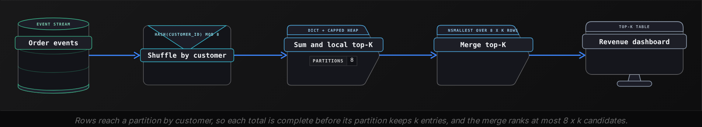

# Heap & Top-K: Beginner

Ilse is 40 minutes into a data engineering interview at Spotify, a company that publishes daily charts of the most-streamed songs in each country. The interviewer hands her a list of per-track play totals and asks for the 10 most-played track IDs. Ilse sorts the list in descending order and slices off the first 10, which works. Then comes the follow-up: the totals arrive as a stream, far too many to hold in memory, and the answer must update as rows land. Sorting needs every row at once, so her answer collapses. The interviewer wants one idea here: keep a min-heap of 10 entries, compare each new total against its root, and let the rest pass straight through. This lesson builds that idea from the first `heapq` call to the Kth-largest question, tuple tie-breaking and the pipeline jobs where top-K shows up every day.


<br>

### What you will be able to do

Predict the list after heapify or heappush, and the return value or traceback from heappop and heapreplace

Write a capped min-heap that returns the top K in O(n log k) time and O(k) memory

Solve Kth largest with a heap and with quickselect, and say which one fits a given input

Build tuple entries that never compare payloads and break ties in the order a spec requires

Apply top-K per key or per group, and merge it across partitions without producing silently wrong rankings


<br>

---

## heapq Module Fundamentals

Python's heapq module stores a heap inside an ordinary list. Every function takes the list as its first argument, and the order of the list's elements is the structure. The rule those functions maintain is the **heap invariant**: for every index i, heap[i] <= heap[2\*i + 1] holds, and so does heap[i] <= heap[2\*i + 2], wherever those children exist. That rule guarantees the smallest value sits at heap[0] and promises nothing about how the remaining values are ordered.


<br>

### The list is a tree laid flat

Read the list as a binary tree stored level by level. Index 0 is the root, the children of index 1 sit at 3 and 4, and the children of index 2 sit at 5 and 6. A value is only ever compared with its own parent and children, so a valid heap can print in an order that looks unsorted. Run `heapify` on `[5, 3, 8, 1, 9, 2]`, take the minimum off, then push a new value:

https://github.com/user-attachments/assets/1107c5ea-df61-4d86-a586-977dbd178379

*The stage redraws nums after every call, so you can see which positions move.*

`heapify` rearranges the list in place to `[1, 3, 2, 5, 9, 8]` and returns `None`. The 2 at index 2 comes before the 5 at index 3, which is legal because index 3 is a child of index 1. `heappop` returns the 1. To fill the gap it puts the last element, the 8, at the root, and a sift-down swaps it past its smaller child, leaving `[2, 3, 8, 5, 9]`. `heappush` appends the 4 and sifts it up past its parent 8, giving `[2, 3, 4, 5, 9, 8]`. Each of those 2 calls walks a single root-to-leaf path, which is why each costs O(log n).

| Call | What it does | Cost |
| --- | --- | --- |
| heapq.heapify(xs) | Rearranges xs into a heap in place | O(n) |
| heapq.heappush(h, x) | Appends x and sifts it up | O(log n) |
| heapq.heappop(h) | Removes and returns the smallest | O(log n) |
| h[0] | Reads the smallest without removing it | O(1) |
| heapq.heappushpop(h, x) | Pushes x, then pops the smallest | O(log n) |
| heapq.heapreplace(h, x) | Pops the smallest, then pushes x | O(log n) |
| Repeated heappush, n times | Builds a heap one value at a time | O(n log n) |

Building with `heapify` costs O(n), less than the O(n log n) of n separate pushes, because it sifts down from the last parent backward. Half the positions are leaves and never move, a quarter can drop at most 1 level, an eighth at most 2, and so on. That series adds up to at most about n level moves for the whole build.


<br>

### Push-pop and replace run in opposite order

The 2 combined calls have similar names and different results. `heappushpop` pushes first, so a new item smaller than the root comes straight back and the heap is untouched. `heapreplace` pops first, so the old root always leaves, even when the new item is smaller.

```sql
import heapq

a = [2, 5, 7]
print(heapq.heappushpop(a, 1), a)

b = [2, 5, 7]
print(heapq.heapreplace(b, 1), b)
```

Either call can be the step of a top-K loop once the heap holds k items: `heapreplace` behind an `if x > h[0]` guard, or `heappushpop` alone, which runs that comparison internally. The bug to avoid is `heapreplace` with no guard, which evicts the root even when the new value is worse.


<br>

### A max-heap by negation

`heapq` only builds min-heaps. To pop the largest value first, store every number negated, so the largest original becomes the smallest stored value, then negate again whenever a value comes out.

```sql
import heapq

scores = [40, 75, 12, 90]
max_heap = [-s for s in scores]
heapq.heapify(max_heap)

print(-max_heap[0])
print(-heapq.heappop(max_heap))
print(-max_heap[0])
```

> **TIP**
>
> Questions about the smallest or earliest value fit heapq as it stands, and lowest is the same question. Largest or highest calls for negation, as does latest, so decide before the first push: a heap that mixes negated and raw values is corrupted and raises no error.


<br>

### 2 failures to predict

Popping an empty heap raises `IndexError: index out of range`, the message from the C implementation of `heappop`. Reading `h[0]` on an empty list raises the list's own wording, `IndexError: list index out of range`. The second failure raises nothing at all: calling `heappush` or `heappop` on a list that was never heapified quietly returns the wrong value.

```sql
import heapq

h = [5, 1, 3]
heapq.heappush(h, 4)
print(heapq.heappop(h))
```


> What to say out loud
>
> - heapq keeps a min-heap in a plain list: h[0] is the minimum, everything else is partially ordered.
> - heapify is O(n); building with n pushes is O(n log n); push and pop are O(log n).
> - For a max-heap, negate on the way in and on the way out.
> - heapreplace pops first, heappushpop pushes first.


<br>

---

## Top-K Largest and Smallest

Every top-K question has the same shape: n values go in, the k best come out, and k is far smaller than n. Sorting answers it in O(n log n) time while holding all n values. The heap answer runs in O(n log k) time and holds k values. The idea behind it reads backwards at first: to keep the k largest, use a min-heap.


<br>

### The root is the bar to clear

Cap a min-heap at k values. Its root is the smallest value being kept, so it is the weakest member of the current top-K, and a newcomer only deserves a place if it beats that member. A newcomer that wins evicts the root. A newcomer that loses cannot be in the top-K and is dropped after a single comparison. A max-heap would put the strongest kept value at the root, the one value the loop must never evict, and leave the weakest buried where no single comparison can reach it.

https://github.com/user-attachments/assets/72f74a61-8b92-4e67-9027-9b56b21e4d12

*Each printed line shows the incoming value and the heap after it is handled.*

Watch the root. After 4 and 1 arrive, then 7, the root is 1, and the value 3 evicts it. Next, 8 evicts the 3, the 2 loses to a root of 4, and 9 evicts the 4. The surviving heap `[7, 8, 9]` happens to be ascending, but heap order only promises the root, so the function sorts the survivors before returning `[9, 8, 7]`.


<br>

### What the heap saves

Sorting pays about log2 n comparisons for every value. The heap pays about log2 k for each value that gets in and a single comparison for each value that does not. In a pipeline the memory difference matters more: the heap needs k slots however long the stream runs, while a sort needs the entire input in memory at once. With n = 10,000,000 and k = 10:

- **~232M** — comparisons to sort 10M values
- **~33M** — worst case for a size-10 heap
- **~138** — expected evictions on shuffled input

*The heap's worst case arrives when values come in ascending order, so every one evicts the root. On shuffled input, most values lose their first comparison and cost a single step each.*


<br>

### Smallest K is the mirror image

To keep the k smallest, the root must be the largest kept value, so cap a max-heap at k by storing negated values. A newcomer enters when its negation beats the root, which means the original is smaller than the largest value kept.

```sql
import heapq

def bottom_k(stream, k):
    heap = []
    for x in stream:
        if len(heap) < k:
            heapq.heappush(heap, -x)
        elif -x > heap[0]:
            heapq.heapreplace(heap, -x)
    return sorted(-v for v in heap)

print(bottom_k([4, 1, 7, 3, 8, 2, 9], 3))
```


<br>

### The library version and its edge cases

heapq.nlargest(k, iterable, key=None) and heapq.nsmallest(k, iterable, key=None) implement this pattern and return their results already sorted. The Python documentation adds 2 rules of thumb: max() and min() are more efficient when k = 1, and sorted() is more efficient for larger k. In an interview, write the loop to show the mechanism, then name nlargest as the call you would use in production.

Edge cases are where hand-written versions fail. With k = 0, the loop in the animation skips the push branch, compares the first value against `heap[0]` on an empty list and raises `IndexError: list index out of range`. With k larger than the input, the heap never fills and every value comes back. A guard brings the hand-written version in line with the library:

```sql
import heapq

def top_k(stream, k):
    if k <= 0:
        return []
    heap = []
    for x in stream:
        if len(heap) < k:
            heapq.heappush(heap, x)
        elif x > heap[0]:
            heapq.heapreplace(heap, x)
    return sorted(heap, reverse=True)

data = [4, 1, 7, 3, 8, 2, 9]
print(top_k(data, 0), heapq.nlargest(0, data))
print(top_k(data, 20) == heapq.nlargest(20, data))
```


<br>

### Ranking by a computed key

When the ranking value is computed, pass it as `key` instead of building tuples by hand. For the k points closest to the origin, the key is the squared distance, which ranks points in the same order as distance and skips the square root.

```sql
import heapq

points = [(3, 4), (1, 1), (-2, 0), (5, -1), (0, 2)]
closest = heapq.nsmallest(2, points, key=lambda p: p[0] ** 2 + p[1] ** 2)
print(closest)
```

Other ways interviewers phrase top-K

- Return the 10 most active users from per-user event counts
- Find the 5 slowest API calls in a request log
- Return the k points closest to the origin, ranked by distance
- Report the 3 warehouses with the lowest stock of an item
- Keep a running top 100 of scores while new scores arrive

> What to say out loud
>
> - Min-heap capped at k for the largest, max-heap capped at k for the smallest.
> - O(n log k) time and O(k) memory in a single pass, so it runs on a stream.
> - Sort the heap before returning it, because heap order only guarantees the root.


<br>

---

## Kth Largest Element, Two Ways

The Kth largest question asks for a single value: the element at position k if the list were sorted in descending order. Duplicates occupy separate positions, so in [3, 2, 3, 1, 2, 4, 5, 5, 6] the 4th largest is 4, reached through 6, 5, 5, 4. Ask about duplicates in the first minute, because the 4th largest *distinct* value is a different question, and its answer is 3.


<br>

### Way 1: the capped heap's root is the answer

The top-K heap from the previous section already holds this answer. Once every value has passed through a min-heap capped at k, the root is the smallest of the k largest values, which is the Kth largest by definition. Seeding the heap with `heapify` on the first k values replaces k pushes with a single O(k) build.

```sql
import heapq

def kth_largest_heap(nums, k):
    if not 1 <= k <= len(nums):
        raise ValueError("k out of range")
    heap = nums[:k]
    heapq.heapify(heap)
    for x in nums[k:]:
        if x > heap[0]:
            heapq.heapreplace(heap, x)
    return heap[0]

print(kth_largest_heap([3, 2, 3, 1, 2, 4, 5, 5, 6], 4))
```

Without the range check, k = 20 on these 9 values builds a heap of all 9 and returns their minimum, 1, with no error. A wrong number that looks plausible is harder to catch than a traceback, so raise.


<br>

### Way 2: quickselect partitions in place

Quickselect borrows the partition step from quicksort. Pick a pivot, move every smaller value to its left, and drop the pivot into the slot it would occupy in ascending order. If that slot is index `n - k`, the pivot is the answer. Otherwise the answer lies on a single side, so the loop discards the other side and partitions again, touching a shrinking range each pass.

https://github.com/user-attachments/assets/72a73be4-9369-4a57-a783-6b938fa98f8b

*Each pass prints the pivot, the index it landed on, and the list after partitioning.*

The target index is `6 - 2 = 4`. The first pass uses pivot 4, which lands at index 3, so the answer lies to the right and `lo` moves to 4. The second pass partitions only indexes 4 and 5: pivot 5 lands at index 4, which is the target, and the function returns 5. The list `data` came back reordered as `[3, 2, 1, 4, 5, 6]`, because quickselect mutates its input; pass `nums[:]` when the caller still needs the original order.

Choosing the last element as pivot keeps the animation repeatable and creates a weakness. On input already sorted ascending, the last element is always the largest in range, so each pass removes a single element whenever the target lies to its left, and the work grows to O(n^2). Swapping a random element into position `hi` before each pass, chosen with `random.randint(lo, hi)`, makes that pattern vanishingly unlikely and bounds the expected cost at about 3.4n comparisons for any k.


<br>

### Choosing between them

| Property | Size-k heap | Quickselect | Sort and index |
| --- | --- | --- | --- |
| Time | O(n log k) | O(n) average, O(n^2) worst | O(n log n) |
| Extra memory | O(k) | O(1), in place | O(n) for sorted() |
| Works on a stream | Yes, in one pass | No, needs all n values | No, needs all n values |
| Changes the input | No | Yes, reorders it | No, with sorted() |
| New value arrives later | One O(log k) update | Rerun on everything | Re-sort everything |

*The heap's O(k) is all the memory it ever needs. Quickselect's O(1) assumes all n values are already loaded, which a stream never provides.*

Put numbers on it. With n = 1,000,000 and k = 100, the heap costs about n log2 k, roughly 6.6 million comparisons in the worst case, and holds 100 values. Quickselect expects at most about 3.4 million comparisons but needs all 1,000,000 values in memory and permission to reorder them. Values already sitting in a Python list on one machine favor quickselect. Values arriving from a stream, or a k tiny next to n, favor the heap. For a single query on a short list, `sorted(nums, reverse=True)[k - 1]` is the readable choice and a fine answer.

> What to say out loud
>
> - Confirm whether duplicates count before writing any code.
> - Heap: O(n log k) time, O(k) memory, works on a stream, leaves the input alone.
> - Quickselect: O(n) average with a random pivot, O(n^2) worst case, reorders the list.
> - If asked for a linear worst case, name median of medians and its large constant.


<br>

---

## Tie-Breaking in Tuple Heaps

Real heap entries carry data: a priority plus the job or row it belongs to. The usual encoding is a tuple, (priority, payload), which works because tuples compare position by position. Python compares the first elements, and only when they are equal does it move on to the second. That second comparison is where tuple heaps break.


<br>

### When the payload gets compared

Push 2 jobs that share a priority and carry dict payloads. The first push compares nothing. The second push sifts the new entry up toward its parent, the priorities tie at 2, and Python moves on to compare the 2 dicts with `<`.

```sql
import heapq

jobs = []
heapq.heappush(jobs, (2, {"name": "load_orders"}))
heapq.heappush(jobs, (2, {"name": "load_events"}))
```

The crash depends on the data. A test suite with distinct priorities never reaches the payload comparison, and the job fails in production on the first day 2 entries share a priority. Equal payloads hide it further: if both dicts held the same keys and values, the tuples would compare equal at that position and no error would appear. Dicts fail this way, and so do objects without `__lt__` and a `None` sitting next to a number.


<br>

### The fix: a sequence number in the middle

Put a unique, comparable value between the priority and the payload. A counter from `itertools.count()` is the standard choice. Priorities decide first, the counter decides every tie, and since no 2 entries share a counter value, the comparison never reaches the payload.

```sql
import heapq
import itertools

seq = itertools.count()
jobs = []
for priority, name in [(2, "load_orders"), (1, "load_users"), (2, "load_events")]:
    heapq.heappush(jobs, (priority, next(seq), {"name": name}))

while jobs:
    priority, _, job = heapq.heappop(jobs)
    print(priority, job["name"])
```

The counter also settles the order of ties. Entries with equal priority leave in the order they arrived, first in, first out, which is what a job queue needs. The heapq documentation puts the count between the priority and the task in its own priority queue example.

#### A record type that compares chosen fields

When entries grow past 3 fields, the documentation's other suggestion is a dataclass. With `order=True`, instances compare as tuples of their fields, and `field(compare=False)` drops the payload from that tuple.

```sql
import heapq
import itertools
from dataclasses import dataclass, field

@dataclass(order=True)
class Job:
    priority: int
    seq: int
    payload: dict = field(compare=False)

counter = itertools.count()
jobs = []
heapq.heappush(jobs, Job(2, next(counter), {"name": "load_orders"}))
heapq.heappush(jobs, Job(2, next(counter), {"name": "load_events"}))
print(heapq.heappop(jobs).payload["name"])
```


<br>

### Ties broken in a required order

Sometimes the tie-break is part of the spec: return the most frequent event types with the highest count first, breaking ties alphabetically. Negate the count and keep the name as the second element. In a min-heap, `(-5, 'view')` comes out before `(-3, 'click')`, and `(-3, 'click')` before `(-3, 'share')`, because 'click' sorts before 'share'.

https://github.com/user-attachments/assets/738fd7dd-c050-4add-8e0d-bb9c67749898

*The tie between click and share is settled by comparing the 2 strings.*

The pushes produce `[(-5, 'view'), (-3, 'click'), (-3, 'share'), (-1, 'like')]`, and the 3 pops return view, then click, then share. Negation flips the count order while the string keeps its natural order, which is the exact combination the spec asks for.


<br>

### Tie direction flips in a capped heap

The heap above held every key. To keep only k, the root must be the weakest kept entry, and under this spec the weakest is the lowest count with the alphabetically last name. Plain `(count, word)` tuples in a min-heap order counts correctly and names backwards. With k = 2:

```sql
import heapq

counts = {"view": 5, "click": 3, "share": 3, "like": 1}
heap = []
for word, c in counts.items():
    entry = (c, word)
    if len(heap) < 2:
        heapq.heappush(heap, entry)
    elif entry > heap[0]:
        heapq.heapreplace(heap, entry)
print(sorted(heap, reverse=True))
```

When share arrives, `(3, 'share') > (3, 'click')` is true, so click is evicted even though it wins the tie. A string has no negative, so there is no one-character fix. Hand the full ordering to `nsmallest` as a key instead; the documentation defines it as equivalent to `sorted(iterable, key=key)[:n]`, ties included:

```sql
import heapq

counts = {"view": 5, "click": 3, "share": 3, "like": 1}
top = heapq.nsmallest(2, counts.items(), key=lambda kv: (-kv[1], kv[0]))
print(top)
```

| ✓ Do | ✗ Don't |
| --- | --- |
| • Use (priority, next(counter), payload) for any heap of records<br><br>• Write the tie-break rule down before writing the heap code<br><br>• Use nsmallest with a key tuple when ties need a required order<br><br>• Test with 2 entries that share a priority | • Put dicts or plain objects right after the priority in a tuple<br><br>• Count on payload comparison to break ties<br><br>• Try to negate a string to reverse its order<br><br>• Trust a capped heap of (count, word) to break ties the right way |


<br>

---

## Basic DE Applications

In a pipeline, top-K rarely arrives as a tidy list of numbers. It arrives as events that must be summed by key or ranked within groups, and often the ranking runs on many partitions whose results have to be merged. Each shape reuses the capped heap and adds a correctness rule of its own.


<br>

### Aggregate first, then rank

Top 2 customers by revenue, computed from order events, takes 2 steps. A dict sums each customer's orders in a single O(n) pass, then a heap ranks the m distinct customers in O(m log k). Ranking the raw events instead would return c3 and c4 because they placed the 2 largest single orders, which answers a different question.

```sql
import heapq
from collections import defaultdict

orders = [
    ("c1", 120.0), ("c2", 45.5), ("c3", 300.0),
    ("c1", 250.0), ("c4", 300.0), ("c2", 210.0),
]
revenue = defaultdict(float)
for customer, amount in orders:
    revenue[customer] += amount

top2 = heapq.nsmallest(2, revenue.items(), key=lambda kv: (-kv[1], kv[0]))
print(top2)
```

Customers c3 and c4 tie at 300.0 for second place. The key, negated total then customer ID, hands the place to c3, so a rerun that reads the orders in a different sequence prints the same answer. With `heapq.nlargest(2, revenue.items(), key=lambda kv: kv[1])`, the tie between c3 and c4 falls back to the dict's insertion order. That order follows the sequence the orders were read in, so 2 runs over the same orders can publish different rankings.


<br>

### When totals keep changing

The capped heap assumes each key arrives once with its final value. In a running aggregation, c2 would enter at 45.5 and climb to 255.5 when its second order lands, while the heap keeps the stale 45.5 entry with no way to find and update it. For a batch, rank once after the sums finish. For an hourly refresh, keep running totals in the dict and rebuild the top-K from it with `nsmallest` each hour, at O(m log k) per refresh.


<br>

### Top-K per group: a dict of heaps

Finding the 2 slowest queries in each region takes 1 heap per group. A dict maps each region to its own list, `setdefault` creates that list the first time a region appears, and every event runs the push-or-replace step against its region's heap. Memory is k entries per group, so 50 regions at k = 2 hold 100 entries however long the log runs.

https://github.com/user-attachments/assets/1d0f72bb-6dc1-4042-ae2d-7e55755fed58

*slowest maps each region to its own capped min-heap of (ms, query_id) entries.*

The eu heap rejects q6 at 60 ms because its root is already 120. The us heap fills at q3. After that, q4 evicts the root at the time, which is 90, and q7 evicts the next root, 340. Iterating over `sorted(slowest)` keeps the region order fixed from run to run.


<br>

### Merging top-K across partitions

A distributed job computes a local top-K on each partition and merges the results. The global top-K is guaranteed to lie inside the union of the local results only when each key's full total lives on a single partition, which is what partitioning by that key provides. Partition by time instead and each total is split, so the merge can miss the true leader.

Hour 1 partition: local top 2 is alice, bob

| customer | revenue |
| --- | --- |
| alice | 100 |
| bob | 90 |
| carol | 80 |

Hour 2 partition: local top 2 is carol, dave

| customer | revenue |
| --- | --- |
| carol | 85 |
| dave | 70 |
| bob | 5 |

Merging the local results sees alice at 100 and bob at 90 ahead of carol at 85 and dave at 70, and reports alice and bob. The true totals put carol first at 165, ahead of alice at 100 and bob at 95, with dave last at 70, so the actual leader is missing: carol's 80 in hour 1 was cut by that partition's top 2. The fix is to shuffle rows so each customer lands on a single partition and gets summed there. Only after that does each partition take its local top-K.




<br>

### Where else the pattern runs

- Slowest queries per day for an on-call report, ranked by duration
- Largest partitions of a table by row count, to spot skew before a join
- Most frequent error messages in a batch of log lines
- Next task to run in a scheduler, from a heap of (run_at, seq, task)
- Top sellers per category for a daily product feed, using a dict of heaps

> What to say out loud
>
> - Aggregate by key before ranking, unless the question is about single events.
> - Per group, keep a dict of capped heaps: k entries of memory per group.
> - Merge local top-K only when the data was partitioned by the ranking key.
> - Rank from finished totals, because a capped heap cannot update an entry it already holds.
> - Make tie-breaks explicit so reruns publish identical output.


<br>

---

## Putting It All Together

A music streaming service builds an hourly chart of the 50 most-played tracks in each country. Play events arrive all day across 8 partitions, the chart must keep the same order on every rerun, and analysts also want the play count of the 50th-ranked track in each country as the bar a track must clear to enter the chart.

- Plays are summed per (country, track) after a shuffle on that key, so every track's full count sits on a single partition and the local top-50 lists merge correctly.
- Each hour, each partition ranks each country's finished totals with nsmallest ( 50 , totals . items ( ) , key = lambda kv : ( - kv [ 1 ] , kv [ 0 ] ) ) , which keeps a 50-entry heap internally, so ranking memory stays at 50 entries per country.
- The key puts the tie-break in the ranking itself, so 2 tracks tied on plays always appear in track ID order, the order a hand-capped heap of (plays, track_id) tuples gets backwards.
- The merge runs the same nsmallest call over at most 8 x 50 candidates per country instead of sorting every track.
- The bar analysts want is the Kth largest with k = 50: the play count of the last entry in the country's merged and sorted top-50 list.


<br>

---

## Key Takeaways

- heapq keeps a min-heap in a plain list: heap[0] is the minimum, and the rest is only partially ordered.
- To keep the k largest, cap a min-heap at k so its root is the bar every new value must clear.
- The capped heap runs in O(n log k) time and O(k) memory in a single pass, so it works on a stream.
- Kth largest is the root of that heap; quickselect is faster on an in-memory list but reorders it and has an O(n^2) worst case.
- Tuple entries need (priority, counter, payload) so a tie never compares payloads, and required tie orders belong in a key.
- In pipelines, aggregate by key before ranking, and partition by the ranking key before merging local top-K.
