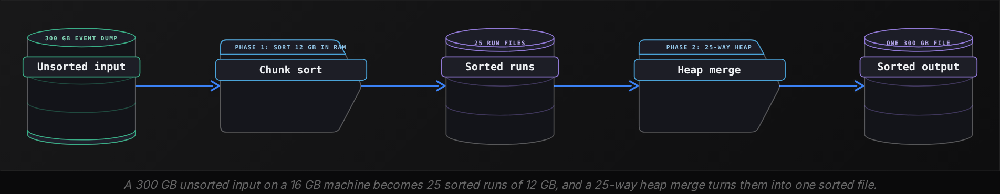

# Heap & Top-K: Intermediate

Ines is in a Google onsite loop, and the interviewer slides over a prompt: 40 servers each wrote a log file already sorted by timestamp, the combined data is 300 GB, and the merge worker has 16 GB of RAM. Produce one sorted timeline. She knows `heappush` and `heappop` cold, so she starts typing, then stops: what goes into the heap, how big does it get, and why does it never hold more than 40 entries? The follow-ups come fast: track the median request latency as events stream in, order jobs that share a cooldown, find the cheapest route between storage regions. Every one is the same move, a heap holding the frontier of choices, and every one has a trap in what the heap compares. This lesson works through all 5 shapes the way an interviewer probes them.


<br>

### What you will be able to do

Implement K-way merge with a heap and size the merge phase of an external sort

Maintain a two-heap running median and state the order and size invariants it depends on

Extend the running median to a sliding window and explain what its removal step costs

Solve cooldown and worker-assignment scheduling with a greedy rule backed by a heap

Implement Dijkstra with stale-entry skipping and tell when a pipeline graph needs a different algorithm

Encode custom orderings for heapq with tuples, sequence numbers and __lt__, and predict the errors when they go wrong


<br>

---

## K-Way Merge with a Heap

Merging k sorted inputs into one sorted output is the question behind "merge k sorted lists", "combine sorted log shards" and "sort a file bigger than RAM". The inputs are runs: each is already in order, so the smallest unread record overall must be the head of some run. That cuts the search from every remaining record down to k candidates, and a min-heap of those k heads hands back the smallest in O(log k).


<br>

### What each heap entry carries

Each entry is a tuple `(value, run_id, pos)`. The `value` orders the heap. The `run_id` says which run to refill from after a pop, and it also breaks ties: when 2 runs hold the same value, Python compares the next tuple field, and an integer always compares cleanly. The `pos` is the value's index inside its run, so the refill reads index `pos + 1`. Pop an entry, emit its value, push that run's next record, and the heap never grows past k.

https://github.com/user-attachments/assets/8c8892f6-a159-4bdc-83fb-3e5cfca540e8

*Three sorted runs merge through a heap that never holds more than 3 entries.*

Watch the stage: after setup the heap holds one head per run and shrinks only when a run runs dry. When 4 leaves, the refill is 9 from the same run, and 9 sits in the heap until 5, 6 and 7 have gone out. Every record enters the heap once and leaves once, so N records cost 2N sifts of at most log2 k levels: O(N log k) time and O(k) memory beyond the output.

| Approach | Time | Extra memory | Streams? |
| --- | --- | --- | --- |
| Concatenate, then sort | O(N log N) | O(N) | No |
| Merge runs 2 at a time, left to right | O(N k) | O(N) | No |
| Merge pairs, then pairs of pairs | O(N log k) | O(N) | No |
| Heap of k heads | O(N log k) | O(k) | Yes |

The heap and pairwise merging tie on time, so the last 2 columns decide. The heap emits its first record after reading k heads, feeds a writer while inputs are still being read, and never builds an intermediate merged list.


<br>

### Streaming version with heapreplace

Production runs are iterators over buffered file reads, so the merge should pull one record at a time and yield as it goes. `heapq.heapreplace(heap, item)` pops the smallest and pushes `item` in a single sift, cheaper than `heappop` followed by `heappush`. The loop below peeks at `heap[0]`, yields it, then replaces it with the same run's next record or pops it when that run is done.

```sql
import heapq


def k_way_merge(iterators):
    heap = []
    for run_id, it in enumerate(iterators):
        first = next(it, None)
        if first is not None:
            heap.append((first, run_id))
    heapq.heapify(heap)
    while heap:
        value, run_id = heap[0]
        yield value
        nxt = next(iterators[run_id], None)
        if nxt is None:
            heapq.heappop(heap)
        else:
            heapq.heapreplace(heap, (nxt, run_id))


runs = [iter([1, 4, 9]), iter([2, 3, 10]), iter([5, 6, 7])]
print(list(k_way_merge(runs)))
```

> **TIP**
>
> The standard library ships this as `heapq.merge(*iterables, key=None, reverse=False)`, a lazy generator. Use it in production; write the loop by hand when the interviewer asks, because the follow-ups (tie order, memory, what `heapreplace` saves) live inside the loop.


<br>

### Where it sits in external sort

External sort is how a machine sorts data larger than its RAM, and the k-way merge is its second phase. Phase 1 reads the input in chunks that fit in memory, sorts each chunk, and writes it back as a sorted run. Phase 2 opens every run with a small read buffer and merges them through a heap of run heads, writing the output sequentially. Both phases read and write the data once, so the cost is measured in passes over disk, and disk time usually dominates the heap's comparisons.



Ines's files arrive sorted, so she skips phase 1 and sizes the merge with a 64 MB read buffer per file:

- **40** — heap entries at peak
- **2.5 GB** — read buffers across all files
- **600 GB** — disk traffic for the merge pass

At 64 MB each, buffers fill the 16 GB worker at about 250 runs, and the heap is a few kilobytes. Beyond that, buffers shrink (4 MB each at 4,000 runs, so refills become slow small reads) or a second pass re-reads all 300 GB.

The same merge in other clothes

- Merge k sorted linked lists: the payload is a node, so the run index must sit before it in the tuple.
- Smallest range covering k lists: a heap of heads plus a running maximum of what the heap holds.
- Kth smallest in a sorted matrix: each row is a run, and the answer is the kth pop.
- Combine per-partition sorted outputs into one ordered file for a downstream reader.

> Predict the output
>
> `heapq.merge` assumes every input is already sorted and never checks. What does `list(heapq.merge([3, 1], [2]))` return?

*Answer: [2, 3, 1]. The merge compares the heads 3 and 2, emits 2, finds the second input empty, then drains the first input in its stored order. Unsorted runs give unsorted output with no error, so check run order where the runs are written.*


<br>

---

## Sliding Window Median: Two Heaps

A median needs the middle of the sorted order, and a single heap only exposes one end. Splitting the data into 2 halves gives 2 ends that meet in the middle: a max-heap `low` for the smaller half and a min-heap `high` for the larger half. The median then sits at one or both tops, readable in O(1).


<br>

### The balancing invariant

> Rules that hold after every operation
>
> - Order: every value in `low` is at most every value in `high`, which reduces to `-low[0] <= high[0]`.
> - Size: `len(low) == len(high)` or `len(low) == len(high) + 1`, so `low` owns the middle value on odd counts.
> - Read-out: on an odd count the median is `-low[0]`; on an even count it is `(-low[0] + high[0]) / 2`.

`heapq` only builds min-heaps, so `low` stores negated values: pushing 5 stores -5, and `-low[0]` reads back the largest value of the lower half. The insert below restores both rules in 3 moves without any case analysis. Push the new value into `low`, then move `low`'s top into `high`, which guarantees the order rule because only the largest lower value crosses. If that left `high` bigger, move `high`'s top back. Each move is one heap operation, so an insert costs O(log n).

https://github.com/user-attachments/assets/1a79934a-a28d-4607-8b15-78d939f00f75

*The stream 5, 15, 1, 3, 8 printed beside its running median.*

On the third insert, value 1 enters `low`, the 5 above it crosses into `high`, and now `high` holds 2 values to `low`'s 1, so the 5 comes straight back. The round trip looks wasteful, and it is what keeps the code free of branches on where the new value belongs.

> Predict the output
>
> Run the stream 2, 2, 9 through `add` and `median` with the same print loop. Which 3 lines appear?

*Answer: 2 2, then 2 2.0, then 9 2. The even step divides with /, which always returns a float, while the odd steps return the int stored in low, negated back. A test comparing medians numerically passes either way; a test checking types or printed text does not.*


<br>

### Making the window slide

A sliding window of size k adds one value and drops the value that fell out the back. Dropping is the hard part: `heapq` has no delete, and the outgoing value can sit anywhere inside either heap. Which heap holds it follows from the order rule. If the old value is at most `-low[0]` it lives in `low`, otherwise in `high`. Remove it by finding its index, overwriting it with the last element, popping the end and calling `heapify`, then run the same size correction as an insert.

*Duplicates need no special case. If the outgoing value equals -low[0], a copy of it sits in low even when another copy sits in high, and removing either copy leaves the same values behind.*

```sql
import heapq


def remove(heap, value):
    i = heap.index(value)
    heap[i] = heap[-1]
    heap.pop()
    heapq.heapify(heap)


def rebalance(low, high):
    if len(low) > len(high) + 1:
        heapq.heappush(high, -heapq.heappop(low))
    elif len(high) > len(low):
        heapq.heappush(low, -heapq.heappop(high))


def window_medians(nums, k):
    low, high, out = [], [], []
    for i, x in enumerate(nums):
        heapq.heappush(low, -x)
        heapq.heappush(high, -heapq.heappop(low))
        rebalance(low, high)
        if i >= k:
            old = nums[i - k]
            if old <= -low[0]:
                remove(low, -old)
            else:
                remove(high, old)
            rebalance(low, high)
        if i >= k - 1:
            if k % 2:
                out.append(-low[0])
            else:
                out.append((-low[0] + high[0]) / 2)
    return out


print(window_medians([1, 3, -1, -3, 5, 3, 6, 7], 3))
```

| Approach | Work per slide | Total for 1,000,000 events, k = 10,000 |
| --- | --- | --- |
| Sort each window | O(k log k) | about 1.3 x 10^11 steps |
| Two heaps, index + heapify removal | O(k) | about 10^10 steps |
| Sorted list, bisect insert and delete | O(k) element shifts | about 10^10 shifts, done as block copies |
| Two heaps, O(log k) removal | O(log k) | about 1.3 x 10^7 steps |

The table is the interview conversation. Two heaps with linear removal match a sorted list on paper, and both lose badly to logarithmic removal once k reaches thousands. For a window of 100 or so, either linear approach is quick and is the right thing to write in 20 minutes. Say out loud that removal is the bottleneck and that an O(log k) removal exists, because naming that limit is what the follow-up checks.


<br>

### Why pipelines want a median

A p50 latency over the last 1,000 requests, a median basket size per rolling hour, a baseline for anomaly alerts: each is a window median. Medians are chosen there because a single bad value barely moves them. One 30-second timeout among 1,000 requests, the other 999 at 50 ms, lifts the mean from 50 ms to roughly 80 ms, while the median stays at 50 ms.

> **TIP**
>
> Interviewers often leave the size rule unstated. Pick which heap owns the extra element on odd counts, say it before coding, and read the odd-count median from that heap only. Most two-heap bugs come from the 2 halves disagreeing about who holds the middle.


<br>

---

## Task Scheduler: Greedy + Heap

A greedy algorithm commits to the best-looking choice at each step and never revisits it. A heap is the natural engine for that, because "best-looking" is a priority, and the heap hands over the current best and absorbs changes to the candidate set in O(log n). The interview work is proving the greedy rule is right and picking what the heap orders by.


<br>

### Cooldown scheduling

The classic prompt: tasks are labels, each takes one time slot, and the same label must wait n slots before it runs again. Return the fewest slots, idles included. For `A A A B B C` with n = 2, the answer is 7. The greedy rule is to run whichever available task has the most copies left, because the most frequent label is the one that forces idle slots, and starting it early spreads its copies across the most gaps.

Two structures carry the state. A max-heap of `(-remaining, label)` holds the tasks that may run now, and a deque of `(ready_slot, -remaining, label)` holds tasks cooling down. Cooldown expiry happens in the order tasks ran, so a FIFO queue is enough there; only the available set needs priority order.

https://github.com/user-attachments/assets/33d1007b-7b53-4b1d-8dc9-3119a8222533

*Cooldown 2 over 6 tasks: the heap picks, the deque holds each task until its slot.*

Slot 6 is the idle one: the heap is empty while A waits in the deque for its ready slot, so the loop records `idle` and advances the clock. The loop ends when both structures are empty. Each slot does at most one pop and one push, so the run costs O(T log m) for T slots and m distinct labels, and m is at most 26 in the original prompt, which makes every heap operation close to constant.

> The closed form interviewers ask about next
>
> The slot count alone has a formula. With `f` the highest frequency and `c` the number of labels that reach it, the answer is `max(len(tasks), (f - 1) * (n + 1) + c)`. For the example, f = 3 and c = 1, so (3 - 1) x (2 + 1) + 1 = 7. The formula returns a number; the heap version emits the order itself, which is what a real scheduler has to produce.

*Why most-remaining-first is optimal here: the most frequent label forces f - 1 gaps of n slots each, and choosing the label with the most copies left fills those gaps with other work whenever any is available, so idles appear only when nothing else can run.*


<br>

### Spreading jobs across workers

The pipeline version of the same greedy shows up in backfills: 7 partition jobs with known runtimes and 3 workers, and the goal is the earliest finish for the whole batch. The rule that works well is longest processing time first: sort jobs longest first, and hand each one to the worker that frees up soonest. A min-heap of `(finish_minute, worker_id)` answers "which worker frees up soonest" with one pop.

```sql
import heapq


def assign(durations, workers):
    heap = [(0, w) for w in range(workers)]
    plan = {w: [] for w in range(workers)}
    for job in sorted(durations, reverse=True):
        finish, w = heapq.heappop(heap)
        plan[w].append(job)
        heapq.heappush(heap, (finish + job, w))
    return max(f for f, _ in heap), plan


print(assign([7, 5, 4, 4, 3, 3, 2], 3))
```

Longest first

| Worker | Jobs | Finishes |
| --- | --- | --- |
| 0 | 7, 3 | 10 |
| 1 | 5, 3, 2 | 10 |
| 2 | 4, 4 | 8 |

Shortest first

| Worker | Jobs | Finishes |
| --- | --- | --- |
| 0 | 2, 4, 7 | 13 |
| 1 | 3, 4 | 7 |
| 2 | 3, 5 | 8 |

Same jobs, same workers, and shortest first finishes 3 minutes later because the 7-minute job arrives last and lands on a worker that has already been busy for 6. Longest first places the big jobs while workers are still free. It carries a published guarantee from Graham's 1969 analysis: its makespan, the finish time of the last worker, is at most 4/3 minus 1/(3m) times the optimum for m workers, and here it hits the lower bound, since 28 total minutes over 3 workers can't finish before minute 10.


<br>

### What a pipeline scheduler borrows

- Ready queue: tasks whose upstream dependencies have finished wait in a heap keyed by priority, then by deadline.
- Rate limits: a source that allows one call per 10 seconds is the cooldown problem, with endpoints as labels.
- Worker slots: a heap of finish times assigns the next task to the slot that frees first.
- Ties: add a submission sequence number so equal priorities run first come, first served.

> **TIP**
>
> When a prompt says "minimize total time" or "assign to the least loaded", state the greedy rule and why it holds before writing code. A heap with no stated rule reads as a guess; a rule checked against one counterexample reads as design.


<br>

---

## Dijkstra's Shortest Path

Dijkstra's algorithm finds the cheapest path from a start node to every other node when edge weights are non-negative. It is the heap pattern with a graph supplying the candidates: the heap holds `(distance_so_far, node)` pairs, each pop returns the closest node not yet settled, and that node's edges are relaxed. Relaxing an edge means checking whether reaching the neighbour through this node beats its best known cost, and recording the new cost if it does.


<br>

### Why the first pop is final

When a node comes off the heap with distance d, every other entry still in the heap is at least d, and edges never subtract cost. Any route that hasn't been explored yet must leave through one of those entries, so it already costs at least d before its remaining edges add more. That argument is the core of the correctness proof, and it is also why a single negative edge breaks it.


<br>

### Duplicate entries and the stale check

`heapq` can't lower the priority of an entry already inside the heap. The standard workaround pushes a second, cheaper entry for the same node and leaves the old one in place. When the old entry surfaces later, its distance is larger than the recorded best, and the loop skips it. The animation below routes data between 4 storage regions, with edge weights as transfer cost in cents per GB.

https://github.com/user-attachments/assets/c9845416-7a73-4aa8-94e6-560c329d59f2

*Cheapest transfer cost from us to every region, with 2 stale entries skipped.*

Two pops do no work. The entry `(4, "eu")` was pushed from the direct edge before the route through `ca` found 3, and `(7, "ap")` was superseded by the route through `eu` at 6. Each skip costs one pop. Because every winning relaxation pushes an entry, the heap can hold up to E entries, and the bound is O((V + E) log V): each edge pushes at most once, and log E is at most 2 log V.

The `prev` dict turns distances into a route the interviewer can read. Each winning relaxation records the node it came from, so the route to any target is a walk back through `prev` to the start, reversed.

```sql
def path_to(prev, target):
    path = [target]
    while path[-1] in prev:
        path.append(prev[path[-1]])
    return path[::-1]


prev = {"ca": "us", "eu": "ca", "ap": "eu"}
print(path_to(prev, "ap"))
```


<br>

### Traps an interviewer will test

| Pipeline question | Graph shape | Algorithm |
| --- | --- | --- |
| Cheapest region-to-region copy route | Weighted, every cost >= 0 | Dijkstra |
| Fewest joins between 2 tables in a schema graph | Unweighted | Breadth-first search, no heap |
| Earliest time a dashboard can be fresh | DAG with job runtimes | Longest path in topological order |
| Route that includes a rebate (negative cost) | Some weights below 0 | Bellman-Ford, O(V x E) |

The dashboard row is the trap that catches strong candidates. "When is the dashboard ready" asks for the slowest chain of dependencies, because the dashboard waits for its last upstream job, so it is a longest-path question. Negating runtimes to turn it into a shortest path feeds Dijkstra negative weights, and the proof from the start of this section no longer applies. On a DAG, process nodes in topological order and take the maximum over parents, O(V + E) with no heap at all.

A concrete failure: edges a to b cost 2, a to c cost 5, and c to b cost -4. A version that marks a node done on its first pop and never updates it again reports b at 2, while the true cost through c is 1. The stale-check version above does push b again at 1 and re-expands it, so it returns 1 here, but every re-expansion is work the O((V + E) log V) bound never counted, and there are known graphs where re-expansions grow exponentially.

Lineage graphs have no cycles, and on a DAG even the cheapest path comes out of a single topological pass in O(V + E). Dijkstra needs its heap on graphs with cycles, such as a region network where copies flow both ways. Sizes stay modest there: a network of 50,000 nodes and 200,000 edges needs around 250,000 x 16 heap-level steps, a few million operations, which one Python process finishes in seconds.

The same algorithm under other names

- Network delay time: run Dijkstra from the source; the answer is the largest settled distance, or -1 if a node is unreached.
- Cheapest route within k hops: the state becomes (node, hops used), and the heap still orders by cost.
- Path with minimum effort: a path costs its worst edge, so relax with max(d, w) in place of d + w.

> Predict the output
>
> In the animation's graph, raise the `ca` to `eu` cost from 2 to 5 and run it again. What does `dist` print, and how many stale lines appear?

*Answer: {'us': 0, 'ca': 1, 'eu': 4, 'ap': 7} with no stale lines. Both routes to ap cost 7, and the strict < keeps the first one found, so prev["ap"] is "ca".*


<br>

---

## Custom Comparators in a Heap

The core `heapq` functions (`heappush`, `heappop`, `heapify`, `heapreplace`, `heappushpop`) take no `key=` argument; they compare whole entries with `<`. Every ordering beyond plain numbers therefore lives in what you push: a tuple whose fields sort the way you want, or an object whose `__lt__` encodes the rule. Three helpers do accept `key=`: `nlargest`, `nsmallest` and `merge`.


<br>

### Trap 1: payloads that cannot compare

Predict what this prints before reading on. Three jobs are pushed as `(priority, dict)` tuples, 2 of them sharing priority 1.

```sql
import heapq

heap = []
heapq.heappush(heap, (2, {"job": "load"}))
heapq.heappush(heap, (1, {"job": "extract"}))
heapq.heappush(heap, (1, {"job": "audit"}))
print(heap[0])
```

Nothing prints. The second push compares 1 with 2 and stops at the first field. The third push ties on priority 1, so tuple comparison moves on to the dicts and line 6 raises `TypeError: '<' not supported between instances of 'dict' and 'dict'`. The bug survives testing because it needs equal priorities with unequal payloads: had the 2 dicts been equal, the tuples would compare as equal and nothing would fail.

```sql
import heapq
import itertools

seq = itertools.count()
heap = []
for priority, job in [(2, "load"), (1, "extract"), (1, "audit")]:
    heapq.heappush(heap, (priority, next(seq), {"job": job}))

while heap:
    priority, _, payload = heapq.heappop(heap)
    print(priority, payload["job"])
```

The sequence number does 2 jobs. It is unique, so comparison never reaches the payload, and it rises with each push, so equal priorities leave first in, first out. The Python documentation recommends the same 3-part entry for priority queues, and a `dataclass(order=True)` with the payload declared `field(compare=False)` builds it as a named type.


<br>

### Trap 2: negation only works on numbers

Negating the key turns `heapq` into a max-heap for numbers, as `low` did in the median section. A string has no negative: `-"etl"` raises `TypeError: bad operand type for unary -: 'str'`. The problem bites hardest with mixed directions. The top-K frequent words prompt wants the highest counts with ties broken alphabetically, so a size-k min-heap must evict the lowest count and, among equal counts, the alphabetically last word. That eviction order cannot be built cleanly from a plain tuple, so the entry gets its own `__lt__`.

https://github.com/user-attachments/assets/1bdb3044-95ca-46c8-9daa-38a7d0703b22

*The heap keeps 2 entries; sla is evicted before dag because it sorts later alphabetically.*

Read `__lt__` as "this entry is worse than that one". A lower count is worse; at equal counts the later word is worse, so `sla` loses its place to `dag` when the third push overflows the heap. The final pops return the worst survivor first, which is why the list is reversed, and `__repr__` makes printed entries read `sla:2`.


<br>

### Trap 3: changing a priority in place

A heap checks its order only while an entry is moving. Editing the priority of an entry already inside raises nothing, and the entry stays buried under parents that are now larger than it. Predict both lines below, where the backfill task is rushed from priority 9 to 0.

```sql
import heapq

heap = [[3, "load"], [5, "audit"], [9, "backfill"]]
heapq.heapify(heap)
heap[2][0] = 0
print(heap[0])
heapq.heapify(heap)
print(heap[0])
```

*Answer: [3, 'load'], then [0, 'backfill']. Before the second heapify, the edited entry was never sifted, so the root still holds the old minimum; the repair costs O(n). Reprioritizing in O(log n) needs extra bookkeeping, which the advanced tier builds.*

Pick the encoding from the order the problem asks for:

| Encoding | Fits when | Cost per comparison |
| --- | --- | --- |
| Tuple `(key, seq, payload)` | Keys are numbers, ascending or negated | Tuple comparison in C, the fastest option |
| `dataclass(order=True)` | Same order, with named fields and a `compare=False` payload | Generated Python method, slower than a tuple |
| Class with `__lt__` | Directions mix, such as count descending then word ascending | One Python call per comparison, up to log k per push |

| ✓ Do | ✗ Don't |
| --- | --- |
| • Push (priority, seq, payload) with seq from itertools.count()<br><br>• Write __lt__ as "worse than" when the heap evicts, and test one tie by hand<br><br>• Give comparator classes a __repr__ so printed entries stay readable<br><br>• Use nlargest(k, items, key=...) for a one-shot top-K over a list | • Don't push dicts or None as payloads where a priority tie can reach them<br><br>• Don't negate strings or date strings to get a max-heap<br><br>• Don't edit an entry's priority while it sits inside the heap<br><br>• Don't use NaN as a priority: every < comparison with it is False |


<br>

---

## Putting It All Together

A food delivery marketplace rebuilds its order analytics every night. Each of 64 order-service shards writes a log sorted by timestamp, and the platform team needs one ordered timeline, a rolling p50 of courier wait time per 1,000 orders, a backfill of 7 partitions across 3 workers before 6 a.m., the cheapest route for copying the result to its analytics region, and a top-10 list of restaurants by order count with ties shown alphabetically.

- The 64 shard logs are sorted runs, so a 64-entry heap merges them in one pass with heapq . merge and a read buffer per shard.
- The rolling courier-wait p50 is a window median: 2 heaps with index-and-heapify removal for a 1,000-order window, with the removal cost stated up front.
- The 7 backfill partitions go out longest first through a heap of worker finish times, which keeps the batch within a known factor of the best possible finish.
- The copy route is Dijkstra over region transfer costs, valid because transfer prices are never negative.
- The 6 a.m. check itself is a longest-path pass over the pipeline DAG, a second graph question that Dijkstra must not answer.
- The top-10 restaurants come from a size-10 min-heap whose __lt__ evicts the lower count first and, on ties, the alphabetically later name.


<br>

---

## Key Takeaways

- K-way merge keeps one head per run in a heap of ( value , run_id , pos ) : O(N log k) time, O(k) memory, and it is phase 2 of every external sort.
- Two heaps hold the 2 halves of the data; the order rule and the size rule together put the median at the tops in O(1), with O(log n) inserts.
- Sliding the window adds a removal step that costs O(k) with index and heapify, and naming that bottleneck is part of the answer.
- Greedy plus heap means stating the rule first (most remaining, longest first, earliest free worker), then letting the heap serve the current best.
- Dijkstra settles a node on its first valid pop, skips stale duplicates and fails on negative weights; "when is it ready" is a longest-path question on a DAG.
- heapq compares whole entries with < : put a sequence number before any payload, write __lt__ for mixed directions, and never edit a priority in place.
