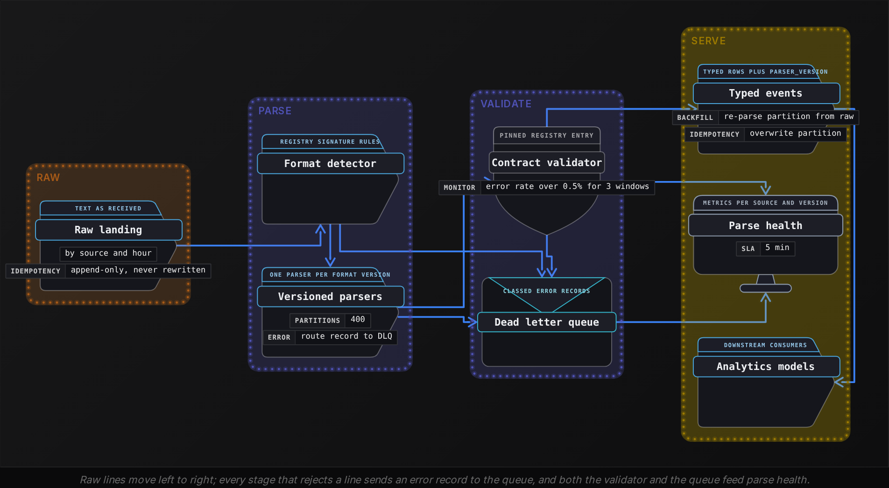

# String Parsing for Data Engineers: Advanced

Maya is in the final round of a data engineering loop at Cloudflare. The interviewer pastes 4 lines of log text, one with a semicolon where a pipe should be, and asks her to design the system that turns lines like these into tables analysts can trust. She sketches a regex and the follow-ups start. Where does that regex execute inside a Spark job, and what does moving it into Python cost? What happens when the source changes its format on a Friday? How would she deduplicate customers whose names arrive spelled 3 ways across 10 million rows? Then, with a nod to the company's July 2019 outage, how does she know her pattern cannot stall every worker it runs on? Each answer turns on a cost or a boundary she has to name.


<br>

### What you will be able to do

Choose between declared schemas, built-in Spark expressions, pandas UDFs and row-at-a-time Python UDFs by the serialization and optimizer cost each one carries.

Design a schema registry that keeps format detection, parsing and validation as separate, replaceable stages that fail with their own names.

Size a record linkage job with blocking keys, Fellegi-Sunter weights and skew limits instead of all-pairs comparison.

Diagnose super-linear regex behaviour from a pattern's shape, and name the controls that would have contained the 2019 Cloudflare outage.

Architect a parsing layer with classed error records, versioned parsers, replay from raw text and per-source parse health alerts.


<br>

---

## regexp_extract vs UDFs in Spark

In Spark, the cost of parsing a string column is set mostly by where the parsing code executes. A built-in expression such as `regexp_extract` runs inside the executor JVM on Spark's internal binary rows, and the optimizer can see it, fold it into whole-stage generated code and reorder filters around it. A Python UDF runs in a separate worker process beside the executor, so each input value is serialized out of the JVM, rebuilt as a Python object, sent over a local socket, and each result makes the same trip back.


<br>

### How the question arrives

Interviewers rarely say UDF. The prompt is a nightly job that parses 2 billion log lines through a Python function in 4 hours: what would you change? Or product wants device type pulled from the user-agent string, and the only trustworthy classifier is a Python library. Or a pull request wraps `str.split` in a `udf`, and you are the reviewer. All 3 reduce to one decision: which execution path a string transformation takes, and what that path costs per row and per plan.


<br>

### Three paths, priced per row

| Path | Runs in | Crosses the boundary | Optimizer sees inside | Python calls, 500M rows |
| --- | --- | --- | --- | --- |
| Built-in expression: `regexp_extract`, `split`, `from_json` | Executor JVM, generated code | Nothing | Yes | 0 |
| pandas UDF | Python worker process | Arrow column batches, 10,000 rows each by default | No | At least 50,000 |
| Row-at-a-time Python UDF | Python worker process | Pickled rows, rebuilt as Python objects | No | 500,000,000 |

The last column is where the paths separate. With `spark.sql.execution.arrow.maxRecordsPerBatch` at its default of 10,000, a pandas UDF over 500 million rows is invoked once per batch, so the per-call interpreter overhead is paid at least 50,000 times, a little more when partitions end in partial batches, instead of once per row. Both UDF paths still copy every input value out of the JVM and every result back in: that copy is the serialization tax, and only the built-in path avoids it. The optimizer column matters as much. Spark cannot look inside either UDF, so the physical plan isolates it in its own node, `BatchEvalPython` for row UDFs and `ArrowEvalPython` for pandas UDFs, and the generated-code stage breaks around it.

```sql
from pyspark.sql import SparkSession, functions as F

spark = SparkSession.builder.getOrCreate()
logs = spark.createDataFrame(
    [("203.0.113.9 GET /cart/ 200 1532",), ("garbage line",)],
    ["line"],
)

PATTERN = r"^(\S+) (\S+) (\S+) (\d{3}) (\d+)$"
parsed = logs.select(
    "line",
    F.regexp_extract("line", PATTERN, 1).alias("ip"),
    F.regexp_extract("line", PATTERN, 3).alias("path"),
    F.regexp_extract("line", PATTERN, 4).alias("status"),
).withColumn("parse_ok", F.col("ip") != "")

clean = parsed.withColumn(
    "path", F.regexp_replace(F.lower("path"), "/+$", "")
)
```

Two details in that code carry most of the production risk. `regexp_extract` returns an empty string when the pattern does not match, so a null check never fires on the garbage row; `parse_ok` compares against the empty string and gives the job a failure count to alert on. And the last statement is the one a reviewer often finds written as a Python UDF calling `.lower().rstrip("/")`. Expressed with `lower` and `regexp_replace`, it stays in the same generated-code stage as the extraction.


<br>

### A declared schema removes a pass

When the text is already structured, as JSON lines or delimited files, the cheapest parser is Spark's native reader with a schema supplied up front, or `from_json` with an explicit `StructType`. Spark's documentation states that `inferSchema` on CSV costs one extra pass over the data, and a sample-based guess can still be wrong. A declared schema pins `amount` to a decimal before any row is read. Under the default permissive mode, a record that does not fit arrives with null fields, which the job counts the same way it counts empty extractions.


<br>

### When the logic only exists in Python

```sql
import pandas as pd
from pyspark.sql.functions import pandas_udf


def classify_device(user_agent):
    ua = user_agent.lower()
    if "mobile" in ua or "android" in ua:
        return "mobile"
    return "desktop"


@pandas_udf("string")
def device_type(user_agents: pd.Series) -> pd.Series:
    return user_agents.map(classify_device)
```

`classify_device` stands in for the other team's classifier. Wrapping it in a pandas UDF fixes the boundary: values cross as Arrow batches and Spark calls `device_type` once per batch. The classifier's own cost is unchanged, because `Series.map` still calls it once per element. A pandas UDF pays off in proportion to how much of its body works on a whole Series at once, so if the library offers a batch API, call that once per Series. Filter and project before the UDF as well, since rows dropped earlier never cross.

Try them in this order

- **Declared schema in the native reader** *JSON lines, CSV, fixed delimiters*\
  Parsing happens in the JVM with no inference pass, and failures arrive as nulls you can count.
- **Built-in expressions** *regexp_extract, split, substring, to_timestamp*\
  For semi-structured lines. Stays in generated code; a failed match surfaces as an empty string.
- **pandas UDF** *Logic that exists only in Python*\
  Batches amortize call and transfer overhead; the work inside still runs at Python speed.
- **Row-at-a-time Python UDF** *Last resort*\
  One object conversion and one function call per row. It needs a measured reason.

> A complete answer to the 4-hour job
>
> - Read the physical plan first: a `BatchEvalPython` node confirms where the boundary sits.
> - Rewrite with built-ins where the logic allows, and compare stage times on the same input.
> - If Python is required, move to a pandas UDF and filter and project before it.
> - Check the pattern too: Spark's regex functions use Java's backtracking engine, so a bad pattern hurts on either side.
> - Route empty extractions to an error path instead of letting blank strings land in the table.


<br>

---

## Schema Inference from Raw Text

Schema inference reads a sample of raw text and guesses a type for each field. That guess describes the upstream system on the day the sample was taken, and upstream systems change on their own schedule. The interview version of this question names the change: a partner switches its delimiter, a JSON feed drops a field, a column that held whole numbers for a year starts carrying cents. The design that holds up treats inference as a drafting tool and puts a registry of pinned, versioned formats between raw text and every consumer.

| Values in the sample | Inferred as | What breaks later |
| --- | --- | --- |
| `02139`, `94107` | integer | Leading zero dropped; `2139` joins to nothing |
| `12`, `40`, then `12.50` at row 2,400,117 | integer | Row nulled or job fails, depending on parse mode |
| `03/04/2024` | date, month first | A European source meant 3 April |
| `true`, `false`, then `Y` | boolean | The new spelling becomes null without an error |
| `""`, `NULL`, `-` | string | Three spellings of missing, none treated as null |


<br>

### Detection, parsing and validation as separate stages

Each stage answers its own question. Detection asks which registered format and version a line belongs to. Parsing turns a line of a known format into named fields. Validation checks those fields against the format's contract: required fields present, types coercible, values in range. Collapsed into one function, a format change surfaces as `ValueError: not enough values to unpack` from deep inside the parser, with nothing saying which source or version moved. Kept apart, every failure carries the stage that raised it, and supporting a new format means adding a detector rule and a parser without touching validation.

https://github.com/user-attachments/assets/30ca732f-e225-4b33-8255-3b094102f644

*Each line is detected, then parsed, then validated, and lands in the bucket of the stage that rejected it.*

The run numbers lines from 0. Line 2 is the upstream delimiter change, `;` instead of `|`. The detector finds neither a leading brace nor 3 pipes and routes it to `unknown_format` before any parser sees it; handed straight to `parse_pipe`, the same line would raise `ValueError` because `split("|")` returns 1 value for 4 names. Line 3 is a recognized format with a broken contract, so it lands in `invalid` together with the name of the missing field. Those 2 buckets go to different owners: an unknown format needs a new registry entry, and an invalid record needs a conversation with the source.


<br>

### A registry entry is data

```sql
{
  "source": "payments_gateway",
  "format": "pipe_v1",
  "version": "1.4.0",
  "detector": {
    "rule": "delimiter_count",
    "char": "|",
    "count": 3
  },
  "fields": [
    {
      "name": "ts",
      "type": "time",
      "required": true,
      "pattern": "HH:mm:ss"
    },
    {
      "name": "user",
      "type": "string",
      "required": true
    },
    {
      "name": "amount",
      "type": "decimal(12,2)",
      "required": true
    },
    {
      "name": "currency",
      "type": "string",
      "required": false,
      "default": "USD"
    }
  ],
  "origin": "inferred from 10,000 sampled lines, types reviewed",
  "status": "active"
}
```

Because the entry is data, the parser for a delimited format can be generic code driven by the field list, and a new version is a reviewed change to a record rather than a code release. The `origin` field records how the entry was born. Inference produced the first draft from a sample, a person set money to decimal and confirmed the time pattern, and from then on production reads the pinned entry and never infers again.

| Upstream change | Example | Registry response |
| --- | --- | --- |
| Optional field added | JSON gains `channel` | Compatible: minor version, extra key ignored until mapped |
| Delimiter changed | `\|` becomes `;` | New format entry; the old one stays for replaying history |
| Type widened | `amount` gains decimals | Compatible only if the target column was already decimal |
| Required field removed | `amount` disappears | Breaking: rows fail validation and the contract owner is paged |
| Fields reordered, same count | `user\|ts\|amount\|currency` | Undetectable by shape: require a version marker or header |

The last row is where detection by shape runs out. A pipe-delimited line with 4 fields looks the same whether `ts` comes first or second, and a parser that trusts position will write user ids into the time column until something downstream fails to cast. No detector rule can recover information the format does not carry, so the fix is a contract: a header line, a version field, or a file-naming convention the source agrees to.

| ✓ Do | ✗ Don't |
| --- | --- |
| • Infer once from a sample, review the types, then pin the entry and version it<br><br>• Store money as decimal and codes with leading zeros as strings in the pinned entry<br><br>• Keep old format entries registered so history can be replayed with its own parser<br><br>• Re-run inference in shadow and alert when its guess drifts from the pinned type | • Re-infer the schema on every run and let the sample decide production types<br><br>• Catch a parser's ValueError and guess a new layout inside the same function<br><br>• Accept a positional format change without a version marker from the source |


<br>

---

## Record Linkage at Scale

Record linkage decides which rows, across sources or within one, describe the same real person, merchant or device when no shared key exists and the strings disagree: `jon smith` and `john smith`, `smyth` for `smith`, a mistyped zip code. The interview prompt is usually a merger: 3 customer tables from acquired companies, 10 million rows in total, deduplicate them. Comparing every row with every other row is correct and unaffordable, so the real question is how to avoid doing it.

All-pairs comparison scales as n(n - 1) / 2. Assume a scorer that evaluates 1 million candidate pairs per second on one core, and an ideal blocking key that splits the 10 million rows into 100,000 groups of 100.

- **50 trillion** — pairs to score with no blocking
- **13,889** — core-hours to score them all
- **495 million** — pairs inside the 100,000 blocks


<br>

### Block, compare, score, classify

- Normalize: lowercase, strip punctuation, expand nicknames, standardize zip and phone formats
- Block: give each record cheap keys; only records sharing a key become candidate pairs
- Compare: per field, decide agree or disagree, or compute a similarity such as edit distance
- Score: sum per-field log-likelihood weights into one number per candidate pair
- Classify: above the upper threshold is a match, below the lower is a non-match, the rest goes to human review
- Cluster: join matched pairs into entities with connected components

https://github.com/user-attachments/assets/d0e14db5-3eb4-431a-9e31-93cdbf28d5d9

*Only records that share a block key are scored; the last line compares that count with all pairs.*

The block key is the first 2 letters of the surname and the first 3 digits of the zip code. `smyth` shares a block with the 2 Smiths in `941` because the key ignores everything past `sm`, so the typo still gets compared, and its score of 3 sends it to review. Jane Smith in `021` is alone in her block and costs nothing. The run scores 5 pairs out of 28, and the Lee pair also lands in review: same name, a zip code that differs in its last 2 digits, a score of 9 against a match threshold of 10.


<br>

### Where the weights come from

The weights follow the Fellegi-Sunter model. For each field, `m` is the probability that the field agrees when 2 records are a true match, and `u` the probability it agrees for 2 random records. Agreement adds log2(m / u) to the score and disagreement adds log2((1 - m) / (1 - u)). Rare agreement is strong evidence, which is why surname outweighs zip code. In production, `u` comes from sampling random pairs and `m` from labelled pairs or expectation-maximization over the candidates.

| Field compared | m | u | Agree weight | Disagree weight | Rounded, as used |
| --- | --- | --- | --- | --- | --- |
| Surname, exact | 0.95 | 0.008 | 6.89 | -4.31 | +7 / -4 |
| First 2 letters of first name | 0.80 | 0.06 | 3.74 | -2.23 | +4 / -2 |
| Zip code, exact | 0.80 | 0.10 | 3.00 | -2.17 | +3 / -2 |


<br>

### Skew decides the runtime

Real surnames are heavily skewed. At scale the same surname-prefix-plus-zip3 key puts every Smith, Smit and Smythe in Manhattan's `100` prefix into one block. If that block holds 50,000 records it alone produces 1,249,975,000 pairs, more than twice the total from all the balanced blocks, and in a distributed self-join on the block key all of them land in one task. Salting the key spreads those pairs across tasks without removing any. What reduces the work is a tighter key for oversized blocks: cap blocks at 1,000 records, 499,500 pairs at most, and sub-block anything larger by first initial or birth year.

Blocking trades recall for cost, and both sides need a number. Reduction ratio is the share of all pairs the blocks skip: 1 - 5 / 28, about 82%, in the small run. Pair completeness is the share of true matches that land in some block, measured on a labelled sample. A Jon Smith whose zip was typed as `84107` falls into a different block and is never compared, so a single key caps completeness. Production pipelines run 2 or 3 blocking passes with independent keys, such as surname prefix plus zip and first name plus birth date, then deduplicate the union of candidate pairs before scoring.

> Clustering can undo good scoring
>
> Matched pairs become edges and connected components become entities. If A matches B and B matches C, the component merges all 3 even when A and C would score below review. Chains like that grow through common names, so check each cluster's weakest internal pair and its size, and send clusters that fail either check to review.


<br>

---

## Cloudflare's Backtracking Outage

On 2 July 2019, Cloudflare deployed a new managed rule to its web application firewall. The rule's regular expression backtracked so heavily that it exhausted the CPU on the machines serving HTTP and HTTPS traffic across its network, and the company's proxying, CDN and firewall functions went down for about 27 minutes. Cloudflare's published post-mortem traced it to the tail of the pattern, `.*(?:.*=.*)`, and to 3 conditions outside the pattern that let one bad expression reach every machine at once.


<br>

### Why 2 adjacent wildcards explode

Strip the group and the tail reads `.*.*=.*`. This shape has no nesting, so a check for nested quantifiers misses it. The danger is ambiguity: both wildcards can consume the same characters, so when a line contains no `=`, a backtracking engine tries every way of splitting the line between them before it gives up, and an unanchored search repeats that from every start position. For a line of n characters that is (n + 1)(n + 2)(n + 3) / 6 attempts in a naive model, growing with the cube of the length. The animation counts them for a 3-character line and prints the closed form for longer ones.

https://github.com/user-attachments/assets/a3d5cd68-02f0-4403-a407-7ea9f84bf9d1

*Counts every way a backtracking engine splits a line with no = between 2 wildcards, then prints the closed form.*

| Line length | Naive attempts, .\*.\*=.\* | Steps, ^[^=]\*=.\* |
| --- | --- | --- |
| 3 | 20 | 4 |
| 100 | 176,851 | 101 |
| 1,000 | 167,668,501 | 1,001 |
| 10,000 | 166,766,685,001 | 10,001 |

Real engines carry optimizations that skip some of these attempts in some cases, and a production pattern should depend on none of them. The rewrite removes the ambiguity: `^` pins the search to a single start, and `[^=]*` cannot consume an `=`, so the first part has exactly one place to end. The second count is one step per character examined; a backtracking engine also retries the `=` once per character it gives back, which doubles the work and keeps it linear. A length cap alone does not rescue the original. Capping lines at 8,192 characters bounds the work at about 92 billion attempts per failing line, which is still a stalled worker.


<br>

### A shape test you can run in review

| Risky shape | Why it backtracks | Unambiguous rewrite |
| --- | --- | --- |
| `.\*.\*=.\*` | 2 wildcards compete for the same characters | `^[^=]\*=.\*` |
| `(\w+\s?)+$` | Inner and outer `+` can split a word many ways | `^\w+(?:\s\w+)\*$` |
| `"(.\|\\")\*"` | `.` also matches the backslash of an escape | `"(?:[^"\\]\|\\.)\*"` |

The test behind every row: can 2 parts of the pattern match the same character at the same position, and can the overall match still fail? If both are true, failure costs every split. On Python 3.11 and later, an atomic group `(?>...)` or a possessive quantifier such as `*+` gives back no characters once it has matched, which removes the splits for that part of the pattern; earlier versions have neither. The `re` module has no timeout argument in any version, so on every version the controls are rewriting the pattern, bounding the input, and running untrusted patterns in a worker that can be stopped from outside.

```sql
import re
import time


def assert_linear(pattern, probe_char="x", budget_per_1k=0.005):
    compiled = re.compile(pattern)
    for n in (1_000, 10_000, 100_000):
        probe = probe_char * n
        start = time.perf_counter()
        compiled.search(probe)
        elapsed = time.perf_counter() - start
        assert elapsed < budget_per_1k * n / 1_000, (pattern, n, elapsed)


assert_linear(r"^[^=]*=.*")
assert_linear(r".*.*=.*")
```

The probe has to be a near miss for the pattern under test: a long run of characters the pattern accepts, with the character it needs left out. The anchored pattern stays inside its budget at all 3 lengths. The original tail raises `AssertionError` before the 100,000-character probe is reached, so the failure happens in continuous integration instead of on live traffic.


<br>

### The controls around the pattern

- **Global deployment in one step** *Rollout*\
  Firewall rules went to every machine at once, outside the staged rollout used for software releases.
- **A CPU guard removed weeks earlier** *Runtime protection*\
  A protection that would have limited regex CPU use had been removed by mistake during a refactoring.
- **A dry run that still executed** *Simulate mode*\
  The rule only logged matches, but logging still meant evaluating the regex on live traffic.
- **Afterwards** *Published fixes*\
  A regex engine with run-time guarantees, staged rollout for rules, and the CPU protection restored.

> **TIP**
>
> In a data pipeline the same lesson reads: a new parsing pattern is a deploy. Ship it to one source or one partition first, watch per-line parse latency, and keep a switch that reverts to the previous pattern without a code release.


<br>

---

## Designing the Parsing Layer

The last question in a parsing loop zooms out: you own ingestion for 200 sources, so design the layer. A strong answer draws parsing as a service boundary. On one side sits raw text, kept exactly as received. On the other sit typed tables and an error stream, the only things downstream teams read. Everything between them is owned by one team, versioned and observable, so a format change at any source is detected, contained and replayed instead of discovered in a dashboard 3 days later.




<br>

### Errors with a class and an owner

A dead letter queue full of stack traces tells nobody what to do. Each rejected line becomes a structured record that names the stage, the class of failure, the parser version and where the raw line lives, so it can be replayed. The record below is what line 2 of the registry run produces in this layer.

```sql
{
  "source": "payments_gateway",
  "stage": "detect",
  "error_class": "unknown_format",
  "parser_version": null,
  "formats_tried": [
    "json_v2",
    "pipe_v1"
  ],
  "detail": "no leading brace; found 0 of 3 expected '|' delimiters",
  "raw_location": "raw/payments_gateway/2024-03-01/10/part-0007.txt:18234",
  "raw_excerpt": "10:00:09;u19;7.00;EUR",
  "received_at": "2024-03-01T10:00:09Z"
}
```

| error_class | Example | Route | Owner |
| --- | --- | --- | --- |
| `unknown_format` | Delimiter switched to `;` | DLQ; alert above 0.5% of the source's lines | Registry owner adds a format |
| `schema_violation` | Required `amount` missing | DLQ | Source team, under the contract |
| `type_coercion` | `amount` arrives as `12,50` | DLQ | Parser owner decides locale handling |
| `truncated` | Line cut at the 8,192-character cap | DLQ | Ingestion owner |
| `parser_bug` | Exception raised inside parser code | Fail the batch and alert | Parser owner |

The last row is the judgement call. A data error belongs to one record, so the record is routed and the batch carries on. A code error belongs to every record: a parser that throws on all of them routes the entire source to the queue while the job reports success. Two thresholds separate the cases. An alert fires when a source's rejection rate passes 0.5% for 3 consecutive 5-minute windows, and a circuit breaker fails the batch when more than 5% of its lines are rejected, because at that rate the defect is far more likely to sit in the parser or the registry than in the data.


<br>

### Versioning and replay

Every typed row carries `parser_version` and the registry `format` that produced it, so a bad release can be traced to the exact rows it wrote. Raw text is retained long enough to re-parse, here 30 days, and output partitions are overwritten whole, which makes a re-parse idempotent: fixing `pipe_v1` and re-running 10 March replaces that day's rows without duplicating them, and dead-lettered lines from that day re-enter through the same path. A new parser version first runs in shadow on a sample of live traffic, and its output is diffed against the current version before it takes over.


<br>

### Parse health metrics

| Metric | Grain | Alert when |
| --- | --- | --- |
| Parse success rate | Source, 5-minute window | Below 99.5% for 3 windows in a row |
| Rejections by error class | Source and class, hourly | A class appears that the source never had |
| Null rate per field | Source and field, daily | Moves more than 5 points against the 7-day baseline |
| Parse latency, p99 per line | Parser version, 5-minute window | Above 5 ms, the early sign of a backtracking pattern |
| Line volume | Source, hourly | Under half of the same hour last week |

The null-rate and latency rows catch what the error stream cannot. A source that starts sending an optional field as an empty string still parses and validates, and only that field's null rate moves. A pattern that has started to backtrack still returns correct results, slowly, and per-line latency is the only signal before the workers stall.

> The answer, in the order an interviewer hears it
>
> - Raw text is immutable and retained, so every output can be reproduced
> - Detection, parsing and validation are separate stages driven by a versioned registry
> - Parsing uses built-in engine functions where possible, with linear-time patterns tested in CI
> - Rejected lines become classed error records with a replayable location and an owner
> - Thresholds separate a bad record from a bad parser, and parse health is alerted per source


<br>

---

## Putting It All Together

A food-delivery marketplace onboards point-of-sale feeds from 200 restaurant software vendors. Each vendor posts order exports as JSON lines or pipe-delimited text, formats change without notice, the same restaurant appears under different names across vendors, and finance reconciles restaurant payouts from the parsed amounts every morning.

- The registry detects each vendor's format and version, so a vendor that switches from | to ; produces unknown_format records instead of misparsed payouts.
- Parsing runs as declared schemas and regexp_extract inside Spark, with a pandas UDF only for the vendor whose timestamps need a Python library.
- Every new pattern passes the near-miss time-budget test and ships to one vendor first, so a backtracking pattern stalls one partition instead of the morning job.
- Restaurants are linked across vendors by blocking on name prefix plus postcode and scoring with Fellegi-Sunter weights, with oversized blocks sub-blocked.
- Parse success rate, null rates and latency per vendor alert before finance sees a gap, and retained raw text lets the team re-parse a bad day once the parser is fixed.


<br>

---

## Key Takeaways

- In Spark, a string transformation's cost is set by where it runs: built-ins stay in the JVM, while UDFs pay to cross into Python and hide from the optimizer.
- A pandas UDF amortizes the boundary over 10,000-row batches by default; the Python work inside it still costs what it costs.
- Inference drafts a schema, a pinned and versioned registry entry decides production types, and detection, parsing and validation fail separately.
- Record linkage at scale is a blocking problem first: measure reduction ratio and pair completeness, and cap or sub-block skewed keys.
- A regex is dangerous when 2 parts can match the same characters and the match can fail; anchors and negated classes remove that ambiguity.
- Cloudflare's 2019 outage took a bad pattern plus a one-step global deploy and a missing CPU guard, so prevention lives in both the pattern and the rollout.
- A parsing layer is a boundary: immutable raw text, classed error records, versioned parsers with replay, and parse health alerted per source.
