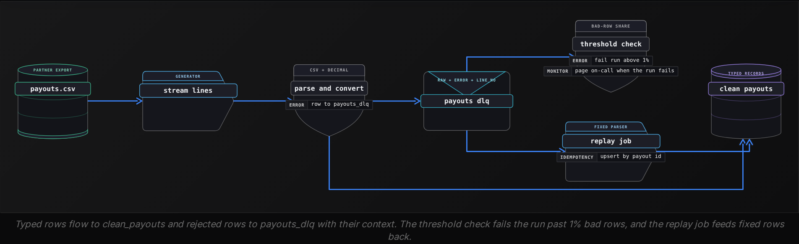

# String Parsing for Data Engineers: Beginner

Noor is 40 minutes into a data engineering loop at Stripe when the interviewer pastes 3 lines into the shared editor: a payout export with a header row, a merchant named "Acme, Inc." in quotes, and an amount column. The ask sounds small: read the file, total the payouts per merchant, and say what happens to rows you can't read. Noor reaches for `line.split(",")`, and the interviewer asks how many fields the Acme row produces. Then the follow-ups arrive: the real file is 40 GB, some lines are truncated, and finance wants every rejected row explained. Each follow-up asks the same thing: can she turn untrusted text into typed records without dropping a row or running out of memory, and still account for every row that failed? This lesson builds each piece of that answer.


<br>

### What you will be able to do

Spot the cues that make a prompt a parsing question and name the 4 decisions it tests

Parse quoted, BOM-prefixed CSV with csv.DictReader and convert fields to int and Decimal

Write a compiled regex with named groups and predict what match returns compared with search and fullmatch

Stream a file through generator functions and state the memory claim with its condition

Send bad records to a dead letter queue, log each failure as a JSON event, and set a failure threshold


<br>

---

## String Parsing Trigger Words

Parsing questions rarely announce themselves. Interviewers phrase them as business tasks: reconcile a payout export, count errors per service, find the slowest endpoints in yesterday's logs. The pattern is in the shape of the data. Input arrives as text written by some other system, and the answer must be typed records or an aggregate computed from them. Once you hear that shape, the interviewer stops grading whether you can write a loop and starts grading 4 decisions about how text becomes data.


<br>

### The phrases that signal a parsing question

| What you hear | What it signals | The move it calls for |
| --- | --- | --- |
| "Here is the CSV export" | Delimited text with a header row | `csv.DictReader`, never `split(",")` |
| "Some merchant names contain commas" | Quoted fields, so quoting rules matter | Let the csv module apply the quoting rules |
| "Pull the latency out of each log line" | Semi-structured text with fields in a fixed order | A compiled regex with named groups |
| "The file is about 40 GB" | Memory use is part of the grade | Stream lines through generators |
| "A few lines are malformed" | Error handling is part of the grade | Route bad rows to a dead letter queue |
| "The file comes from a partner" | Encoding and quality are unknown | Decode explicitly and check for a byte order mark |
| "Return the total per merchant" | An aggregate computed after parsing | Convert amounts to `Decimal` before summing |

Disguised forms count too. A prompt might read: given a list of strings like "2024-03-05 ERROR payments 412ms card declined", return the average latency per service. The words "list of strings" make it sound like an algorithm warm-up. Look at the example instead: a date, a level, a service name, a number glued to its unit, and free text at the end. That's a log line. The interviewer wants to see fields extracted by name, 412ms turned into the integer 412, and a plan for the string that fits none of it.


<br>

### The 4 decisions behind every parsing answer

- **Read** *How does the text enter the program?*\
  Whole file in memory, or a line at a time from a stream. Code that loads the whole file breaks on the question about file size.
- **Parse** *Which tool splits a line into fields?*\
  The csv module for delimited data, a compiled regex for log-style lines, and plain string methods only when the format can never contain quotes.
- **Convert** *What type does each field become?*\
  Every parsed field starts as a string. An amount becomes a Decimal only when your code converts it, the same goes for integers and dates, and every conversion can raise.
- **Route** *Where do failures go?*\
  A record that cannot be parsed goes to a dead letter queue with its line number and error, so a bad row leaves evidence.

Interviewers grade the 4 as a set. A solution that parses perfectly but loads the whole file has answered 3 of them. A solution that streams well but wraps the loop in except: pass does worse, because a row that disappears produces a wrong total and no error to investigate. Naming all 4 decisions early, before any code, tells the interviewer you know where the follow-ups will land.


<br>

### Questions to ask before writing code

> Clarify the input in under a minute
>
> - Is there a header row, and can the column order change?
> - Can a field contain the delimiter or a quote character, and can a quoted field span a line break?
> - What encoding does the file use, and could it begin with a byte order mark?
> - How large is the largest file, and does it arrive once or every hour?
> - What should happen to a row that fails? Does it get skipped or quarantined, or does it stop the job?

Each answer changes the code. If the interviewer says fields are never quoted, str.split becomes acceptable. If files never pass 2 MB, reading the whole file is fine. Asking shows that you know which assumptions the code depends on, and the answers become the narration you give while you write.


<br>

### What a complete answer looks like

```sql
import csv
from decimal import Decimal, InvalidOperation


def read_lines(source):
    for line in source:
        yield line


def parse_rows(lines):
    return csv.DictReader(lines)


def convert(row):
    return row["merchant"], Decimal(row["amount"])


def run(source):
    totals, dead_letters = {}, []
    for row in parse_rows(read_lines(source)):
        try:
            merchant, amount = convert(row)
        except (TypeError, InvalidOperation) as exc:
            dead_letters.append({"row": row, "error": repr(exc)})
            continue
        totals[merchant] = totals.get(merchant, Decimal("0")) + amount
    return totals, dead_letters
```

The skeleton has no readlines() and no split(","), and nowhere does it use a bare except. Each omission answers a follow-up before it is asked. The exception tuple names exactly the errors that bad data can raise, so a typo in your own code still crashes loudly.


<br>

### Try it: classify the prompt

*Cover the last 2 columns and decide for each prompt before reading them.*

| Prompt | Parsing question? | The decision it turns on |
| --- | --- | --- |
| Find the 10 most common error messages in an application log | Yes | Parse: a regex pulls the message field from each line |
| Merge 2 sorted lists of integers | No | The input is already typed |
| Load a partner's daily transactions file into a table | Yes | Read and Route: unknown size, unknown quality |
| Count events by type, given a list of dicts already decoded | No | Parsing is done; this is aggregation |
| Deduplicate emails from a signup export | Yes | Convert: lowercase and strip each email before comparing |

> **TIP**
>
> When a prompt hands you strings, ask what each string looks like in production. If the answer is a line in a file another system wrote, you're in a parsing question and all 4 decisions apply.


<br>

---

## csv.DictReader Instead of split()

The Acme row is the first follow-up in the payout question. A comma inside quotes is part of the field, and str.split has no way to tell it from a delimiter. The csv module implements the quoting rules that spreadsheets and databases write, described in RFC 4180: a field wrapped in double quotes may hold commas and line breaks, and a doubled quote "" inside it stands for 1 quote character.


<br>

### Predict the output before you press play

The program parses the same export 2 ways. Before playing it, predict how many items split(",") returns for the Acme row, and what type DictReader gives the amount.

https://github.com/user-attachments/assets/4721ddb1-7673-4a61-9e8a-3f49e9b2a514

*The same export parsed 2 ways: a naive split first, then csv.DictReader.*

The naive split returns 4 items: '"Acme' keeps its opening quote and ' Inc."' keeps a leading space and the closing quote. Code that reads the amount from index 2 gets ' Inc."', and the conversion raises on a row that was valid all along. DictReader takes its keys from the header line. It also strips the quotes, so Acme, Inc. comes back as one field. The last line prints str: every value is text until your code converts it.


<br>

### What DictReader does with ragged rows

Real exports contain rows with too few or too many fields, and DictReader raises on neither. Missing fields come back as None. Extra fields are collected in a list stored under the key None. The damage surfaces later, inside conversion code, far from the row that caused it.

| Row (header is payout_id,merchant,amount) | What DictReader returns | What breaks later |
| --- | --- | --- |
| `1003,Bolt Coffee` | `{'payout_id': '1003', 'merchant': 'Bolt Coffee', 'amount': None}` | `Decimal(None)` raises `TypeError` |
| `1004,Kiln,12.00,EUR` | `{'payout_id': '1004', 'merchant': 'Kiln', 'amount': '12.00', None: ['EUR']}` | Nothing visible: the extra field rides along unchecked |
| `1005,,40.00` | `{'payout_id': '1005', 'merchant': '', 'amount': '40.00'}` | The payout totals under an empty merchant name |

> **TIP**
>
> Make ragged rows visible: `csv.DictReader(lines, restkey="_extra")` stores surplus fields under `_extra`, and a row whose values include `None` is missing fields. Send either kind to the dead letter queue before conversion runs.


<br>

### Encoding and the invisible first character

Many spreadsheet tools save CSV with a UTF-8 byte order mark, the 3 bytes EF BB BF, at the start. Decoded as utf-8, those bytes become the character \ufeff, glued to the front of the first header name. The utf-8-sig codec drops the mark when it is present and decodes normally when it's absent, which makes it the safe default for files from unknown tools.

```sql
import csv

raw = b"\xef\xbb\xbfpayout_id,amount\n1001,250.00\n"

bad = next(csv.DictReader(raw.decode("utf-8").splitlines()))
good = next(csv.DictReader(raw.decode("utf-8-sig").splitlines()))

print(list(good))
print(good["payout_id"])
print(list(bad))
print(bad["payout_id"])
```

| Line | Prints |
| --- | --- |
| `print(list(good))` | `['payout_id', 'amount']` |
| `print(good["payout_id"])` | `1001` |
| `print(list(bad))` | `['\ufeffpayout_id', 'amount']` |
| `print(bad["payout_id"])` | A traceback ending in `KeyError: 'payout_id'` |

On screen, print(key) shows no trace of the mark, so the failing key looks identical to payout_id; only repr, which printing a list uses, exposes it. With a real file, the same codec goes to open() as encoding="utf-8-sig", together with newline="", which the csv documentation asks for so that a line break inside a quoted field stays inside the field.


<br>

### Every field is a string until you convert it

```sql
from decimal import Decimal


def to_payout(row):
    payout_id = int(row["payout_id"])
    merchant = row["merchant"].strip()
    amount = Decimal(row["amount"])
    return payout_id, merchant, amount


print(0.1 + 0.2)
print(Decimal("0.1") + Decimal("0.2"))
```

The 2 prints show 0.30000000000000004 and 0.3. Floats store binary approximations of decimal fractions, and the error accumulates across a sum of payouts, so money goes through Decimal. Build it from the string: Decimal(0.1) starts from the float and carries its error out to 55 decimal places.

| Call | Result |
| --- | --- |
| `int(" 42 ")` | `42`, since `int` strips surrounding whitespace |
| `int("250.00")` | `ValueError: invalid literal for int() with base 10: '250.00'` |
| `int("")` | `ValueError: invalid literal for int() with base 10: ''` |
| `Decimal("")` | `decimal.InvalidOperation`, flagged as a conversion syntax error |
| `Decimal("1,250.00")` | `decimal.InvalidOperation`, since thousands separators are rejected |
| `Decimal(None)` | `TypeError: conversion from NoneType to Decimal is not supported` |

Each failure raises a known type, either ValueError or decimal.InvalidOperation, with TypeError as the third possibility. Keeping conversion in its own function gives you a single place to catch exactly those types, which the dead letter queue section builds on. A NameError from a typo in your own code is none of them, so it still stops the job.

| ✓ Do | ✗ Don't |
| --- | --- |
| • Read delimited text with csv.DictReader and address fields by header name<br><br>• Decode with utf-8-sig when a file may start with a byte order mark<br><br>• Build money values with Decimal from the original string<br><br>• Open real files with newline="" so quoted line breaks stay in their field | • Split on the delimiter when any field could be quoted<br><br>• Assume every row has as many fields as the header<br><br>• Store amounts that must reconcile to the cent as float<br><br>• Sum or compare fields before converting them from str |


<br>

---

## Compile Regex Outside the Loop

Log lines have structure but no delimiter you can trust. In 2024-03-05 ERROR payments 412ms card declined, spaces separate the first 4 fields and also appear inside the message, and the latency carries a unit. A regular expression describes the shape of the whole line at once, and named capture groups turn each piece of the match into a dictionary key.


<br>

### Named groups turn a match into a record

| Group name | Pattern inside the group | Matches in the sample line |
| --- | --- | --- |
| `date` | `\d{4}-\d{2}-\d{2}` | `2024-03-05` |
| `level` | `[A-Z]+` | `ERROR` |
| `service` | `\w+` | `payments` |
| `latency` | `\d+`, followed by a literal `ms` outside the group | `412` |
| `msg` | `.\*`, the rest of the line | `card declined` |

A named group is written (?P<service>\w+): the name in angle brackets, service, becomes the key in groupdict(), and the pattern after it, \w+, is what the group captures. m.group("service") and m.groupdict() read the result by name, so inserting a field into the pattern later leaves every existing name pointing at the same data, where m.group(3) would shift to a different field without any error. Like DictReader, groupdict() hands back strings only: latency is '412' until int() runs.


<br>

### Predict the order of the output

The program below compiles a single pattern and parses 3 lines, the third a startup message with none of the fields. Predict which printed line comes first, then play it.

https://github.com/user-attachments/assets/5ff374ae-31b0-4764-b3ef-8f1a6a073275

*A pattern compiled once, applied to every line, read by group name.*

no match: warming cache... prints first, from inside the parse loop, because match returned None and the loop moved to the next line. The 2 records print afterwards, from the second loop, with latency already an int. Remove the if m is None check and the third line raises AttributeError: 'NoneType' object has no attribute 'groupdict', the traceback every regex parser meets on its first malformed line.


<br>

### Why compile outside the loop

```sql
import re

lines = ["2024-03-05 ERROR payments 412ms card declined"]

for line in lines:
    m = re.match(r"(?P<date>\d{4}-\d{2}-\d{2}) (?P<level>[A-Z]+) (?P<rest>.*)", line)
```

Python's re module caches compiled patterns, 512 of them in Python 3.9, so this loop doesn't rebuild the pattern for every line. It does pay, on every line, for a call that checks its arguments and looks the pattern up in that cache, and a program that cycles through more patterns than the cache holds starts compiling again. Compiling once into a module-level constant removes the per-line lookup, gives the pattern a name that tests can import, and raises re.error when the module loads if the pattern is invalid, before a single line of data is read.

> When the interviewer asks about the cache
>
> Agree that the module caches recent patterns, so the speed difference for 1 pattern is modest. Then give the reasons that hold anyway: 1 compile per run instead of a lookup per line, a named pattern you can unit test, and a broken pattern that fails at startup instead of halfway through a file.


<br>

### match, search or fullmatch

*LINE_RE is the pattern from the program above; DATE_RE is re.compile(r"\d{4}-\d{2}-\d{2}") on its own.*

| Call | Input | Result |
| --- | --- | --- |
| `LINE_RE.match(s)` | `2024-03-05 INFO search 38ms ok` | A match: the pattern is anchored at the start |
| `LINE_RE.match(s)` | `[node-3] 2024-03-05 INFO search 38ms ok` | `None`: the line starts with a tag |
| `LINE_RE.search(s)` | `[node-3] 2024-03-05 INFO search 38ms ok` | A match starting at index 9 |
| `DATE_RE.match(s)` | `2024-03-05junk` | A match: trailing text is ignored |
| `DATE_RE.fullmatch(s)` | `2024-03-05junk` | `None`: the whole string must fit |

Choose by intent. match fits lines whose format begins at the first character. search fits lines where an unknown prefix, such as a host or container tag, may come first. fullmatch fits validation of a single field, so 2024-03-05junk is rejected as a whole.


<br>

### Try it: one more line

What does LINE_RE.match("2024-03-05 WARN search 9999ms") return? Decide before reading the note.

*It returns None: the pattern requires a space after ms, and this line ends there. Wrapping the space and the message group in an optional non-capturing group, (?: ...)?, accepts the line and sets msg to None.*

> **TIP**
>
> Write every pattern as a raw string, `r"\d+"`, so backslashes reach the regex engine untouched. In a plain string, `"\b"` becomes a backspace character, and the word boundary you meant is gone.

| ✓ Reach for a compiled regex | ✗ Reach for the csv module |
| --- | --- |
| • The last field contains spaces that the other fields use as separators<br><br>• Fixed tokens such as brackets or a unit suffix, or a keyword that names the level<br><br>• A known layout followed by free text | • A single delimiter between every field<br><br>• Quoted fields that may contain the delimiter<br><br>• A header row that names the columns |


<br>

---

## Streaming Files with Generators

The 40 GB follow-up tests the read step. f.read() and f.readlines() both build the entire file in memory before the first line is parsed. Iterating the file object, for line in f, pulls a line at a time from a fixed-size buffer, and generator functions let every later stage of the parser work the same way.

- **200M** — lines in 40 GB at 200 bytes per line
- **51.4 GB** — those lines held in a Python list
- **1 line** — held at a time by a generator

The list costs more than the file because every Python string carries a header. In CPython 3.9 a 200-character ASCII string occupies 249 bytes, 49 of them overhead, and the list adds an 8-byte pointer per line. Turning each line into a dict of parsed fields multiplies the total again. The generator version holds only the current line and the record parsed from it, plus the running totals.


<br>

### A generator runs only when asked

Calling a function that contains yield returns a generator object and runs none of the body. Each next() call, which a for loop makes for you, runs the body up to the next yield, hands back that value, and freezes the local variables until the following call. Chain generators together and each line travels through every stage before the next line is read.

The program below puts 2 generator stages around csv.DictReader and prints from inside each stage. Predict whether pipeline built appears before or after the first read, and how many lines are read before the first parse.

https://github.com/user-attachments/assets/49431ee9-c847-4a52-813b-58918ddbad8d

*A row is parsed and added to totals before the generator reads the next one.*

pipeline built prints first: the line that builds the pipeline creates 2 generators and a DictReader and runs none of them. The first loop iteration reads 2 lines, because DictReader consumes the header before it can return a row. After that the prints alternate, read then parse, so exactly 1 row is in flight at any moment. totals ends as {'payments': 507, 'search': 38}, and its size tracks the number of distinct services.


<br>

### What O(1) memory means here

Precisely, the streaming version uses memory proportional to the longest line plus whatever the aggregate keeps. Interviewers accept O(1) in the number of rows for that, and they listen for the exception: an aggregate grouped by a high-cardinality field, such as totals per user ID, grows with the data even though reading does not. State the claim with its condition, for instance: memory is bounded by the longest line and the number of distinct services.

| ✓ Holds the whole file in memory | ✗ Holds a line at a time |
| --- | --- |
| • f.read().splitlines()<br><br>• f.readlines()<br><br>• list(csv.DictReader(f))<br><br>• [parse(line) for line in f] | • for line in f:<br><br>• A generator function that yields each record<br><br>• (parse(line) for line in f), a generator expression<br><br>• A for loop directly over csv.DictReader(f) |


<br>

### A generator runs out after 1 pass

```sql
rows = (line.upper() for line in ["a", "b"])

print(list(rows))
print(list(rows))
print(sum(1 for _ in rows))
```

The prints are ['A', 'B'], then [], then 0. A generator keeps its position and never rewinds, so a second pass finds it exhausted and raises nothing. The trap appears when code counts rows in one pass and parses them in another: the count is right and the parsed output is empty. Recreate the generator from its source for a second pass, or compute everything in a single pass.


<br>

### Carry the line number through every stage

Small stages that each do a single job are easier to test than a long loop, and a tuple of line number and content costs almost nothing to pass along. That number becomes the first field of every record sent to the dead letter queue.

```sql
def read_lines(source):
    for line_no, line in enumerate(source, start=1):
        yield line_no, line.rstrip("\n")


def skip_blank(numbered):
    for line_no, line in numbered:
        if line.strip():
            yield line_no, line


def match_all(numbered, pattern):
    for line_no, line in numbered:
        yield line_no, line, pattern.match(line)
```

> **TIP**
>
> If the interviewer asks how you would prove the memory claim, describe measuring peak memory on a 1 GB sample and a 4 GB sample. A streaming parser shows about the same peak for both; a whole-file parser roughly quadruples.

| ✓ Do | ✗ Don't |
| --- | --- |
| • Loop directly over the file object or the csv reader<br><br>• Write each parsing step as a small generator function<br><br>• Carry the line number alongside every line<br><br>• Group aggregates by fields with few distinct values | • Call read() or readlines() on a file of unknown size<br><br>• Wrap a reader in list() before looping over it<br><br>• Iterate the same generator twice and expect the same rows<br><br>• Claim O(1) memory while keeping a total per user ID |


<br>

---

## Dead Letter Queue Error Handling

The last follow-up asks where rejected rows go, and it's the one where answers fail quietly. except Exception: pass keeps the job green and the totals wrong. A dead letter queue is a separate destination for every record the parser rejected, stored with enough context to explain the rejection and to replay the record once the parser is fixed.


<br>

### Silent skipping turns errors into wrong totals

Picture the payout job reading 1,000,000 rows, 3,000 of which fail conversion. With every exception swallowed, the merchant totals are short by 3,000 payouts, the run reports success, and reconciliation finds the gap days later with no list of which rows were dropped. A crash would at least have pointed at a line. A broad except also hides bugs: a typo that raises NameError turns every row into a skipped row.

| ✓ Swallowed | ✗ Dead lettered |
| --- | --- |
| • except Exception: pass around the parse<br><br>• Bad rows vanish with no count<br><br>• A bug in your own code looks like bad data<br><br>• Nothing to replay after a fix | • except (ValueError, InvalidOperation) around conversion<br><br>• Each bad row stored with its raw text and error<br><br>• Unexpected exceptions still stop the job<br><br>• A fixed parser replays the stored rows |


<br>

### Predict the routing

The program parses 5 payout lines and catches only the exceptions bad data raises. Predict which line numbers reach dead and which exception name each one records. Line 5 has a third field: think about what unpacking 3 values into 2 names does.

https://github.com/user-attachments/assets/6eeda74a-e9d5-4250-a4e0-7ac29417eae6

*Bad lines land in dead with their context while good lines keep flowing.*

Line 2 fails in Decimal('') with InvalidOperation, which inherits from ArithmeticError and would slip past an except ValueError written alone. In int('abc'), line 4 raises ValueError. The third bad line, line 5, fails before any conversion runs: unpacking raises ValueError: too many values to unpack (expected 2). Each failure prints a JSON event, and the run ends with 2 good, 3 dead. Lines 1 and 3 parse normally, so 1 bad line costs 1 record.


<br>

### The fields of a dead letter record

| Field | Example | Why it is stored |
| --- | --- | --- |
| `source` | `payouts_2024-03-05.csv` | Finds the input again for replay |
| `line_no` | `5` | Points a person at the exact row |
| `raw` | `1005,20.00,EUR` | The original text, before any conversion touched it |
| `error` | `ValueError` | Groups failures by cause |
| `message` | `too many values to unpack (expected 2)` | The detail behind the type |
| `parser_version` | `payouts-v3` | Tells replay which rules rejected the row |
| `failed_at` | `2024-03-05T06:00:12Z` | Orders failures across runs |


<br>

### Log each failure as a structured event

A log line such as Bad row: 1005,20.00,EUR reads well to a person and poorly to a query. Writing each failure as a JSON object with fixed keys lets an alert count parse_failed events per run and lets an engineer group failures by error without writing a regex to parse their own logs. The raw row belongs in the dead letter store, which can sit behind access controls; payout rows carry account details, and logs are read by far more people.

```sql
import json
import logging

logger = logging.getLogger("payouts")


def log_parse_failure(source, line_no, exc):
    logger.warning(json.dumps({
        "event": "parse_failed",
        "source": source,
        "line_no": line_no,
        "error": type(exc).__name__,
        "message": str(exc),
    }))
```


<br>

### Row errors versus file errors

Dead lettering suits errors local to a single record. A missing header, a file that fails to decode from its first byte, or a bad-row share far above normal means the input as a whole is wrong, and routing every row of it to the queue buries that fact. Check those conditions during the run and fail it when they hold: a team might start at 1% bad rows and tune the limit to the source's history.

```sql
def check_threshold(good_count, dead_count, max_share=0.01):
    total = good_count + dead_count
    if total and dead_count / total > max_share:
        raise RuntimeError(
            f"{dead_count} of {total} rows failed to parse, above {max_share:.0%}"
        )
```



| ✓ Do | ✗ Don't |
| --- | --- |
| • Catch the exact exceptions your conversion code raises<br><br>• Store each reject's raw line with its line number and source, plus the error it raised<br><br>• Log every failure as a JSON event with fixed keys<br><br>• Fail the run when the bad-row share passes its limit | • Wrap the parse loop in except Exception: pass<br><br>• Keep only the converted fields of a rejected row<br><br>• Write sensitive raw rows into widely read logs<br><br>• Dead letter every row of a file whose header is wrong |


<br>

---

## Putting It All Together

A marketplace pays its sellers every night from a settlement file that its partner bank exports as CSV, and at month end the file reaches 40 GB. Seller names contain commas, the bank's export tool writes a byte order mark, a debug line from the bank's job sometimes lands in the middle of the file, and finance must explain every payout that did not go out.

- The cues in the request (export, partner, 40 GB, explain every failure) map to all 4 decisions before any code exists.
- A generator reads the file a line at a time and carries the line number, so memory stays flat at month end.
- csv.DictReader over text decoded with utf-8-sig keeps "Acme, Inc." whole and the first header clean, and Decimal turns each amount into exact money.
- A compiled regex recognizes the stray debug lines by their shape, so they are routed aside before conversion sees them.
- Every rejected row lands in the dead letter queue with its raw text and error, a JSON event feeds the alert, and the run fails past the threshold, which gives finance its explanation.


<br>

---

## Key Takeaways

- A prompt that hands you text and asks for typed records or totals is a parsing question, whatever it calls itself.
- Answer it as 4 decisions (read, parse, convert, route) and name all 4 before writing code.
- csv.DictReader with utf-8-sig handles quoting and byte order marks, and every field it returns is still a string.
- Compile each regex once, read fields by group name, and handle the None that match returns for a bad line.
- Generators bound memory by the longest line and the aggregate's keys, and each generator runs out after 1 pass.
- Catch the exact exceptions bad data raises, store the raw row with its line number and error, and fail the run past a threshold.
