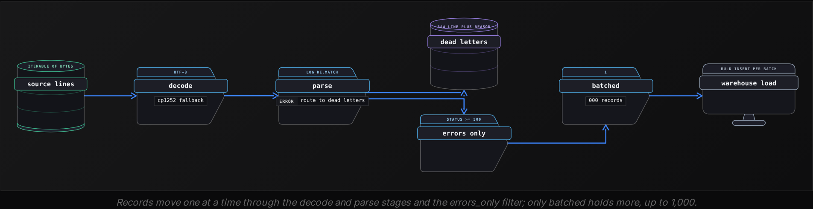

# String Parsing for Data Engineers: Intermediate

Tomasz is 40 minutes into a Cloudflare data engineering interview when the interviewer pastes 3 access log lines into the shared editor. One has a dash where the byte count belongs, one carries a user agent with an escaped quote inside it, and one stops halfway through the request. The task is to turn lines like these into rows for an analytics table. Tomasz starts typing `line.split()` and the interviewer waits. The follow-ups arrive one by one: a partner feed that sends cp1252 bytes, a tags column written as `user="Ana Silva" retry=3`, a file too large for memory, and a validation regex that might hang on a hostile line. Each follow-up has a correct answer and a cost, and the interviewer is listening for both, said in numbers, before any code runs.


<br>

### What you will be able to do

Write an anchored, compiled regex for Combined Log Format that copes with brackets and escaped quotes and accepts a dash for any missing value. Route the lines it rejects.

Diagnose an unknown encoding from its bytes and pick the errors= strategy and BOM handling that keep bad bytes visible.

Decide from the producer's quoting and delimiter rules whether partition or split is enough for key=value strings, or whether they need shlex or a compiled pattern.

Compose generator stages into a lazy pipeline and name every stage where memory stops being constant.

Spot quantified groups that backtrack exponentially and rewrite them into patterns that run in linear time.


<br>

---

## Parsing Apache Combined Logs

Combined Log Format writes 9 fields per request on a single line, separated by single spaces: client host, identity, authenticated user, time, request line, status and response size, then referer and user agent. Four of those fields can contain spaces of their own, so the format fences them in. The time sits inside square brackets because it ends with a UTC offset after a space, and the request line and the 2 client headers, referer and user agent, sit inside double quotes. A field the server has no value for is written as a single `-`.

```sql
line_a = (
    '203.0.113.7 - frank [10/Oct/2023:13:55:36 -0700] '
    '"GET /cart HTTP/1.1" 200 2326 "-" "Mozilla/5.0 (X11)"'
)
line_b = '198.51.100.4 - - [10/Oct/2023:13:55:40 -0700] "-" 408 - "-" "-"'
```

| Field | Line A value | Fenced by | A dash means |
| --- | --- | --- | --- |
| host | 203.0.113.7 | nothing | never a dash |
| ident | - | nothing | identity lookup is off |
| user | frank | nothing | request was not authenticated |
| time | 10/Oct/2023:13:55:36 -0700 | [ ] | never a dash |
| request | GET /cart HTTP/1.1 | " " | no request line arrived, as on a 408 timeout |
| status | 200 | nothing | never a dash |
| size | 2326 | nothing | 0 body bytes were sent |
| referer | - | " " | no Referer header |
| agent | Mozilla/5.0 (X11) | " " | no User-Agent header |


<br>

### Why split() lands on the wrong field

Whitespace splitting treats the fences as ordinary characters, so the number of tokens depends on what was inside them. Line A splits into 13 tokens and line B into 10, and the shift begins at the request field, index 5.

| Index | Line A token | Line B token |
| --- | --- | --- |
| 5 | "GET | "-" |
| 6 | /cart | 408 |
| 7 | HTTP/1.1" | - |
| 8 | 200 | "-" |
| 9 | 2326 | "-" |
| 12 | (X11)" | IndexError |

> Predict the output
>
> Code written against line A reads the status with `int(parts[8])`. Run it with `parts = line_b.split()`. Does it print a status, return a wrong number, or raise?

It raises `ValueError: invalid literal for int() with base 10: '"-"'`, because index 8 on line B holds the quoted referer. That traceback is the better outcome. A broken client that sends a raw space in its path, `GET /search?q=red shoes HTTP/1.1`, pushes the status to index 9, so a parser that reads size from index 9 stores the status 200 as the byte count without complaint.


<br>

### An anchored pattern with fenced groups

The pattern describes each fence instead of counting tokens. `\[(?P<time>[^\]]+)\]` takes everything up to the closing bracket. A quoted field is `"(?:[^"\\]|\\.)*"`: any character that is neither a quote nor a backslash, or a backslash followed by any character. The second branch matters because the server writes a quote inside a user agent as `\"`, and a plain `[^"]*` would stop there. The size group is `\d+|-`, which accepts the dash explicitly. The pattern is compiled once at module level, and `match` anchors it at index 0, so a line that doesn't start like a record fails at the first position instead of being retried from every offset the way `search` would.

https://github.com/user-attachments/assets/7fcabb0f-9d5b-40f3-8b9f-cd2f3ce4e47e

*4 lines through 1 compiled pattern. The first 2 are a full record and a 408 made of dashes, the last 2 an escaped quote and a fragment.*

The 408 line comes out as `408 0 None None`: every dash became `None` except size, which became 0. The bot's agent keeps its escape sequences as `bot \"v2\"`. If the column needs literal quotes, a later step can unescape them. The fragment matches nothing and lands in the dead letter path with its full text, so the count of rejected lines becomes a number someone can alert on.


<br>

### Dashes and offsets in the emitted row

| Raw value | Store as | Why |
| --- | --- | --- |
| A dash in ident, user, referer or agent | NULL | A literal - would count as 1 more distinct referer in every GROUP BY |
| A dash in size | 0 | The server writes a dash when it sent 0 body bytes, so SUM(size) stays correct |
| A dash as the request | NULL method, path and protocol | Nothing arrived to split into 3 parts |
| An offset such as -0700 | UTC timestamp, offset in its own column if analysts need local time | Rows from servers in different zones sort on a single clock |

```sql
from datetime import datetime, timezone

raw = "10/Oct/2023:13:55:36 -0700"
local = datetime.strptime(raw, "%d/%b/%Y:%H:%M:%S %z")
print(local.astimezone(timezone.utc).isoformat())
```

It prints `2023-10-10T20:55:36+00:00`: 13:55 at 7 hours behind UTC is 20:55 UTC. `%b` matches month abbreviations in the process's `LC_TIME` locale, while the server always writes English ones, so a job that sets a non-English locale fails on every line; a 12-entry month dict removes the dependency. `strptime` also runs a regex of its own plus Python code on every call, and a busy log repeats the same second hundreds of times, so caching parsed values by timestamp string cuts that cost.

> **TIP**
>
> A complete answer names 5 things before the interviewer asks: brackets and quotes are fenced groups, escaped quotes need the backslash branch, dashes map to NULL or 0 by field, offsets convert to UTC, and lines that fail `match` go somewhere countable.


<br>

---

## Encoding Detection and errors=

Every file arrives as bytes, and the codec you decode with decides which character each byte becomes. The byte `0xE9` is `é` in cp1252 and Latin-1, while in UTF-8 it opens a 3-byte sequence and is invalid on its own. Choose wrong and the decode either raises or succeeds with the wrong text stored.

| Bytes | decode("utf-8") | decode("cp1252") | decode("latin-1") |
| --- | --- | --- | --- |
| b"caf\xe9" | UnicodeDecodeError | café | café |
| b"caf\xc3\xa9" | café | café | café |
| b"5\x80" | UnicodeDecodeError | 5€ | '5\x80', a control character |
| b"\x81" | UnicodeDecodeError | UnicodeDecodeError | '\x81', a control character |

The second row is the silent failure. UTF-8 bytes read as cp1252 or Latin-1 turn `café` into `café` without raising. The corrupted value reaches the warehouse, where it no longer joins to the clean `café`. Latin-1 assigns a character to every possible byte, so it can never raise; that makes it a bad default, because a wrong guess produces text instead of an error. cp1252 replaces Latin-1's control characters in the 0x80 to 0x9F range with printable ones such as `€` and leaves 5 of them undefined, which is why the last row raises.


<br>

### A detection order you can defend

- **1. Read the first 4 bytes** *BOM check*\
  EF BB BF means UTF-8 with a byte order mark. FF FE or FE FF means UTF-16, which no single-byte guess survives.
- **2. Decode strictly as UTF-8** *the default*\
  A lead byte must be followed by bytes in 0x80 to 0xBF, so cp1252 text usually fails at its first accented letter.
- **3. Fall back to cp1252 per record** *tagged*\
  Record which codec decoded each row, so a fallback rate of 0.1% and one of 40% look different on a dashboard.
- **4. Quarantine what neither decodes** *raw bytes kept*\
  Store the original bytes with the file name and line number, so a fix can be replayed against them.

Sniffing a sample only sets the starting codec. The first 64 KB of a partner file can be clean ASCII while a single accented surname sits in row 9 million, and a sample cut at a fixed size can end in the middle of a multibyte character. Detection libraries add a statistical guess with a confidence score, which helps with unlabeled files from many sources and still needs the strict decode behind it. The answer to give is a strict decode across the full stream with a per-record fallback, because that is the only step that checks every byte.


<br>

### What errors= does to the byte

| errors= | b"caf\xe9".decode("utf-8", errors=...) | What it costs |
| --- | --- | --- |
| strict | raises UnicodeDecodeError | The job stops at the first bad byte unless each record is caught |
| replace | 'caf\ufffd', printed as caf� | The original byte is gone and U+FFFD lands in the warehouse |
| ignore | 'caf' | The value shrinks silently and stops joining to 'café' |
| backslashreplace | printed as caf\xe9 | Readable for diagnosis, ambiguous if the source holds a literal backslash |
| surrogateescape | 'caf\udce9' | Round-trips with encode(..., errors='surrogateescape'); a strict UTF-8 write raises |

Strict stays the default for anything feeding a table, wrapped in a per-record `try` so a single bad line is routed instead of fatal. `backslashreplace` belongs in the quarantine copy, where a person needs to see which byte broke. `surrogateescape` fits a pass-through job that must write the original bytes back out unchanged. `ignore` is the option to argue against: it turns `café` into `caf` with no error and no count.

https://github.com/user-attachments/assets/de0a0578-966f-4c91-8f37-0ee7228cf435

*BOM stripped on the first line, then strict UTF-8 with a cp1252 fallback; a row that fails both is quarantined with the bad bytes visible.*

The rows with ids 1 and 2 hold the same city in 2 encodings, and both come out as `München` because the fallback runs only after strict UTF-8 refuses. Row 4 fails both codecs on byte `0x81` and is quarantined as `4,Z\xfcrich \x81`, the bad bytes still readable. The final counter is the observability piece: 2 of 5 rows needing cp1252 in a feed labeled UTF-8 is a conversation to have with its producer.


<br>

### The BOM that hides the first column

```sql
import csv

data = b"\xef\xbb\xbfid,city\n1,Oslo\n".decode("utf-8")
row = next(csv.DictReader(data.splitlines()))
print(list(row))
print(row["id"])
```

The first print shows `['\ufeffid', 'city']` and the second raises `KeyError: 'id'`. A byte order mark is the 3 bytes `EF BB BF`. Some editors and export tools write it at the start of UTF-8 files, and decoding with plain `utf-8` keeps it as the invisible character U+FEFF glued to the first header. Decoding with `utf-8-sig` removes a leading BOM and otherwise behaves exactly like `utf-8`, so it is a safe default for reading any file that should be UTF-8. On output the choice reverses: write `utf-8` without a BOM unless the consumer is a spreadsheet program that needs one to detect the encoding.

> **TIP**
>
> Asked how you would detect an encoding, answer in order: BOM, strict UTF-8, tagged cp1252 fallback, quarantine with raw bytes, and a per-file count of each path. Naming `latin-1` as the fallback invites the follow-up about mojibake.


<br>

---

## Parsing Quoted Key=Value Pairs

Application logs are full of key=value strings, and so are event tags and URL query strings. The parse looks like a split on spaces followed by a split on `=`, and it holds until a value has a space or an equals sign of its own, or a quote. The interviewer's line has all 3:

```sql
line = 'level=error user="Ana Silva" path=/q?a=b note="can\'t write" retry=3'
pairs = dict(token.split("=") for token in line.split())
```

It raises `ValueError: dictionary update sequence element #2 has length 1; 2 is required`. Element 0 is `level=error`, and element 1 is `user="Ana`, which splits into 2 parts and is accepted with a stray quote. Element 2 is `Silva"`, the second half of the quoted name, with no `=` at all. Remove the 2 quoted pairs and `path=/q?a=b` fails next, splitting into 3 parts because its value holds a second `=`.


<br>

### partition and the missing separator

| Token | split("=") | split("=", 1) | partition("=") |
| --- | --- | --- | --- |
| retry=3 | ['retry', '3'] | ['retry', '3'] | ('retry', '=', '3') |
| path=/q?a=b | ['path', '/q?a', 'b'] | ['path', '/q?a=b'] | ('path', '=', '/q?a=b') |
| tag= | ['tag', ''] | ['tag', ''] | ('tag', '=', '') |
| debug | ['debug'] | ['debug'] | ('debug', '', '') |

`partition` cuts at the first separator and always returns 3 strings, so `key, sep, value = token.partition("=")` never raises. `split("=", 1)` handles the extra `=` too, but it returns 1 item for `debug`, and unpacking that into 2 names raises `ValueError: not enough values to unpack (expected 2, got 1)`. The middle element of the partition tuple carries information: an empty `sep` marks a bare flag like `debug`, while `tag=` has a separator and an empty value. Mapping those to `True` or `NULL`, or leaving an empty string, is a schema decision the parser should make once and document.


<br>

### Quotes change the tokenizer

Partition fixes the value side; the quoted space is a tokenizing problem. `shlex.split` tokenizes with shell rules: it splits on whitespace outside quotes and removes the quotes, so `user="Ana Silva"` comes back as the single token `user=Ana Silva`.

```sql
import shlex

print(shlex.split('level=error user="Ana Silva" retry=3'))
print(shlex.split("note=can't retry=3"))
```

The first call prints `['level=error', 'user=Ana Silva', 'retry=3']`. The second raises `ValueError: No closing quotation`, because shell rules read the apostrophe in `can't` as the start of a single-quoted string, and backslashes outside quotes get shell meaning as well. shlex is pure Python and reads 1 character per loop iteration, where a compiled pattern scans in C, so on millions of log lines it is the slowest option here. It fits producers that really follow shell quoting, such as command lines captured in an audit log.


<br>

### One compiled pattern for logfmt-style lines

When only double quotes delimit values, a pattern states that rule directly. Each pair is a word key, `=`, then either a double-quoted string with the same escape branch the log pattern used for its quoted fields, or a run of non-space characters. `findall` returns every pair in a single pass.

https://github.com/user-attachments/assets/4a240e07-e288-42f5-ad49-d9e160806e97

*Partition after a whitespace split, then a pattern that knows the quoting rule.*

The partition version never raises, and that is its danger here: it invents the keys `Silva"` and `write"` with empty values and leaves stray quotes on 2 real values. The pattern version returns 5 pairs, keeps the second `=` inside the path, and accepts the apostrophe because only a double quote opens a value. Duplicate keys raise a second policy question: if the line held `retry=3` and later `retry=4`, the dict would keep 4, and an interviewer may ask whether that field should keep the first value or the last, or collect them in a list.

| What the format allows | Tool | Reason |
| --- | --- | --- |
| No quoting, a fixed delimiter, values that may contain = | split on the delimiter, then partition | String methods run in C and need no pattern |
| Shell quoting: single and double quotes, backslash escapes | shlex.split, then partition | Implements exactly those rules, at Python speed |
| Double-quoted values with escapes, apostrophes in free text, high volume | compiled findall pattern | States the single quoting rule and scans in C |

> **TIP**
>
> Name the producer's quoting rule before naming a tool. 'Values can hold spaces inside double quotes and apostrophes are literal' points to a pattern; 'it is a shell command line' points to shlex; 'nothing is quoted' points to partition.


<br>

---

## Lazy Generator Pipelines

A single generator keeps a file's lines out of memory. A production parse needs several steps after reading: decode and parse, then filter and batch. Writing them as one long loop couples every step to every other. A pipeline gives each step its own generator function that takes an iterable and yields results, then chains them: `batched(errors_only(parse(decode(lines))), 1000)`. Building that chain runs no code inside the stages. The consumer at the end calls `next`, and each stage pulls 1 item from the stage before it.




<br>

### Watch the stages interleave

https://github.com/user-attachments/assets/db5e3524-826d-4a3d-80ab-6d0198851809

*3 stages over 5 lines: each read happens only when the consumer asks for a record.*

The trace answers 3 interview questions. Building the chain printed nothing, so a pipeline nobody consumes never touches its source. The first `next` read 2 lines and stopped at the first 5xx, so a consumer that needs only a sample stops the upstream reads too: `itertools.islice(pipeline, 100)` returns the first 100 errors without reading the rest of the file. The second `list` came back empty because a generator is single-use, and a function that counts the pipeline and then loops over it again to load gets an empty second pass and raises nothing.


<br>

### Where constant memory ends

The pipeline is O(1) in the number of lines only while every stage keeps bounded state. Interviewers probe this by adding a requirement and asking what happens to memory.

| Stage | State it holds | Memory grows with |
| --- | --- | --- |
| decode, parse, filter | the current record | nothing, it stays constant |
| batched(records, 1000) | 1 batch | the batch size |
| count requests per status | a Counter of statuses | distinct statuses, a few dozen |
| drop duplicate request ids | a set of every id seen | distinct ids in the file |
| list(), sorted() | every record | the whole file |
| itertools.groupby by host | the current group | 1 group, on input already sorted by host |

Deduplication is where most answers lose the bound. A set of request ids grows with the file, so a constant-memory answer bounds it: dedupe inside a time window when duplicates arrive close together, or push exact dedupe to the warehouse, where a key on the load table enforces it. Sorting has the same shape. `groupby` is lazy, but it groups only adjacent items, so it needs input already sorted by its key, and that sort is the step holding everything.

```sql
from itertools import islice

def batched(records, size):
    it = iter(records)
    while True:
        batch = list(islice(it, size))
        if not batch:
            return
        yield batch
```

Without the `iter` call this stage is wrong. Given a list, `islice(records, size)` starts a fresh iterator at index 0 on every call, so the loop would yield the first batch forever.


<br>

### An exception closes the generator

https://github.com/user-attachments/assets/34e75708-86a1-4f4f-a951-1dd6b2532b18

*The consumer catches the error and keeps calling next. Predict whether 503 is ever parsed.*

The value 503 never appears. When an exception escapes a generator, Python finishes that generator, and every later `next` raises `StopIteration`; catching the error in the consumer cannot resume it. The handling has to live inside the stage, around the single record that failed.

```sql
def parse(rows, dead_letters):
    for row in rows:
        try:
            host, status = row.split()
            yield {"host": host, "status": int(status)}
        except ValueError as exc:
            dead_letters.append((row, str(exc)))
```

> **TIP**
>
> Write each stage as a function of an iterable and test it on a list. A stage that opens and parses a file from a path it was given can only be tested against a real file, and it cannot be reordered or reused.


<br>

---

## Catastrophic Regex Backtracking

Python's `re` module is a backtracking engine. Wherever a pattern allows more than one choice, such as how many characters a `+` takes, it records the choice, tries the first option, and comes back for the next when the rest of the pattern fails. Most patterns offer few choices per character. A quantified group whose body also has a variable length offers choices that multiply, and on input that almost matches, the engine tries every combination before it can report failure.

```sql
import re

ID_LIST = re.compile(r"^(\d+,?)+$")
print(bool(ID_LIST.match("101,102,103")))
print(bool(ID_LIST.match("1" * 25 + "x")))
```

The first call prints `True` at once. The second line has 25 digits and then an `x`, so `$` fails. Because the comma is optional, `(\d+,?)+` can carve the digit run into groups in many ways: all 25 digits as 1 group or 24 plus 1, then 23 plus 2 and on through every other split. The engine must reject each carving before it prints `False`.

https://github.com/user-attachments/assets/1127e756-2c58-4310-96ec-324e5a92fbe6

*The 8 ways (\d+,?)+ can carve 4 digits, in the order the greedy engine tries them.*

Each extra digit doubles the carvings, so rejection cost grows as 2 to the power of the length minus 1. The real engine does more work per carving than this model, testing the optional comma and the anchor at every step, so the model understates it.

- **16,777,216** — carvings to reject the 25-digit line
- **33,554,432** — carvings at 26 digits


<br>

### The shape that explodes

The danger is a quantified group whose body can match the same characters in more than one way. Inside `(\d+,?)+`, the optional separator lets 2 iterations share a digit run. The same happens with overlapping alternatives, where a character can be taken by either branch. A nested quantifier is safe when every character has exactly 1 way to be consumed, which is why the quoted-field group from the log pattern, `(?:[^"\\]|\\.)*`, runs in linear time: a backslash can only start the second branch.

| Pattern | Why it branches | Linear rewrite |
| --- | --- | --- |
| ^(\d+,?)+$ | an optional comma lets digit runs split anywhere | ^\d+(?:,\d+)\*$ |
| ^(\w+\s?)+$ | an optional space does the same to words | ^\w+(?:\s\w+)\*$ |
| ^(\w\|\d)+$ | a digit matches both branches | ^\w+$ |
| "(?:[^"]\|\\.)\*" | a backslash matches both branches | "(?:[^"\\]\|\\.)\*" |


<br>

### Making a pattern production-safe

| ✓ Do | ✗ Don't |
| --- | --- |
| • Require the separator: \d+(?:,\d+)\* instead of (\d+,?)+<br><br>• Give each character a single way in: [^"\\] beside \\. rather than [^"] beside \\.<br><br>• Fence fields with negated classes such as [^\]]+ rather than .\*<br><br>• Cap line length before matching and dead-letter longer lines<br><br>• Test near misses: a long valid run plus 1 bad final character, at doubling lengths | • Put a + or \* around a group whose body already has a variable length<br><br>• Run regex patterns supplied by users inside the parsing process<br><br>• Trust tests built from valid lines; the slow input is the one that almost matches<br><br>• Count on a timeout: re has no timeout argument |

Python 3.9 offers no engine-level guard. Atomic groups `(?>...)` and possessive quantifiers such as `\d++`, which forbid backtracking into what they matched, arrived in Python 3.11. On 3.9 the protection is the pattern's shape plus a length cap: a linear pattern on a line capped at 8 KB finishes quickly, while an exponential one can hang on a 40-character line. Patterns supplied by users belong in a separate process that a supervisor can kill.

```sql
import re
import time

SAFE = re.compile(r"^\d+(?:,\d+)*$")

def reject_seconds(pattern, size):
    text = "1" * size + "x"
    start = time.perf_counter()
    assert pattern.match(text) is None
    return time.perf_counter() - start

for size in (2000, 4000, 8000):
    print(size, f"{reject_seconds(SAFE, size):.6f}")
```

On the rewrite, each row prints a small fraction of a millisecond, and the time grows in step with the size. Pointed at `^(\d+,?)+$`, the same harness never returns from its first size. Describing this harness is the evidence an interviewer wants that a rewrite is safe.

> **TIP**
>
> Shown a regex and asked whether it can hang, look for a quantifier on a group whose body is itself variable-length, then ask whether 2 iterations could split the same characters differently. If they can, build the near miss out loud: a long run that fits, plus 1 character that does not.


<br>

---

## Putting It All Together

A retailer loads web server access logs from its own servers and from a partner's checkout service into an hourly 5xx dashboard. After a partner release, the partner's lines arrive in cp1252 with a trailing tags field such as region="eu west" build=7, and the hourly job starts taking 6 times longer.

- The anchored log pattern still matches the partner lines, because match ignores text after the agent field; a separate findall pass parses the tags, and the quoted region value rules out a whitespace split.
- Strict UTF-8 fails only on the partner lines that carry accented city names, while ASCII-only lines still decode as UTF-8; the cp1252 fallback decodes the accented ones, and that feed's fallback count rising from 0 to roughly the share of accented lines at the release hour shows when the producer changed.
- Generator stages keep memory flat on the larger files, and the dead letter list, filled inside the parse stage, shows which partner lines fail and with which error.
- The 6 times slowdown traces to a new build-field validator, ^(\d+,?)+$, meeting long malformed values; rewriting it as ^\d+(?:,\d+)\*$ and capping line length restores the run time.


<br>

---

## Key Takeaways

- Describe log fields by their fences: a negated class inside brackets, a quote-or-escape group inside quotes, an explicit dash in size, with match anchoring the pattern and misses routed to dead letters.
- Decode strictly as UTF-8, with utf-8-sig on read, fall back to cp1252 per record with a tag, and quarantine raw bytes; latin-1 never raises, so its mistakes stay silent.
- Pick the key=value tool from the quoting rule: partition for unquoted values that may hold =, shlex for shell quoting, a compiled findall pattern for double-quoted logfmt.
- A generator chain stays constant in memory only while each stage holds bounded state. A dedupe set ends that, and so do sorts and list(); an exception escaping a stage finishes it.
- A quantified group whose body can match the same text 2 ways backtracks exponentially on near misses. Require separators and make branches disjoint, then cap length and test with near misses.
