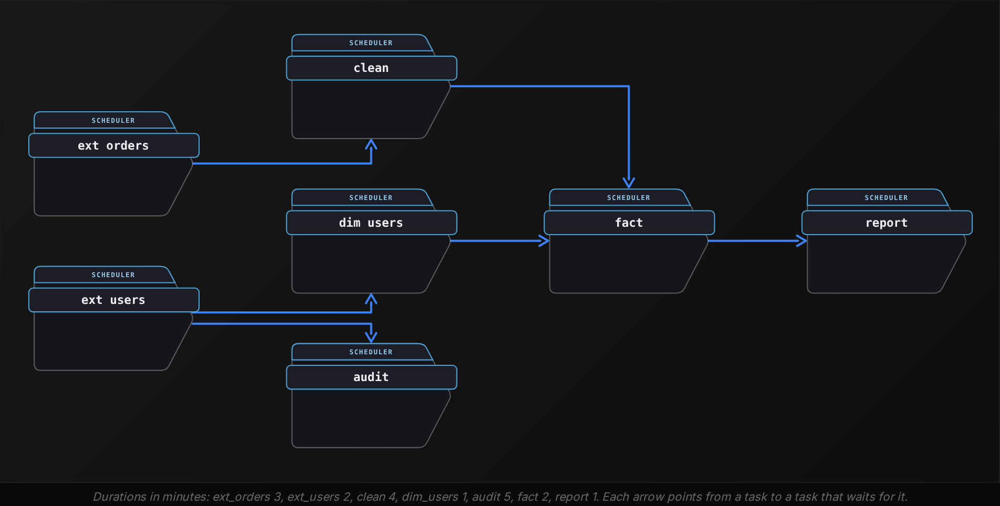
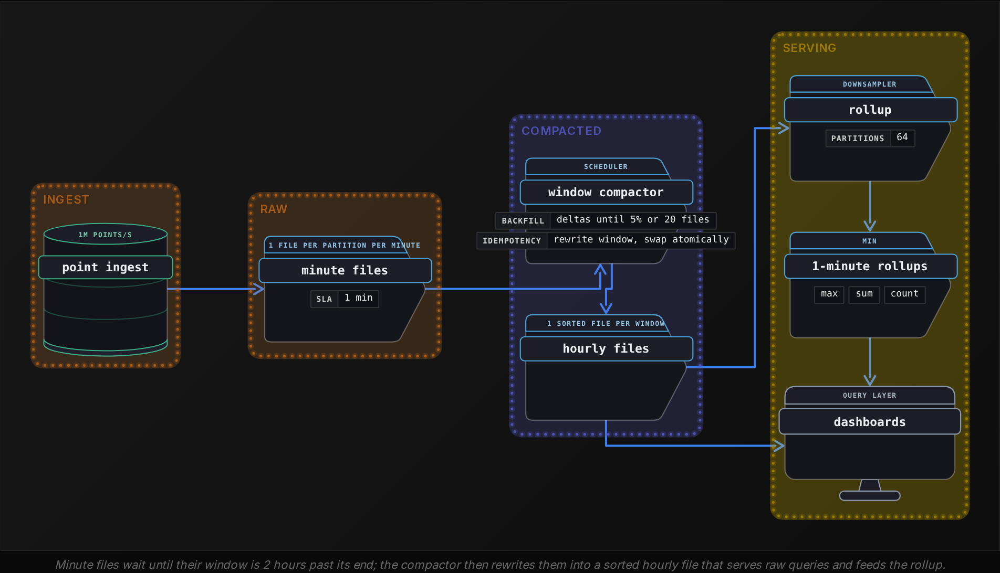

# Merge Intervals: Advanced

Ines is in the final round of a Netflix data engineering loop. The interviewer sketches a timeline: playback heartbeats from a phone every minute, then a 2-hour silence, then 40 events stamped mid-flight that arrive after the plane lands. 'Build viewing sessions with a 30-minute gap. Then tell me what your pipeline had already published before those 40 events showed up.' Ines recognizes the shape. Every heartbeat is a short interval, a session is their merged union, and the late batch can fuse 2 published sessions into a single session. The follow-ups keep coming: attach the subscription plan valid at each session's start, compact the heartbeat table after a night of small files, and schedule the whole job graph on 8 workers. Each one is merge intervals under a new constraint, and each constraint comes with a cost she has to name.


<br>

### What you will be able to do

Derive earliest-start intervals from a task DAG, read worker demand off their peak overlap, and explain why that peak overstates the minimum.

Decide when interleaved range updates and range queries call for a segment tree, and implement range add with range max.

Implement an as-of temporal join with a sort and 2 pointers, and name the output term that breaks the n log n bound.

Design a streaming sessionizer that retracts and re-emits published sessions, and size its state against allowed lateness.

Plan time-window compaction by merging file time ranges, and quantify the write amplification that late files cause.


<br>

---

## DAG-Constrained Scheduling

The question arrives as a job graph: 7 tasks, each with a duration in minutes and a list of upstream tasks. The interviewer wants the shortest wall-clock time for the whole graph and the number of workers that time needs. It reads like a dependency problem, yet both answers come from intervals. Once a task has a start time, it occupies the half-open interval [start, start + duration), and worker demand at any moment is the count of intervals live at that moment.




<br>

### Earliest start turns the DAG into intervals

Kahn's algorithm visits tasks in topological order. Keep a queue of tasks whose parents have all been placed, pop one, fix its end time, and decrement the in-degree of each child. A child's earliest start is the latest end among its parents, so each finished parent raises it to max(current start, parent end). When the queue empties, the largest end is the makespan, equal to the length of the longest chain of durations, the critical path. A sweep over start and end events then counts how many tasks run at once in this as-soon-as-possible (ASAP) schedule.

https://github.com/user-attachments/assets/cf08118e-f30b-4a1e-8a9c-c049a681dd92

The run prints each task with its interval, then makespan 10 peak 3. The critical path is ext_orders, clean, fact, report: 3 + 4 + 2 + 1 = 10. The peak lands at minute 2, when ext_orders is still running and dim_users and audit both start. Tuple order matters at that minute: (2, -1) sorts before (2, 1), so ext_users frees its worker before its children claim one. Sort starts ahead of ends at equal times, and the same data reports a peak of 4.


<br>

### The ASAP peak is an upper bound

ASAP placement starts every task at its earliest slot, which bunches the tasks that could afford to wait. A task's slack is how far it can slide right without moving the makespan: its latest start, found by a backward pass from the end, minus its earliest start. The `audit` task feeds nothing, so it may finish as late as minute 10, which gives it 3 minutes of slack. Sliding it to [5, 10) drops the peak from 3 to 2 with the makespan unchanged.

| task | duration | ASAP interval | slack | with audit moved |
| --- | --- | --- | --- | --- |
| ext_orders | 3 | [0, 3) | 0 | [0, 3) |
| ext_users | 2 | [0, 2) | 3 | [0, 2) |
| clean | 4 | [3, 7) | 0 | [3, 7) |
| dim_users | 1 | [2, 3) | 4 | [2, 3) |
| audit | 5 | [2, 7) | 3 | [5, 10) |
| fact | 2 | [7, 9) | 0 | [7, 9) |
| report | 1 | [9, 10) | 0 | [9, 10) |
| peak workers |  | 3 |  | 2 |

Placing slack well is a scheduling problem in its own right: on a fixed number of workers with precedence constraints, minimizing the makespan is NP-hard. Production schedulers use list scheduling instead. Whenever a worker frees up, it takes the highest-priority task whose parents are done. Graham showed in 1966 that any list schedule on m workers finishes within a factor of 2 - 1/m of the optimal makespan. Priority decides how close a run gets; ranking ready tasks by their longest remaining path keeps critical-path work from queuing behind tasks that have slack.


<br>

### With k workers, ready tasks wait in a heap

The k-worker simulation runs 2 heaps. One holds running tasks keyed by finish time; popping it advances the clock to the next completion and releases that task's children. The other holds ready tasks keyed by priority, and each free worker pops from it. A common bug hides in the ready heap's tuples. Predict what this prints.

```sql
import heapq

ready = []
heapq.heappush(ready, (3, {"name": "clean", "dur": 4}))
heapq.heappush(ready, (3, {"name": "audit", "dur": 5}))
print(ready[0][1]["name"])
```

The first push succeeds, since an empty heap compares nothing. The second compares the new tuple with the root, finds the ready times tied at 3, moves on to the dicts, and stops the program before print with TypeError: '<' not supported between instances of 'dict' and 'dict'. Push (ready_time, next(seq), task) with seq = itertools.count() instead. The counter never repeats, so comparison never reaches the dict, and ties break by insertion order, which keeps the schedule identical between runs.

> **TIP**
>
> If Kahn's loop ends having placed fewer tasks than the graph holds, the tasks left with nonzero in-degree sit on or downstream of a cycle. Report their names and fail the run: scheduling only the acyclic part hides the broken dependency until its tables go stale.


<br>

---

## When You Need a Segment Tree

The sweep line answers peak overlap when every interval is in hand before the first answer is due. Interviewers take that assumption away: reservations for a shared compute pool arrive one at a time, the pool runs at most 2 jobs at once in any hour, and each request is accepted or rejected the moment it lands. Accepting one means reading the maximum load across every hour it covers, then adding 1 to each of those hours, so the service interleaves 2 range operations for as long as it runs.


<br>

### The operations pick the structure

| workload | structure | cost per operation |
| --- | --- | --- |
| every interval known, 1 answer at the end | sort events, sweep once | O(n log n) total |
| insert intervals, read load at one instant | difference array: +1 at start, -1 at end | O(1) insert, O(D) read |
| insert intervals, read max load over a range | segment tree with range add and range max | O(log D) |
| insert and delete intervals, list those containing t | interval tree | O(log n + k) per query |

D is the number of time slots and k the number of intervals a query returns. The third row is the one a sweep cannot serve: rescanning the accepted reservations for each new request costs time proportional to how many are already accepted, so n requests cost O(n^2).


<br>

### Why range add and range max stay logarithmic

A segment tree covers slots 0 through D - 1. The root spans all of them, each node's 2 children split its span in half, and leaves are single slots. Any range decomposes into at most 2 whole nodes per level, and the walk that finds them touches at most 4 nodes per level, so both operations cost O(log D). Each node stores tag, an amount added to its entire span, and mx, the largest load inside its span including its own tag. Because max(a + v, b + v) = max(a, b) + v, an update that covers a node's whole span adds v to both fields and stops there; the children never see it, and a query adds the tags back on its way up.

```sql
class MaxAddTree:
    def __init__(self, n):
        self.n = n
        self.mx = [0] * (4 * n)
        self.tag = [0] * (4 * n)

    def add(self, lo, hi, v):
        self._add(1, 0, self.n - 1, lo, hi, v)

    def peak(self, lo, hi):
        return self._peak(1, 0, self.n - 1, lo, hi)

    def _add(self, node, l, r, lo, hi, v):
        if hi < l or r < lo:
            return
        if lo <= l and r <= hi:
            self.mx[node] += v
            self.tag[node] += v
            return
        m = (l + r) // 2
        self._add(2 * node, l, m, lo, hi, v)
        self._add(2 * node + 1, m + 1, r, lo, hi, v)
        self.mx[node] = self.tag[node] + max(self.mx[2 * node], self.mx[2 * node + 1])

    def _peak(self, node, l, r, lo, hi):
        if hi < l or r < lo:
            return float("-inf")
        if lo <= l and r <= hi:
            return self.mx[node]
        m = (l + r) // 2
        left = self._peak(2 * node, l, m, lo, hi)
        right = self._peak(2 * node + 1, m + 1, r, lo, hi)
        return self.tag[node] + max(left, right)


tree = MaxAddTree(24)
for s, e in [(9, 12), (10, 14), (11, 13), (12, 15)]:
    ok = tree.peak(s, e - 1) < 2
    if ok:
        tree.add(s, e - 1, 1)
    print(s, e, ok)
```

The booking loop prints 9 12 True, 10 14 True, 11 13 False, 12 15 True. After 2 accepts, hours 10 and 11 hold load 2, so [11, 13) sees a peak of 2 and fails < 2. The request for [12, 15) starts in an hour the rejected request also wanted, and passes, because hour 12 carries load 1. A half-open reservation [s, e) maps to slots s through e - 1; pass e instead and a booking that ends at 12:00 collides with one that starts at 12:00.


<br>

### The domain size is a design decision

A fixed calendar gives a fixed tree: 1,440 minute slots in a day need 5,760-entry arrays and 11 levels. Arbitrary timestamps need one of 2 adjustments. When every endpoint is known before the first request, coordinate compression sorts the distinct endpoints and uses their ranks as slots, so D is at most 2n. When endpoints are unknown, a dynamic tree allocates nodes only along the paths updates touch. A year at millisecond resolution spans roughly 31.5 billion slots, 35 levels deep, and memory grows with the requests instead of the span.

Price the choice at production size. A pool scheduled by the minute takes 100,000 reservations against a 1,440-minute day, and each request makes 1 range-max read and, when accepted, 1 range add. Rescanning grows with the square of the request count; the tree pays 2 walks of 11 levels per request no matter how many came before.

- **5 billion** — event visits, rescanning per request
- **8.8 million** — node visits, segment tree worst case


<br>

---

## Temporal Joins in O(n log n)

A temporal join attaches to each event the dimension row that was valid at the event's timestamp. Clickstream events carry product_id and event_ts; a price table has 1 row per price period, valid over [valid_from, valid_to). A single product's periods are disjoint, so each event matches at most 1 row. The interviewer asks for the join, then for its cost.

```sql
SELECT
  e.event_id,
  e.product_id,
  p.price
FROM events AS e
LEFT JOIN price_versions AS p
  ON e.product_id = p.product_id
    AND e.event_ts >= p.valid_from
    AND e.event_ts < p.valid_to
```

An engine runs this as a hash join on `product_id` followed by a filter on the 2 range predicates. Inside a single product, every event meets every price period before the filter keeps at most 1. A product with 200 price changes and 5 million events costs about 1 billion comparisons in a single task, and that hot key sets the runtime of the whole job.


<br>

### Sort both sides, then walk 2 pointers

Sort events by (key, ts) and versions by (key, valid_from). Because a key's versions are disjoint, that order also sorts them by valid_to. A pointer j moves forward past every version that belongs to an earlier key or ends at or before the current event. The version it stops on is the only candidate, and it matches when its key equals the event's key and it started at or before the event. Neither pointer moves backward, so the walk is O(n + m), and the sorts dominate at O(n log n + m log m).

https://github.com/user-attachments/assets/6f326ba7-87f1-491d-a770-e02cde818163

The walk prints 6 lines, a line per event. A 10 sits on a boundary: the first version of A ends at 10 and valid_to is exclusive, so the pointer steps past it and the event gets 6.0. C 5 drives j off the end of the list and prints None. Remove j < len(prices) from the if and that same event raises IndexError: list index out of range, since prices[4] does not exist. Across all 6 events, the while loop advances j only 4 times.


<br>

### Check the invariant before trusting the join

The walk is correct only while each key's versions are disjoint. A loader bug that writes 2 overlapping periods for a single product makes the walk return whichever period sorts first, with no error, while the SQL range join returns 2 rows for that event. Run the merge intervals adjacency check on the dimension before the join: sort by key and `valid_from`, and flag any row that starts before the previous row ended.

```sql
SELECT
  product_id,
  valid_from,
  prev_valid_to
FROM (
  SELECT
    product_id,
    valid_from,
    LAG(valid_to, 1) OVER (
      PARTITION BY product_id
      ORDER BY valid_from
    ) AS prev_valid_to
  FROM price_versions
) AS v
WHERE valid_from < prev_valid_to
```

A gap, where a period starts after the previous one ended, is legal; events inside it match nothing and come out with a null price, so count them as their own data-quality metric.


<br>

### Interval-to-interval joins are output-sensitive

Swap the events for intervals: join user sessions to the ad campaigns that were live during each one. A session can now overlap many campaigns. The sweep sorts every start and end together, keeps an active list per side, and pairs each starting interval with every active interval on the other side. Its cost is O((n + m) log(n + m) + k), where k is the number of output pairs, and k has no useful bound: 10,000 sessions inside a week when 10,000 campaigns each ran all week produce 100 million pairs. Writing 100 million rows takes at least 100 million steps, whatever the algorithm.

So ask what the consumer needs. If it wants the number of live campaigns per session, the pairs never have to exist. With sorted arrays of campaign starts and campaign ends, the campaigns overlapping session [s, e) are those starting before e minus those ending at or before s: 2 binary searches per session, O((n + m) log m) in total, with no k term.

| join shape | matches per left row | cost |
| --- | --- | --- |
| point in interval, disjoint versions per key | 0 or 1 | O(n log n + m log m) |
| point in interval, overlapping intervals | many | O(n log n + m log m + k) |
| interval overlap, pairs written out | many | O((n + m) log(n + m) + k) |
| interval overlap, count per left row | 1 number | O((n + m) log m) |

> **TIP**
>
> In a distributed job, partition both sides by key, sort within each partition, and run the same walk. A hot key still lands in a single task, but its cost falls from events times versions to events plus versions.


<br>

---

## Sessionization at Scale

Sessionization is merge intervals applied to clicks. An event at time t covers the closed interval [t, t + gap], and a user's sessions are the union of those intervals after merging. With a 30-minute gap, an event exactly 30 minutes after the previous one continues the session, because the 2 intervals touch. In batch, sort each user's events and open a new session wherever the gap exceeds 30 minutes.

```sql
WITH flagged AS (
  SELECT
    user_id,
    event_ts,
    CASE
      WHEN DATE_DIFF(
        'second',
        LAG(event_ts, 1) OVER (
          PARTITION BY user_id
          ORDER BY event_ts
        ),
        event_ts
      ) <= 1800 THEN 0
      ELSE 1
    END AS is_new_session
  FROM events
)

SELECT
  user_id,
  event_ts,
  SUM(is_new_session) OVER (
    PARTITION BY user_id
    ORDER BY event_ts
  ) AS session_number
FROM flagged
```

Batch has a property streaming lacks: each run recomputes from every event it can see, so a late event fixes the output on the next run with no extra logic. The costs are freshness, bounded by the schedule, and boundaries: a daily partition cuts every session that crosses midnight unless the job also reads the last 30 minutes of the previous day. Skew shows up here too, since a crawler account with 50 million events sorts inside 1 window partition.


<br>

### Streaming: open sessions, a watermark, retractions

A streaming sessionizer keeps, per user, a sorted list of disjoint session intervals. Each event is an insert-interval step: bisect finds its position and a loop absorbs every session the new interval touches. A watermark is the pipeline's running claim that no event older than it is still in flight, and once a session's end falls below the watermark, the sessionizer emits it. A late event that touches an emitted session breaks that claim, and the repair is to retract what was published and emit the corrected session.

https://github.com/user-attachments/assets/80f32447-c63e-4699-8f32-bd5c7122b4df

The sessionizer prints 3 lines: emit [0, 40], retract [0, 40], emit [0, 110]. The event at 38 arrives with the watermark at 60, 22 minutes late. Its interval [38, 68] reaches back to touch [0, 40] and forward to touch [65, 110], so 2 sessions collapse into 1. Only [0, 40] had been published, so only it is retracted; [65, 110] was still open and merges without any output. A consumer that showed the session [0, 40] now shows [0, 110].


<br>

### Allowed lateness sets state size and finality

Published sessions cannot stay in state forever. Allowed lateness L is how long past its end a session stays mergeable: once the watermark passes end + L, the sessionizer drops it, and any later event for it lands in a side table that a batch repair job reprocesses. A session becomes final, beyond any further retraction, at its last event + gap + L. With a 30-minute gap and 90 minutes of lateness, that is 2 hours after the last click.

| allowed lateness | final after last event | what downstream must handle |
| --- | --- | --- |
| 0 min | 30 min | no retractions; every late event goes to batch repair |
| 90 min | 2 h | retractions until 2 h after the last event |
| 24 h | 24.5 h | retractions for a day, and a day of users in state |

Size the state before picking L. Assume 20 million users hold a session in state at peak, at around 200 bytes each for the key, the interval list and the emitted flags. State tracks users active within gap + L, so moving L from 90 minutes to 24 hours widens that span from 2 to 24.5 hours: around 12 times the users at a uniform activity rate. A session that keeps merging never closes, so a crawler clicking every few minutes stays in state forever; a 24-hour cap on session length forces a split and bounds that user's state.

- **4 GB** — session state at peak, L = 90 min
- **49 GB** — session state at peak, L = 24 h


<br>

### Session ids that survive a merge

A retraction needs an id to retract. Deriving it from data, as `hash(user_id, session_start)`, makes the stream and the batch repair compute the same id for the same session, so their outputs converge. The cost shows when a late event lands before a session's start: had the late event in the run been at minute -10, the merged session would start at -10 and carry a new id, and the consumer must delete the old id and insert the new one. An id taken from arrival order survives that merge but differs between stream and batch, leaving 2 answers for the same session.

> What the interviewer listens for
>
> - Sessions as merged closed intervals [t, t + gap], with the boundary rule stated.
> - Emission on watermark, and retraction when a late event touches a published session.
> - Allowed lateness traded against state size and time to finality.
> - Events past lateness routed to a batch repair that derives the same session ids.
> - A session-length cap, such as 24 hours, so one crawler cannot hold state forever.


<br>

---

## Time-Series Compaction Design

Compaction questions come with numbers: a metrics store ingests 1 million points per second, writes 1 file per partition every minute, and accepts points up to 2 hours late. Each partition gains 60 small files an hour, and a query over a day opens 1,440 of them per partition. Compaction rewrites many small files into a few large, time-sorted ones, and the design turns on which files must be rewritten together. That is a merge intervals question asked over file metadata.


<br>

### File time ranges are the intervals

Each file records the smallest and largest timestamp it holds. Files whose ranges overlap interleave in time, so a sorted output needs their rows sort-merged. Disjoint files only need concatenating in time order, which still rewrites small files into a larger one but never interleaves their rows. Merge the ranges, and every group holding more than 1 file needs the sort-merge. The ranges are closed, because max_ts is a point the file contains.

https://github.com/user-attachments/assets/d688c16a-57d3-4b06-af0c-df3a12eafa3a

The grouping prints 3 lines: merge ['f1', 'f3', 'f2'] 0 119, merge ['f4', 'f6', 'f5'] 120 259, append ['f7'] 300 359. On their own, f1 and f2 are disjoint, 59 against 60, yet f3 straddles both and pulls them into a single merge. f6, a late file, bridges f4 and f5 the same way. append means f7 is concatenated after its neighbours into a larger file, with no sort-merge. Under steady late data, bridges can chain a whole day into a single group, and the merge grows with the day.


<br>

### Fixed windows stop the chain

Time-window compaction assigns every point to a fixed window, 1 hour here, and compacts each window on its own. A file that straddles a boundary is split at write time, so groups never cross windows and the largest rewrite is a single window. A window compacts once the watermark passes its end plus the 2-hour lateness; on-time data can no longer arrive for it, so 1 pass per window covers nearly every point.



A file that arrives after its window compacted forces a choice. Rewriting the window keeps reads at 1 file but pays for the whole window to absorb a small file. Keeping the late file as a delta beside the compacted output costs nothing extra at write time, and every read of that window merges 2 sources until a later pass folds the delta in. Take a partition's hourly window at 6 GB, a late file at 1 MB, and on-time points written once at flush and once at compaction.

- **2x** — write amplification, on-time points
- **6,000x** — write amplification, a late 1 MB file

A threshold policy splits the difference: re-compact a window once its deltas pass 5% of its bytes or 20 files, which bounds the read-side merge and spreads a single rewrite across many late files.


<br>

### The rewrite is a k-way merge with dedupe

Inside a group, heapq.merge combines the sorted files while holding 1 pending row per input, at O(N log k) for N rows across k files. Late data can rewrite a point that already exists, so each row carries a sequence number, and the highest sequence for a timestamp wins.

```sql
import heapq
from itertools import groupby

old = [(10, 1, 4.0), (20, 1, 4.5), (30, 1, 5.0)]
late = [(20, 2, 4.7), (25, 2, 4.9)]

for ts, rows in groupby(heapq.merge(old, late), key=lambda r: r[0]):
    *_, winner = rows
    print(ts, winner[2])
```

The merge prints 10 4.0, 20 4.7, 25 4.9, 30 5.0. Tuples order by timestamp, then sequence, so the newest write for a timestamp comes last, and \*_, winner = rows keeps the last row of each group. Give the late row at 20 a sequence of 0 and the older 4.5 survives, the bug a backfill job produces when it reuses a stale sequence.


<br>

### Value compaction: runs of equal readings

A second kind of compaction shrinks the rows themselves. A device status polled every 10 seconds repeats itself, and storing each run of equal values as a single interval is merging adjacent intervals that share a payload.

polled readings

| ts | status |
| --- | --- |
| 0 | up |
| 10 | up |
| 20 | up |
| 30 | down |
| 40 | down |
| 50 | up |

compacted runs

| interval | status |
| --- | --- |
| [0, 30) | up |
| [30, 50) | down |
| [50, 60) | up |

Runs are lossless for state signals. Continuous gauges get downsampled into coarser buckets instead, and each bucket stores min, max, sum and count so averages come from sum over count at read time. An hourly average built from 60 minute averages is wrong whenever the minutes hold different point counts; sum over count stays exact at every tier.


<br>

---

## Putting It All Together

A video streaming service builds a daily viewing report. Devices send playback heartbeats, some of them hours late after offline viewing; a plan table records each subscriber's plan over validity periods; heartbeats land in a metrics store as minute files; and an overnight job graph turns all of it into the report on a fixed pool of workers.

- Heartbeats are sessionized as merged [t, t + 30 min] intervals, with a watermark, 90 minutes of allowed lateness and retractions keyed by hash(user, session start).
- Each session joins to the plan valid at its start through a sorted 2-pointer walk, after a LAG check confirms each subscriber's plan periods are disjoint.
- Minute files compact per hourly window once the window is 2 hours past its end, and late heartbeats sit as deltas until a threshold triggers a rewrite.
- The overnight graph gets earliest starts from a topological pass, list scheduling on the worker pool, and a sequence counter in its ready heap so tied tasks never compare dicts.
- If the service sells reserved time on that worker pool, accepting reservations online is the range-add, range-max segment tree problem.


<br>

---

## Key Takeaways

- A task DAG becomes intervals once earliest starts are fixed; the makespan is the critical path, and the ASAP peak overlap bounds worker demand from above.
- A sweep line needs every interval up front. Online range updates mixed with range-max reads need a segment tree at O(log D) per operation.
- An as-of join over disjoint versions is a sort plus a forward-only 2-pointer walk; interval-to-interval joins add an output term k that no algorithm avoids.
- Sessions are merged closed intervals of [t, t + gap]. In a stream, a late event can fuse published sessions, so the design needs watermarks, retractions, allowed lateness and data-derived ids.
- Compaction groups are merged file time ranges. Fixed windows cap the chain, and deltas plus a threshold trade read cost against write amplification.
- In each design, the half-open or closed boundary choice decides correctness at the exact moment 2 intervals meet.
