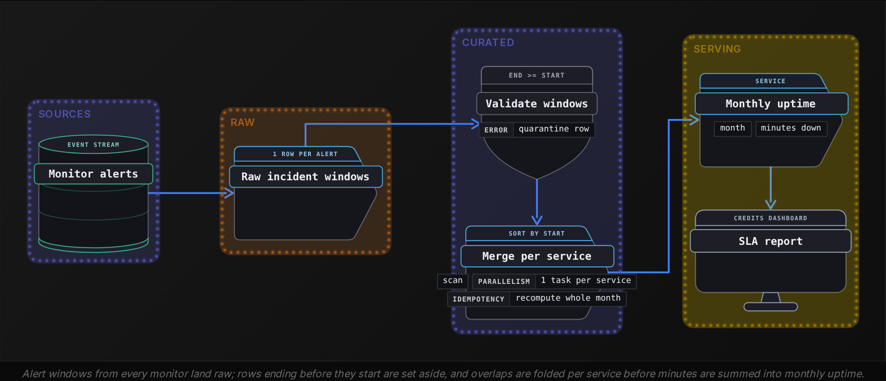

# Merge Intervals: Beginner

Ines is 40 minutes into a Google onsite when the interviewer pastes a list into the shared doc: [[9, 11], [13, 14], [10, 12], [16, 17]]. Each pair is a busy block from a teammate's calendar, measured in hours. 'Combine these into the stretches when anyone is busy, so the scheduler can show the free gaps.' Ines begins comparing every block with every other block. The interviewer nods, then asks how that behaves with 50,000 blocks from a whole office, and whether [9, 11] and [11, 12] should become a single block. She has the pieces but no order to put them in. Under the calendar story sits one of the most common interview patterns: sort the ranges, then walk them once while deciding each boundary case on purpose. This lesson builds that pattern and its 2 relatives.


<br>

### What you will be able to do

Merge overlapping intervals by sorting on start and comparing each interval only with the last merged block

Insert a new interval into a sorted, disjoint list in O(n) using 3 explicit phases

Choose the largest set of non-conflicting intervals by sorting on end time, and show why start order and shortest-first fail

Translate downtime totals and per-user activity into merges, and recognize backfill plans as inserts and exclusive job slots as the end-time greedy

Pick a Python representation for intervals and predict the errors each one invites, from aliased lists to comparisons against None or between naive and aware datetimes


<br>

---

## Sort First, Scan Once

The prompt: given `[start, end]` pairs in any order, return the fewest pairs that cover exactly the same points, with no 2 output pairs overlapping. For `[[8, 10], [1, 3], [2, 6], [15, 18], [17, 20]]` the answer is `[[1, 6], [8, 10], [15, 20]]`. Whether the pairs are calendar blocks or partition ranges, the algorithm reads only the 2 numbers in each.


<br>

### Why sorted order makes 1 pass enough

Checking each pair against all the others fails in 2 ways. It costs n(n-1)/2 comparisons, about 1.25 billion for 50,000 intervals. It's also incomplete: merging 2 pairs produces a wider pair that may now overlap a third, so the checks must repeat until a full round changes nothing.

Sort by start and 1 comparison per interval is enough. Walk the sorted list while building an output of merged blocks. Every block except the last ended before the last one began; had it not, the 2 would have merged when the last one arrived. The current interval starts at or after the last block's start, because of the sort, so it can reach the last block and nothing earlier. Each step either extends that block or opens a new one. Sorting 50,000 intervals takes roughly 780,000 comparisons, and the scan adds 50,000 more.

| Step | Next interval | Last block before | Test | Last block after | Output so far |
| --- | --- | --- | --- | --- | --- |
| 1 | [1, 3] | none | output empty | [1, 3] | [[1, 3]] |
| 2 | [2, 6] | [1, 3] | 2 <= 3, overlap | [1, 6] | [[1, 6]] |
| 3 | [8, 10] | [1, 6] | 8 <= 6 fails | [8, 10] | [[1, 6], [8, 10]] |
| 4 | [15, 18] | [8, 10] | 15 <= 10 fails | [15, 18] | [[1, 6], [8, 10], [15, 18]] |
| 5 | [17, 20] | [15, 18] | 17 <= 18, overlap | [15, 20] | [[1, 6], [8, 10], [15, 20]] |

The animation runs that walk on the same 5 intervals. `sorted(intervals, key=lambda iv: iv[0])` returns a new list ordered by start and leaves the caller's list untouched. `merged[-1][1]` is the end of the last block, the only output value each step reads. Opening a block appends a fresh `[start, end]` list built from the 2 numbers; the last section of this lesson shows the bug that reusing the input pair causes.

https://github.com/user-attachments/assets/9d0d6d42-2cf4-4ca9-afc1-0be467f915a2

*Each interval is compared with the last merged block only.*


<br>

### The 2 decisions inside the test

The operator in `start <= merged[-1][1]` decides touching ranges. Under `<=`, the ranges `[1, 3]` and `[3, 5]` merge into `[1, 5]`, since no free moment separates them, and a free-time finder built on the output never reports a zero-length gap at 3. With `<`, they stay as 2 blocks. Some prompts want touching ranges kept apart, so state the rule aloud and let the interviewer adjust it.

`max(merged[-1][1], end)` handles containment. In `[[1, 10], [2, 3]]` the second interval sits inside the first. Assigning `merged[-1][1] = end` would overwrite 10 with 3, shrinking the block to `[1, 3]` and dropping everything from 3 to 10. The sort guarantees a new interval starts late enough to belong to the block; it says nothing about where that interval ends, so the end needs `max`.

| Input | Correct output | The mistake that breaks it |
| --- | --- | --- |
| [] | [] | Indexing `intervals[0]` up front to seed the output raises IndexError |
| [[5, 7]] | [[5, 7]] | Dropping the `merged and` guard makes `merged[-1]` raise IndexError |
| [[1, 3], [3, 5]] | [[1, 5]] | Testing with `<` leaves 2 touching blocks |
| [[1, 10], [2, 3]] | [[1, 10]] | Assigning `end` instead of `max(...)` shrinks the block to [1, 3] |
| [[4, 6], [1, 2]] | [[1, 2], [4, 6]] | Skipping the sort folds [1, 2] into [4, 6] and loses it |


<br>

### Try it: predict the output

This version changes 1 line. Work out what it prints before reading the answer below the code.

```sql
def merge_buggy(intervals):
    ordered = sorted(intervals, key=lambda iv: iv[0])
    merged = []
    for start, end in ordered:
        if merged and start <= merged[-1][1]:
            merged[-1][1] = end
        else:
            merged.append([start, end])
    return merged


print(merge_buggy([[1, 10], [2, 3], [4, 8]]))
```

It prints `[[1, 3], [4, 8]]`. The sorted order is `[1, 10]`, `[2, 3]`, `[4, 8]`. The first pair opens `[1, 10]`. The second passes `2 <= 10` and overwrites the end with 3. The third then fails `4 <= 3` and opens a second block. The correct `[[1, 10]]` needs `max`. The bug appears as soon as any interval sits inside the current block: the block shrinks, as `[[1, 10], [2, 3]]` alone already shows, and a later interval that the original end would have absorbed then splits off as a block of its own. This input shows both effects.

> What the approach costs
>
> - Sorting: O(n log n) time, the dominant term.
> - Scanning: O(n), with 1 comparison and at most 1 append per interval.
> - Space: O(n) for the sorted copy and up to n output blocks.
> - Input that arrives sorted needs only the O(n) scan, so ask how the data is ordered.

> **TIP**
>
> Say the boundary rule before writing code: 'I'll treat [1, 3] and [3, 5] as a single block, because no time is free between them; tell me if touching ranges should stay apart.' That sentence decides between `<=` and `<` out loud and shows the interviewer you saw the case coming.


<br>

---

## Insert Interval: Three Phases

Insert interval gives you a list already sorted by start and already free of overlaps, such as a room's bookings or a backfill plan, plus a new interval. Return the updated list, which must stay ordered and disjoint. For bookings `[[1, 2], [3, 5], [6, 7], [8, 10], [12, 16]]` and the new interval `[4, 8]`, the result is `[[1, 2], [3, 10], [12, 16]]`.

Appending the new interval and rerunning the previous section's merge returns the right list in O(n log n). Interviewers usually ask for better, because the order of the input is information you were handed. Using it brings the cost down to O(n): a single left-to-right walk with no sorting at all.


<br>

### Every existing interval falls into 1 of 3 phases

Lay the new interval over the sorted bookings. Some finish before it starts, some collide with it, and the rest start after it ends. In a sorted, disjoint list those 3 groups are contiguous runs in that order, so a single index can move through all of them without stepping back.

| Phase | Loop condition | Action | Stops at |
| --- | --- | --- | --- |
| 1. Before | `slot_end < new_start` | Copy the slot to the output | The first slot ending at or after `new_start` |
| 2. Overlap | `slot_start <= new_end` | Widen: keep the smaller start and the larger end | The first slot starting after the widened end |
| 3. After | Any slot left | Append the widened interval once, then copy each remaining slot | The end of the list |

| Booked slot | Phase | Deciding comparison | New interval after this slot |
| --- | --- | --- | --- |
| [1, 2] | 1 | 2 < 4 | [4, 8] |
| [3, 5] | 2 | 5 < 4 fails, 3 <= 8 | [3, 8] |
| [6, 7] | 2 | 6 <= 8 | [3, 8] |
| [8, 10] | 2 | 8 <= 8 | [3, 10] |
| [12, 16] | 3 | 12 <= 10 fails | [3, 10], appended before this slot |

In the code, the 3 `while` loops share the index `i` and none of them resets it, so each booking is read once. `lo` and `hi` hold the widening interval. Phase 2 compares each slot's start with the current `hi`, and `[lo, hi]` enters the output exactly once, as soon as phase 2 finishes.

https://github.com/user-attachments/assets/e4e58811-c568-4ce3-883b-2429bd41293f

*One index walks the 3 phases and never moves back.*


<br>

### Strict before, inclusive during

The 2 comparisons apply 1 touching rule from opposite sides. Phase 1 copies a slot only when it ends strictly before the new start. A booking `[1, 4]` meeting a new interval `[4, 8]` ends exactly where the new one begins, so under the rule that touching ranges join, it must fall through to phase 2 and become part of `[1, 8]`. Writing `<=` in phase 1 would copy it and leave `[1, 4]` beside `[4, 8]`. Phase 2 uses `<=` for the mirror case, a slot starting exactly where the new interval ends.

| Booked | New | Phase 1 copies | Phase 2 absorbs | Result |
| --- | --- | --- | --- | --- |
| [[2, 4], [6, 8]] | [0, 1] | nothing | nothing | [[0, 1], [2, 4], [6, 8]] |
| [[2, 4], [6, 8]] | [9, 10] | both slots | nothing | [[2, 4], [6, 8], [9, 10]] |
| [[2, 4], [6, 8]] | [1, 9] | nothing | both slots | [[1, 9]] |
| [[2, 4], [6, 8]] | [4, 6] | nothing | both slots | [[2, 8]] |
| [] | [3, 5] | nothing | nothing | [[3, 5]] |

Rehearse the `[4, 6]` row: the new interval touches the end of 1 booking and the start of the next, and widening joins all 3 into `[2, 8]`.


<br>

### Try it: 2 insertions

Start from bookings `[[1, 3], [6, 9]]`. Predict the result of inserting `[2, 5]`. Then, from the same bookings, predict inserting `[5, 6]`. Name the phase each booking lands in.

Inserting `[2, 5]`: `[1, 3]` ends at 3, not before 2, so phase 2 absorbs it and widens the new interval to `[1, 5]`; `[6, 9]` starts after 5 and goes to phase 3. Result: `[[1, 5], [6, 9]]`. Inserting `[5, 6]`: `[1, 3]` ends before 5 and is copied in phase 1; `[6, 9]` starts at 6, and `6 <= 6` pulls it into phase 2. Result: `[[1, 3], [5, 9]]`.

| ✓ Append, then re-merge | ✗ 3 phases |
| --- | --- |
| • O(n log n), the sort dominates<br><br>• Reuses the merge already written<br><br>• Correct even if the list arrives unsorted<br><br>• Ignores the order the input guarantees | • O(n), 1 pass with a shared index<br><br>• A new function with 3 loops and 2 boundary comparisons<br><br>• Requires a sorted, disjoint input<br><br>• Uses that guarantee, which is what the question tests |

> **TIP**
>
> `bisect` can find where phase 2 begins in O(log n) on a separate list of ends, but building the output still copies every slot, so the whole insert stays O(n). Bring it up when the interviewer asks only for the position of the new interval.


<br>

---

## Greedy Scheduling by End Time

A third kind of prompt hands you candidate intervals and asks you to choose among them: the most meetings a single room can host, the most jobs a machine can run in sequence, or the fewest meetings to cancel so the rest never collide. The last is the first in disguise: with n candidates and k kept, the minimum number to cancel is n - k.

Conflict here follows the clock. A meeting from 9 to 10 and another from 10 to 11 can share a room, so a candidate fits when it starts at or after the end of the last meeting kept: `start >= last_end`. That treats touching ranges the opposite way from the merge, on purpose. Merging asks whether a gap separates 2 ranges; scheduling asks whether 2 ranges compete for the same moment.


<br>

### Of 3 sort orders, 2 lose

| Greedy order | Candidates | Greedy keeps | Best possible |
| --- | --- | --- | --- |
| Earliest start | [0, 100], [1, 2], [3, 4] | 1: [0, 100] | 2: [1, 2], [3, 4] |
| Shortest first | [0, 6], [5, 8], [7, 13] | 1: [5, 8] | 2: [0, 6], [7, 13] |
| Earliest end | either set above | 2 | 2 |

Earliest start fails because a long meeting that opens first locks the room for everything inside it. Shortest first fails because a short meeting can straddle the boundary between 2 longer ones and block both. Earliest end has no such case.

The argument for earliest end fits in 3 sentences. Take any best schedule and look at its first meeting, which ends at time t. The meeting that ends earliest overall ends at or before t, so swapping it in clashes with nothing later in that schedule, and the count stays the same. Repeat the swap on the meetings that start after the new first one ends, and the best schedule turns into the greedy one without losing a meeting.

The code sorts once by end and keeps a single number, `last_end`, the finish time of the most recent meeting kept. Starting it at `float("-inf")` means the first candidate always fits. Each candidate is compared with `last_end` alone, so the scan is O(n) after an O(n log n) sort.

https://github.com/user-attachments/assets/245d3d55-d20f-43b2-aa2d-ff36727d3b79

*Only last_end decides whether the next meeting fits.*

The greedy takes 6 requests and keeps a chain of 3 in which each meeting starts as the previous one ends: `[1, 3]` hands off to `[3, 5]`, which hands off to `[5, 9]`, and the `>=` test allows that. Each of the other 3 overlaps a kept meeting, and by the exchange argument above no schedule keeps more than 3, so 3 cancellations is the minimum.


<br>

### The yes-or-no cousin: can 1 person attend all?

When the prompt asks only whether every meeting fits, nothing is chosen, so start order is enough: sort, then check each neighbouring pair. A start earlier than the previous end is a clash.

```sql
def can_attend(meetings):
    ordered = sorted(meetings)
    for prev, cur in zip(ordered, ordered[1:]):
        if cur[0] < prev[1]:
            return False
    return True


print(can_attend([[9, 10], [10, 11], [13, 14]]))
print(can_attend([[9, 11], [10, 12]]))
```

It prints `True`, then `False`. The touching pair `[9, 10]` and `[10, 11]` passes because `10 < 10` is false, consistent with the clock rule above.


<br>

### Try it: count the cancellations

For `[[1, 2], [2, 3], [3, 4], [1, 3]]`, how many meetings must be cancelled so the rest never overlap? Then decide whether the order of `[2, 3]` and `[1, 3]`, which share an end of 3, can change the answer.

Sorted by end, the list is `[1, 2]`, `[2, 3]`, `[1, 3]`, `[3, 4]`; Python's sort is stable, so the tie keeps input order. Only `[1, 3]` is skipped, for 1 cancellation, while `[1, 2]` and `[2, 3]` survive along with `[3, 4]`. With the tied pair swapped, the greedy keeps `[1, 2]` and skips `[1, 3]`, after which `[2, 3]` and `[3, 4]` both fit, so 3 meetings are still kept. Ties on end never change the count, because either tied meeting frees the room at the same moment.

| ✓ Do | ✗ Don't |
| --- | --- |
| • Sort by end time whenever the task is choosing the largest conflict-free subset<br><br>• Ask whether [9, 10] and [10, 11] conflict before writing the comparison<br><br>• Start last_end at negative infinity so the first candidate always fits<br><br>• Report minimum removals as the candidate count minus the kept count | • Sort by start for the largest subset: [0, 100] blocks [1, 2] and [3, 4]<br><br>• Favour the shortest meeting: [5, 8] blocks both [0, 6] and [7, 13]<br><br>• Check a candidate against every kept meeting when the last kept end decides<br><br>• Copy the merge test <=, which would treat back-to-back meetings as clashes |


<br>

---

## Data Engineering Applications

Interval prompts in data engineering interviews usually describe a table of start and end timestamps with a business question on top. The work is translating the question into 1 of the 3 moves from the earlier sections, then noticing what the data adds, which is usually a grouping column or overlapping sources, and sometimes a list that is already maintained in order.

| Production question | Interval move | Why that move |
| --- | --- | --- |
| What was each service's downtime last month? | Merge per service, then sum lengths | Overlapping alerts would count the same minutes twice |
| How long was each user active across devices? | Group by user, merge, sum | Phone and laptop sessions overlap in time |
| Which date ranges need a backfill job? | Merge the requested ranges | Each day is rebuilt by 1 job, once |
| A team adds a backfill request to the plan | Insert into the sorted plan | The plan is already ordered and disjoint |
| Which compaction jobs get the table's single write slot? | Greedy by end time | Runs the most jobs; the rest are rescheduled |
| Do the loaded partitions leave any holes? | Merge loaded ranges, read between blocks | Each hole sits between 2 consecutive merged blocks |


<br>

### Downtime: summing raw windows overstates it

A service has 2 monitors, and each opens an incident window while it sees errors. Measured in minutes from the start of a 30-day month, the windows are `[10, 40]` and `[30, 50]`, plus `[45, 60]` and `[120, 130]`. Summing their lengths gives 75 minutes. Merging first gives `[10, 60]` and `[120, 130]`, 60 minutes of real downtime. Over the 43,200 minutes in the month, that is 99.861% uptime against a 99.85% target, a pass. The raw sum reports 99.826%, a failure that would pay out service credits the company does not owe.

- **64.8 min** — downtime allowed at 99.85% in 30 days
- **15 min** — overlap the raw sum counts twice




<br>

### Per-user active time: merge inside each group

Add a `user` column and the prompt becomes a grouping problem. Bucket the rows by user in a dict of lists, then run the merge on each bucket independently, since overlaps only matter within 1 user. Sorting k rows per bucket costs k log k, and the buckets together never cost more than sorting all n rows at once.

In the run below, ana's 3 sessions add up to 65 raw minutes. Her phone and laptop sessions overlap from minute 20 to 30, so merging leaves 55. `fold` seeds its output with `ranges[0]`, safe here because every bucket holds at least 1 row, and sorts each bucket in place because `by_user` owns those lists.

https://github.com/user-attachments/assets/e85bad25-e31c-4240-9c2b-d012b51c20ba

*Rows are bucketed by user, and each bucket is merged on its own.*


<br>

### Backfill plans: insert as requests arrive

A backfill plan is a list of day ranges to rebuild. It stays ordered and disjoint so that no day is rebuilt by 2 jobs. With the plan `[[1, 5], [8, 12], [20, 25]]`, a team asks for days 11 through 16. Phase 1 copies `[1, 5]`, phase 2 widens the request through `[8, 12]` to `[8, 16]`, and phase 3 copies `[20, 25]`. Days 11 and 12 are rebuilt once instead of twice. Ranges such as `[1, 5]` and `[6, 7]` hold adjacent days with no gap between them, yet `6 <= 5` fails; the last section handles that case.


<br>

### Exclusive slots: end-time greedy in a scheduler

Some tables accept 1 writer at a time, so compaction jobs that rewrite their files must not overlap. Given requested windows in hours `[[0, 4], [1, 2], [2, 5], [3, 6], [5, 7]]`, sort by end and keep each job whose start clears the previous kept finish. The kept jobs are `[1, 2]` and `[2, 5]`, with `[5, 7]` last. That leaves 2 jobs to reschedule, and no other choice runs more than 3.


<br>

### Partition holes: read the gaps between blocks

A day's events are loaded by 3 jobs. 2 of them cover `[0, 6]` and `[5, 12]`, and the third covers `[14, 24]`. Merging gives `[0, 12]` and `[14, 24]`, and a hole runs from one merged block's end to the next block's start, so hours 12 to 14 are missing. Reading the merged list in consecutive pairs lists every hole in O(n) after the sort.

Ask about boundaries and groups before coding

- A grouping column: bucket rows in a dict of lists and merge each bucket
- Several sources for the same events: merge before summing any lengths
- A list maintained in order: insert the new range in O(n)
- A single exclusive resource: sort by end and keep what fits
- Rows whose end precedes their start: filter them out before sorting

> **TIP**
>
> When a prompt involves timestamps, ask 2 questions before coding: are ranges closed or half-open, and is there a grouping column? The first picks your comparison operators; the second decides whether a dict of lists wraps the algorithm.


<br>

---

## Interval Representation in Python

The algorithms above stay the same whatever holds an interval, but the Python type decides which bugs are possible. Lists can be edited in place, which makes extending a block cheap and aliasing possible. Tuples and frozen dataclasses cannot be edited, which forces a rebuild and rules aliasing out. Comparison support decides whether `sorted()` works without a key.

| Type | Example | Change the end | Plain sorted() | Watch for |
| --- | --- | --- | --- | --- |
| list | `[2, 6]` | `block[1] = 9` | works: start, then end | editing a list the caller still holds |
| tuple | `(2, 6)` | rebuild: `(block[0], 9)` | works: start, then end | `TypeError: 'tuple' object does not support item assignment` |
| dataclass, frozen and ordered | `Span(2, 6)` | `replace(block, end=9)` | works: fields in order | declare `start` before `end` |
| plain dataclass | `Slot(2, 6)` | `block.end = 9` | `TypeError: '<' not supported between instances of 'Slot' and 'Slot'` | pass `key=lambda s: s.start` |


<br>

### Aliasing: when a merge edits the caller's data

This merge resembles the one from the first section, with 2 differences: it sorts without a key, and it appends each input pair directly. Predict both printed lines.

```sql
def merge_aliased(intervals):
    merged = []
    for iv in sorted(intervals):
        if merged and iv[0] <= merged[-1][1]:
            merged[-1][1] = max(merged[-1][1], iv[1])
        else:
            merged.append(iv)
    return merged


shifts = [[1, 4], [2, 6], [8, 9]]
print(merge_aliased(shifts))
print(shifts)
```

The first line is `[[1, 6], [8, 9]]`, as expected. The second is `[[1, 6], [2, 6], [8, 9]]`: the caller's first shift has changed. `sorted` builds a new outer list, but its items are the same inner list objects that `shifts` holds. Appending `iv` puts `shifts[0]` itself into `merged`, so `merged[-1][1] = 6` writes 6 into the caller's data. A job that merges a batch and then writes the original rows elsewhere would write corrupted rows. Appending `[iv[0], iv[1]]`, or holding intervals as tuples, removes the bug.


<br>

### Closed or half-open: choose 1, convert at the edges

| Question | Closed [start, end] | Half-open [start, end) |
| --- | --- | --- |
| Length of an integer range | `end - start + 1` | `end - start` |
| Do `[1, 3]` and `[3, 5]` share a point? | Yes, both contain 3 | No, they touch at 3 |
| Days 1 to 12 and 13 to 14 | `[1, 12]`, `[13, 14]`: no gap, yet `13 <= 12` fails | `[1, 13)`, `[13, 15)`: `13 <= 13` merges them |
| Conflict test for a and b | `a.start <= b.end and b.start <= a.end` | `a.start < b.end and b.start < a.end` |
| Python precedent | `random.randint(1, 12)` includes 12 | `range(1, 13)` and `xs[1:13]` exclude 13 |

Store intervals half-open inside your code and convert at the boundary: a closed integer range `[s, e]` becomes `[s, e + 1]`, and a calendar day runs from midnight to the next midnight, with no 23:59:59.999 end to guess at. The merge test `<=` then joins ranges that touch, which for half-open ranges means contiguous coverage, and the scheduling test `>=` lets touching meetings coexist. Both earlier rules hold with no special cases.

The animation merges half-open day ranges held as tuples. Tuples compare by start, then end, so plain `sorted` orders them with no key. They cannot be edited, so extending the last block means building a new tuple and assigning it to `out[-1]`, and appending the input tuple itself is safe: the second printed line shows the caller's list unchanged. A frozen, ordered dataclass behaves the same way through `replace(...)`.

https://github.com/user-attachments/assets/c9c87ad4-9b93-4dc0-a794-af37048e0839

*Half-open day ranges that touch at 13 merge into one tuple.*


<br>

### Datetimes and missing ends: 2 tracebacks

`datetime` values sort and subtract, and the difference is a `timedelta`, so the same merge runs on timestamps. Dirty data can stop it with a traceback in 2 ways. Predict what this prints.

```sql
from datetime import datetime, timezone

windows = [
    [datetime(2024, 3, 1, 9, 0), datetime(2024, 3, 1, 10, 0)],
    [
        datetime(2024, 3, 1, 8, 30, tzinfo=timezone.utc),
        datetime(2024, 3, 1, 9, 15, tzinfo=timezone.utc),
    ],
]
print(sorted(windows))
```

It prints no list. Ordering the 2 inner lists means ordering their first items, and one of those is a naive datetime while the other is aware, so Python raises `TypeError: can't compare offset-naive and offset-aware datetimes`. Normalize every timestamp to aware UTC when rows are loaded, before any interval logic runs.

An incident that is still open, stored as `[5, None]`, causes the other traceback. When `[7, 9]` arrives, the merge evaluates `7 <= None` and raises `TypeError: '<=' not supported between instances of 'int' and 'NoneType'`. At load time, replace a missing end with a sentinel: `float("inf")` for numbers, `datetime.max.replace(tzinfo=timezone.utc)` for aware timestamps. Convert it back when writing results.


<br>

---

## Putting It All Together

A cloud storage company pays service credits when a storage service's monthly uptime drops below 99.85%. Three monitors per service write incident windows that overlap, some incidents are still open at month end, alert timestamps arrive from regions in mixed formats, late alerts for the previous month keep arriving, and each storage cluster accepts 1 maintenance job at a time while teams request overlapping windows for the weekend.

- Normalizing alert timestamps to aware UTC and replacing open ends with a far-future sentinel at load time lets the sort run without a TypeError.
- Bucketing windows by service and merging each bucket with the sort-first scan turns overlapping alerts into downtime minutes that do not overstate the service credits owed.
- A late alert is a new interval for a service's sorted, disjoint windows, so the 3-phase insert updates that month in O(n) without re-merging.
- Weekend maintenance requests for a cluster are an end-time greedy choice, and the number turned away is the request count minus the kept count.
- Storing every window half-open makes touching incidents merge for downtime and lets back-to-back maintenance jobs coexist, so the 2 comparisons never contradict each other.


<br>

---

## Key Takeaways

- Sorting by start means each interval can only reach the last merged block, so 1 comparison per interval replaces the all-pairs check and the cost is O(n log n).
- The merge test start <= last_end joins touching ranges, and max on the end keeps a containing block from shrinking.
- Insert interval uses the input's order: copy what ends before, widen through what collides, append once, copy the rest, all in O(n).
- Picking the most non-conflicting intervals means sorting by end; earliest-start and shortest-first each lose on a 3-interval input.
- Production versions bring grouping columns and overlapping sources, so bucket by the column and merge before summing. Dirty values need timezones normalized and missing ends replaced at load time.
- Half-open intervals and fresh or frozen output objects remove the adjacency and aliasing bugs before they can happen.
