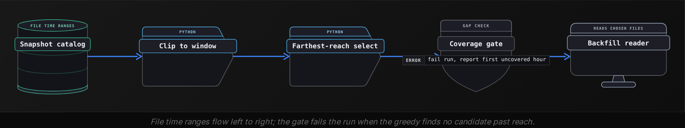

# Merge Intervals: Intermediate

Ines is 40 minutes into a Google onsite when the interviewer pastes a list of start and end times. 'These are one building's room bookings for tomorrow, pulled from the internal calendar system. How many physical rooms does the building need?' She sorts the list and builds a heap of finish times, explaining why a meeting that starts at 10:00 can take a room freed at 10:00. Then the follow-ups arrive. Report the busiest window and the hours when nothing is booked. Accept bookings one at a time and reject conflicts as they come. Cover a 24-hour audit window with the fewest log segments. Merge overlapping bookings while keeping attendee counts right. Each follow-up is a familiar interval question with a new decision inside it, and the interviewer scores whether she names that decision and its cost before she codes.


<br>

### What you will be able to do

Find the minimum number of rooms with a heap of end times and with 2 sorted lists, and pick the version a room-assignment follow-up needs

Turn intervals into +1 and -1 events and read peak overlap from a single sorted pass; the same pass also gives covered length and gaps

Choose between a sorted list with neighbor checks and an interval tree, based on whether stored intervals may overlap

Cover a target range with the fewest intervals using the farthest-reach greedy, and detect when no cover exists

Merge intervals while keeping attached sums and counts exact, and carry unions and latest values through the same merge


<br>

---

## How Many Meeting Rooms?

### One number behind every phrasing

Every version of this question reduces to a single number: the largest count of intervals open at the same instant. If 3 meetings overlap at 10:30, no schedule fits them into 2 rooms, and a greedy assignment that reuses the earliest-freed room never needs more than that peak. Interviewers phrase it as rooms and servers, or as concurrent ETL jobs competing for worker slots, or as parking spots, and the answer is the same peak count each time. The 2 standard solutions reach it from opposite directions, and the follow-up question decides which one you should have started with.

| Meeting | Start | End | Running at 10:30? |
| --- | --- | --- | --- |
| A | 10 | 12 | yes |
| B | 9 | 11 | yes |
| C | 11 | 13 | no |
| D | 10 | 11 | yes |
| E | 12 | 14 | no |


<br>

### Approach 1: heap the end times

Sort by start. Keep a min-heap holding the end time of every room opened so far, so `rooms[0]` is the room that frees up soonest. For each meeting, compare its start with `rooms[0]`. If that room is free by then, the meeting reuses it: pop the old end time and push the new one. If not, push alone, which opens a room. Each meeting costs 1 push and at most 1 pop, O(log n) apiece, after the O(n log n) sort.

https://github.com/user-attachments/assets/03630521-f0f6-407b-b1f6-bd07051ee786

*Every meeting pushes once; a pop happens only when the soonest-free room is free by its start.*

Look at the final line first. The heap ends with 3 entries and the answer is 3, because the loop never pops more often than it pushes: the heap's length counts rooms opened, and an opened room stays counted. After the loop the heap still lists the room A occupies until 12, although that room is empty from 12 onward, and that is right, since the building still owns it. A variant that pops every finished meeting inside a `while` loop also works, but there the heap's length rises and falls with concurrency, so you must track its maximum separately. Returning the final length from that variant is a common undercount: on this input it reports 2.


<br>

### Approach 2: 2 sorted lists and 2 pointers

Drop the pairing between each start and its end. Sort all starts into a list and all ends into another, walk the starts in order, and keep a second pointer `j` into the ends. A start at or after `ends[j]` means some meeting has finished, so its room is reused and `j` advances. Any other start needs a new room.

```sql
def min_rooms(meetings):
    starts = sorted(s for s, _ in meetings)
    ends = sorted(e for _, e in meetings)
    rooms = 0
    j = 0
    for s in starts:
        if s >= ends[j]:
            j += 1
        else:
            rooms += 1
    return rooms
```

| start s | ends[j] | decision | rooms |
| --- | --- | --- | --- |
| 9 | 11 | 9 < 11, open a room | 1 |
| 10 | 11 | 10 < 11, open a room | 2 |
| 10 | 11 | 10 < 11, open a room | 3 |
| 11 | 11 | 11 >= 11, reuse, j becomes 1 | 3 |
| 12 | 11 | 12 >= 11, reuse, j becomes 2 | 3 |

Discarding the pairing is safe for counting, because reusing a room requires only that some meeting has ended, whichever it was. It's fatal for assignment. Once the interviewer asks which room meeting C occupies, the pointer version has nothing to report, while the heap answers as soon as each entry becomes the tuple `(end, room_id)`.

```sql
import heapq


def assign_rooms(meetings):
    free_at = []
    rooms = []
    for start, end in sorted(meetings):
        if free_at and free_at[0][0] <= start:
            _, room = heapq.heappop(free_at)
        else:
            room = len(free_at)
        rooms.append((start, end, room))
        heapq.heappush(free_at, (end, room))
    return rooms
```

`len(free_at)` works as the next room id because the heap holds every room ever opened, the same invariant as the counting loop. On the sample input it puts B in room 0, D in room 1, A in room 2, C back in room 0 and E in room 1. When 2 rooms free at the same time, the tuple comparison falls through to the room id, so room 0 is handed out before room 1.


<br>

### The tie at 11 decides correctness

Bookings are half-open, `[start, end)`, so a meeting ending at 11 and another starting at 11 can share a room. That's why the heap test reads `rooms[0] <= start` and the pointer test reads `s >= ends[j]`. Make either comparison strict and the 5 sample meetings need 4 rooms instead of 3, because C can no longer take the room B or D releases at 11. If the interviewer says times are closed, so that 11:00 belongs to both meetings, the strict comparison is the right one. Ask before you write it: it's a single character, and it changes the answer.

| ✓ Min-heap of end times | ✗ 2 sorted lists, 2 pointers |
| --- | --- |
| • O(n log n) time, O(n) heap space<br><br>• Assigns rooms when each entry is (end, room_id)<br><br>• Answers 'lowest-numbered free room' with a second heap of idle ids<br><br>• Runs online if meetings arrive in start order | • O(n log n) for 2 sorts, then a linear pass<br><br>• Counts rooms only: the start-to-end pairing is gone<br><br>• Generalizes into event sweeps for coverage and gaps<br><br>• Plain integer comparisons, the smallest constant factor |

> **TIP**
>
> Choose from the follow-up. If it asks which room a meeting gets, or how long meetings wait in a queue when rooms run out, use the heap. Questions about totals and peaks go to the sweep, as do questions about empty time ranges; the next section grows the sweep into a general tool. Naming the choice before coding counts as part of the answer.


<br>

---

## Sweep Line: Events Drive Everything

### Each interval becomes 2 events

The pointer walk generalizes once you stop picturing meetings and track the moments when a count changes. An interval `[s, e)` emits the event `(s, 1)` and the event `(e, -1)`. Sort the events, walk them in order, and keep a running total called `active`. Between consecutive event times nothing changes, so at most 2n points describe the whole timeline, and every overlap question becomes a question about how `active` behaves between those points.

| Question | What the sweep reads | Data engineering example |
| --- | --- | --- |
| Peak overlap | Largest value of active after any event | Peak concurrent user sessions in a day |
| Covered length | Sum of widths (t minus prev) while active > 0 | Minutes in which at least 1 sensor reported |
| Gaps | Spans where active == 0 inside the range | Hours in which a partition received no rows |
| k-coverage | Sum of widths while active >= k | Time with 2 or more replicas serving |

A single pass answers the first 3 together. The program below sweeps 5 intervals, 2 of which touch at time 9, and prints the peak and the covered length, then lists the gaps between busy runs.

https://github.com/user-attachments/assets/4b852f3d-0f39-444f-bd25-abfbfd5fce6a

*Width is credited before the update, so each span uses the count that held across it.*

Where the coverage check sits relative to the update is the detail interviewers probe. Each step credits the span `[prev, t)` using the value `active` held during that span, so the check runs before `active += delta`. Move the update above the check and each span is credited with the count from its right edge: the empty stretch before every start is counted as covered, and the final stretch of every busy run is reported as a gap.


<br>

### Ties at equal timestamps

Python sorts the tuple `(10, -1)` ahead of `(10, 1)`, so at a shared time every end is processed before any start. For half-open intervals that matches reality: the interval ending at 10 has released its slot before the next one begins. Encode the deltas the other way round and the intervals `[9, 10)` and `[10, 11)` briefly count as overlapping.

Ends first: [9, 10) and [10, 11)

| event | active |
| --- | --- |
| (9, 1) | 1 |
| (10, -1) | 0 |
| (10, 1) | 1 |
| (11, -1) | 0 |

Starts first: [9, 10) and [10, 11)

| event | active |
| --- | --- |
| (9, 1) | 1 |
| (10, 1) | 2 |
| (10, -1) | 1 |
| (11, -1) | 0 |

The right-hand order reports a peak of 2 for 2 meetings that never share a minute. With closed intervals the shared point 10 belongs to both, the right-hand order becomes the correct one, and the delta encoding is where that convention gets written down.


<br>

### Small time grids skip the sort

The sweep's cost is the O(n log n) sort. When times are integers on a bounded grid, such as minutes within a single day, a difference array replaces it: add 1 at index `s`, subtract 1 at index `e`, and take a running sum. That costs O(n + T) for T slots, and touching intervals cancel inside the same cell, so the half-open rule comes built in. The tradeoff flips on large or sparse grids. A year at millisecond resolution has 31.5 billion slots, while the sorted-event sweep touches only the 2n slots where something happens.

- **1,440** — slots in a day at minute grain
- **86,400** — slots in a day at second grain

```sql
def peak_on_grid(intervals, slots):
    diff = [0] * (slots + 1)
    for s, e in intervals:
        diff[s] += 1
        diff[e] -= 1
    active = 0
    peak = 0
    for delta in diff:
        active += delta
        peak = max(peak, active)
    return peak
```

> Gaps inside a reporting window
>
> - Start `prev` at the window start, so empty time before the first interval is reported
> - After the loop, report `[prev, window_end)` when it has positive width
> - Clip every interval to the window first, so events outside it can't add coverage

> **TIP**
>
> For the time of peak overlap, record `t` whenever `active` sets a new maximum. The peak window runs from that event to the next event time, and it's half-open like the inputs.


<br>

---

## Interval Trees vs SortedList

### Intervals that arrive one at a time

Everything so far assumed the full input was known before the first answer. A booking service receives intervals one at a time, as do lock managers and partition registries, and each request needs an answer at once: does this one conflict with anything already stored? Re-sorting per request costs O(n log n) each time, so n requests cost O(n^2 log n). The structure kept between requests sets the cost, and the choice turns on a single property of what it stores.


<br>

### Disjoint intervals: 2 neighbors suffice

If accepted bookings never overlap, sorting them by start sorts them by end as well. A new request `[s, e)` can then collide only with the stored interval immediately before its insertion point or the one sitting at it. `bisect` finds that point in O(log n), 2 comparisons settle the conflict, and inserting at the found index keeps the list sorted.

https://github.com/user-attachments/assets/5467f306-bef8-4425-a372-958d25b670f3

*Each request is checked against its 2 neighbors in the sorted list and nothing else.*

Request `(25, 27)` sorts after `(20, 30)` and is refused by that left neighbor; `(0, 6)` sorts first and is refused by its right neighbor `(5, 10)`. In both cases the other stored bookings were never examined. `(20, 30)` is accepted against `(10, 20)` because the comparison `20 > 20` is false, the same half-open rule as the rooms problem.


<br>

### The O(n) shift behind each insert

The search is O(log n), but `list.insert` shifts every element after the insertion point, which is O(n) per booking. At 10,000 stored bookings the average shift moves roughly 5,000 pointers and takes microseconds. At 10 million, the average shift moves 5 million pointers, roughly 40 MB of memory, on every insert. `SortedList` from the third-party `sortedcontainers` package keeps a list of smaller sorted lists and documents its `add` as approximately O(log n). Swapping it in changes 3 lines: `booked = SortedList()`, `booked.bisect_left(x)` in place of the `bisect` call, and `booked.add(x)` in place of the insert. Some interview environments preinstall the package; ask, and if it is missing, keep the list version and state the O(n) insert out loud.


<br>

### Overlapping intervals break the neighbor check

The 2-neighbor argument depends on ends being sorted along with starts. Allow stored intervals to overlap and that property fails at once, since a long interval can start early and outlive everything after it.

| Stored, sorted by start | Query | Left neighbor checked | Neighbor check says | Actual answer |
| --- | --- | --- | --- | --- |
| (1, 100), (2, 3) | (50, 60) | (2, 3), ends at 3 | no conflict | conflicts with (1, 100) |

Scanning left from the insertion point repairs it at O(n) per query, because any earlier interval might still be open. An interval tree repairs it structurally. It is a binary search tree keyed by start in which every node also records `max_end`, the largest end anywhere in its subtree. When a subtree's `max_end` is at or before the query's start, nothing inside can overlap, and the search skips the subtree whole.

```sql
class Node:
    def __init__(self, start, end):
        self.start = start
        self.end = end
        self.max_end = end
        self.left = None
        self.right = None


def insert(node, start, end):
    if node is None:
        return Node(start, end)
    if start < node.start:
        node.left = insert(node.left, start, end)
    else:
        node.right = insert(node.right, start, end)
    node.max_end = max(node.max_end, end)
    return node


def overlapping(node, start, end, found):
    if node is None or node.max_end <= start:
        return found
    overlapping(node.left, start, end, found)
    if node.start < end and start < node.end:
        found.append((node.start, node.end))
    if node.start < end:
        overlapping(node.right, start, end, found)
    return found
```

The pruning uses both fields. `node.max_end <= start` discards a subtree whose intervals all end too early, and `node.start < end` guards the step right, because every start in the right subtree is at least `node.start`. In a balanced tree, such as a red-black tree with the same `max_end` field maintained through rotations, an insert costs O(log n), and finding 1 overlap or answering yes or no costs O(log n). Listing all k overlaps costs O(min(n, k log n)), because each reported interval can sit at the end of its own root-to-leaf walk; a centered interval tree, built differently, reaches O(log n + k). The sketch above is unbalanced, so already-sorted input degrades it into a linked list with O(n) operations, which is worth saying if you write it on a whiteboard.

| Workload | Structure | Cost per operation |
| --- | --- | --- |
| Fixed set, many queries | Sort once, merge or sweep, then bisect | O(log n) per query after an O(n log n) build |
| Arriving intervals that never overlap | Sorted (start, end) list with the 2-neighbor check | O(log n) search; insert O(n) with a list, about O(log n) with SortedList |
| Arriving intervals that may overlap, report every overlap | Interval tree with max_end | O(log n) to find one overlap, O(min(n, k log n)) to report all k; O(log n) insert when balanced |
| Arriving intervals that may overlap, only peak depth matters | Map of time to net delta, keys kept in order | O(n) sweep per request |

> **TIP**
>
> State the disjointness assumption before writing the neighbor check: 'accepted bookings never overlap, so their ends are sorted too.' The interviewer listens for that sentence, because the neighbor check is only correct when it holds.


<br>

---

## Greedy Range Coverage

### Fewest intervals that cover a range

Coverage questions ask how few intervals can buy a target range. Given intervals and a target `[0, T)`, choose the fewest intervals whose union covers the target, or report that no choice can. It appears as video clips stitched into a full recording, sprinklers watering a garden, or, in pipeline terms, the fewest snapshot files or backfill runs that together cover a reporting window.


<br>

### Take the farthest reach

Keep `reach`, the point up to which the target is already covered, starting at 0. Among all intervals that start at or before `reach`, pick the one ending farthest right and move `reach` to its end. If no candidate extends past `reach`, the target has a gap and no cover exists. Sorting by start lets a single pointer gather each step's candidates, and that pointer never moves backwards.

https://github.com/user-attachments/assets/9486a718-3e75-463a-80ef-43b73ee5ec0d

*The pointer i only moves forward, so every clip is examined once.*

The run makes 5 picks. `(1, 3)` and `(8, 10)` are examined and passed over, since each starts inside the covered prefix but ends short of a competitor. The inner `while` looks like a nested loop, yet `i` passes over the 7 clips once across the whole run, so after the O(n log n) sort the scan is O(n).


<br>

### The swap argument for the farthest end

Take any optimal cover and suppose that at some step it picks an interval ending at `x`, short of the farthest candidate end `f`. The optimal cover's next interval must start at or before `x` to keep the cover continuous, and `x <= f`, so it also starts at or before `f`. Swapping in the farthest interval leaves the rest of that cover valid with the same count. Repeating the swap at every step turns any optimal cover into the greedy one, so the greedy count is optimal. That swap is what an interviewer means by 'prove the greedy'.


<br>

### Same family, different sort key

| Question | Sort by | Greedy choice | Result |
| --- | --- | --- | --- |
| Most intervals with no overlap | end | Keep the next interval starting at or after the last kept end | intervals kept |
| Fewest points that stab every interval | end | Place a point at the current end and skip every interval it stabs | points placed |
| Fewest removals to leave no overlap | end | Run the first row, then answer n minus kept | intervals removed |
| Fewest intervals covering [0, T) | start | Among starts at or before reach, take the farthest end | intervals chosen |

Mixing these rows is the common failure. Sorting by end for a coverage question favors intervals that finish early, which is the opposite of what coverage rewards. A working test: if the objective rewards leaving room for later intervals, sort by end; if it rewards reaching as far right as possible from a fixed left edge, sort by start and, among the intervals that begin by that edge, take the one with the farthest end.


<br>

### Disguises that convert to intervals

Recognizing the problem is most of the work, because it rarely arrives as a list of intervals. Each disguise below converts item by item into an interval, and then the same farthest-reach loop runs unchanged.

| Disguise | Each item becomes | Target |
| --- | --- | --- |
| Jump game: from index i, jump up to nums[i] steps | [i, i+nums[i]] | Reach index n minus 1 |
| Garden taps: tap i waters radius r | [i-r, i+r], clipped to [0, n] | [0, n] |
| Video clips with start and end seconds | [start, end) | [0, T) |
| Snapshot files with min and max event time | [min_ts, max_ts] | The reporting window |




<br>

### Edge cases that change the answer

> Check these before you code
>
> - No interval starts at or before the target's left edge: the first step finds no candidate, so return impossible
> - Half-open clips chain when the next start equals reach; closed integer slots chain when start <= reach + 1
> - Intervals running past T are allowed, and the loop stops as soon as reach >= T
> - Zero-length intervals never extend reach, and the strict > test skips them


<br>

---

## Merging Intervals with Metadata

### The payload is the new part

Fusing the boundaries is the sort-and-scan from earlier interval work. The follow-up attaches a payload to each interval, such as an event count, a byte total, a set of sources or a price, and asks for merged intervals with correct payloads. Boundary logic stays put. What changes is the rule for combining 2 payloads when their intervals fuse, and that rule must give the same result whatever order the fusions happen in.


<br>

### Carry mergeable state, derive the answer last

Sums and counts combine safely; so do min and max, and so do set unions. Merging A with B, then with C, gives what merging A with the combination of B and C gives. An average does not, because averaging 2 averages weights a span of 1 event the same as a span of 1,000. Carry `events` and `total_ms` through the merge and divide once, after the last fusion.

https://github.com/user-attachments/assets/3b197947-545d-45d7-a172-866fb2576d73

*Sums and counts ride through the merge; the average is computed only when printing.*

The loop appends a fresh `Span` built from the input's fields whenever a merged span opens, and gives it its own `sources` list. Appending `s` itself would let the later `+=` lines rewrite objects inside the caller's `spans` list, a bug that surfaces only when someone reuses that list. The boundary test also carries a decision: `s.start <= merged[-1].end` fuses `[9, 12)` with `[12, 14)` although they only touch, which suits activity data where back-to-back spans form a single visit. With `<`, the second output line splits into 2 spans.

Averaging the averages

| span | inputs | avg |
| --- | --- | --- |
| [1, 6) | 100 ms and 500 ms | 300 ms |
| [9, 14) | 200 ms and 50 ms | 125 ms |

Carrying sum and count

| span | inputs | avg |
| --- | --- | --- |
| [1, 6) | 800 ms over 4 events | 200 ms |
| [9, 14) | 900 ms over 6 events | 150 ms |

The averaged figures miss in both directions, 50% high on the first span and about 17% low on the second, so no single correction factor rescues them.

> Which aggregates survive a merge
>
> - Count and sum: add directly. Min and max: compare and keep the extreme
> - Set of sources: take the union, then sort it if output must be deterministic
> - Average: carry sum and count, divide after the last merge
> - Latest value: carry (updated_at, value) and keep the pair with the larger updated_at
> - Median or exact distinct count: carry the raw values, or ask whether an approximation is acceptable


<br>

### Fuse only when the payload matches

A second family keeps intervals apart unless their payloads agree. Price and status histories arrive as back-to-back validity rows, and compaction should fuse neighbors carrying the same value while leaving every change where it happened.

```sql
def coalesce(rows):
    out = []
    for start, end, value in sorted(rows):
        prev = out[-1] if out else None
        if prev and prev[1] == start and prev[2] == value:
            out[-1] = (prev[0], end, value)
        else:
            out.append((start, end, value))
    return out
```

Input rows

| start | end | price |
| --- | --- | --- |
| 1 | 5 | 10 |
| 5 | 9 | 10 |
| 9 | 12 | 12 |
| 12 | 15 | 10 |

After coalesce

| start | end | price |
| --- | --- | --- |
| 1 | 9 | 10 |
| 9 | 12 | 12 |
| 12 | 15 | 10 |

The price of 10 that returns at time 12 stays its own row, because the price 12 sits between the 2 runs. Grouping by price and taking the minimum start and maximum end, the tempting shortcut, produces `(1, 15, 10)` on top of `(9, 12, 12)`: 2 prices valid at the same moment. Walking rows in time order and comparing only adjacent ones keeps each change in place.


<br>

### Different payloads that overlap: split, then label

When overlapping intervals carry payloads that must stay distinct, such as which ad campaigns were live, fusing them destroys the answer. Run the event sweep instead: every event time becomes a boundary, and each elementary segment between 2 boundaries is labeled with the set of payloads active across it.

| Segment | A on [1, 5) | B on [3, 8) | Active set |
| --- | --- | --- | --- |
| [1, 3) | live |  | A |
| [3, 5) | live | live | A, B |
| [5, 8) |  | live | B |

| ✓ Do | ✗ Don't |
| --- | --- |
| • Carry sums and counts through the merge; divide once at the end<br><br>• Copy each input when it opens a merged span, so the input list is never mutated<br><br>• Sort set-valued payloads before emitting them<br><br>• Decide whether touching spans fuse, and write that choice into the comparison | • Average 2 averages from spans of different sizes<br><br>• Group by value without time order when compacting histories<br><br>• Fuse overlapping intervals whose payloads must stay distinct<br><br>• Append the input object itself and then mutate it in place |


<br>

---

## Putting It All Together

A video conferencing company bills enterprise customers by their peak number of concurrent meetings each month, and its data team builds the invoice table from raw call logs. A meeting arrives as several overlapping segments, because each reconnect opens a new segment for a call already in progress, and every segment carries participant-minutes and the client types that joined.

- Segments of the same meeting are merged with their metadata first. Participant-minutes are summed and client types are unioned and sorted, and touching segments fuse because a reconnect is still the same call.
- The merged meetings per customer then go through an event sweep with ends before starts, which yields the billed peak and the timestamp it occurred, the figure support tickets ask about.
- A completeness check runs the farthest-reach greedy over the month's log files, whose time ranges are irregular, and the step that finds no candidate names the first uncovered hour, holding the invoice until a backfill lands.
- Live admission control, which refuses a new meeting once a customer reaches its licensed concurrency, is the end-time heap running online, with room ids attached so each call is placed on a specific media server.


<br>

---

## Key Takeaways

- Minimum rooms equals peak concurrency; the heap can also say which room, while the 2-pointer walk says only how many.
- The boundary convention lives in a single comparison or sort key: <= versus <, ends before starts versus starts before ends.
- A sorted event sweep finds peak and coverage in a single pass, and gaps and k-coverage come out of that same pass. On a small time grid, a difference array replaces the sort.
- Disjoint stored intervals need only 2 neighbor checks; stored intervals that overlap need an interval tree's max_end to prune.
- Range cover sorts by start and takes the farthest reach; keeping or stabbing non-overlapping intervals sorts by end.
- Merge payloads only with state that combines in any order, like sums and counts or set unions, and derive averages after the last merge.
