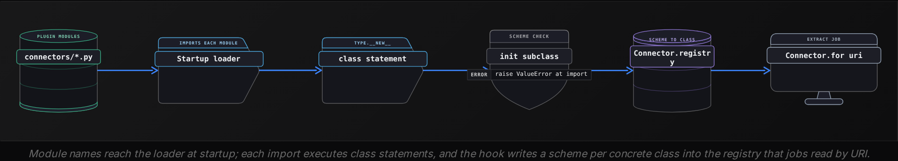

# OOP for Data Engineers: Advanced

Ines is 40 minutes into a Dropbox data platform loop when the interviewer shares a file: 60 connector classes and a hand-maintained dictionary mapping URI schemes to them. "Every new source means a pull request against this dict, a memory spike when a sync batch holds 3 million row objects, and connectors shipped with no owner listed. Fix all 3 without changing how callers use the classes." Ines knows classes, properties and ABCs. What the interviewer is probing is the layer underneath: which code Python runs while it builds a class, what an instance costs in bytes, how `|` finds its method, and why `@property` can intercept an assignment at all. Each follow-up asks her to predict output before running anything. Her offer depends on reasoning through that machinery out loud, with numbers and failure modes attached.


<br>

### What you will be able to do

Build a connector registry with __init_subclass__ that fills at import, rejects duplicate schemes and skips abstract intermediate classes

Quote per-record memory with and without __slots__ in bytes, and predict which inheritance patterns raise or quietly restore the dict

Implement __or__ and __ror__ with NotImplemented so a pipeline DSL composes without shared state, and predict its TypeError messages

Write a metaclass that rejects misnamed connectors and missing attributes at import, and argue when __init_subclass__ is the better tool

Implement a descriptor with __set_name__, __get__ and __set__, and trace how lookup order produces @property, @classmethod and @staticmethod


<br>

---

## __init_subclass__ Plugin Registry

The question usually arrives as a maintenance complaint. A `REGISTRY` dict in `connectors/__init__.py` maps URI schemes to classes, and every new connector waits on review of that single shared file. The fix moves registration into class creation. When Python finishes executing a `class` statement, `type.__new__` calls the nearest `__init_subclass__` defined above the new class in its MRO, passing the new class as `cls`. Any keyword written on the class line, such as `scheme="sftp"`, arrives as an argument to that hook. The base therefore sees every subclass the moment it exists, and no list needs editing.

https://github.com/user-attachments/assets/a3ba7c57-86c4-46b4-8952-93a1738d5692

*The registry fills while the class statements run; SQLBase passes no scheme and stays out.*

Step through the run and watch `registry` fill during the `class` statements, before any connector object exists. `SQLBase` passes no `scheme`, so the hook returns early and the abstract middle layer stays out of the dict. `RdbmsConnector` inherits from it and still registers, because Python finds the hook through the MRO. The `super().__init_subclass__(**kwargs)` line forwards keywords this hook doesn't consume, which keeps the base cooperative with a mixin that defines a hook of its own. `for_uri` then turns a URI string into the right class with a single dict lookup, and the printed type confirms the dispatch.


<br>

### The hook fires at import, and only at import

A class statement executes when its module is imported, so registration is a side effect of import. A connector in `connectors/ledger.py` that no code imports never runs its class statement and never reaches the dict, and the failure surfaces hours later as `KeyError: 'ledger'` inside a scheduled job. Self-registration therefore needs a discovery step at startup: the loader imports every module in the `connectors` package by naming convention, or imports the plugin modules that installed packages advertise through packaging entry points. That convention is what removes the review bottleneck. A team adds a file, the loader imports it, and the class statement does the wiring.




<br>

### Predict the duplicate

A second team copies the SFTP connector to add resumable transfers and keeps its class line. Before reading on, decide what happens when the loader imports their module.

```sql
from connectors.base import Connector


class SftpResumableConnector(Connector, scheme="sftp"):
    resume_chunk_mb = 64
```

The import raises `ValueError: duplicate scheme 'sftp'` from inside the class statement, so the error appears at startup, with a traceback pointing at the class line, instead of inside a job. Without the duplicate check, the second assignment would replace `SftpConnector` with no error, and every `sftp:` job would run whichever implementation the loader happened to import last. With a loader that scans the package in filename order, a rename alone could flip which class serves `sftp:`.

| Decision | Choice in the example | What breaks otherwise |
| --- | --- | --- |
| Where the dict lives | A single `registry` on `Connector`, written through `Connector.registry` | Writing through `cls.registry` lets a subclass that defines its own `registry` capture its descendants, hidden from `for_uri` |
| Duplicate keys | Raise at import | Last import wins, and module order picks the winner |
| Abstract layers | No `scheme` means no entry | Base classes land in the dict and `for_uri` builds an object with no `read` |
| Unused keywords | Forward `\*\*kwargs` to `super()` | A mixin's own hook never receives its keywords |
| Tests | Copy the dict before each test, restore it after | A throwaway subclass in one test leaks into every later test |

| ✓ Decorator registry: @register("sftp") | ✗ __init_subclass__ on the base |
| --- | --- |
| • Registration is visible above the class line<br><br>• Works for classes that share no base<br><br>• A forgotten decorator fails silently, exactly like a forgotten import | • Inheriting from Connector is the registration<br><br>• The hook runs the same validation for every plugin<br><br>• Every subclass triggers it, so abstract layers need an explicit opt-out |

For a connector platform the inheritance version usually wins, because every connector subclasses `Connector` anyway for `for_uri` and the shared `__init__`, so requiring the base costs nothing new. The decorator version wins where plugins are plain functions or classes you do not control.


<br>

### What implicit registration costs

Registration by inheritance trades explicitness for zero wiring. A reader searching for where `SftpConnector` gets wired in finds nothing, because the wiring is the base class. Import-time side effects also make startup cost scale with the plugin count: a loader that imports 60 connector modules, each pulling in its own client library, pays every one of those imports before the first job starts, so heavy client imports belong inside `read`, deferred until a connector is used. Finally, the registry is process-global state, so 2 test files that each define a subclass with `scheme="test"` collide unless each test restores the dict it found.

> **TIP**
>
> State where the import happens before you show the hook. The usual follow-up is "a team shipped a connector and `for_uri` raises `KeyError`", and the answer lives in the loader's module list.


<br>

---

## Cutting Memory with __slots__

A batch job that materializes row objects pays for every record twice: once for the field values and once for the per-instance `__dict__` that maps each attribute name to its value. Declaring `__slots__` on the class replaces that dict with fixed storage inside the object, a pointer for each declared name, and Python places a descriptor on the class for each slot so `event.amount` still reads and writes the same way. Callers see no change. The object's shape does change: its set of attribute names is fixed when the class statement runs.

| Layout of a 3-field record, CPython 3.9, 64-bit | Container bytes | Bytes with values | 1 million records |
| --- | --- | --- | --- |
| Regular class: object 48 + `__dict__` 104 | 152 | 232 | about 232 MB |
| `__slots__ = ("user_id", "ts", "amount")` | 56 | 136 | about 136 MB |
| `namedtuple` with the same fields | 64 | 144 | about 144 MB |

- **63%** — less container memory per record
- **41%** — less memory once values are counted

The table explains why quoted savings for `__slots__` vary so widely. The values column adds 2 unique integers at 28 bytes each and a float at 24, the 80 bytes every layout pays regardless. The slot removes the dict and nothing else, so its share of the total depends on how heavy the field values are: a record of small cached integers or interned strings is almost all container, while wide string payloads dilute the gain. Quote bytes times batch size instead of a bare percentage: at 3 million records the regular layout carries roughly 288 MB that slots remove. Measure your own records with `tracemalloc` around building 100,000 of them, and expect a smaller gain on CPython 3.11 and later, which keeps the attribute values of regular instances without allocating a separate dict up front.


<br>

### What a slotted class refuses

https://github.com/user-attachments/assets/c6c1f617-1054-4b83-87b1-3f23ed14555b

*A subclass without its own __slots__ gets a dict back; one that declares its new name stays dict-free.*

The run answers the 3 inheritance questions interviewers ask. The base instance has no `__dict__`, so assigning `region` raises the `AttributeError` printed second. `EnrichedEvent` declares no `__slots__`, and a subclass without its own declaration gets a `__dict__` back: it accepts `region`, it stores only that name in the dict while the inherited fields stay in slots, and it pays the dict's cost per instance again. `TightEvent` declares only the name it adds, so its instances keep the parent's 3 slots plus 1 more and still have no dict. Repeating a parent's name in a child's tuple is accepted, wastes a pointer per instance and hides the parent's slot.


<br>

### Predict the tracebacks

Each of the 3 snippets below raises when run alone. Name the exception and the line that raises it before reading the table.

```sql
# snippet 1: two slotted parents
class Keyed:
    __slots__ = ("key",)


class Timed:
    __slots__ = ("ts",)


class KeyedTimed(Keyed, Timed):
    pass


# snippet 2: slot plus class default
class Amount:
    __slots__ = ("amount",)
    amount = 0.0


# snippet 3: weak reference
import weakref


class Cached:
    __slots__ = ("payload",)


weakref.ref(Cached())
```

| Snippet | Raises | Why | Fix |
| --- | --- | --- | --- |
| `KeyedTimed(Keyed, Timed)` | `TypeError: multiple bases have instance lay-out conflict` | Both parents put their slot at the same offset in the object | Give mixins `__slots__ = ()` and declare every name on the concrete class |
| `amount = 0.0` beside the slot | `ValueError: 'amount' in __slots__ conflicts with class variable` | The slot's descriptor and the default both claim the class attribute `amount` | Assign defaults in `__init__` |
| `weakref.ref(Cached())` | `TypeError: cannot create weak reference to 'Cached' object` | Weak references need the `__weakref__` slot that `__slots__` removed | Add `"__weakref__"` to the tuple, at 8 bytes per instance |

Because of the layout conflict, a slotted record family needs a particular shape. Put behavior in mixins with empty `__slots__ = ()`, which add no storage and therefore never collide, and let a single concrete class per record type own the field names. A shared `BaseRecord` can own slots too, as long as every other parent in a class's bases is empty. Check the result with `hasattr(obj, "__dict__")` in a unit test, because a single base anywhere in the MRO without `__slots__` restores the dict for every subclass below it, and nothing else reports it.

> Where slots stop being the answer
>
> - Python 3.9 dataclasses have no `slots=True`: write `__slots__` by hand and drop field defaults, or the `ValueError` above returns
> - Pickle protocol 2 and later handle slotted objects, and the 3.9 default is protocol 4
> - Code that sets ad hoc attributes while debugging, or tools that call `vars(obj)`, breaks on slotted instances
> - At large row counts, a column per field beats an object per row: `array('d')` stores each float in 8 bytes with no per-row header

> **TIP**
>
> When asked for the number, give the mechanism first: the slot removes a dict from every object, so the saving is a fixed number of bytes per record, and the percentage depends entirely on what each record carries.


<br>

---

## Operator Overloading for Pipelines

The request sounds cosmetic: let analysts write `rows | parse | dedupe | load` and have it run. The engineering underneath is binary operator dispatch. For `a | b`, Python calls `type(a).__or__(a, b)`. If that method is missing or returns the `NotImplemented` sentinel, Python tries the reflected form, `type(b).__ror__(b, a)`, and raises `TypeError` only when both decline. One rule reorders the attempt: when the type of `b` is a subclass of the type of `a` and overrides `__ror__`, the reflected method runs first, which lets a specialized stage type take over composition.

https://github.com/user-attachments/assets/3dac33f1-e61e-4d18-86fd-9e40633dbd80

*Composition builds new Pipe objects; data on the left reaches __ror__ and streams through the stages.*

The 3 printed lines show the design. `__or__` builds a new `Pipe` from both stage tuples, so `clean` still lists 2 stages after `full` extends it; a version that stored a list and appended to `self.stages` would hand `double` to every pipeline ever built from `clean`. `list` defines no `__or__`, so the last line dispatches to `Pipe.__ror__`, which is where data enters and the stages run. Each stage returns a generator, so `full` holds functions and no rows, and the strings stream through all 3 stages a record at a time until `list` collects the result.


<br>

### Predict which line raises

Both lines below run in the same session as the animation. Decide which one raises, and what its message names.

```sql
step = Pipe(parse) | double
rows = ["3", "-1"] | parse
```

The first line raises, so the second never runs: `TypeError: unsupported operand type(s) for |: 'Pipe' and 'function'`. `Pipe.__or__` returns `NotImplemented` for a bare function, Python looks for a `__ror__` on the function type, finds none, and reports both operand types. Run alone, the second line fails the same way, naming `'list' and 'function'`. Returning `NotImplemented` instead of raising is what gives the right operand its turn: a `TypeError` raised inside `__or__` would block a future stage type whose `__ror__` knows how to join a `Pipe`.


<br>

### Precedence decides the grouping

Python groups `a | b | c` from the left, as `(a | b) | c`. That makes `rows | Pipe(parse) | Pipe(drop_negative)` legal but different from piping into `full`: the first `|` already runs `parse` and returns a materialized list, which the second `|` feeds into the next stage. The output matches, and the memory profile does not, because every intermediate result is a full list. For a 3 million row sync batch, that is 3 million parsed integers held between each pair of stages. Compose the stages into a named pipeline first, then pipe the data in once.

| Dunder | Triggered by | Pipeline use | Trap |
| --- | --- | --- | --- |
| `__or__` | `a | b` | Join 2 pipelines into a new one | Mutating `self` shares stages between pipelines |
| `__ror__` | `a | b` after `a` declines | Feed records in from the left | In 3.9 a `dict` on the left declines too, so its keys run through the stages |
| `__ior__` | `a |= b` | Usually left undefined | Without it Python rebinds `a` to `a | b`; a mutating version brings shared-state bugs back |
| `__rshift__` | `a >> b` | Arrow-style alternative | `>>` binds tighter than `|`, so mixing them regroups the chain |
| `__call__` | `p(rows)` | Run without the operator | Gives tests a plain function call to assert on |
| `__repr__` | `repr(p)`, debuggers, logs | Show `Pipe(parse | drop_negative)` | Without it, logs show a memory address |
| `__eq__` | `a == b` | Compare stage tuples in tests | Defining it sets `__hash__` to `None`, so a pipeline stops working as a dict key |

*set behaves the same way: in 3.9, set.__or__ returns NotImplemented for a Pipe, so a set of record ids on the left becomes the data, iterated in hash order.*


<br>

### When the DSL costs more than it reads

| ✓ Do | ✗ Don't |
| --- | --- |
| • Return a new object from __or__ and keep stage tuples immutable<br><br>• Return NotImplemented for operand types you don't handle<br><br>• Make stages take and return iterators so memory stays flat per record<br><br>• Give Pipe a __repr__ that lists stage names for logs<br><br>• Test each stage alone on a 3-row list before testing the composed pipeline | • Run stages inside __or__; build first and execute when data arrives<br><br>• Overload \| on classes that already use it for set-like union<br><br>• Let an exception from stage 4 surface without the stage's name<br><br>• Mix \| and >> in the same chain<br><br>• Rely on rows \| a \| b to stream; it materializes a list between stages |

> The cost to name before you are asked
>
> Laziness moves every failure to run time: a bad stage composed into `full` at import raises only when the first record reaches it, inside `list(rows)`, far from the line that composed it. Static type checkers also see `|` returning `Pipe` and nothing about what flows between stages. Keep the DSL at the edge where analysts compose stages, and keep each stage a plain, separately tested function that works without any operator.


<br>

---

## Metaclasses That Enforce Rules

Platform teams ask for this when a convention keeps slipping through review: every concrete connector must be named `...Connector` and must declare `source_system` and `owner_team`, so whoever is on call can find the team that owns a failing sync. A metaclass enforces the rule at the latest point that still precedes any job, which is class creation. A class statement calls its metaclass, `type` by default, to build the class object, so a subclass of `type` that overrides `__new__` receives the name, the bases and the finished namespace dict, and can refuse to return a class at all.

```sql
class ConnectorMeta(type):
    required = ("source_system", "owner_team")

    def __new__(mcls, name, bases, namespace, **kwargs):
        cls = super().__new__(mcls, name, bases, namespace, **kwargs)
        if namespace.get("abstract", False):
            return cls
        if not name.endswith("Connector"):
            raise TypeError(f"{name}: class name must end with 'Connector'")
        missing = [a for a in mcls.required if a not in namespace]
        if missing:
            raise TypeError(f"{name} is missing {missing}")
        return cls


class BaseConnector(metaclass=ConnectorMeta):
    abstract = True


class OrdersConnector(BaseConnector):
    source_system = "rdbms"
    owner_team = "commerce-data"
```

Two choices in that code deserve a defense out loud. The check reads `namespace`, the dict the class body produced, so `abstract = True` exempts only the class that writes it, and every subclass of `BaseConnector` is checked unless it opts out again. The same choice means an inherited attribute does not satisfy the rule; test `hasattr(cls, a)` instead if a shared base should supply `owner_team` for a whole family. The metaclass also inherits: `OrdersConnector` names no metaclass, yet `ConnectorMeta` builds it, because Python takes the metaclass from its base.

A team ships the class below. Predict what importing its module does.

```sql
class OrdersSync(BaseConnector):
    source_system = "rdbms"
```

The import raises `TypeError: OrdersSync: class name must end with 'Connector'`. The name check runs first, so the missing `owner_team` stays unreported until the rename lands and the next import fails again. Collect every violation into a list and raise once, so the author sees all of them in a single failure.


<br>

### Who runs first while a class is built

A metaclass and `__init_subclass__` in the same hierarchy both fire, and interviewers check whether you know their order. Predict the 10 printed lines before playing the run.

https://github.com/user-attachments/assets/73a41b0d-d374-46bb-828f-fee7b7c7fb78

*The subclass hook fires inside type.__new__, between the metaclass's start and end lines.*

`__prepare__` runs before the body, so it's the only hook that can supply the namespace itself, for example a dict subclass that raises when a class body defines `read` twice and the second silently replaces the first. The body then fills that namespace. Inside `Meta.__new__`, the call to `type.__new__` is where attribute `__set_name__` hooks and then `__init_subclass__` fire, so the subclass hook prints between the metaclass's start and end lines. `Base` produces no `init_subclass` line, since a class's own hook runs only for its subclasses. `Meta.__init__` runs last, on a fully built class.


<br>

### Metaclass or __init_subclass__

| ✓ __init_subclass__ is enough when | ✗ Only a metaclass can |
| --- | --- |
| • The rule checks subclasses after their body has run<br><br>• The check needs only the finished class: name, attributes, methods<br><br>• Connectors must also inherit from bases built by other metaclasses | • Supply the namespace before the body runs, through __prepare__<br><br>• Control instance creation through the metaclass's __call__<br><br>• Change isinstance answers with __instancecheck__<br><br>• Apply the same rule to the base class itself |

The last item on the left is the cost interviewers probe. A class has a single metaclass, and Python picks the most derived metaclass among its bases; when 2 bases bring metaclasses that do not derive from each other, the class statement fails. Mixing `BaseConnector` with an ABC, built by `ABCMeta`, does exactly that:

```sql
from abc import ABC, abstractmethod


class Readable(ABC):
    @abstractmethod
    def read(self):
        ...


class FilesConnector(BaseConnector, Readable):
    source_system = "files"
    owner_team = "ingest"

    def read(self):
        return []
```

The class statement raises `TypeError: metaclass conflict: the metaclass of a derived class must be a (non-strict) subclass of the metaclasses of all its bases`. Declaring `class ConnectorMeta(ABCMeta)` resolves it by making the platform metaclass the most derived one, and every further third-party base with its own metaclass forces another merge like it. That recurring cost is why a check that only reads the finished class belongs in `__init_subclass__`, which composes with any metaclass.

*Keywords on a class line reach the metaclass too: class X(BaseConnector, strict=True) passes strict to __prepare__, __new__ and __init__, and type.__new__ forwards it to __init_subclass__, so each hook must accept or pass it on.*

> **TIP**
>
> Open with `__init_subclass__`, then name the specific power that justifies a metaclass: `__prepare__`, instance control through `__call__`, or a rule on the base itself. Every future base class inherits the metaclass, so the justification is part of the answer.


<br>

---

## The Descriptor Protocol

The question is often phrased as "how does `@property` work?", and the complete answer is a single protocol. An object whose type defines `__get__` is a descriptor once it sits on a class, and one whose type also defines `__set__` or `__delete__` is a data descriptor. When code reads `obj.attr`, `object.__getattribute__` searches `type(obj).__mro__` for `attr` before it looks at the instance, and the kind of object it finds there decides who answers. The table gives the order, and every decorator in the question follows from it.

| Step | Where attr is found | What obj.attr returns |
| --- | --- | --- |
| 1 | On the class, as a data descriptor | `desc.__get__(obj, type(obj))`, even when `obj.__dict__` has the name |
| 2 | In `obj.__dict__` | The stored value |
| 3 | On the class, as a non-data descriptor | `desc.__get__(obj, type(obj))` |
| 4 | On the class, as a plain attribute | The attribute itself |
| 5 | Nowhere | `__getattr__` if the class defines it, else `AttributeError` |

A typed record field is the descriptor to build in the interview, because it needs all 3 hooks. `__set_name__` tells the descriptor which attribute name it was bound to, so the class line never repeats the name as a string, and `__set__` is the validation point every assignment passes through.

https://github.com/user-attachments/assets/ca2d5e94-cdd3-4999-b9eb-15a5a036673b

*Every assignment passes through __set__, and __set_name__ has already named each field.*

`__set_name__` ran during the `class Event` statement, called by `type.__new__` once for each descriptor in the body, which is why `Event.user_id.name` already reads `user_id` before any instance exists. Reading the attribute on the class passes `obj=None`, and returning `self` there keeps the descriptor reachable for introspection. Values live in each instance's `__dict__` under the field's own name. Writes go through `__set__` because the class holds a data descriptor, and reads go through `__get__` for the same reason, even though the dict contains the key. The float `9.5` passed the check and `"9.50"` was refused, so a malformed CSV value fails at the assignment instead of in a later aggregation.


<br>

### Drop __set__ and the instance dict wins

This descriptor defines only `__get__` and caches its result in the instance dict. Predict all 4 printed lines.

```sql
class Lazy:
    def __init__(self, fn):
        self.fn = fn

    def __get__(self, obj, objtype=None):
        if obj is None:
            return self
        value = self.fn(obj)
        obj.__dict__[self.fn.__name__] = value
        print("computed", value)
        return value


class Partitioner:
    def __init__(self, user_id):
        self.user_id = user_id

    @Lazy
    def bucket(self):
        return self.user_id % 4


p = Partitioner(42)
print(p.bucket)
print(p.bucket)
p.user_id = 43
print(p.bucket)
```

It prints `computed 2` and then `2` on each of the next 3 lines. The first read finds no `bucket` in the instance dict, so lookup reaches the non-data descriptor at step 3, which computes and stores the value. Every later read stops at step 2 and never calls `__get__`, so changing `user_id` to 43 leaves the stale bucket in place, where 43 would have mapped to bucket 3. `functools.cached_property` works the same way, which makes it fast and also wrong for any value derived from fields that change after the first read. Adding a `__set__` would make it a data descriptor that recomputes on every read.


<br>

### The decorators are descriptors

Plain functions are non-data descriptors. `Event.__init__` is a function on the class, and `e.__init__` calls `function.__get__(e, Event)`, which returns a bound method whose `__self__` is `e`. The 3 decorators change what `__get__` binds, as these pure-Python equivalents show.

```sql
from types import MethodType


class MyProperty:
    def __init__(self, fget, fset=None):
        self.fget = fget
        self.fset = fset

    def __get__(self, obj, objtype=None):
        if obj is None:
            return self
        return self.fget(obj)

    def __set__(self, obj, value):
        if self.fset is None:
            raise AttributeError("can't set attribute")
        self.fset(obj, value)


class MyClassMethod:
    def __init__(self, fn):
        self.fn = fn

    def __get__(self, obj, objtype=None):
        if objtype is None:
            objtype = type(obj)
        return MethodType(self.fn, objtype)


class MyStaticMethod:
    def __init__(self, fn):
        self.fn = fn

    def __get__(self, obj, objtype=None):
        return self.fn
```

| Built-in | Descriptor kind | __get__ returns | Consequence |
| --- | --- | --- | --- |
| Function | Non-data | A method bound to the instance | An instance attribute with the same name shadows the method |
| `property` | Data, even with no setter | `fget(obj)` | Assigning without a setter raises `AttributeError: can't set attribute` |
| `classmethod` | Non-data | A method bound to the class | `Connector.for_uri` works from the class and from any instance |
| `staticmethod` | Non-data | The raw function | Neither `self` nor `cls` is passed |
| A `__slots__` name | Data, a `member_descriptor` | The value in the fixed slot | Slot attributes cannot be shadowed per instance |

> The descriptor bug that ships
>
> Storing the value on the descriptor, as `self.value = value` inside `__set__`, keeps a single value on the class for all instances, so creating a second `Event` overwrites the first one's `amount`. Store per instance, in `obj.__dict__` under the name `__set_name__` delivered. A slotted class has no instance dict, so its descriptor must write to a separately named slot, such as `_amount`, that `__slots__` declares.

> **TIP**
>
> Asked to explain `@property` in 1 minute, answer with step 1 of the lookup table: a property is a data descriptor, so it runs on every read and every write of that name, and no instance dict can shadow it.


<br>

---

## Putting It All Together

A payments company's ingestion platform hosts 60 connectors written by 12 product teams. Each nightly sync materializes batches of 3 million transaction records, analysts compose cleaning steps on top of those batches, and the on-call rotation needs every failing connector to name the team that owns it.

- Connector modules dropped into the package register through __init_subclass__ when the startup loader imports them, so adding a source needs no edit to shared code.
- ConnectorMeta , or a stricter __init_subclass__ , rejects a connector without owner_team at that same import, before the nightly run starts.
- Transaction records declare __slots__ , cutting container memory per batch from about 456 MB to about 168 MB.
- Typed descriptors on those records validate each field at assignment and write to named slots such as _amount , so the memory saving survives the validation.
- Analysts chain parse, dedupe and load stages with | into a named pipeline, and generator stages keep memory per record flat while the batch streams through.


<br>

---

## Key Takeaways

- __init_subclass__ registers plugins when their class statement runs, so a registry is only as complete as the loader's import list.
- __slots__ removes the per-instance dict: 56 bytes instead of 152 for a 3-field record on CPython 3.9, a share that shrinks as field values grow.
- A subclass without its own __slots__ gets the dict back, and 2 parents with non-empty slots can't be combined.
- Pipeline operators return new objects, and NotImplemented for unknown operands, so composition never mutates shared stages and the reflected method gets its turn.
- A metaclass sees a class before and while it's built; reach for one only for __prepare__ , __call__ or rules on the base itself, since each third-party metaclass forces a merge.
- Data descriptors outrank the instance dict and non-data descriptors lose to it, which explains property , bound methods and stale cached_property values.
