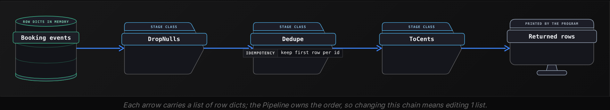

# OOP for Data Engineers: Intermediate

Maya is 20 minutes into a data engineering onsite at Airbnb when the interviewer gives her the prompt: listing data comes from 4 sources and lands in 3 stores, so sketch the classes a team will extend for years. She writes a `BaseConnector` whose methods raise `NotImplementedError` and a `ListingsApiConnector` that inherits from it. Then the follow-ups arrive. A new connector forgets `close()`: when does anyone find out? Config arrives as a dict: what stops `batch_size=-1`? A second output format doubles the subclasses: how many classes is that? A vendor SDK will never inherit her base class: how does it plug in? Every writer needs logging: where does that code live? Each question asks the same thing in a new form, namely the moment a mistake surfaces and what the design costs to change, and this lesson answers all 5.


<br>

### What you will be able to do

Explain when an ABC rejects an incomplete subclass, and name what that check leaves unverified

Build a frozen dataclass config with default_factory, __post_init__ validation and a correct __hash__

Replace a combinatorial subclass tree with a Pipeline that owns swappable stages, and state the count it saves

Type third-party classes against a Protocol and predict what runtime_checkable lets through

Order mixins so every super() call runs, and predict the MRO and output a class produces


<br>

---

## Interface Contracts with ABCs

Every interface question in this pattern turns on a single decision: the moment an incomplete implementation gets caught. A connector missing a method has 3 possible fates. It breaks at the line that calls the method, which in a nightly batch can be hours after start. It breaks when the object is constructed, before any row moves. Or it never breaks, because the calling code checked `hasattr` and quietly skipped the step. An abstract base class from the `abc` module buys the second fate, and naming that timing is most of the answer.

| Base class design | A subclass forgets close | Caught |
| --- | --- | --- |
| No `close` on the base | `AttributeError` at the line calling `close()` | Mid-run, at that call |
| Base `close` raises `NotImplementedError` | `NotImplementedError` at the same line | Mid-run, at that call |
| `ABC` with `@abstractmethod` on `close` | `TypeError` when the subclass is instantiated | Construction, before any read |
| Caller checks `hasattr` first | Cleanup silently skipped | When connections run out |


<br>

### How the abc module enforces the contract

When Python creates a class whose metaclass is `ABCMeta`, which inheriting from `ABC` arranges, it collects every name still marked with `@abstractmethod` into the class attribute `__abstractmethods__`. A subclass clears a name by defining an attribute with that name. Construction checks the set: if it is non-empty, `object.__new__` raises `TypeError` and the instance never exists. Defining the incomplete class is allowed, importing it is allowed, and its class methods still run; only creating an instance is refused. Concrete methods on the ABC are allowed too, which lets the base own the workflow and leave the steps to subclasses.

https://github.com/user-attachments/assets/e3dd8363-a3f5-48c7-a09b-cc2ad79d8015

*The incomplete subclass is refused at construction; the complete one is driven by the base's read_all.*

Trace it before pressing play. `HalfSource` defines `read` but not `close`, so `__abstractmethods__` still holds `close`, and `HalfSource()` raises before its generator could yield anything. `ListSource` clears both names, and `read_all`, written once on the base, drives it: 3 batches of at most 2 rows, then `close`. The last line prints `[10, 20, 30, 40, 50] True` because Python evaluates the arguments of `print` left to right, so `read_all` has already set `closed` by the time `src.closed` is read.


<br>

### Predict the last line

```sql
from abc import ABC, abstractmethod


class Sink(ABC):
    @property
    @abstractmethod
    def name(self): ...

    @abstractmethod
    def write(self, rows): ...


class AuditSink(Sink):
    name = "audit"

    def write(self, rows):
        return len(rows)


class NamelessSink(Sink):
    def write(self, rows):
        return len(rows)


print(AuditSink().write([1, 2]))
NamelessSink()
```

The print shows 2: a plain class attribute called `name` overrides the abstract property and clears it from the set. `NamelessSink()` raises `TypeError`, since `name` is still abstract there. Decorator order matters here: `@property` sits on top and `@abstractmethod` sits next to the function, so the property reports the abstract flag the function carries.


<br>

### The cost of the later failure

Put the timing on a real schedule. A nightly job builds 40 source objects up front, then reads them one after another at roughly 5 minutes each. Source 35 was merged last week, and its author never implemented `read`. With a `NotImplementedError` base, the 34 sources ahead of it run, their partitions land, and the error arrives with the warehouse half loaded and a partial rerun to plan. With an ABC, the `TypeError` fires while the list of sources is still being built.

- **170 min** — until the NotImplementedError fires
- **0 rows** — loaded before the ABC's TypeError

The ABC version also changes what on-call reads at 2 a.m.: a traceback pointing at the line that constructs the new source and naming the missing method, instead of a failure deep inside a read loop with other partitions already written and waiting to be untangled.


<br>

### The follow-ups an ABC answer invites

- Signatures are not checked: a subclass defining read(self) with no size parameter clears the name and constructs fine, then fails with TypeError at its first call. A static type checker catches the mismatch before the run.
- Source.register(VendorReader) makes isinstance return True for a class that never inherited and was never verified. It is a promise Python does not hold you to.
- An abstract method may have a body. Subclasses must still override it, and can call super().read(size) to reuse the shared setup written there.
- Test doubles stay honest: a FakeSource in the test suite must implement every abstract method or the test fails at setup, so fakes cannot drift from the contract.

> **TIP**
>
> If the codebase in front of you uses `raise NotImplementedError`, describe it accurately instead of calling it wrong: it fails at the call. An ABC moves that failure to construction for the price of 1 import and 1 decorator per method, and the base class's concrete methods keep working as before.


<br>

---

## Dataclasses for Config and Records

A job config passed around as a dict accepts anything. `{"batch_szie": 1000}` is a valid dict, `cfg.get("batch_size", 500)` ignores the typo without a word, and the default of 500 now lives in every function that reads the key. A dataclass turns the keys into declared fields: a misspelled keyword raises `TypeError` at construction, the default is written once on the class, and the generated `__repr__` prints every value into the job log.


<br>

### The 4 tools that do the work

| Tool | What it does | Pipeline use |
| --- | --- | --- |
| `field(default_factory=list)` | Builds a fresh container for each instance | Per-job tag lists that must not be shared |
| `field(compare=False)` | Leaves the field out of `__eq__` and the generated hash | Owner or note metadata that should not change identity |
| `__post_init__` | Runs right after the generated `__init__` | Range checks and normalizing values |
| `frozen=True` | Blocks assignment; together with `eq`, generates `__hash__` | Configs used as dict keys, set members and cache keys |

One check fires even before construction. Writing `tags: list = []` makes Python raise `ValueError` while the class statement itself runs, because that single list would be shared by every instance, and the message names `default_factory` as the fix. The animation below uses all 4 tools on a config class and prints 5 lines, so write down your guesses first.

https://github.com/user-attachments/assets/26971aaf-f3ea-4054-bdc0-31df9d1884e2

*Normalized, compared, hashed, frozen and validated: 1 config class, 5 printed lines.*

`__post_init__` lowercases `"Orders"`, so the repr shows `table='orders'`. `a == b` is `True` because the tables now match and `tags` was left out of comparison, and the 2 hashes agree because the generated hash covers the same compared fields. That agreement is what lets `runs[b]` find the entry stored under `a`. Assigning `a.batch_size` raises `FrozenInstanceError`, and so would `self.table = ...` inside `__post_init__`, which is why the normalizing line writes through `object.__setattr__`. The last config fails validation before it exists.


<br>

### Which dataclass can be a dict key

| Decorator | Generated __hash__ | Used as a dict key |
| --- | --- | --- |
| `@dataclass` | Set to `None` | `TypeError: unhashable type` |
| `@dataclass(frozen=True)` | Hash of the compared fields | Works; equal configs share a key |
| `@dataclass(eq=False)` | Not generated; identity hash inherited | Works; 2 configs with the same field values are 2 keys, since equality falls back to identity |
| `@dataclass(unsafe_hash=True)` | Hash of the compared fields | Works until a field changes |

The first row is the one that catches people out. A plain `@dataclass` generates `__eq__`, and Python sets `__hash__` to `None` on any class that defines equality without a hash, so adding a config to a set raises. The last row is the dangerous one: change `batch_size` after inserting the config into a dict, and the object stays in the bucket chosen by its old hash, so a lookup with an equal config usually misses it while it is still in the dict.


<br>

### Frozen stops at the first level

`frozen=True` blocks rebinding a field; the object a field points to stays as mutable as before. On the config from the animation, `a.tags["owner"] = "growth"` succeeds. The same detail explains a second traceback: had `tags` kept `compare=True`, `hash(a)` would raise `TypeError: unhashable type: 'dict'`, because the generated hash builds a tuple of the compared values and hashes it. Fields that must stay fixed hold a `tuple` or a `frozenset`.


<br>

### Records: dedupe by value

A frozen class serves row records as well as it serves config. Hashable records go straight into a set or a `Counter`, so deduplication becomes a set build and counting duplicates becomes a single call.

```sql
from collections import Counter
from dataclasses import dataclass


@dataclass(frozen=True)
class Event:
    user_id: int
    kind: str


events = [Event(7, "click"), Event(7, "click"), Event(9, "view")]
counts = Counter(events)
print(len(counts), counts[Event(7, "click")])
```

It prints `2 2`: 2 distinct events, and the click from user 7 counted twice, because equal records hash equal. Drop `frozen=True` and the `Counter` line raises `TypeError: unhashable type: 'Event'`.

Traps interviewers set

- Field order: a field without a default after one with a default raises TypeError at class creation. A subclass that adds a required field after a parent's defaulted fields fails the same way.
- Cost at scale: the frozen __init__ assigns through object.__setattr__, slower per field than plain assignment. Irrelevant for configs, worth measuring for millions of records.
- dataclasses.replace(cfg, batch_size=0) builds a new object through __init__, so __post_init__ validates it too.


> **TIP**
>
> When asked why the config is frozen, give 2 consequences: it can key a cache or a dict of run results, and no stage can change it mid-run, so the value logged at start is the value every stage used.


<br>

---

## Composition Over Inheritance

The inheritance version of a connector framework writes every axis of variation into the class tree. Booking events read from CSV and loaded into the warehouse become `CsvWarehouseLoader`, the same feed bound for the search index becomes `CsvIndexLoader`, and a new output format repeats the whole set. With 4 sources, 3 sinks and 2 formats, every combination is a class of its own, each inheriting from a reader and a writer, so a change to a base gets retested across every combination built on it.

- **24** — classes in the inheritance tree
- **9** — classes once the axes are composed

| ✓ Class tree | ✗ Pipeline owning stages |
| --- | --- |
| • A new sink means a subclass for every source and format<br><br>• Behavior is fixed when the class is written<br><br>• Testing a transform means building a whole loader<br><br>• Step order hides inside overridden methods | • A new sink is 1 class that works with every source<br><br>• Stages are chosen from config when the job starts<br><br>• Each stage is tested alone with a 3-row list<br><br>• Step order is a list you can read and reorder |


<br>

### The Pipeline owns a list, each stage owns a job

In the composed design a stage is any object with a `process` method that takes a list of rows and returns a list of rows, and `Pipeline` holds those objects in the order they run. `Pipeline` never asks what class a stage is. Predict the 3 counts the program prints, then the final rows.

https://github.com/user-attachments/assets/92c42da6-dc81-491d-bece-15a15107355c

*The Pipeline calls process on each stage in list order and logs the row count after each.*

`DropNulls` removes the row whose `amount` is `None`, leaving 3. `Dedupe` keeps the first row per id, so the repeated id 1 goes, leaving 2. `ToCents` keeps the count and rewrites values: 2.5 becomes 250 and 4.1 becomes 410, with `round` absorbing the float error in `4.1 * 100`. Swapping a stage out, adding one, or changing the order is an edit to the list passed in, and no class changes.




<br>

### A stage that forgets to return

This is the traceback question that tests whether you understand the stage contract. Delete the `return` from `Dedupe.process`. The method now returns `None`, the loop assigns it to `rows`, and `Dedupe` itself raises nothing. The print line in `run` fails first, with `TypeError: object of type 'NoneType' has no len()`. Without that print, the error would surface a stage later, inside `ToCents`, as `TypeError: 'NoneType' object is not iterable`. Both tracebacks point downstream of the bug, which is the argument for testing every stage on its own.


<br>

### Building the stage list from config

The wiring that inheritance did with class names moves into a small factory. The job config lists stage names with their arguments, a registry dict maps each name to a class, and the factory builds the list. A new stage costs 1 class and 1 registry entry, and a misspelled name raises `KeyError` inside `build`, before a single row moves.

```sql
STAGES = {"drop_nulls": DropNulls, "dedupe": Dedupe, "to_cents": ToCents}


def build(spec):
    return Pipeline([STAGES[name](*args) for name, args in spec])


pipeline = build([("drop_nulls", ["amount"]), ("dedupe", ["id"]), ("to_cents", [])])
```


<br>

### When inheritance still earns its place

- Inherit an interface, compose behavior: ListSource subclassing the Source ABC is a true is-a relationship, 1 level deep.
- Inherit to share a template: a base run calling overridable steps works while there is a single axis of variation.
- Split into objects when a second axis appears: a class name that joins 2 nouns, like CsvWarehouseLoader, is 2 objects waiting to separate.

Composition has a price worth saying out loud. A run's full behavior no longer sits in 1 class body, so reading a job means reading its stage list, and the factory is another piece to test. That is why `run` in the animation prints each stage's name beside its row count: in production that same line in the job log tells on-call which stage dropped the rows.


> **TIP**
>
> Answer the why-not-inheritance follow-up with the growth rate: under inheritance the class count is the product of the axes, under composition it is their sum. A fifth source costs 6 new subclasses in the first design and 1 new class in the second.


<br>

---

## Structural Typing with Protocol

The `Source` ABC covers classes your team writes. A vendor's analytics SDK ships a `VendorClient` with a `write_batch(rows)` method, and it inherits from nothing of yours and never will, because the code is not yours to edit. Your `flush` function still has to accept it next to your own sinks. Python gives 3 routes, and they differ in what they verify and what they cost.


<br>

### Fitting a class you cannot edit

| Approach | What you write | What gets checked |
| --- | --- | --- |
| Adapter class | A wrapper per vendor that inherits your ABC and forwards calls | Everything, at construction, plus a file and a test per vendor |
| `Sink.register(VendorClient)` | 1 line | Nothing; `isinstance` returns `True` regardless |
| `Protocol` | The shape, once, in your own code | Names and signatures, by the static type checker |


<br>

### A Protocol names the shape

```sql
from typing import List, Protocol


class BatchSink(Protocol):
    def write_batch(self, rows: List[dict]) -> int: ...


def flush(sink: BatchSink, rows: List[dict]) -> int:
    return sink.write_batch(rows)
```

Nothing in this code runs a check at runtime. A static type checker reads `flush(VendorClient(), rows)` and compares the vendor's method with the protocol: same name, compatible parameters, compatible return type. A client whose `write_batch` takes no `rows` is reported in CI before the job ships, and production pays nothing for the check. `VendorClient` never imports `BatchSink`, and it does not need to.


<br>

### What runtime_checkable actually checks

`@runtime_checkable` lets `isinstance` test an object against a protocol, which tempts people to rely on it as a guard. The runtime check is much thinner than the static one. Predict the 4 printed lines below, including which client reaches a `TypeError` and which line raises it.

https://github.com/user-attachments/assets/d0986fd7-11a5-41a3-b50d-48582b894d5f

*The runtime check confirms the method name exists; the parameter list is never inspected.*

`VendorClient` passes the guard and returns 3. `LegacyClient` passes `isinstance` as well: a runtime-checkable protocol confirms only that an attribute named `write_batch` exists and never inspects parameters. So `flush` lets it through, and the `TypeError` comes from the call itself, carrying the interpreter's message about positional arguments. `Unrelated` fails the guard and gets the readable message. Remove the decorator and the very first `print` raises `TypeError` from `isinstance`, because a plain protocol refuses runtime checks.


<br>

### The Pipeline's stages were a protocol all along

The composed `Pipeline` already depended on a shape: anything with a `process` method. Writing that shape down as a `Stage` protocol lets the type checker verify every stage passed to `Pipeline` without any stage inheriting from it. It also catches the forgotten `return`: a stage method annotated `-> List[dict]` that ends without returning is reported as a missing return before the job runs.

```sql
from typing import List, Protocol


class Stage(Protocol):
    def process(self, rows: List[dict]) -> List[dict]: ...


class Pipeline:
    def __init__(self, stages: List[Stage]):
        self.stages = stages
```


<br>

### ABC or Protocol, decided by who owns the code

| ✓ ABC | ✗ Protocol |
| --- | --- |
| • Your team writes every implementation<br><br>• Fails at runtime, when the object is built<br><br>• Ships concrete methods such as read_all<br><br>• Implementations must inherit explicitly | • Some implementations come from code you cannot edit<br><br>• Fails in the type checker, before the run<br><br>• Ships no shared code unless a class inherits it<br><br>• Any class with matching methods qualifies |

Follow-ups and their answers

- Can a Protocol be instantiated? No: BatchSink() raises TypeError, since a protocol describes a shape and holds no implementation.
- Can it require attributes? Yes: table: str in the body requires the attribute, and issubclass against such a protocol raises TypeError.
- Can a class inherit from a Protocol? Yes, explicitly, and it then inherits any method bodies the protocol defines, like any base class.
- When do you use both? An ABC for the connectors you own, and function parameters typed against a Protocol so vendor clients and your connectors both fit.


> **TIP**
>
> When asked how a third-party class fits your interface, lay out the 3 routes with their costs, then pick the Protocol and say what it leaves unchecked at runtime. Naming the `runtime_checkable` gap unprompted is the detail that separates a tested answer from a recited one.


<br>

---

## Mixins for Cross-Cutting Behavior

Every reader and writer on the platform needs the same 2 extras: a log line around each call and a row counter for the metrics dashboard. Copying that code into 20 classes means 20 copies drifting apart. Moving it into the `Source` base forces every class through a single hierarchy and gives the base 2 unrelated jobs. A mixin is a small class that adds a single behavior and expects to be combined: it defines methods, calls `super()` so the next class still runs, and is never instantiated alone.


<br>

### super() follows the MRO, not the parent

Python lays every class and its ancestors out in a single line, the method resolution order, built by C3 linearization: the class first, then its bases left to right, each class ahead of its own bases, `object` last. Attribute lookup walks that line from the front. Inside a method, `super()` returns the class after the current one in the MRO of the instance's actual class, which can be a sibling the method's author never imported. Before playing the program below, write down the MRO it prints and the order of the 4 lines a single `write` call produces.

https://github.com/user-attachments/assets/fc505406-28ea-492d-8127-45c23841f90c

*Each super() call moves 1 step along TableWriter's MRO, from the leftmost mixin to Base.*

The output nests like layers. `LoggingMixin.write` runs first and its `super()` call reaches `MetricsMixin`, the next class in `TableWriter`'s MRO, even though `LoggingMixin` declares no base at all. `MetricsMixin` hands off to `Base`, which writes and returns 3, and that count travels back out through both mixins. The second call repeats the pattern with 2 rows, so `metrics_rows` ends at 5.


<br>

### Predict the reordered class

| Bases, in order | MRO after the class | What w.write([1, 2, 3]) does |
| --- | --- | --- |
| `LoggingMixin, MetricsMixin, Base` | Logging, Metrics, Base | Logs, counts and writes, as in the animation |
| `MetricsMixin, LoggingMixin, Base` | Metrics, Logging, Base | Same work; the timer line now prints before the log lines |
| `Base, LoggingMixin, MetricsMixin` | Base, Logging, Metrics | Prints `Base.write 3` only; reading `w.metrics_rows` raises `AttributeError` |
| `Base, BufferedBase`, where `BufferedBase(Base)` | No valid order exists | `TypeError` at class creation, before any instance |

Row 3 is the classic production bug. `Base.write` never calls `super()`, so once it sits first, nothing after it in the line runs, and no error appears until some code reads the counter, often a dashboard showing 0 rows for a job that wrote millions. Row 4 fails loudly instead: C3 cannot place `Base` both before `BufferedBase`, as the base list demands, and after it, as subclassing demands. The rule that prevents row 3: mixins on the left, the concrete class that ends the chain on the right.


<br>

### Mixins that need setup

A mixin with its own state uses a cooperative `__init__`: accept `**kwargs`, take what it needs, and pass the rest on with `super().__init__(**kwargs)`. Every class in the line then gets initialized, whichever order the mixins come in, as long as each class except the last calls `super().__init__(**kwargs)` and the concrete base that ends the chain sits on the right. A required positional argument in a mixin breaks that, because the mixin cannot know which class comes after it.

```sql
class MetricsMixin:
    def __init__(self, metrics_prefix="pipeline", **kwargs):
        self.metrics_prefix = metrics_prefix
        self.metrics_rows = 0
        super().__init__(**kwargs)


class Base:
    def __init__(self, table):
        self.table = table


class TableWriter(MetricsMixin, Base):
    pass


w = TableWriter(table="bookings", metrics_prefix="nightly")
print(w.table, w.metrics_prefix, w.metrics_rows)
```

It prints `bookings nightly 0`. `MetricsMixin` takes `metrics_prefix` out of the keywords and forwards `table` to `Base`, so both classes in the line are initialized from 1 call.

| ✓ Do | ✗ Don't |
| --- | --- |
| • Call super() in every mixin method so the chain keeps going<br><br>• List mixins left of the concrete class that ends the chain<br><br>• Prefix mixin attributes with the mixin's job, such as metrics_rows<br><br>• Assert on __mro__ in a test to pin the order you depend on | • Give a mixin an __init__ with required positional arguments<br><br>• Let 2 mixins write the same attribute name<br><br>• Instantiate a mixin alone; it expects a class after it<br><br>• Stack mixins until the MRO no longer fits on a line |


<br>

### Mixin, decorator or composed object

| Approach | Fits when | Costs |
| --- | --- | --- |
| Mixin | The behavior needs `self` and spans many classes | Base order becomes part of the contract |
| Method decorator | 1 or 2 methods need wrapping with a log or a timer | Applied by hand to each method |
| Composed object, such as a `Metrics` passed in | The behavior has its own state, config or backend | Every class accepts and forwards the extra object |


> **TIP**
>
> When asked what goes wrong with multiple inheritance, answer with this class's MRO: print it, show where each `super()` leads, and point at the class that fails to call it. Tracing the real line answers the question; a general description of the diamond leaves it open.


<br>

---

## Putting It All Together

A travel marketplace ingests booking events from 4 partner feeds every night, scores each booking with a vendor fraud-scoring SDK, and lands the results in a warehouse table and a search index. The platform team owns the feed readers, the vendor owns the SDK client, and on-call needs every run logged and its rows counted.

- The feed readers subclass a Source ABC, so a reader merged without read fails while the job assembles its sources, before any partition lands.
- Each run's settings live in a frozen JobConfig , validated in __post_init__ and used as the key of the dict that tracks run status.
- The run is a Pipeline owning a list of stages built from that config, so adding the search index as a sink is 1 class instead of 1 per feed and format.
- The fraud-scoring client is typed against a ScoreProvider Protocol, so the vendor's class qualifies without inheriting, and the type checker flags it if the vendor changes the method signature.
- Readers and writers pick up logging and row counts through mixins listed left of their base, each calling super ( ) , so a test asserting on __mro__ guards the order on-call depends on.


<br>

---

## Key Takeaways

- An ABC moves a missing method from a mid-run error to a TypeError at construction, and it verifies method names only, never parameter lists.
- A frozen dataclass with eq gets a hash built from its compared fields, so it can key dicts and caches; a plain @dataclass is unhashable.
- __post_init__ validates and normalizes on every construction, including dataclasses . replace , and inside a frozen class it writes through object . __setattr__ .
- Under inheritance the class count is the product of the axes of variation; a Pipeline that owns stages grows by their sum.
- A Protocol lets classes you cannot edit satisfy your interface, checked by the type checker; runtime_checkable confirms attribute names and nothing more.
- Mixins go left of the concrete base and every mixin method calls super ( ) , because super ( ) follows the instance's MRO.
