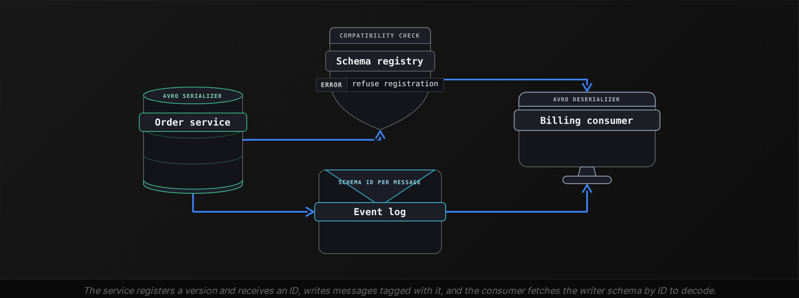
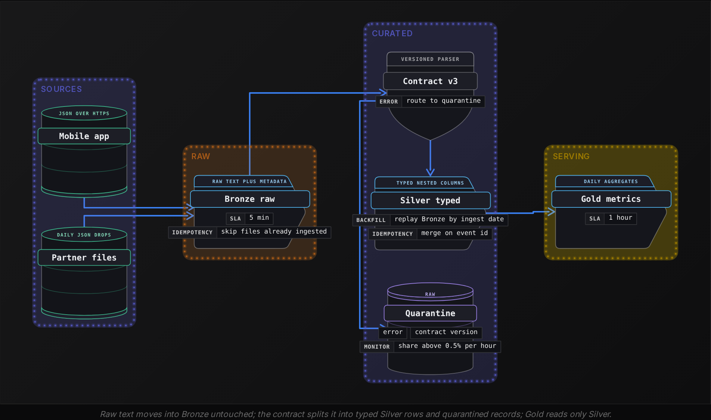
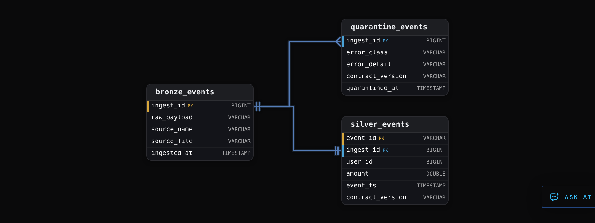

# Nested JSON for Data Engineers: Advanced

Rekha is in the final round of a LinkedIn data engineering loop when the interviewer slides over a scenario. A mobile team shipped a new build on Friday. Its profile-view event now sends `viewer_id` as a string instead of an integer, adds a `surface` object, and drops `referrer`. By Monday the engagement dashboard shows a 30% dip, no job has failed, and nobody was paged. The interviewer wants 3 answers: which layer should have refused the change, which layer should have kept the data anyway, and how she would rebuild the missing weekend without asking the mobile team to resend anything. A complete answer puts a guard at each boundary: the producer's contract, the loader's rescue column, the raw landing table, and the typed table that analysts read.


<br>

### What you will be able to do

Choose a compatibility mode for a schema change and state which side must deploy first

Predict, for each schema-drift policy, whether a loader keeps a drifted value, nulls it, moves it to a rescue column or stops the load

Weigh a document column against typed nested columns by what each costs to parse and prune, and by how each surfaces a failure

Design a Bronze and Silver flow that accepts every record and recovers from a parser bug by replay

Flatten arrays of rows with CROSS JOIN UNNEST without double counting parent-level measures


<br>

---

## Schema Registry and Avro

### The contract lives outside the message

A JSON event names every field inside itself, so a producer can reshape it without asking anyone. Avro moves the shape out of the payload: the writer encodes values in field order with no field names in the bytes, and a reader can decode them only with that writer schema in hand. A schema registry stores every version of every schema under a subject and assigns each version a numeric ID, which each message carries in place of the full schema. The registry does its work at registration time. Before it issues an ID, it compares the new version with earlier ones under the subject's compatibility mode and refuses the registration when the comparison fails. A producer without an ID cannot serialize, so the break surfaces in the producer's deploy rather than in a consumer's dashboard 3 days later.




<br>

### Writer schema, reader schema, defaults

Every decode involves 2 schemas: the writer schema the bytes were produced with, and the reader schema the consumer's code expects. Avro resolves them field by field, matching by name. A field only the writer has is skipped. A field only the reader has takes the reader's default, and decoding fails when there is none. A shared field whose types differ is allowed only when the writer type promotes to the reader type, as `int` does to `long`. The second rule is the one most schema changes trip over: a field with no default.

```sql
{
  "type": "record",
  "name": "Order",
  "namespace": "shop.events",
  "fields": [
    {
      "name": "order_id",
      "type": "string"
    },
    {
      "name": "amount",
      "type": "int"
    },
    {
      "name": "region",
      "type": "string"
    },
    {
      "name": "coupon",
      "type": [
        "null",
        "string"
      ],
      "default": null
    }
  ]
}
```

The program below models resolution with each schema as a dict from field name to a `(type, has_default)` pair, and `can_read(reader, writer)` returns `ok` or the first reason a decode would fail. BACKWARD asks whether the new schema can read old data, so it calls `can_read(v2, v1)`. FORWARD asks whether the old schema can read new data and flips the arguments. Predict all 4 lines before playing it; the instructive ones pass in one direction and fail in the other.

https://github.com/user-attachments/assets/43d481f5-a572-43ac-ad29-7d0e78889985

*Each schema change checked in both directions against version 1.*

| Mode | New version must | Safe changes | Deploy first |
| --- | --- | --- | --- |
| BACKWARD | read data written with the previous version | drop a field; add a field with a default | consumers |
| FORWARD | be readable by the previous version | add a field; drop a field that had a default | producers |
| FULL | pass both checks against the previous version | add or drop fields that have defaults | either side |
| NONE | nothing | any change, breaking ones included | everyone, in a coordinated cutover |
| Any _TRANSITIVE mode | pass its base check against every earlier version | same as the base mode | same as the base mode |

The deploy order falls out of the direction of the check. Under BACKWARD, a new reader handles old data but an old reader may fail on new data, so consumers upgrade before any producer writes the new version. Under FORWARD, old readers handle new data, so producers can move first and consumers follow at their own pace. Stating a mode without the order that comes with it leaves the interviewer to ask the follow-up.


<br>

### Why the transitive variants exist

A non-transitive mode compares a new version only with its immediate predecessor, which leaves a gap whenever older data is still read. Say version 1 of a subject has `order_id`. Version 2 adds `tier` with default `basic` and passes BACKWARD. Then version 3 removes the default from `tier`, and it passes too, because every version 2 record contains `tier`. A version 3 reader replaying a version 1 record finds neither the field nor a default and fails. If the log retains 7 days, or the lake keeps raw Avro files for a year of backfills, version 1 records are still read, and only a transitive mode that includes the backward check (BACKWARD_TRANSITIVE or FULL_TRANSITIVE) refuses version 3.

> What a complete answer adds
>
> - Modes are set per subject: a payments event can run FULL_TRANSITIVE while a debug event runs NONE.
> - A rename is a drop plus an add. A reader bridges it only by listing the old name as an alias, and older readers still lack the new name.
> - A truly required new field has no default by definition, so it needs a new subject or a coordinated cutover.
> - The registry checks shape only: switching `amount` from cents to dollars inside the same `int` passes every mode.


<br>

---

## Auto Loader and _rescued_data

### Where a green load still loses data

An incremental file loader discovers new JSON files in a landing path and appends their records to a table with a fixed schema. Each record has to be reconciled with that schema, and it can disagree in 4 ways: a key the schema has never seen, a known key whose value has the wrong type, a key the schema expects that the record omits, and text that does not parse at all. The quiet failure is to drop the first and null the second while the load succeeds and the row count matches the file. Row count and freshness checks both pass, and a field is gone.

A reserved column, conventionally named _rescued_data, collects whatever the schema could not hold. For each record it is a JSON string mapping each offending key to its raw value, and it is NULL when the record matched cleanly. A filter on _rescued_data IS NOT NULL then measures drift directly. The omitted key gets no help from it, since there is nothing to rescue: a missing referrer shows up only as a rising null rate on that column.


<br>

### Policies for a key the schema has never seen

What the loader does with a new key

- **Evolve** *stop, widen, restart*\
  The load fails on the first unseen key and records it in the stored schema, and the restarted load writes it as a real column.
- **Rescue** *schema stays fixed*\
  Unseen keys and mismatched values go to _rescued_data, and fields join the schema only when someone promotes them.
- **Fail** *stop until a human acts*\
  The load halts on an unseen key until the schema is edited by hand, which suits regulated feeds where an unreviewed field is an incident.
- **None** *discard unseen keys*\
  Unseen keys vanish. Defensible only when the schema is a deliberate allowlist, and even then the discards should be counted.

Evolve looks like the best of both, and its cost is operational: every unseen key costs a failed run and a restart, a producer that adds keys daily turns the load into a restart loop, and a misspelled key from a producer becomes a permanent column.

The program below implements 3 of these policies over the same 3 records. Record `e2` sends `user_id` as a string, and record `e3` carries a `device` key the schema lacks. Predict every line, and give the `fail` run extra attention, since its `e2` line is where answers tend to go wrong.

https://github.com/user-attachments/assets/39d1c48c-3974-43f0-aad6-028f026d4c40

*The same 3 records loaded under 3 policies for keys and types the schema does not expect.*

Under `none`, `device` disappears from `e3` and the original value of `user_id` disappears from `e2`, and the output gives no sign of either loss. Under `rescue`, the typed columns look identical but `_rescued_data` holds both originals. The `fail` run stops at `device`, yet `e2` was already written with a null `user_id`: a policy about new keys says nothing about type drift on known ones. Keep the rescue column under every policy, because the 2 concerns are separate settings.


<br>

### Turning the rescue column into a signal

A rescue column nobody queries only delays the loss. Give it an owner and a daily number. The query below reads the rescue column of the loaded table and counts, per ingest day, how many records drifted and which known culprits drove it, which turns a vague report that the mobile team changed something into a figure with a start date.

```sql
SELECT
  DATE(ingested_at) AS ingest_date,
  COUNT(*) AS total_records,
  COUNT_IF(_rescued_data IS NOT NULL) AS drifted_records,
  COUNT_IF(
    JSON_EXTRACT(_rescued_data, '$.surface') IS NOT NULL
  ) AS new_surface_key,
  COUNT_IF(
    JSON_EXTRACT(_rescued_data, '$.viewer_id') IS NOT NULL
  ) AS bad_viewer_id
FROM loaded_profile_views
GROUP BY DATE(ingested_at)
ORDER BY ingest_date
```

| ✓ Do | ✗ Don't |
| --- | --- |
| • Keep a rescue column under every new-key policy<br><br>• Alert on the daily share of rows with a non-null rescue column<br><br>• Track null rate per expected column to catch keys that vanished<br><br>• Declare types only for fields downstream code depends on | • Read a green load with a matching row count as proof nothing was lost<br><br>• Assume a fail policy covers type drift on known keys<br><br>• Promote every rescued key into a column without a named owner<br><br>• Leave a key in the rescue column for weeks without a schema decision |

> **TIP**
>
> Interviewers often phrase this as 'the schema evolved and some fields went missing'. Split it out loud. New keys are the new-key policy's job and wrong types land in the rescue column; vanished keys only show up when a null-rate check fires.


<br>

---

## Semi-Structured Warehouse Types

### Document columns and typed nested columns

Analytical engines store nested data in 2 ways. A document column holds a whole JSON value per row, and the shape is decided at query time by whichever path expression the query uses: schema-on-read. A typed nested column declares the shape in the table definition, with named fields grouped into rows that can sit inside arrays or maps, and every writer must conform: schema-on-write. Most platforms end up with both, so the question worth answering is which fields belong in which and what each placement costs.

```sql
SELECT
  JSON_EXTRACT_SCALAR(payload, '$.viewer_id') AS viewer_id,
  JSON_EXTRACT_SCALAR(payload, '$.surface.name') AS surface_name,
  CAST(
    JSON_EXTRACT_SCALAR(payload, '$.dwell_ms')
    AS BIGINT
  ) AS dwell_ms
FROM raw_profile_views
WHERE JSON_EXTRACT_SCALAR(payload, '$.event_type') = 'profile_view'
```

```sql
SELECT
  viewer_id,
  surface.name AS surface_name,
  dwell_ms
FROM profile_views
WHERE event_type = 'profile_view'
```

Both queries return the same rows and fail in different ways. Misspell the path as `'$.surface.nmae'` and the document query returns `NULL` in that column for every row and still succeeds; misspell `surface.nmae` in the typed query and planning stops with an error. The document query also parses the JSON text of every scanned row, so asking for 1 field out of 40 still pays to parse all 40, while a columnar file with typed nested columns lets the engine read the `surface.name` leaf alone. Some engines shred frequently seen document paths into hidden typed sub-columns at load time, which narrows the scan gap and leaves the silent typo in place.

The program below makes the failure difference concrete. `extract` walks a dotted path through a dict the way a path expression walks a document, and the `View` class stands in for a typed column. Predict all 5 lines, including the third, which shows what a document column returns when producers disagree about a type.

https://github.com/user-attachments/assets/691c651d-d03e-484b-adc2-c5fd59533e69

*Path extraction over documents next to attribute access on a typed record.*

Line 2 is the production incident: a misspelled path returns a full list of nulls and raises nothing, and a dashboard averages over empty input. Line 3 is the slower cost: the document hands back whatever each producer sent, so the conversion a typed column performs once at write time is repeated in every query, and each query author decides alone what to do with `None` and with a number sent as text. The typed object fails loudly on line 5, and that failure is the product schema-on-write sells.

| Concern | Document column | Typed nested column |
| --- | --- | --- |
| New key from a producer | stored and queryable by path at once | absent until the table definition changes |
| Wrong type for a known key | stored as sent; each query decides | the write-time cast fails or nulls it |
| Misspelled path or field | NULL on every row, query succeeds | error when the query is planned |
| Reading 1 field of 40 | parses every scanned document | reads 1 leaf column |
| Min and max statistics | only for paths the engine shreds | kept per leaf column |
| Who pays for the schema | every query author, on every query | the writer, once |


<br>

### From document to typed with a single cast

A JSON value can be cast to a typed nested shape in a single expression, with object keys matched to row fields by name. That expression is the contract: it lists the fields downstream code relies on with their types, and keys it leaves out are ignored. A plain `CAST` that meets an unconvertible value fails the whole query, while `TRY_CAST` returns `NULL` for that row, which is back to silent loss unless someone counts the nulls.

```sql
SELECT
  JSON_EXTRACT_SCALAR(payload, '$.order_id') AS order_id,
  CAST(
    JSON_EXTRACT_SCALAR(payload, '$.shipping_fee')
    AS DOUBLE
  ) AS shipping_fee,
  CAST(
    JSON_EXTRACT(payload, '$.items')
    AS ARRAY(ROW( sku VARCHAR , qty INTEGER))
  ) AS items
FROM raw_orders
```

> Where each field belongs
>
> - Document column for many producers and shifting shapes: raw landing, partner feeds, debug payloads.
> - Typed column for join keys and for any field a dashboard or metric reads.
> - A null count on every promoted field, since the cast is where silent loss moves to.
> - Schema-on-read moves the cost of the schema from 1 writer to every reader, on every query.


<br>

---

## Bronze and Silver for Mixed JSON

### A landing table that never says no

Producer contracts need producers who agree to them, and loader policies need a single schema to hold the data against. When sources are heterogeneous, such as when a mobile app and 3 partners send events and a legacy batch export fills in the rest, the medallion layout adds a guard of its own: a Bronze table whose single job is to accept every record. Bronze stores each record as the text it arrived as, with its source and arrival time, and performs no parsing that could fail. Silver applies a versioned parsing contract to what it reads from Bronze. Rows that pass are written typed; every record it cannot parse goes to a quarantine table along with the reason and the contract version. Gold aggregates Silver for consumers and never reads Bronze.





Each column type is there for a reason. raw_payload is VARCHAR so that a truncated record such as {"id": "a3", "amount": 3 still lands; a document type would reject it at the door. ingest_id links every Silver and quarantine row back to the exact Bronze record it came from, and contract_version records which parser made each decision.


<br>

### Replay is the payoff

Raw text in Bronze turns a parser bug into a rerun instead of lost data. The program below lands 4 records in Bronze. One is malformed and another duplicates an earlier one. Then it builds Silver twice: first with a strict contract that requires `amount` to be a JSON number, then with a corrected contract that also accepts a numeric string. Predict both Silver dicts and both quarantine lists, and notice that Bronze is not touched between the 2 builds.

https://github.com/user-attachments/assets/1c397a50-597b-4f64-a616-f1c39b51e7af

*Bronze stays fixed while Silver is rebuilt under 2 contract versions.*

Build v1 quarantines `a2` for its type and `a3` for its syntax. Build v2 recovers `a2` by rereading the same 4 Bronze rows, and `a3` stays quarantined, because no contract can parse truncated text; the fix for that record is upstream. The duplicate `a1` collapses into a single entry because Silver is keyed by `id`, which is what makes running a replay twice safe. Had Silver been the landing table, `a2` would have been rejected at ingest, and getting it back would mean asking the source to resend.

| ✓ Reject at landing | ✗ Land, then quarantine |
| --- | --- |
| • Bad records never reach storage<br><br>• A parser fix needs the source to resend<br><br>• A malformed record can stall a whole file<br><br>• Stores only typed data | • Every record reaches Bronze as raw text<br><br>• A parser fix is a replay from Bronze<br><br>• Failures are isolated record by record<br><br>• Stores raw text plus typed copies |

The Silver contract meets the same 4 disagreements the loader met in the previous section, and it answers them row by row. Unseen keys go to a rescue column on the Silver row. A wrong type or unparseable text sends the record to quarantine, while an omitted key becomes a null that a null-rate check watches. What changes is that every decision is reversible, because Bronze still holds the input.


<br>

### Choices that keep the design honest

- **Partition Bronze by ingest date.** Replays and retention then follow arrival, and a late event lands in today's partition instead of rewriting an old one.
- **Stamp the contract.** Write contract_version on every Silver and quarantine row, so a metric shift traces back to the parser that caused it.
- **Merge on the business key.** A Silver write that upserts on event_id converges when a day of Bronze is replayed, where an append would double it.
- **Alert on quarantine share.** Measure it per source and per hour, so a partner's broken export pages someone before the daily report goes out.
- **Size Bronze retention by replay reach.** A fix can be backfilled only as far back as raw text survives.

> **TIP**
>
> When asked how you would handle mixed JSON, answer in 4 parts. Start with what Bronze stores and what the Silver contract checks; then cover where failures go and how a fix gets backfilled. Naming the replay path is what separates a design from a list of tools.


<br>

---

## Querying Nested STRUCT Arrays

### UNNEST is a join

Once `items` is typed as `ARRAY(ROW(sku VARCHAR, qty INTEGER))`, flattening it in SQL does what `explode` does on a DataFrame: 1 output row per array element, with the parent's columns repeated on each. SQL writes it as a join between each order and a small table generated from that order's own array. `UNNEST(o.items)` generates the table, and because the elements are rows, each row field becomes its own column, named by the alias list.

orders

| order_id | shipping_fee | items |
| --- | --- | --- |
| o1 | 5.00 | [(A, 2), (B, 1)] |
| o2 | 3.00 | [] |
| o3 | 5.00 | [(A, 5)] |

after CROSS JOIN UNNEST

| order_id | shipping_fee | sku | qty | pos |
| --- | --- | --- | --- | --- |
| o1 | 5.00 | A | 2 | 1 |
| o1 | 5.00 | B | 1 | 2 |
| o3 | 5.00 | A | 5 | 1 |

```sql
SELECT
  o.order_id,
  o.shipping_fee,
  t.sku,
  t.qty,
  t.pos
FROM orders AS o
CROSS JOIN UNNEST(o.items) WITH ORDINALITY AS t(sku, qty, pos)
```

The output shows 3 effects worth naming in an interview. Order `o2` is gone: a cross join against an empty table yields nothing, the same behavior as `explode` and the opposite of `explode_outer`. Order `o1` now appears twice. And `shipping_fee` repeats on every item row. That is harmless on screen, but summing it gives the wrong total.

The program below models both joins over the same 3 orders: `inner` behaves like the cross join, and `outer` substitutes a 1-element placeholder when an array is empty. Predict the shipping sums before playing it. Bringing `o2` back changes the total, though not in the direction you might hope.

https://github.com/user-attachments/assets/2471251a-e566-4082-bb59-1c8a111ef2ed

*Flattening repeats each parent's fee once per item, and the empty order drops or returns.*

The true shipping total is 13.0. Summing after the inner flatten gives 15.0, because `o1` contributes its fee twice and `o2` contributes nothing; the outer version restores `o2` and reaches 18.0. Any measure stored at the parent grain is wrong after flattening, whichever join you pick. The last 2 lines compute per-order facts without flattening at all, and SQL has the same tools.


<br>

### Answer at the parent grain in place

```sql
SELECT
  order_id,
  shipping_fee,
  CARDINALITY(items) AS line_count,
  REDUCE(items, 0, (s, x) -> s + x.qty, s -> s) AS units,
  CONTAINS(TRANSFORM(items, x -> x.sku), 'A') AS has_sku_a
FROM orders
```

When the question needs item rows, such as units by SKU, flatten. When it needs 1 row per order, compute from the array in place. A question that needs both grains gets fan-out when they share a single flattened query; aggregate the item side to the order grain in a subquery first, then join it to the order-level measures with a left join so orders without items keep their fee.

```sql
SELECT
  SUM(o.shipping_fee) AS total_shipping,
  SUM(u.units) AS total_units
FROM orders AS o
LEFT JOIN (
  SELECT
    order_id,
    SUM(t.qty) AS units
  FROM orders
  CROSS JOIN UNNEST(items) AS t(sku, qty)
  GROUP BY order_id
) AS u
  ON u.order_id = o.order_id
```


<br>

### Empty arrays, nested arrays, zipped arrays

When item rows are needed and orders with no items must still appear, add them back with a second branch, casting the placeholder columns so both branches agree on types.

```sql
SELECT
  o.order_id,
  t.sku,
  t.qty
FROM orders AS o
CROSS JOIN UNNEST(o.items) AS t(sku, qty)

UNION ALL

SELECT
  order_id,
  CAST(NULL AS VARCHAR) AS sku,
  CAST(NULL AS INTEGER) AS qty
FROM orders
WHERE CARDINALITY(items) = 0
  OR items IS NULL
```

Follow-ups often bring 2 more shapes. An array inside each element is flattened by a second `CROSS JOIN UNNEST` that references a column from the first, and every level multiplies rows again. Passing 2 arrays to a single `UNNEST`, as in `UNNEST(skus, prices)`, zips them by position and pads the shorter with `NULL`, while 2 separate `UNNEST` clauses produce every pairing of the 2.

> Checks before trusting a flattened result
>
> - Compare `count(*)` after flattening with `sum(cardinality(items))` before it; the 2 must match.
> - List every parent-grain measure in the SELECT and confirm none of them is summed.
> - Count parents with `cardinality(items) = 0` or a NULL array to know how many a cross join will drop.
> - Add `WITH ORDINALITY` whenever position carries meaning, such as step order or rank.


<br>

---

## Putting It All Together

A food delivery marketplace receives order events from its own checkout service and nightly JSON files from 12 restaurant partners. One Monday, finance sees delivery-fee revenue up 9% on flat order counts, while units sold drop sharply for one partner. That partner's new export lists each combo meal as its component items and sends qty as text.

- The checkout service's Avro subject runs FULL_TRANSITIVE, so any change it shipped was readable by every old and new schema version. That cannot explain units going missing for a single partner, which points the search at partner files.
- The partner loader runs the rescue policy, and its daily drift query shows qty values moving into _rescued_data from Saturday on, which explains the drop in units.
- Bronze still holds the partner's raw text, so once the Silver contract accepts numeric strings for qty , replaying the weekend's ingest dates restores the units without a resend.
- The fee jump traces to a Gold query that sums delivery_fee after CROSS JOIN UNNEST ( items ) ; more items per order meant more repeated fees, and aggregating items in a subquery before a left join fixes it.
- Promoting qty to a typed column with a null count on it turns the next partner change into an alert instead of a finance question.


<br>

---

## Key Takeaways

- A compatibility mode comes with a deploy order: BACKWARD upgrades consumers first, FORWARD upgrades producers first.
- Transitive modes matter whenever retained logs or raw files let old schema versions be read again.
- A loader's policy for new keys and its handling of wrong types are separate settings, and a rescue column covers type drift under every policy.
- Schema-on-read stores anything and returns silent nulls on typos; schema-on-write fails loudly and charges the writer once.
- Bronze keeps raw text so a parser fix becomes a replay, and a Silver merge on the business key makes that replay safe to repeat.
- Flattening multiplies parent rows, so compute parent-grain answers from the array in place or aggregate items before joining.
