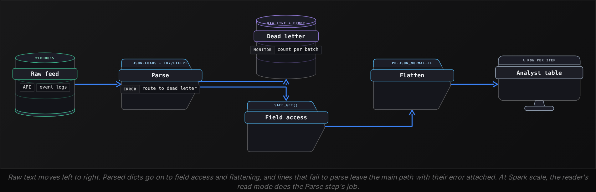

# Nested JSON for Data Engineers: Beginner

Ines is 20 minutes into a data engineering interview at Stripe when the interviewer pastes a webhook payload into the shared editor. Stripe delivers every event as JSON with the affected object nested under `data.object`, and this one is a charge whose `billing_details` holds an email and an address. The task sounds routine: turn a day of these events into a table analysts can query, with the customer's city and email as columns. Ines starts typing `event["data"]["object"]["billing_details"]["address"]["city"]` and pauses. Some charges carry no address, some carry a null one, a few lines in the export are cut off mid-object, and the interviewer mentions the full history spans 2 years. Nothing in the prompt says nested JSON, yet every follow-up tests her code on records a happy path never shows.


<br>

### What you will be able to do

Recognize the source phrases (webhooks, event logs, callbacks, 1 row per item) that turn a prompt into a nested JSON question.

Write a safe_get() helper that survives nulls and wrong types, and use a sentinel to tell a null value from a missing key.

Parse raw lines with json.loads() inside try/except, route failures to a dead letter, and predict what json.load() and json.loads() raise when swapped.

Flatten nested records with pd.json_normalize, choosing the grain with record_path, carrying parents with meta, and tolerating gaps with errors='ignore'.

Choose PERMISSIVE in Spark or one of its stricter modes, DROPMALFORMED or FAILFAST, and declare _corrupt_record so bad lines are kept for replay.


<br>

---

## Nested JSON Trigger Phrases

Interviewers rarely say the words "nested JSON". They describe where the data comes from, and the source decides the shape. Webhooks, REST API responses, clickstream events, messages on a queue and exports from a document database all arrive as JSON objects that contain other objects and lists. Once you hear the source, 4 problems follow from it: reaching a field several levels down, parsing text that may be broken, turning lists into rows, and deciding what happens to a record that fails.


<br>

### Source phrases and what they signal

| The prompt says | What it tells you about the data | What you reach for |
| --- | --- | --- |
| webhook events, API responses, callbacks | Objects nested 3 or more levels deep, with optional fields | `.get()` chains or a `safe_get()` helper |
| event log, clickstream, 1 event per line | JSON Lines: 1 object per line, and some lines arrive cut off | `json.loads()` per line inside try/except |
| the field is sometimes missing, sometimes null | Absent keys and null values carry different meanings | A sentinel default that separates the 2 cases |
| a row per line item, flatten it for analysts | A list of child objects inside each parent record | `pd.json_normalize` with `record_path` and `meta` |
| billions of events, a nightly batch over the full history | More data than 1 machine's memory holds | Spark's JSON reader with an explicit read mode |
| some records are malformed, we can't lose data | Bad lines must be kept for inspection and replay | A dead-letter list or a `_corrupt_record` column |


<br>

### The payload the rest of this lesson uses

Most prompts describe some version of the record below: an envelope with the event's id and type plus a timestamp, and the business object nested under `data`. Inside that object, a customer and a list sit next to a field that holds null. Later sections come back to its fields.

```sql
{
  "id": "evt_1001",
  "type": "order.created",
  "created": 1717430400,
  "data": {
    "object": {
      "order_id": 101,
      "customer": {
        "id": "c1",
        "email": null,
        "address": {
          "city": "Austin",
          "country": "US"
        }
      },
      "items": [
        {
          "sku": "A",
          "qty": 2,
          "price": 12.5
        },
        {
          "sku": "B",
          "qty": 1,
          "price": 30
        }
      ]
    }
  }
}
```

Read it the way an interviewer will probe it. data.object.customer.email exists and holds null. data.object.customer.phone is absent altogether. items holds 2 objects, so a table with a row per item gets 2 rows from this event, while a table with a row per order gets 1. Each of those facts is a follow-up in waiting: what you write for the null, what you write for the absent phone, and which grain the analyst needs.




<br>

### Three disguises of the same question

- **The analytics framing** *"Build a daily table of orders by city."*\
  The city sits 4 levels down and some orders have no address. This one tests safe field access.
- **The reliability framing** *"Our nightly job crashed on line 81,442."*\
  A truncated or non-JSON line reached a bare json.loads(). The interviewer wants to hear about error handling and where bad lines go.
- **The modeling framing** *"Analysts want revenue per SKU."*\
  Revenue lives inside the items list, so the table needs a row per item with the order id carried along, which makes it a flattening question.

All 3 framings share a payload; they differ in which failure the interviewer has already watched happen. Matching the framing to its failure tells you which part of your answer deserves the most time.

| ✓ An answer that ignores the shape | ✗ An answer that names the shape |
| --- | --- |
| • Indexes event['data']['object']['customer']['address']['city'] with no checks<br><br>• Calls json.loads() with no try/except around it<br><br>• Takes items[0] and loses every other line item<br><br>• Never says what happens to a bad record | • Asks for a sample record and points at the null and the list<br><br>• Parses each line inside try/except and counts failures<br><br>• Produces a row per item, carrying the order id<br><br>• States where bad lines go and how they get replayed |


<br>

### Try it: which prompts are nested JSON?

> Classify each prompt before reading the answers
>
> - A. Compute 7-day retention from a users table and a logins table.
> - B. Load the mobile app's event stream into a table; each event has a device object and a list of properties.
> - C. A partner sends order confirmations as HTTP callbacks. Report revenue per product.
> - D. Deduplicate a CSV of customer records by email.

| Prompt | Nested JSON? | The clue |
| --- | --- | --- |
| A | No | Two flat tables and a join, with nothing nested |
| B | Yes | "Device object" and "list of properties" name a nested object and an array |
| C | Yes | HTTP callbacks are webhooks, and products sit in a list inside each order |
| D | No | CSV rows are flat, so the work is deduplication logic |

> **TIP**
>
> When a prompt names a source and no schema, ask for 1 sample record before writing code. How deep it nests, and where it holds lists or nulls, tells you which of the next 4 sections the follow-ups will come from.


<br>

---

## Safe Nested Access with .get()

Bracket indexing d["key"] raises KeyError when the key is absent. d.get("key") returns None instead, and d.get("key", default) returns your default. That handles 1 level. Payloads nest several levels deep, and the usual first attempt chains .get() calls with empty-dict defaults so each level has something to call .get() on.

```sql
order = {"order_id": 201, "customer": {"id": "c4", "address": None}}

city = order.get("customer", {}).get("address", {}).get("city")
print(city)
```

Predict the output before reading on. The chain breaks on its third call. order.get("customer", {}) returns the customer dict. .get("address", {}) finds the key address, so it returns the stored None and never falls back to the {} default. Then None.get("city") raises AttributeError: 'NoneType' object has no attribute 'get'. A .get() default covers a missing key only, and JSON null arrives in Python as None, which is a value like any other.

| Payload | d.get("email", "n/a") | d["email"] |
| --- | --- | --- |
| {"email": "ana@example.com"} | 'ana@example.com' | 'ana@example.com' |
| {"email": null} | None | None |
| {} | 'n/a' | KeyError: 'email' |
| {"email": ""} | '' (empty string) | '' (empty string) |


<br>

### Writing safe_get()

A helper fixes the chain by checking the type at every step. It walks a sequence of keys, descends only while the current value is a dict that holds the next key or a list long enough for the next index, and returns the default the moment the path breaks. A string where an object was expected breaks the path the same way a missing key or a null does.

```sql
def safe_get(data, *path, default=None):
    current = data
    for step in path:
        if isinstance(current, dict) and step in current:
            current = current[step]
        elif (
            isinstance(current, list)
            and isinstance(step, int)
            and -len(current) <= step < len(current)
        ):
            current = current[step]
        else:
            return default
    return current


event = {"data": {"object": {"items": [{"sku": "A"}, {"sku": "B"}]}}}
print(safe_get(event, "data", "object", "items", 1, "sku"))
print(safe_get(event, "data", "object", "items", 5, "sku"))
print(safe_get(event, "data", "object", "customer", "id", default="unknown"))
```

It prints B, then None, then unknown. Integer steps index into lists, so items[1] is reachable, and an index past the end returns the default where bracket indexing would raise IndexError. Two details are deliberate. step in current tests membership, so a stored 0 comes back as itself instead of being mistaken for absence, and so do False and the empty string. The type check runs at every level, so a string where a dict should be returns the default where "abc"["city"] would raise TypeError.


<br>

### Null and missing mean different things

Returning `None` for both cases throws away information the pipeline may need. A missing `email` usually means the producer never sent the field, for instance a client on an older app version. An `email` of null usually means the producer sent the field with no value, for instance a customer who deleted their email. Update events make the gap expensive: JSON Merge Patch, defined in RFC 7396, treats a null member as "remove this field" and an absent member as "leave it unchanged". Write null into the table for an absent key and you erase a value nobody touched.

*JSON has no undefined: a key is either absent or present, and a present key holds either a value or null. Those 3 states are what the helper has to tell apart.*

The fix is a sentinel: a unique object passed as the default, which no parsed payload can contain, so `value is MISSING` can only mean the path broke. Give it a readable `__repr__` so it prints as a name in logs.

https://github.com/user-attachments/assets/3187173d-5a0c-4124-8bed-745c49bd53e5

*The same path read from 4 events. Event 1 has a value and event 2 has null, while event 3 lacks the key and event 4 has a null parent.*

Event 1 prints its email. Event 2 stores null, so safe_get returns None and the loader writes NULL. Events 3 and 4 both return MISSING, one because email is absent and one because customer itself is null, which stops the walk a level early. The loader leaves the stored email untouched for both, and a data quality metric can count them apart from real nulls.

> Follow-ups an interviewer asks about this helper
>
> - Why not wrap the chain in try/except? It works, but the handler has to catch `KeyError` and `TypeError` as well as `AttributeError`, and around a long expression it also hides your own bugs.
> - Why `*path` instead of a dotted string like `"customer.email"`? Real keys can contain dots, and list positions need to stay integers.
> - What does it cost? Each level runs an `isinstance` check and a membership test before the lookup, 3 cheap operations, so a path 5 levels deep costs 15 per record.

| ✓ Do | ✗ Don't |
| --- | --- |
| • Read optional fields with .get() or safe_get()<br><br>• Index with [] on fields the contract requires, so a violation raises<br><br>• Use a sentinel when null and missing lead to different writes<br><br>• Count records that hit the default and alert when the rate jumps | • Chain .get(key, {}) through fields that can be null<br><br>• Default with or: d.get("qty") or 1 turns a real 0 into 1<br><br>• Wrap field access in a bare except Exception<br><br>• Write NULL for a key that never arrived in an update event |

> **TIP**
>
> Raise the null-versus-missing distinction before the interviewer does, and tie it to the write it changes: NULL into the column, or the stored value left alone. Naming the merge-patch rule shows you have thought past parsing to what the table holds after an update.


<br>

---

## Handling json.loads() Errors

json.loads() turns JSON text into Python objects: objects become dicts and arrays become lists, while null becomes None and true becomes True. Broken text raises json.JSONDecodeError, a subclass of ValueError that carries msg. It also records where parsing failed, as a character offset pos and as a lineno and colno. With no handler, 1 bad line in a file of a million stops the whole job at that line.


<br>

### What breaks json.loads() in real feeds

| Input | What json.loads() does |
| --- | --- |
| `''`, an empty line | JSONDecodeError: Expecting value, at char 0 |
| `{'id': 2}`, single quotes | JSONDecodeError: Expecting property name enclosed in double quotes |
| `{"id": 3, "amount": `, cut off mid-object | JSONDecodeError: Expecting value |
| Two objects on 2 lines of 1 string | JSONDecodeError: Extra data |
| `None`, a field that was null upstream | TypeError: the JSON object must be str, bytes or bytearray, not NoneType |
| A JSON string holding JSON text, encoded twice | No error: returns a `str`, and the next `.get()` raises AttributeError |
| `b'{"id": 4}'`, bytes | Parses: UTF-8, UTF-16 and UTF-32 bytes are accepted |

Two rows escape an `except json.JSONDecodeError` clause. `None` raises `TypeError`, a different exception family, and the twice-encoded payload raises nothing at parse time, then fails later in code far from the cause. Decide which failures the handler owns, and check the type of what came back as well as whether the parse succeeded.


<br>

### A try/except loop with a dead letter

https://github.com/user-attachments/assets/321b8fd9-141e-4f8e-a800-02a1c5237a53

*Five raw lines through 1 try/except: good records to parsed, failures to dead_letter with their error.*

The run parses 2 of 5 lines and keeps 3 dead-letter entries, each holding the line number and raw text alongside `err.msg` and `err.pos`. The empty line fails at char 0, before a single character is consumed, which is how blank lines from a trailing newline or a keep-alive message show up. The loop keeps going: each bad line costs 1 entry in `dead_letter`, and the good line after it still loads.

In a production job the `dead_letter` list becomes a table or a folder written next to the good output, partitioned by load date, with each row holding the raw line and its error, tagged with the source file. A fixed producer can then be replayed from that table without re-reading the whole input, and the count of entries per batch becomes a data quality metric with an alert on it.


<br>

### Covering the cases the except misses

```sql
import json


def parse_line(raw):
    if not isinstance(raw, (str, bytes, bytearray)):
        return None, f"not text: {type(raw).__name__}"
    try:
        record = json.loads(raw)
    except json.JSONDecodeError as err:
        return None, f"{err.msg} at line {err.lineno} col {err.colno}"
    if not isinstance(record, dict):
        return None, f"expected object, got {type(record).__name__}"
    return record, None


print(parse_line('{"id": 1}'))
print(parse_line(None))
print(parse_line(json.dumps(json.dumps({"id": 1}))))
print(parse_line("{'id': 2}"))
```

It prints ({'id': 1}, None), then (None, 'not text: NoneType'). The twice-encoded payload parses into the string {"id": 1}, so the third line prints (None, 'expected object, got str'), and the single-quoted line prints (None, 'Expecting property name enclosed in double quotes at line 1 col 2'). Returning a pair leaves routing to the caller, and the error string travels with the raw line into the dead letter, so whoever replays it knows why it failed without parsing it again.

*The lineno and colno attributes count from 1, while pos counts characters from 0, which is why the single-quote failure reports col 2 for pos 1.*


<br>

### load versus loads

| ✓ json.loads(s) | ✗ json.load(fp) |
| --- | --- |
| • The s stands for string: it takes a str, or the same text as bytes or bytearray<br><br>• Fits 1 line of JSON Lines or a message body, and also an HTTP response's text<br><br>• Given a file object, it raises TypeError: the JSON object must be str, bytes or bytearray | • Takes a file-like object with a .read() method<br><br>• Reads the whole stream, then calls loads() on it, so it expects exactly 1 JSON document<br><br>• Given a str, it raises AttributeError: 'str' object has no attribute 'read' |

```sql
import io
import json

stream = io.StringIO('{"id": 1}\n{"id": 2}\n')

records = [json.loads(line) for line in stream if line.strip()]
print(records)

stream.seek(0)
print(json.load(stream))
```

Predict the second print before reading on. The comprehension parses each line on its own and prints both records. json.load(stream) reads the whole buffer as a single document, finds a second object after the first, and raises JSONDecodeError: Extra data: line 2 column 1 (char 10). JSON Lines needs a loop that calls loads() per line; load() fits a file that holds 1 array or 1 object.

> Follow-ups on the parsing loop
>
> - Why not fix single quotes with `raw.replace("'", '"')`? An apostrophe inside a value, as in `O'Brien`, breaks the fix.
> - Why keep the raw line instead of a parsed fragment? The parse failed, so the raw text is the only complete copy.
> - What if a line parses but has no `id`? That is a contract failure, separate from a parse failure; route it with its own reason.

| ✓ Do | ✗ Don't |
| --- | --- |
| • Catch json.JSONDecodeError by name, around the parse call only<br><br>• Put each raw line in the dead letter, tagged with its line number and err.msg<br><br>• Check isinstance(record, dict) after the parse succeeds<br><br>• Alert when the dead-letter count per batch crosses a threshold | • Use a bare except: that also swallows bugs in your own code<br><br>• Call json.load() on a JSON Lines file<br><br>• Log the error and drop the line with no copy kept<br><br>• Fix bad lines with string replacement before you know why they broke |

> **TIP**
>
> `except ValueError` also catches `JSONDecodeError`, its subclass. That breadth bites when the try block grows: a `ValueError` from your own `int(record["qty"])` lands in the dead letter as if the JSON were broken. Keep the try block to the parse call.


<br>

---

## Flattening with pd.json_normalize

Analysts query tables, so a nested record has to become rows and columns before it reaches them. In pandas, `pd.json_normalize` does that flattening, and the 3 arguments interviews probe decide 2 things: what a single row represents, and what happens when a field is absent.


<br>

### By default, objects become dotted columns

```sql
import pandas as pd

orders = [
    {
        "order_id": 101,
        "customer": {"id": "c1", "address": {"city": "Austin"}},
        "items": [{"sku": "A", "qty": 2}, {"sku": "B", "qty": 1}],
    },
    {
        "order_id": 102,
        "customer": {"id": "c2"},
        "items": [{"sku": "C", "qty": 5}],
    },
]

flat = pd.json_normalize(orders)
print(flat.columns.tolist())
```

| order_id | items | customer.id | customer.address.city |
| --- | --- | --- | --- |
| 101 | [{'sku': 'A', 'qty': 2}, {'sku': 'B', 'qty': 1}] | c1 | Austin |
| 102 | [{'sku': 'C', 'qty': 5}] | c2 | NaN |

The printed list is ['order_id', 'items', 'customer.id', 'customer.address.city']. Every nested object is spread into columns whose names join the keys with sep, which defaults to .. Order 102 has no address, so its customer.address.city is NaN: a column exists as soon as any record has the field. The items list stays a Python list inside 1 cell, because a dict maps onto a fixed set of columns and a list of unknown length does not. A table at the order grain with lists in cells cannot answer a question about SKUs.

`max_level` stops the flattening at a given depth: `max_level=1` turns `customer` into `customer.id` and leaves `customer.address` as a dict in 1 cell, which suits a deep object that should land as a single column.


<br>

### record_path picks the grain, meta carries the parent

```sql
items = pd.json_normalize(
    orders,
    record_path="items",
    meta=["order_id", ["customer", "id"]],
)
print(items)
```

| index | sku | qty | order_id | customer.id |
| --- | --- | --- | --- | --- |
| 0 | A | 2 | 101 | c1 |
| 1 | B | 1 | 101 | c1 |
| 2 | C | 5 | 102 | c2 |

record_path names the list whose elements become rows, so 2 orders produce 3 rows, 1 per item. meta lists the parent fields copied onto every row that came from that parent: a string for a top-level key, and a list of keys for a nested one, which becomes the dotted name customer.id. Leave order_id out of meta and the 3 rows lose their link back to the orders they came from.

The logic underneath fits in a dozen lines of plain Python. Watch order 103, whose `items` list is empty, as the loop reaches it.

https://github.com/user-attachments/assets/2ac56958-f4a5-4f90-8b7b-5f19447825e3

*Record-path flattening by hand: each item becomes a row carrying its order's fields.*

Three orders go in and 3 rows come out, with order 103 nowhere in them. Each list element produces 1 row, so an empty list produces 0. A report that counts orders from the item table undercounts by every order with no items; count orders at the order grain, or append the item-less orders yourself. The .get("id") on customer stands in for errors='ignore', covered next.

Grain also decides which sums are safe. A `shipping_fee` copied onto each item row through `meta` appears once per item, so summing it over the item table counts order 101's fee twice. Order-level amounts are summed at the order grain, and item-level amounts at the item grain.


<br>

### errors='ignore' for absent meta fields

```sql
orders.append(
    {"order_id": 104, "customer": {}, "items": [{"sku": "D", "qty": 1}]}
)

pd.json_normalize(
    orders,
    record_path="items",
    meta=["order_id", ["customer", "id"]],
)
```

Predict it before reading on. Order 104 has no customer.id, and with the default errors='raise' the call raises KeyError with a message naming the missing key 'id' and suggesting errors='ignore'. Add errors="ignore" to the call and it returns 4 rows, with NaN in customer.id for order 104's row.

> What errors='ignore' does not cover
>
> - It covers `meta` paths only. An order without an `items` key raises `KeyError` whatever `errors` says.
> - It hides absence. Count the `NaN` values in each meta column after the load, or a producer that stops sending a field goes unnoticed.
> - A `meta` field whose name matches a field in the records, such as `id` on both an order and its items, raises a `ValueError`; `meta_prefix` or `record_prefix` renames one side.


<br>

### Try it: what does this return?

```sql
pd.json_normalize(orders, record_path="items")
```

Four rows with only `sku` and `qty`. With no `meta`, nothing ties an item to its order, and 2 items with the same SKU in different orders become indistinguishable, which is why every flattening answer in an interview names the keys it carries down.

| ✓ Do | ✗ Don't |
| --- | --- |
| • Name the grain first: a row per order, or a row per item<br><br>• Carry every join key down with meta<br><br>• Count parents before and after flattening to catch empty lists<br><br>• Pass errors="ignore" only when you also count the NaNs it creates | • Leave lists in cells for analysts to parse in SQL<br><br>• Flatten to the item grain and then sum order-level fields like shipping<br><br>• Assume a column exists because the first record had it<br><br>• Load more JSON into 1 process than its memory holds |

> **TIP**
>
> `pd.json_normalize` runs in 1 process and holds the input list and the result in memory together. A day of webhooks fits; years of history do not, and the same flattening then moves to a distributed reader.


<br>

---

## Spark JSON Read Modes

When the data outgrows 1 machine, Spark's JSON reader does the parsing that the `json.loads()` loop did, spread over many tasks. It reads JSON Lines by default, 1 object per line, and it faces the same choice the dead-letter loop made: what to do with a line that fails to parse. The `mode` option makes that choice, and it takes 3 values.

| mode | A bad line becomes | Use it when |
| --- | --- | --- |
| PERMISSIVE, the default | A row with null data columns and the raw text in `_corrupt_record` | Landing raw data, where nothing may be lost |
| DROPMALFORMED | Nothing: the line is skipped without a trace | Exploring a sample, or bad lines are captured upstream |
| FAILFAST | An exception that fails the job | Inputs with a strict contract, where 1 bad line means a broken producer |

The choice follows where the data sits in the pipeline. A raw landing layer exists to keep everything that arrived, so it reads with PERMISSIVE and lets later steps decide. A job that feeds billing from a producer your team owns can use FAILFAST, because a bad line there means a bug worth stopping for. DROPMALFORMED fits a notebook exploring a sample, where a lost line costs nothing.


<br>

### Wiring up _corrupt_record

```sql
from pyspark.sql import SparkSession

spark = SparkSession.builder.getOrCreate()

lines = [
    '{"id": 1, "amount": 25.0}',
    '{"id": 2, "amount": ',
    '{"id": 3, "amount": 12.0}',
]

df = (
    spark.read
    .schema("id LONG, amount DOUBLE, _corrupt_record STRING")
    .option("mode", "PERMISSIVE")
    .option("columnNameOfCorruptRecord", "_corrupt_record")
    .json(spark.sparkContext.parallelize(lines))
)
df.show(truncate=False)
```

| id | amount | _corrupt_record |
| --- | --- | --- |
| 1 | 25.0 | null |
| null | null | {"id": 2, "amount": |
| 3 | 12.0 | null |

Three lines in, 3 rows out. Line 2 is cut off, so id and amount come back null. _corrupt_record keeps the line's exact text, so you can read it and replay it. The schema lists _corrupt_record STRING on purpose: with a schema you supply, Spark fills that column only when the schema declares it. Leave it out and line 2 still comes back as a row of nulls, with no copy of the text that produced them. columnNameOfCorruptRecord renames the column; the value in the example is the default name.


<br>

### Splitting good rows from bad

```sql
df = df.cache()

bad = df.filter(df["_corrupt_record"].isNotNull())
good = df.filter(df["_corrupt_record"].isNull()).drop("_corrupt_record")

print(bad.count(), good.count())
```

It prints 1 2. The good rows go on to the curated table and the bad rows to a quarantine table stamped with the load date. The cache() call matters when the source is files: since Spark 2.3, a query on raw JSON files whose only referenced column is the corrupt-record column is rejected with an AnalysisException, and the documented workaround is to cache or save the parsed result first.


<br>

### The 3 modes, modeled in plain Python

The animation models each mode with the same `try/except` around `json.loads()` from the dead-letter loop, run over the same 3 lines, so you can follow where line 2 ends up in each run.

https://github.com/user-attachments/assets/b99fc44b-2d7f-48eb-9c86-95255753c37c

*One loop, 3 policies for the line that fails to parse.*

PERMISSIVE keeps 3 rows, 1 of them carrying the raw text. DROPMALFORMED returns 2 rows and no record that line 2 existed; the row count is the only clue, and only if someone compares it with the input. FAILFAST stops at line 2, so line 3 is never read. In real Spark, with a schema supplied, the FAILFAST error surfaces when an action runs, because reading is lazy, and its message reports malformed records and suggests switching to PERMISSIVE.

> When every row lands in _corrupt_record
>
> The input is probably pretty-printed, with each JSON object spread over many lines. The reader expects 1 object per line, so every fragment fails on its own. Setting `.option("multiLine", True)` parses each file as whole documents instead. It costs parallelism: a file read that way cannot be split, so 1 task reads it end to end.

> **TIP**
>
> The 3 modes govern lines that fail to parse. A line that parses but carries a string where the schema says LONG is a type mismatch, and how much of that row survives differs between Spark versions, so test that case on the version you run.


A complete answer to "what about bad records?"

- Name the default, PERMISSIVE, and keep each bad line in _corrupt_record.
- Declare _corrupt_record in the schema, or the raw text is lost.
- Split the rows, write bad ones to a quarantine table, and alert on their count.
- Reach for FAILFAST where a bad line should stop the pipeline, and DROPMALFORMED only where losing lines is acceptable.


<br>

---

## Putting It All Together

A food delivery marketplace receives order webhooks from 3 restaurant point-of-sale vendors and publishes a daily table of revenue per menu item by city, backfilled over 18 months of stored events.

- The prompt says "webhooks from vendors" and "per menu item": nested objects and a list of items, so every technique in the lesson applies.
- Each webhook body goes through parse_line ( ) ; a vendor that sends a truncated body lands in the dead letter with its error, and the rest of the batch still loads.
- City is a grouping key, so a null city and an absent delivery block belong in the same bucket: safe_get ( order , "delivery" , "address" , "city" ) returns None for both, and both map to "unknown". The sentinel is kept for update writes, which treat null differently from a missing key.
- Passing record_path = "items" and meta = [ "order_id" , [ "delivery" , "address" , "city" ] ] to json_normalize , along with errors = "ignore" , gives a row per menu item. Vendors that omit delivery get NaN in delivery . address . city , and those NaNs are counted per vendor. Order counts and delivery fees are summed from the order-grain table instead.
- The 18-month backfill runs in Spark with PERMISSIVE and _corrupt_record declared, and the quarantine count per vendor shows which integration sends broken JSON.


<br>

---

## Key Takeaways

- If a prompt mentions webhooks or an API, or an event log or a document export, it is asking about nested JSON even when it never says so.
- . get ( key , default ) falls back only on a missing key; a null value comes back as None , so chained . get ( ) calls crash on nulls.
- A safe_get ( ) that checks types at each level, plus a sentinel default, separates null (write NULL) from missing (leave the stored value alone).
- Parse every line inside try / except json . JSONDecodeError , keep the raw line and err . msg in a dead letter, and check that the result is a dict.
- loads takes text and load takes a file object; JSON Lines needs loads once per line.
- json_normalize sets the grain with record_path , carries parents with meta , and drops any parent whose list is empty.
- Spark's PERMISSIVE keeps bad lines in _corrupt_record only when the schema declares it; DROPMALFORMED loses them silently; FAILFAST stops the job.
