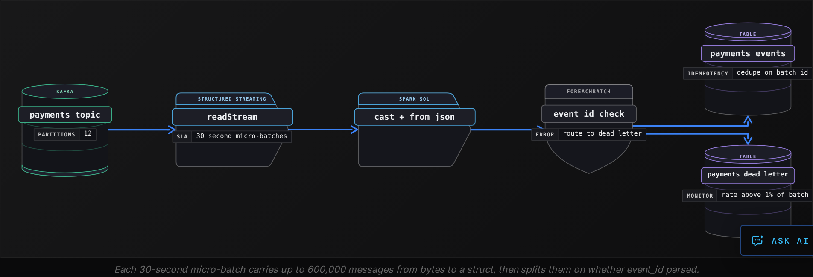

# Nested JSON for Data Engineers: Intermediate

Ines is 40 minutes into a data engineering onsite at Uber. The interviewer pastes 3 lines of JSON from the rider app: a trip event with a nested `rider` object, an array of `fare_components`, and a `pickup_address` field that is a plain string on line 1 and an object on line 2. The events stream in from Kafka at 20,000 per second. "Walk me through getting this into a table analysts can trust," the interviewer asks. Ines starts with `spark.read.json` and stops herself: inferring the schema means reading the data twice, and the address field would come out as whatever the sample happened to see. She sketches a declared schema, a `from_json` call, an `explode_outer`, a string landing column for the address, and a dead letter for the lines that will not parse. The follow-ups probe each of those choices, and this lesson builds every one.


<br>

### What you will be able to do

Explain the extra parse pass that schema inference costs and replace it with a committed StructType the scan can push filters into

Parse a JSON string column with from_json and pick explode or explode_outer by which rows the metric must keep

Land a field that is sometimes a string and sometimes an object as StringType and parse it per row without losing data

Build a Kafka readStream to writeStream pipeline that splits parsed events from a dead letter inside a single foreachBatch

Replace a withColumn loop over nested fields with a single select and explain the plan growth it avoids


<br>

---

## The inferSchema Anti-Pattern

When spark.read.json(path) runs without a .schema(...) call, the reader has no column list, so it builds one from the data. Interviewers call this the **inferSchema anti-pattern**, borrowing the name of the CSV reader's inferSchema option. The JSON reader has no such switch: inference runs every time the schema is missing, which makes it the default for anyone who forgets.


<br>

### What inference costs before your job starts

Inference is a separate distributed job that runs before the read you asked for. With the default `samplingRatio` of 1.0 it parses every record in every file, notes each field's type, and merges those types across records into a single schema. Only then does Spark plan your query, and the scan parses every record again to produce rows. Text parsing is the expensive part of a JSON read, so on a landing directory that receives 2 TB a day, inference adds a whole second job's worth of parsing to every run of the pipeline.

- **4 TB** — parsed per day with inference
- **2** — full passes over each file

https://github.com/user-attachments/assets/ab072535-244b-4247-92ec-9a22ad8d00b3

*The inferred schema depends on which records inference sees*

The first print is what a sample that skipped record 4 would build: `amount` is double and `channel` does not exist, so the table silently loses a column. The full pass widens `amount` to string because of the single "N/A", following the rule Spark's inference applies: a long meeting a double becomes double, and any conflict with a string becomes string. A field that is null in every record inference sees also lands as string. Either way the schema is a function of the data that arrived, so `amount` can be double on Monday and string on Tuesday, and every downstream `sum(amount)` breaks with no code change.


<br>

### Declare the contract in code

A declared `StructType` removes the inference job and turns the type of every column into a decision that goes through code review. It also gives the "N/A" record a visible home: with `amount` declared as `DoubleType`, the line fails conversion in PERMISSIVE mode and its raw text lands in `_corrupt_record`, a column the schema includes for that purpose.

```sql
from pyspark.sql import SparkSession
from pyspark.sql.types import (
    DoubleType,
    LongType,
    StringType,
    StructField,
    StructType,
    TimestampType,
)

spark = SparkSession.builder.getOrCreate()

order_schema = StructType([
    StructField("id", LongType()),
    StructField("amount", DoubleType()),
    StructField("channel", StringType()),
    StructField("event_ts", TimestampType()),
    StructField("_corrupt_record", StringType()),
])

orders = (
    spark.read
    .schema(order_schema)
    .option("mode", "PERMISSIVE")
    .option("columnNameOfCorruptRecord", "_corrupt_record")
    .json("/landing/orders/dt=2026-10-01/")
)

orders.filter("event_ts >= TIMESTAMP '2026-10-01 09:00:00'").explain()
```

Since Spark 3.1 the JSON source accepts pushed filters, controlled by `spark.sql.json.filterPushdown.enabled`, which defaults to true. The parser evaluates a pushed filter as soon as it has converted the fields the filter reads, and stops converting a record that fails it. That works only when the filter compares a column in its declared type. Inference leaves `event_ts` as a string unless timestamp inference is switched on, so the same filter turns into a cast evaluated on every row after the scan, and no comparison on `event_ts` appears under `PushedFilters`.

| What the plan shows | Inferred schema | Declared schema |
| --- | --- | --- |
| Jobs before the read | 1 inference job over the input | None |
| Type of event_ts | string | timestamp |
| Filter on event_ts | Cast on every row after the scan | Listed under PushedFilters |
| Type of amount | Whatever today's records imply | double, failures go to _corrupt_record |
| A new field tomorrow | Appears as a new column | Ignored until the schema adds it |


<br>

### Sampling trades cost for risk

Setting `samplingRatio` to 0.1 parses a tenth of the records during inference. For line-delimited files the sample is drawn from lines the job has already read, so the whole input is still read: sampling saves parse work and keeps the extra I/O. It also buys the failure from the first print, a rare field that never makes the sample. The production answer is to run inference once, offline, over a representative week, review the output of `df.schema.json()`, and commit it. At job start, `StructType.fromJson(json.loads(schema_text))` rebuilds the schema with no scan.

*Everything here assumes line-delimited JSON. With multiLine set to true, each file is a single document, so sampling picks whole files and parses only those. At the default samplingRatio of 1.0, inference parses every file before the read.*

> **TIP**
>
> Check this in a design review with `explain()`. In the scan line, `ReadSchema` should match the committed schema and `PushedFilters` should list the filter on `event_ts`. Those 2 lines prove the declared schema reached the reader.

> The answer in 4 parts
>
> - Cost: an extra job parses the input before the real read, so every file is parsed twice on every run.
> - Risk: the schema follows the data, so a rare value or a rare field changes column types between runs.
> - Fix: a reviewed StructType in code, passed to .schema(), with a _corrupt_record column for lines that fail it.
> - Payoff: typed filters reach the scan as PushedFilters, and the output table's types stop drifting.


<br>

---

## from_json and explode

Nested JSON often arrives as a string column inside rows that are already tabular: a `payload` column in a change table, the `value` of a stream message, an API response stored per request. `spark.read.json` can parse a collection of strings, but it detaches them from the row they came from, so a column such as `order_id` is gone, and it infers a schema again. `from_json` parses the column in place, beside `order_id`. It accepts either a `StructType` or a DDL string as the schema and returns a struct column you reach into with dotted paths.

```sql
from pyspark.sql import SparkSession
from pyspark.sql import functions as F

spark = SparkSession.builder.getOrCreate()

raw = spark.createDataFrame(
    [
        ("A", '{"customer": "c9", "items": [{"sku": "s1", "qty": 2}, '
              '{"sku": "s2", "qty": 1}, {"sku": "s3", "qty": 4}]}'),
        ("B", '{"customer": "c4", "items": [{"sku": "s1", "qty": 1}]}'),
        ("C", '{"customer": "c7", "items": []}'),
        ("D", '{"customer": "c2"}'),
    ],
    ["order_id", "payload"],
)

payload_ddl = "customer STRING, items ARRAY<STRUCT<sku: STRING, qty: INT>>"

parsed = raw.select(
    "order_id",
    F.from_json("payload", payload_ddl).alias("p"),
)

lines = parsed.select(
    "order_id",
    "p.customer",
    F.explode_outer("p.items").alias("item"),
).select("order_id", "customer", "item.sku", "item.qty")
```

The schema here is a DDL string, which reads well for a handful of fields; a `StructType` built in code expresses the same thing for 80 fields. A payload that fails to parse under it yields nulls in the fields of `p` and the job keeps running, so a later check has to look for those nulls. To draft the DDL, `F.schema_of_json` takes a literal sample and returns its schema string, which describes that sample only and deserves the same review as any inferred schema.


<br>

### explode versus explode_outer

The 2 functions differ only on rows whose array is empty or null. `explode` drops those rows, which removes orders C and D from the output. `explode_outer` keeps each of them as a row with null element fields. The animation runs both over the 4 orders above.

https://github.com/user-attachments/assets/262ec586-6fa4-4aaa-aaf1-78be3c3cd315

*Empty and null arrays decide which orders survive*

explode: 4 rows

| order_id | customer | sku | qty |
| --- | --- | --- | --- |
| A | c9 | s1 | 2 |
| A | c9 | s2 | 1 |
| A | c9 | s3 | 4 |
| B | c4 | s1 | 1 |

explode_outer: 6 rows

| order_id | customer | sku | qty |
| --- | --- | --- | --- |
| A | c9 | s1 | 2 |
| A | c9 | s2 | 1 |
| A | c9 | s3 | 4 |
| B | c4 | s1 | 1 |
| C | c7 | null | null |
| D | c2 | null | null |

Which output is correct depends on the metric. Total units sold is 8 under both, since the extra rows carry a null `qty` that `sum` skips. Orders per customer is wrong under `explode`: customer c7 placed an order with an empty cart and c2 placed one whose payload had no `items` key, and both drop out of the count. Choose `explode_outer` when any order-level fact must survive the flattening, and filter out the null-element rows only where a metric needs real items.

- Rows after explode: the sum of array lengths, counting only non-empty arrays
- Rows after explode_outer: that sum, plus 1 for every empty or null array
- Rows after exploding 2 sibling arrays: the product of their lengths, per record


<br>

### Sibling arrays multiply rows

If an order has 3 items and 2 payments, exploding items and then payments gives 6 rows, because each item row repeats once per payment. A `sum(item_price)` over the result counts every item twice, and a `sum(payment_amount)` counts every payment 3 times. Spark also rejects 2 generators in the same `select`, which pushes people into chaining 2 selects and walking straight into the cross product.

| Grain | Rows for this order | sum(item_price) | sum(payment_amount) |
| --- | --- | --- | --- |
| Correct order totals | 1 | 60 | 60 |
| After exploding items, then payments | 6 | 120 | 180 |

Explode each array in its own DataFrame keyed by `order_id`, aggregate each to the order grain, and join the aggregates. When the arrays are parallel, position 0 of one belonging with position 0 of the other, `arrays_zip` pairs them into a single array of structs that explodes once.

Name the exploded table for its grain

- posexplode_outer adds a pos column holding each element's index, which preserves array order when line numbers matter.
- Exploding a map column returns 2 columns, key and value, with a row per entry.
- inline_outer(p.items) inside selectExpr expands an array of structs straight into columns, skipping the item.\* step.
- Filter on order-level columns before exploding, so each row removed there is removed once instead of once per element.

Exploding changes the grain of the table, so the grain belongs in its name and its key. Build `order_lines` with `posexplode_outer` so every element carries its `pos`, and key it by `order_id` and `pos`. It sits beside `orders`, which is keyed by `order_id`. Counts go wrong most often when someone assumes order grain on a line-grain table.

> **TIP**
>
> Before naming a function, say which rows must survive the flattening. An interviewer asking to flatten an array is usually checking whether the empty cart disappears from your counts.


<br>

---

## Handling Mixed-Type Fields

A field that changed shape between producer versions is a frequent nested JSON trap in production. Older app builds send `"address": "12 Main St"`; builds after a schema change send `"address": {"street": "9 Oak Ave", "city": "Austin"}`. Both shapes sit in the same files, and a downstream team wants a `street` column and a `city` column.

| ✓ Declare address as a struct | ✗ Land address as a string |
| --- | --- |
| • Object rows parse into street and city<br><br>• String rows fail conversion and come back null<br><br>• The original text survives only if a corrupt-record column is in the schema<br><br>• A third shape next month fails the same way, silently | • Every row loads: a string arrives as its text, an object as its JSON text<br><br>• Nothing is lost at read time<br><br>• Shape handling moves into a column expression you can test<br><br>• A third shape shows up as a value you can count |

The right column works because of how the JSON reader fills a `StringType` field. When the record holds an object or an array at that position, the reader writes the value's raw JSON text into the column, and a JSON string value arrives without its surrounding quotes. After landing, then, a value whose first non-space character is `{` was an object, and anything else was a scalar, so the parse can branch on that character.

```sql
from pyspark.sql import SparkSession
from pyspark.sql import functions as F
from pyspark.sql.types import StringType, StructField, StructType

spark = SparkSession.builder.getOrCreate()

landing_schema = StructType([
    StructField("user", StringType()),
    StructField("address", StringType()),
])
landed = spark.read.schema(landing_schema).json("/landing/profile_events/")

address_ddl = "street STRING, city STRING"
raw_address = F.ltrim(F.col("address"))
is_object = raw_address.startswith("{")
parsed = F.from_json(raw_address, address_ddl)
no_fields = parsed["street"].isNull() & parsed["city"].isNull()

events = landed.select(
    "user",
    F.when(is_object, parsed)
    .otherwise(
        F.struct(
            F.col("address").alias("street"),
            F.lit(None).cast("string").alias("city"),
        )
    )
    .alias("address"),
    F.when(is_object & no_fields, F.col("address")).alias("address_unparsed"),
)
```

Both branches of the `when` return the same struct type, `street STRING, city STRING`, which the expression requires: a branch returning a bare string beside a struct fails analysis with a type mismatch. The `address_unparsed` column keeps the text of any value that looked like an object and yielded neither field, so a broken payload stays visible and countable.

https://github.com/user-attachments/assets/5052ac40-cdc4-4a65-a227-32e031acf103

*Every shape lands as text, then parses into the same 3 fields*

Row u3 shows a choice worth stating in the interview: a null address becomes a struct of nulls, because the `otherwise` branch builds a struct from a null string. If downstream code tests `address IS NULL`, add a first `when` that returns null for a null input.


<br>

### The same move for scalar-or-array

Tags show the other common variant: `"tags": "promo"` from one producer and `"tags": ["promo", "new"]` from another. Land the field as a string, parse values that start with `[` as an array, and wrap every other non-null value in a 1-element array, so every row ends up as `ARRAY<STRING>`.

```sql
from pyspark.sql import functions as F

raw_tags = F.ltrim(F.col("tags"))

tags = (
    F.when(raw_tags.startswith("["), F.from_json(raw_tags, "ARRAY<STRING>"))
    .when(F.col("tags").isNotNull(), F.array(F.col("tags")))
)
```


<br>

### Count the shapes before choosing

Before writing the parse, measure the mix on a day of landed data. Add a shape column that tags each value as an object or an array, a scalar or null, then group and count it, and the counts show which branch is the main path and how large the unparsed bucket is. In the interview, ask for those numbers or state an assumption: if 7% of addresses are strings, the string branch is a real code path that needs its own test, and if 0.1% fail to parse, that rate is what the quarantine alert watches.

```sql
from pyspark.sql import functions as F

raw = F.ltrim(F.col("address"))
shape = (
    F.when(raw.startswith("{"), "object")
    .when(raw.startswith("["), "array")
    .when(F.col("address").isNull(), "null")
    .otherwise("scalar")
)

landed.groupBy(shape.alias("shape")).count().show()
```

The cost of the design is a second parse of a single column and a landing table that stores the field as text. Set that against the alternatives: a struct declaration that nulls out every string-shaped address, or a pipeline that breaks the day a third shape appears.

> **TIP**
>
> If the producer team can change the event, ask them to put the new shape under a new key, such as `address_v2`, instead of reusing the old key. The landing trick handles a reused key; a new key removes the ambiguity at the source.

| ✓ Do | ✗ Don't |
| --- | --- |
| • Land a field that has 2 or more shapes as StringType<br><br>• Trim before testing the first character<br><br>• Give every branch of the when the same struct type<br><br>• Keep unparsed text in its own column | • Declare a struct for a field that sometimes arrives as a string<br><br>• Expect the reader to reject the odd shape loudly<br><br>• Drop a whole row because a single field had an unexpected shape<br><br>• Choose branch order before counting the shapes |


<br>

---

## Parsing Kafka JSON Streams

Spark's Kafka source hands every message over with a fixed schema, whatever the producer wrote. The payload sits in `value` as binary, so the pipeline's work is to turn bytes into text, text into a struct, and the struct into either a table row or a dead-letter row, while keeping the offset that identifies each message.


Every source column except `value` is metadata the dead letter needs. An `offset` identifies a message only within its `topic` and `partition`, so the dead letter keeps all of them and an engineer can replay the exact message after a fix. `batch_id` ties a dead-letter row back to the micro-batch that produced it.



```sql
from pyspark.sql import SparkSession
from pyspark.sql import functions as F

spark = SparkSession.builder.getOrCreate()

event_ddl = "event_id STRING, user_id STRING, amount DOUBLE, event_ts TIMESTAMP"

source = (
    spark.readStream
    .format("kafka")
    .option("kafka.bootstrap.servers", "broker1:9092")
    .option("subscribe", "payments")
    .option("startingOffsets", "latest")
    .option("maxOffsetsPerTrigger", 600000)
    .load()
)

decoded = source.select(
    "topic",
    "partition",
    "offset",
    F.col("value").cast("string").alias("raw_json"),
)
parsed = decoded.select("*", F.from_json("raw_json", event_ddl).alias("data"))


def route(batch_df, batch_id):
    batch_df.persist()
    is_bad = F.col("data.event_id").isNull()
    (batch_df.filter(~is_bad)
        .select("data.*", "partition", "offset")
        .write.mode("append").saveAsTable("payments_events"))
    (batch_df.filter(is_bad)
        .select(
            "topic", "partition", "offset", "raw_json",
            F.lit(batch_id).alias("batch_id"),
            F.current_timestamp().alias("routed_at"),
        )
        .write.mode("append").saveAsTable("payments_dead_letter"))
    batch_df.unpersist()


query = (
    parsed.writeStream
    .foreachBatch(route)
    .option("checkpointLocation", "/checkpoints/payments_events")
    .trigger(processingTime="30 seconds")
    .start()
)
```

`cast("string")` decodes the bytes as UTF-8. `from_json` returns nulls for text it cannot parse, so the routing test checks the field the table cannot do without, `data.event_id`, which is null both when parsing fails and when the text parses but lacks the key. `persist()` matters because the batch feeds 2 writes, and without it each write recomputes the batch from the source.

`startingOffsets` applies only to a query's first run: once a checkpoint exists, the query resumes from its stored offsets. `maxOffsetsPerTrigger` caps a batch at 600,000 messages across all partitions, which bounds recovery after an outage. Without it, the first batch after a 2-hour stop would try to pull 144 million messages at once.

https://github.com/user-attachments/assets/4a7d301f-dd43-48e6-904a-c5e36db19a2c

*Routing on the required key catches both failure kinds*

Offset 3 parsed as JSON and still went to the dead letter: a check that only asked whether parsing succeeded would have written it to the table with a null key. Scale the routing to the pipeline in the code: a `maxOffsetsPerTrigger` of 600,000 per 30-second trigger sustains 20,000 messages per second, and assume 0.1% of them are malformed.

- **600** — dead-letter rows per batch
- **1.7M** — dead-letter rows per day

At that volume no one reads dead-letter rows individually. The rate per batch gets an alert, and rows are grouped by failure shape and replayed in bulk once the producer or the schema is fixed.


<br>

### A single foreachBatch versus 2 queries

| ✓ 2 writeStream queries | ✗ A single foreachBatch |
| --- | --- |
| • Each query has its own checkpoint and its own Kafka consumer<br><br>• Every message is fetched and parsed twice<br><br>• The 2 sinks can drift apart in progress after a failure<br><br>• Each query can run on its own trigger | • A single fetch and parse per micro-batch<br><br>• A single checkpoint tracks both sinks<br><br>• Both writes happen inside the same batch, in a known order<br><br>• Needs persist() so the second write does not recompute |


<br>

### What a restart replays

`foreachBatch` provides at-least-once delivery. If the driver dies after the table write and before the checkpoint marks the batch committed, the restarted query runs that batch again with the same `batch_id`, and plain appends insert its rows a second time. The standard fixes are to record the last `batch_id` written per sink and skip any batch already recorded, or to write with a merge keyed on `event_id` so a replay updates rows instead of adding them. The dead letter tolerates duplicates better than the fact table, and the same `batch_id` check protects it for the price of a single lookup.

| ✓ Do | ✗ Don't |
| --- | --- |
| • Route on a required field being null, which catches unparseable text and missing keys alike<br><br>• Keep the offset with its topic and partition on every dead-letter row so a fix can replay it<br><br>• Persist the batch DataFrame before writing it to 2 sinks<br><br>• Alert on the dead-letter rate per batch | • Test only whether the whole struct is null<br><br>• Drop malformed messages in the reader, which leaves no record to replay<br><br>• Run 2 queries on the same topic to get 2 sinks<br><br>• Assume foreachBatch writes exactly once |


> The pipeline in 4 sentences
>
> - Read the topic with readStream under a maxOffsetsPerTrigger cap, and keep each message's offset with its topic and partition.
> - Cast value to string and parse it with from_json against the committed DDL.
> - In foreachBatch, persist the batch, write rows with event_id to the table and the rest to the dead letter.
> - Dedupe replays on batch_id or event_id, and alert on the dead-letter rate.


<br>

---

## Replacing a withColumn Loop

Flattening a wide nested record invites a loop: walk a list of 200 nested paths, call `withColumn` for each, and reassign the DataFrame every time. It reads like ordinary Python, and every iteration adds work on the driver before a single task starts.

```sql
from pyspark.sql import functions as F

nested_paths = ["user.id", "user.email", "device.os", "device.model"]

flat = events
for path in nested_paths:
    flat = flat.withColumn(path.replace(".", "_"), F.col(path))
```

The documentation for `withColumn` names the problem: the method introduces a projection internally, so calling it repeatedly in a loop to add many columns can generate big plans that cause performance issues and even a `StackOverflowException`, and the fix it recommends is `select()` with all the columns at once. Each call returns a new DataFrame, and constructing a DataFrame analyzes its logical plan, so the driver re-examines a plan that grows a projection deeper on every iteration.

https://github.com/user-attachments/assets/3b09fa46-8700-46fe-9467-8321454a5794

*A walk-cost model: each new DataFrame visits every node in its plan once*

The animation counts plan nodes under a simple model in which each new DataFrame walks its whole plan once. The plan grows by a node per call, and the total walk grows with the square of the field count. Interviewers often call this exponential DAG growth; measured, it is linear plan depth and quadratic planning work, which hurts at the field counts nested events reach. At the 200 paths from the loop above:

- **201** — plan nodes after 200 calls
- **20,300** — node visits in the walk model

The optimizer's `CollapseProject` rule merges adjacent projections, so the plan that finally executes can match the `select` version and no task runs slower. The cost is paid on the driver before the first stage is scheduled, so the Spark UI shows healthy stages and a job that started late.

`functools.reduce(lambda df, p: df.withColumn(p, F.col(p)), paths, events)` is the same loop in disguise, as is any helper that reassigns a DataFrame once per column.


<br>

### Build the column list, then select once

The fix moves the loop out of the DataFrame API and into plain Python. The loop builds a list of `Column` objects, which touches neither the cluster nor the planner, and a single `select` turns the whole list into a single projection. Walking the schema, instead of a hand-typed list of paths, also keeps the output correct when the producer adds a field.

```sql
from pyspark.sql import functions as F
from pyspark.sql.types import StructType


def flat_columns(schema, prefix=""):
    columns = []
    for field in schema.fields:
        path = prefix + field.name
        if isinstance(field.dataType, StructType):
            columns.extend(flat_columns(field.dataType, path + "."))
        else:
            columns.append(F.col(path).alias(path.replace(".", "_")))
    return columns


flat = events.select(*flat_columns(events.schema))
```

Take an event with `user` and `device` structs, plus `geo` and `order`. `flat_columns` returns one column per leaf field, starting with `user_id` and `user_email`, then `device_os` and the rest, each aliased so the output names carry no dots. Arrays pass through untouched, since flattening one changes the row count and is a job for `explode`.

> **TIP**
>
> A field whose own name contains a dot, such as a key literally named app.version, breaks a dotted path. Wrap each name part in backticks while building the path, so the resolver reads app.version as a single field name.


<br>

### When the change is inside a struct

Sometimes the target keeps the nesting and a single inner field changes, such as lowercasing `device.os`. Rebuilding the `device` struct with `F.struct` means listing every sibling field by hand. `Column.withField` was added in Spark 3.1 to replace a field inside a struct or add one. `dropFields` removes fields, and each is an expression that fits inside the same projection. `withColumns`, added in 3.3, takes a dict of names to columns and applies them all in a single projection, which makes it the direct replacement for a loop that only adds or replaces top-level columns.

```sql
from pyspark.sql import functions as F

cleaned = events.withColumns({
    "device": F.col("device").withField("os", F.lower(F.col("device.os"))),
    "geo": F.col("geo").dropFields("raw_ip"),
    "event_date": F.to_date("event_ts"),
})
```

| Approach | Projections added for 200 fields | Use it when |
| --- | --- | --- |
| withColumn in a loop | 200 | Never for more than a few columns |
| withColumns with a dict | 1 | Adding or replacing top-level columns |
| select with a built list | 1 | Flattening or reshaping the whole record |
| withField and dropFields inside select | 1 | Changing fields while keeping the struct |

> What the interviewer wants to hear
>
> - Each withColumn call adds a projection and triggers analysis of the whole plan on the driver.
> - Plan depth grows linearly with the column count and planning work roughly with its square.
> - The withColumn docs warn of performance issues and StackOverflowException for loops.
> - Build the columns in Python and pass them to one select or withColumns call.


<br>

---

## Putting It All Together

A food delivery company streams order events from its courier and customer apps into Kafka at 20,000 messages per second. Each event carries a nested customer object, an array of line items, a delivery_address that older app builds send as a string, and about 200 nested fields that analysts want as flat columns in a daily table.

- The declared schema from the first section is the DDL that from_json applies to the Kafka value, so a single reviewed contract serves both the batch backfill and the stream.
- delivery_address is declared StringType in that contract, so old-build events reach the conditional parse instead of the dead letter, and only text that yields no fields lands in address_unparsed.
- The dead-letter test on event_id and the unparsed address column share an idea: check the field that must exist, since a struct of nulls looks parsed.
- Line items explode with explode_outer into an order-line table, while order counts come from the unexploded table so empty carts still count.
- The 200-field flattening runs as a select built from the schema inside foreachBatch, so each 30-second batch plans a single projection however many fields the schema gains.


<br>

---

## Key Takeaways

- Without a schema the JSON reader runs an inference job over the input first, so every file is parsed twice and column types follow whatever data arrived.
- A committed StructType makes types a reviewed decision, sends conversion failures to _corrupt_record, and lets typed filters reach the scan.
- from_json parses a string column. On rows with empty or null arrays, explode drops the row and explode_outer keeps it. Exploding sibling arrays multiplies rows.
- A field with 2 shapes lands as StringType, where objects keep their JSON text, and a when on the first character parses it into a single struct type.
- Kafka values are bytes, so cast them to string and parse them, then route on a required field being null. All of it runs inside a single foreachBatch that persists the batch and dedupes on batch_id.
- A withColumn loop deepens the plan by a projection per call; build the columns in Python and select once.
