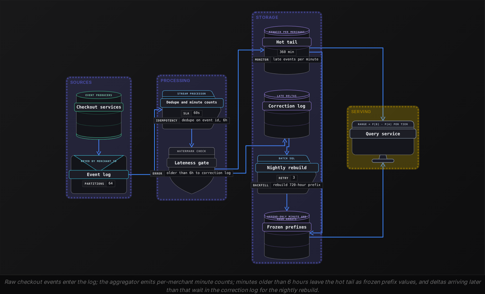

# Prefix Sum: Advanced

Ines is 40 minutes into her final onsite loop at Stripe when the interviewer pastes a grid onto the shared screen: rows are merchants, columns are hours, cells are net revenue in cents, refunds negative. Her first task is to find the rectangle of merchants and hours with the highest total. She sketches an answer, and the follow-ups arrive in quick succession. How many contiguous hour windows net to an exact multiple of 100 cents? What if a refund lands 3 hours late and rewrites a cell? Can the same idea back a dashboard reading 200,000 events a second? And why did yesterday's float total come out a cent off? Every follow-up stretches the prefix sum she already knows, and the interviewer is listening for whether she knows where each stretch breaks: the zero row, the negative remainder, the index-zero loop, the late event, the drifting float.


<br>

### What you will be able to do

Build a padded 2D prefix table that rejects ragged grids and out-of-range rectangles, then pair it with Kadane's algorithm to find the maximum-sum submatrix in O(R^2 \* C).

Count subarrays whose sum is divisible by K, and keep negative running totals in the right remainder bucket in Python and in SQL.

Implement a Fenwick tree with O(log n) updates and prefix queries, and predict the calls that make it hang or drop a write.

Design a tiered real-time metrics store where every layer answers range totals with 2 prefix reads and absorbs late events.

Answer range sums over sparse keys with bisect, and keep money totals exact with integer cents or Decimal.


<br>

---

## Full 2D Prefix Sum Implementation

The 2D prefix sum opens the question, and the follow-ups test its edges: an empty grid, a ragged row, swapped corners, all-negative cells, then a request to find the best rectangle instead of scoring a given one. Each edge turns on a decision made while writing the first loop: where index 0 of the prefix table sits.


<br>

### Pad the table with a zero border

Give the prefix table `P` an extra row and an extra column of zeros along the top and left. `P[i][j]` then holds the sum of every cell above row `i` and left of column `j`. The build fills `P[i + 1][j + 1] = grid[i][j] + P[i][j + 1] + P[i + 1][j] - P[i][j]`, and the inclusive rectangle from `(r1, c1)` to `(r2, c2)` scores as `P[r2 + 1][c2 + 1] - P[r1][c2 + 1] - P[r2 + 1][c1] + P[r1][c1]`.

grid, 3 x 3

|  | col 0 | col 1 | col 2 |
| --- | --- | --- | --- |
| row 0 | 2 | -1 | -4 |
| row 1 | -3 | 4 | 2 |
| row 2 | 1 | 5 | -6 |

P, 4 x 4 with a zero border

|  | j=0 | j=1 | j=2 | j=3 |
| --- | --- | --- | --- | --- |
| i=0 | 0 | 0 | 0 | 0 |
| i=1 | 0 | 2 | 1 | -3 |
| i=2 | 0 | -1 | 2 | 0 |
| i=3 | 0 | 0 | 8 | 0 |

Score rows 1 to 2, column 1: `P[3][2] - P[1][2] - P[3][1] + P[1][1]` is 8 - 1 - 0 + 2 = 9, matching the cells 4 + 5. A rectangle on row 0 or column 0 reads the border's zeros, so the formula needs no branch for it.


<br>

### The bug Python hides

Without the border, a rectangle starting at row 0 reads `S[r1 - 1]`, which is `S[-1]`. Most languages crash on that read; Python returns the last row. Here `S` is the unpadded prefix table of `[[1, 2], [3, 4]]`. Predict both lines this program prints.

```sql
S = [[1, 3],
     [4, 10]]


def query(r1, c1, r2, c2):
    return S[r2][c2] - S[r1 - 1][c2] - S[r2][c1 - 1] + S[r1 - 1][c1 - 1]


print(query(0, 0, 1, 1))
print(query(1, 1, 1, 1))
```

It prints 0, then 4. The interior query never touches index -1. The full-grid query wraps every `- 1` to the last row or column and computes 10 - 10 - 10 + 10. No exception fires, a test on an interior cell passes, and the wrong total ships. With the zero border, no index drops below 0.


<br>

### A build that refuses bad input

```sql
class Prefix2D:
    def __init__(self, grid):
        self.rows = len(grid)
        self.cols = len(grid[0]) if grid else 0
        if any(len(row) != self.cols for row in grid):
            raise ValueError("ragged grid")
        P = [[0] * (self.cols + 1) for _ in range(self.rows + 1)]
        for i, row in enumerate(grid):
            for j, v in enumerate(row):
                P[i + 1][j + 1] = v + P[i][j + 1] + P[i + 1][j] - P[i][j]
        self.P = P

    def query(self, r1, c1, r2, c2):
        r1, r2 = sorted((r1, r2))
        c1, c2 = sorted((c1, c2))
        if r1 < 0 or c1 < 0 or r2 >= self.rows or c2 >= self.cols:
            raise IndexError("rectangle outside grid")
        P = self.P
        return P[r2 + 1][c2 + 1] - P[r1][c2 + 1] - P[r2 + 1][c1] + P[r1][c1]
```

| Call on the 3 x 3 grid | Formula with no guards | Prefix2D |
| --- | --- | --- |
| `query(2, 2, 0, 0)`, corners swapped | Returns 4; the grid's true total is 0 | Sorts to `(0, 0, 2, 2)` and returns 0 |
| `query(-1, 1, 0, 1)` | Reads `P[-1]`, the last row, and returns -9 | Raises `IndexError: rectangle outside grid` |
| `query(0, 0, 3, 2)`, row 3 of a 3-row grid | Raises `IndexError: list index out of range` | Raises `IndexError: rectangle outside grid` |

Predict the 2 tracebacks the guards produce for bad grids. `Prefix2D([[1, 2], [3]])` stops with `ValueError: ragged grid` before a table exists. `Prefix2D([]).query(0, 0, 0, 0)` builds a 1 x 1 table of zeros, then raises `IndexError: rectangle outside grid`, since a grid with 0 rows has no row 0. A returned 0 there would look identical to a real total of 0.


<br>

### Composing with Kadane for the max submatrix

The last follow-up asks for the rectangle with the largest sum. Scoring every rectangle with the O(1) query is O(R^2 \* C^2). The faster plan fixes a top row and a bottom row, collapses the band between them into a strip of column totals, and runs Kadane's algorithm along that strip. Kadane keeps `run`, the best sum of a run ending at the current column, as the larger of the value alone or `run` plus the value, and `best` keeps the largest `run` seen. A column prefix table makes each strip O(C), since column `j` of the band totals `col[bot + 1][j] - col[top][j]`, and R(R + 1)/2 row pairs make the search O(R^2 \* C).

https://github.com/user-attachments/assets/cb33ae19-c372-4b5e-9987-4445373478f8

*Each row pair collapses into a strip of column totals, and Kadane scans the strip once.*

The pair top 1, bottom 2 produces the strip `[-2, 9, -4]`, whose best run is the lone 9: the rows-1-to-2, column-1 rectangle scored with `P` above. `best` starts at `grid[0][0]` instead of 0, so a grid of only negative cells returns its least negative cell, never an empty rectangle worth 0. When R exceeds C, transpose first so the squared term is the smaller dimension. Sized for a 500 x 500 grid, the 2 plans compare like this:

- **15.7B** — rectangles scored by brute force
- **62.6M** — strip steps with Kadane

> **TIP**
>
> Interviewers often ask for the rectangle's coordinates after you return its sum. Each time `best` improves, save `top` and `bot` along with the column where the current run began; a run restarts whenever `x` alone beats `run + x`.


<br>

---

## Prefix Sums with Modular Arithmetic

Counting subarrays whose sum is divisible by K reuses the prefix-and-hash-map count with a single change: the map is keyed by remainder. A subarray from index `i` to `j - 1` sums to `P[j] - P[i]`, and that difference is a multiple of K exactly when `P[j]` and `P[i]` leave the same remainder. Each new prefix therefore adds the number of earlier prefixes in its remainder bucket, starting from `{0: 1}` for the empty prefix.


<br>

### Where a negative running total lands

Refunds push running totals below 0, and the remainder of a negative number depends on the language. Python's `%` takes the sign of the divisor: `-7 % 5` is 3, because -7 = 5 \* (-2) + 3. Many other languages, and the SQL in this lesson, take the sign of the dividend and return -2. Predict what `print(-7 % 5, -7  5, divmod(-7, 5))` shows, then compare with the first row of the table.

| Running total a | Python a % 5 | Truncated remainder | ((a % 5) + 5) % 5, truncated |
| --- | --- | --- | --- |
| -7 | 3 | -2 | 3 |
| -3 | 2 | -3 | 2 |
| -2 | 3 | -2 | 3 |
| 3 | 3 | 3 | 3 |
| -10 | 0 | 0 | 0 |

The print shows `3 -2 (-2, 3)`, since Python defines floor division and remainder together. Under truncation, a positive total with remainder r lands in bucket r and a negative total of the same class lands in r - 5, so -3 and 2 sit in separate buckets. Every same-class pair on opposite sides of 0 with a nonzero remainder goes uncounted. Pairs such as -5 and 5 both truncate to 0 and still match. Adding K and reducing again maps both -3 and 2 to 2. The animation runs the same count with 3 remainder functions.

https://github.com/user-attachments/assets/7f83a892-19b5-462a-9174-be07e6a76f54

*The same 5 numbers counted with 3 remainder functions.*

The true count is 3 windows: `[-6, 4, 2]` and `[-6, 4, 2, -5]`, plus `[-5]`. Floor remainders find all of them because the running totals 3, 3 and -2 share bucket 3. Truncation files -2 under -2 and finds only 1 window. Its dict ends with 5 keys instead of 4. `trunc_mod` mimics the other languages' rule for small integers, and `fixed_mod` repairs it with the add-K step.


<br>

### The same count in SQL

In SQL the count becomes a grouping. Normalize each row's running total to its remainder, add a row of 0 for the empty prefix, count the rows per remainder, and sum n(n - 1)/2 over those counts, since any 2 prefixes in a bucket bound 1 qualifying window. This version answers the ledger question from the interview: how many windows net to a multiple of 100 cents.

```sql
WITH prefix AS (
  SELECT
    (
      (
        SUM(amount_cents) OVER (
          ORDER BY txn_id
        ) % 100
      ) + 100
    ) % 100 AS residue
  FROM ledger

  UNION ALL

  SELECT
    0 AS residue
)

SELECT
  SUM(
    n * (
      n - 1
    ) / 2
  ) AS windows_divisible_by_100
FROM (
  SELECT
    residue,
    COUNT(*) AS n
  FROM prefix
  GROUP BY residue
) AS residue_counts
```

> **TIP**
>
> Delete the `+ 100` step and the query still runs and still returns a number. On a ledger whose running total never drops below 0 it is even correct, which is why this bug tends to surface only after the first large refund.


<br>

### Clarifying questions that change the code

> Ask before you code
>
> - K = 0: `pre % 0` raises. Ask whether 'divisible by 0' means 'sums to 0', and if so count equal raw prefix sums.
> - Negative K: Python's remainders land in (K, 0], still 1 bucket per class, so the count is unchanged.
> - Length of at least 2: look up prefix j's bucket before adding prefix j - 1 to the counts, so neighbours never pair. An earliest-index map only says whether a window exists.
> - 32-bit totals: reduce `pre` mod K at every step. The remainder is unchanged and the total cannot overflow.

Predict `count_div([1, 2], 0, floor_mod)`. The first step sets `pre` to 1 and calls `floor_mod(1, 0)`, so Python stops with `ZeroDivisionError: integer division or modulo by zero`, and the traceback lists `count_div` above `floor_mod`. The guard belongs at the top of `count_div`, before any state exists.


<br>

---

## Fenwick Trees for Mutable Sums

A refund that lands 3 hours late changes a single bucket, and in a plain prefix array it also changes every prefix after that bucket: an O(n) rewrite per correction. A Fenwick tree, also called a binary indexed tree, spreads each prefix over about log2(n) slots, so an update touches O(log n) of them, and so does a prefix query.


<br>

### What each slot owns

The tree is 1-indexed. Slot `i` owns the elements `(i - lowbit(i), i]`, where `lowbit(i)` is `i & -i`, the lowest set bit of `i`. Two's complement negation flips every bit above that bit, so the AND keeps it alone. A prefix query walks down by subtracting `lowbit(i)` until `i` reaches 0; an update walks up by adding `lowbit(i)` until `i` passes `n`.

| Slot i | Binary | lowbit(i) | Owns elements | Value |
| --- | --- | --- | --- | --- |
| 1 | 0001 | 1 | 1 | 5 |
| 2 | 0010 | 2 | 1 to 2 | 7 |
| 3 | 0011 | 1 | 3 | 9 |
| 4 | 0100 | 4 | 1 to 4 | 13 |
| 5 | 0101 | 1 | 5 | 6 |
| 6 | 0110 | 2 | 5 to 6 | 10 |
| 7 | 0111 | 1 | 7 | 1 |
| 8 | 1000 | 8 | 1 to 8 | 31 |

https://github.com/user-attachments/assets/63215ac0-6f44-42a5-8230-7c80eb68c6ec

*The build pushes each slot into its parent once; then a late +4 lands at position 3.*

The build pushes each slot into its parent `i + lowbit(i)` once, which is O(n) instead of n separate O(log n) updates. `prefix(6)` reads slot 6 (elements 5 to 6) and slot 4 (elements 1 to 4) for 10 + 13 = 23. `add(3, 4)` starts at slot 3 and climbs through 4 to 8, since those are the only slots whose ranges contain element 3, and `range_sum(3, 6)` moves from 16 to 20. Every other slot keeps its value.


<br>

### Calls at position 0 or past n

Predict 3 calls on `fw`. `fw.prefix(0)` returns 0, because the loop condition fails at once. `fw.add(9, 1)` returns `None` and changes nothing, since 9 is past `n`. `fw.add(0, 1)` never returns: `0 & -0` is 0, so `i` stays 0 and the loop adds to `tree[0]` forever. Neither failure raises, so the guard has to be written in.

```sql
class SafeFenwick(Fenwick):
    def add(self, i, delta):
        if not 1 <= i <= self.n:
            raise IndexError(f"position {i} outside 1..{self.n}")
        while i <= self.n:
            self.tree[i] += delta
            i += i & -i

    def set(self, i, value):
        self.add(i, value - self.range_sum(i, i))
```

Callers usually think in 0-based positions, so convert with `+ 1` in a single place inside the class. `set` turns an assignment into an `add` of the difference between the new value and the stored one, which is how a corrected bucket arrives from upstream.


<br>

### Picking the structure from the workload

| Operation | Plain prefix array | Difference array | Fenwick tree |
| --- | --- | --- | --- |
| Point update | O(n) | O(1) | O(log n) |
| Range sum | O(1) | O(n) rebuild | O(log n) |
| Range update | O(n) | O(1) | O(log n) with 2 trees |
| Range max | No | No | No: prefix max only |

Size it with numbers: 1,000,000 minute buckets, 10,000 corrections and 10,000 range reads between rebuilds. The plain array rewrites every prefix after a corrected bucket. The Fenwick tree pays at most 20 hops per update or prefix call, and a range read is 2 prefix calls.

- **600K** — Fenwick hops for the whole workload
- **10B** — worst-case writes, plain prefix array

> **TIP**
>
> A Fenwick tree cannot answer range max. It can keep a running prefix max, but subtracting 2 prefix maxes means nothing, so 'max between positions 3 and 6' needs a different structure. Say so before the interviewer asks.


<br>

---

## Real-Time Metrics System Design

The design version of the question asks for per-merchant event counts over any range in the last 30 days, at a peak of 200,000 events a second. Dashboard reads have to stay under 100 ms. Refunds and retries arrive late. A strong answer names a prefix form for each layer and the reason it fits that layer's write pattern.




<br>

### One prefix form per layer

| Layer | Holds | Prefix form | Why it fits |
| --- | --- | --- | --- |
| Stream aggregator | Counts for the open minute, per merchant | None yet: plain counters | A minute absorbs thousands of events before a single write leaves |
| Hot tail | Last 360 minutes per merchant | Fenwick tree | A late event becomes `add(minute, delta)` at 9 hops at most |
| Frozen minutes | 1,080 minutes, 6 to 24 hours old | Append-only prefix array | Nothing changes in place, so each closed minute is an O(1) append |
| Frozen hours | 720 hours, the 30-day window | Prefix array rebuilt nightly | Older ranges are answered at hour resolution |
| Query service | No state | 2 reads per tier | Any range is `P[b] - P[a]` per tier, summed |

Take a query at 15:00 for 02:00 to 14:45 today. It splits at 09:00, where the hot tail begins: the frozen minute array answers 02:00 to 09:00 with 2 reads, and the tail answers 09:00 to 14:45 with 2 prefix calls of at most 9 hops each. The cost is around 20 memory reads whatever the range length. The tiers also cap storage: 360 + 1,080 + 720 = 2,160 slots per merchant at 8 bytes each, against 2,592,000 one-second slots of 8 bytes for the same 30 days:

- **17,280 B** — stored per merchant, tiered
- **20.7 MB** — per merchant at 1-second buckets

```sql
class MinuteSeries:
    def __init__(self, start_minute):
        self.start = start_minute
        self.prefix = [0]

    def append(self, count):
        self.prefix.append(self.prefix[-1] + count)

    def count(self, from_minute, to_minute):
        a = from_minute - self.start
        b = to_minute - self.start
        if a < 0 or a > b or b >= len(self.prefix):
            raise IndexError("range outside stored minutes")
        return self.prefix[b] - self.prefix[a]


s = MinuteSeries(600)
for n in [4, 7, 0, 5]:
    s.append(n)
print(s.prefix)
print(s.count(601, 603))
print(s.count(600, 605))
```

Predict the 3 results, then check. `s.prefix` is `[0, 4, 11, 11, 16]`. `s.count(601, 603)` returns 11 - 4 = 7, which covers minutes 601 and 602. `s.count(600, 605)` raises `IndexError: range outside stored minutes`, because minute 604 has not closed. Half-open ranges let adjacent windows share an endpoint without counting a minute twice.


<br>

### Late events and the freeze

A late event for minute m shifts every prefix after m by its delta. Inside the hot tail that is a single Fenwick `add`. When a minute ages past 6 hours, the tail freezes it: the minute's prefix is read once and appended to the frozen array, and the tail slides forward. An event older than 6 hours goes to the correction log. The nightly job replaces both the frozen minute array and the hour tier with arrays rebuilt from corrected counts, so neither is edited in place. Until it runs, a range that draws on a corrected minute or hour is provisional, and the dashboard flags it as pending revision.

```sql
SELECT
  merchant_id,
  hour_ts,
  SUM(event_count) OVER (
    PARTITION BY merchant_id
    ORDER BY hour_ts
    ROWS BETWEEN UNBOUNDED PRECEDING AND CURRENT ROW
  ) AS events_through_hour
FROM hour_counts
WHERE hour_ts >= CURRENT_TIMESTAMP - INTERVAL '30' DAY
```

The window starts at a different hour every night, so every stored prefix value shifts, yet each difference `P[b] - P[a]` stays the same: the origin of a prefix array can move without changing a single answer.


<br>

### What a prefix difference cannot answer

| ✓ Subtracts cleanly | ✗ Needs another plan |
| --- | --- |
| • Event counts and summed cents<br><br>• Sum of squares beside a count, for variance at read time<br><br>• Average, stored as separate sum and count prefixes | • Distinct users: users through 10:00 minus users through 09:00 is not the users in between<br><br>• Percentiles like p99 latency, and max or min: no inverse exists<br><br>• An average of per-minute averages, which weights quiet minutes like busy ones |

A retried event counted twice raises every prefix after it, so the aggregator dedupes on `event_id` across the 6-hour tail. A global total across shards is the sum of each shard's prefix at the same boundary, which holds only if every shard cuts minutes on the same UTC epoch boundaries.

> **TIP**
>
> State the numbers as you design: 360 tail buckets, 9 hops per late event, 2 reads per tier, 17,280 bytes per merchant. With the costs computed on the whiteboard, the interviewer can check the design line by line.


<br>

---

## Sparse Prefix Sums and Float Error

Timestamps in epoch seconds span billions of slots, and a merchant with 5 ledger entries a day fills almost none of them. A dense prefix array covering a day of seconds needs 86,401 entries. The sparse version stores the sorted keys that occurred and a prefix array over their values, and it answers a range with 2 binary searches.


<br>

### Sorted keys plus bisect

```sql
from bisect import bisect_left, bisect_right


class SparsePrefix:
    def __init__(self, points):
        points = sorted(points)
        self.keys = [k for k, _ in points]
        self.prefix = [0]
        for _, v in points:
            self.prefix.append(self.prefix[-1] + v)

    def range_sum(self, lo, hi):
        i = bisect_left(self.keys, lo)
        j = bisect_right(self.keys, hi)
        return self.prefix[j] - self.prefix[i]


ledger = SparsePrefix([(1700000000, 1250), (1700000420, -300),
                       (1700003600, 899), (1700003600, 101),
                       (1700086400, 5000)])
print(ledger.range_sum(1700000000, 1700003600))
print(ledger.range_sum(1700000001, 1700003599))
print(ledger.range_sum(1800000000, 1900000000))
```

It prints 1950, -300 and 0. `bisect_left(keys, lo)` counts the keys below `lo`, and `bisect_right(keys, hi)` counts the keys at or below `hi`, so their prefix difference covers `[lo, hi]` inclusive and includes both entries at `1700003600`. A range past every key gives `i == j` and returns 0 with no special case.

When sparse values also change, compress first: map each distinct key to its rank, then run the Fenwick tree from earlier over ranks. That needs every key known up front, which holds for a day being reprocessed and fails for a live stream, where the time-bucket tiers from the metrics design take over.


<br>

### Why money breaks float prefixes

https://github.com/user-attachments/assets/e0044b83-df30-495c-a2f4-234392cc1570

*The same ledger accumulated as floats, then again as Decimal and as integer cents.*

The float list ends at `0.6000000000000001`, because 0.1, 0.2 and 0.3 have no exact binary form and each addition rounds. The difference of 2 float prefixes prints `0.5000000000000001`, so the first comparison is `False`. `Decimal` values built from strings keep `0.60` and `0.50`, integer cents keep `60` and `50`, and both comparisons print `True`.


<br>

### Order and magnitude change float totals

```sql
a = (0.1 + 0.2) + 0.3
b = 0.1 + (0.2 + 0.3)
print(a, b, a == b)
print(float(2 ** 53) + 1 == float(2 ** 53))
```

It prints `0.6000000000000001 0.6 False`, then `True`. Float addition is not associative, so 2 shards merging the same partial sums in different orders can publish different totals. Above 2^53, which is 9,007,199,254,740,992, a float cannot represent every integer, and a running total up there silently drops a unit.

```sql
from decimal import Decimal

print(Decimal(0.1))
print(Decimal("0.10") + Decimal("0.20"))
print(Decimal("0.10") + 0.2)
```

Predict all 3 lines. `Decimal(0.1)` prints `0.1000000000000000055511151231257827021181583404541015625`, the float's error carried in exactly. The string version prints `0.30`. The last line raises `TypeError: unsupported operand type(s) for +: 'decimal.Decimal' and 'float'`, which is the behavior you want: Python refuses to mix the 2 types silently.

| ✓ Do | ✗ Don't |
| --- | --- |
| • Store amounts as integer cents in BIGINT, or as DECIMAL with a fixed scale<br><br>• Build Decimal values from strings, never from floats<br><br>• Round once with a named rounding mode, either at display or at settlement<br><br>• Compare money totals with == only on integers or Decimal | • Accumulate a prefix of float dollars and subtract its entries<br><br>• Merge float partial sums across shards and expect matching totals<br><br>• Round every step of a running total<br><br>• Mix Decimal and float in one expression |

> **TIP**
>
> Show totals in dollars by converting integer cents once, where the text is rendered, with `divmod(cents, 100)` for the dollar and cent parts. Every layer before that point adds and subtracts integers, so every prefix difference stays exact.


<br>

---

## Putting It All Together

A payments company runs a merchant dashboard that shows net revenue for any time range, a heatmap of merchants by hour, and an alert when a merchant's refunds and charges net to an exact multiple of 100 cents over a run of hours, a pattern its risk reviewers want to inspect.

- The heatmap's 'hottest block of merchants and hours' panel is the padded 2D table plus Kadane over row pairs, recomputed after each nightly rebuild of the hour tier.
- The round-multiple alert counts windows by the remainder of the running net in cents, with the add-100 step because refunds push the total below 0.
- Refunds arriving within 6 hours update the Fenwick hot tail; older ones go to the correction log and the nightly rebuild.
- Range totals read 2 prefix values per tier, and merchants with a handful of entries a day are stored as sorted keys searched with bisect.
- Every stored value is integer cents, so shards merging partial sums in any order publish the same total.


<br>

---

## Key Takeaways

- A zero border on the 2D prefix table removes every row-0 and column-0 branch, and without it Python's negative indexing turns a bad read into a wrong total instead of a crash.
- Max submatrix is row pairs times Kadane: column prefix sums make each strip O(C), for O(R^2 \* C) overall.
- Divisible-by-K counting keys the map by remainder; normalize with ((a % k) + k) % k anywhere a remainder can come back negative.
- A Fenwick tree trades O(1) reads for O(log n) reads and updates; positions must stay within 1 to n, or the loops hang or drop writes silently.
- In a metrics system each layer picks its prefix form from its write pattern: counters, a Fenwick tail, append-only frozen arrays, and 2 reads per tier.
- Sparse keys get sorted keys plus bisect; money gets integer cents or string-built Decimal, never float prefixes.
