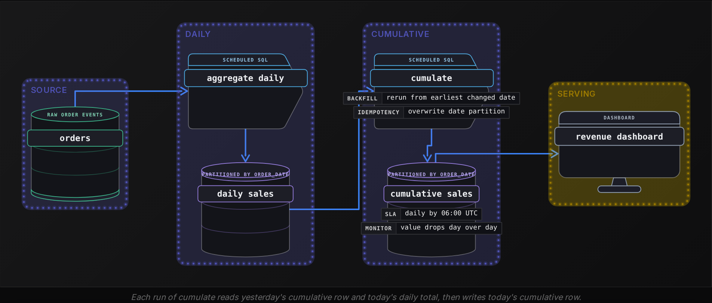

# Prefix Sum: Beginner

Tamsin is 40 minutes into a data engineering interview at Stripe when the coding question arrives. The interviewer pastes 365 daily payment totals for a single merchant, then 10,000 requests, each asking for the total between 2 dates. Her first draft loops over every requested slice and adds it up, and it passes the sample. Then the interviewer asks what happens when the data becomes 10 years of minute-level totals and the requests climb into the millions. Tamsin sees the waste: each request re-adds days that earlier requests already added. One pass that stores running totals would let any range be answered with a single subtraction. Getting the indexes right on the first try, with no off-by-one, decides how the rest of the round goes.


<br>

### What you will be able to do

Build a prefix sum array with a leading zero and explain when its O(n) precompute pays for itself

Write the range sum formula for inclusive, half-open and 1-based ranges, and catch off-by-one errors with a brute-force check

Express running totals and date-range metrics as cumulative window sums in SQL, and know which rows a late correction forces you to rebuild

Build a 2D prefix table and answer any submatrix sum in O(1) with 4 reads

Solve subarray sum equals K and equilibrium index in O(n)


<br>

---

## How Prefix Sums Avoid Rework

### Where the repeated work hides

Take 7 days of order counts for a single store, `sales = [3, 1, 4, 1, 5, 9, 2]`, with days numbered from 0. The direct way to total any stretch of days is a loop over that stretch:

```sql
def range_sum_slow(sales, l, r):
    total = 0
    for i in range(l, r + 1):
        total += sales[i]
    return total


queries = [(0, 6), (1, 5), (2, 4)]
print([range_sum_slow([3, 1, 4, 1, 5, 9, 2], l, r) for l, r in queries])
```

It prints `[25, 20, 10]`. Those 3 queries perform 7, 5 and 3 additions, and days 2, 3 and 4 get added in every one of them. Scale the input to 1,000,000 values and the queries to 1,000,000, and a single wide slice costs close to 1,000,000 additions by itself. The data never changes between queries, so all of that repeated addition recomputes sums the program has already produced.

- **1,000,000,000,000** — worst-case additions, re-summing slices
- **2,000,000** — total steps with a prefix array


<br>

### Pay once, then subtract

Define a second array P where P[i] holds the sum of the first i values. P[0] = 0 stands for the empty prefix, so P has n + 1 entries. Any slice sum then becomes the difference of 2 entries, sum(sales[l:r]) == P[r] - P[l], and building P takes a single left-to-right pass in which each entry is the previous entry plus the next value.

https://github.com/user-attachments/assets/287c866b-5580-4234-b6f2-e85cc4bd6858

*Each new entry is the last entry plus the next day's count.*

The run prints `[0, 3, 4, 8, 9, 14, 23, 25]` and then 10. Days 2 through 4 became `P[5] - P[2]`, which is 14 minus 4. Each entry is a sum that starts at day 0, so subtracting a shorter prefix from a longer one cuts off their shared start: `P[5]` covers days 0 to 4, `P[2]` covers days 0 to 1, and what remains is days 2 to 4.

| i | P[i] | covers |
| --- | --- | --- |
| 0 | 0 | nothing, the empty prefix |
| 1 | 3 | sales[0:1], day 0 |
| 2 | 4 | sales[0:2], days 0 to 1 |
| 3 | 8 | sales[0:3], days 0 to 2 |
| 4 | 9 | sales[0:4], days 0 to 3 |
| 5 | 14 | sales[0:5], days 0 to 4 |
| 6 | 23 | sales[0:6], days 0 to 5 |
| 7 | 25 | sales[0:7], days 0 to 6 |

Read the table as a ledger: each row is the balance after another day. A range total is the difference between 2 balances, the way a week's deposits on a bank statement are the closing balance minus the opening balance.


<br>

### What the precompute costs

| ✓ Re-sum each slice | ✗ Prefix array |
| --- | --- |
| • Build: nothing to build<br><br>• Extra memory: none<br><br>• Each query: O(r - l) additions<br><br>• Change a value: O(1), write the new value | • Build: O(n), a single pass<br><br>• Extra memory: n + 1 numbers<br><br>• Each query: O(1), 2 reads and a subtraction<br><br>• Change a value: O(n), every later entry shifts |

The prefix array trades a fixed input for fast reads. For a single query it loses: the build reads all n values, and the slice it answers holds at most n. It wins once the queries together would read more values than the array holds, a line that a handful of wide queries or a stream of narrow ones crosses quickly. Updates run the other way. Raise `sales[3]` by 2 and entries `P[4]` through `P[7]` each rise by 2, 4 of the 8 entries; in general a change at index i rewrites `n - i` entries. Appending a new day costs a single `P.append(P[-1] + x)`, which is why append-only data such as daily logs suits the technique.

```sql
from itertools import accumulate

sales = [3, 1, 4, 1, 5, 9, 2]
P = list(accumulate(sales, initial=0))
print(P)
```

Signals that a prefix array fits

- The input is fixed, and the same kind of question is asked many times.
- Each question names a contiguous range: index l through r, or date a through date b.
- The answer is a total that subtraction can undo: a sum or a count.
- Max and min fail that test, because removing a prefix's maximum says nothing about the maximum of what is left.

> Try it
>
> - Build the prefix array for `[5, -2, 7, 0]`.
> - Use it to get the sum of indexes 1 through 3, inclusive.
> - Write the array after the value at index 0 becomes 6.

*Answers: P = [0, 5, 3, 10, 10]; the sum is P[4] - P[1], which is 5; every entry from P[1] onward rises by 1, giving [0, 6, 4, 11, 11].*

> **TIP**
>
> When you propose a prefix array in an interview, state all 3 terms together: O(n) time and n + 1 stored numbers up front, O(1) per query afterwards, and an input that stays fixed between queries. If the prompt mentions updates between queries, say that a plain prefix array has to be rebuilt after each one.


<br>

---

## Off-by-One in Range Sum Queries

### 2 layouts, 2 formulas

Prefix arrays come in 2 layouts, and each has its own formula for the inclusive range `l` through `r`. The leading-zero layout reserves slot 0 for the empty sum. The inclusive layout drops that slot, so `Q[i]` holds `a[0]` through `a[i]` and the array has exactly as many entries as the input. Both layouts are correct on their own; applying one layout's formula to the other layout's array is where off-by-one bugs come from.

| layout | length | sum of a[l] through a[r] | at l = 0 |
| --- | --- | --- | --- |
| leading zero, P | n + 1 | P[r + 1] - P[l] | P[r + 1] - P[0], correct |
| inclusive, Q | n | Q[r] - Q[l - 1] | reads Q[-1], the last entry |


<br>

### Python hides the first bug

Python reads `Q[-1]` as the last element of the list, so the l = 0 case of the inclusive formula returns a number where an error would have been more useful. On the first 5 days of `sales`, predict both printed lines before reading on:

```sql
counts = [3, 1, 4, 1, 5]
Q = []
running = 0
for x in counts:
    running += x
    Q.append(running)


def range_sum(l, r):
    return Q[r] - Q[l - 1]


print(range_sum(2, 4))
print(range_sum(0, 2))
```

It prints 10 and then -6. The second call computes `Q[2] - Q[-1]`, 8 minus 14, when the first 3 days add up to 8. Order counts never total below zero, so the sign gives this one away, but on revenue with refunds a wrong total can look plausible enough to pass review. The patch `Q[r] - (Q[l - 1] if l > 0 else 0)` works and puts a branch in every call; the leading zero removes the branch by giving l = 0 a real slot to read.


<br>

### The second bug raises

The opposite mix, the leading-zero formula applied to an inclusive array, fails louder:

```sql
Q = [3, 4, 8, 9, 14]


def range_sum(l, r):
    return Q[r + 1] - Q[l]


print(range_sum(1, 3))
print(range_sum(0, 4))
```

The first call prints 10, the total of days 2 through 4, because every index has shifted by 1. The second call asks for `Q[5]` on a 5-entry list and stops with `IndexError: list index out of range`, raised on the `return` line inside `range_sum`. The crash is the lucky outcome. It fires only when `r` is the last index, so a test suite that never queries the final day ships the silent shift instead.


<br>

### Name the endpoints before the formula

Python slices are half-open: `a[l:r]` includes `l` and stops before `r`. With the leading-zero layout, a half-open range needs no +1 at all, and its sum is `P[r] - P[l]`. The +1 appears only when the question states an inclusive end, and a problem that numbers days from 1 shifts both ends down by 1. Translating the wording into indexes first, out loud, settles the off-by-one decision before any code depends on it.

| question says | indexes | formula on P | answer |
| --- | --- | --- | --- |
| days 2 through 4 | l = 2, r = 4, inclusive | P[5] - P[2] | 10 |
| the slice sales[2:5] | l = 2, r = 5, half-open | P[5] - P[2] | 10 |
| the first 3 days | l = 0, r = 2, inclusive | P[3] - P[0] | 8 |
| the last 2 days | l = 5, r = 6, inclusive | P[7] - P[5] | 11 |
| days 3 to 5, counting from 1 | L = 3, R = 5, 1-based | P[5] - P[2] | 10 |


<br>

### Catch it with a brute-force check

```sql
from itertools import accumulate


def range_sum(P, l, r):
    return P[r + 1] - P[l]


for data in ([3, 1, 4, 1, 5], [5], [-4, 0, 4]):
    P = list(accumulate(data, initial=0))
    for l in range(len(data)):
        for r in range(l, len(data)):
            assert range_sum(P, l, r) == sum(data[l:r + 1]), (data, l, r)
print("all ranges match")
```

Off-by-one bugs live at the edges: a range starting at 0, a range ending at the last index, and a range of length 1. Checking every pair `l <= r` against `sum(data[l:r + 1])` covers all 3 without listing them by hand, and the 5-day list alone yields 15 pairs. The 1-element list and the list holding a negative and a zero cover inputs where a sign or an empty total could hide a shift. As written, the program prints `all ranges match`. Change `r + 1` to `r` and the first pair fails with `AssertionError: ([3, 1, 4, 1, 5], 0, 0)`.

| ✓ Do | ✗ Don't |
| --- | --- |
| • Say the range in words, then in indexes, before writing the formula<br><br>• Use the leading-zero layout so l = 0 needs no branch<br><br>• Test l = 0, r = n - 1 and l == r against a brute-force sum<br><br>• Reject l > r explicitly; the formula returns a negative instead of failing | • Apply Q[r] - Q[l - 1] to an array that has a leading zero<br><br>• Count on Python to raise on index -1<br><br>• Ship after testing only ranges in the middle of the array |

> Try it
>
> - With the prefix array `P` of the 7-day `sales` list, what is the sum of `sales[3:3]`?
> - What does `P[r + 1] - P[l]` return for `l = 4, r = 2`?

*Answers: 0, because P[3] - P[3] is the empty slice; and -1, from P[3] - P[4]. The formula has no notion of a reversed range, so validate l <= r where the request enters your code.*


<br>

---

## Running Totals in Data Pipelines

### The cumulative column

Warehouse tables carry prefix sums under other names: cumulative revenue, signups to date, month-to-date spend. Each row stores the total of every row up to and including its own date, which is the inclusive layout with the empty sum implied before the first date. Here is the running example as daily revenue in thousands for March 2024:

| order_date | revenue | cumulative_revenue |
| --- | --- | --- |
| 2024-03-01 | 3 | 3 |
| 2024-03-02 | 1 | 4 |
| 2024-03-03 | 4 | 8 |
| 2024-03-04 | 1 | 9 |
| 2024-03-05 | 5 | 14 |
| 2024-03-06 | 9 | 23 |
| 2024-03-07 | 2 | 25 |

```sql
SELECT
  order_date,
  revenue,
  SUM(revenue) OVER (
    ORDER BY order_date
    ROWS BETWEEN UNBOUNDED PRECEDING AND CURRENT ROW
  ) AS cumulative_revenue
FROM daily_sales
ORDER BY order_date
```

With the column in place, a date range costs 2 lookups. Revenue from March 3 through March 5 is the cumulative value on March 5 minus the cumulative value on March 2, which is 14 minus 4, or 10. It is the same `P[r + 1] - P[l]` subtraction, with the row for the day before the start playing the part of `P[l]`. A range that begins on the first date subtracts nothing, because the empty sum before it is zero.


<br>

### Partitions and ties

Whether the column holds the right numbers comes down to 2 clauses. `PARTITION BY` restarts the sum for every key, which gives each merchant its own running total in a single pass over the table:

```sql
SELECT
  merchant_id,
  order_date,
  revenue,
  SUM(revenue) OVER (
    PARTITION BY merchant_id
    ORDER BY order_date
    ROWS BETWEEN UNBOUNDED PRECEDING AND CURRENT ROW
  ) AS cumulative_revenue
FROM merchant_daily_sales
```

The frame decides what happens when several rows share a date. Written with `ORDER BY` and no frame, the window defaults to `RANGE BETWEEN UNBOUNDED PRECEDING AND CURRENT ROW`, and `RANGE` treats rows with equal dates as peers that all receive the same total. On raw order rows, where a date repeats, the 2 frames disagree:

ROWS frame

| order_id | order_date | amount | running |
| --- | --- | --- | --- |
| 101 | 2024-03-01 | 10 | 10 |
| 102 | 2024-03-02 | 5 | 15 |
| 103 | 2024-03-02 | 7 | 22 |

RANGE frame, the default

| order_id | order_date | amount | running |
| --- | --- | --- | --- |
| 101 | 2024-03-01 | 10 | 10 |
| 102 | 2024-03-02 | 5 | 22 |
| 103 | 2024-03-02 | 7 | 22 |

`ROWS` gives each row its own total, but the order among tied rows is whatever the engine reads first, so order 102 can show 15 on one run and 22 on the next. Adding `order_id` to the `ORDER BY` pins the order. `RANGE` gives every row of a date the end-of-day total. Choose the frame from what the metric means: revenue through the end of each day wants `RANGE`, or a table aggregated to 1 row per date first, and a balance after each payment wants `ROWS` with a tiebreaker.


<br>

### Incremental loads and late data

A daily job has no reason to rescan history. Today's cumulative row is yesterday's cumulative row plus today's daily total, the `P.append(P[-1] + x)` step from the first section run as a pipeline: 2 rows read and 1 row written per day, however long the history grows.



```sql
INSERT INTO cumulative_sales
SELECT
  d.order_date,
  c.cumulative_revenue + d.revenue AS cumulative_revenue
FROM daily_sales AS d
JOIN cumulative_sales AS c
  ON c.order_date = d.order_date - INTERVAL '1' DAY
WHERE d.order_date = DATE '2024-03-08'
```

Late data breaks the shortcut. Suppose an order worth 6 for March 2 arrives on March 8, after every cumulative row through March 7 exists. Daily revenue for March 2 goes from 1 to 7, and every cumulative row from March 2 onward must rise by 6: 6 date partitions to rewrite, the O(n) update cost of a prefix array measured in partitions. The backfill rule follows from it: recompute from the earliest changed date forward. Rerunning March 2 alone leaves March 3 through March 7 stale.

| order_date | cumulative before | cumulative after the late order |
| --- | --- | --- |
| 2024-03-01 | 3 | 3 |
| 2024-03-02 | 4 | 10 |
| 2024-03-03 | 8 | 14 |
| 2024-03-04 | 9 | 15 |
| 2024-03-05 | 14 | 20 |
| 2024-03-06 | 23 | 29 |
| 2024-03-07 | 25 | 31 |

Predict what this partial backfill prints:

```sql
daily = {"03-01": 3, "03-02": 1, "03-03": 4}
cumulative = {"03-01": 3, "03-02": 4, "03-03": 8}

daily["03-02"] += 6
cumulative["03-02"] = cumulative["03-01"] + daily["03-02"]

print(cumulative)
print(cumulative["03-03"] - cumulative["03-01"])
print(daily["03-02"] + daily["03-03"])
```

It prints `{'03-01': 3, '03-02': 10, '03-03': 8}`, then 5, then 11. The range query for March 2 through March 3 reports 5 where the true total is 11, because March 3 still carries the old cumulative value. The dict also shows the symptom: the cumulative value falls from 10 to 8, which cannot happen while daily values are non-negative.

> **TIP**
>
> Put a quality check on cumulative tables: within a partition, each row's value minus the previous row's must equal that date's daily total, `cumulative_revenue - LAG(cumulative_revenue)` equal to `revenue`. It costs a single `LAG` window per run and catches a partial backfill in either direction; a never-drops check catches only upward corrections left half-applied.

> How the question shows up
>
> - Write a running total of revenue per merchant, ordered by date.
> - Return revenue between any 2 dates without scanning the daily table.
> - A past day's data was corrected. Which downstream rows must be rebuilt?
> - Why do 2 orders on the same date show the same running total?


<br>

---

## 2D Prefix Sums for Matrix Queries

### From a row to a grid

Sales reports often come as grids: regions down the side, quarters across the top. A query asks for a rectangle, such as regions 1 to 2 over quarters 1 to 2. Summing the rectangle cell by cell costs up to `R * C` additions for a grid of R rows and C columns, and a dashboard that recomputes the rectangle while a user drags a selection pays that again on every move.

| region | q0 | q1 | q2 | q3 |
| --- | --- | --- | --- | --- |
| r0 | 2 | 0 | 1 | 3 |
| r1 | 1 | 4 | 2 | 0 |
| r2 | 3 | 1 | 0 | 2 |

The 1D layout carries over with a zero border on both axes. P[i][j] holds the sum of every cell in rows 0 to i - 1 and columns 0 to j - 1, so the table has R + 1 rows and C + 1 columns, with row 0 and column 0 all zeros. A query never needs a special case for the top row or the left column, because the border supplies the empty blocks.


<br>

### Building the table

Each new entry combines 4 known quantities: the grid cell itself, the block above it `P[i][j + 1]`, the block to its left `P[i + 1][j]`, and the block those 2 share, `P[i][j]`, above and to the left. The shared block was counted inside both of the others, so it is subtracted once.

https://github.com/user-attachments/assets/c195e64d-9c8a-489e-9708-fdaa94e7febf

*Each entry adds its cell to the blocks above and to the left, then removes their overlap.*

The bottom-right entry, 19, is the total of the whole grid, the 2D counterpart of the last entry in `[0, 3, 4, 8, 9, 14, 23, 25]`. The last printed number, 7, answers the rectangle query from the top of this section without visiting a single grid cell.


<br>

### 4 lookups per query

For an inclusive rectangle from `(r1, c1)` to `(r2, c2)`, start from the block that ends at the rectangle's bottom-right corner, remove the rows above the rectangle, remove the columns to its left, and add back the corner block that both removals took. Predict the 3 lines this prints, using the table the animation built:

```sql
P = [[0, 0, 0, 0, 0], [0, 2, 2, 3, 6], [0, 3, 7, 10, 13], [0, 6, 11, 14, 19]]


def rect_sum(P, r1, c1, r2, c2):
    return P[r2 + 1][c2 + 1] - P[r1][c2 + 1] - P[r2 + 1][c1] + P[r1][c1]


print(rect_sum(P, 0, 0, 2, 3))
print(rect_sum(P, 2, 3, 2, 3))
print(rect_sum(P, 1, 0, 1, 3))
```

It prints 19, 2 and 7: the whole grid, the single cell at region 2 and quarter 3, and all of region 1. The single-cell call is the sharpest self-test, since any misplaced +1 reads a neighbouring block. The query for regions 1 to 2 and quarters 1 to 2 breaks down term by term:

| term | block it covers | value | running total |
| --- | --- | --- | --- |
| + P[3][3] | rows 0 to 2, columns 0 to 2 | 14 | 14 |
| - P[1][3] | row 0, columns 0 to 2 | 3 | 11 |
| - P[3][1] | rows 0 to 2, column 0 | 6 | 5 |
| + P[1][1] | row 0, column 0 | 2 | 7 |

Summing the cells directly agrees: `4 + 2 + 1 + 0` is 7. Drop the last term and the function returns 5, short by exactly the corner block. A missing `+ P[r1][c1]` is the first thing to look for when a 2D answer comes out low; a missing +1 on `r2` or `c2` is the second, the 1D shift repeated on 2 axes.

| ✓ 1D prefix array | ✗ 2D prefix table |
| --- | --- |
| • n + 1 entries, leading zero<br><br>• Build: P[i + 1] = P[i] + a[i]<br><br>• Query: 2 reads<br><br>• Change a[0]: n entries rewritten | • (R + 1) \* (C + 1) entries, zero border<br><br>• Build: cell + above + left - above-left<br><br>• Query: 4 reads<br><br>• Change grid[0][0]: R \* C entries rewritten |

The build visits every cell once, so it takes O(R \* C) time, and the table holds R + C + 1 more entries than the grid: 2,001 more for a 1000 by 1000 grid. After that, every rectangle costs the same, from a single cell to the full grid. An update is the expensive direction again: a change to a cell shifts every entry below it and to its right.

- **1,002,001** — entries in the prefix table
- **4** — reads per rectangle of any size


> Try it
>
> - Using the printed table, sum regions 0 to 1 over quarters 2 to 3.
> - Write down the 4 entries you read before doing any arithmetic.

*Answer: P[2][4] - P[0][4] - P[2][2] + P[0][2] is 13 - 0 - 7 + 0, which is 6, matching the cells 1 + 3 + 2 + 0.*

> **TIP**
>
> Pipelines use the same table for heatmaps. A grid of 7 days by 24 hours of event counts, rebuilt once per load, lets a dashboard total any block of days and hours with a fixed number of reads, however large the block.


<br>

---

## Classic Beginner Interview Problems

### Equilibrium index

Given a list of integers, return the first index where the values to its left sum to the same total as the values to its right, or -1 if no index qualifies. The value at the index belongs to neither side. For `[1, 7, 3, 6, 5, 6]` the answer is 3, because 1 + 7 + 3 and 5 + 6 both make 11.

In prefix terms, the left side at index i is `P[i]` and the right side is `total - P[i + 1]`. The scan only ever moves forward, so a running left sum can stand in for the whole array and memory drops to O(1), with the right side computed as `total - left - x`.

```sql
def pivot_index(nums):
    total = sum(nums)
    left = 0
    for i, x in enumerate(nums):
        if left == total - left - x:
            return i
        left += x
    return -1


print(pivot_index([1, 7, 3, 6, 5, 6]))
print(pivot_index([2, 1, -1]))
print(pivot_index([1, 2, 3]))
```

| i | x | left | right: 28 - left - x | match |
| --- | --- | --- | --- | --- |
| 0 | 1 | 0 | 27 | no |
| 1 | 7 | 1 | 20 | no |
| 2 | 3 | 8 | 17 | no |
| 3 | 6 | 11 | 11 | yes, return 3 |

The program prints 3, 0 and -1. For `[2, 1, -1]`, index 0 qualifies because an empty left side sums to 0 and the right side is 1 + -1. The function is correct only if the 2 statements inside the loop run in this order: compare first, then add. Move `left += x` above the `if` and the left side swallows the value at i, so `[2, 1, -1]` returns -1.


<br>

### Subarray sum equals K

Count the contiguous subarrays whose values sum to k. For `nums = [1, 2, 3, -2, 2]` and `k = 3`, the answer is 4. In prefix terms, the subarray from i to j - 1 sums to k exactly when `P[j] - P[i] == k` for some `i < j`, which turns the problem into counting pairs of prefix entries that differ by k. With `P = [0, 1, 3, 6, 4, 6]`, the 4 pairs are:

| pair | subarray | sum |
| --- | --- | --- |
| P[2] - P[0] | [1, 2] | 3 |
| P[3] - P[2] | [3] | 3 |
| P[4] - P[1] | [2, 3, -2] | 3 |
| P[5] - P[2] | [3, -2, 2] | 3 |

```sql
from itertools import accumulate


def count_k_slow(nums, k):
    P = list(accumulate(nums, initial=0))
    count = 0
    for j in range(1, len(P)):
        for i in range(j):
            if P[j] - P[i] == k:
                count += 1
    return count


print(count_k_slow([1, 2, 3, -2, 2], 3))
```

This version prints 4 after checking all 15 pairs of the 6 entries, and its cost grows as O(n^2). Rearranging the condition removes the inner loop: `P[i] == P[j] - k`. Scanning left to right, every earlier prefix value is already known, so each step asks how many earlier prefixes equal the current one minus k. A dict from prefix value to the number of times it has appeared answers that in O(1), and seeding it with `{0: 1}` records the empty prefix, the leading zero in a new form.

https://github.com/user-attachments/assets/a4c510d6-c9b3-466e-91d7-c8181a90f5a9

*seen maps each prefix value to how many times it has appeared so far.*

The run prints 4 and then the final dict, `{0: 1, 1: 1, 3: 1, 6: 2, 4: 1}`. The count is right because of 2 details. The lookup comes before the insert: reversed, a k of 0 would match the entry the same step had added and count an empty subarray at every position. The seed covers subarrays that start at index 0: without `{0: 1}`, the step that reaches a running total of 3 finds nothing, `[1, 2]` goes uncounted, and the function returns 3.

> **TIP**
>
> Present the pair-checking version first and name its O(n^2) cost. The dict version then reads as the fix for that cost, and the interviewer has already seen that you can produce a correct answer.

> Recognizing these 2 problems
>
> - Left side equals right side, balance point, pivot: a running left sum checked against the total.
> - Count or find contiguous ranges with a target sum: prefix values counted in a dict.
> - Many range totals over data that never changes: a full prefix array.
> - Negative values allowed: the dict method still works, since it never assumes a sum grows as a range widens.

| ✓ Do | ✗ Don't |
| --- | --- |
| • Trace the first 2 steps by hand before running anything<br><br>• Seed the dict with {0: 1} and say which subarrays it covers<br><br>• Look up running - k before inserting running<br><br>• Test an answer at index 0 and an input with no answer | • Add the current value to the left sum before comparing<br><br>• Stop at the O(n^2) pair loop when the prompt says n can reach millions<br><br>• Assume values are positive unless the prompt says so |

> Try it
>
> - Count the subarrays of `[1, 1, 1]` that sum to 2.
> - Find the equilibrium index of `[0, 0]`.

*Answers: 2, the subarrays at indexes 0 to 1 and 1 to 2; and 0, since the left side of index 0 is empty and the right side sums to 0.*


<br>

---

## Putting It All Together

A food delivery company's finance team asks for 3 things built on its order data: revenue for any date range a user picks on a dashboard, a heatmap of orders by day of week and hour where a user can drag out a rectangle, and the number of stretches of consecutive days in which refunds totalled exactly the monthly write-off allowance. Orders keep arriving for up to 2 days after delivery.

- The date-range revenue reads 2 rows of a cumulative column: the end date's value minus the value on the day before the start.
- Orders that arrive late change daily totals for past dates, so the cumulative job reruns from the earliest changed date, and a check that each day's cumulative value minus the previous day's equals its daily total catches a partial backfill, whether the correction raised or lowered a day.
- The heatmap is a 7 by 24 grid with a zero-bordered prefix table, rebuilt once per load and queried with 4 reads per rectangle.
- Counting stretches whose refunds hit the allowance is subarray sum equals K: running refund totals counted in a dict seeded with {0: 1}.
- Every piece uses the same subtraction, and each one depends on stating whether a range is inclusive or half-open before writing the index arithmetic.


<br>

---

## Key Takeaways

- A prefix array with a leading zero answers any range sum with 2 reads after a single O(n) pass, as long as the input stays fixed.
- For an inclusive range l to r the sum is P[r + 1] - P[l]; for a half-open slice a[l:r] it is P[r] - P[l].
- Python reads Q[-1] as the last element, so the inclusive formula at l = 0 returns a wrong number with no error; test the edges against a brute-force sum.
- A cumulative SQL column is a prefix array keyed by date, and a late correction forces a rewrite from the earliest changed date forward.
- A 2D table with a zero border answers any rectangle with 4 reads: the full block, minus the strip above, minus the strip to the left, plus the corner.
- Equilibrium index compares a running left sum with total - left - x; subarray sum equals K counts earlier prefixes equal to the current one minus k in a dict seeded with {0: 1}.
