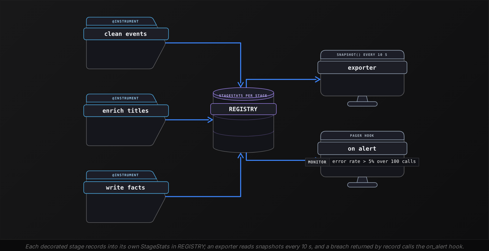

# Decorators for Data Engineers: Advanced

Odile is in the final round for a data platform role at Netflix. The interviewer describes a nightly job that enriches 40 million viewing events with title metadata from an internal service. Last month the service stalled for 11 minutes, every worker thread retried into it, and the job missed its 6 a.m. deadline. 'You already know `@wraps` and `@retry`,' he says. 'Now design the decorators. Something has to remember failures across calls and stop calling a dead service. Something else commits or rolls back a transaction cleanly, and I want to know which stage is slow. Then tell me which of those shouldn't be decorators at all, and how you would unit test the enrichment logic without waiting on any of it.' Every part of the question, Odile notices, is about state a decorator holds between calls, and who owns it.


<br>

### What you will be able to do

Build a class-based decorator that keeps readable state across calls and stays correct under concurrent threads

Implement a circuit breaker decorator that moves from CLOSED to OPEN and through HALF_OPEN, taking every transition under a lock

Write transactional context managers with @contextmanager and predict what each generator shape does on error

Design a decorator-fed metrics registry that raises per-stage alerts on latency and throughput, and on error rate

Decide when injection or middleware beats a decorator, and test decorated code through __wrapped__


<br>

---

## Stateful Class-Based Decorators

A closure-based decorator keeps its counters in cells with no name outside the wrapper. A test that wants the failure count must read `parse_row.__closure__[0].cell_contents`, and that index shifts the day someone adds a variable. When other code needs the state, such as a call count or a breaker's position, make the wrapper an object: the instance replaces the function, its attributes hold the state, and a method such as `snapshot()` is the interface the exporter and the tests share with the on-call engineer.

| ✓ Closure wrapper | ✗ Class wrapper |
| --- | --- |
| • State sits in cells reachable through __closure__<br><br>• @functools.wraps goes on the inner def<br><br>• Binds to an instance when it decorates a method<br><br>• Fits stateless concerns such as timing a call | • State sits in named attributes read through methods<br><br>• functools.update_wrapper(self, fn) runs in __init__<br><br>• Needs __get__ before it works on a method<br><br>• Fits state that belongs to the interface: counts, a breaker's position |


<br>

### How a class becomes the wrapper

Writing `@CallStats` above `def parse_row` runs `parse_row = CallStats(parse_row)`. So `__init__` runs once at import and receives the function, while `__call__` runs on every call after that. With no inner `def` to carry `@functools.wraps`, `__init__` calls the function form, `functools.update_wrapper(self, fn)`. It copies 5 attributes onto the instance: `__module__`, `__name__`, `__qualname__`, `__doc__`, `__annotations__`. Then it merges `fn.__dict__` into the instance's own and sets `self.__wrapped__ = fn`. Predict all 6 printed lines before reading the table under the code.

```sql
import functools


class CallStats:
    def __init__(self, fn):
        functools.update_wrapper(self, fn)
        self.fn = fn
        self.calls = 0
        self.failures = 0

    def __call__(self, *args, **kwargs):
        self.calls += 1
        try:
            return self.fn(*args, **kwargs)
        except ValueError:
            self.failures += 1
            raise


@CallStats
def parse_row(raw):
    """Split an id,amount row into a typed tuple."""
    row_id, amount = raw.split(",")
    return int(row_id), float(amount)


for raw in ["1,9.5", "2,oops", "3,4.0"]:
    try:
        print(parse_row(raw))
    except ValueError:
        print("bad row:", raw)

print(parse_row.__name__, "|", parse_row.__doc__)
print(parse_row.calls, parse_row.failures)
print(parse_row.__wrapped__("4,1.0"), parse_row.calls)
```

| Printed | Why |
| --- | --- |
| (1, 9.5) | parsed, calls is 1 |
| bad row: 2,oops | float raised ValueError, failures is 1, the error re-raised to the loop |
| (3, 4.0) | parsed, calls is 3 |
| parse_row | Split an id,amount row into a typed tuple. | update_wrapper copied the name and docstring onto the instance |
| 3 1 | 3 calls, 1 failure |
| (4, 1.0) 3 | __wrapped__ ran the original, so calls stayed at 3 |

The last row is the one to carry forward: `__wrapped__` is the original function, untouched by the counter, and the final section of this lesson tests business logic through that bypass.


<br>

### Decorating a method

```sql
class PartitionLoader:
    @CallStats
    def load(self, table):
        return "loaded " + table


PartitionLoader().load("fact_plays")
```

On Python 3.9 this raises `TypeError: load() missing 1 required positional argument: 'table'`. A plain function stored on a class has a `__get__` method, and looking it up through an instance calls `__get__` to bind `self`. A `CallStats` object has no `__get__`, so `PartitionLoader().load` returns it unbound. When `__call__` forwards `("fact_plays",)`, the string lands in `self`. A `__get__` that returns `functools.partial(self.__call__, obj)` binds the instance the way a function would. Even then, the `CallStats` object is a class attribute, so every `PartitionLoader` shares a single counter, which fits "how often does any loader run" and is wrong when each loader needs its own count.


<br>

### Lost updates under threads

`self.calls += 1` reads the attribute in one bytecode instruction and writes the sum back in another, and Python promises no atomicity for it. CPython before 3.10 could switch threads between them, and the free-threaded 3.13t build runs threads in parallel. On both, the interleaving below loses counts silently. From 3.10, GIL builds switch only at points such as calls and backward jumps, so a demo that counts correctly there proves nothing. The lock makes the count correct on every build.

| Step | Thread A | Thread B | self.calls |
| --- | --- | --- | --- |
| 1 | reads 41 |  | 41 |
| 2 |  | reads 41 | 41 |
| 3 | writes 42 |  | 42 |
| 4 |  | writes 42 | 42 |

*Two calls ran, and the counter moved by 1.*

```sql
import functools
import threading


class CallStats:
    def __init__(self, fn):
        functools.update_wrapper(self, fn)
        self.fn = fn
        self.calls = 0
        self.failures = 0
        self._lock = threading.Lock()

    def __call__(self, *args, **kwargs):
        with self._lock:
            self.calls += 1
        try:
            return self.fn(*args, **kwargs)
        except Exception:
            with self._lock:
                self.failures += 1
            raise

    def __get__(self, obj, objtype=None):
        if obj is None:
            return self
        return functools.partial(self.__call__, obj)

    def snapshot(self):
        with self._lock:
            return {"calls": self.calls, "failures": self.failures}
```

The lock guards the counter updates and nothing else. Holding it across `self.fn(...)` would serialize the stage: 8 threads each making a 200 ms lookup would need 1.6 s per round instead of 200 ms, because only 1 thread could be inside the call at a time. `snapshot()` reads both counters under the same lock. Without that, a reader could take `calls`, other threads could record new calls and failures, and the later read of `failures` could exceed the `calls` it reported.

> **TIP**
>
> Counters live in a single process. Sending a `CallStats`-wrapped function to a `multiprocessing` pool fails to pickle, and even a picklable design would have each worker process count into its own copy. Collect `snapshot()` from each process and add them in the parent.

> What a complete answer covers
>
> - Where the state lives and who reads it: instance attributes, exposed through `snapshot()`.
> - That `update_wrapper` also sets `__wrapped__`, which tests use to reach the original.
> - That a class-based decorator on a method needs `__get__`, or the first argument lands in `self`.
> - That the lock covers bookkeeping only, so the wrapped call keeps its concurrency.


<br>

---

## Circuit Breaker State Machine

Back to the enrichment job. With 64 worker threads, a 10 s timeout and the 4-attempt retry decorator from the previous lesson, an outage costs each call at least 40 s of waiting, and the metadata service absorbs 256 requests per round while it tries to recover. Retry suits a blip, and an outage needs a circuit breaker. The breaker counts consecutive transient failures; at `threshold` it stops sending requests for `cooldown` seconds and raises `CircuitOpenError` without touching the network, so the worker frees itself and the batch can go to a dead-letter path.


<br>

### The state table

| State | Event | Next state | Caller sees |
| --- | --- | --- | --- |
| CLOSED | call succeeds | CLOSED, failures reset to 0 | the result |
| CLOSED | transient failure below threshold | CLOSED | the original exception |
| CLOSED | transient failure reaches threshold | OPEN, timer starts | the original exception |
| OPEN | call before cooldown ends | OPEN | CircuitOpenError, no request sent |
| OPEN | first call after cooldown | HALF_OPEN | its request goes out as the probe |
| HALF_OPEN | another call while the probe is out | HALF_OPEN | CircuitOpenError |
| HALF_OPEN | probe succeeds | CLOSED | the result |
| HALF_OPEN | probe fails | OPEN, timer restarts | the original exception |

The run below plays that table on a fake clock with `threshold=2` and `cooldown=30`. The service answers only at t=5 and t=62.

https://github.com/user-attachments/assets/426b09d6-f5c4-4caf-8730-2ab8f435b0ba

*threshold=2, cooldown=30, and a clock the loop sets by hand*

At t=5 the service is back and the call is still rejected: an open breaker learns about recovery only by probing, and it probes only after the cooldown. At t=31 the probe fails, so the breaker reopens at once with a fresh 30 s timer, without counting to `threshold` again. At t=62 the probe succeeds and the breaker closes. The clock is a constructor argument, so the run moves time by assigning to a dict. Production passes `time.monotonic`, which never runs backward; `time.time` follows the wall clock, and a 60 s backward NTP correction would hold the breaker open an extra minute.


<br>

### Choosing threshold and cooldown

Threshold trades false trips against wasted requests. If 0.1% of calls fail transiently on a healthy day, 5 consecutive failures by chance have a probability of 0.001 to the 5th power, 1 in a quadrillion, so a threshold of 5 trips only on a real outage. Cooldown sets the probe rate: at 30 s, a dead service receives at most 2 probes a minute, and that holds with 64 workers waiting as much as with 1.


<br>

### The half-open race

The run is single-threaded. With threads, the cooldown check must happen in the same step that reads `state` and writes `HALF_OPEN`. Without a lock, 64 workers waking at t=31 each read `OPEN` and find the cooldown elapsed. Each writes `HALF_OPEN` and sends a probe, so the service gets the burst of 64 the breaker exists to stop. The production version admits calls under a lock and lets exactly 1 probe through with a `_probing` flag.

```sql
import functools
import threading
import time


class CircuitOpenError(Exception):
    pass


class CircuitBreaker:
    def __init__(self, threshold=5, cooldown=30.0,
                 trips_on=(ConnectionError, TimeoutError), clock=time.monotonic):
        self.threshold, self.cooldown = threshold, cooldown
        self.trips_on, self.clock = trips_on, clock
        self.state, self.failures, self.opened_at = "CLOSED", 0, 0.0
        self._probing = False
        self._lock = threading.Lock()

    def _admit(self):
        with self._lock:
            if self.state == "OPEN":
                if self.clock() - self.opened_at < self.cooldown:
                    raise CircuitOpenError("open")
                self.state = "HALF_OPEN"
            if self.state == "HALF_OPEN":
                if self._probing:
                    raise CircuitOpenError("probe in flight")
                self._probing = True
                return True
            return False

    def _record(self, ok, probe):
        with self._lock:
            if probe:
                self._probing = False
            if ok is None:
                return
            if ok:
                if self.state != "OPEN":
                    self.state, self.failures = "CLOSED", 0
                return
            self.failures += 1
            if probe or self.failures >= self.threshold:
                self.state, self.opened_at, self.failures = "OPEN", self.clock(), 0

    def __call__(self, fn):
        @functools.wraps(fn)
        def wrapper(*args, **kwargs):
            probe = self._admit()
            try:
                result = fn(*args, **kwargs)
            except self.trips_on:
                self._record(ok=False, probe=probe)
                raise
            except Exception:
                self._record(ok=True, probe=probe)
                raise
            except BaseException:
                self._record(ok=None, probe=probe)
                raise
            self._record(ok=True, probe=probe)
            return result
        return wrapper
```

Choices an interviewer will probe

- Only the probe gets True from _admit, and only its _record clears _probing, so a slow call admitted while CLOSED cannot free a slot it never held.
- A KeyboardInterrupt in the probe still frees _probing. Without that, every later call stays rejected.
- A success that lands while OPEN is ignored: that call was admitted before the trip and says nothing about the service now.
- Tripping resets failures to 0, so at the default threshold of 5 a straggler failure from an earlier call cannot reopen a half-open breaker by itself.
- trips_on names transport errors. A ValueError from a malformed title_id means the service answered, so the breaker records a success.
- The lock is released before fn runs, so a call stuck in a 10 s timeout never delays the rejections other threads get.


<br>

### Stacking with retry

| ✓ Retry outside the breaker | ✗ Breaker outside retry |
| --- | --- |
| • Each attempt passes through the breaker and counts<br><br>• With threshold 5 and 4 attempts per call, 5 requests trip it<br><br>• Retry must treat CircuitOpenError as non-retryable, or it backs off and collects rejections | • The breaker sees a single failure per exhausted retry sequence<br><br>• Tripping takes 5 calls of 4 attempts: 20 requests to a dead service<br><br>• Each of those calls also sleeps through full backoff first |

> **TIP**
>
> Scope a breaker to the dependency it protects. Build `metadata_breaker = CircuitBreaker()` once and decorate both `lookup_title` and `lookup_artwork` with it. With a breaker per function, the second lookup keeps calling a service the first has already marked down.


<br>

---

## @contextmanager Without a Class

Every warehouse loader grows a transaction manager. The class form spreads a single idea across 3 methods and hides a trap in the last: a true return value from `__exit__` swallows the exception.

```sql
class Transaction:
    def __init__(self, conn):
        self.conn = conn

    def __enter__(self):
        self.conn.begin()
        return self.conn

    def __exit__(self, exc_type, exc, tb):
        if exc_type is None:
            self.conn.commit()
        else:
            self.conn.rollback()
        return False
```

`contextlib.contextmanager` turns a generator function into both methods. The code before `yield` is the setup, the yielded value is what `as` binds, and the code after is the cleanup, all in reading order inside a single function:

```sql
from contextlib import contextmanager


@contextmanager
def transaction(conn):
    conn.begin()
    try:
        yield conn
    except BaseException:
        conn.rollback()
        raise
    else:
        conn.commit()


def load_partition(conn, rows):
    with transaction(conn) as tx:
        tx.insert_many("fact_plays", rows)
```

| ✓ Class with __enter__ and __exit__ | ✗ @contextmanager generator |
| --- | --- |
| • Setup and cleanup live in separate methods<br><br>• Exception details arrive as 3 arguments to __exit__<br><br>• Returning a true value suppresses the error<br><br>• Fits managers that keep state across uses or expose methods | • The code reads top to bottom, from setup to cleanup, with the handoff at yield<br><br>• Errors surface inside the generator at yield<br><br>• Finishing without re-raising suppresses the error<br><br>• Fits one-shot resources: a transaction, a staging table, a lock |


<br>

### What the with statement does to the generator

Calling `transaction(conn)` returns a manager holding a fresh generator. Its `__enter__` calls `next(gen)`, which runs to the `yield` and returns `conn`. Its `__exit__` takes 2 paths. If the body finished, it calls `next(gen)` again and expects `StopIteration`. If the body raised, it calls `gen.throw(exc)`. The exception then reappears at the `yield` line inside the generator, where its `try` can catch it. The run below drives a generator by hand with exactly those calls, once for a clean batch and once for a batch holding `None`.

https://github.com/user-attachments/assets/3463a368-2b82-4686-829e-f0c2a985106b

*with_block makes the same generator calls a @contextmanager manager makes on enter and exit*

The clean batch logs `BEGIN` and `COMMIT` with its sum in between. In the second, `sum` raises `TypeError` at the `None`; `throw` re-raises it at the `yield`, the `except` branch logs `ROLLBACK`, and the bare `raise` sends the same exception back to the caller, which logs its name. Catching `BaseException` matters for loaders: a `KeyboardInterrupt` in the middle of a 20-minute load must roll back too, and `except Exception` lets it skip the rollback.

*The real __exit__ throws the exception into the generator (before Python 3.12 it passes the traceback separately, along with the type and value) and returns False when that same exception comes back out, letting the with statement propagate it.*


<br>

### Two bugs to predict

```sql
@contextmanager
def transaction(conn):
    conn.begin()
    yield conn
    conn.commit()
```

When the body raises, `throw` raises at the bare `yield` and the generator dies, because nothing catches it. The commit is skipped and nothing calls `rollback()`. The exception still reaches the job log, so the failure looks handled. If the pool doesn't reset connections on return, the connection goes back with an open transaction and its row locks; the next borrower's statements join that transaction, and its commit publishes the failed batch's partial inserts.

The second bug is deleting the `raise` after `rollback()`. The generator then ends normally after the throw, `contextmanager` reads that as handled, and `__exit__` returns `True`. The `with` statement suppresses the error, so `load_partition` returns `None` and the orchestrator marks the partition loaded with 0 rows.

| Generator behaviour | Caller sees |
| --- | --- |
| yields once and re-raises after rollback | the original exception, after a rollback |
| yields with no try around it | the original exception, and no rollback |
| catches the exception without re-raising | no exception, after a rollback |
| returns before reaching yield | RuntimeError: generator didn't yield |
| yields again after a clean body | RuntimeError: generator didn't stop |


<br>

### Release versus decide

```sql
@contextmanager
def staging_table(conn, name):
    conn.create_table(name)
    try:
        yield name
    finally:
        conn.drop_table(name)
```

Two cleanup shapes cover most pipelines. A transaction decides between 2 outcomes, so it needs `except` and `else`. A staging table has to be released whatever happened, and so does a lock or a temp directory. That shape needs `finally`: it runs cleanup and leaves the exception untouched. Nest them in the order they must unwind: `with staging_table(conn, "stg_plays") as stg, transaction(conn) as tx:` commits or rolls back first, then drops the staging table.


<br>

### The same object as a decorator

Managers built by `@contextmanager` inherit from `contextlib.ContextDecorator`, so `@transaction(warehouse_conn)` above a function wraps each call in its own transaction, rebuilding the generator every time. Two limits come with it. The yielded value is discarded, so the function must reach the connection some other way, and `warehouse_conn` is fixed when the module is imported, a binding the last section returns to.

```sql
@transaction(warehouse_conn)
def rebuild_daily_rollup(day):
    warehouse_conn.delete_partition("agg_daily_plays", day)
    warehouse_conn.insert_many("agg_daily_plays", compute_rollup(day))
```

| ✓ Do | ✗ Don't |
| --- | --- |
| • Wrap the yield in try so cleanup runs when the body raises<br><br>• Re-raise after rollback unless suppression is the documented contract<br><br>• Catch BaseException when an interrupted load must still roll back<br><br>• Yield exactly once on every path through the generator | • Put cleanup after a bare yield<br><br>• End the except branch without raise to handle a failed load<br><br>• Yield inside a loop or a retry block<br><br>• Trust a pooled connection to reset itself after an error |


<br>

---

## Decorator-Based Instrumentation

The metrics part of the question comes with a constraint: business code stays as it is, so `clean_events` remains a 1-line comprehension with no timers inside. A decorator factory takes the stage name, registers a stats record in a module-level `REGISTRY` at import, and updates it around every call. The exporter iterates `REGISTRY` and finds every instrumented stage without a hand-kept list.

```sql
import bisect
import functools
import threading
import time
from collections import deque

BUCKETS = [0.01, 0.05, 0.1, 0.5, 1.0, 5.0]
REGISTRY = {}
REGISTRY_LOCK = threading.Lock()


class StageStats:
    def __init__(self, window, max_error_rate):
        self.lock = threading.Lock()
        self.calls = self.errors = self.rows = 0
        self.latency_buckets = [0] * (len(BUCKETS) + 1)
        self.recent = deque(maxlen=window)
        self.max_error_rate = max_error_rate
        self.alerting = False

    def record(self, seconds, rows, ok):
        with self.lock:
            self.calls += 1
            self.rows += rows
            self.errors += 0 if ok else 1
            self.latency_buckets[bisect.bisect_left(BUCKETS, seconds)] += 1
            self.recent.append(ok)
            if len(self.recent) < self.recent.maxlen:
                return None
            rate = self.recent.count(False) / len(self.recent)
            newly_breached = rate > self.max_error_rate and not self.alerting
            self.alerting = rate > self.max_error_rate
            return rate if newly_breached else None

    def snapshot(self):
        with self.lock:
            return dict(calls=self.calls, errors=self.errors, rows=self.rows,
                        buckets=list(self.latency_buckets))


def instrument(stage, count_rows=len, window=100, max_error_rate=0.05, on_alert=print):
    with REGISTRY_LOCK:
        stats = REGISTRY.setdefault(stage, StageStats(window, max_error_rate))

    def decorator(fn):
        @functools.wraps(fn)
        def wrapper(*args, **kwargs):
            start, rows, ok = time.perf_counter(), 0, False
            try:
                result = fn(*args, **kwargs)
                rows, ok = count_rows(result), True
                return result
            finally:
                rate = stats.record(time.perf_counter() - start, rows, ok)
                if rate is not None:
                    on_alert(stage, rate)
        return wrapper
    return decorator


@instrument("clean_events")
def clean_events(batch):
    return [row for row in batch if row["user"] is not None]
```

Two functions registered under the same stage name share a single `StageStats` through `setdefault`, which merges their counts silently; raise on a duplicate name when stages must stay separate.


<br>

### Tracing the alert window

Run 5 batches through `clean_events` with `window=4` and `max_error_rate=0.5`, each call taking 40 ms. Batch 2 contains a row with no `user` key, as do batches 4 and 5, and each of them raises `KeyError`.

| Batch | Outcome | Rows | Window | Error rate | on_alert |
| --- | --- | --- | --- | --- | --- |
| 1 | ok | 1 | T | not full | no |
| 2 | KeyError | 0 | T F | not full | no |
| 3 | ok | 2 | T F T | not full | no |
| 4 | KeyError | 0 | T F T F | 0.5 | no |
| 5 | KeyError | 0 | F T F F | 0.75 | fires |

In the window, T marks a success. Durations are recorded in `finally`, so failed batches add their 40 ms too: 3 rows over 200 ms is 15 rows per second. The alert fires on batch 5. At batch 4 the window holds 2 failures out of 4, a rate of 0.5, which does not exceed the line; batch 5 pushes the oldest success out of the `deque`. Waiting for a full window is deliberate: a stage whose first call fails would otherwise report a 100% error rate and page someone at startup. A 6th failing batch wouldn't call `on_alert` again, because `alerting` is already set.


<br>

### Why latency is a histogram

Percentiles need the distribution, and the tempting store is a list of every duration. A stage called 2,000 times per second makes 172.8 million calls a day, and each float in a list costs 32 bytes: 24 for the float object and 8 for the list's pointer to it. A histogram keeps a count per latency bucket, and its memory stays fixed as traffic grows.

- **5.5 GB** — raw latencies per stage per day
- **7** — counters in each stage's histogram

Design choices in that code

- StageStats.record takes its own lock, so 8 threads recording into a single stage never lose a count, and REGISTRY_LOCK covers registration only.
- bisect_left files each duration into a bucket: up to 10 ms, 50 ms, 100 ms, 500 ms, 1 s, 5 s, or above.
- The alerting flag makes alerts edge-triggered. At 2,000 calls per second, a level-triggered check would call on_alert 2,000 times a second while the stage stays bad.
- on_alert runs after the lock is released, so a slow pager call never blocks the threads recording into that stage.
- on_alert and count_rows are arguments, so a test passes a lambda that appends to a list, and CI never pages anyone.


<br>

### Cardinality and overhead

Key the registry by stage name and nothing finer. A key per partition date adds 365 entries per stage each year, a key per customer adds millions, and every export serializes all of them. Each call pays for 2 `perf_counter` calls and a lock, plus a `bisect` and a `deque` append. The expensive part is `self.recent.count(False)`, which scans the whole window, so the cost grows with `window`: a few microseconds per call at 100. Put it on per-batch functions: around a per-row function that runs for each of the job's 40 million events, it would add minutes.



> Answer shape for the metrics question
>
> - Name 3 signals and their sources: duration from `finally`, rows from the return value, errors from the exception path.
> - Bound every structure: buckets for latency, a fixed `deque` for the error window, stage names as keys.
> - Alert on a full window and on the transition into breach, never on every bad call.
> - Keep bookkeeping from changing outcomes: an exception raised inside `record` would replace the stage's own result.


<br>

---

## When Not to Use a Decorator

The question's last part asks which concerns should not be decorators. Most of the answer follows from 1 fact: decorator arguments are evaluated once, when the `def` statement runs at import. Predict the threshold this job uses when started with `20` on the command line.

```sql
CONFIG = {"breaker_threshold": 5}


@CircuitBreaker(threshold=CONFIG["breaker_threshold"])
def lookup_title(title_id):
    return METADATA_CLIENT.get(title_id)


def main(argv):
    CONFIG["breaker_threshold"] = int(argv[1])
    run_enrichment(lookup_title)
```

It trips after 5 consecutive failures. `CircuitBreaker(threshold=CONFIG["breaker_threshold"])` read 5 and stored it while the module was being imported; `main` updates the dict later, and nothing reads it again. A test that wants a threshold of 1 or a fake clock has to patch the breaker object or reload the module.


<br>

### Dependency injection: pass the concern in

```sql
class EnrichStage:
    name = "enrich_titles"

    def __init__(self, client, breaker):
        self.lookup = breaker(client.get)

    def run(self, rows):
        return [dict(row, title=self.lookup(row["title_id"])) for row in rows]


def build_enrich_stage(config, client):
    breaker = CircuitBreaker(threshold=config["breaker_threshold"])
    return EnrichStage(client, breaker)
```

The breaker is still a decorator object, now applied to `client.get` when the stage is built. Config is read after it is parsed, the client's lifecycle belongs to whoever builds the stage, and a test needs no patching:

```sql
def test_enrich_adds_title():
    breaker = CircuitBreaker(threshold=1, clock=lambda: 0.0)
    stage = EnrichStage(FakeClient({7: "title-7"}), breaker)
    assert stage.run([{"title_id": 7}]) == [{"title_id": 7, "title": "title-7"}]
```


<br>

### Middleware: one chain for every stage

Some concerns belong to every stage: timing, the error-rate window, a trace id. Decorating 40 stage functions copies the policy 40 times, and a 41st stage written without `@instrument` is a silent gap in the dashboard. A runner that wraps each stage in a list of middlewares applies the policy once, and the order lives as data in a single place.

```sql
def timing(stage, handler):
    return instrument(stage.name)(handler)


def run_pipeline(stages, middlewares, batch):
    for stage in stages:
        handler = stage.run
        for middleware in reversed(middlewares):
            handler = middleware(stage, handler)
        batch = handler(batch)
    return batch
```

`reversed` makes the first middleware the outermost wrapper, matching the top decorator in a stack, so `[timing, breaker_guard]` behaves like `@timing` above `@breaker_guard`. Reordering is a config edit that shows up in a single diff.

| Signal | Decorator | Injection | Middleware |
| --- | --- | --- | --- |
| Policy fixed in code for a single function | fits | wiring with no gain | too heavy |
| Value chosen at runtime: environment, tenant, flag | binds at import, reads a stale value | fits | fits |
| Concern owns a resource with its own lifecycle | hides the resource | fits | fits when the runner owns it |
| Applies to every stage | a missed decorator is a silent gap | repeated per stage | fits |
| Tests swap it per case | needs patching or __wrapped__ | fits | fits |

One more row belongs in that table: a decorator that changes the function's contract. A `@with_connection` decorator that supplies a `conn` argument leaves `def load(conn, rows)` called as `load(rows)`, so `help()` and type checkers see a signature the call sites contradict, and so does anyone reading the code. Passing the connection in keeps the signature honest.


<br>

### Testing through __wrapped__

When a decorator stays, test it separately from the logic it wraps. `functools.wraps` stores the decorated function on the wrapper's `__wrapped__`, so a test can call the business logic without the retry sleeps or the breaker state, and without recording metrics. Each `__wrapped__` peels 1 layer, and `inspect.unwrap` follows the chain to its end. The chain is only as long as the decorators that kept it, which this run shows.

https://github.com/user-attachments/assets/79c70a7b-d0e5-4aea-9262-61676e0877a7

*timed kept wraps and audit skipped it*

`dedupe.__name__` prints `wrapper`: `audit` skipped `wraps`, so its wrapper carries the generic name, and `timed` copied that name outward, so logs that show `__qualname__` say `audit.<locals>.wrapper`. Calling `dedupe.__wrapped__` skips `timed` and still runs `audit`, which appends to `calls` again. The second peel fails because `audit`'s wrapper never received a `__wrapped__`, which leaves the original `dedupe` unreachable from outside.

Test the decorator itself with a stub function: a breaker with `threshold=1` and a list-backed clock trips on the first `ConnectionError`, rejects at t=29 and probes at t=30, all within microseconds of test time.

> Answer shape for the last part
>
> - Name where each concern binds: a decorator at import, injection at construction, middleware at runner startup.
> - Keep decorators for fixed, per-function policy that no test needs to vary.
> - Move runtime-configured or every-stage concerns into injected objects or the runner.
> - Show the test: call `__wrapped__` for the logic, and test the decorator against a stub with a fake clock.


<br>

---

## Putting It All Together

A streaming company's nightly enrichment job joins 40 million viewing events to title metadata from an internal service, writes them into a partitioned fact table inside a transaction, and must finish before the morning reporting refresh, even on a night when the metadata service stalls for 11 minutes.

- The title and artwork lookups share 1 CircuitBreaker for the metadata service, so an 11-minute stall costs a probe every 30 s instead of 64 threads each waiting 40 s per call.
- @retry sits outside the breaker and treats CircuitOpenError as final, so rejected batches reach the dead-letter path within microseconds of the trip.
- The write stage runs inside with staging_table ( conn , "stg_plays" ) as stg , transaction ( conn ) as tx : , so a failed batch rolls back and the staging table is dropped either way.
- The runner wraps every stage in timing and error-rate middleware, so the dashboard reads latency buckets per stage and the pager fires once when enrichment crosses 5% errors over 100 calls.
- Stages built from parsed config receive their thresholds by injection, and the clock and clients arrive the same way. Unit tests reach the business logic through __wrapped__ or construct stages with fakes.
- The breaker exposes its state as attributes the way CallStats . snapshot ( ) exposes counters, so the on-call engineer sees OPEN on the dashboard before anyone reads a log.


<br>

---

## Key Takeaways

- A class-based decorator makes its state public: __init__ takes the function, __call__ runs each call, and update_wrapper ( self , fn ) keeps the name and docstring, plus __wrapped__ .
- Guard read-modify-write updates with a lock and release it before the wrapped call; add __get__ before decorating methods.
- A circuit breaker is 3 states and a lock: count consecutive transient failures, fail fast while OPEN, and admit exactly 1 probe in HALF_OPEN.
- Put @retry outside the breaker so every attempt counts, and never retry CircuitOpenError .
- In a @contextmanager , wrap the single yield in try: except with raise plus else to decide, finally to release.
- Instrument with bounded structures, a full-window edge-triggered alert and injected hooks, keyed by stage name only.
- Decorators bind at import. Runtime config and owned resources belong in injection, every-stage policy belongs in middleware, and __wrapped__ reaches the logic for tests.
