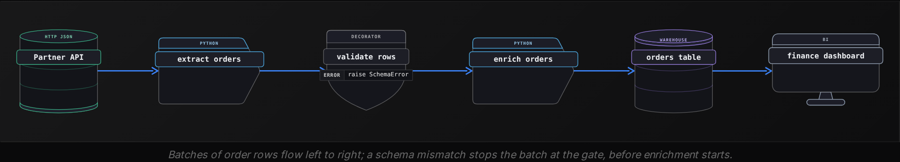

# Decorators for Data Engineers: Intermediate

Mei is 40 minutes into her data engineering loop at Amazon when the interviewer sketches an ingestion job on the whiteboard. It pulls seller orders from a payments partner whose contract allows 10 requests per second with bursts of 20, and the partner answers with 503 errors whenever its backend is under load. Every order gets converted to dollars through a currency lookup, then loaded into the warehouse. "Write the decorators that make this job safe to run every night," he says. Mei writes a retry loop in 3 minutes. Then the follow-ups arrive: what happens when 200 workers retry in the same millisecond, should a 400 be retried, which decorator belongs on top, why does the lookup cache keep growing, and where does a bad batch get stopped before it reaches the warehouse?


<br>

### What you will be able to do

Write a parameterized decorator factory and predict the order its layers run in when decorators are stacked.

Implement retry with exponential backoff and full jitter that retries only transient failures on idempotent calls.

Cache dimension lookups with @lru_cache safely: keep arguments hashable and entries fresh, then avoid the instance-method leak that keeps old objects alive.

Build a schema-validation decorator that rejects a bad batch at the stage boundary with an actionable message.

Implement a token-bucket rate limiter that either sleeps or raises, and stack it beneath @retry.


<br>

---

## Three-Layer Decorator Factories

A decorator that takes settings, such as @retry(max_attempts=5), works because Python evaluates the expression after @ before it decorates anything. Whatever retry(max_attempts=5) returns is the thing that receives the function. So retry is a **factory**: a function that takes configuration and returns a decorator, which takes the function and returns a wrapper.

```sql
@retry(max_attempts=5, base_delay=0.5)
def fetch_orders(page):
    ...

fetch_orders = retry(max_attempts=5, base_delay=0.5)(fetch_orders)
```

The double call retry(...)(fetch_orders) is the whole idea in one line. The first call runs the factory and returns a decorator; the second hands that decorator the function. Interviewers ask you to name all 3 layers because each one runs at a different moment and owns different state, and code placed in the wrong layer is a common source of decorator bugs.


<br>

### What each layer receives and when it runs

| Layer | Receives | Returns | Runs | Belongs here |
| --- | --- | --- | --- | --- |
| Factory | The settings, such as `max_attempts=5` | The decorator | Once, when the `def` statement executes | Validating settings, creating shared state such as a token bucket |
| Decorator | The function | The wrapper | Once at definition, after every factory in the stack has run, innermost decorator first | `functools.wraps`, registering the function in a pipeline registry |
| Wrapper | The call's `\*args` and `\*\*kwargs` | The function's result | On every call | try/except, timing, sleeping, counting attempts |

Test the table on a timing decorator: where does the time.perf_counter() read belong? In the wrapper. Read it in the factory and it runs once, at import, so every call would report the time elapsed since the module loaded instead of the time the call took. The same reasoning places the retry counter in the wrapper and the token bucket in the factory.

Here is the skeleton with a small factory, log_calls(prefix). The argument check lives in the factory, so a bad setting fails when the module is imported instead of on the first call during the overnight run. The wrapper reads prefix and func although neither is passed to it: each layer closes over the variables of the layer around it.

```sql
import functools

def log_calls(prefix):
    if not prefix:
        raise ValueError("prefix must be non-empty")

    def decorator(func):
        @functools.wraps(func)
        def wrapper(*args, **kwargs):
            print(f"{prefix} calling {func.__name__}")
            return func(*args, **kwargs)
        return wrapper

    return decorator
```

> **TIP**
>
> Factory state is per decorated function. Every call of `fetch_orders` shares the variables its factory call created, and a second function decorated with identical settings gets a fresh copy. The rate limiter later in this lesson depends on this: each `@rate_limit(...)` line builds its own token bucket.


<br>

### Stacking order: built bottom-up, run top-down

Stacking 2 factories means keeping 3 separate orders straight, and they disagree. Python evaluates the @ expressions top to bottom, so the factories run in reading order. It then applies the decorators bottom to top, the one nearest the def first, because @outer receives whatever @inner returned. At call time the outermost wrapper starts first and finishes last. The animation logs every layer of a 2-deep stack.

https://github.com/user-attachments/assets/254ddfcc-6477-4eed-ad88-69e2e918259c

*The log fills in definition order first, then call order.*

The log shows factory outer before factory inner, then decorate inner before decorate outer. The call passes through outer and inner on its way to load, then unwinds in reverse. So the top decorator observes everything the decorators beneath it do. Its view includes their sleeps and retries, and it sees any exception they let through.

| ✓ @timed above @retry | ✗ @retry above @timed |
| --- | --- |
| • One timing record per call<br><br>• Duration includes every failed attempt and every backoff sleep<br><br>• Answers how long the caller waited | • One timing record per attempt<br><br>• Each record covers a single request, sleeps excluded<br><br>• Answers how slow the API is per request |


<br>

### The missing-parentheses bug

A frequent follow-up asks you to predict what happens when someone writes @retry without the call. Python runs retry(fetch_orders), so the function lands in max_attempts, and the name fetch_orders is now bound to the inner decorator.

```sql
@retry
def fetch_orders():
    return [{"order_id": "o1"}]

rows = fetch_orders()
```

Calling it raises TypeError: decorator() missing 1 required positional argument: 'func'. That is the lucky case. If the function takes an argument, fetch_orders(3) passes 3 in as func, gets a wrapper back, and the job carries on holding a function where it expected rows. A common fix makes both spellings work:

```sql
def retry(_func=None, *, max_attempts=3):
    def decorator(func):
        ...
    if _func is not None:
        return decorator(_func)
    return decorator
```

Used bare, the factory receives the function as _func and decorates it on the spot; used with settings, _func stays None, so the factory returns the decorator instead. The bare \* keeps every setting keyword-only, so the function is the only value that can arrive positionally.


<br>

---

## Retry with Backoff and Jitter

A retry decorator answers 3 questions: which failures to retry, how long to wait between attempts, and when to give up. A common way to get the first one wrong is catching Exception and retrying a bug 5 times.


<br>

### Which failures to retry

| Failure | Retry? | Reason |
| --- | --- | --- |
| Timeout, connection reset | Yes | The request may never have arrived, or only the reply was lost |
| HTTP 429 Too Many Requests | Yes, after the wait the server asks for | The server is healthy; you exceeded your share |
| HTTP 502, 503, 504 | Yes | An overloaded or restarting backend; the next attempt often lands on a healthy instance |
| HTTP 500 | Only for idempotent calls | The server may have crashed halfway through a write |
| HTTP 400, 422 | No | The request itself is malformed and will fail identically every time |
| HTTP 401, 403 | No | Credentials do not repair themselves between attempts |
| `KeyError`, `TypeError` in your parsing | No | A bug; retrying hides it and multiplies its cost |

Transient is half the test. The other half is **idempotency**: running the call twice must leave the same state as running it once. Fetching page 7, an upsert keyed on order_id, and overwriting the partition for 2026-10-24 are idempotent. Appending rows and a POST that creates a refund are not, because a timeout can arrive after the server already committed, and the retry writes a second copy.

| ✓ Safe to retry | ✗ Unsafe to retry blindly |
| --- | --- |
| • GET a page or a record by id<br><br>• Upsert keyed on a business key<br><br>• Overwrite a whole date partition<br><br>• POST carrying an idempotency key the server deduplicates on | • Append rows to a table<br><br>• POST that creates a payment or refund<br><br>• Increment a counter<br><br>• Send an email or fire a webhook |


<br>

### Exponential backoff with full jitter

Backoff spaces the attempts out so a struggling server has time to recover. Counting attempts from 0, the ceiling for attempt n is min(cap, base \* 2 \*\* n). Full jitter sleeps a uniform random time between 0 and that ceiling. With base=0.5 and cap=8.0, the ceiling starts at 0.5 seconds and doubles on each attempt until it reaches 8, then stays at 8 for every later attempt.

- **7.5 s** — worst-case sleep across 5 attempts
- **3.75 s** — average sleep across 5 attempts

Jitter exists for the many-client case. Take 200 extract workers that all lose their connection when the partner API restarts at 09:00:00. With plain backoff, all 200 retry at 09:00:00.5 and again at 09:00:01.5: synchronized spikes against a server that is still warming up, which can knock it over again. With full jitter, the first wave spreads across half a second and the second across a full second, so the server sees a ramp instead of a wall.

https://github.com/user-attachments/assets/8306cdee-67d5-4493-bd74-7ce5608af1b5

*Each failed attempt adds 1 jittered delay to slept; the third attempt succeeds.*

The injected sleep records each delay instead of waiting, which is also how you unit-test this decorator without a slow test suite; production keeps the time.sleep default. Both failures were transient, so 2 sleeps happen, the first drawn from 0 to 0.5 seconds and the second from 0 to 1. A KeyError raised inside fetch_page would skip the except clause and surface on the first attempt, because it isn't in retry_on.


<br>

### Details that complete the answer

- Re-raise with a bare raise on the last attempt, so the caller sees the original exception type and traceback.
- Honor Retry-After on a 429: sleep the larger of the server's number and your jittered delay.
- Bound total time as well as attempts: 5 attempts with a 30-second request timeout each can hold a worker for over 2.5 minutes.
- Log every retry with its attempt number and exception, so a call that only succeeded on attempt 4 still shows up in monitoring.


| ✓ Do | ✗ Don't |
| --- | --- |
| • Retry an explicit tuple of transient exception types<br><br>• Retry only idempotent calls, or send an idempotency key<br><br>• Cap the delay and the total attempts<br><br>• Inject sleep so tests run instantly | • Catch Exception and retry whatever comes out<br><br>• Retry a schema error or a 400 or 401 response<br><br>• Sleep a fixed interval across hundreds of workers<br><br>• Swallow the final exception and return None |


<br>

---

## Caching Lookups with @lru_cache

Enrichment stages look up dimension values: a currency rate per order, a region per store, a segment per customer. A day's batch of 2,000,000 orders might touch only 40 distinct currencies, and each rate lookup is a 15 ms query against the rates table. Without a cache, the stage repeats those same 40 queries tens of thousands of times each.

- **8.3 h** — uncached lookup time per batch
- **0.6 s** — cached lookup time per batch

```sql
import functools

@functools.lru_cache(maxsize=1024)
def fx_rate(currency, rate_date):
    return query_rate(currency, rate_date)
```

After the batch, fx_rate.cache_info() reports CacheInfo(hits=1999960, misses=40, maxsize=1024, currsize=40). Read that line as a health check: misses should match the distinct keys you expect, and a currsize pinned at maxsize means entries are being evicted and recomputed. The default maxsize is 128, and maxsize=None removes the bound, which is safe only when the key space is small and known.


<br>

### The key is built from the arguments

lru_cache turns the call's arguments into a dictionary key, so every argument must be hashable, and that check happens before your function body runs. How you spell a call also changes the key.

| Call | What the cache does |
| --- | --- |
| `fx_rate("EUR", d)` twice | One miss, then a hit |
| `fx_rate(["EUR"], d)` | `TypeError: unhashable type: 'list'` before the body runs |
| `fx_rate(("EUR",), d)` | Works: a tuple of hashable values is hashable |
| `fx_rate("EUR", d)` then `fx_rate(currency="EUR", rate_date=d)` | Two separate entries: positional and keyword spellings build different keys |
| `fx_rate(currency="EUR", rate_date=d)` then `fx_rate(rate_date=d, currency="EUR")` | Possibly 2 entries: keyword order is part of the key |
| `tier(3)` then `tier(3.0)` | One entry, since `3 == 3.0` and both hash alike; `typed=True` splits them |

The list row is the one to predict in an interview, and a dict argument fails the same way with 'dict'. Convert at the boundary: pass a tuple or a frozenset, or split the argument into its individual scalar values. Keep call sites consistent too, because a low hit rate can come from inconsistent call spelling as much as from the data.


<br>

### Stale entries and shared results

The cache never expires. If the key is currency alone, a job that runs past midnight keeps serving yesterday's rate, because nothing in the key changed. Every input the answer depends on belongs in the key, such as the rate date or the dimension's version number. Call fx_rate.cache_clear() at batch boundaries when the source can change underneath you.

Cached results are also shared objects. If customer_row(42) returns a dict and one caller sets row["segment"] = "test", every later hit for customer 42 returns the mutated dict. Return immutable values, such as tuples or named tuples; frozen dataclasses and a read-only types.MappingProxyType view also work.


<br>

### The instance-method leak

Putting @lru_cache on a method makes self part of every key. The cache belongs to the function object stored on the class, so it lives as long as the class does, and it holds a strong reference to every instance that still has an entry in it. With maxsize=None, that is every instance that ever called the method. With the default bound of 128, an instance is released only once all of its entries are evicted, so a dimension queried for 2 currencies can still keep 64 instances alive, each pinning its own rates. The animation sets maxsize=None, builds a new dimension object for each of 3 batches and keeps a variable pointing only at the last.

https://github.com/user-attachments/assets/9a655e58-6220-429c-90e0-8b49cf13f30b

*The class-level cache keeps entries for all 3 instances.*

The output shows 6 entries for 3 objects. Although the loop rebound dim twice, the first 2 batches and their rates dicts are still alive because cache keys refer to them. A service that loads a 50 MB currency dimension every 15 minutes builds 96 objects a day and retains 4.8 GB of them. The counters mislead as well: hits=3 pools every instance together.

```sql
import functools

class CurrencyDim:
    def __init__(self, rates):
        self.rates = rates
        self.rate = functools.lru_cache(maxsize=256)(self._rate)

    def _rate(self, currency):
        return self.rates[currency]
```

Now each instance owns its cache, and the entries die with it. The instance refers to its cache, the cache to the bound method, and the method back to the instance: a reference cycle, which Python's cycle collector reclaims once nothing else refers to the object. For a value with no arguments, functools.cached_property stores the result on the instance directly. A module-level cached function keyed on plain values, such as (batch_id, currency), keeps instances out of keys altogether.

| ✓ Do | ✗ Don't |
| --- | --- |
| • Key on every input the answer depends on, dates included<br><br>• Return tuples or frozen dataclasses from cached functions<br><br>• Check cache_info() against the distinct keys you expect<br><br>• Build per-instance caches in __init__ | • Decorate a method with @lru_cache on a long-lived service<br><br>• Pass lists or dicts to a cached function<br><br>• Use maxsize=None on an unbounded key space<br><br>• Cache a dimension that changes mid-run without cache_clear() |


<br>

---

## Validation Decorator for Data Quality

An enrichment stage multiplies amount by a rate. The partner changes amount from a number to a string such as "12.5", and 25 minutes into a 2,000,000-row batch, row 1,400,000 raises TypeError: can't multiply sequence by non-int of type 'float'. The traceback points at a line in your enrichment code instead of at the partner, the output table holds a partial load, and the on-call engineer starts debugging the wrong component.

A validation decorator moves that check to the stage boundary. The wrapper inspects the batch before the stage body runs and, on a mismatch, raises an error that names the stage and points to the exact row and column. Business logic stays free of defensive checks, and every stage that consumes the same rows can share 1 schema.




<br>

### The decorator

The factory takes the schema as a mapping from column to accepted type, the wrapper walks the rows, and errors are collected up to a cap before anything is raised.

https://github.com/user-attachments/assets/3324ff03-0515-493f-aeb0-c7102d2d740f

*The wrapper rejects the batch before enrich runs.*

The batch never reaches the multiplication. The message lists both problems from a single run, the string amount in row 1 and the missing order_id in row 2, so whoever contacts the partner gets the full picture at once. The max_errors cap stops a batch where every row is wrong from producing a message with 2,000,000 lines.


<br>

### Design decisions and what they cost

| Decision | Choice A | Choice B | Deciding factor |
| --- | --- | --- | --- |
| Rows checked | Every row | The first 1,000 rows | Checking 2,000,000 rows times 6 columns is 12,000,000 checks against 6,000; a sample misses a bad row at position 1,400,000 |
| On failure | Raise and stop the stage | Quarantine bad rows, load the rest | Whether a partial load is worse than a late one: finance totals raise, clickstream quarantines |
| Errors reported | The first one | Up to a cap | Operator time: a capped list fixes several columns in 1 cycle |
| Side checked | Input only | Input and output | An output check catches your own stage breaking the next stage's contract |

Sampling is the tempting shortcut and the dangerous one: type drift often starts mid-file, when the partner's new code path handles only some records. If full validation costs too much, validate every row for the columns the stage computes with and sample the rest.


<br>

### Type checks that lie

isinstance(True, int) returns True, because bool subclasses int, so a quantity column full of booleans passes an integer check. In the other direction, isinstance(3, float) returns False: a JSON amount of 3 parses as an int, so a strict float check rejects valid rows. For numeric columns, accept (int, float) but exclude bool explicitly. Treat None as valid only in columns declared nullable.

```sql
def matches(value, kind, nullable=False):
    if value is None:
        return nullable
    if isinstance(value, bool) and kind is not bool:
        return False
    return isinstance(value, kind)
```


<br>

### Where validation sits in the stack

Put @validate_rows above @retry on a load stage. A bad batch then fails once, in milliseconds, before any connection opens, and never enters the retry loop where a misconfigured retry_on could burn 5 attempts on it.

```sql
@validate_rows(ORDER_SCHEMA)
@retry(retry_on=(TransientError,))
def load_orders(rows):
    write_partition(rows)
```

The same factory can check what a stage returns. A returns= schema validated after func runs catches your own code dropping or retyping a column the next stage needs, and the error names your stage, which is where the bug is, instead of the downstream stage where it would otherwise surface hours later.

> **TIP**
>
> Give `SchemaError` its own exception class and keep it out of every `retry_on` tuple. Bad data is permanent until a human fixes it, so the orchestrator should alert the data owner instead of rerunning the task, and a distinct class is how it tells bad data from flaky infrastructure.


<br>

---

## Token Bucket Rate Limiting

The partner's contract allows 10 requests per second sustained, bursts of up to 20, and answers anything faster with a 429. A **token bucket** models that contract directly: the bucket holds at most capacity tokens (20), refills at rate tokens per second (10), and every call spends 1. Bursts are allowed up to the capacity, and the sustained rate can never exceed the refill.

- **30** — calls allowed in the first second
- **2 s** — to refill an empty bucket


<br>

### Refill lazily on each call

No background thread is needed. On each call, add elapsed \* rate tokens, cap the total at capacity, then try to spend 1. Production code reads time.monotonic(), because time.time() follows the wall clock, which can jump backwards when the system clock is corrected and produce a negative refill. The animation replaces the clock with a variable so the timeline is exact, and it runs in raise mode with rate=2 and capacity=3.

https://github.com/user-attachments/assets/aa0b3f38-4cce-40df-b06f-d09501720f8f

The first 3 calls drain the burst allowance, leaving 0.4 tokens at 0.2 seconds. At 0.3 seconds the bucket holds 0.6, short of 1, so the call raises with the wait the caller needs: 0.4 missing tokens at 2 per second is 0.2 seconds. By 0.8 seconds another full token has accrued, 0.5 seconds at 2 per second, and the call passes; at 0.9 the bucket is short again.


<br>

### Sleep or raise

| ✓ Sleep until a token frees up | ✗ Raise RateLimited |
| --- | --- |
| • Fits batch extracts and backfills where throughput matters and latency does not<br><br>• Throughput settles exactly at the contract rate<br><br>• The caller blocks; sleeping while holding a lock blocks every thread | • Fits request paths with a latency budget<br><br>• The caller picks what happens next, whether that means queuing the work or shedding it<br><br>• The exception carries the wait, so the caller decides |

For a thread-safe sleeping limiter, reserve the token under the lock and sleep outside it. The bucket may go negative: a reading of -0.5 tokens at a rate of 10 means this caller's slot opens in 0.05 seconds. Each thread computes its own wait and releases the lock before sleeping, so it never stalls the others.

```sql
import functools
import threading
import time

class TokenBucket:
    def __init__(self, rate, capacity):
        self.rate, self.capacity = rate, capacity
        self.tokens = capacity
        self.last = time.monotonic()
        self.lock = threading.Lock()

    def reserve(self):
        with self.lock:
            now = time.monotonic()
            refill = (now - self.last) * self.rate
            self.tokens = min(self.capacity, self.tokens + refill)
            self.last = now
            self.tokens -= 1
            return max(0.0, -self.tokens / self.rate)

def rate_limit(rate, capacity):
    bucket = TokenBucket(rate, capacity)

    def decorator(func):
        @functools.wraps(func)
        def wrapper(*args, **kwargs):
            time.sleep(bucket.reserve())
            return func(*args, **kwargs)
        return wrapper

    return decorator
```


<br>

### Stack @retry outside @rate_limit

The stacking order determines what a single token covers. With @retry on top, every attempt passes through the limiter and spends its own token, so retries count against the contract. With @rate_limit on top, 1 token admits a whole retry loop, and each attempt inside it reaches the partner uncounted.

```sql
@retry(retry_on=(TransientError, VendorThrottled))
@rate_limit(rate=10, capacity=20)
def fetch_page(page):
    return call_partner(page)
```

| Stack order | Each token pays for | Partner traffic for a 20-call burst, 4 attempts max |
| --- | --- | --- |
| `@retry` above `@rate_limit` | A single attempt | At most 20 requests, then 10 per second |
| `@rate_limit` above `@retry` | Up to 4 attempts | Up to 80 requests while the limiter counted 20 |

The wrong order feeds itself: the extra requests trigger 429s, the 429s trigger retries, and the retries add more uncounted requests. Under the right order, a 429 usually means another client shares your quota or the partner measures the rate differently from your bucket. A partner that counts requests in its own 1-second windows can see 30 requests in one of them, a full burst of 20 plus the 10 that refill behind it, which the bucket allows and the partner's counter may not; clock and latency differences between client and server shift requests across those window edges too. Either way, backoff plus the bucket bring the traffic back inside the contract.


<br>

### The bucket's scope

The bucket lives in the factory's closure, so there is 1 per decorated function per process. Run 8 worker processes with rate=10 each and the partner sees up to 80 requests per second. Either divide the contract across workers, 1.25 per second each with a capacity of 2, or move the bucket into a shared store that every worker consults, at the cost of a network round trip per call. If 2 functions hit the same partner, give them 1 shared bucket object, because 2 decorator lines with matching numbers create 2 buckets and double the traffic.

| ✓ Do | ✗ Don't |
| --- | --- |
| • Size the bucket from the contract: capacity is the burst, rate the refill<br><br>• Read time.monotonic() for elapsed time<br><br>• Stack @retry above @rate_limit<br><br>• Divide the rate by worker count or share the bucket | • Run a background thread to add tokens<br><br>• Sleep while holding the bucket's lock<br><br>• Let 1 token admit a whole retry loop<br><br>• Give every process the full contract rate |


<br>

---

## Putting It All Together

A marketplace pulls 50,000 pages of seller payouts each night from a payments partner whose contract allows 10 requests per second with bursts of 20, converts every payout to dollars, and loads the result for the finance team's morning close. At 10 requests per second the extract needs at least 5,000 seconds, about 83 minutes, so every wasted request pushes the close later.

- The fetch function carries @retry above @rate_limit , so each attempt spends a token and retries cannot push traffic past the contract.
- Because each process builds its own bucket in the factory's closure, the 4 extract workers each get rate = 2.5 and capacity = 5 , keeping their combined traffic at the contract.
- Full jitter keeps the 4 workers from retrying in lockstep after the partner's nightly restart.
- The currency lookup is a module-level @lru_cache function keyed on ( currency , rate_date ) , cleared between nights.
- The load stage carries @validate_rows above its own @retry , so a partner schema change stops the batch before any partial payout total reaches the close.


<br>

---

## Key Takeaways

- A parameterized decorator is 3 layers: the factory runs once with the settings, the decorator once with the function, the wrapper on every call.
- Stacked decorators are applied bottom-up and run top-down, so the top one observes everything beneath it.
- Retry only transient failures on idempotent calls, with capped exponential backoff and full jitter.
- An @lru_cache key is built from hashable arguments and must hold every input. Return immutable values, and keep the cache off methods of long-lived objects.
- Validate a batch at the stage boundary with its own exception class, so bad data fails fast and is never retried.
- A token bucket encodes burst and sustained rate; put @retry above @rate_limit and size the bucket for every process sharing the contract.
