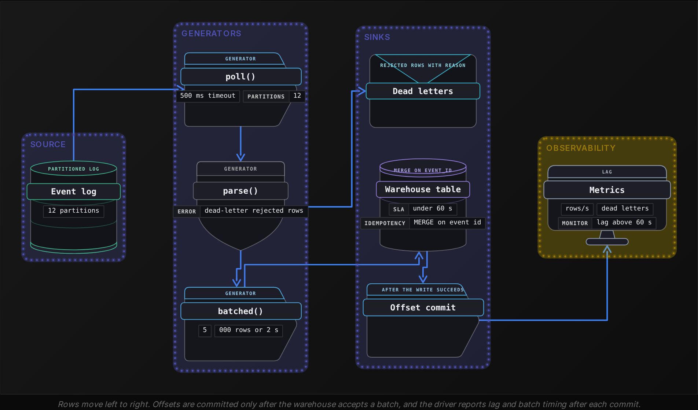

# Generators for Data Engineers: Advanced

The interviewer at Stripe shares a screen holding 40 lines of Python: an async generator that walks a cursor-paged API, feeding a generator chain that parses and batches rows before writing them to a warehouse table. 'A deploy stops this worker in the middle of a batch,' she says. 'Which rows land in the table twice, and which never arrive? Then walk me through the line of cleanup that actually runs.' The candidate knows `yield` well. What decides the next 45 minutes is everything around it: what `close()` raises inside a paused frame, why an empty input file once produced a silent zero-row load, when an event loop shortens a sync, where the offset commit sits relative to the write, and which corner cases only appear in production tracebacks.


<br>

### What you will be able to do

Drive a generator with throw() and close(), handling the value throw() returns and the GeneratorExit contract

Explain PEP 479 and replace every raise StopIteration and unguarded next() with return or a default

Choose between a plain and an async generator for paged APIs using latency and rate-limit arithmetic

Design a log-to-warehouse generator consumer that commits offsets after idempotent writes and escalates when its metrics show trouble

Diagnose finally, threading and evaluation-timing corner cases from their production symptoms


<br>

---

## Generator throw() and close()

A suspended generator can be resumed 3 ways. `next()` and `send()` continue it normally. `gen.throw(exc)` continues it by raising `exc` at the exact `yield` where it paused. `gen.close()` continues it by raising `GeneratorExit` at that same `yield`. Everything in this section follows from a single rule: whatever arrives at the paused `yield` meets the generator's own `try` blocks first, and the caller sees only what the generator lets out.

| Call | Arrives at the yield | Body reaches another yield | Body returns | Exception escapes the body |
| --- | --- | --- | --- | --- |
| `next(gen)` | nothing; execution resumes | returns the yielded value | raises `StopIteration` | propagates to the caller |
| `gen.throw(exc)` | `exc` | returns the yielded value | raises `StopIteration` | propagates to the caller |
| `gen.close()` | `GeneratorExit` | raises `RuntimeError: generator ignored GeneratorExit` | returns `None` (3.13+: the body's return value) | `GeneratorExit` is absorbed and `close()` returns `None`; any other exception propagates |

Two edge cases complete the table. On a generator that has never started, `throw()` raises `exc` immediately and `close()` marks it finished, and neither runs a line of the body. A finished generator ignores `close()`, while `throw(exc)` raises `exc` straight back at the caller.


<br>

### Error injection: a failed row travels upstream

The reader stage owns the position in the input, while the sink is the first to learn a row is bad: the warehouse rejects it or a schema check fails. Rather than handing the sink a reference to the reader's state, the driver throws an exception into the reader. The reader catches it around its `yield`, files the row it handed out last in a dead-letter list, and moves to the next position. The policy for a failed row lives in the stage that knows where it is in the input.

https://github.com/user-attachments/assets/7673e0d6-e727-40ed-9e1c-dd938257ca40

*throw() delivers BadRecord to the paused yield; close() delivers GeneratorExit.*

Predict the 5 printed lines before pressing play. `throw()` raised `BadRecord` at the `yield` holding `"a"`, and the inner `except` filed `"a"` in `dead`. The loop then advanced until the body reached its next `yield`, so `throw()` itself returned `"b"`. `close()` then raised `GeneratorExit` at the `yield` holding `"c"`. The inner handler catches only `BadRecord`, so `GeneratorExit` passed through it, the `finally` reported position 2, and `close()` returned `None`.


<br>

### The row hidden in the throw call's result

That returned `"b"` is where production drivers lose data. The common shape iterates the reader with a `for` loop and calls `throw()` inside it on failure. The `for` loop never sees the row `throw()` returned, so the record after every rejected record disappears without an error. At 1 rejection per 10,000 rows the loss is 0.01%, small enough to hide inside normal day-to-day variation in row counts.

```sql
gen = reader(rows, dead)
for record in gen:
    try:
        sink.write(record)
    except SinkRejected:
        gen.throw(BadRecord())
```

The corrected driver below treats `throw()` as another way to advance: whatever it returns is the next record to write. `inject()` exists because a reader that handles the error and then runs out of input makes `throw()` raise `StopIteration`, the same end-of-stream signal `next()` gives. The driver also assumes `None` is never a real record; use a private sentinel object if it can be.

```sql
def inject(gen, exc):
    try:
        return gen.throw(exc)
    except StopIteration:
        return None


gen = reader(rows, dead)
record = next(gen, None)
while record is not None:
    try:
        sink.write(record)
        record = next(gen, None)
    except SinkRejected:
        record = inject(gen, BadRecord())
```


<br>

### The shutdown contract

`GeneratorExit` inherits from `BaseException`, so `except Exception` around a `yield` lets it pass, and that is the behaviour you want: retry and dead-letter handlers must never intercept a shutdown. A bare `except:` or `except BaseException:` does catch it. If that handler then loops back to a `yield`, `close()` raises `RuntimeError: generator ignored GeneratorExit`. On `GeneratorExit` the body has 2 clean moves after releasing what it holds: return, or let the exception continue.

```sql
def tail(rows):
    for row in rows:
        try:
            yield row
        except:
            continue
```

The caption's second half is why this bug survives testing. With rows remaining, `continue` reaches another `yield` and `close()` fails. Paused on the final row, `continue` ends the loop; once the body returns, `close()` succeeds. A test that drains a short list never sees the failure; a worker stopped mid-stream does.

Who calls `close()` matters as much as what it does. Breaking out of a `for` loop leaves the generator suspended. CPython closes a generator when its last reference disappears, but that moment becomes unpredictable if a traceback still holds the frame or the generator sits in a reference cycle, and on other interpreters it is unpredictable to begin with. A generator holding a connection or a file handle should be closed explicitly, and so should one holding a lease; do it in a `finally` or with `contextlib.closing`.

```sql
from contextlib import closing

with closing(reader(rows, dead)) as gen:
    for record in gen:
        if record == "STOP":
            break
```


<br>

---

## PEP 479 and raise StopIteration

Before Python 3.7, a `StopIteration` escaping a generator's body ended the generator exactly as running out of items does. The consumer couldn't tell 'this generator finished' from 'code inside this generator called `next()` on an empty iterator and the exception leaked'. PEP 479 removed the ambiguity. Since 3.7, a `StopIteration` leaving a generator frame is replaced by `RuntimeError: generator raised StopIteration`, with the original attached as `__cause__`. Python 3.5 offered the new behaviour behind `from __future__ import generator_stop`, and 3.6 issued a `DeprecationWarning` for code that depended on the old one.


<br>

### The leak that looked like an empty file

The bug PEP 479 targets sits in a parsing stage: read the header with `next(lines)`, then yield a dict per data line. On a zero-byte partition, `next(lines)` raises `StopIteration` inside the generator. On Python 3.6 the stage yields nothing, the load reports 0 rows, and the dashboard shows a quiet day. On 3.7 and later the same input stops the run with a `RuntimeError` whose traceback points at the header line.

https://github.com/user-attachments/assets/f4483751-7f59-466e-b936-16ee03a652c3

*The same empty input through the guarded and the unguarded parser.*

Before playing, predict 4 printed lines. The `print` inside `try` never runs: `list()` propagates the `RuntimeError` raised from inside `parse()`, and the handler prints the replacement and its cause. `parse_safe()` asks `next()` for a default and executes a bare `return` when the input is empty, which ends the generator through the normal path and gives `list()` an empty result.

The silent version is worse than a crash because the rest of the pipeline keeps going. A stage that ends early still lets every downstream stage flush its last batch and commit, so the run reports success. A row-count check may notice a 0-row day; it will not notice a stage that stopped at row 4,000 of 9,000 because a nested `next()` reached the end of a lookup iterator.


<br>

### Ending a generator on purpose

Inside a generator, `return` is the whole stopping vocabulary. A bare `return` ends iteration. `return value` ends it and stores `value` on the `StopIteration` the interpreter raises for the caller, which is how `yield from` hands a sub-generator's result to the delegating generator. Writing `raise StopIteration` yourself now produces the same `RuntimeError` as the leak.

```sql
def load(batches):
    rows = 0
    for batch in batches:
        rows += len(batch)
        yield batch
    return rows


def run(batches):
    rows = yield from load(batches)
    print("loaded", rows)
```

`list(run([[1, 2], [3]]))` prints `loaded 3` and returns both batches. The count travels on the `StopIteration` that ends `load()`, and `yield from` reads it off that exception, so no caller ever handles the exception by hand.


<br>

### Where the rule applies

| Where StopIteration appears | Python 3.6 | Python 3.7 and later |
| --- | --- | --- |
| `raise StopIteration` in a generator body | generator ends; `DeprecationWarning` issued | `RuntimeError` |
| `next(it)` on an exhausted iterator, inside a generator | generator ends; `DeprecationWarning` issued | `RuntimeError` |
| `return value` in a generator | `StopIteration` carrying `value` | unchanged |
| `__next__` of an iterator class | normal end of iteration | unchanged |
| `[next(it) for _ in range(3)]` | `StopIteration` reaches the caller | unchanged |
| `list(next(it) for _ in range(3))` | list silently truncated; `DeprecationWarning` issued | `RuntimeError` |

The last 2 rows catch people in review. A list comprehension isn't a generator, so its `StopIteration` propagates as an ordinary exception to the surrounding code. Inside a generator it then becomes `RuntimeError`; inside an iterator class's `__next__` it still ends iteration silently, the very bug PEP 479 fixed for generators. A generator expression is a generator, so wrapping it in `list()` now fails loudly where it used to truncate. Async generators follow the same rule: a `StopIteration` or `StopAsyncIteration` escaping an `async def` body that contains `yield` becomes `RuntimeError`.

> **TIP**
>
> In review, search generator bodies for `next(` with 1 argument. Each hit needs a default plus a check, a `try/except StopIteration: return` around it, or a comment stating that empty input is meant to crash the run.


<br>

---

## Async Generators for Paged APIs

A cursor-paged API returns 1 page of results plus a cursor for the next. An `async def` function containing `yield` is an async generator: you consume it with `async for`, and each `await` inside it gives the event loop to other tasks while a request is in flight. Choosing between that and a plain generator over a blocking client comes down to whether any other work could run during the wait.


<br>

### Laziness survives the await

The animation composes 3 async stages the way synchronous pipelines compose: `pages()` follows cursors, `records()` flattens each page, and `batched()` groups 4 rows per write. Each stage pulls from its upstream with `async for`, and `get_page()` stands in for the HTTP call.

https://github.com/user-attachments/assets/f05b626c-69dd-4bc3-b9c7-c733281e955b

*Three async stages pulling from a 3-page cursor API.*

Read the order of the output. Page `p2` is requested only after the first write, because `pages()` runs again only when `records()` has used up page `p1`. The same pull bounds memory: the pipeline holds at most 1 page and 1 partial batch, however many pages the API serves.


<br>

### When an event loop saves time

Cursor pagination is sequential by construction: page 2's cursor arrives inside page 1. Over 1 cursor stream, an async generator finishes no sooner than a plain one; 500 pages at 200 ms per round trip take the same time whether the wait blocks a thread or yields to a loop. Time is saved across independent streams. Syncing 40 tenants, each with its own cursor, lets several streams wait at once until the provider's rate limit takes over: at 25 requests per second, the 20,000 requests have a fixed minimum duration.

- **100 s** — 1 cursor stream of 500 pages
- **4,000 s** — 40 streams fetched one by one
- **400 s** — 40 streams, 10 in flight, no cap
- **800 s** — floor under a 25 requests/s cap

The cap binds early: at 200 ms per request, 1 stream issues 5 requests per second, so 5 requests in flight fill the quota of 25 and a 6th earns only `429 Too Many Requests` responses. Waits overlap only across tasks, since `async for` over 1 generator or a nested chain awaits 1 request at a time.

```sql
import asyncio


async def pages(tenant, sem):
    cursor = None
    while True:
        async with sem:
            data, cursor = await get_page(tenant, cursor)
        yield data
        if cursor is None:
            return


async def drain(tenant, sem, queue):
    try:
        async for data in pages(tenant, sem):
            await queue.put(data)
    finally:
        await queue.put(None)


async def sync_all(tenants, writer):
    sem, queue = asyncio.Semaphore(5), asyncio.Queue(10)
    tasks = [asyncio.create_task(drain(t, sem, queue)) for t in tenants]
    for _ in tasks:
        while (data := await queue.get()) is not None:
            await writer.write(data)
    await asyncio.gather(*tasks)
```

Each `drain()` task posts `None` from its `finally`, so the writer stops after 1 `None` per task, and `gather()` re-raises any failure. The semaphore caps requests in flight, which matches the quota only at the measured 200 ms: at 100 ms the same 5 slots issue 50 requests per second, so a strict cap needs a token-bucket limiter around `get_page()`.

| ✓ Plain generator, blocking client | ✗ Async generator on an event loop |
| --- | --- |
| • 1 cursor stream, or streams that must run in order<br><br>• No other I/O to overlap with the wait<br><br>• CPU-heavy parsing that would stall an event loop<br><br>• A synchronous caller you do not control | • Many independent cursors: tenants, accounts, date ranges<br><br>• Prefetching page n+1 while page n is written<br><br>• An async service, where 1 blocking call freezes every task<br><br>• A rate limit enforced by 1 token bucket shared by every task |


<br>

### Rules that change with async

| Operation | Plain generator | Async generator on 3.9 |
| --- | --- | --- |
| Advance by hand | `next(gen)` | `await agen.__anext__()`; the `anext()` builtin arrives in 3.10 |
| Delegate to a sub-generator | `yield from sub` | `SyntaxError`; loop with `async for` and `yield` |
| Return a value | `return value` | `SyntaxError`; bare `return` only |
| Inject an error, shut down | `throw()`, `close()` | `await agen.athrow(exc)`, `await agen.aclose()` |
| Scoped cleanup helper | `contextlib.closing` | `contextlib.aclosing` arrives in 3.10; write your own |
| Iterate with a plain `for` | works | `TypeError: 'async_generator' object is not iterable` |

```sql
class aclosing:
    def __init__(self, agen):
        self.agen = agen

    async def __aenter__(self):
        return self.agen

    async def __aexit__(self, *exc_info):
        await self.agen.aclose()


async def first_page_with(predicate):
    async with aclosing(pages()) as stream:
        async for data in stream:
            if any(predicate(row) for row in data):
                return data
```

Explicit `aclose()` matters more than in sync code because an async generator's `finally` runs only on the event loop. When the last reference to an abandoned one disappears, asyncio schedules its `aclose()` as a task; while a reference survives, cleanup waits until `asyncio.run()` shuts down, and an early `return` like the one in `first_page_with()` leaves the HTTP session open that long. The class runs `aclose()` on every exit path.

> Answering regular versus async
>
> - Name the pagination type first: cursor pages are sequential, numbered pages can fan out.
> - Do the latency arithmetic for 1 stream, then for all streams in parallel.
> - Run 1 task per stream under a token-bucket rate limiter.
> - State where blocking code lives, and how cleanup runs on an early exit.


<br>

---

## Streaming ETL Design

The design prompt usually reads: consume events from a partitioned log, load them into a warehouse table, and survive restarts without losing data. A generator pipeline answers it with 1 process per consumer. `poll()` yields records as they arrive and `parse()` validates them, dead-lettering the bad ones. `batched()` groups rows by count or age, and a driver writes each batch and then commits offsets. The design is judged on 3 decisions: where the commit sits, what the sink does with a repeated batch, and which signal says the consumer is falling behind.




<br>

### Commit after the write

```sql
import time


def run(consumer, warehouse, metrics):
    stream = batched(parse(poll(consumer), metrics), 5000, 2.0)
    try:
        for rows, offsets in stream:
            started = time.monotonic()
            warehouse.merge(rows, key="event_id")
            consumer.commit(offsets)
            metrics.observe("batch_seconds", time.monotonic() - started)
            metrics.count("rows_loaded", len(rows))
    finally:
        stream.close()
        consumer.close()
```

The order of `merge()` and `commit()` is the delivery guarantee. Each row of the table below is a process kill landing between those 2 steps, the event a deploy or an out-of-memory kill produces.

| Order | Killed between the steps | On restart | Guarantee |
| --- | --- | --- | --- |
| write, then commit | batch in the table, offsets uncommitted | batch re-read and written again | at-least-once: duplicates, no loss |
| commit, then write | offsets committed, batch missing | batch skipped | at-most-once: loss, no duplicates |
| rows and offsets in 1 warehouse transaction | both or neither | seek to offsets stored in the warehouse | exactly-once into that table |

At-least-once is the default because duplicates are repairable and loss is not. The repair lives in the sink: a `MERGE` keyed on `event_id` turns a replayed batch into updates that write identical values. Without a natural event id, `(partition, offset)` identifies every record and is the key. The third row is the answer when the interviewer pushes for exactly-once. It holds only while the warehouse is the single sink and supports transactions, and it moves ownership of the position from the log to the table.


<br>

### Batches that flush on a quiet log

A batching generator runs only when its upstream yields, which a list-driven test never exposes. When the log goes quiet, a partial batch waits for the row that would fill it, and the 2-second age limit is never checked. The fix is a heartbeat: when its poll timeout expires with no records, `poll()` yields `(now, None)`, which gives `batched()` a turn to flush stale rows. The animation shrinks the size limit to 3 rows and keeps the 2-second age limit.

https://github.com/user-attachments/assets/7480862e-a1da-49cb-85dd-42227b199965

*Size and age limits, with heartbeats from a quiet log.*

Row `d` is flushed by the heartbeat at 2.6, 2.2 seconds after it arrived; the heartbeat at 0.9 found it too young. Each committed value is the next offset to read, 1 past the last loaded record, so partition 1 resumes at 9. A process that dies with rows still inside `batched()` loses nothing: their offsets were never committed, so the log delivers them again.


<br>

### Metrics that show the consumer falling behind

- **Consumer lag** *gauge, per partition*\
  Log end offset minus committed offset. Divided by the load rate it becomes seconds behind, the unit a freshness target is written in.
- **Rows loaded per second** *counter*\
  Lag grows whenever producer inflow exceeds this rate.
- **Batch write seconds** *histogram*\
  A rising p99 means the warehouse is slowing, and it shows up before lag does.
- **Dead letters** *counter, labelled by reason*\
  A spike right after a producer deploy usually marks a schema change upstream.
- **Seconds since last commit** *gauge*\
  Catches a consumer wedged mid-write. Alert on it only while lag is above zero, so an idle log pages no one.


<br>

### The escalation path

Scale-out comes from the consumer group: each partition is read by 1 consumer at a time, so the partition count caps parallelism. If 1 process sustains 15,000 records per second in your benchmark and peak inflow is 45,000, you need 3 consumers, and the 12 partitions leave room to grow to 12. Past that, or when the work needs state the per-partition design can't hold, the right move is a different engine. Write those conditions into the design document so the migration is a planned step.

| ✓ Stay on generator consumers | ✗ Move to a distributed stream processor |
| --- | --- |
| • Records are processed independently, or with state that fits in 1 process per partition<br><br>• At-least-once plus an idempotent MERGE meets the correctness bar<br><br>• Peak inflow divided by per-process rate stays under the partition count<br><br>• The freshness target is seconds to minutes | • Windowed aggregates or stream-to-stream joins whose state must survive restarts<br><br>• Event-time windows that must place late records using watermarks<br><br>• Exactly-once delivery into several sinks, which needs coordinated checkpoints<br><br>• Regrouping by a key other than the log's partition key |

The other exit runs the opposite direction. If the freshness target relaxes to hours, a scheduled job on a distributed batch engine can read a day of landed log data and rewrite whole partitions, and the generator consumer shrinks to landing raw rows.

> **TIP**
>
> State each escalation trigger as a number you already monitor: partition count, per-process records per second, state size, freshness target. Then 'when would you move off this design?' gets an answer the interviewer can check against your metrics.


<br>

---

## Generator Protocol Corner Cases

The behaviours below pass code review and unit tests, then surface as a leaked connection, a missing day of rows, or an exception that appears only under load. Each traces back to a single rule of the generator protocol, and each has a symptom you can recognize in a traceback or a metric.


<br>

### Cleanup blocks that never run

A `finally` in a generator runs only if the body reached its `try`. A generator that was never advanced has executed no lines, so `close()` on it marks it finished and runs nothing. That matters when the caller opens a resource and passes it in: the generator's `finally` is then the only cleanup, and it never fires for a stream nobody started, such as one built by a stage that failed before consuming it.

https://github.com/user-attachments/assets/a732a973-e8d7-425f-9b58-7b5d315b43dc

*The first generator was advanced before close(); the second was not.*

Connection `a` sat behind a generator paused at its first `yield`, so `close()` raised `GeneratorExit` there and the `finally` closed it. Connection `b` belongs to a generator that was created and closed without a single `next()`, and it's still open. The fix is ownership: whoever opens the resource closes it, in a `with` block wrapped around the whole consumption, and the generator only reads from it.

```sql
def guarded(rows):
    try:
        for row in rows:
            yield row
    finally:
        return
```

A `return` inside `finally` discards the exception in flight. Throw `ValueError` into `guarded()` and `throw()` raises `StopIteration` instead, so the error meant to halt the pipeline reaches the driver as a clean end of stream. A `finally` that raises fails the opposite way: when a flush inside it fails during `close()`, that error replaces `GeneratorExit` and comes out of `close()`, so the driver's call to `close()` needs its own error handling.


<br>

### Sharing a generator across threads

Every generator object carries a flag that is set while its frame runs. Calling `next()` while the flag is set raises `ValueError: generator already executing`. With threads, that happens when 2 workers pull from 1 shared generator and the interpreter switches threads while the first is inside the body, so the error depends on timing: rare in tests and frequent under production load. A generator that advances itself trips the same guard in a single thread, every time, which makes the failure reproducible.

https://github.com/user-attachments/assets/d0a13bc4-f885-47fb-ad32-df0e5974a02c

*A generator that advances itself trips the running-frame guard.*

The second printed line is its own corner case. An exception that escapes a generator's body finishes it for good, so a driver that catches an error from `next()` and retries gets an exhausted stream with no further error. Retries belong inside the generator, around the step that failed.

```sql
import threading


class LockedIter:
    def __init__(self, it):
        self._it = it
        self._lock = threading.Lock()

    def __iter__(self):
        return self

    def __next__(self):
        with self._lock:
            return next(self._it)
```

The lock serializes `next()`, so the shared source runs at single-thread speed. That trade fits when workers spend their time on network writes. When the source is the bottleneck, give each worker its own generator over its own partition instead.


<br>

### What runs now and what runs later

A generator expression evaluates its outermost iterable at creation and everything else at consumption. A generator function binds its arguments at the call and runs its body at the first `next()`. Both rules move work, and errors, away from the line that looks responsible for them.

https://github.com/user-attachments/assets/902b4687-cfb7-4615-b5b3-deb12e5d306c

*Late-bound and parameter-bound filters over the same rows.*

The first list is `[2, 2]` because `day` inside each generator expression is looked up when `list()` consumes it, after the loop has left `day` at 2. Passing `day` through a function parameter freezes a value per generator and produces `[1, 2]`.

```sql
def read_partition(rows, day):
    if day < 1:
        raise ValueError(f"bad day {day}")
    return _rows_for(rows, day)


def _rows_for(rows, day):
    for row in rows:
        if row["day"] == day:
            yield row
```

Put the `if` check and the loop into a single generator function, and `read_partition(rows, 0)` returns a generator without complaint: the `ValueError` appears wherever the stream is first consumed, often in another stage after a connection is already open. The version above splits validation into a plain function that returns the inner generator, which makes the check eager and the reading lazy.

| Symptom | Protocol cause | Fix |
| --- | --- | --- |
| Connection left open after an early shutdown | `close()` on an unstarted generator skips its `finally` | The resource's owner closes it in a `with` block |
| An error thrown into a stage disappears | `return` inside `finally` discards the exception in flight | No `return` in `finally` |
| `close()` raises an unexpected error | An exception in `finally` replaces `GeneratorExit` | Handle errors around `close()` in the driver |
| `ValueError: generator already executing` under load | A second thread advances a running generator | A lock in `__next__`, or a generator per worker |
| A retry after an error gets an empty stream | An exception that escapes the body finishes the generator | Retry inside the generator |
| Every filter uses the last loop value | Late binding of names in generator expressions | Bind through a function parameter |
| A bad argument fails far from the call | The body, validation included, runs at the first `next()` | Validate in a wrapper that returns the inner generator |


<br>

---

## Putting It All Together

A payments company moves its charge reporting from a nightly export to a feed that is minutes fresh. An async generator walks a cursor-paged charges API for each of 40 merchant accounts, a second consumer reads charge events from a 12-partition log, and both feed the same parse, batch and MERGE stages into a single warehouse table.

- The API sync opens 1 async generator per account under a semaphore sized to the provider's rate limit, because each cursor stream on its own is sequential.
- parse ( ) dead-letters rows the warehouse rejects through throw ( ) , and its driver treats the value throw ( ) returns as the next row to write.
- Every next ( ) inside parse ( ) carries a default, so an empty page or partition ends the stage with return instead of a RuntimeError .
- The API feed stores its cursor and the log feed stores its offset, both only after the MERGE succeeds, so a deploy mid-batch causes replays that the event_id key absorbs.
- The driver owns the HTTP session and the log consumer and closes them in finally , because a generator closed before its first next ( ) never runs its own cleanup.
- Heartbeats from poll ( ) keep the 2-second flush working on quiet partitions, and the commit-age alert fires only while lag is above zero.


<br>

---

## Key Takeaways

- throw ( ) is an advance: its return value is the next record, and a StopIteration from it means the stream ended.
- GeneratorExit is a BaseException , and a yield reached after it makes close ( ) raise RuntimeError .
- Since Python 3.7 a leaked StopIteration becomes RuntimeError : end generators with return and give every inner next ( ) a default.
- Async generators save wall-clock time only when independent streams or prefetching exist, and the rate limit sets the floor.
- Commit offsets after the write and make the write idempotent: that pair gives at-least-once delivery without visible duplicates.
- A resource passed into a generator belongs to the caller, because an unstarted generator never runs its finally .
