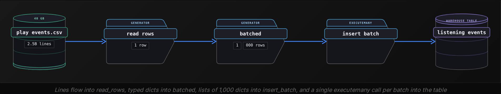

# Generators for Data Engineers: Beginner

Maya is in a data engineering loop at Spotify, and the coding round opens with a scenario. Yesterday's play events landed as one 40 GB CSV with 3 columns: user_id, track_id and ms_played. The worker that loads it has 2 GB of RAM. Write the function that gets every row into the warehouse table.
Her first line is `rows = list(csv.DictReader(f))`. The interviewer lets her finish, then asks a single question: how much memory does that line need? Maya does the arithmetic out loud and stops. The list would hold every row at once, and the worker would be killed long before the last one arrived.
She rewrites it with `yield`, streams the rows, groups them into batches of 1,000, and sends each batch as a single insert. The rest of the round tests why that works and where it stops working.


<br>

### What you will be able to do

Spot the phrases in an interview prompt that signal a memory-bound, single-pass problem

Predict exactly when a generator's body runs and pauses, and when it raises StopIteration

Choose between a list comprehension and a generator expression from what the consumer needs

Write a streaming CSV reader and batcher that load rows in fixed memory

Name the operations that force materialization and the smallest structure to hold for each


<br>

---

## Spotting Generator Trigger Words

Interviewers almost never say the word generator. They describe a constraint and wait to see whether you hear it. The constraint is nearly always memory: the data is bigger than the machine, or has no end, or arrives a piece at a time. When a prompt says any of that, the natural shape of the answer is a function that hands back a record and forgets it before fetching the next.


<br>

### Phrases that point to streaming

| Phrase in the prompt | What it tells you | Shape of the answer |
| --- | --- | --- |
| "the file is larger than memory" | A list of every row cannot exist on this machine | Yield rows from the file object |
| "process it line by line" / "in one pass" | Each record is needed once, in arrival order | A `for` loop over a generator |
| "constant memory" / "O(1) memory" | Peak memory must not grow with input size | Hold a single record or a fixed-size batch |
| "the log keeps growing" / "tail the stream" | The input has no last element | A generator that never returns |
| "fetch pages until the API returns none" | The total count is unknown up front | Yield each page's records as they arrive |
| "stop at the first bad row" | Most of the input may never be needed | Consume lazily and break early |
| "insert in batches of 1,000" | Rows travel in fixed groups | A batching generator around the reader |


<br>

### Do the memory arithmetic out loud

The trigger words matter because of a gap most candidates underestimate. A row on disk is a few bytes of text. The same row in Python is a dict plus a string object per field, each carrying its own reference count and type pointer on top of allocation overhead; only the column names are shared between rows. Multiply that by every row the file holds and compare it with the worker's RAM. Saying this calculation in the interview turns "I'd use a generator" from a reflex into a reason.

- **16 bytes** — one play-event line on disk
- **~400 bytes** — that line as a DictReader row
- **~1 TB** — the 40 GB file held as a list

*Check the middle figure with sys.getsizeof on a row dict and on each of its 3 value strings. The file's row count is its size divided by the line length: 2.5 billion.*

When the prompt gives no size, ask for one: "How big is the input, and how much memory does the worker have?" The answer can flip the design. A 200 MB file grows to roughly 5 GB as dicts, which a 16 GB laptop holds, so a list works there and can be inspected freely. The same code against the 40 GB export dies with an out-of-memory error long before the last row.


<br>

### The second test: one pass, in order

Size alone does not settle it. A generator walks forward once and keeps nothing it has already handed out, so it fits only when the work needs each record once, in the order the records arrive. Before committing, ask yourself a follow-up: does any output depend on a record I haven't read yet, or on one I have already discarded? If yes, a pure generator cannot produce it, and the last section of this lesson covers what to hold instead.

| ✓ Points toward a generator | ✗ Points toward holding data |
| --- | --- |
| • Input larger than RAM, read once<br><br>• Unbounded or still-growing input<br><br>• Results fed to a loop or a writer, or to sum and max<br><br>• Early exit after the first match<br><br>• Output written in fixed-size batches | • "Sort by", "rank", "top N overall"<br><br>• "Join" 2 large inputs<br><br>• "Deduplicate" across the whole file<br><br>• "Compare each row to the average"<br><br>• "Look up row 5,000" or call len() |


<br>

### Try it: classify 4 prompts

> Generator or not?
>
> - A 30 GB JSON-lines export must be validated, and the job writes failing line numbers to a report.
> - A service log grows all day; alert when 5 errors arrive within a 60-second window.
> - Produce the 10 longest sessions from a 30 GB sessions file.
> - Rank all users by total listening time and write the full ranking.

Answers: the first prompt streams, since each line is checked alone and only its number is kept. The service log in prompt 2 streams forever; keep the timestamps of the last 5 errors and drop older ones. For the 10 longest sessions, the input still flows through a generator, but a 10-item heap holds the leaders, so memory is 10 sessions. Ranking all users needs every user's total before the first rank is known, so the totals must be materialized, though that is a single number per user rather than a row per event.

> **TIP**
>
> Say the trigger back to the interviewer before coding: "The file is bigger than RAM and each row is needed once, so I'll stream it with a generator and batch the writes." That sentence shows you heard the constraint and already know the shape of the answer.


<br>

---

## What yield Actually Does

A function whose body contains `yield` anywhere is a generator function, and calling it does something different from calling an ordinary function: it runs none of the body. Python builds a generator object that holds the code, a frame for the local variables, and a position marker set before the first line. The body only starts when something asks the object for a value with `next()`.

Each `next()` resumes the body from where it last stopped and runs until it reaches a `yield`. The yielded value becomes the return value of `next()`, and the frame freezes with every local variable intact. When the body runs off its end or hits `return`, the next call raises `StopIteration` instead of returning. Watch the order of the printed lines in this run.

https://github.com/user-attachments/assets/b401562d-ad24-4a0c-8be4-8006ce69ad9c

*The body starts at the first next() and pauses at each yield*

| Call | Body lines that run | What the caller gets |
| --- | --- | --- |
| `gen = read_events()` | None | A generator object |
| 1st `next(gen)` | From the top to `yield "play"` | `"play"` |
| 2nd `next(gen)` | From after `yield "play"` to `yield "skip"` | `"skip"` |
| 3rd `next(gen)` | From after `yield "skip"` to `yield "pause"` | `"pause"` |
| 4th `next(gen)` | From after `yield "pause"` to the end | `StopIteration` is raised |
| 5th `next(gen)` | None, the body is finished | `StopIteration` again |


<br>

### State survives between values

Because the frame freezes instead of ending, local variables carry over from one value to the next. Here `total` accumulates across 3 resumptions with no class or global variable, and each yielded value includes every value before it.

```sql
def running_total(values):
    total = 0
    for v in values:
        total += v
        yield total


print(list(running_total([31000, 4000, 250000])))
```


<br>

### The body runs late, and so do its errors

Because nothing in the body runs at the call, a bug inside it stays hidden until the first value is requested. A generator that divides by a zero row count, or reads a missing CSV column, will be created without complaint and fail later, at whatever line first pulls from it. In a traceback, that failure points into the generator body, but the line that triggered it is the consumer's `for` loop or `next()` call, sometimes far from where the generator was built.

```sql
def parse(rows):
    for row in rows:
        yield int(row["ms_played"])


gen = parse([{"ms_played": "31000"}, {"ms": "4000"}])
print("created")
print(next(gen))
print(next(gen))
```

It prints `created`, then `31000`, then the 2nd `next(gen)` raises `KeyError: 'ms_played'`. The bad record was in the list from the start; the generator noticed it only when asked for it.


<br>

### Exhausted means empty, forever

A generator has no rewind. Once it raises `StopIteration`, every later `next()` raises it again, and every later `for` loop sees no items and finishes without an error, as do `list()` and `sum()`. That silence is what makes the bug dangerous in a pipeline: a second consumer quietly processes nothing.

```sql
def ids():
    yield 1
    yield 2
    yield 3


g = ids()
print(sum(g))
print(sum(g))
print(list(g))
next(g)
```

The first `sum` drains the generator and prints 6. The second finds it empty and prints 0, and `list(g)` prints `[]`. The bare `next(g)` on the last line has no loop around it to absorb the signal, so the program ends with a traceback whose final line is `StopIteration`.


<br>

### A for loop is next() with a catch

A `for` loop over a generator calls `iter()` on it, which returns the generator itself, then calls `next()` until `StopIteration` arrives and treats that as the normal end. That's why the same generator works in `for` and `list()` and just as well in `sum()` or `max()` or `",".join()`: all of them speak this protocol. To get a fresh stream, call the generator function again, which builds a new object starting from the top of the body.

> 3 facts to state in the interview
>
> - Calling a generator function runs none of its body and returns a generator object.
> - Each next() runs the body up to the next yield, then freezes it with locals intact.
> - After StopIteration the generator stays exhausted; a new stream needs a new call.


<br>

---

## Generator Expressions vs Lists

Swap the square brackets of a list comprehension for parentheses and you get a generator expression: the same `for` and `if` clauses, the same result values, and a completely different moment of evaluation. `[parse(s) for s in lines]` runs `parse` on every line before the assignment finishes. `(parse(s) for s in lines)` runs nothing until a consumer pulls, then runs `parse` once per pull.

https://github.com/user-attachments/assets/1b1273de-56c2-45b1-a6c7-fcdd434ae892

*The list parses every line up front; the generator parses on each pull*

The list comprehension parsed all 3 lines and failed on `"x"` before producing anything. The generator expression parsed a line per `next()` and never touched `"x"`, because nobody asked for a third value. That laziness is also why `any()` and `next()` over a generator expression stop early: `any(r["ms_played"] == "0" for r in rows)` stops reading at the first play of 0 ms.


<br>

### Choosing by what the consumer needs

| Need | List comprehension | Generator expression |
| --- | --- | --- |
| Container size for 1 million items | About 8 MB of pointers, plus the items | About 100 bytes, at any length |
| Index access like `xs[5]` | Yes | No, raises TypeError |
| `len(xs)` | Yes | No, raises TypeError |
| Iterate twice | Yes, same values both times | Second pass is empty |
| Inspect while debugging | Prints every element | Prints an address, no values |
| Stop early with `any()` or `break` | Every element was already built | Remaining elements are never built |
| Feed `sum()`, `max()`, `join()` once | Works, wastes memory | The natural fit |

Laziness has a price. Every item from a generator costs a resume of its frame, so for data that fits comfortably a list comprehension usually runs a little faster, and you can print or slice it while debugging, or read it a second time. The deciding questions are whether the input could ever be large and whether anything reads it twice.


<br>

### One generator expression, 2 consumers

The most common generator-expression bug in interviews is passing a single expression to 2 consumers. Predict what this prints, where `rows` is a list of play-event dicts.

```sql
rows = [{"ms_played": "31000"}, {"ms_played": "4000"}]
ms = (int(r["ms_played"]) for r in rows)
total = sum(ms)
count = sum(1 for _ in ms)
print(total / count)
```

No number is printed: `sum(ms)` drains the expression to 35000, the counting pass sees an empty stream and gets 0, and the division raises `ZeroDivisionError: division by zero`. The fix depends on the size. For a stream that must stay lazy, fuse both aggregates into a single loop that updates `total` and `count` together. For a few thousand rows, a list comprehension is the simpler choice, since it can be read as many times as needed.

```sql
rows = [{"ms_played": "31000"}, {"ms_played": "4000"}]
total = 0
count = 0
for r in rows:
    total += int(r["ms_played"])
    count += 1
print(total / count)
```


<br>

### Other one-shot iterators

Generator expressions are not alone in behaving this way. Several built-ins return lazy, one-shot iterators, and handing any of them to 2 consumers fails the same way.

| Object | Lazy | Second loop sees |
| --- | --- | --- |
| `(x for x in xs)` | Yes | Nothing |
| `map(int, xs)` | Yes | Nothing |
| `zip(a, b)` | Yes | Nothing |
| `csv.DictReader(lines)` | Yes | Nothing |
| `range(10)` | Yes | All 10 values again |
| `[x for x in xs]` | No | All values again |

Laziness and one-shot behaviour are separate properties, and `iter()` is where they split. `range(10)` is a sequence: each new `for` loop asks it for an iterator and receives a fresh one starting at 0, so it can be looped over any number of times. A generator hands back itself when asked for an iterator, so a second loop resumes the same object the first loop already drained. `map` and `zip` do the same, and so does `csv.DictReader`. Lazy describes when values are computed. One-shot describes whether each loop gets a new starting point.


<br>

### Syntax details that come up

- When a generator expression is the only argument, its parentheses can be dropped: sum(len(s) for s in lines).
- With a second argument the inner pair is required: sorted(r for r in rows, key=f) is a SyntaxError.
- print(gen) shows the object and its memory address, never the values; wrap it in list() only on small test data.
- A dict or set comprehension in braces is always eager; Python has no lazy brace form.

A frequent warm-up shows `total = sum([len(line) for line in lines])` and asks what you would change. The answer: drop the brackets, because `sum` reads each value once and the list exists only to be thrown away. Then state the condition under which you would keep it: the same lengths feeding a second calculation.

| ✓ Do | ✗ Don't |
| --- | --- |
| • Use a generator expression when the result is read once by sum or max, or by any or join<br><br>• Use a list when you need len(), indexing or a second pass<br><br>• Fuse aggregates into a single loop when the input must stay lazy<br><br>• Call list() on a generator only with small test data | • Pass one generator expression to 2 consumers<br><br>• Build a list only to pass it straight to sum()<br><br>• Print a generator to inspect it and expect values<br><br>• Assume a lazy stream raised its errors at creation |

> **TIP**
>
> A quick test for any comprehension you write: name its consumers. If there's exactly 1 and it reads front to back, use parentheses. If there are 2 or more, or any indexing, use brackets.


<br>

---

## The Large-File Streaming Pattern

Here is the full answer to the play-events question. It has 3 parts that never hold more than a batch: a reader that turns each CSV line into a typed dict, a batcher that groups dicts into lists of a fixed size, and a loader that sends each list in a single database call. In production the reader receives the open file object, which Python iterates line by line from a small read buffer, so the 40 GB never sits in memory at once.



```sql
import csv


def read_rows(lines):
    for row in csv.DictReader(lines):
        yield {
            "user_id": int(row["user_id"]),
            "track_id": row["track_id"],
            "ms_played": int(row["ms_played"]),
        }


def batched(rows, size):
    batch = []
    for row in rows:
        batch.append(row)
        if len(batch) == size:
            yield batch
            batch = []
    if batch:
        yield batch


def load(lines, insert_batch, size=1000):
    loaded = 0
    for batch in batched(read_rows(lines), size):
        insert_batch(batch)
        loaded += len(batch)
    return loaded
```

`read_rows` converts types at the edge, so every downstream stage sees ints, and a malformed line fails with its values in the traceback rather than deep in the loader. `batched` holds at most `size` rows. `load` never touches the file or an individual row, and it returns a count you can log and reconcile against the source's line count.

```sql
def make_insert_batch(conn):
    def insert_batch(batch):
        cur = conn.cursor()
        cur.executemany(
            "INSERT INTO listening_events (user_id, track_id, ms_played) "
            "VALUES (%s, %s, %s)",
            [(r["user_id"], r["track_id"], r["ms_played"]) for r in batch],
        )
        conn.commit()
    return insert_batch
```

This is the stage that touches the warehouse. The list comprehension turns each dict in the batch into a tuple in column order, and `executemany` sends all 1,000 tuples against a single statement. The `%s` markers are the driver's placeholders (some drivers use `?`), so the driver quotes every value and a track id containing a comma or quote can't break the SQL. The commit after each batch sets the retry unit: if batch 1,742 fails, the 1,741,000 rows before it are already committed, and only that batch's 1,000 rows need to be sent again.

Use the `csv` module even when the data looks plain. If an upstream system adds a quoted field such as `"Hello, World"`, it is 1 column to `csv.DictReader` and 2 to `line.split(",")`, which shifts every later field and hands `int()` text it rejects. Open the file with `newline=""` so quoted fields containing line breaks also parse correctly.

https://github.com/user-attachments/assets/efc9a6ad-9517-4792-99fe-6e25b4efb065

*7 rows in batches of 3: the final partial batch still reaches the table*


<br>

### Why memory stays flat

At any instant the program holds the current line, the dict built from it, and the batch being filled. When `batched` yields, the loader receives the list and inserts it, then drops its reference; `batch = []` gives the generator a new empty list, so the old one can be freed. Peak memory is about `size` rows no matter how many lines follow, which is what O(1) memory means here: constant with respect to file length, set by the batch size.

| Lines in the file | Rows held by list(DictReader) | Rows held by the streaming loader |
| --- | --- | --- |
| 10,000 | 10,000 | at most 1,000 |
| 10,000,000 | 10,000,000 | at most 1,000 |
| 2,500,000,000 | 2,500,000,000 | at most 1,000 |


<br>

### Choosing the batch size

Batching exists because each database call carries fixed overhead: every call pays for a network round trip and statement parsing before it commits. Inserting the 2.5 billion rows individually means 2.5 billion round trips; batches of 1,000 cut that to 2.5 million. Larger batches cut it further but raise peak memory and make each failure retry more rows. Values from a few hundred to a few thousand rows are a common starting point, tuned by measuring rows inserted per second.


<br>

### 2 bugs interviewers watch for

A batcher without the final `if batch: yield batch` drops the tail. A file of 7 rows with a batch size of 3 must produce 2 batches of 3 and a final batch of 1; without that line the last row is silently lost, and the row counts stop reconciling. A subtler bug hides in this version. Predict what it prints.

```sql
def batched_bad(rows, size):
    batch = []
    for row in rows:
        batch.append(row)
        if len(batch) == size:
            yield batch
            batch.clear()
    if batch:
        yield batch


saved = list(batched_bad(range(7), 3))
print(saved)
```

It prints `[[6], [6], [6]]`. `yield batch` hands out a reference to the same list object every time, and `batch.clear()` empties that object after the consumer has stored it. All 3 entries in `saved` point at a single list, which ends up holding only the last row. Rebinding with `batch = []` creates a new list per batch and leaves the yielded ones untouched. With a loader that inserts each batch before asking for the next, the bad version happens to work, which is why the bug survives review and appears the day someone collects batches with `list()` to retry them later.

> What a complete answer covers
>
> - Reader yields typed dicts from csv.DictReader over the file object
> - Batcher holds at most size rows and yields the final partial batch
> - Each batch goes to the database in a single executemany call
> - Peak memory stated as O(batch size), with the batch size named
> - Loaded row count returned and compared with the source line count

> **TIP**
>
> State the memory bound with its unit: "peak memory is O(batch size), about 1,000 rows, independent of file length." Then name the knob you would tune and the metric you would watch: rows inserted per second.


<br>

---

## When Generators Are Wrong

A generator delivers each record once and in arrival order, then lets it go. Some questions cannot be answered under those terms, because the first correct output depends on a record that hasn't arrived yet or on a record already gone. For those operations, something has to be held in memory. The skill is choosing the smallest structure that answers the question, and saying out loud what it costs.


<br>

### Sorting reads everything before answering

`sorted()` accepts a generator, and that hides the cost: it pulls every value into a new list before it can return the smallest, because the last line of the file might hold it. This run shows the order of events, then a second operation that needs 2 passes.

https://github.com/user-attachments/assets/357d63cd-5ce5-40b6-b995-742a37f892a8

*sorted reads every value first; comparing to the mean needs a second read*

All 3 reads finish before `sorted` produces its first value, so the sort holds the whole input. The second half counts plays longer than the mean. That needs 2 passes, since no row can be judged until the mean is known, and the mean is known only after the last row. An average alone fuses into a single loop; this comparison cannot. Calling `events()` again re-reads the source, which works for a file at the price of reading it twice, while holding the values in a list avoids the second read at the price of memory.


<br>

### The operations that need held data

| Operation | Why a forward pass fails | Smallest thing to hold |
| --- | --- | --- |
| Full sort or rank | The last row may come first in the output | Every row, or push the sort to the database |
| Top 10 by a value | Any later row may enter the top 10 | A 10-item heap via `heapq.nlargest(10, gen)` |
| Join on a key | A match may sit anywhere in the other input | A dict of the smaller input, keyed for lookup |
| Deduplicate | A repeat can appear at any later point | A set of keys already seen |
| Count distinct users | Same as dedup, per key | A set of user ids, never full rows |
| Median | Its position depends on the total count | Every value, or an approximate sketch |
| Compare each row to the mean | The mean needs the last row first | A second read, or the values in a list |
| `len()`, `rows[5000]` | A generator has no length or index | A list, or a running counter |


<br>

### Joins: hold the small side, stream the big one

The common case in data engineering is a large event stream joined to a small dimension. Build a dict from the small side once, then stream the large side and look up each record as it passes. Memory is the size of the dict, so 50,000 tracks cost a few megabytes while the 2.5 billion events still flow through a record at a time.

```sql
tracks = {"trk_9": "Intro", "trk_4": "Outro"}


def enrich(events, tracks):
    for event in events:
        title = tracks.get(event["track_id"], "unknown")
        yield {**event, "title": title}


events = [
    {"user_id": 101, "track_id": "trk_9"},
    {"user_id": 102, "track_id": "trk_7"},
]
for row in enrich(iter(events), tracks):
    print(row)
```

When both inputs are large, neither fits in a dict. Load both into the warehouse with the streaming loader and let the database join them: it can spill to disk and spread the work across machines, which a single Python process cannot.

```sql
SELECT
  e.user_id,
  t.title,
  e.ms_played
FROM listening_events AS e
JOIN tracks AS t
  ON e.track_id = t.track_id
```

| ✓ Stream it | ✗ Hold something |
| --- | --- |
| • Filter rows, or validate and convert each one<br><br>• Running totals and counts, or min and max<br><br>• Enrich against a small lookup dict<br><br>• Write rows out in fixed batches | • Sorting or ranking, or a median: every value<br><br>• Top N: N items in a heap<br><br>• Dedup or distinct: a set of keys<br><br>• Large-to-large join: load first, join in SQL |


<br>

### Try it: what does each job hold?

> Name what must be held
>
> - Find users whose first play of the day was a skip, from a file sorted by timestamp.
> - Find users whose first play was a skip, from an unsorted file.
> - Report the 5 most-played tracks from 2.5 billion events.
> - Drop events whose (user_id, track_id, timestamp) already appeared earlier in the file.

In order: a set of users already seen, since a file sorted by timestamp delivers each user's first play before any other. For the unsorted file, a dict holding each user's earliest timestamp and whether that play was a skip, because a later row may carry an earlier time. For the top 5, a dict of play counts per track, then a 5-item heap over it; that dict is bounded by the number of tracks, never by the number of events. Dedup needs a set of every key seen, which grows with distinct events, so at 2.5 billion rows it belongs in the database.

> **TIP**
>
> When a prompt asks for a sort or a join, or for distinct values or a median, say what you would hold and how big it gets before writing code. "I'll stream the events and hold a dict of track counts, bounded by the 50,000 tracks" is a complete answer to the memory question.


<br>

---

## Putting It All Together

A music streaming service exports each day's play events as a CSV of user_id, track_id and ms_played, tens of gigabytes per day. A worker with 2 GB of RAM must load the file into the warehouse before the morning reports run, enrich each event with its track title from a 50,000-track catalog, and publish the 5 most-played tracks of the day.

- The file size and the worker's RAM are the trigger words: a list of dicts would need around 25 times the file's size, so the rows must stream.
- read_rows runs only as the loader pulls, so a malformed line surfaces mid-load with its values in the traceback instead of at the call.
- Each stage feeds a single consumer once, so generator expressions fit inside it, while the track catalog is a dict built once and read for every event.
- batched keeps memory at 1,000 rows and must yield its final partial batch and rebind a new list, or the loaded count stops matching the source.
- The top-5 report holds a dict of counts per track and a 5-item heap, and the title join holds only the catalog, so neither forces the events into memory.


<br>

---

## Key Takeaways

- Memory trigger words (bigger than RAM, line by line, constant memory, unbounded) plus a single-pass need point to a generator.
- Calling a generator function runs nothing; each next() runs to the next yield; an exhausted generator stays empty and a loop over it ends silently.
- Parentheses make a lazy, one-shot generator expression; brackets make a reusable list with len() and indexing.
- The streaming loader is a reader generator, a batcher that yields its final partial batch and rebinds a new list, and a loader making a call per batch.
- Sorting and dedup need held data, as do large joins and comparisons against a whole-dataset value; hold the smallest structure that answers the question.
