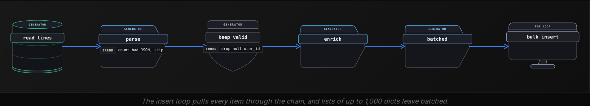

# Generators for Data Engineers: Intermediate

Ingrid is 40 minutes into a data engineering loop at Netflix when the interviewer shares a prompt. A day of playback events lands as a single compressed log, far larger than the 512 MB container the job gets. Parse every line, drop malformed records, tag each event with a region, divert rejects to a quarantine table, and insert the rest in batches of 1,000. She starts typing `rows = [json.loads(line) for line in f]` and stops. The follow-ups come quickly. What does this job hold in memory at its peak? What happens when the database slows to half speed? How would you route the stream to 3 destinations without reading it 3 times? Every answer comes from the same machinery: generator stages that pull a record at a time, itertools functions that keep that promise or quietly break it, and coroutines that accept records instead of producing them.


<br>

### What you will be able to do

Build a pipeline from 5 generator stages that read and parse lines, filter and enrich records, then batch them, and state its peak memory as a number

Predict the output and memory cost of chain.from_iterable and islice on a given stream, then do the same for tee and groupby

Prime and drive a send()-based router that feeds separate sinks, and explain the TypeError raised when priming is skipped

Explain how a pull pipeline produces backpressure, and choose a buffer policy for a push source

Use yield from to delegate send() and throw() to a subgenerator and capture its return value


<br>

---

## Generator Pipeline Composition

Interviewers rarely say the word generator. They say the log is 40 GB, the container has 512 MB, or the export triples every year. Each version asks for an ETL step whose peak memory is set by its batch size. The structure that gives it is a chain of small generator functions, each consuming an iterable and yielding a new one, ending in a batcher that feeds bulk inserts.


<br>

### A contract shared by every stage

Each stage takes any iterable as its first argument and yields records. That contract is what makes the stages independent: parse sees the same lines whether they come from a file handle or a test list, and a socket or a decompressor looks no different, so each stage can be tested alone with 3 hand-written lines. Side information, such as a counter of rejected lines or a lookup table, enters as an extra argument, which keeps every stage free of globals.

```sql
import json


def read_lines(source):
    for line in source:
        line = line.strip()
        if line:
            yield line


def parse(lines, stats):
    for line in lines:
        try:
            yield json.loads(line)
        except json.JSONDecodeError:
            stats["bad_json"] += 1


def keep_valid(records):
    for rec in records:
        if rec.get("user_id") is not None and rec.get("ms", 0) > 0:
            yield rec


def enrich(records, region_of):
    for rec in records:
        rec["region"] = region_of.get(rec.get("country"), "other")
        yield rec


def batched(records, size):
    batch = []
    for rec in records:
        batch.append(rec)
        if len(batch) == size:
            yield batch
            batch = []
    if batch:
        yield batch
```

Wiring them is nested calls, innermost stage first. Assigning pipeline executes none of their code: 5 generator objects exist, each paused before its first line. The for loop's first next() reaches batched, which pulls from enrich. That pull goes on to keep_valid and keeps going down until read_lines reads from the list.

```sql
raw = [
    '{"user_id": 7, "ms": 5400, "country": "BR"}',
    'not json',
    '{"user_id": null, "ms": 90, "country": "US"}',
    '{"user_id": 9, "ms": 1200, "country": "JP"}',
    '{"user_id": 4, "ms": 300, "country": "US"}',
]
stats = {"bad_json": 0}
regions = {"BR": "latam", "US": "na"}

pipeline = batched(
    enrich(keep_valid(parse(read_lines(raw), stats)), regions),
    size=2,
)
for batch in pipeline:
    print(len(batch), [r["region"] for r in batch])
print(stats)
```

Predict the 3 printed lines before reading on. The output is 2 ['latam', 'other'], then 1 ['na'], then {'bad_json': 1}. The not json line is counted and skipped, the null user_id is filtered out, and Japan has no entry in regions, so it falls back to other. The last valid record arrives as a batch of 1 because batched flushes whatever remains when its input ends. Delete that final if batch: and the last record is never loaded, with no error, which is the most common bug in hand-written batchers.


<br>

### Depth-first: each record travels the whole chain

The animation swaps parsing for arithmetic and logs each stage's work in trace. Value 2 is not read at all until value 1 has passed the filter. Value 2 becomes 20, and keep drops it before it reaches the batcher. Each stage holds only its current item, except batched, which holds up to size.

https://github.com/user-attachments/assets/36a9d575-7a3a-496d-98b3-001647ff15ad

*Each value clears the filter before the next value is read*


<br>

### The number to say out loud

Suppose the log holds 20 million playback events at about 2 KB of Python objects per parsed dict. With a batch size of 1,000, the pipeline holds the current batch, a dict in flight inside each earlier stage, and the region lookup table. The input size appears nowhere in that sum, so the same code runs unchanged when the log doubles.

- **~2 MB** — peak held by a 1,000-record batch
- **~40 GB** — the same events parsed into a list


<br>

### Where the stream breaks

Changes that turn O(batch_size) into O(n)

- **A materializing call in the middle** *list(), sorted(), set()*\
  Any of these on an intermediate stage reads the entire input before passing anything on. Memory jumps to the input size, and the first insert waits for the last line.
- **Asking a stage for its length** *len()*\
  A generator has no length: len(parse(lines, stats)) raises TypeError: object of type 'generator' has no len(). Count records as they pass, in a stats dict.
- **Looping over the same chain twice** *single pass*\
  A second for loop over pipeline finds every stage exhausted and never enters its body, with no error. Wrap the wiring in a function and call it again to rerun.

#### The batcher that reuses its list

```sql
def batched_clear(records, size):
    batch = []
    for rec in records:
        batch.append(rec)
        if len(batch) == size:
            yield batch
            batch.clear()
    if batch:
        yield batch


kept = list(batched_clear(range(5), 2))
print(kept)
```

It prints [[4], [4], [4]]. The batcher yields the same list object each time, and clear() empties it once the consumer has it. A consumer that inserts each batch before asking for the next never notices, so the tests pass. The bug surfaces when someone adds a retry buffer, collects batches with list(), or hands them to a worker thread. Binding a fresh list with batch = [] costs a single allocation per 1,000 records and removes the shared object.




<br>

---

## Core itertools Functions

The follow-ups test whether you can extend the pipeline with the standard library without slipping a full copy of the data back in. Most land on 4 functions from itertools, each with a memory cost its name hides.

| Function | What it yields | Memory it holds | The trap |
| --- | --- | --- | --- |
| `chain.from_iterable(outer)` | Items of each inner iterable, in order | A single inner iterator at a time | `chain(\*outer)` runs the outer iterable to the end first |
| `islice(it, start, stop)` | A lazy slice by position | O(1) | Skipped items are still pulled; the source advances |
| `tee(it, 2)` | 2 independent iterators over the same items | Every item between the leading and trailing copy | A copy that finishes first leaves the whole stream buffered |
| `groupby(it, key)` | A (key, group) pair per run of equal keys | O(1) per group while streaming | Unsorted input repeats keys; old groups go empty |


<br>

### chain.from_iterable versus chain(\*outer)

A backfill often reads a partition per day: partitions() yields an iterator for each day, and the caller wants a flat stream. Both chain(\*partitions()) and chain.from_iterable(partitions()) produce the same rows. Unpacking with \* happens before chain is called, so Python runs the outer generator to the end to build the argument tuple. If creating each inner iterator opens a file or a connection, a year of partitions means 365 open handles before the first row is read.

```sql
from itertools import chain

opened = []


def partition(name):
    opened.append(name)
    return (f"{name}:{i}" for i in range(2))


def partitions(names):
    for name in names:
        yield partition(name)


lazy = chain.from_iterable(partitions(["d1", "d2", "d3"]))
print(next(lazy), opened)

eager = chain(*partitions(["e1", "e2", "e3"]))
print(next(eager), opened)
```

The first line prints d1:0 ['d1']: the lazy chain has opened the partition it is reading and no other. The second prints e1:0 ['d1', 'e1', 'e2', 'e3'], because unpacking called partition for all 3 days before chain saw any of them. Use from_iterable whenever the outer iterable is itself a generator.


<br>

### islice: lazy slicing that still reads

islice(it, start, stop) returns the items from position start up to stop without building a list, so islice(stream, 5) safely samples a 20-million-line input. Being a view over a single iterator has 2 consequences. Skipped items are still produced: islice(stream, 1_000_000, 1_000_010) pulls and discards 1,000,000 records through every upstream stage. And whatever islice consumed is gone for the next reader of the same iterator.

```sql
from itertools import islice

rows = iter(["id,ms", "1,500", "2,900", "3,40", "4,700"])
header = next(rows)
first_two = list(islice(rows, 2))
print(header, first_two, list(rows))
```

Predict the output first. It prints id,ms ['1,500', '2,900'] ['3,40', '4,700']. next and islice consumed the header and 2 rows, so list(rows) gets only the rest: code that samples a stream with islice and then passes it on has removed the sample from the load. Negative positions are refused: islice(rows, -2, None) raises ValueError, because the last 2 items cannot be found without buffering everything before them.


<br>

### tee and its hidden buffer

tee(it, 2) returns 2 iterators over the same items. Each item pulled by the leading copy is stored until the trailing copy has read it too, so the memory cost is the gap between them. When the copies advance together, as inside zip(a, b), the buffer holds a single item. When a copy runs to the end before the other starts, the buffer holds the entire stream.

```sql
from itertools import tee

events = ({"ms": ms} for ms in [500, 900, 40, 700])
for_count, for_load = tee(events, 2)

n = sum(1 for _ in for_count)
loaded = [e["ms"] for e in for_load]
print(n, loaded)
```

It prints 4 [500, 900, 40, 700], correct output with the worst memory profile: when sum finishes, tee is holding all 4 events for for_load. The Python documentation notes that when one iterator uses most of the data before another starts, list() is faster than tee(). For 20 million events the better answer is a single loop that counts and loads in the same pass. After calling tee, read only from the copies, since pulling from events directly takes items neither copy will see.


<br>

### groupby groups adjacent runs

groupby starts a new group each time the key changes between neighbouring items. It does no sorting and remembers no keys it has passed, which is what lets it stream. The animation runs it over clicks from 3 users in arrival order, then over the sorted clicks, then stores the groups before reading them.

https://github.com/user-attachments/assets/395e8c5b-7d88-46ec-80f5-e63182b63eb0

*groupby splits on every key change and invalidates groups it has moved past*

u1 appears twice in the first result because a u2 click splits its run. Sorting fixes the counts at the cost of a full materialization, the same O(n) step a list takes. The third print shows every group empty: advancing groupby to the next key invalidates the previous group, so read each group inside the loop or copy it with list(group) first.

> **TIP**
>
> `groupby` streams only when the input arrives clustered by key, such as rows exported in `user_id` order. Ask the interviewer whether the source is ordered: the answer chooses between `groupby` at O(1) per group and a dict of running totals at O(distinct keys).


<br>

---

## Coroutines with send()

A generator pipeline has one output stream, and requirements often need more: valid rows to the warehouse table, unparseable rows to a dead-letter table, events older than the load window to a backfill job. The interview version is 'route this stream to 3 destinations without reading it 3 times'. A coroutine turns the generator around, so the caller sends records in instead of receiving them as yielded values.


<br>

### yield as an expression

Inside a generator, yield is an expression whose value is whatever the caller passes in. gen.send(value) resumes the paused generator, makes the paused yield evaluate to value, runs to the next yield, and returns the value that yield produces. next(gen) behaves the same as gen.send(None).

```sql
def running_total():
    total = 0
    while True:
        amount = yield total
        total += amount


acc = running_total()
print(next(acc))
print(acc.send(40))
print(acc.send(2))
```

0 comes out first, then 40, then 42. The first next runs to yield total and returns 0 without consuming input. Each send delivers an amount to the paused yield. The coroutine adds it to the total and returns the new total from the following yield. So every send is a round trip: a value goes in and a value comes out.


<br>

### Priming, and the traceback when it is skipped

```sql
def sink():
    while True:
        row = yield
        print("got", row)


s = sink()
s.send({"id": 1})
```

The last line raises a TypeError saying a non-None value cannot be sent to a generator that has not started. A new generator object has not executed its first line, so no yield is paused waiting to receive the dict. Priming means calling next(s) once to run the coroutine up to its first yield. A decorator can do it at construction so that no caller forgets.

```sql
import functools


def primed(func):
    @functools.wraps(func)
    def start(*args, **kwargs):
        gen = func(*args, **kwargs)
        next(gen)
        return gen
    return start
```

Predict what s = sink(), then print(next(s)), then print(s.send(7)) produce. The first print shows None, the value of the bare yield that priming reached. The send prints got 7 from inside the coroutine, then the outer print shows None again, because the loop came back to a bare yield. A sink that yields nothing returns None from every send, so the router has no result to inspect.


<br>

### Routing records to separate sinks

The router inspects each record and sends it on to a sink coroutine. Each sink here appends to a list, where production would hold a batching writer or a dead-letter client. The rules: a record with no ms field goes to dead letter, a day before the load window's cutoff of 26 goes to backfill, and everything else goes to the warehouse.

https://github.com/user-attachments/assets/101e8cac-7615-4008-bce9-fb1340ee58f4

*Each send finishes in exactly one sink before the next record is routed*

The final line prints [1, 4] [2] [3]. Record 2 has no ms field, so dead letter receives it; record 3 is from day 24, before the cutoff, so backfill gets it. Each router.send returns only after the chosen sink has appended, so a record is fully handled before the loop takes the next one. The same blocking means a slow dead-letter client slows every route, including the warehouse route, until it returns.


<br>

### Sinks that keep state

Routing could be an if-chain inside the consumer loop. The coroutine form pays off when a sink holds state between records, such as a buffer that flushes every 1,000 rows. The sink owns its buffer, the router knows nothing about it, and adding a destination means adding a sink. No record marks the end of input unless the caller sends a signal, and a sentinel is the simplest one, so this sink flushes when it receives None. Calling close() on the coroutine is the other way to end it, covered in the advanced tier.

```sql
def batch_sink(size, flushes):
    batch = []
    while True:
        rec = yield
        if rec is not None:
            batch.append(rec)
        if batch and (rec is None or len(batch) == size):
            flushes.append(batch)
            batch = []


flushes = []
sink = batch_sink(2, flushes)
next(sink)
for rec in ["a", "b", "c", None]:
    sink.send(rec)
print(flushes)
```

This prints [['a', 'b'], ['c']]. Without the None at the end, record c would sit in the buffer forever: the lost-final-batch bug again, moved from a batcher to a sink.

> **TIP**
>
> When you write `x = yield` on a whiteboard, add the priming `next()` call in the same breath. Interviewers who ask about coroutines are usually checking for that `TypeError`.


<br>

---

## Pull-Based Backpressure

This question arrives disguised as a rate mismatch: the source can produce 10,000 events per second, the database accepts 4,000, so what happens to memory? For a generator pipeline, nothing. The reader slows to 4,000 events per second, and no record waits anywhere except inside the current batch.


<br>

### The consumer decides the pace

In for batch in pipeline: insert(batch), the loop asks batched for a value and batched asks enrich in turn, so the requests travel down to read_lines. While insert runs, every generator in the chain is suspended at a yield and executes nothing, so no line is read. Backpressure is the mechanism by which a slow consumer slows its producer, and here the call stack provides it: a producer that runs only when called cannot outrun its caller. There is no queue to size, no high-water mark and no setting to tune.


<br>

### Push needs somewhere to put the surplus

In a push system the producer decides when data moves: a socket delivering bytes, a webhook endpoint, a reader thread putting rows into a queue, a client library invoking a callback per message. Data arrives whether the consumer has finished. The animation simulates 4 ticks in which the producer emits 3 items per tick and the consumer handles 2, first with an unbounded buffer, then with a buffer capped at 2 items, then with a pull loop.

https://github.com/user-attachments/assets/b651e8ac-7e2c-4bf2-86d5-36ae36ba385e

*Producer emits 3 items per tick, consumer handles 2*

The unbounded buffer grows by 1 item per tick and never shrinks. The capped deque stays small by discarding its oldest item without any error, losing 1 item per tick. The pull loop reads exactly 2 items per tick, so it never buffers and never drops, ending at read up to 8 after 4 ticks.

Scale the unbounded case to the interview prompt: 10,000 events per second arriving, 4,000 per second inserted, a database that stays slow for 10 minutes, and 2 KB per parsed event.

- **3.6M** — events waiting after 10 minutes
- **~7.2 GB** — memory held by that backlog

| Push policy | At 10,000 in and 4,000 out | What it costs |
| --- | --- | --- |
| Unbounded buffer | Grows by 6,000 events per second | Memory until the process is killed |
| Bounded, block the producer | Producer waits whenever the buffer is full | Works only if the producer can pause |
| Bounded, drop | 6,000 events per second discarded | Data loss that nothing reports by default |
| Upstream flow control | Source throttled to 4,000 per second | Needs a source with acknowledgements or credits |

#### send() chains still block

A send()-based router looks like push, yet in a single thread it keeps the backpressure. router.send(rec) returns only after the sink has finished with the record, so the loop feeding the router waits for the slowest sink. The surplus problem starts when something that does not block sits between producer and consumer: an unbounded queue, a callback fired by a network library, a thread handing off work.


<br>

### What free backpressure costs

A single-threaded pull pipeline never overlaps its stages. Say parsing costs 20 microseconds per record, so 20 ms per 1,000-record batch, and the bulk insert takes 50 ms per batch. Each batch then takes 70 ms end to end, roughly 14,300 records per second. Moving the read and parse into a thread that fills a queue bounded at 4 batches lets parsing run while the insert waits on the database. The batch time drops to the slower stage, 50 ms, which is 20,000 records per second, and memory grows from 1 batch to at most 6: 4 queued, 1 in the insert, and 1 finished by a producer waiting for queue space. That bound is what keeps the backpressure: a producer thread blocked on a full queue is the pull model rebuilt by hand.

Try the same arithmetic with a slower database, 100 ms per batch insert. Serial stages take 120 ms per batch, about 8,300 records per second. The overlapped version is bound by the insert at 100 ms, 10,000 records per second. The gain from threading shrinks as a single stage dominates, which is the argument for staying with a plain pull pipeline when the sink is the bottleneck.

| ✓ Pull: generator chain | ✗ Push: callbacks and queues |
| --- | --- |
| • The consumer's next() call starts every unit of work<br><br>• Memory fixed at a batch plus an item per stage<br><br>• Backpressure from the call stack, nothing to configure<br><br>• Stages run serially, so times add up<br><br>• A failure surfaces in the consumer's stack trace | • The producer's arrival rate starts the work<br><br>• Memory set by the buffer policy you chose<br><br>• Backpressure only if the buffer blocks or the source throttles<br><br>• Stages overlap, so the slowest sets throughput<br><br>• A failure on another thread must be passed back |

> **TIP**
>
> State the trade in a sentence: pull gives bounded memory and automatic backpressure at the price of serial stages, and push gives overlap at the price of a buffer policy you must choose. Then give both numbers, 14,300 and 20,000 records per second.


<br>

---

## yield from: Generator Delegation

Delegation questions arrive as refactors: 'split this 80-line coroutine into smaller pieces', or 'flatten these partitions and report the bad-row count for each'. Both need an outer generator that hands control to an inner one and gets a result back when it finishes. The keyword pair for that handoff is `yield from`.

What a yield from expression does

- Yields every value sub yields, straight to whoever is iterating the outer generator.
- Forwards send(value) and throw(exc) from the outer caller to the yield paused inside sub.
- Sets result to the value sub returns, which a for loop would discard.
- Starts sub itself, running it to its first yield when delegation begins, so the subgenerator needs no priming.


<br>

### Capturing a return value

```sql
def read_partition(lines):
    bad = 0
    for line in lines:
        if line.count(",") != 1:
            bad += 1
            continue
        yield line
    return bad


def read_all(partitions, stats):
    for name, lines in partitions:
        stats[name] = yield from read_partition(lines)


parts = [("d1", ["1,500", "bad", "2,900"]), ("d2", ["3,40,x", "4,700"])]
stats = {}
print(list(read_all(parts, stats)))
print(stats)
```

It prints ['1,500', '2,900', '4,700'] and {'d1': 1, 'd2': 1}. The return bad inside a generator ends iteration and travels inside the StopIteration that signals the end. A for loop catches that exception and drops the value; yield from hands it back as the value of the expression. Mind the timing: stats['d1'] is assigned only after partition d1 is exhausted, so a consumer that stops early never sees that count.


<br>

### Delegating a coroutine

With coroutines, delegation lets each piece own a single job. In the animation, batch_summary accumulates play times until it receives None, then returns a count and a total. per_user receives a user id, delegates to a fresh batch_summary, and stores what it returns. Watch which frame receives each sent value.

https://github.com/user-attachments/assets/80981460-d9fe-4e40-8802-95dddaf5405d

*Sends to agg land inside batch_summary until it returns*

It prints {'u1': (2, 1400), 'u2': (1, 40)}. The values 500 and 900 never pass through any line of per_user, and neither does 40: each agg.send goes directly to the paused yield inside batch_summary. A single next(agg) primed the outer coroutine, and yield from started each batch_summary itself.


<br>

### The for loop that looks equivalent

```sql
def per_user_loop(summaries):
    while True:
        user = yield
        for value in batch_summary():
            yield value
```

| Item sent | With yield from | With the for loop |
| --- | --- | --- |
| `"u1"` | `per_user` takes it as the user | `per_user_loop` takes it as the user |
| 500 | `batch_summary` counts it | Discarded by `yield value`; the inner coroutine ends at `(0, 0)` |
| 900 | `batch_summary` counts it | Taken as the next user |
| `None` | `batch_summary` returns `(2, 1400)` | Discarded; the inner coroutine ends at `(0, 0)` |
| `"u2"` | `per_user` takes it as the user | Taken as the user |
| 40 | `batch_summary` counts it | Discarded; the inner coroutine ends at `(0, 0)` |
| `None` | `batch_summary` returns `(1, 40)` | Taken as the user |

Each sent value lands on the outer yield value, which discards it, while the inner coroutine receives None from the loop's own next() call and ends at once with (0, 0), a result the loop also drops. summaries stays empty, no exception is raised, and 900 is treated as a user id.


<br>

### throw() reaches the subgenerator

```sql
class BadRecord(Exception):
    pass


def counter():
    seen, skipped = 0, 0
    while True:
        try:
            yield seen, skipped
            seen += 1
        except BadRecord:
            skipped += 1


def outer():
    yield from counter()


gen = outer()
next(gen)
print(next(gen), gen.throw(BadRecord), next(gen))
```

It prints (1, 0) (1, 1) (2, 1). gen.throw(BadRecord) is called on outer, but the exception is raised at the paused yield inside counter, which catches and counts it before yielding again, so outer never sees it. Had counter not caught it, the exception would have propagated out through outer to the caller, as if outer had raised it. A driver can therefore inject a skip signal into the stage that owns the counters, and the delegating generator needs no handler of its own.

yield from read_partition(lines) gives the same rows as chain.from_iterable when only the flat stream matters. Reach for yield from when the subgenerator returns something you need, when the caller will send() or throw() into the pipeline, or when the outer generator must do work between subgenerators, such as writing a per-partition log line.

> **TIP**
>
> Describe `yield from` as 3 channels. Values flow out, while `send()` and `throw()` flow in the other direction. The third channel carries the return value back when the subgenerator ends. A `for` loop keeps only the first channel.


<br>

---

## Putting It All Together

A subscription video service rebuilds its daily viewing-hours table from 24 hourly log partitions. The job runs in a 512 MB container, loads valid events into the warehouse in batches of 1,000, sends unparseable lines to a dead-letter table, and routes events older than the load window to a backfill job. The warehouse slows down during its maintenance window, and the on-call engineer wants each partition's bad-line count in the job log.

- The outer reader delegates to each hourly partition with yield from , so a single partition is open at a time and each returns its bad-line count for the log.
- parse is an independent generator stage, as are keep_valid and enrich , and each can be tested with 3 hand-written lines.
- A primed router coroutine sends each record to the warehouse batch sink, the dead-letter sink or the backfill sink, and a None sentinel flushes the partial batches at the end.
- During the maintenance slowdown every send ( ) waits on the warehouse sink and every stage waits at its yield , so memory stays near 2 MB of batch instead of building a backlog.
- If the job must finish faster, a parsing thread with a queue bounded at 4 batches overlaps parsing with inserts and holds at most 6 batches: 4 queued, 1 in the insert and 1 waiting with the producer.
- A per-user summary can use groupby only if a partition arrives ordered by user; otherwise a dict of running totals is the streaming answer.


<br>

---

## Key Takeaways

- A generator pipeline's peak memory is batch size times record size plus an item per stage; any list ( ) in the middle replaces that with the input size, and so does a sorted ( ) or set ( ) .
- A batcher must bind a fresh list for each batch and flush the final partial batch.
- chain . from_iterable stays lazy over a generator of iterators, while chain ( \* gen ) creates every inner iterator first.
- islice still pulls what it skips, tee buffers the gap between its copies, and groupby streams only over input clustered by key.
- A send ( ) coroutine must be primed to its first yield ; sending first raises TypeError .
- Pull pipelines get backpressure from the call stack; push sources need a chosen buffer policy, and overlapping stages costs a bounded queue.
- yield from passes values out and forwards send ( ) and throw ( ) in, then evaluates to the subgenerator's return value.
