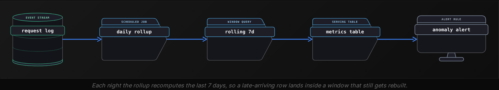

# Sliding Window: Beginner

Maya is 3 interviews into the day at Stripe, which has written publicly about the rate limiters guarding its API, and the interviewer draws a list on the whiteboard: per-second request counts for one merchant key over an hour. "Return the largest number of requests this key made in any 60-second stretch." She writes the nested loop first, 3,541 windows of 60 counts each, and the interviewer nods and asks for a faster version. Maya pauses at the whiteboard, looks at 2 neighbouring windows, and notices they share 59 of their 60 values. One count enters, one leaves, and the running total moves with them. Twenty minutes later she has the fixed window, the edge cases, and the variable-width version for "the shortest stretch that exceeds 1,000 requests". This lesson is that twenty minutes, slowed down enough to see every move.


<br>

### What you will be able to do

Recognize a sliding window prompt from its wording and decide whether the width is fixed or variable

Implement the add-subtract loop for fixed windows with the leaving index proven, not guessed

Choose a window state that updates in constant time on entry and exit, including a frequency dictionary with deletes

Write the expand-contract loop for shortest and longest variable windows and explain why it is O(n)

Map the array versions to rolling metrics, rate limits and late-data rebuilds in a pipeline


<br>

---

## Spotting the Pattern

### The sentence that gives it away

A sliding window problem asks about every contiguous run of elements in a list or string and wants a single answer that summarizes those runs: the largest sum of any 3 consecutive values, the shortest stretch whose total reaches a target, the number of distinct characters inside each run of length k. The word doing the work is contiguous. The elements in a run sit next to each other, so moving the run 1 step to the right drops exactly 1 element and picks up exactly 1 element, while everything between them stays. That overlap is what the pattern exploits: the answer for the next window comes from the answer for the current one in constant time, with no need to look at the shared elements again.


<br>

### Why recomputing is too slow

Take `nums = [2, 1, 5, 1, 3, 2]` with `k = 3`. There are 4 windows of width 3, and summing each one on its own touches 3 elements per window, 12 additions in total.

| Window | Elements | Sum | Additions |
| --- | --- | --- | --- |
| 0 | [2, 1, 5] | 8 | 3 |
| 1 | [1, 5, 1] | 7 | 3 |
| 2 | [5, 1, 3] | 9 | 3 |
| 3 | [1, 3, 2] | 6 | 3 |

Twelve additions costs nothing. The gap opens at scale. A list of 1,000,000 per-second request counts with a window of 1,000 seconds holds 999,001 windows, and the from-scratch version pays the full width on every one of them, while the sliding version pays 1 addition and 1 subtraction per step however wide the window is. That ratio is what an interviewer is pointing at when they ask "can you do better?" after you propose the nested loop, and the answer they want names the shared elements.

- **1,000,000,000** — additions when summing from scratch
- **2,000,000** — operations carrying the sum forward

```sql
def max_window_sum_slow(nums, k):
    best = None
    for start in range(len(nums) - k + 1):
        total = sum(nums[start:start + k])
        if best is None or total > best:
            best = total
    return best
```


<br>

### Fixed or variable: the first decision

Before writing a line, decide whether the window width is fixed or variable, because the 2 shapes use different loops. The prompt tells you. "Of size k", "every 7 days" and "any 3 consecutive" fix the width: the window moves 1 step per iteration and never changes size. "Shortest", "longest", "at most" and "at least" leave the width to the data: the window grows until a condition holds and shrinks when it stops holding, and the answer is a width or a value measured at a width. Mixing up the 2 shapes, by forcing a shortest-run prompt into a loop over fixed widths, is the most common way a candidate stalls.

| Prompt phrase | Width | Window state | What you return |
| --- | --- | --- | --- |
| any k consecutive values | Fixed | running sum | max or min sum |
| average of each 7-day period | Fixed | running sum | list of averages |
| distinct values in each window of size k | Fixed | dict of counts | list of counts |
| shortest run whose sum reaches t | Variable | running sum | a length |
| longest substring with no repeats | Variable | dict of counts | a length |


<br>

### Three lookalikes

Three prompts resemble the pattern and are a different pattern. "Longest increasing subsequence" has no contiguity, since a subsequence skips elements, so nothing slides. "Two numbers that sum to a target" picks 2 elements from anywhere in the list, which is a dictionary lookup or 2 pointers on a sorted list. "Maximum of each window of size k" is contiguous and fixed-width, but when the current maximum leaves, a single number cannot tell you what the next largest was, so the state fails the constant-time test, and the advanced lesson in this track covers the structure it needs. The test to apply is 2 questions: are the elements contiguous, and can the state absorb a departure without a rescan.

> Recognition checklist
>
> - Contiguous: the prompt says subarray, substring, consecutive, run, or stretch.
> - A single answer per window or over all windows: a max, a min, a count, a length.
> - Adjacent windows overlap in all but 1 element (fixed) or share a long prefix (variable).
> - The state updates in constant time when 1 element enters and 1 leaves.

#### Try it: classify these prompts

Fixed window, variable window, or something else?

- Return the highest average of any k consecutive temperature readings.
- Count the pairs of indices whose values sum to 10.
- Find the length of the longest substring with no repeated characters.
- Given a sorted list, find the position where a value would be inserted.

The first is a fixed window carrying a sum, divided by k at the end. The second pairs elements from anywhere in the list, so nothing is contiguous, and a dictionary of seen values solves it. The third is a variable window carrying a dictionary of character counts, contracting whenever a count reaches 2. The fourth describes a sorted list and a position, which is binary search.


<br>

---

## Add-Subtract for Fixed Windows

### Build once, then slide

The loop has 2 phases. First, sum the first k elements to build the starting window. Second, for every index i from k through the last index, add `nums[i]` and subtract `nums[i - k]`. The element at `i - k` is the one that dropped off the left edge: the window ending at i covers indices `i - k + 1` through i, so `i - k` sits exactly 1 position left of it. Each step costs 1 addition and 1 subtraction regardless of k, which is where the speedup from the previous section comes from.

https://github.com/user-attachments/assets/5f78688c-7f88-4496-bad4-d7a207a9d8cc

*Each step adds the entering value and subtracts the one k positions back.*

Follow `window_sum` through the run. It starts at 8 for `[2, 1, 5]`. At `i = 3` it adds `nums[3] = 1` and subtracts `nums[0] = 2`, landing on 7 for `[1, 5, 1]`. At `i = 4` it adds 3 and subtracts `nums[1] = 1` to reach 9, and at `i = 5` it adds 2 and subtracts `nums[2] = 5` to reach 6. The printed list `[8, 7, 9, 6]` matches the 4 sums from the table earlier, and `best` finishes at 9 without any window ever being summed twice.


<br>

### The off-by-one that costs the offer

The index of the leaving element is where this pattern breaks under pressure, and 2 wrong versions keep appearing. `nums[i - k + 1]` subtracts an element that is still inside the window, so the running total stops describing any contiguous run. `nums[i - k - 1]` reaches 1 position too far left, and at `i = k` that index is -1, which Python resolves to the last element of the list without raising anything. Both bugs produce plausible numbers, which is worse than a crash, because the only thing that catches them is a hand trace.

| Expression | At i = 3 subtracts | Reported sum | Verdict |
| --- | --- | --- | --- |
| nums[i - k] | nums[0] = 2 | 7 | correct, [1, 5, 1] sums to 7 |
| nums[i - k + 1] | nums[1] = 1 | 8 | wrong, repeats the old window's 8 instead of [1, 5, 1]'s 7 |
| nums[i - k - 1] | nums[-1] = 2 | 7 | right by luck, wrong at i = 4 |

The third row is the dangerous one. `nums[-1]` happens to equal `nums[0]`, so the first slide reports the right sum, and the bug surfaces 1 step later when `i = 4` subtracts `nums[0] = 2` instead of `nums[1] = 1` and reports 8 for a window that sums to 9. The check I use: substitute `i = k` into the expression and confirm that 0 comes out, because the first element to leave is always `nums[0]`. `i - k` gives 0. `i - k + 1` gives 1. `i - k - 1` gives -1. Say it aloud in the interview, it takes 5 seconds and settles the index for good.


<br>

### Guard the edges before the loop

Three inputs break the clean version without raising. If k is larger than the list, `nums[:k]` sums the whole list and the loop runs 0 times, so the function returns a total for a window that does not exist. If k is 0, the starting sum is 0 and every step adds `nums[i]` and subtracts `nums[i]`, so every window reports 0. If the list is empty, `sum([])` is 0 and the function returns a maximum of nothing. Put the guard at the top, raise `ValueError` or return `None`, and tell the interviewer which one you chose and why.

```sql
def max_average(nums, k):
    if k <= 0 or k > len(nums):
        raise ValueError('k must be between 1 and len(nums)')
    window_sum = sum(nums[:k])
    best = window_sum
    for i in range(k, len(nums)):
        window_sum += nums[i] - nums[i - k]
        best = max(best, window_sum)
    return best / k

print(max_average([1, 12, -5, -6, 50, 3], 4))
print(max_average([5], 1))
```

> **TIP**
>
> Write `window_sum += nums[i] - nums[i - k]` as a single line once you trust the index: it keeps the enter and leave operations visibly paired, so a reviewer sees both edges move together.

#### Predict the output

Before reading further, write down the 3 lines this prints.

```sql
def window_sums(nums, k):
    window_sum = sum(nums[:k])
    result = [window_sum]
    for i in range(k, len(nums)):
        window_sum += nums[i] - nums[i - k]
        result.append(window_sum)
    return result

print(window_sums([4, 2, 1, 7, 8], 2))
print(window_sums([4, 2, 1, 7, 8], 5))
print(window_sums([4, 2, 1, 7, 8], 6))
```

The first call slides a width of 2 over 5 values and prints `[6, 3, 8, 15]`. The second asks for a width equal to the length, so the starting sum is the whole list and the loop never runs: `[22]`. The third asks for a width of 6 over 5 values, and it also prints `[22]`, because `nums[:6]` stops at the end of the list and `range(6, 5)` is empty. Two different questions, the same answer, and no error: that is the silent failure the guard in `max_average` exists to stop.

| ✓ Do | ✗ Don't |
| --- | --- |
| • Build the first window with one sum, then move both edges every step<br><br>• Check the leaving index by substituting i = k and expecting 0<br><br>• Validate 1 <= k <= len(nums) before touching the list | • Call sum on a slice inside the loop, which restores the O(nk) cost<br><br>• Trust a correct first slide as proof the index is right<br><br>• Let k > len(nums) return the sum of the whole list |


<br>

---

## Window State: Beyond Sums

### The state must survive a departure

A sum is the friendliest window state because removal is subtraction. Whatever state you keep must support 2 operations in constant time: absorb the element entering on the right, and undo the element leaving on the left. A sum passes. A count of elements meeting a condition passes: add 1 if the entering element qualifies, subtract 1 if the leaving one did. A dictionary of frequencies passes: increment on entry, decrement on exit. A maximum fails: when the largest value leaves, a single number cannot say what the next largest was, so you would rescan the window, and the run slides back to O(nk). Choosing the state is the whole design decision in this pattern.

| State | On entry | On exit | Constant time? | Problem |
| --- | --- | --- | --- | --- |
| Sum | add x | subtract x | yes | max sum of any k |
| Count of matches | +1 if x qualifies | -1 if x qualified | yes | windows with 2 evens |
| Dict of counts | counts[x] += 1 | counts[x] -= 1, delete at 0 | yes | distinct per window |
| Set | add x | cannot tell if a copy remains | no | wrong tool for distinct |
| Max | max(cur, x) | rescan the window | no | advanced lesson |


<br>

### Counting with a condition

Suppose the prompt is: count the windows of size 3 that contain at least 2 even numbers. The state is the number of even values inside the current window, and the condition is checked once per window after both edges have moved. For `[2, 4, 1, 6, 3, 8, 5]`, the windows hold 2, 2, 1, 2 and 1 evens, so 3 of them qualify.

```sql
def windows_with_evens(nums, k, needed):
    evens = sum(1 for x in nums[:k] if x % 2 == 0)
    hits = 1 if evens >= needed else 0
    for i in range(k, len(nums)):
        if nums[i] % 2 == 0:
            evens += 1
        if nums[i - k] % 2 == 0:
            evens -= 1
        if evens >= needed:
            hits += 1
    return hits

print(windows_with_evens([2, 4, 1, 6, 3, 8, 5], 3, 2))
```

Note the order inside the loop: the entering element is counted, the leaving element is uncounted, and only then is the window judged. Judge it between the 2 updates and the thing being judged has width k + 1, which answers a different question.


<br>

### Distinct values need a dictionary and a delete

Counting distinct values per window is where candidates lose the thread. A set looks right, but when a copy of the value 1 leaves while another copy stays inside the window, a set has no way to know whether to discard 1. A dictionary from value to its count inside the window holds exactly the missing information. On entry, increment. On exit, decrement, and when the count reaches 0, delete the key. Skip the delete and `len(counts)` keeps counting values that already left, so the distinct count only ever drifts upward.

https://github.com/user-attachments/assets/3e738431-8045-4ef0-bd0f-7e98eb2e1e9b

*A key is deleted the moment its count reaches 0, so len(counts) stays honest.*

The second window `[2, 1, 3]` reaches 3 distinct values. At `i = 4` the value 2 leaves, its count drops to 0 and the key is deleted, leaving `counts` with the 2 keys that `[1, 3, 3]` contains. Had the key stayed with a count of 0, `len(counts)` would have reported 3 for `[1, 3, 3]`, and 3 again for `[3, 3, 2]`, where 1 drops to 0 as 2 re-enters, though that window holds 2 distinct values. Both of the last 2 lines would be wrong. The run prints `[2, 3, 2, 2]`.


<br>

### The traceback that reveals a bad remove

Decrementing a key that was never inserted raises. In the program above, the entering element is recorded before the leaving one is removed, and every leaving element entered exactly k steps earlier, so the key always exists. Get the leaving index wrong, or remove before the window has filled, and the dictionary refuses.

```sql
counts = {}
nums = [5, 7, 9]
for x in nums[:2]:
    counts[x] = counts.get(x, 0) + 1
counts[nums[2]] -= 1
```

`counts[9] -= 1` expands to `counts[9] = counts[9] - 1`, and the read on the right side fails before any write happens, so `counts` still holds its 2 keys after the exception. The fix depends on the cause: in a window, make sure the removal index points at an element that entered, and reserve `counts.get(x, 0)` for the entry side, where a new value is expected.

> Rules for window state
>
> - Every mutation on entry has a mirror on exit, applied in the order the elements arrived.
> - A count that reaches 0 means the key is gone: delete it, or every len(counts) afterwards lies.
> - If removal needs a scan of the window, the state is wrong for this pattern.
> - Judge the window only after both edges have moved.

#### Predict the output

This program leaves out the delete. Write down what it prints, and which lines are wrong.

```sql
s = 'aabcad'
k = 3
counts = {}
for ch in s[:k]:
    counts[ch] = counts.get(ch, 0) + 1
print(len(counts))
for i in range(k, len(s)):
    counts[s[i]] = counts.get(s[i], 0) + 1
    counts[s[i - k]] -= 1
    print(len(counts))
```

It prints 2, 3, 3 and 4. The windows are aab, abc, bca and cad, which hold 2, 3, 3 and 3 distinct characters. The first 3 lines are right because no count reached 0 during those slides. At `i = 5` the character b leaves, its count becomes 0, the key stays, and `len(counts)` reports 4 for a window with 3 letters. A missing delete passes every small test until the first value fully leaves.


<br>

---

## The Expand-Contract Framework

### When the width is up to the data

Variable-width problems ask for the shortest or longest contiguous run that satisfies a condition. Two indices define the window. `right` advances 1 step per iteration of a for loop, and `left` advances inside a while loop, only when the window has reached or broken the condition. The right edge expands, the left edge contracts, and the state updates on both moves exactly as in the fixed case. The difference from the fixed case is that a contraction happens 0 or many times per expansion rather than exactly once, so the width floats.

```sql
left = 0
state = 0
best = 0
for right in range(len(nums)):
    state += nums[right]
    while condition_holds(state):
        best = update(best, right - left + 1)
        state -= nums[left]
        left += 1
```


<br>

### Shortest subarray reaching a target

Take `nums = [2, 3, 1, 2, 4, 3]` and `target = 7`, all values positive. Expand until the sum reaches 7, record the width, then keep contracting while the sum still reaches 7, because any shorter window that qualifies beats the one you recorded. `best` starts at `len(nums) + 1`, a width no real window can have, which doubles as the signal that nothing qualified.

https://github.com/user-attachments/assets/7b29399f-44a9-464c-b488-922d81a4df00

*left only moves when the window qualifies, and each move records a width first.*

| right | Added | Sum after add | Contractions | left after | best |
| --- | --- | --- | --- | --- | --- |
| 0 | 2 | 2 | none | 0 | 7 |
| 1 | 3 | 5 | none | 0 | 7 |
| 2 | 1 | 6 | none | 0 | 7 |
| 3 | 2 | 8 | drop 2, sum 6 | 1 | 4 |
| 4 | 4 | 10 | drop 3, sum 7, drop 1, sum 6 | 3 | 3 |
| 5 | 3 | 9 | drop 2, sum 7, drop 4, sum 3 | 5 | 2 |

The answer is 2, from `[4, 3]`. Watch `right = 4`: the window `[3, 1, 2, 4]` sums to 10, qualifies at width 4, loses the 3 and still qualifies at width 3 with sum 7, loses the 1 and stops at 6. Two contractions on one expansion, each paid once.


<br>

### Why this is linear, not quadratic

A while loop nested inside a for loop looks like O(n squared). Count moves instead of nesting. `right` moves forward exactly n times. `left` only ever moves forward, never resets, and cannot pass `right`, so across the entire run it moves at most n times too. Every element enters once and leaves at most once: at most 2n updates, which is O(n). An interviewer who asks about the inner loop is checking whether you count work by loop structure or by how far the pointers can travel.


<br>

### The precondition: positive values

Contraction is correct only when removing an element can never raise the sum. With negative values present, dropping the left element can push a sum up, so a window that failed before contraction might pass after it, and the loop never looks. Take `nums = [1, -1, 5]` with `target = 5`. The sum reaches 5 only at `right = 2` with width 3, the loop removes the 1 and sees 4, and it reports 3. The real answer is 1, the single element 5. Say the precondition before writing the loop: all values non-negative, with zeros allowed and no negatives, or the problem belongs to a different pattern.


<br>

### Longest instead of shortest

The longest variant flips where the record happens. Contract while the condition is violated, so the window is always valid after the while loop, then record the width. For a limit on the sum instead of a target, that reads: while `window_sum > limit`, drop from the left.

```sql
def longest_at_most(nums, limit):
    left = 0
    window_sum = 0
    best = 0
    for right in range(len(nums)):
        window_sum += nums[right]
        while window_sum > limit:
            window_sum -= nums[left]
            left += 1
        best = max(best, right - left + 1)
    return best

print(longest_at_most([3, 1, 4, 1, 5, 9, 2, 6], 8))
```

| ✓ Shortest that reaches | ✗ Longest that stays under |
| --- | --- |
| • while the window qualifies<br><br>• record the width inside the while<br><br>• best starts above any width<br><br>• contract after recording | • while the window violates<br><br>• record the width after the while<br><br>• best starts at 0<br><br>• contract before recording |

#### Try it by hand

Run `longest_at_most([5, 1, 1, 1, 5], 3)` on paper. The 5 at index 0 forces the window empty before anything is recorded, the 3 ones fit with sum 3 for a width of 3, and the final 5 empties the window again. The answer is 3, and `left` finishes at 5.


<br>

---

## Sliding Windows in Data Pipelines

### Rolling metrics are fixed windows over rows

A 7-day rolling total of requests per day is the add-subtract loop written in SQL. The frame `ROWS BETWEEN 6 PRECEDING AND CURRENT ROW` names a window of 7 rows ending at the current one, ordered by day, and the engine computes each row's total from the rows that window covers.

```sql
SELECT
  day,
  requests,
  SUM(requests) OVER (
    ORDER BY day
    ROWS BETWEEN 6 PRECEDING AND CURRENT ROW
  ) AS rolling_7d
FROM daily_requests
ORDER BY day
```

| day | requests | rolling_7d |
| --- | --- | --- |
| 1 | 10 | 10 |
| 2 | 12 | 22 |
| 3 | 8 | 30 |
| 4 | 15 | 45 |
| 5 | 9 | 54 |
| 6 | 11 | 65 |
| 7 | 14 | 79 |
| 8 | 7 | 76 |

Day 8 is the slide: 79 from day 7, minus day 1's 10, plus day 8's 7, gives 76. Days 1 through 6 are the k > n edge case in another costume, totals over fewer than 7 rows, and a dashboard that plots them as full weeks shows a ramp that never happened. The usual fix is to publish the rolling value only once 7 rows exist, the same decision as the guard in `max_average`.

`ROWS` counts rows, not days. If day 5 never landed because the upstream job failed, the frame for day 11 quietly covers 6 real days plus 1 from before the gap, and nothing flags it. Pipelines fill missing days with 0 before the window runs so that the row count matches the calendar, which is the data-side version of checking that the window really holds k elements.


<br>

### Rate limiting is a variable window over time

The question "how many requests did this key send in the last 60 seconds" is expand-contract where the condition is a gap in time instead of a sum. `right` walks the sorted timestamps, `left` advances while the oldest timestamp in the window is 60 or more seconds older than the newest, and the state is the count, which is `right - left + 1` and needs no variable of its own.

```sql
def max_in_any_60s(timestamps, span=60):
    left = 0
    best = 0
    for right in range(len(timestamps)):
        while timestamps[right] - timestamps[left] >= span:
            left += 1
        width = right - left + 1
        if width > best:
            best = width
    return best

print(max_in_any_60s([0, 10, 25, 61, 70, 75, 130]))
```

At `right = 4` the gap 70 - 10 equals 60, so the request at 10 leaves, which makes every window span strictly less than 60 seconds. Whether the boundary request counts is a product decision, and the `>=` in the while is where it lives. Change it to `>` and a window may span exactly 60 seconds. Ask the interviewer, then write the comparison to match.


<br>

### Where the window sits in a pipeline



Three jobs in that chain use the pattern. The rolling query is the fixed window. The anomaly rule compares today's count against the rolling average of the previous 7 days and alerts when the ratio crosses a threshold. Averaging over a week keeps the baseline stable, so one odd day in the past week does not swing the threshold, while a spike today is exactly what the alert is built to catch. The rollup re-runs the last 7 days every night rather than only the newest day, because a row that arrives late for day 3 changes the windows ending on days 3 through 9, and a window published before the row landed is wrong until it is rebuilt. That rebuild is the price of windows over event time, and it is why late data is the first question to ask about any rolling metric.

| Pipeline task | Window kind | State | Python twin |
| --- | --- | --- | --- |
| 7-day rolling total | fixed, 7 rows | sum | window_sums |
| rolling distinct users | fixed, 7 rows | dict of counts | distinct per window |
| requests in the last 60 seconds | variable, time gap | count | max_in_any_60s |
| longest streak under a budget | variable, sum limit | sum | longest_at_most |

> **TIP**
>
> When the interviewer asks where you would use this, name the rolling metric and the late-data rebuild. It shows the array problem is a model of a job you have operated, and it opens the door to a design conversation.

#### Try it: a 30-day distinct count

A product team wants the number of distinct customers seen over each trailing 30 days. Which state, which exit rule, and what happens on day 31? The state is a dictionary from customer id to the number of days it appeared inside the window, the exit rule decrements each customer from the day leaving and deletes any key that reaches 0, and day 31 is the first slide, where day 1's customers leave and the count can fall for the first time. A set in place of the dictionary would drop a customer who appeared on day 1 and day 20 as soon as day 1 left.


<br>

---

## Putting It All Together

A payments platform publishes a merchant health dashboard: a 7-day rolling payment volume per merchant, a 60-second request ceiling enforced on each API key, and a trailing 30-day count of distinct customers per merchant. Volume and customer counts come from a nightly rollup over an event log where 2 percent of rows arrive a day late, and the rate limit runs inside the API itself on a sorted list of recent request timestamps.

- The 7-day volume is the fixed add-subtract window from section 1 expressed as a ROWS frame, and the first 6 days of a new merchant are the k > n edge case that the guard exists to catch.
- The distinct customer count is the frequency dictionary from section 2: a customer who paid on day 1 and day 20 must survive day 1 leaving, which a set cannot do and a count with a delete at 0 can.
- The 60-second ceiling is expand-contract from section 3 with time as the condition, where the choice between >= and > decides whether a request on the boundary counts.
- The 2 percent of late rows is why the rollup rebuilds the last 7 days each night, the pipeline lesson from section 4: a late row changes every window it falls inside, and a window published before it landed is wrong until rebuilt.
- Recognizing all 3 metrics as windows, the skill from section 0, is what lets one engineer reason about their cost, their edge cases and their failure modes with a single mental model.


<br>

---

## Key Takeaways

- The signal is contiguity: subarray, substring, consecutive, stretch. Adjacent windows share everything but 1 element, and that overlap turns O(nk) into O(n).
- Fixed windows add nums[i] and subtract nums[i - k]; prove the leaving index by substituting i = k and expecting 0, and guard 1 <= k <= len(nums) before the loop.
- Window state must absorb an entry and undo an exit in constant time: sums, condition counts and frequency dictionaries pass, a plain max does not, and a frequency dictionary needs a delete at 0.
- Variable windows expand on every step and contract while the condition says to; shortest records inside the while, longest records after it, and both are O(n) because each pointer only moves forward.
- Contraction on sums is only valid when every value is positive; negatives break the monotonic property the loop relies on.
- In pipelines the same loops appear as ROWS frames, rate limiters and nightly rebuilds of the last k days to absorb late data.
