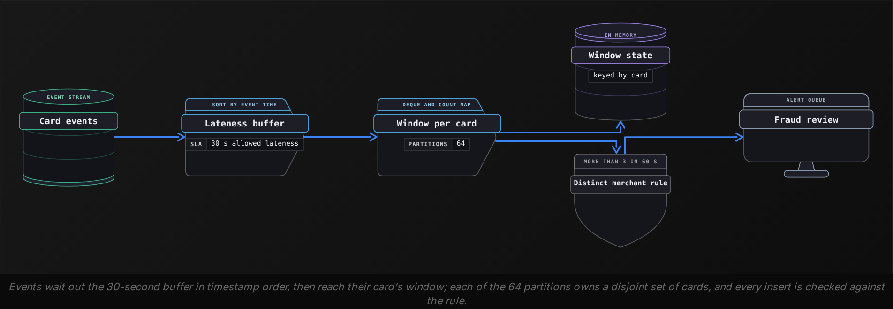

# Sliding Window: Intermediate

Ines is 40 minutes into her technical screen at Stripe when the interviewer pastes a list of payment events, each tagged with a risk signal. 'Find the shortest run of consecutive events that contains every signal in this set: new_device, cvc_fail, geo_mismatch.' The interviewer adds that the real feed holds 2 million events, so a nested loop over every start and end is off the table. Ines recognizes the shape: a window that grows on the right until it covers every required signal, then tightens from the left while it still does. The follow-ups arrive fast. A required signal can appear twice. Count the stretches with exactly 3 distinct merchants. What breaks when events arrive out of order? Each follow-up runs on the same pair of pointers with a different rule for when the window may exist.


<br>

### What you will be able to do

Write a variable-size window that contracts with a while loop, and explain why it runs in O(n)

Keep a frequency map in step with both pointers, including deleting keys that reach 0

Solve Minimum Window Substring with need, window and have counters

Count windows with exactly K distinct values as at_most(K) minus at_most(K minus 1)

Move a window rule onto a time-ordered event stream and state what late data and per-key state cost


<br>

---

## Shrinking Variable-Size Windows

A fixed window moves both edges together. A variable window advances `right` on every step and advances `left` only when the window breaks its rule. The rule defines the problem: the longest stretch of `nums` whose sum stays at or below `limit`, or the shortest stretch whose sum reaches `target`. The program below solves the longest version on `nums = [2, 1, 5, 2, 3, 2]` with `limit = 7`.

https://github.com/user-attachments/assets/37e933fe-ad9a-44d3-8bed-cda6492ebc34

The step to watch is `right = 2`. The sum jumps to 8, so the `while` loop evicts the 2 at index 0 and the window becomes `[1, 5]` with sum 6. Index 3 and index 4 each force another eviction, and the window stays at 2 items. At index 5, `[2, 3, 2]` sums to exactly 7, and `window > limit` is false at equality, so the window survives at length 3 and the program prints 3.


<br>

### Predict the output

Run the animated program in your head with `nums` unchanged and `limit = 5`. Which window wins, and what does it print?

> Answer
>
> It prints 2. The pair [2, 1] reaches length 2 at index 1. At index 2 the 5 alone fills the limit, so both earlier items are evicted, and no 3 consecutive items sum to 5 or less: the triples sum to 8, 8, 10 and 7.


<br>

### Why the left pointer only moves forward

The contraction is safe because of a property of the data, and stating it before writing code is part of the answer. With non-negative numbers, removing an item from the left can only lower the sum, and adding an item on the right can only raise it. So once `[left..right]` exceeds the limit, every window that starts at `left` and ends at `right` or later exceeds it too. No window starting at `left` can still win, and advancing `left` discards only windows that were already lost.

The same property sets the running time. `right` visits each index once. `left` also moves only forward and never passes `right + 1`, so across the whole run the `while` body executes at most n times in total, even though it sits inside a `for` loop. Total pointer movement is bounded by 2n: O(n) time and O(1) extra memory.


<br>

### Negative numbers break the guarantee

Allow a negative value and the property is gone. Take `nums = [5, -4, 1]` with `limit = 2`. The whole array sums to 2, so the true answer is 3. The loop sees the 5 at index 0, finds the window over the limit, and evicts it before the -4 that would have offset it arrives. The program prints 2. When an interviewer allows negatives, naming the broken property is the response they're listening for, and so is the replacement: a stretch's sum is the difference of 2 prefix sums, and binary search over the running maximum of the prefix sums finds the earliest valid start for each end, in O(n log n) time and O(n) memory.


<br>

### Shortest instead of longest

Flip the goal and the update moves. For the minimum length with a sum of at least `target`, a window matters the moment it becomes valid, and every eviction tries a shorter valid window. So the length is recorded inside the `while`, before each eviction, and the loop condition flips from `window > limit` to `total >= target`, with the running sum named `total` in the function below.

```sql
def shortest_reaching(nums, target):
    left = 0
    total = 0
    best = len(nums) + 1
    for right, x in enumerate(nums):
        total += x
        while total >= target:
            best = min(best, right - left + 1)
            total -= nums[left]
            left += 1
    return best if best <= len(nums) else 0


print(shortest_reaching([2, 3, 1, 2, 4, 3], 7))
```

| right | x | total after add | lengths recorded | left after shrink |
| --- | --- | --- | --- | --- |
| 0 | 2 | 2 | none | 0 |
| 1 | 3 | 5 | none | 0 |
| 2 | 1 | 6 | none | 0 |
| 3 | 2 | 8 | 4 | 1 |
| 4 | 4 | 10 | 4, 3 | 3 |
| 5 | 3 | 9 | 3, 2 | 5 |

| ✓ Longest valid window | ✗ Shortest valid window |
| --- | --- |
| • Shrink while the window breaks the rule<br><br>• Record after the while exits, once the window is valid again<br><br>• best can start at 0<br><br>• The animation above prints 3 | • Shrink while the window still satisfies the rule<br><br>• Record inside the while, before each eviction<br><br>• best starts above any real length and is checked at the end<br><br>• The function above prints 2 |


<br>

### Why the shrink is a while loop

Replace the `while` with an `if` and each step evicts at most 1 item, so the window can stay over its limit. In the longest version the returned length survives, because the window's length never drops and only grows on a step that ends valid, but its contents are wrong whenever it is over the limit. In the shortest version the answer itself breaks: with an `if`, `shortest_reaching` returns 4 instead of 2 on its own example, because each step records a single window and stops before trying shorter ones.

> **TIP**
>
> Before writing the loop, say the property aloud: if this window breaks the rule, every wider window with the same left edge breaks it too. If that sentence is false for the input, the shrinking window doesn't apply, and the interviewer has handed you a different problem.


<br>

---

## Character Frequency Maps

When the rule depends on which items sit in the window rather than their total, the window's state becomes a dictionary from item to count. 3 updates keep it in step with the pointers: increment when an item enters at `right`, decrement when one leaves at `left`, and delete the key when its count reaches 0. Each is O(1) on average, so the scan stays linear, and the map holds at most 1 key per distinct item in the window.


<br>

### Longest substring without a repeat

The standard first use is the longest substring with no repeated character. The window is valid while every count is 1. A new character can push only its own count to 2, so the loop shrinks while `counts[ch] > 1` for that character and never scans the whole map.

https://github.com/user-attachments/assets/f73c2e54-a6c2-4f0f-8c85-d7b01e37124e

*Index 2 evicts 2 characters: the p, then the first w.*

Index 2 is the busy step. The second `w` raises its count to 2, and the loop must evict `p` before it reaches the first `w`. Deleting the `p` key keeps the map limited to characters inside the window, which is why the printed map at index 2 holds only `w`. At index 5 the map shows `w`, `k` and `e` at 1 each, and the answer is 3, first reached by `wke` at index 4.


<br>

### Why deleting zeros matters

This problem never reads the size of the map, so zero entries would not change its answer. Any rule that reads `len(counts)` as the number of distinct items does read it, and a stale zero makes the window look more varied than it is. A `Counter` can hold zero entries in the same way. Predict both lines:

```sql
from collections import Counter

c = Counter("aab")
c["a"] -= 2
print(len(c), c)
print(c["z"], len(c))
```

> What it prints
>
> - `2 Counter({'b': 1, 'a': 0})`: subtracting through a key leaves a 0 entry, and `len` still counts it.
> - `0 2`: reading a missing key returns 0 without inserting it, so the length stays 2.
> - `+c` or `c -= Counter()` drops entries at 0 or below, but each call scans the whole map, which costs O(distinct keys).

#### A plain dict raises instead

Swap the `Counter` for a plain dict and the first increment fails before any window logic runs:

```sql
counts = {}
for ch in "ab":
    counts[ch] += 1
```

It stops on the first pass with `KeyError: 'a'`. `counts.get(ch, 0) + 1` avoids it, and so does `defaultdict(int)`, but reading a missing key from a `defaultdict` inserts it with 0, which is another way a zero entry gets into the map.


<br>

### Zeros inside a dict comparison

Fixed-width anagram search compares the window's counts with the pattern's on every slide. Predict what this prints on Python 3.9 for the pattern `abc`:

```sql
from collections import Counter


def anagram_starts(s, p):
    width = len(p)
    need = Counter(p)
    window = Counter(s[:width])
    starts = [0] if window == need else []
    for right in range(width, len(s)):
        window[s[right]] += 1
        window[s[right - width]] -= 1
        if window == need:
            starts.append(right - width + 1)
    return starts


print(anagram_starts("cbaebabacd", "abc"))
```

It prints `[0]`. The window `bac` at index 6 has the right letters, but the `e` evicted 2 steps earlier is still in the map with a count of 0, and in Python 3.9 `Counter` equality is plain dict equality, so a key holding 0 differs from a missing key. Python 3.10 changed that comparison to treat missing keys as 0, which makes the same code print `[0, 6]` there. Deleting a key when its count reaches 0 gives `[0, 6]` on every version.


<br>

### The last-seen index shortcut

For the no-repeat rule there is lighter bookkeeping: store the last index where each character appeared and jump `left` past it in a single move. The jump must never go backwards, and the input `"abba"` catches the version that forgets.

```sql
def longest_unique(s):
    last = {}
    left = 0
    best = 0
    for right, ch in enumerate(s):
        if ch in last:
            left = max(left, last[ch] + 1)
        last[ch] = right
        best = max(best, right - left + 1)
    return best


print(longest_unique("abba"))
```

At index 3, `a` was last seen at index 0, which already lies outside the window because the second `b` moved `left` to 2. Without the `max`, `left` jumps back to 1, the window becomes `bba`, and the function returns 3 for a string whose longest repeat-free stretch has 2 characters. The map keeps stale indexes on purpose here; the `max` is what makes them harmless.

> **TIP**
>
> Comparing 2 dicts with `==` on every slide costs O(distinct keys) per step. Over 26 letters that is harmless. Over user IDs or log tokens it turns a linear scan into O(n \* d), where d is the number of distinct keys compared, and the next section replaces that comparison with a single integer.


<br>

---

## Minimum Window Substring

Given strings `s` and `t`, return the shortest substring of `s` containing every character of `t`, duplicates included, or the empty string if none exists. With `s = "AXBBCAXCB"` and `t = "ABC"`, the answer is `"BCA"` at indices 3 to 5. Structurally this is a shortest-window problem: record inside the shrink loop. The difficulty is the validity test. Asking whether a window covers `t` has to cost O(1) per step, or the scan stops being linear.


<br>

### The need, window and have counters

- need: the count of each character in t. For "ABC" that is {'A': 1, 'B': 1, 'C': 1}, and required = len(need), which is 3.
- window: counts of the needed characters inside s[left:right + 1]. Characters outside t are skipped, so this map never has more keys than need.
- have: how many keys of need the window currently satisfies. The window covers t exactly when have == required.

What keeps `have` correct is that it changes only when a count crosses its threshold. On entry, `have` rises when `window[ch]` becomes equal to `need[ch]`, the moment that key goes from short to satisfied. On exit, it falls when `window[ch]` drops below `need[ch]`. A second `B` entering a window that needs 1 `B` changes nothing, and removing that surplus `B` later changes nothing either.

https://github.com/user-attachments/assets/8960bd56-758d-4814-a021-9b4879cb61c3

*have reaches 3 at indices 4, 5 and 8; the shortest window, BCA, appears at index 5.*

| right | char | what happens | have | best so far |
| --- | --- | --- | --- | --- |
| 2 | B | B meets its need | 2 | none |
| 3 | B | surplus B, count 2 | 2 | none |
| 4 | C | C meets its need; record AXBBC, evict A | 3, then 2 | AXBBC (5) |
| 5 | A | A meets its need; evict X, record BBCA, evict the surplus B, record BCA, evict the last B | 3, then 2 | BCA (3) |
| 7 | C | surplus C, count 2 | 2 | BCA (3) |
| 8 | B | B meets its need; evict the surplus C, then A | 3, then 2 | BCA (3) |

If `t` holds a character that `s` lacks, `have` never reaches `required`, the stored length stays infinite, and the program prints the empty string. The scan runs in O(|s| + |t|) time, and both maps hold at most 1 key per distinct character of `t`.


<br>

### Surplus characters expose the common bug

Hand-written versions break when a needed character shows up more often than `t` asks for. A frequent slip writes the entry test with `>=`, which raises `have` again every time an already satisfied character arrives. A surplus character then counts as coverage for a key that is still missing.

```sql
if ch in need:
    window[ch] = window.get(ch, 0) + 1
    if window[ch] >= need[ch]:
        have += 1
```

Predict what the full program prints with this change for `s = "ABBC"` and `t = "ABC"`, then for the original `==` test.

> Answer
>
> The `>=` version prints `BC`, which has no `A`. The second `B` at index 2 lifts `have` to 3 while no `C` is present, so `ABB` is recorded, and the extra count survives every later step. The `==` version prints `ABBC`: only the whole string holds all 3 characters.


<br>

### What the counter buys

The alternative test, `all(window.get(c, 0) >= n for c, n in need.items())`, is correct and costs a comparison per distinct required character on every check. For `t = "ABC"` that is 3. When `t` is a list of 40 required event types and `s` is a day of log events, every pointer move pays 40 comparisons, while `have == required` stays a single integer comparison regardless of the size of `t`.

The code never assumes `s` is a string: it indexes, compares and slices, so a list of event names works unchanged.

> **TIP**
>
> Name the 3 pieces before coding: `need`, `have`, and the record-then-evict loop. The threshold rule is what the question tests, and running the `ABBC` input aloud takes around 10 seconds and catches the overcount.


<br>

---

## At-Most-K Window Constraints

A large family of window rules caps a count: at most K distinct values, at most K zeros, at most K requests above a latency threshold. They share a property, the one every shrinking window needs: any window inside a valid window is also valid. Remove an item from a window holding 2 distinct values and it holds 2 or fewer. That property lets `left` move forward without regret, and it also lets you count windows instead of only measuring them.


<br>

### Longest window with at most K distinct

For the longest version, the state is a frequency map with zero keys deleted, and the shrink condition is `len(counts) > k`. On `"eceba"` with `k = 2`, the window grows to `ece`. The `b` at index 3 brings a third key, so eviction removes the first `e`, whose count falls to 1, and then the `c`, whose count falls to 0 and whose key leaves the map. The window is `eb`, and the answer stays 3. Questions about 2 fruit baskets or a cart limited to 2 suppliers are this problem with `k = 2`.


<br>

### Counting windows instead of measuring them

Now ask how many subarrays have at most K distinct values. After the shrink, `left` is the smallest start that keeps the window ending at `right` valid. By the property above, every start from `left` through `right` is valid too, so the windows ending at `right` add exactly `right - left + 1` to the total. A single pass counts them all in O(n), even though there can be n(n + 1) / 2 of them.


<br>

### Exactly K as a subtraction

Exactly K distinct breaks the property. Shrinking a window with K distinct values can leave K minus 1, and growing a window with K minus 1 can make it valid again. For a fixed `right`, the valid starts form a range with 2 moving edges, and a single `left` pointer can follow only 1 of them. The repair is arithmetic: windows with exactly K distinct values are the windows with at most K, minus the windows with at most K minus 1.

Both single-pass shortcuts fail on `nums = [1, 2, 1, 2, 3]` with K = 2. Counting a window per step whenever the map holds 2 keys gives 4. Adding `right - left + 1` whenever the map holds 2 keys gives 11, because it also counts the single-value windows inside each range. The true count is 7, and the subtraction produces it:

https://github.com/user-attachments/assets/7f27b089-5979-4f85-9780-a7822d92a4a0

*at_most runs twice on [1, 2, 1, 2, 3]; 12 minus 5 leaves 7.*

at_most(nums, 2)

| right | left | added |
| --- | --- | --- |
| 0 | 0 | 1 |
| 1 | 0 | 2 |
| 2 | 0 | 3 |
| 3 | 0 | 4 |
| 4 | 3 | 2 |
| total |  | 12 |

at_most(nums, 1)

| right | left | added |
| --- | --- | --- |
| 0 | 0 | 1 |
| 1 | 1 | 1 |
| 2 | 2 | 1 |
| 3 | 3 | 1 |
| 4 | 4 | 1 |
| total |  | 5 |

Listing the exactly-2 subarrays by hand confirms the 7:

| start | end | subarray |
| --- | --- | --- |
| 0 | 1 | [1, 2] |
| 0 | 2 | [1, 2, 1] |
| 0 | 3 | [1, 2, 1, 2] |
| 1 | 2 | [2, 1] |
| 1 | 3 | [2, 1, 2] |
| 2 | 3 | [1, 2] |
| 3 | 4 | [2, 3] |


<br>

### Capping something other than distinct values

The cap can sit on any single category. The longest run of 1s with at most K zeros flipped keeps a single integer, `zeros`, and shrinks while `zeros > k`. The map collapses to a counter because only a single kind of item is capped.

```sql
def longest_with_flips(bits, k):
    left = 0
    zeros = 0
    best = 0
    for right, b in enumerate(bits):
        zeros += b == 0
        while zeros > k:
            zeros -= bits[left] == 0
            left += 1
        best = max(best, right - left + 1)
    return best


print(longest_with_flips([1, 1, 0, 0, 1, 1, 1, 0, 1], 1))
```

The wording rarely says at most K distinct. Listen for a cap on variety or on bad items: no more than 2 product categories in a cart session, at most 3 failed checks in a run of requests, a playlist stretch using at most 4 artists. Each asks for a map or a counter, a shrink condition on its size, and either the longest window or the number of windows.

> Edge cases worth naming
>
> - `k = 0`: at_most returns 0, since every window empties itself, so `at_most(nums, 1) - at_most(nums, 0)` still gives the exactly-1 count.
> - `k` at or above the number of distinct values: no shrink runs, and at_most returns n(n + 1) / 2, which is 15 for these 5 numbers.
> - Negative values are harmless here, because the rule counts kinds of values and never sums them.
> - Exactly-K for sums uses the same subtraction only when every value is non-negative.

> **TIP**
>
> When a question says exactly, read it first as at most K minus at most K minus 1. That turns an awkward window into 2 calls of a function you have already written and tested.


<br>

---

## Window Patterns in Production

The same machinery runs inside pipelines with 2 changes. The window is usually measured in time instead of item count, and the input is a stream partitioned by a key such as a card or a user, so a job holds many small windows at once instead of a single large window.


<br>

### The clock moves the left edge

Take the rule 'alert when a card is used at more than 3 distinct merchants within 60 seconds.' It is an at-most-K window whose left edge is pushed by the clock. Each event enters on the right. Any event 60 or more seconds older than the newest one leaves from the left, and because events arrive in time order, the oldest is always at the front. A deque holds the events and a dict holds merchant counts, and a merchant's key leaves the dict when its count hits 0, so `len(counts)` is the distinct count.

https://github.com/user-attachments/assets/62c5998e-ef77-448e-ab6f-009c263b0eb5

*Alerts fire at 55 and 70; by 130 only m5 remains.*

At 70, the events at 0 and 10 leave. The one at 10 is exactly 60 seconds old, and the `<=` in the eviction test is what decides it no longer counts. Whether the boundary is open or closed belongs in the rule's spec, since 2 implementations that disagree will fire different alerts on the same data. At 130 every older event leaves, and the map shrinks to `m5`. The `while` never reads an empty deque, because the arriving event is always newer than the cutoff.


<br>

### What the pointer assumes about order

Front eviction works only if timestamps arrive in non-decreasing order, the same one-direction assumption that let `left` advance in the first section. Suppose an event stamped 20 arrives right after the one at 70: it lands behind newer events in the deque. The next arrival at 85 evicts the event at 25 and stops at 40, so the stale event at 20 stays counted against a window it no longer belongs to. Pipelines handle this with a lateness buffer: hold events for an allowed delay, say 30 seconds, sort the buffer by timestamp, and release an event to the window only once nothing older can still arrive. Every alert then fires up to 30 seconds late, which is the price of correct windows. An event later than 30 seconds, such as one stamped 20 arriving after 85 was released, is dropped or sent to a side output for reprocessing, because admitting it would bring back the stale count. The rule accepts missing a few very late events in exchange for a bounded delay.




<br>

### The same rule as a batch query

For a backfill or an audit, the rule is a self-join: each event is paired with every event of the same card in the 60 seconds before it, using the same boundary as the Python test.

```sql
SELECT
  e.card_id,
  e.event_time,
  COUNT(DISTINCT p.merchant_id) AS merchants_60s
FROM card_events AS e
JOIN card_events AS p
  ON p.card_id = e.card_id
    AND p.event_time > e.event_time - INTERVAL '60' SECOND
    AND p.event_time <= e.event_time
GROUP BY e.card_id, e.event_time
HAVING COUNT(DISTINCT p.merchant_id) > 3
```

The query parallelizes across cards, but each row is joined against every earlier event of its card inside the window. A burst of 200 events from a single card within a minute produces 20,100 joined rows, because the k-th event pairs with all k events at or before it. The streaming loop does amortized O(1) work per event and keeps only the live window. The batch form fits recomputing history; the loop fits alerting while events arrive.


<br>

### Memory is paid per key

A single window costs O(events inside it) for the deque plus O(distinct merchants) for the map, and partitioning by card pays that per active card. Eviction runs only when a card sees a new event, so a card that goes quiet keeps its last window indefinitely. A periodic sweep that evicts every card against the current clock, and deletes a card's entry once its deque is empty, keeps memory proportional to the cards active in the last 60 seconds instead of every card ever seen.

Each pattern in this lesson has a production form, and each move to production changes an assumption:

| Interview pattern | Production form | What changes |
| --- | --- | --- |
| Longest window under a sum limit | Most consecutive records that fit a 5 MB request payload | Sizes are non-negative, so shrinking from the left stays safe |
| No repeated character | Drop an event whose ID already appeared in the last 10 minutes | Last-seen time per ID, evicted by the clock |
| Minimum window substring | Shortest log stretch that mentions every required stage | Items are event names in a list instead of characters |
| At most K distinct | More than 3 distinct merchants per card in 60 seconds | The clock moves the left edge; state lives per key |
| Exactly K by subtraction | Request traces that touch exactly 2 services | 2 passes over each trace, subtracted |


<br>

---

## Putting It All Together

A card issuer's fraud team wants 2 rules on its live payment stream. The first flags a card used at more than 3 distinct merchants within 60 seconds. The second runs for every flagged card and finds the shortest run of its recent events that contains all 3 risk signals (new device, failed CVC check, geolocation mismatch), so an analyst reviews the tightest evidence. A nightly job also counts, per card, the stretches of events that touch exactly 2 merchants, as a feature for a behaviour model.

- The merchant rule is an at-most-K window whose left edge the clock pushes, with merchant keys deleted at 0 so len ( counts ) is the distinct count.
- The evidence search is Minimum Window Substring over a list of signal names: need built from the 3 signals, have moving on threshold crossings, and the best window recorded inside the shrink loop.
- The nightly feature is at_most ( 2 ) - at_most ( 1 ) per card, each pass adding right - left + 1 per event, run in parallel across cards.
- Every rule depends on events reaching the window in time order, and the 30-second lateness buffer is what keeps front eviction correct, at the cost of alerts arriving up to 30 seconds late.
- Memory is the deque plus the count map per active card, and a periodic sweep drops cards that have been silent for 60 seconds.


<br>

---

## Key Takeaways

- A shrinking window is correct only when breaking the rule at [ left . . right ] means every longer window with the same left breaks it too; non-negative sums and count caps have that property, negative sums do not.
- Longest-window code records after the while ; shortest-window code records inside it, before each eviction, and an if in place of the while breaks the shortest version.
- A frequency map stays honest only if keys leave at 0: len ( counts ) and, on Python 3.9, Counter equality both read stale zeros.
- Minimum Window Substring is the shortest-window loop plus a have counter that moves only when a count lands on its need or falls below it.
- Counting at-most-K windows adds right - left + 1 per step, and exactly K is at_most ( k ) - at_most ( k - 1 ) .
- In pipelines the clock moves the left edge, late events break front eviction unless a lateness buffer reorders them, and window state is paid per key.
