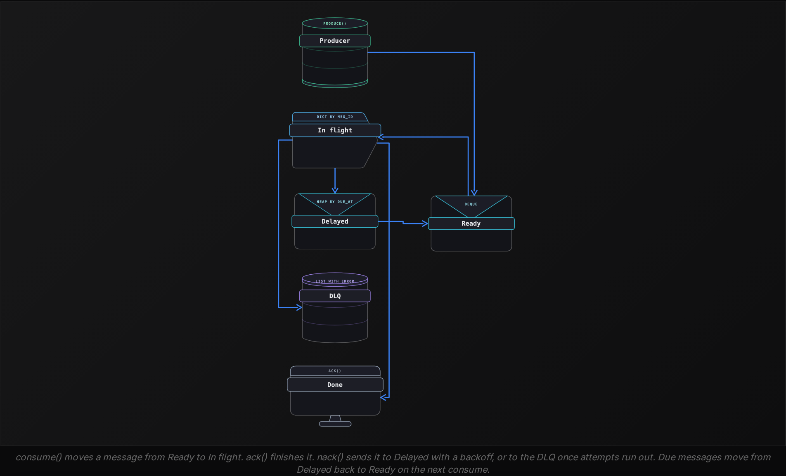

# Stacks & Queues: Advanced

Forty minutes into the onsite, the interviewer pastes a list of API latencies into the shared editor, one reading per second for a full day.
"For each second, give me the worst latency over the trailing 5 minutes. Then we'll talk about how these readings get to your code."
The second sentence is the tell. A clean linear loop earns the first 10 minutes. The rest of the hour is follow-ups: hold only recent readings in fixed memory, deliver them through a queue that survives a poison message, let an operator reverse a bad config push, and feed the work from 4 threads without hanging at shutdown.
Each follow-up is a stack or a queue with a production constraint attached. What the interviewer is scoring is whether you name the constraint before you write the class.


<br>

### What you will be able to do

Implement sliding window max and min in O(n) with a monotonic deque, and adapt it to windows defined by timestamps

Explain how deque(maxlen=N) evicts in O(1) without copying, and where its silent eviction causes bugs

Design an in-memory message queue with backoff, a dead letter queue and a backpressure policy, and say what changes when it must be durable

Build undo and redo with the command pattern, and name the operations no undo stack can reverse

Pick among deque, queue.Queue, multiprocessing.Queue and asyncio.Queue, and shut down a worker pool without hanging


<br>

---

## Sliding Window Max and Min

The question almost never says "sliding window maximum." It says "alert when the highest p99 in the last 300 seconds crosses 800 ms," or "report each sensor's low and high over its last 60 readings." Both are window extremes, and before any code the interviewer is checking whether you see why this is harder than a rolling sum. A sum survives the window moving because you subtract the value that leaves. A maximum has no inverse: when the current max slides out, nothing you kept tells you the runner-up.

| Approach | Time | Extra space | What the interviewer hears |
| --- | --- | --- | --- |
| Rescan every window | O(n\*k) | O(1) | Correct, and 10 billion comparisons at n = 1M, k = 10,000 |
| Heap of (value, index) with lazy deletion | O(n log n) | O(n) | Knows heaps; stale entries leave only when they reach the top |
| Monotonic deque of indices | O(n) | O(k) | The answer being scored |

Say the heap answer out loud on the way to the deque, because interviewers push on it. On a strictly increasing input every old maximum stays buried under the new one, so the heap grows to n entries and each push costs log n rather than log k. Naming that weakness is how you get to the deque.


<br>

### The move you narrate

The deque stores indices whose values decrease from front to back. Each step does 4 things in a fixed order: drop the front index if it has slid out of the window, pop from the back every index whose value is less than or equal to the newcomer, append the newcomer's index, and once the first window is full, read the answer at the front. Watch the 3 at index 1 survive while -1 and -3 line up behind it, then watch one arrival of 5 expire the 3 from the front and clear the rest from the back.

https://github.com/user-attachments/assets/ea0b88e2-d055-4c6b-a7c1-86d74376fffc

*The deque holds indices with values decreasing front to back; its front is each window's max.*

The complexity follow-up arrives within a minute: "There's a while inside your for. Isn't that O(n\*k)?" The interviewer wants the counting argument. Each index is appended exactly once and removed at most once, from one end or the other, so across the whole run the deque performs at most 2n operations however the inner loop's work is distributed. One step may pop 4 entries while the next pops none; the total stays linear. The front eviction is an if because a fixed-size window advances 1 position per step, so at most 1 index can expire per step.


<br>

### Why popping is safe

When an older value is less than or equal to a newer one, every future window that still holds the older value also holds the newer one, because the newer one arrived later and leaves later. The older value can never be the maximum again, so discarding it loses nothing. Two invariants follow: every index in the deque lies inside the current window, and their values decrease from front to back, so the front is the window's maximum. Store indices rather than values, because the window boundary is a position, and a bare value cannot tell you when it has expired.

| ✓ Window maximum | ✗ Window minimum |
| --- | --- |
| • Values decrease front to back<br><br>• Pop the back while nums[dq[-1]] <= x<br><br>• Front holds the largest value in the window<br><br>• Spike detection: worst latency, peak throughput | • Values increase front to back<br><br>• Pop the back while nums[dq[-1]] >= x<br><br>• Front holds the smallest value in the window<br><br>• Floor detection: lowest stock level, least free disk |

For the range over a sensor's last 60 readings, run both deques in one loop and subtract one front from the other. Popping on `<` instead of `<=` is also correct: equal values then stay queued and the deque runs slightly longer, and saying why both work is the answer to the duplicates probe.


<br>

### The follow-up about real timestamps

The probe that separates people who have run this from people who have memorized it: "Readings don't arrive every second. Some minutes have 400 events, some have 2. The window is the last 300 seconds." Two things change. The window is now defined by time, so the deque holds (timestamp, value) pairs and no index arithmetic is needed. And a quiet gap followed by one arrival can expire many entries at once, so the front eviction becomes a `while`.

```sql
from collections import deque
from typing import List, Tuple

def rolling_max(events: List[Tuple[int, float]], span: int) -> List[Tuple[int, float]]:
    """events: (epoch_seconds, latency_ms), sorted by time.
    Window for each event: (ts - span, ts]."""
    dq = deque()   # (ts, latency); latencies decrease front to back
    out = []
    for ts, latency in events:
        while dq and dq[0][0] <= ts - span:
            dq.popleft()            # a gap can expire many entries at once
        while dq and dq[-1][1] <= latency:
            dq.pop()
        dq.append((ts, latency))
        out.append((ts, dq[0][1]))
    return out

events = [(0, 120.0), (40, 95.0), (310, 80.0), (320, 400.0), (900, 70.0)]
print(rolling_max(events, 300))
# [(0, 120.0), (40, 120.0), (310, 95.0), (320, 400.0), (900, 70.0)]
```

This version assumes events arrive in timestamp order. A late event that belongs 90 seconds in the past cannot be placed into the deque correctly, and the interviewer will ask what you do about it. Answer it by scope. Inside a Python consumer, hold events in a small sorted reorder buffer and send anything later than the buffer covers to a correction path. At warehouse scale the window maximum belongs in the engine, as a `RANGE`-framed window function over the timestamp or a streaming framework's windowed aggregate with a watermark. The deque is the right tool when the data already sits in one Python process: a consumer loop, a monitoring agent, a UDF over one partition.


<br>

---

## Circular Buffers With deque

This question arrives disguised as a memory budget. "The alerting agent should attach the last 1,000 log lines to every page." "Compute a moving average over the last 50 readings per sensor." "Print the final 3 lines of a 40 GB export without loading it." Each asks for the latest N items of a stream that never ends, and the scored answer is `collections.deque(maxlen=N)`. The interviewer then asks why, and your explanation is what gets scored.


<br>

### What happens when it is full

A deque created with `maxlen` never grows past it. Once it holds N items, `append(x)` adds x at the right and discards the leftmost item in the same call, with no exception and no return value. `appendleft` on a full deque discards from the right instead, and `extend` with more than N items keeps the last N. Each of these is O(1) per item, because CPython builds a deque from a doubly linked chain of fixed-size blocks and tracks the first and last occupied slot. Evicting the oldest item moves an index forward and, when a block empties, releases that block. No element is ever shifted or copied.

- **64** — items in each CPython deque block

| Approach | Cost per new item | What it does at N = 1,000 |
| --- | --- | --- |
| `buf.append(x)` then `buf.pop(0)` | O(N) | Shifts 999 references left on every arrival |
| `buf = (buf + [x])[-N:]` | O(N) | Allocates and copies a fresh 1,000-item list per arrival |
| `deque(maxlen=N).append(x)` | O(1) | Writes 1 slot and advances 1 index |
| Preallocated list with a write head | O(1) | Same cost, plus O(1) access to any position |

```sql
from collections import deque

def tail(lines, n=3):
    return list(deque(lines, maxlen=n))

stream = (f"row {i}" for i in range(1, 1_000_001))
print(tail(stream))
# ['row 999998', 'row 999999', 'row 1000000']
```


<br>

### The silent eviction trap

Silent discard is the feature and also the bug. A moving average that keeps a running total has to subtract the value about to fall off, and after the `append` that value is gone with no trace. Read `buf[0]` before appending whenever the buffer is full.

```sql
from collections import deque

class RollingMean:
    def __init__(self, n: int):
        self.buf = deque(maxlen=n)
        self.total = 0.0

    def add(self, x: float) -> float:
        if len(self.buf) == self.buf.maxlen:
            self.total -= self.buf[0]     # about to be evicted, read it now
        self.buf.append(x)
        self.total += x
        return self.total / len(self.buf)

m = RollingMean(3)
print([m.add(v) for v in [10, 20, 30, 40]])   # [10.0, 15.0, 20.0, 30.0]
```

The interviewer usually asks 2 follow-ups. The first is float drift: after millions of subtract-and-add steps the running total accumulates rounding error, so recompute it with `math.fsum(self.buf)` every few thousand updates and say why. The second is "what about a rolling median?" A deque reads its ends in O(1) but walks the block chain to reach the middle, and sorting 1,000 items per arrival costs O(N log N) each time. That question needs 2 heaps or a sorted container, and the point being tested is whether you say the ring buffer is the wrong tool for it.


<br>

### Writing it without deque

Some interviewers forbid the import to see whether you understand the ring itself. A preallocated list plus a write head gives the same O(1) append and adds O(1) access to any position, which matters when you need percentiles over the window.

```sql
class Ring:
    def __init__(self, n: int):
        self.slots = [None] * n
        self.head = 0          # next slot to write
        self.size = 0

    def push(self, x) -> None:
        self.slots[self.head] = x      # overwrites the oldest when full
        self.head = (self.head + 1) % len(self.slots)
        self.size = min(self.size + 1, len(self.slots))

    def items(self) -> list:
        n = len(self.slots)
        start = (self.head - self.size) % n
        return [self.slots[(start + i) % n] for i in range(self.size)]

r = Ring(3)
for v in [5, 8, 13, 21]:
    r.push(v)
print(r.items())   # [8, 13, 21]
```

> **TIP**
>
> `maxlen` is read-only after construction, so resizing means building a new deque from the old one. And iterating a deque while other code appends to it raises `RuntimeError: deque mutated during iteration`, so take a snapshot with `list(buf)` before you loop.


<br>

---

## Designing a Message Queue System

The prompt sounds operational: "Ingestion workers pull jobs from a queue. Last week a malformed file got retried for 6 hours and starved everything behind it. Design the queue." It usually runs in 2 rounds. First you write an in-memory class, which tests whether you can keep 4 collections consistent. Then the interviewer says "now it has to survive a restart," which tests whether you know when to stop writing the class.

> What a production queue has that a deque lacks
>
> - Acknowledgement: a delivered message stays in flight until the consumer acks it, and is redelivered if the ack never comes.
> - Retry with backoff: a failed message waits 1, 2, 4, 8 seconds, with jitter, so a downstream service that is already struggling does not get a burst of retries.
> - Dead letter queue: after a fixed number of attempts the message is parked with its error, so 1 poison file cannot starve the rest.
> - Backpressure: a full queue makes the producer wait, unless the data type calls for rejecting or dropping the new item.


<br>

### The in-memory design

The version most candidates write keeps 1 deque and, on each consume, rotates through it looking for a message whose backoff has expired. That is O(n) per consume, and every rotation reorders the queue. The stronger design gives each state a message can be in its own structure: ready messages in a deque, delayed messages in a heap keyed by when they become due, in-flight messages in a dict keyed by id, and dead letters in a list.



```sql
import heapq
import itertools
import random
from collections import deque
from typing import Optional, Tuple

class QueueFull(Exception):
    pass

class MessageQueue:
    def __init__(self, capacity: int = 10_000, max_attempts: int = 5,
                 base_delay: float = 1.0):
        self.ready = deque()      # (msg_id, payload, attempts)
        self.delayed = []         # heap of (due_at, msg_id, payload, attempts)
        self.in_flight = {}       # msg_id -> (payload, attempts)
        self.dlq = []
        self.capacity = capacity
        self.max_attempts = max_attempts
        self.base_delay = base_delay
        self.ids = itertools.count()

    def produce(self, payload) -> int:
        if len(self.ready) + len(self.delayed) >= self.capacity:
            raise QueueFull("producer must back off")
        msg_id = next(self.ids)
        self.ready.append((msg_id, payload, 0))
        return msg_id

    def consume(self, now: float) -> Optional[Tuple[int, dict]]:
        while self.delayed and self.delayed[0][0] <= now:
            _, msg_id, payload, attempts = heapq.heappop(self.delayed)
            self.ready.append((msg_id, payload, attempts))
        if not self.ready:
            return None
        msg_id, payload, attempts = self.ready.popleft()
        self.in_flight[msg_id] = (payload, attempts)
        return msg_id, payload

    def ack(self, msg_id: int) -> None:
        self.in_flight.pop(msg_id, None)

    def nack(self, msg_id: int, now: float, error: str) -> None:
        payload, attempts = self.in_flight.pop(msg_id)
        attempts += 1
        if attempts >= self.max_attempts:
            self.dlq.append({"msg_id": msg_id, "payload": payload,
                             "attempts": attempts, "error": error})
            return
        delay = self.base_delay * 2 ** (attempts - 1) * random.uniform(0.5, 1.0)
        heapq.heappush(self.delayed, (now + delay, msg_id, payload, attempts))
```

That code has 3 details that draw follow-ups, and 1 gap that draws the likeliest probe. The msg_id sits second in every heap tuple because 2 messages due at the same instant would otherwise be compared by payload, and comparing 2 dicts raises TypeError. The jitter multiplies each delay by a random factor between 0.5 and 1.0. That spreads 5,000 messages that failed together during an outage across the back half of each interval: 0.5 to 1 s on the first retry, 4 to 8 s on the fourth, so the spread widens with every attempt. Full jitter, uniform(0, delay), spreads them wider still. produce raises QueueFull instead of growing, which makes the backpressure decision explicit and hands it to the caller. The gap is that nothing ever expires in_flight, so a consumer that crashes holds its message forever. The fix is a lease. consume stores now + visibility_timeout beside the payload, and the same sweep that drains the delayed heap requeues any in-flight message whose deadline has passed.


<br>

### Choosing the backpressure policy

| Policy | Producer experiences | Right for |
| --- | --- | --- |
| Block | `put()` waits until there is room | In-process stages, where a slower producer is acceptable |
| Reject | An exception or HTTP 429, then its own retry | Payments, orders, anything that must not be lost |
| Drop oldest | Nothing; the queue evicts silently | Metrics and heartbeats where the newest reading matters most |
| Spill to disk | Higher latency, no loss | Bursty batch loads that fit on local disk |

Naming one policy for everything is the shallow answer. The interviewer is listening for the sentence that ties the policy to the data: drop-oldest is a `deque(maxlen=N)` and is fine for CPU gauges, and the same choice would silently lose customer orders.


<br>

### When it has to survive a restart

Everything above lives in 1 process, so a crash loses every message, including the ones in flight. Bolting a write-ahead log onto the class is the wrong move here. The answer that scores is to name the system that already solved durability and map your 4 collections onto it. Amazon SQS replaces the in-flight dict with a visibility timeout, and its redrive policy moves a message to a DLQ after `maxReceiveCount` receives. Kafka persists an append-only log per partition, consumers commit offsets only after processing, and parallelism is capped by partition count, because each partition goes to 1 consumer in a group.

- **30 s** — default SQS visibility timeout
- **168 h** — default Kafka log retention

> Follow-ups, with the answers that land
>
> - Consumer dies mid-message? It is never acked, the visibility timeout expires and the message is redelivered: at-least-once delivery.
> - So duplicates happen? Yes. Make the consumer idempotent: upsert on a natural key, or record processed message ids.
> - Exactly-once? Kafka transactions give it inside Kafka. Across a queue and an external database, deliver at-least-once and write idempotently.
> - Retries break ordering? A retried message lands behind newer ones. For strict per-key order, hold that key's partition until it succeeds or parks.
> - Scale to 50,000 messages a second? Partition by key and add consumers up to the partition count; a consumer beyond that sits idle.


<br>

---

## Stack-Based Undo and Redo

This one arrives inside a product: "Analysts edit pipeline configs in our UI. They rename a column, drop a column, change the partition key. They want Ctrl+Z." Or as a code prompt: "Implement undo and redo for a list of transformations." Both are the command pattern with 2 stacks. The interviewer cares less whether you know the pattern's name than about 3 details: when the redo stack is cleared, when state is captured, and which operations cannot be reversed at all.


<br>

### The rules of the 2 stacks

Each operation is an object with `execute` and `undo`. Running a new command executes it, pushes it onto the undo stack and clears the redo stack. Undo reverses the command on top of the undo stack and moves it to the redo stack. Redo runs the top of the redo stack again and moves it back. The clearing step is where implementations break: a redo stack that survives a new edit replays commands against a state they were never recorded against, and the schema ends up in a shape no sequence of user actions produced.

```sql
from abc import ABC, abstractmethod
from collections import deque
from typing import List, Optional

class Command(ABC):
    @abstractmethod
    def execute(self, schema: List[str]) -> None: ...

    @abstractmethod
    def undo(self, schema: List[str]) -> None: ...

class RenameColumn(Command):
    def __init__(self, old: str, new: str):
        self.old, self.new = old, new

    def execute(self, schema):
        schema[schema.index(self.old)] = self.new

    def undo(self, schema):
        schema[schema.index(self.new)] = self.old

class DropColumn(Command):
    def __init__(self, name: str):
        self.name = name
        self.pos: Optional[int] = None

    def execute(self, schema):
        self.pos = schema.index(self.name)   # state captured when it runs
        schema.pop(self.pos)

    def undo(self, schema):
        schema.insert(self.pos, self.name)

class History:
    def __init__(self, schema: List[str], limit: int = 100):
        self.schema = schema
        self.undo_stack = deque(maxlen=limit)
        self.redo_stack: List[Command] = []

    def run(self, cmd: Command) -> None:
        cmd.execute(self.schema)    # raises before anything is recorded
        self.undo_stack.append(cmd)
        self.redo_stack.clear()

    def undo(self) -> None:
        if self.undo_stack:
            cmd = self.undo_stack.pop()
            cmd.undo(self.schema)
            self.redo_stack.append(cmd)

    def redo(self) -> None:
        if self.redo_stack:
            cmd = self.redo_stack.pop()
            cmd.execute(self.schema)
            self.undo_stack.append(cmd)

h = History(["user_id", "ts", "amt"])
h.run(RenameColumn("amt", "amount"))
h.run(DropColumn("ts"))
h.undo()
print(h.schema)     # ['user_id', 'ts', 'amount']
h.run(RenameColumn("user_id", "uid"))
h.redo()            # nothing to redo: the new command cleared it
print(h.schema)     # ['uid', 'ts', 'amount']
```

Two orderings in that code are deliberate. run executes before it pushes, so a command that raises never enters the history. And DropColumn records its position inside execute rather than in __init__, because position is a fact about the schema at the moment the command runs. A command built early and run after other edits would otherwise reinsert the column in the wrong place, and capturing in execute also refreshes the position on every redo.


<br>

### Inverse or snapshot

| ✓ Store the inverse (command) | ✗ Store a snapshot (memento) |
| --- | --- |
| • Each command records only enough to reverse itself<br><br>• Memory scales with the size of each change<br><br>• Every new command type needs a correct undo, and a wrong one corrupts state<br><br>• Right for schema edits and config changes | • Save the whole state before each operation<br><br>• Memory scales with state size times history depth<br><br>• Undo is a restore, so a buggy command cannot break it<br><br>• Right for small state, or when inverses are hard to write |


<br>

### What you cannot undo

The follow-up that tests real experience: "Undo the drop. What about the data in that column?" The schema command restores a name; it cannot restore 400 million values that a `DROP COLUMN` removed from storage. Operations with effects outside the process have no inverse: a sent notification, an overwritten S3 object, a deleted partition. The answers are a compensating action, refusing undo for that command type, or the table format's own history. Delta Lake's `RESTORE TABLE ... TO VERSION AS OF` and Iceberg's `rollback_to_snapshot` procedure are undo stacks the storage layer already keeps, so a data command in your history holds a pointer to the prior table version rather than the bytes.

Two more probes. Grouped edits ("apply these 5 renames as one step") are a composite command whose `undo` reverses its children in reverse order, a stack inside the stack. And the history dies with the process, so a shared tool persists commands as an append-only log and rebuilds both stacks on load, the same idea as a table format's transaction log.


<br>

---

## Concurrent Queue Patterns

It arrives as a throughput complaint: "We enrich 50,000 user records through a geocoding API that takes 200 ms per call. It runs for nearly 3 hours. Make it faster." Or as a memory complaint: "Parsing is fast, writing to Postgres is slow, and memory keeps climbing." Both are producer-consumer, and the first thing scored is whether you pick the queue class for the right reason.

| Class | Safe between | Blocking and bounds | Reach for it when |
| --- | --- | --- | --- |
| `collections.deque` | Threads, for single `append` and `popleft` calls | Never blocks; no `join` | 1 thread, or a polling handoff |
| `queue.Queue` | Threads | `get` blocks; `maxsize` blocks `put`; `task_done` and `join` | I/O-bound workers: API calls, database writes |
| `queue.PriorityQueue` | Threads | Same as `Queue`, lowest item first | Urgent jobs first; store `(priority, seq, item)` |
| `multiprocessing.Queue` | Processes | Blocks; pickles every item | CPU-bound parsing in pure Python |
| `asyncio.Queue` | Coroutines on 1 event loop, never threads | `await get()`; `maxsize`; `join` | Many concurrent calls through async drivers |

The reason behind the choice is the GIL. A thread waiting on a socket releases it, so 20 threads calling a 200 ms API keep about 20 calls in the air, taking the job from close to 3 hours to about 8 minutes until the API's rate limit becomes the ceiling. Threads doing pure-Python parsing take turns on 1 core, so CPU work goes to processes, and every item crossing a `multiprocessing.Queue` is pickled, which makes batches of 1,000 records far cheaper than 1,000 single records. `queue.LifoQueue` and `queue.SimpleQueue` exist too; `SimpleQueue` is unbounded and has no `task_done`, so it gives you neither backpressure nor `join`.


<br>

### A pool that shuts down

The common failure shows up at the end of the run: all the work finishes and the process hangs. The code below avoids the 3 causes.

```sql
import queue
import threading

def geocode(record: dict) -> tuple:
    return (record["user_id"], record["postcode"].upper())   # stand-in for the API

def worker(q: queue.Queue, results: list, errors: list) -> None:
    while True:
        record = q.get()
        try:
            if record is None:              # sentinel
                return
            results.append(geocode(record))
        except Exception as exc:            # recorded, never swallowed
            errors.append((record, repr(exc)))
        finally:
            q.task_done()                   # runs on success, failure and return

q = queue.Queue(maxsize=100)
results, errors = [], []
threads = [threading.Thread(target=worker, args=(q, results, errors)) for _ in range(4)]
for t in threads:
    t.start()
for rec in [{"user_id": 8814, "postcode": "ec1a 1bb"}, {"user_id": 8815, "postcode": None}]:
    q.put(rec)                              # blocks while 100 items wait
for _ in threads:
    q.put(None)                             # 1 sentinel per worker
q.join()
print(len(results), errors[0][1])
# 1 AttributeError("'NoneType' object has no attribute 'upper'")
```

> Why each line is there
>
> - `maxsize=100` makes `put()` block when workers fall behind, so a fast reader cannot fill memory.
> - `task_done()` sits in `finally`. If a worker raised before calling it, `join()` would wait forever on a count that never reaches zero.
> - The worker catches per record and keeps going. An uncaught exception kills that thread and prints a traceback; the main thread never sees it.
> - One sentinel per worker, queued after the real work. A worker stops at the first sentinel it reads, so 4 workers need 4.


<br>

### The asyncio version and its 3.9 trap

With async drivers the same shape uses worker tasks reading from `asyncio.Queue`. After `await q.join()`, call `task.cancel()` on each worker once the queue drains; that replaces sentinels. On Python 3.9, create the queue inside the running coroutine: a queue built at module level binds to a different event loop from the one `asyncio.run` starts, and the first `await q.get()` that has to wait fails with a future attached to a different loop. And `asyncio.Queue` is not thread-safe, so a thread that feeds it calls `loop.call_soon_threadsafe(q.put_nowait, item)`.

Often you should write none of this. For a fixed list of inputs, `ThreadPoolExecutor(max_workers=20).map(fetch, user_ids)` from `concurrent.futures` is the pool already built, with results in input order. It submits every input up front, though, so write the queue yourself when input streams in or memory must stay bounded. Chained stages need it too: parse feeds enrich and enrich feeds write through bounded queues, so the slowest stage sets the pace for the rest.

| ✓ Do | ✗ Don't |
| --- | --- |
| • Store indices or timestamps in a window deque so expiry is one comparison<br><br>• Read the item a full deque(maxlen=N) will evict before you append<br><br>• Bound every queue and decide up front whether a full one blocks the producer or turns new items away<br><br>• Pair at-least-once delivery with an idempotent consumer<br><br>• Call task_done() in finally and queue 1 sentinel per worker after the real work | • Don't rotate a deque hunting for due retries; keep delayed messages in a heap<br><br>• Don't let a heap compare payloads; put a sequence number before them in the tuple<br><br>• Don't keep the redo stack after a new command runs<br><br>• Don't offer undo for writes outside the process; restore a table version instead<br><br>• Don't share an asyncio.Queue across threads or use threads for CPU-bound pure Python |


<br>

---

## Putting It All Together

A ride-sharing company's surge-pricing service reads rider wait-time events from Kafka. For each zone it alerts when the longest wait over the trailing 300 seconds crosses a threshold, attaches the last 200 raw events to each alert, retries failed writes to the pricing database, lets operators roll back a bad threshold change, and fans enrichment calls out to a thread pool.

- The per-zone alert is a time-based monotonic deque of (timestamp, wait) pairs with a while loop at the front, because a quiet zone's next event can expire many entries at once.
- The alert context is a deque(maxlen=200) per zone, so memory stays flat however busy a zone gets.
- Failed database writes go to a delay heap with jittered backoff and land in a DLQ after 5 attempts; writes are upserts keyed by event id because redelivery is expected.
- Threshold changes are commands on an undo stack, each recording the old value when it runs, so a rollback restores exactly what was live.
- Enrichment runs on a bounded queue.Queue with 20 I/O threads. Each thread calls task_done in finally and gets 1 sentinel at shutdown.


<br>

---

## Key Takeaways

- A window max has no inverse, so keep a monotonic deque of indices; each enters once and leaves at most once, which makes the whole run O(n).
- deque ( maxlen = N ) evicts the oldest item in O(1) without shifting anything, and does it silently, so read what leaves before you append.
- A production queue keeps ready, delayed, in-flight and dead messages apart and has a size limit. Duplicates are left to an idempotent consumer.
- Undo is 2 stacks of commands: capture state at execute time, clear redo on every new command, and leave data undo to table versions.
- Choose the queue class by what crosses it: threads for I/O, processes for CPU, 1 event loop for asyncio; stop workers with sentinels.
