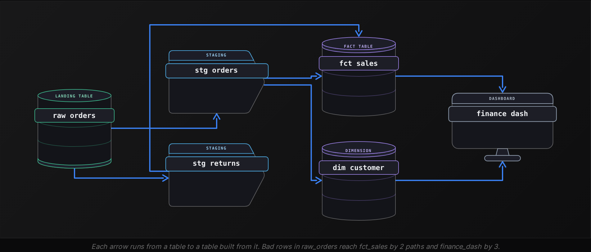

# Stacks & Queues: Beginner

Renata is 20 minutes into the Python round of a data engineering loop at LinkedIn. The interviewer pastes the log payload `{"ids": [7, (9, 4]}` and asks for a function that says whether every bracket closes in the right order. Renata starts tallying openers and closers, then stops: a tally would accept `([)]`, which is broken. What the function needs is memory of the innermost bracket still open, and that memory is a stack. The follow-up arrives before she finishes. Given a map of which tables feed which, list every table downstream of a failed load, closest first. That one wants the oldest unexplored table next, which is a queue. Both questions look like string or graph puzzles, and both are graded on 3 things: naming the structure, saying why its order fits, and handling empty input without a traceback.


<br>

### What you will be able to do

Implement a stack on a Python list and spot the prompt wording that calls for last-in, first-out order

Write a bracket checker that catches mismatched pairs and stray closers as well as openers left unclosed, and adapt it to log and SQL text

Run breadth-first search over a table dependency map with collections.deque and a visited dict

Compute next-greater values in a single pass with a monotonic stack and explain why it is O(n)

Predict the output or traceback of the stack and queue mistakes interviewers look for


<br>

---

## Stack Fundamentals

A stack returns items in the reverse of their arrival order: the last item pushed is the first one popped, which is why it is called LIFO, last in, first out. It has 3 operations that matter. Push adds an item on top, pop removes the top item and hands it back, and peek reads the top item without removing it. Every property of the structure follows from a single restriction: code only ever touches the top.


<br>

### A Python list is already a stack

Python has no built-in stack type because list covers it. append(x) pushes and pop() with no argument pops. To peek, read stack[-1]. An empty list is falsy, so `while` stack: runs until the stack is drained. All 4 work at the end of the list, so each is O(1): no other item has to move. Predict the 5 lines this prints before you read the table under it.

```sql
stack = []
stack.append("a")
stack.append("b")
stack.append("c")
print(stack[-1])
print(stack.pop())
print(stack.pop())
print(stack, len(stack))
print(bool(stack))
```

| Line | Stack after it | Printed |
| --- | --- | --- |
| stack.append("a") | ['a'] |  |
| stack.append("b") | ['a', 'b'] |  |
| stack.append("c") | ['a', 'b', 'c'] |  |
| print(stack[-1]) | ['a', 'b', 'c'] | c |
| print(stack.pop()) | ['a', 'b'] | c |
| print(stack.pop()) | ['a'] | b |
| print(stack, len(stack)) | ['a'] | ['a'] 1 |
| print(bool(stack)) | ['a'] | True |

Peek and pop both printed `c`, and only pop changed the list. Confusing the 2 is a common logic slip in stack code: reading `stack[-1]` when the item should have been consumed leaves it on top, and the next comparison sees it a second time. The final `True` matters too, because `['a']` still holds an item, and a loop guarded by `while stack:` would run once more.


<br>

### Keep the top at the end

A list keeps its items in a single contiguous block of memory. Appending or popping at the end touches a single slot. Calling `insert(0, x)` or `pop(0)` shifts every other item by 1 position. A stack built on the front of a list still returns correct answers, but each operation costs O(n), so a loop of n pushes costs O(n squared). Put the top at the end and that cost disappears.


<br>

### When the prompt says implement a stack

Some interviewers want the class written out rather than a bare list, mostly to see how you handle the empty case. The wrapper below takes under 2 minutes to write and makes a decision explicit: popping or peeking an empty stack raises an error instead of returning `None`.

```sql
class Stack:
    def __init__(self):
        self._items = []

    def push(self, item):
        self._items.append(item)

    def pop(self):
        if not self._items:
            raise IndexError("pop from empty stack")
        return self._items.pop()

    def peek(self):
        if not self._items:
            raise IndexError("peek at empty stack")
        return self._items[-1]

    def is_empty(self):
        return not self._items

    def __len__(self):
        return len(self._items)
```

Raising beats returning `None` because a stack may legitimately hold `None`, for example a missing value read from a row. If pop returned `None` on empty, the caller could not tell an empty stack from a stored null. Say that sentence in the interview: it shows you thought about the contract as well as the code.


<br>

### Rolling back in reverse order

A table swap job runs 4 steps: create a temp table, copy rows into it, build an index on it, then rename it over the live table. If the rename fails, the earlier steps must be reversed newest first, because the index sits on rows that sit in the temp table. Each completed step goes on a stack, and the rollback loop pops until the stack is empty.

https://github.com/user-attachments/assets/75bc253d-4385-4828-9397-e43edc5dcb98

*Steps go on in run order and come off in reverse, with no index math.*

The rollback loop never names a step or computes an index. It pops whatever is on top, and the order comes out right because the pushes recorded it. That's the core reason to choose a stack: it remembers order for you, and it always hands back the most recent unfinished item first.


<br>

### Recognizing a stack question

| Words in the prompt | Why a stack fits |
| --- | --- |
| balanced, matching, well-formed, nested | Each closer pairs with the most recent opener that is still open |
| undo, roll back, in reverse order | The last action applied is the first one to reverse |
| next greater, next warmer, until a higher value | Unsettled items wait on top until a later value settles them |
| resolve a path such as a/b/../c | Each .. cancels the most recently entered directory |
| depth-first, explore as deep as possible | The newest discovered node is the next one explored |

> **TIP**
>
> Say the reason aloud before coding: "I need the most recent unresolved item, so I will use a stack." Interviewers give credit for that sentence by itself, and if you can't finish it honestly, the problem probably wants a queue or a dict instead.


<br>

---

## Balanced Parentheses

### Why a counter falls short

With a single bracket type, a counter solves the problem: add 1 for `(`, subtract 1 for `)`, fail the moment it goes negative, and pass if it ends at 0. With 3 types the counter loses the information that matters. The string `([)]` holds 1 of each character, so any per-type count balances, yet the `)` arrives while `[` is the innermost open bracket. The order of opening is the data, and a counter throws it away.

The rule the checker enforces: every closer must match the most recently opened bracket that is still open. That bracket is exactly the top of a stack of openers. Push each opener, and on each closer pop the top and compare.


<br>

### The checker

https://github.com/user-attachments/assets/d44cf66e-7488-41c0-ab2f-5a9fc929b4c7

*Watch the stack top at each closer: it is the only opener a closer may match.*

`PAIRS` maps each closer to the opener it needs, so the comparison is a single dict lookup. Characters that are not brackets fall through both branches and are ignored, so the letters and commas in a payload never touch the stack. Running the program prints `{[()]} True` first, then `([)] False` and `(( False`. The 2 failures happen for different reasons.

| Char of ([)] | Action | Stack after |
| --- | --- | --- |
| ( | push | ['('] |
| [ | push | ['(', '['] |
| ) | pop '[', needs '(': mismatch | return False |

For `((` no closer ever arrives, so the loop finishes without returning. The stack still holds 2 openers, and `return not stack` turns that leftover into `False`. A version that ends with `return True` passes every test where the brackets close and fails every test where they do not, which is the bug interviewers probe first.

> The 3 ways a string can fail
>
> - Mismatch: a closer pops an opener of the wrong type, as in ([)].
> - Unopened closer: a closer arrives while the stack is empty, as in )(. Check the stack before popping.
> - Unclosed opener: the input ends with openers left, as in ((. Return not stack, never True.

The guard if not stack or stack.pop() != PAIRS[ch] covers the first 2 cases in a single line. On an empty stack not stack is True. `or` stops evaluating there, so pop() never runs on an empty list. Swap the 2 operands and )( raises IndexError instead of returning False. The scan is O(n) time, and O(n) space in the worst case, when every character is an opener.


<br>

### Data engineering variants

#### Report where the payload breaks

A validator for incoming log payloads is more useful when it says where the problem is. The follow-up question asks for the index of the first bad character, or -1 when the string is clean. Pushing indices instead of characters gives both facts at once: the index is the position, and `text[i]` recovers the bracket type.

```sql
PAIRS = {")": "(", "]": "[", "}": "{"}

def first_error(text):
    stack = []
    for i, ch in enumerate(text):
        if ch in "([{":
            stack.append(i)
        elif ch in PAIRS:
            if not stack or text[stack[-1]] != PAIRS[ch]:
                return i
            stack.pop()
    return stack[0] if stack else -1

print(first_error('{"ids": [7, (9, 4]}'))
print(first_error("((a)"))
print(first_error("[ok]"))
```

It prints 17, 0 and -1. In the first payload the `]` at index 17 arrives while the `(` at index 12 is on top, so 17 is the mismatch. In `((a)` the closer settles the opener at index 1, and the opener at index 0 is never closed, so the function reports the oldest bracket left open. This version peeks with `stack[-1]` and pops only after the match succeeds, which keeps the failing opener on the stack for anyone debugging it.

#### Ignore brackets inside quoted strings

A SQL query or a JSON value can carry a bracket inside a string literal, such as a note column holding `'sad :('`. A plain checker reports that query as broken. The fix is a second piece of state: a boolean that flips on every single quote, with brackets skipped while it is on.

```sql
def sql_balanced(sql):
    stack = []
    in_quote = False
    for ch in sql:
        if ch == "'":
            in_quote = not in_quote
        elif in_quote:
            continue
        elif ch == "(":
            stack.append(ch)
        elif ch == ")":
            if not stack:
                return False
            stack.pop()
    return not stack and not in_quote

print(sql_balanced("SELECT count(*) FROM t WHERE note = 'sad :('"))
print(sql_balanced("SELECT max(price FROM t"))
```

The first call prints `True` and the second `False`. SQL escapes a quote inside a literal by doubling it. In `'it''s'` the doubled quote flips the flag off and straight back on, so the checker still reads the literal correctly. The final check also rejects an unterminated literal. With only parentheses, the stack could shrink to an integer depth; keep the stack anyway if the interviewer is likely to add square brackets next.

#### Measure nesting depth

Recording `len(stack)` after each push and keeping the maximum gives the deepest nesting in a payload. That number is worth checking before handing a document to a recursive parser, because Python's default recursion limit is 1000 frames and a hostile payload can nest deeper than that.

> **TIP**
>
> Before writing the loop, list the 3 failure modes, then test on "", ")", "((", "([)]" and a valid nested string. The empty string should return True, and saying so shows you checked the edge where the loop body never runs.


<br>

---

## Queue Fundamentals

### FIFO and the deque

A queue returns items in arrival order: items join at the back and leave from the front, which is why it's called FIFO, first in, first out. In Python the structure for it is `collections.deque`. Its `append` adds at the right end and `popleft` removes from the left end, and both are O(1). A deque is built as a doubly linked list of fixed-size blocks, so neither end ever shifts the items behind it.

```sql
from collections import deque

jobs = deque(["extract", "validate"])
jobs.append("load")
print(jobs.popleft())
print(jobs[0])
print(len(jobs), list(jobs))
```

Predict the output first. The first print shows `extract`, the oldest job. The second shows `validate`, because `jobs[0]` peeks at the front without removing it. The last prints `2 ['validate', 'load']`. A deque is also falsy when empty, so `while jobs:` drains it the same way a list-backed stack drains.


<br>

### Why list.pop(0) is the wrong tool

A list gives the right answers as a queue, and its cost grows with the square of the queue's length. `pop(0)` returns the front item and then shifts every remaining reference 1 slot left, so draining a list of n items from the front shifts n(n-1)/2 references in total. At 1,000 items that is 499,500 shifts, small enough to pass a toy test. At 100 times as many items the count is about 10,000 times larger, the figure below. A deque drains the same items with no shifting at all.

- **4,999,950,000** — shifts to drain 100,000 via pop(0)
- **0** — shifts to drain them via popleft

| ✓ list used as a queue | ✗ collections.deque |
| --- | --- |
| • append at the back: O(1)<br><br>• pop(0) from the front: O(n)<br><br>• insert(0, x) at the front: O(n)<br><br>• index into the middle: O(1) | • append at the back: O(1)<br><br>• popleft from the front: O(1)<br><br>• appendleft at the front: O(1)<br><br>• index into the middle: O(n) |


<br>

### BFS, the queue's interview job

Breadth-first search, BFS, explores a graph in rings of distance: every node 1 hop from the start before any node 2 hops away. The queue enforces that ring order. A node discovered earlier leaves earlier, and every node at distance d is discovered while the queue is still processing distance d-1, so the whole ring sits ahead of the next one.

The interview version uses table lineage. A nightly load wrote duplicate rows into `raw_orders`, and the on-call engineer needs every table built from it, nearest first, with the number of hops, to know how far the bad data spread. The dependency map is a dict from each table to the tables built from it.



https://github.com/user-attachments/assets/97355974-f1ea-4329-8892-0e39f31e6c59

*The level dict is both the visited check and the hop count.*

| Dequeued | Level | New children | Queue after |
| --- | --- | --- | --- |
| raw_orders | 0 | stg_orders, stg_returns | [stg_orders, stg_returns] |
| stg_orders | 1 | fct_sales, dim_customer | [stg_returns, fct_sales, dim_customer] |
| stg_returns | 1 | none: fct_sales already has a level | [fct_sales, dim_customer] |
| fct_sales | 2 | finance_dash | [dim_customer, finance_dash] |
| dim_customer | 2 | none: finance_dash already has a level | [finance_dash] |
| finance_dash | 3 | none | [] |

The `level` dict does 2 jobs. A key's presence marks the table as seen, and its value is the hop count, set once as the parent's level plus 1. Because a table is marked when it enters the queue, `fct_sales` enters only once even though 2 parents point at it. BFS on this map does O(V + E) work: 6 tables each enqueued once, and 7 edges each checked once.

Try a different start before moving on. Calling `downstream("stg_returns")` prints `0 stg_returns` and `1 fct_sales`, then `2 finance_dash`. Neither `stg_orders` nor `dim_customer` appears, because BFS follows arrows forward only, and no arrow leads from `stg_returns` to either of them.

*Level order measures how far the damage spread. Rebuilding tables in level order can fail: when a table is reachable by paths of different lengths, its level can come before one of its parents. Rebuild order is a separate problem with its own algorithm.*


<br>

### Queues outside graphs

A backfill worker that rebuilds dates in the order they were requested is a queue as well. Requests are appended at the back, the worker takes the next date with `popleft`, and a date that fails is appended again, so it retries after the dates already waiting and doesn't block them. The structure is the same deque, with dates where the tables were.

> **TIP**
>
> Seed the queue and the visited map with the start node in the same step. Forgetting the visited entry for the start lets a cycle back to it enqueue it a second time; forgetting the queue entry makes the loop exit before it begins.


<br>

---

## Next Greater via Monotonic Stack

### The question

You are given hourly event counts for a single topic. For each hour, return the next later count that is strictly higher, or -1 if no later hour beats it. A common variant asks how many hours pass until that higher count. The same problem appears as days until a warmer temperature and as the next day revenue beat today. Listen for a comparison paired with a word about time order, such as next or until.

```sql
def next_greater_slow(values):
    result = []
    for i in range(len(values)):
        answer = -1
        for j in range(i + 1, len(values)):
            if values[j] > values[i]:
                answer = values[j]
                break
        result.append(answer)
    return result
```

The nested loop stops early when a higher value is near, which hides its cost on random data. On a series that only falls, no later value ever beats an earlier one, so every inner loop runs to the end of the list. That falling series is the case to name when the interviewer asks for the worst case, and it is the reason this solution is O(n squared).

- **499,999,500,000** — comparisons, nested loop, 1M falling
- **2,000,000** — max pushes plus pops, stack, 1M


<br>

### The waiting room

Turn the scan around. Walk forward once instead of searching forward from each hour. As you go, keep a stack of hours still waiting for their answer. When a new count v arrives, every waiting hour with a smaller count has its answer, and the answer is v. Pop those hours, record v for each, then push the current hour, which now waits too.

The stack stays in a fixed shape: from bottom to top, the counts at the waiting indices never increase. That is a monotonic decreasing stack. The shape is what makes stopping safe. When the top count is greater than or equal to v, v can't answer it, and everything below the top is at least as large, so nothing deeper can be answered either.

https://github.com/user-attachments/assets/3293cd5a-3c1a-4808-a042-5290ac587a21

*Indices wait on the stack until a larger count arrives and settles them.*

| i | Count | Settled (index: answer) | Stack after | Counts on stack |
| --- | --- | --- | --- | --- |
| 0 | 5 | none | [0] | [5] |
| 1 | 3 | none | [0, 1] | [5, 3] |
| 2 | 4 | 1: 4 | [0, 2] | [5, 4] |
| 3 | 8 | 2: 8, then 0: 8 | [3] | [8] |
| 4 | 2 | none | [3, 4] | [8, 2] |
| 5 | 6 | 4: 6 | [3, 5] | [8, 6] |

The program prints `[8, 4, 8, -1, 6, -1]`. Indices 3 and 5 are still on the stack when the scan ends, so they keep the -1 the result list started with. At i = 3 a single arrival settles 2 waiting hours, which is where the speedup comes from: the inner `while` can run several times for a single value, but it can only pop what was pushed earlier.

That bound is the whole complexity argument. Each index is pushed exactly once and popped at most once, so across the entire scan the `while` body runs at most n times in total, counted over all elements together. On the 6 sample counts the stack does 6 pushes and 4 pops. Time is O(n), and space is O(n) for the stack on a falling series.

Ties follow from the strict `<` in the loop condition. An equal count does not settle a waiting hour, so `[4, 4, 5]` gives `[5, 5, -1]`: both 4s wait until the 5 arrives and settles them together. If the prompt asks for higher or equal, change `<` to `<=`, and the first 4 is then settled by the second.


<br>

### Variants from the same loop

Change a line, answer a different question

- **Hours until higher:** start the result at 0 and record result[j] = i - j. The sample gives [3, 1, 1, 0, 1, 0].
- **Next smaller:** pop while the top count is greater than v, using >; the stack's counts then never decrease.
- **Previous greater or equal:** after the pops, the top, if any, is the nearest earlier count that is at least v.
- **Store indices:** an index gives the count through values[j] and the position for distances; a stored count gives only the count.

```sql
def hours_until_higher(values):
    result = [0] * len(values)
    stack = []
    for i, v in enumerate(values):
        while stack and values[stack[-1]] < v:
            j = stack.pop()
            result[j] = i - j
        stack.append(i)
    return result

print(hours_until_higher([5, 3, 4, 8, 2, 6]))
```

> **TIP**
>
> State the invariant before you code it: "The stack holds indices still waiting, and their counts never increase from bottom to top." Every line of the loop then follows from keeping that sentence true, and the interviewer can check your reasoning without tracing the code.


<br>

---

## Common Bugs and Python Pitfalls

### Predict each result

Each snippet below runs on Python 3.9 with `deque` and `queue` imported. Cover the right column and predict the output or the traceback before you check. Several of these produce no error at the point of the mistake, which is what makes them expensive in a timed interview.

| Snippet | Result |
| --- | --- |
| [].pop() | IndexError: pop from empty list |
| [][-1] | IndexError: list index out of range |
| deque().popleft() | IndexError: pop from an empty deque |
| s = [1]; s = s.append(2); s.append(3) | AttributeError: 'NoneType' object has no attribute 'append' |
| deque([1, 2, 3]).pop() | Returns 3, taken from the right end |
| bool(queue.Queue()) | True, although the queue is empty |

#### Empty structures raise

Popping or indexing an empty list or deque raises `IndexError`, and the message names the operation: `pop from empty list` comes from a pop, `list index out of range` from a peek. Guard every pop and every `[-1]` with `if stack:` or a `while stack:` loop condition. In the bracket checker, that guard is the line that handles a closer with nothing open.

#### Mutating methods return None

Each of these changes the object in place and returns `None`: `append`, `extend`, `appendleft`, `sort`, `reverse`. Writing `s = s.append(2)` rebinds `s` to `None`, and nothing fails on that line. The crash comes at the next method call on `s`. In the snippet above that call is on the very next line, but in a real loop it can be many lines or another function away. When an `AttributeError` mentions `NoneType`, trace that name back to an assignment from a mutating method.

#### deque.pop takes the wrong end for a queue

On a deque, `pop` removes from the right, the same end `append` adds to, so `append` plus `pop` is a stack. Pair `append` with `popleft` for a queue. Swapping `popleft` for `pop` in the lineage BFS still prints all 6 tables, in the order `raw_orders`, `stg_returns`, `fct_sales`, `finance_dash`, `stg_orders`, `dim_customer`: the level 3 dashboard comes out before a level 1 table, and on other graphs the hop counts come out wrong too.

#### Peeking at the wrong end

A stack's top is `s[-1]` and a queue's front is `q[0]`. Reading `q[-1]` in BFS returns the newest table discovered, so a debug print that claims to show the next table to process shows the last one added. Take the lineage map just after `raw_orders` is processed. There `q[0]` is `stg_orders`, while `q[-1]` is `stg_returns`.

#### queue.Queue is for threads

`queue.Queue` is a locked queue for passing work between threads. It defines no `__len__` or `__bool__`, so `while q:` is always true, and `q.get()` on an empty Queue waits for another thread to add an item. In single-threaded BFS no other thread exists, so the program hangs with no traceback at all. Use `deque`, and check emptiness with `while queue:`.

#### Popping inside a for loop

A `for` loop over a list that pops from the same list stops early, because the iterator advances an index while the list shrinks. With `s = [1, 2, 3, 4]`, the loop `for x in s: s.pop()` runs 2 times and leaves `[1, 2]`. The same loop over a deque raises `RuntimeError: deque mutated during iteration`. Drain a stack or queue with `while s:`.

#### A list as a default argument

```sql
def collect(item, seen=[]):
    seen.append(item)
    return seen

print(collect("a"))
print(collect("b"))
```

This prints `['a']` and then `['a', 'b']`. Python evaluates the default once, when the `def` line runs, so every call that omits `seen` shares 1 list. A recursive helper that carries its stack or visited list this way leaks state between test cases, and the second test fails for reasons the first test never showed. Default to `None` and create the list inside the function.

#### Marking visited when dequeued

If the lineage BFS checks `visited` only after `popleft`, a table with 2 parents enters the queue twice. `fct_sales` and `finance_dash` each enter twice on the 6-table map, so the queue receives 8 items instead of 6. The result is still correct after deduplication, but on a wide graph the queue can hold far more entries than there are nodes. Mark on enqueue, as the `level` dict does.

| ✓ Do | ✗ Don't |
| --- | --- |
| • Use append and pop() on a list for a stack<br><br>• Use collections.deque with append and popleft for a queue<br><br>• Guard every pop and every [-1] with an emptiness check<br><br>• Mark a node as visited when it enters the queue<br><br>• End a matching check with return not stack | • Call list.pop(0) or insert(0, x) inside a loop<br><br>• Assign the return value of a mutating list method like append<br><br>• Use queue.Queue in single-threaded code<br><br>• Give a function a mutable list as a default argument<br><br>• Store counts in a monotonic stack when the answer needs positions |

> **TIP**
>
> Before saying you are done, run the function by hand on 5 inputs: an empty list, a single element, all-equal values, and values that strictly rise or strictly fall. Between them they exercise the empty guard and the leftover check, plus the worst case for the monotonic stack.


<br>

---

## Putting It All Together

An online retailer's nightly order load lands with duplicated rows and a batch of malformed JSON payloads, and the data engineer on call has the morning to contain it before the finance dashboard refreshes.

- A bracket checker that pushes indices finds the first bad character in each malformed payload, so the rejects file says where every record broke.
- BFS from raw_orders over the dependency map lists every affected table with its hop count. Both fct_sales and finance_dash appear in that list, so both took bad rows.
- Next greater over hourly row counts gives, for each hour of the incident, the first later hour whose volume beat it, which shows when the load recovered.
- The repair job pushes each step it completes, so a failed table swap rolls back newest first without any index bookkeeping.
- Using a deque with emptiness guards, and marking tables visited on enqueue, keeps each of those scripts from hanging or crashing on an empty batch.


<br>

---

## Key Takeaways

- A stack hands back the most recent unresolved item and a queue hands back the oldest. Name which one the prompt needs and why.
- On a list, push with append, pop with pop(), peek with [-1], and keep the top at the end so every operation is O(1).
- A bracket checker fails 3 ways: mismatch, closer with an empty stack, and openers left over, so it ends with return not stack.
- BFS uses collections.deque with append and popleft, and marks each node when it enters the queue.
- A monotonic stack settles each waiting index the moment a larger value arrives, so each index is pushed once and popped at most once.
- Empty pops raise IndexError, mutating methods return None, and queue.Queue hangs a single-threaded loop.
