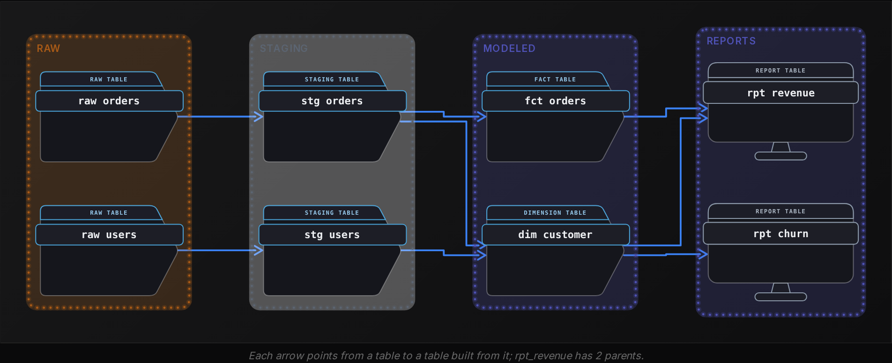
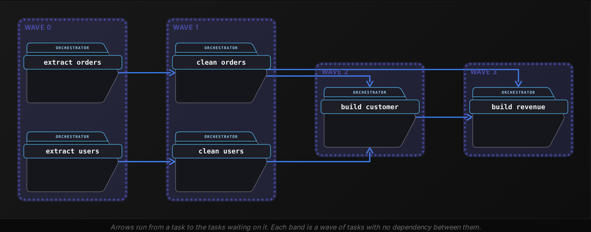

# Stacks & Queues: Intermediate

Priya is 40 minutes into her data engineering loop at Airbnb when the interviewer pastes a list of hourly booking counts for a single city and asks: for every hour, how many hours pass before the count goes higher? Her nested loop works on the sample. Then the interviewer describes the real input: a year of hours for every market, with long falling stretches where her loop compares almost every pair. Can she do it in a single pass? The follow-ups fill the rest of the hour: a queue built from 2 stacks, a stack that reports its minimum instantly, the order to rebuild tables after an upstream failure, and a metric formula stored as a string. Each one is a stack or a queue held to a specific invariant, and the interviewer is listening for that invariant and what it costs.


<br>

### What you will be able to do

Choose the stack order and pop comparison for next or previous greater or smaller, and state what a tie does

Build a queue from 2 stacks and prove its amortized O(1) cost by counting each item's stack operations

Implement a min-stack and a max-stack with O(1) extreme lookup that stays correct with duplicate values

Use deque-based BFS for lineage blast radius and Kahn's algorithm for run waves and cycle detection

Evaluate infix and postfix expressions with correct precedence, associativity and operand order


<br>

---

## Monotonic Stack Deep Dive

The beginner version of this pattern answers next-greater-element. Interview prompts rarely use that name. They ask how many days pass until a table's row count beats today's, how far back a latency spike reaches, or which earlier partition was the nearest smaller one. Every one of these runs the same loop, and that loop has exactly **2 settings**: the direction the stack is ordered in, and whether an equal value pops.


<br>

### The stack holds indexes still waiting for an answer

For a next-greater question, an index stays on the stack until something to its right beats it. That rule orders the stack by itself: if a smaller value sat below a larger one, the larger one's arrival would already have popped it. So the values behind the indexes never increase from bottom to top, which is what a decreasing stack means. When a new value arrives, it is the answer for every index on top that it beats, and each of those leaves as it is answered. Store indexes rather than values: the index gives you the distance `i - j` and the slot to write in the answer list, and the value is a single lookup away.

Here it is on 8 days of a table's loaded row counts, in millions. For each day, how many days until a strictly higher count? A day that is never beaten keeps 0.

https://github.com/user-attachments/assets/dc93c61a-fe11-4e09-9e5a-f91265434b28

*Each pop writes a waiting day's answer; whatever is left on the stack was never beaten.*

Watch days 1 and 2, both at 9 million. Day 2 does not pop day 1, because `9 < 9` is false, so they wait together, and day 3's 15 million answers both in the same run of the `while`: day 2 waits 1 day, day 1 waits 2. Day 3 itself sits through days 4, 5 and 6 and is answered by day 7's 20 million. The run ends with `wait` as `[3, 2, 1, 4, 2, 1, 1, 0]` and the stack holding `[7]`, the only day nothing beat.


<br>

### The comparison operator decides what a tie means

| Pop condition | Answer it computes | wait for [12, 9, 9, 15] |
| --- | --- | --- |
| counts[top] < c | next strictly higher | [3, 2, 1, 0] |
| counts[top] <= c | next higher or equal | [3, 1, 1, 0] |

Only day 1 changes on this input, from 2 to 1, because under `<=` the second 9 counts as a successor that is at least as high. Daily counts with flat weekends tie often, so on production data the operator changes many answers without raising any error. Ask before coding whether an equal value counts as higher, then write the operator that matches the reply.


<br>

### The same loop answers 4 questions

| Question | Stack values, bottom to top | Pop while top value is | Answer written |
| --- | --- | --- | --- |
| Next greater | Decreasing | < current | For each popped index, at pop time |
| Next smaller | Increasing | > current | For each popped index, at pop time |
| Previous greater | Decreasing | <= current | For the current index, after popping |
| Previous smaller | Increasing | >= current | For the current index, after popping |

A next answer lands on the popped index, because the current value is the first one to its right that beats it. A previous answer lands on the current index: once it has cleared away every earlier value that fails the test, whatever is left on top is the nearest earlier value that passes. That also explains why strictness flips between the 2 halves of the table. For previous strictly greater, you pop everything that is not strictly greater, and that test is `<=`.

#### Try it: how far back does a latency spike reach?

The list holds a service's daily p95 latency in milliseconds. A day's span counts the consecutive days, ending with that day, whose latency was at or below its own. That is a previous-greater question: the span stops at the nearest earlier day that was strictly higher. Predict the printed list before reading the paragraph under the code.

```sql
latency = [120, 90, 95, 80, 130, 100]
span = []
stack = []
for i, x in enumerate(latency):
    while stack and latency[stack[-1]] <= x:
        stack.pop()
    span.append(i - stack[-1] if stack else i + 1)
    stack.append(i)
print(span)
```

It prints `[1, 1, 2, 1, 5, 1]`. Day 2 (95 ms) pops day 1 (90 ms) and stops at day 0 (120 ms), so its span is 2. Day 4 (130 ms) pops days 3, 2 and 0, finds the stack empty, and takes `i + 1`, since every day so far was at or below it. Day 5 (100 ms) stops at day 4 without popping anything.


<br>

### A while inside a for, still linear

The inner `while` looks like it could make the loop quadratic. Count pops instead of loop iterations: every index is pushed exactly once and popped at most once, so across the entire run the `while` body executes at most n times in total. The nested-loop alternative has no such bound. Its worst input is a long falling run, where every day scans to the end of the list without finding a higher count.

- **~500B** — nested-loop checks, 1M falling days
- **2M** — pushes plus pops at most, same input

> **TIP**
>
> Say the invariant before writing the loop: the stack holds indexes still waiting for a higher value, so their values never increase from bottom to top. From that sentence the interviewer can check your pop condition, your tie rule and your cost argument together.


<br>

---

## Queue from Two Stacks

A FIFO queue built from 2 stacks fits in about 15 lines, so the interview spends its time on cost. The interviewer wants to hear why a single dequeue can move every stored item while the average cost per call stays constant. Production Python would use `collections.deque`. The 2-stack design earns its place in the loop because its cost argument, amortized analysis, is the one you need for any structure that occasionally does a large batch of work.


<br>

### Writes go to the inbox, reads come from the outbox

`enqueue` pushes onto `inbox`. `dequeue` pops from `outbox`. When `outbox` is empty, pour: pop every item off `inbox` and push it onto `outbox`. Pouring reverses order, turning a newest-on-top inbox into an oldest-on-top outbox. The design has 1 rule that matters, and it concerns timing: pour only when `outbox` is empty.

https://github.com/user-attachments/assets/0898824a-0ad8-4efd-b780-2288ff88a761

*Batches b1 to b4 leave in arrival order; moves counts the items poured from inbox to outbox.*

The first `dequeue` pays for 3 moves and returns `b1`. The next 2 calls pop `b2` and `b3` and move nothing. All that time `b4` sat in `inbox`, because pouring it earlier would have placed it on top of the older batches. It moves only after `outbox` runs dry, which is why the run ends at 4 moves for 4 batches.


<br>

### The bug: pouring while the outbox still holds items

The second version below pours on every `dequeue`, whether or not `outbox` is empty. Both start from the same state, right after `b1` left.

Pour only when outbox is empty

| Step | inbox | outbox | Returns |
| --- | --- | --- | --- |
| start | [] | [b3, b2] | - |
| enqueue b4 | [b4] | [b3, b2] | - |
| dequeue | [b4] | [b3] | b2 |

Pour on every dequeue

| Step | inbox | outbox | Returns |
| --- | --- | --- | --- |
| start | [] | [b3, b2] | - |
| enqueue b4 | [b4] | [b3, b2] | - |
| dequeue | [] | [b3, b2] | b4 |

In the second version, `b4` lands on top of `b2` and leaves first, so the newest batch jumps the line. A test that enqueues everything before the first dequeue never catches this, because `outbox` is always empty whenever it pours. Interleave enqueues and dequeues in any test of this class.


<br>

### Amortized O(1): follow a single item through its life

Track an item instead of an operation. It is pushed onto `inbox` once, popped off `inbox` once during a pour, pushed onto `outbox` once, and popped off `outbox` once when it is dequeued. Nothing ever travels back from `outbox` to `inbox`, so that list is complete: 4 stack operations per item over its whole life. Any sequence of calls that touches k items therefore costs at most 4k stack operations, a constant per call on average. The per-call table shows how unevenly that total is spread.

| Call | Stack operations in this call |
| --- | --- |
| enqueue b1 | 1 |
| enqueue b2 | 1 |
| enqueue b3 | 1 |
| dequeue, returns b1 | 7: 3 pops, 3 pushes, 1 pop |
| enqueue b4 | 1 |
| dequeue, returns b2 | 1 |
| dequeue, returns b3 | 1 |
| dequeue, returns b4 | 3: 1 pop, 1 push, 1 pop |
| Total | 16, which is 4 items times 4 |

#### When the average is the wrong promise

An amortized bound limits the total, never a single call. Enqueue a long run of events, dequeue once, and that call does all of the pouring while the calls after it do none. A batch consumer that drains the whole queue does not care. A consumer with a per-message latency budget does, so state both bounds: amortized O(1), worst case O(n). If the worst case is unacceptable, a doubly linked list or `collections.deque` gives O(1) on every call.

- **1,000,000** — moves in 1 dequeue after 1M enqueues
- **0** — moves in the 999,999 dequeues after it

#### peek and len follow the same rule

```sql
class TwoStackQueue:
    def _pour(self):
        if not self.outbox:
            while self.inbox:
                self.outbox.append(self.inbox.pop())

    def peek(self):
        self._pour()
        return self.outbox[-1]

    def __len__(self):
        return len(self.inbox) + len(self.outbox)
```

Moving the pour into a helper keeps `dequeue` and `peek` from drifting apart. On an empty queue, `peek` raises `IndexError: list index out of range` and `dequeue` raises `IndexError: pop from empty list`, so decide early whether that is the contract or whether both should return `None`.

> What a complete answer includes
>
> - Pour only when outbox is empty, and explain why arrival order survives.
> - Empty-queue behaviour decided up front: raise, or return None.
> - State amortized O(1) and worst case O(n) together.
> - Prove the bound per item: 4 stack operations across its lifetime, never more.


<br>

---

## Min-Stack and Max-Stack in O(1)

The task is a stack whose `push`, `pop`, `top` and `get_min` all run in O(1). Scanning for the minimum is O(n), so the minimum has to be remembered rather than searched for. Remembering works because a stack changes only at its top. While an item sits at depth d, nothing beneath it can change, so the minimum of the bottom d items stays fixed until that item is popped. Record that minimum at each depth, and every pop restores the previous one with no extra work.


<br>

### Option A: carry the running minimum on every entry

```sql
class PairMinStack:
    def __init__(self):
        self.items = []

    def push(self, x):
        low = min(x, self.items[-1][1]) if self.items else x
        self.items.append((x, low))

    def pop(self):
        return self.items.pop()[0]

    def get_min(self):
        return self.items[-1][1]
```

Each entry is a tuple of the value and the minimum of itself and everything beneath it, and `get_min` reads the top tuple. The price is a second slot on every entry, including entries that were never the minimum.


<br>

### Option B: a separate stack of minimums

Push onto `mins` only when the new value is at or below the current minimum. Pop from `mins` only when the value leaving the main stack equals the top of `mins`. The example holds event times, in minutes past the hour, for records staged before a write, so `get_min` returns the earliest staged event time.

https://github.com/user-attachments/assets/a586d7fe-aff3-456b-a503-58a26bf79fdb

*mins grows only on a new minimum or a tie, and shrinks only when that exact value leaves.*

The second 25 goes onto `mins` even though it does not lower the minimum. That copy keeps the answer right through the first 2 pops: when the top 25 leaves, `mins` still holds the 25 that belongs to the deeper entry, and `get_min` stays at 25 until that entry leaves too. Only then does it climb back to 40.


<br>

### Why the push test needs <=

| Push test | mins after 5 pushes | mins after 2 pops | get_min returns | Real minimum of [40, 25, 30] |
| --- | --- | --- | --- | --- |
| x <= mins[-1] | [40, 25, 25] | [40, 25] | 25 | 25 |
| x < mins[-1] | [40, 25] | [40] | 40 | 25 |

With `<`, the duplicate 25 never reaches `mins`, so popping the top 25 removes the only copy, and the stack reports 40 while a 25 is still inside it. There is no exception and no warning, only a wrong number. Inputs without repeated values pass every time, which is why interviewers put a repeat in their test case.

| ✓ Option A: pair entries | ✗ Option B: separate min stack |
| --- | --- |
| • Stores 2 values for every item<br><br>• pop needs no comparison<br><br>• Ties need no special rule<br><br>• Memory fixed at 2n whatever the input order | • Stores an extra value only on a new minimum or a tie<br><br>• pop compares the leaving value with mins[-1]<br><br>• Push test must be <= when values repeat<br><br>• Memory between n + 1 and 2n, depending on order |

- **2,000,000** — values held by Option A, 1M rising
- **1,000,001** — values held by Option B, 1M rising

On a falling input every push is a new minimum, and the 2 options tie at 2 values per item. Pick Option B when new minimums are rare relative to pushes, and Option A when you want a pop with no comparison to get wrong.


<br>

### Max-stack, and the pop_max follow-up

A max-stack flips both tests: push onto `maxes` when `x >= maxes[-1]`, and pop from it when the leaving value equals its top. A stack that answers both extremes keeps `mins` and `maxes` beside the main list, 3 lists in total. The usual follow-up is `pop_max`: remove the largest value wherever it sits. The auxiliary stack cannot do that in O(1), because every running maximum recorded above the removed item still names the removed value. Two standard answers exist. Pop into a temporary stack until the maximum surfaces, then push the rest back, at O(n) per call. Or keep a heap of `(-value, id)` next to the stack plus a set of removed ids, and discard removed ids lazily whenever either structure reaches one, at O(log n) per call. Choose by how often `pop_max` is called relative to `push`.

#### Combine it with the 2-stack queue

Build the inbox and outbox from the previous section out of min-stacks, and the queue's minimum is the smaller of their 2 minimums. Enqueue, dequeue and minimum all become amortized O(1), which answers a question such as the earliest event time among records still waiting in arrival order.

> **TIP**
>
> When the prompt says values can repeat, read it as a hint about 2 lines of your code: `<=` in the push and `==` in the pop. Push a duplicate minimum, pop it once, and call `get_min` before you say you are done.


<br>

---

## BFS with Deque for Graph Problems

Graph questions in data engineering interviews arrive dressed as operations problems. A source table loaded bad data: which tables downstream must be rebuilt, and how many hops away is each one? Four hundred tasks have declared dependencies: in what order can they run, and which ones can run at the same time? The first is BFS over a lineage graph. The second is Kahn's algorithm, which is BFS driven by in-degree counts. Both keep their frontier in a `collections.deque`.


<br>

### Blast radius: BFS over table lineage



BFS from the broken table finds the blast radius, and FIFO makes each hop count a shortest distance. Use it for triage and to tell consumers how indirect their exposure is. Rebuild order differs: a table 1 hop away can depend on one 3 hops away, so Kahn's algorithm sets it.

https://github.com/user-attachments/assets/71f65ffb-6ad9-4cb9-8c25-f930001bd53d

*hops is the visited set and the answer at once; a table enters the queue the moment it is discovered.*

`rpt_revenue` is discovered from `fct_orders` at hop 3. When `dim_customer` offers it again, `hops` already contains it, so the second edge adds nothing. `raw_users` and `stg_users` never appear: BFS follows arrows forward only, and they sit upstream or to the side of the failure. For the upstream question, which sources feed this report, run the same code on the reversed graph.


<br>

### Mark a table when it enters the queue

Some solutions add to the visited set when a table is dequeued instead. The set of tables found is the same, but the queue is not. In this graph `rpt_revenue` would enter twice. Now picture 100 staging tables that each feed the same 100 marts: marking on dequeue, every staging table pushes all 100 marts, and the queue receives 10,000 entries, 1 per edge. Marking on enqueue caps the entries at 1 per table, 100 here, which keeps memory at O(V) instead of O(E).

#### Why deque and not a list

list.pop(0) removes the first element and then shifts every remaining element one slot to the left, so each call costs O(n). Draining a 50,000-entry frontier that way performs about 1.25 billion element shifts in total. deque.popleft() unlinks the leftmost element in O(1), and deque.append() is O(1) as well, which keeps the whole traversal at O(V + E).


<br>

### Run order: Kahn's algorithm in waves



A task's in-degree is the number of its upstream tasks that have not finished. Every task at 0 is ready. Take the ready tasks, mark them done, and subtract 1 from each child's in-degree; a child that reaches 0 joins the ready queue. Draining the queue a full level at a time, instead of task by task, groups the output into waves, and the tasks inside a wave share no dependency, so they can run in parallel.

```sql
from collections import deque

upstream = {
    "extract_orders": [],
    "extract_users": [],
    "clean_orders": ["extract_orders"],
    "clean_users": ["extract_users"],
    "build_customer": ["clean_orders", "clean_users"],
    "build_revenue": ["clean_orders", "build_customer"],
}

children = {task: [] for task in upstream}
indegree = {task: len(parents) for task, parents in upstream.items()}
for task, parents in upstream.items():
    for parent in parents:
        children[parent].append(task)

ready = deque(t for t, d in indegree.items() if d == 0)
wave, done = 0, 0
while ready:
    batch = [ready.popleft() for _ in range(len(ready))]
    print(wave, batch)
    for task in batch:
        done += 1
        for child in children[task]:
            indegree[child] -= 1
            if indegree[child] == 0:
                ready.append(child)
    wave += 1

if done < len(upstream):
    print("cycle among:", [t for t, d in indegree.items() if d > 0])
```

It prints 4 waves, matching the bands in the diagram: both extracts, then both cleans, then `build_customer`, then `build_revenue`. The last task waits for `build_customer` even though `clean_orders` finished 2 waves earlier, because its in-degree reaches 0 only when the last of its 2 parents is done.

Now make it fail. Add `build_revenue` to the upstream list of `build_customer`. Predict how many waves print and what the final line says, then check the next paragraph.

Waves 0 and 1 print exactly as before. After wave 1, `build_customer` sits at in-degree 1 and so does `build_revenue`, each waiting on the other, so the queue empties with 2 tasks never run. `done` is 4 against 6 tasks, and the last line is `cycle among: ['build_customer', 'build_revenue']`. Comparing finished tasks with the total is the entire cycle check, and the tasks still above 0 are the ones on a cycle or downstream of one.

> Numbers to state in the answer
>
> - BFS and Kahn both run in O(V + E): each node is dequeued once and each edge examined once.
> - Mark on enqueue and the queue never holds more than V entries.
> - The wave count equals the number of tasks on the longest dependency chain.
> - The widest wave is the worker count at which no ready task has to wait.


<br>

---

## Stack-Based Expression Evaluation

Metric definitions often live as strings: a config file holds `(gross_bookings - refunds) / nights`, and the pipeline must compute it for every row. Calling Python's `eval` on that string would run any code an analyst types, so the interview asks you to evaluate it yourself. The tool is a pair of stacks, and the decisions the question turns on are operator precedence, associativity and operand order.


<br>

### Postfix first: 1 stack, no precedence rules

In postfix notation, also called reverse Polish, each operator follows its operands, so position alone fixes the order of operations. `900 60 - 12 / 5 2 * -` means the same as `(900 - 60) / 12 - 5 * 2`. Push each number; on an operator, pop 2 values, apply the operator, and push the result.

| Token | Action | Stack after |
| --- | --- | --- |
| 900 | push | [900] |
| 60 | push | [900, 60] |
| - | 900 - 60 | [840] |
| 12 | push | [840, 12] |
| / | 840 / 12 | [70] |
| 5 | push | [70, 5] |
| 2 | push | [70, 5, 2] |
| \* | 5 \* 2 | [70, 10] |
| - | 70 - 10 | [60] |

The first value popped is the right operand. Pop them the other way round and the first `-` computes 60 - 900, leaving -840 on the stack, and every later step carries the error forward. For `+` and `*` the mistake is invisible, which is why a test with only addition passes.


<br>

### Infix: an operand stack and an operator stack

Infix input needs a second stack for operators that cannot run yet. Four rules cover it. A number goes onto `nums`. An opening parenthesis goes onto `ops`. A closing parenthesis applies operators until the matching opening one surfaces, then discards it. An operator first applies every waiting operator on top of `ops` whose precedence is at least its own, then pushes itself. At the end, apply whatever is left. This is Dijkstra's shunting-yard algorithm with its output step replaced by evaluation.

https://github.com/user-attachments/assets/3265b72e-8ac1-49de-b54f-74b2dbe2f176

*Each apply_top pops 1 operator and 2 numbers and pushes 1 result.*

At `/`, `ops` is empty, so it waits. At the second `-`, the `/` on top has higher precedence and runs first: 840 / 12 is 70. At `*`, the `-` on top has lower precedence, so `*` stacks above it and runs first when the input ends: 5 \* 2 is 10, then 70 - 10 prints `60.0`. `PREC.get(ops[-1], 0)` gives an opening parenthesis precedence 0, which makes it a floor that no operator pops past.


<br>

### Associativity lives in 1 comparison

| Pop while top precedence is | 100 - 20 - 30 evaluates to | Grouping |
| --- | --- | --- |
| >= new operator | 50.0 | (100 - 20) - 30 |
| > new operator | 110.0 | 100 - (20 - 30) |

Subtraction and division are left-associative, so equal precedence must pop: the earlier operator runs before the later one is pushed. With `>`, equal operators pile up and run right to left, and the result is wrong with no error. Exponentiation is the usual exception: `2 ^ 3 ^ 2` means `2 ^ (3 ^ 2)`, so a right-associative operator uses `>` against operators of its own level.

#### From a formula string to tokens

```sql
import re

TOKEN = re.compile(r"\d+(?:\.\d+)?|[A-Za-z_]\w*|[()+\-*/]")


def tokenize(formula, row):
    return [str(row[t]) if t[0].isalpha() or t[0] == "_" else t
            for t in TOKEN.findall(formula)]


row = {"gross_bookings": 900, "refunds": 60, "nights": 12}
tokens = tokenize("(gross_bookings - refunds) / nights", row)
print(tokens)
print(evaluate(tokens))
```

With `evaluate` from the animation above, it prints `['(', '900', '-', '60', ')', '/', '12']` and then `70.0`. Predict 2 failures before reading on: the same row with the formula's `nights` mistyped as `night`, and the correct formula on a row where `nights` is 0.

The typo stops inside `tokenize` with `KeyError: 'night'`, because each name is looked up in the row dict. The zero row tokenizes cleanly and fails inside `apply_top` with `ZeroDivisionError: float division by zero`, since `float('0')` is 0.0 and the division runs on floats.

#### Parse once, evaluate per row

At 10M rows, tokenizing and running the operator stack for every row repeats identical work 10M times, since the formula never changes between rows. Run the operator stack once to emit the formula in postfix order, keeping names in place of numbers, then evaluate each row with the single-stack loop from the start of this section, looking each name up in that row. The per-row cost drops to 1 pass over a short token list with 1 stack.

> Follow-ups to expect
>
> - Unary minus: a `-` at the start, after `(`, or after another operator negates the value that follows.
> - Malformed input: a `(` still on `ops`, or more than 1 value on `nums`, when the input ends.
> - Stray characters: `findall` skips anything that matches no pattern, so validate the whole string first.
> - Bad rows: agree whether a zero divisor raises, yields null or goes to a reject table.

> **TIP**
>
> Write the precedence dict and the pop test first, and say them aloud: 4 operators mapped to 2 levels, and `>=` so equal levels run left to right. Both bugs shown above live in those lines or in operand order, and stating them early lets the interviewer correct you before the loop exists.


<br>

---

## Putting It All Together

A short-term rental marketplace's bookings source loads a partition with duplicated rows at 02:00, and the on-call data engineer has until the 08:00 dashboard refresh to repair everything built on it. She needs the set of affected tables and how far each sits from the source, a rebuild order that runs independent tables in parallel, the earliest event time among corrected records still waiting to be written, the nightly metrics recomputed from formulas stored in config, and an anomaly review of the corrected hourly counts.

- BFS from the bookings source over the lineage graph returns every affected table with its hop count, and marking on enqueue keeps the frontier at 1 entry per table.
- Kahn's algorithm over the affected tables turns the rebuild into waves; the widest wave sets the worker count, and a leftover in-degree flags a dependency cycle before anything runs.
- Corrected records wait in a queue built from 2 min-stacks, so the earliest pending event time is known in amortized O(1) as records arrive and leave.
- Each metric formula is parsed once into postfix with the operator stack, then evaluated per row with a single stack, with zero divisors handled as agreed before coding.
- The anomaly review asks, for each corrected hourly count, how many hours passed before a higher one: a decreasing monotonic stack with the tie rule agreed with the analysts.


<br>

---

## Key Takeaways

- A monotonic stack holds indexes still waiting for an answer; the pop comparison sets both the stack's order and how ties are treated.
- Next answers are written for the popped index, previous answers for the current one.
- A 2-stack queue pours only into an empty outbox, costs 4 stack operations per item for life, and has an O(n) worst-case dequeue.
- Min and max stacks record the extreme at each depth; the auxiliary version needs <= on push and == on pop.
- BFS with a deque gives the blast radius with shortest hop counts, and marking on enqueue keeps the queue at V entries or fewer.
- Kahn's algorithm drains the ready queue in waves, and a finished count below the task total means a cycle.
- Expression evaluation pops the right operand first, and >= in the pop test makes equal-precedence operators run left to right.
