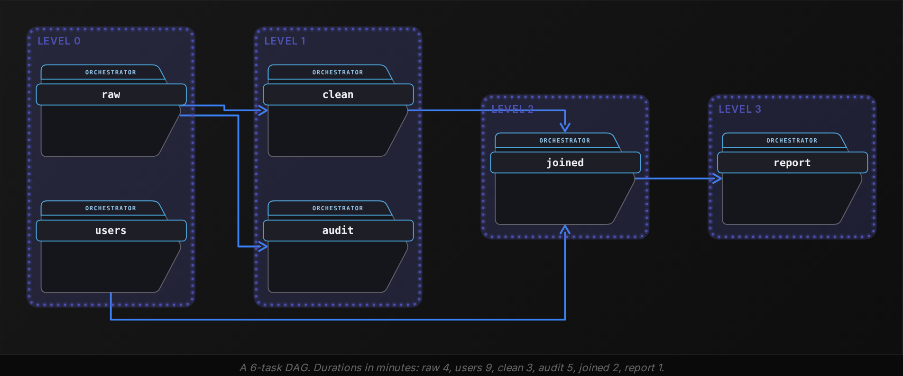
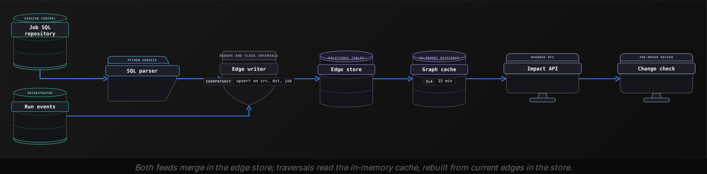

# Tree Traversal: Advanced

40 minutes into her onsite at Airbnb, Ines watches the interviewer paste a dict into the shared editor: 900 pipeline tasks, each mapped to the tasks that consume its output, and a stub named `build_order`. Return an order the scheduler can run, or show why none exists. The follow-ups arrive one after another. Run the independent tasks at once on 8 workers, and say how long the night takes. A nightly table changed its schema: which dashboards break, and who gets paged? When the report query runs, what does the engine do with its WHERE clause? Each follow-up is the same skill in a new costume: walk a graph or a tree in an order its edges allow, and know what that walk costs. Ines has written traversals before. Today she has to defend which one, and why.


<br>

### What you will be able to do

Detect cycles in a dependency graph with 3-color DFS, report the exact cycle path, and choose between DFS and Kahn's algorithm.

Build a segment tree in a flat array and answer range queries and point updates in O(log n), including the identity-element trap.

Schedule a DAG across a fixed number of workers, rank ready tasks by longest tail, and prove a makespan with 2 lower bounds.

Push predicates down a query plan tree and name the joins and aggregates where pushing changes the result.

Design a lineage graph store that versions its edges and merges its ingestion feeds, then answer impact questions with a bounded BFS.


<br>

---

## DAG Traversal with Cycle Detection

The prompt rarely says graph. It hands you a dict such as {"clean": ["joined"]} and asks for a build order. Another version lists Python modules and wants the circular import found; a third gives course prerequisites and asks whether a student can finish. Each is a directed graph, and the answer is a **topological order** or evidence that none exists. The evidence worth giving is the cycle itself, written as a path an engineer can open and fix.


<br>

### Why a visited set raises false alarms

In an undirected graph, reaching an already visited node other than the parent means a cycle. Carry that rule into a directed graph and it fires on healthy pipelines. Take the running example: `raw` feeds `clean`, `clean` feeds `joined`, `users` also feeds `joined`, and `joined` feeds `report`. A walk from `raw` visits `joined`. A later walk from `users` reaches `joined` again, a visited node, yet no task depends on itself. That second arrival is a cross edge between 2 branches, and the fix is a third state that separates nodes on the current path from nodes already finished.

| Color | Meaning | An edge into it during DFS |
| --- | --- | --- |
| WHITE | Not discovered yet | Tree edge: recurse into it |
| GRAY | On the current recursion path | Back edge: a cycle exists |
| BLACK | Finished, every descendant done | Cross or forward edge: skip it |

A node turns BLACK only after every node it can reach is BLACK, so appending it at that moment records the finish order, consumers before producers. Edges here point from producer to consumer, so reversing the finish order runs every task after all of its inputs. Each node and edge is handled once: O(V + E) time, and O(V) space for the colors and the path.

Before you play the animation, write down the list it prints. The outer loop starts walks in dict order, so `raw` goes first and `users` second; watch the color of `joined` when the walk from `users` reaches it.

https://github.com/user-attachments/assets/2c893034-fdfb-4e63-b8f9-95c46b533255

The finish order is `report`, `joined`, `clean`, `raw`, `users`, so the program prints `['users', 'raw', 'clean', 'joined', 'report']`. When the walk from `users` arrives, `joined` is already BLACK and the edge is skipped: the exact case where a lone visited set would report a cycle that does not exist.


<br>

### Predict the failure

Change `"report": []` to `"report": ["clean"]` and run the program again. The walk from `raw` reaches `report` with the whole path still GRAY, from `raw` and `clean` down to `joined` and `report`, then finds `clean` GRAY. Slicing the path from the index of `clean` drops `raw`, which leads into the loop without belonging to it, and the traceback ends with `ValueError: clean -> joined -> report -> clean`. That message names 3 tasks and the edge to cut. A bare `False` leaves the on-call engineer hunting the loop by hand.


<br>

### Kahn's algorithm, the other answer

Kahn's algorithm peels the graph from its sources. Count each node's incoming edges and queue the nodes with none. Whenever a node leaves the queue, its children each lose 1 incoming edge, and any child left at 0 joins the queue. If the finished order is shorter than the graph, the leftovers sit on a cycle or behind one.

```sql
from collections import deque


def kahn(graph):
    indegree = {node: 0 for node in graph}
    for node in graph:
        for nxt in graph[node]:
            indegree[nxt] += 1
    queue = deque(sorted(n for n, d in indegree.items() if d == 0))
    order = []
    while queue:
        node = queue.popleft()
        order.append(node)
        for nxt in graph[node]:
            indegree[nxt] -= 1
            if indegree[nxt] == 0:
                queue.append(nxt)
    if len(order) < len(graph):
        stuck = sorted(n for n, d in indegree.items() if d > 0)
        raise ValueError("cycle among " + ", ".join(stuck))
    return order
```

On the graph with the new `report` to `clean` edge, the queue releases `raw`, then `users`, and empties while `clean` and `joined` still hold 1 incoming edge each, as does `report`. The error reads `cycle among clean, joined, report`. The stuck set equals the cycle here only by luck. Give `report` a child named `dash` and `dash` stays stuck too, with 1 incoming edge from inside the loop, though it belongs to no cycle.

| ✓ 3-color DFS | ✗ Kahn's algorithm |
| --- | --- |
| • Returns the exact cycle path from the GRAY nodes on the stack<br><br>• Recursion depth equals the longest chain, and CPython's default recursion limit is 1,000<br><br>• Output order follows dict iteration, so sort neighbours when a test compares orders | • Iterative, so a long chain never meets a recursion limit<br><br>• Names stuck nodes, including innocent ones downstream of the cycle<br><br>• Exposes the ready set at every step, which a parallel scheduler needs |

> What the grader listens for
>
> - Edge direction stated before any code: producer to consumer, or the reverse
> - Every node starts a walk if still WHITE, so disconnected components are covered
> - Nodes that appear only as targets get keys first, or looking up `nxt` raises KeyError
> - A cycle reported as a path, and the choice of DFS or Kahn justified

> **TIP**
>
> Raising `sys.setrecursionlimit` lets a deep chain recurse further, but past some depth the interpreter's own C stack overflows and the process crashes. For lineage graphs with chains in the thousands, run the 3-color walk on an explicit stack of (node, neighbour iterator) pairs.


<br>

---

## Segment Tree for Range Queries

An events table is bucketed by hour, dashboards ask for the total over any window of hours, and late events keep revising hours that already closed. You need to support both operations faster than a rescan. The question tests whether you can name what each candidate structure gives up, then build the one whose cost fits the workload.

| Structure | Range query | Point update | Fails when |
| --- | --- | --- | --- |
| Rescan the bucket list | O(n) | O(1) | queries outnumber updates |
| Prefix sum array | O(1) | O(n) | late updates are frequent, or the operation is min or max |
| Segment tree | O(log n) | O(log n) | the bucket count changes often, forcing an O(n) rebuild |

Prefix sums answer a window as `prefix[hi] - prefix[lo]`, which works because subtraction cancels everything before the window. Minimum has no such inverse: the minimum of hours 0 to 9 and the minimum of hours 0 to 3 say nothing about hours 4 to 9. A segment tree asks less of the operation. It needs associativity and an identity value: sum with 0, min with positive infinity, max with negative infinity.


<br>

### The tree as a flat array

For n buckets, allocate `2n` cells. The leaves sit at indexes `n` to `2n - 1`, node `i` has children `2i` and `2i + 1`, its parent is `i  2`, and cell 0 stays unused. Building from index `n - 1` down to 1 guarantees both children exist before their parent: a postorder traversal carried out by arithmetic, with no node objects and no recursion. This bottom-up layout handles any n for commutative operations such as sum and min. The example holds 8 hourly counts.

| Level | Cells as index: value |
| --- | --- |
| Root | 1: 36 |
| Level 1 | 2: 17, 3: 19 |
| Level 2 | 4: 8, 5: 9, 6: 7, 7: 12 |
| Leaves, hours 0 to 7 | 8: 5, 9: 3, 10: 7, 11: 2, 12: 6, 13: 1, 14: 4, 15: 8 |

Windows are half-open, so `query(2, 6)` covers hours 2 through 5. Before playing, predict which cells the query reads. Then predict the second printed number, after hour 3 is revised from 2 to 10.

https://github.com/user-attachments/assets/b03a72fc-def1-4056-8e15-bbb133ea067b

Both pointers climb a level per loop. An odd `lo` is a right child whose parent also covers hours left of the window, so its own cell is added and `lo` steps right. An odd `hi` means the cell at `hi - 1` is a left child whose parent spills past the window, so that cell is taken alone. The first query reads cells 5 and 6, 2 reads for 4 hours, and prints 16. The update rewrites leaf 11 and then climbs to the root at 1, rewriting 5 and 2 on the way, so the same query then prints 24.


<br>

### The bug planted in the follow-up

Asked for range minimum instead, you swap `+` for `min` in the build and the update, and again in the query. Predict what `query(2, 6)` returns if `total = 0` survives the edit. Every count is positive, so `min(0, ...)` returns 0 for every window. The identity belongs to the operation, and the fix is `total = float("inf")`. Saying identity and associativity out loud is what the follow-up rewards.

A further follow-up asks to add a value to every bucket in a window, such as a backfill that adds 5 events to hours 2 through 5. Point updates cost O(k log n) for k buckets. Lazy propagation keeps it at O(log n): each internal node stores a pending addition and hands it to its children only when a later query or update descends through that node. In the interview, naming lazy propagation and its cost is enough; write it only if asked.

Scale it to 2^20 per-minute buckets, around 2 years of minutes, and the tree's costs stay small enough to keep in a single process.

- **21** — cells rewritten per point update
- **2,097,152** — array cells the tree allocates

> Where the structure appears in data work
>
> - In-memory metric stores serving window sums while late events revise old buckets
> - Range minimum or maximum over price ticks, where prefix sums cannot help
> - Hourly rollups nested inside daily and monthly ones: any window is a few whole rollups plus 2 ragged edges


<br>

---

## Parallel Topological Execution

After the build order comes the follow-up: run it as fast as possible on 2 workers. A topological order is a single line of names, and an executor needs something richer, the set of tasks whose inputs have all finished, at every moment. Kahn's in-degree counters, kept current as tasks complete, are that set.




<br>

### The event-driven executor loop

The loop keeps 3 structures: `need`, each task's count of unfinished inputs; `ready`, tasks at 0 waiting for a worker; and `running`, a heap keyed by finish time. Fill free workers from `ready` and advance the clock to the earliest finisher. That task's children each lose 1 from their count, and any child that reaches 0 goes onto `ready`. The only open decision is which ready task takes a free worker, and `run` receives that decision as a ranking.

Predict both printed numbers before playing. The first run ranks every task equally, so ties fall to alphabetical order. The second ranks each task by its tail: its own duration plus the longest chain of durations after it.

https://github.com/user-attachments/assets/83f1e9cb-067c-4d65-b9ef-6871ab0b0506

Alphabetical order prints 15. When `raw` finishes at minute 4, a worker comes free with `audit` and `clean` both ready; `audit` wins the tie and holds that worker until 9, so `clean` runs 9 to 12, `joined` 12 to 14 and `report` 14 to 15. Tail ranking prints 12: `clean` runs 4 to 7, `audit` 7 to 12, `joined` 9 to 11 and `report` 11 to 12. Both runs use the same tasks and the same workers, so the 3 minutes come entirely from how the tie was broken.

| Task | Duration | Tail |
| --- | --- | --- |
| raw | 4 | 10 |
| users | 9 | 12 |
| clean | 3 | 6 |
| audit | 5 | 5 |
| joined | 2 | 3 |
| report | 1 | 1 |

- **24 min** — total work across the 6 tasks
- **12 min** — longest tail, users through report

No schedule can beat the larger of 2 floors: the longest tail, and total work divided among the workers. The figures above put both floors on the same minute, so tail ranking is optimal for this graph and the proof fits in a sentence. They also price the next request: a third worker lowers the work floor and leaves the chain floor where it stands, so it buys nothing.

For arbitrary durations and a fixed worker count, finding the optimal schedule is NP-hard, so production schedulers use priority rules. Longest tail is the standard one, and the 2 floors bound how far from optimal any given schedule can be.


<br>

### Why lockstep layers lose

A common first answer runs the graph level by level: every task with no inputs, then every task whose inputs were all in that first level, and so on. With 2 workers, level 0 (`raw`, `users`) ends at 9 and level 1 (`clean`, `audit`) at 14. After that `joined` finishes at 16, and `report` at 17. The event-driven loop starts `clean` the moment `raw` finishes at minute 4, without waiting on the slowest member of its level.


<br>

### Running it for real: failures and a worker cap

```sql
import asyncio


async def execute(children, indeg, run_task, workers):
    need = dict(indeg)
    ready = [t for t, d in need.items() if d == 0]
    running = {}
    failed = set()
    while ready or running:
        while ready and len(running) < workers:
            name = ready.pop()
            running[asyncio.create_task(run_task(name))] = name
        done, _ = await asyncio.wait(running, return_when=asyncio.FIRST_COMPLETED)
        for task in done:
            name = running.pop(task)
            if task.exception() is not None:
                failed.add(name)
                continue
            for child in children[name]:
                need[child] -= 1
                if need[child] == 0:
                    ready.append(child)
    return failed
```

Each task is a coroutine that submits work, such as a query, and awaits the result, so a single event loop can supervise many of them. `asyncio.wait` with `FIRST_COMPLETED` returns as soon as any task ends, the real-world version of the heap pop. A failed task never decrements its children, so its whole downstream cone keeps a nonzero count and never starts, while independent branches carry on. If `clean` raises, `joined` and `report` never start and the function returns a set holding `clean`. Outside that cone, `raw` and `users` succeed, and so does `audit`. Work that computes inside Python belongs in separate processes, since a coroutine busy computing blocks the loop.

| ✓ Do | ✗ Don't |
| --- | --- |
| • Rank ready tasks by longest tail, so the critical chain never waits for a worker<br><br>• Cap concurrency at what the shared database absorbs, then compare against the chain floor<br><br>• Skip a failed task's descendants and let independent branches finish<br><br>• Make every task idempotent, so a retry after a crash rewrites the same partition | • Run levels in lockstep, where 1 slow task stalls the whole next level<br><br>• Release children when a task starts; only completion satisfies a dependency<br><br>• Add workers past the chain floor and expect a faster run |


<br>

---

## Tree-Based Query Optimization

The question arrives as "why is this query slow", as "write a rule that moves filters down a plan", or as "what happens to my WHERE clause before any data is read". All 3 concern the same tree. A query plan has scans at its leaves and operators above them, with rows flowing upward. Every optimizer rule is a traversal that matches a pattern in the tree and rewrites that subtree.

```sql
SELECT
  u.country,
  SUM(o.total) AS revenue
FROM orders AS o
JOIN users AS u
  ON o.user_id = u.user_id
WHERE o.status = 'paid'
  AND u.country = 'DE'
GROUP BY u.country
```

Read bottom up, the plan a parser produces is: scan `orders`, scan `users`, join them, filter on both predicates, aggregate. Suppose `orders` holds 50,000,000 rows and 2% are paid. The join then processes all 50,000,000 order rows, and the filter above it discards every unpaid row the join produced. Move the status filter below the join and the join reads 1,000,000 order rows.


<br>

### Pushdown as a recursive rewrite

The toy plan below uses tuples. Each node is `("scan", table)` or `("filter", predicate, child)` or `("join", left, right, how)`, and a predicate carries its SQL text and the tables it references. `push` rewrites children first, so each subtree is final before its parent decides. A filter whose tables all live in the left input moves there; for an inner join, a filter on the right input's tables moves into the right input. Calling `push` again on the moved filter lets it keep sinking through deeper joins.

```sql
def tables(n):
    if n[0] == "scan":
        return [n[1]]
    return tables(n[2]) if n[0] == "filter" else tables(n[1]) + tables(n[2])


def push(n):
    if n[0] == "scan":
        return n
    if n[0] == "join":
        return ("join", push(n[1]), push(n[2]), n[3])
    pred, child = n[1], push(n[2])
    if child[0] == "join":
        left, right, how = child[1], child[2], child[3]
        if all(t in tables(left) for t in pred[1]):
            return ("join", push(("filter", pred, left)), right, how)
        if how == "inner" and all(t in tables(right) for t in pred[1]):
            return ("join", left, push(("filter", pred, right)), how)
    return ("filter", pred, child)


def show(n, depth=0):
    if n[0] == "scan":
        print("  " * depth + "Scan " + n[1])
        return
    head = "Filter " + n[1][0] if n[0] == "filter" else n[3].upper() + " JOIN"
    print("  " * depth + head)
    for kid in ([n[2]] if n[0] == "filter" else [n[1], n[2]]):
        show(kid, depth + 1)


join = ("join", ("scan", "orders"), ("scan", "users"), "inner")
plan = ("filter", ("users.country = 'DE'", ["users"]), join)
plan = ("filter", ("orders.status = 'paid'", ["orders"]), plan)
show(push(plan))
```

The plan stacks the status filter on the country filter on an inner join. Predict the printed lines, with their indentation, before reading the right-hand table below.

Plan as built

| Depth | Node |
| --- | --- |
| 0 | Filter orders.status = 'paid' |
| 1 | Filter users.country = 'DE' |
| 2 | INNER JOIN |
| 3 | Scan orders |
| 3 | Scan users |

Printed after push

| Depth | Node |
| --- | --- |
| 0 | INNER JOIN |
| 1 | Filter orders.status = 'paid' |
| 2 | Scan orders |
| 1 | Filter users.country = 'DE' |
| 2 | Scan users |

The country filter is rewritten first, because it sits lower, and lands above `Scan users`. The status filter then meets the join and lands above `Scan orders`. Each filter now runs before the join, on 1 table's rows.


<br>

### Where the rewrite changes the answer

Now change `"inner"` to `"left"` in the `join` line and predict again. Nothing moves: the 5 lines come back in their built order. The country filter references the null-supplying side of a LEFT JOIN, and pushing it into the `users` input would keep orders from outside DE as rows with NULL user columns, rows the WHERE above the join drops. The status filter is safe to push, yet it sits stuck behind the country filter, because `push` inspects only the node directly under a filter.

Real optimizers escape that trap in 2 ways. They split the WHERE clause into its AND-ed conjuncts, so each conjunct moves on its own. They also notice that `u.country = 'DE'` rejects NULLs, which lets the LEFT JOIN become an INNER JOIN before any pushing starts.

| Filter sits above | Push below it? | Why |
| --- | --- | --- |
| Inner join, columns from 1 side | Yes, into that side | Filtering before or after matching keeps the same pairs |
| Left join, preserved side's columns | Yes, into the left input | Unmatched left rows are dropped the same either way |
| Left join, null-supplying side's columns | Only if the filter rejects NULLs, after turning the join inner | Pushing keeps NULL-extended rows the WHERE would drop |
| Aggregate, a GROUP BY key | Yes, below the aggregate | Each group is kept or dropped whole |
| Aggregate, a SUM or COUNT result | No | The value exists only after aggregation |


<br>

### The other trees the optimizer searches

Join order is a choice of tree shape. A left-deep plan joins 2 tables, then adds 1 table at a time; a bushy plan may join 2 pairs separately and then join the results. The number of orders grows factorially with the table count, so optimizers combine table statistics with dynamic programming over small subsets and greedy rules past that. Pushdown also continues below the plan into storage: a filter that reaches a scan becomes partition pruning, which skips whole date partitions, and a min/max check that skips row groups inside columnar files.

- **3,628,800** — left-deep join orders for 10 tables
- **479,001,600** — left-deep join orders for 12 tables

> Reading a slow plan from EXPLAIN
>
> - Read the tree bottom up and find the operator where row counts peak
> - Check whether each filter reached its scan or sits stuck above a join
> - A function wrapped around the partition column can hide it from pruning
> - Confirm the smaller filtered input is the build side of the hash join


<br>

---

## Design a Lineage Graph System

The prompt asks you to design a system that answers which downstream tables break when this table changes, along with the dashboards and models built on them, and who to tell. Spend the opening minutes on scope, because the data model follows from the questions the system must answer.

Questions to pin down first

- Impact: every downstream table, column, dashboard and model of a node, by hop distance
- Root cause: every upstream job that fed a broken dashboard in its last run
- Point in time: lineage as it stood on a past date, for audits and incident reviews
- Ownership: who to notify for each affected node, ranked by how critical its consumers are


<br>

### Data model


Each table and column is a node, and so is each job and dashboard. An edge says data moved from `src_id` to `dst_id` through `job_id`. When a job's SQL changes, the writer closes its old edges by setting `valid_to` and inserts new ones, so the current graph is every edge with `valid_to IS NULL`, and the graph on a past date is every edge whose interval contains that date. Column nodes point to their table through `parent_id`, which makes table-level lineage a projection: group the column edges by their parents.


<br>

### Ingestion: 2 sources, 2 blind spots

| ✓ Parsing each job's SQL | ✗ Events emitted by each run |
| --- | --- |
| • Sees every path in the code, including branches not yet run<br><br>• Misses SQL assembled at runtime from string templates<br><br>• Resolves SELECT \* into column edges by reading the catalog schema | • Records each run that actually happened, including its run id and row count<br><br>• Misses paths that have not executed since the last change<br><br>• Arrives only after a run, so a check on a proposed change sees nothing |

Merge both feeds into a single store and tag each edge with its source. An edge only the parser saw is a path that has not run since the change; an edge only runtime saw points at SQL the parser could not resolve, which is worth an alert of its own.




<br>

### Impact analysis as bounded BFS

Impact is a breadth-first walk downstream from the changed node. A dict from node to hop count is both the visited set and the report, and a depth cap bounds the walk. The visited check is required even though each individual run is acyclic: `stg.orders` is incremental and reads its own previous state, so the stored graph carries a self-loop.

```sql
from collections import deque

edges = {
    "raw.orders": ["stg.orders"],
    "stg.orders": ["fct.revenue", "fct.refunds", "stg.orders"],
    "fct.revenue": ["dash.exec", "ml.forecast"],
    "fct.refunds": ["dash.exec"],
    "dash.exec": [],
    "ml.forecast": [],
}


def impact(start, max_depth):
    depth = {start: 0}
    queue = deque([start])
    while queue:
        node = queue.popleft()
        if depth[node] == max_depth:
            continue
        for nxt in edges[node]:
            if nxt not in depth:
                depth[nxt] = depth[node] + 1
                queue.append(nxt)
    return depth


for node, hops in impact("stg.orders", 3).items():
    print(hops, node)
```

Predict the output before reading on; `dash.exec` is reachable along 2 paths. The program prints 5 lines. `stg.orders` sits at 0, `fct.revenue` and `fct.refunds` are 1 hop out, and `dash.exec` and `ml.forecast` are 2 hops away. BFS reaches `dash.exec` first through `fct.revenue`, so the later arrival from `fct.refunds` changes nothing, and the self-loop is skipped because `stg.orders` is already a key.

```sql
def walk(node, out):
    out.append(node)
    for nxt in edges[node]:
        walk(nxt, out)
```

Predict what `walk("stg.orders", [])` does. It appends `dash.exec` twice, then follows the self-loop back into `stg.orders` again and again until the traceback ends in `RecursionError`. Delete the self-loop and it terminates, but its cost now grows with paths instead of nodes: a chain of 30 diamonds has 2^30, about 1.07 billion, distinct paths.


<br>

### Scale: hubs and precomputation

A hub such as a users dimension read by thousands of jobs turns every impact query on it into most of the warehouse. Return counts grouped by depth and by owner first, page the node list behind them, and lean on column-level edges: a change to `orders.coupon_code` reaches only jobs that read that column. A graph of 1,000,000 edges, each 2 ids of 8 bytes, is 16 MB of raw ids, so a single service can hold the adjacency in memory while the store stays the source of truth.

```sql
SELECT
  e.dst_id,
  n.name,
  n.owner
FROM lineage_edges AS e
JOIN lineage_nodes AS n
  ON e.dst_id = n.node_id
WHERE e.src_id IN (101, 102)
  AND e.valid_to IS NULL
```

| Approach | Impact query cost | Write cost | Breaks when |
| --- | --- | --- | --- |
| BFS over an in-memory cache | O(V + E) of the reached subgraph | Rebuild or patch the cache | Edges written after the last refresh are missing |
| Per-level SQL frontier | One round trip per hop | None | Deep graphs pay latency at every level |
| Closure table of every ancestor and descendant pair | One indexed lookup | Adding edge u to v inserts every (ancestor of u, descendant of v) pair | A hub makes the pair count explode |

> What a complete answer covers
>
> - Scope first: impact, root cause, point in time, ownership
> - Nodes and edges with validity intervals, columns linked to tables
> - Parser and runtime feeds merged, each edge tagged with its source
> - Bounded BFS that keeps a visited map and a depth cap, then groups the results by owner
> - A build order: table-level runtime lineage, then parsing, then columns


<br>

---

## Putting It All Together

A food delivery marketplace changes orders.discount_cents from an integer to a decimal on a Tuesday afternoon. Before the change merges, a pre-merge check asks the lineage service for impact and gets 14 tables, 3 dashboards and 1 forecasting model within 4 hops, grouped by owner. The rebuild of that downstream cone goes to the scheduler, which rejects a new reconciliation job because the job would read a table that depends on its own output. The cone reruns on 6 workers ordered by longest tail, the revenue dashboard's plan pushes the date filter down to the scan so only affected partitions are read, and the live minute-level revenue counter absorbs the corrected values through point updates on its segment tree.

- The impact check is the bounded BFS from the lineage design, and its visited map keeps the incremental table's self-loop from walking forever.
- Rejecting the reconciliation job is 3-color DFS: the new edge lands on a GRAY node, and the error names the loop to break.
- Rerunning the cone uses Kahn's in-degree counts as the ready set, ranked by tail, so the critical chain never waits for a worker.
- Reading only the affected partitions is predicate pushdown carried past the plan tree into storage.
- Correcting the live counter without a rebuild is the O(log n) point update climbing from leaf to root.


<br>

---

## Key Takeaways

- A directed graph needs 3 states: GRAY marks the current path, and only an edge into a GRAY node is a cycle.
- Kahn's algorithm names stuck nodes, including innocent ones behind a cycle; 3-color DFS returns the cycle itself as a path.
- A segment tree needs an associative operation and its identity value. Prefix sums need an inverse on top of that, and neither min nor max has one.
- Event-driven scheduling with longest-tail priority beats lockstep levels, and the work floor and chain floor prove when a schedule is optimal.
- Predicate pushdown is a recursive tree rewrite that stops at the null-supplying side of an outer join and at aggregate outputs.
- Lineage is a versioned graph that can contain self-loops: bounded BFS with a visited map, column-level edges and hub-aware output.
