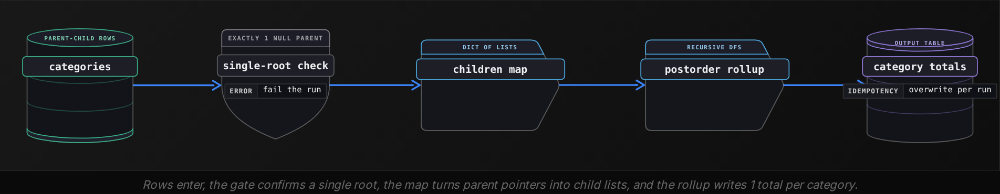

# Tree Traversal: Beginner

Renata is 20 minutes into a data engineering loop at Amazon when the interviewer pastes a small class onto the shared screen: a `TreeNode` whose `val` holds the value and whose `left` and `right` point at its children. The ask sounds modest. Return the values of the tree level by level, then write a second function that returns its depth. Renata knows recursion and she has used `collections.deque` before, but with the clock running in a blank editor, every choice feels loaded. Does the base case check the node or its children? Where does the queue get its level boundaries? What does the depth function hand back from an empty subtree? The interviewer is watching for exactly those decisions, and then asks how the same walk would roll up sales across a product category hierarchy stored as parent-child rows. This lesson builds the answers to each of those questions.


<br>

### What you will be able to do

Build a binary tree from TreeNode objects and predict what each of the 3 depth-first orders outputs

Write level-order BFS with a deque and a level-size snapshot that returns a list of levels

Solve depth and node-count problems, then path sums, by fixing what None returns and how child answers combine

Turn parent-child rows into a children map, then roll values up and build breadcrumbs over it

Recognize the 5 most common tree bugs from their traceback or wrong output, and fix each one


<br>

---

## Binary Tree Basics in Python

Interview trees are objects pointing at objects. Each node stores a value and 2 references, `left` and `right`. A missing child is the value `None`. No container holds the tree: everything is reachable from 1 variable holding the root, which is where every traversal here starts.

```sql
class TreeNode:
    def __init__(self, val, left=None, right=None):
        self.val = val
        self.left = left
        self.right = right


root = TreeNode(8)
root.left = TreeNode(3)
root.right = TreeNode(10)
root.left.left = TreeNode(1)
root.left.right = TreeNode(6)
root.right.right = TreeNode(14)
```

Read the wiring as a picture: 8 at the top with 3 and 10 under it. Below 3 sit 1 and 6, and 14 hangs off the right of 10. Node 10 still has a left attribute, and it holds None. Most traversal bugs start at that gap. Evaluating root.right.left gives back None quietly, while root.right.left.val raises AttributeError, because None has no val.

| node | left | right | kind |
| --- | --- | --- | --- |
| 8 | 3 | 10 | root |
| 3 | 1 | 6 | internal |
| 10 | None | 14 | internal |
| 1 | None | None | leaf |
| 6 | None | None | leaf |
| 14 | None | None | leaf |

A **leaf** has both children set to None, and this tree has 3 of them. A **subtree** is any node plus everything below it, so node 3 roots a 3-node subtree. **Depth** in most interview prompts counts nodes on the longest root-to-leaf path, which makes this tree's depth 3; some prompts count edges instead and would answer 2, so confirm the convention before writing code. The tree also happens to be a **binary search tree**: every value in a left subtree is smaller than its ancestor, and every value in a right subtree is larger.


<br>

### The same walk, recorded at different moments

Depth-first traversal finishes the whole left subtree before touching the right one. The 3 depth-first orders make exactly the same recursive calls in exactly the same sequence. The only thing that changes is when the current node's value gets recorded relative to the 2 recursive calls. Preorder records it first; inorder waits until the left call returns, and postorder waits for both.

```sql
def preorder(node, out):
    if node is None:
        return
    out.append(node.val)
    preorder(node.left, out)
    preorder(node.right, out)
```

Move out.append(node.val) below the first recursive call and the function becomes inorder. Move it below the second and it becomes postorder. The animation runs all 3 at once: 1 walk, 3 lists, each appended at its own moment. Watch the call frames stack up on the way down the left edge, and notice that the inorder list receives 1 before anything else, because 1 is the first node whose left subtree is empty.

https://github.com/user-attachments/assets/ae267064-52ec-4d3f-82c1-a54df9bc0224

*1 walk fills 3 lists: before the left call, between the calls, after the right call.*

| order | value recorded | output on the running tree | typical use |
| --- | --- | --- | --- |
| preorder | before both children | 8, 3, 1, 6, 10, 14 | copy or print a tree top-down |
| inorder | between the children | 1, 3, 6, 8, 10, 14 | sorted output from a binary search tree |
| postorder | after both children | 1, 6, 3, 14, 10, 8 | answers that depend on children |

Interviewers listen for the choice in the use column. Preorder hands each parent to you before its descendants, so it fits work where a parent's information must exist first, like writing a path prefix. Inorder on a binary search tree yields ascending values, which is why 1 through 14 come out sorted here. Postorder hands you a node only after its children are finished, so any answer built from the children's answers, such as a subtree size or a rollup total, is postorder by nature.

#### What the walk costs

Every node is entered once, so all 3 orders run in O(n) time for n nodes. Memory is the call stack: at any moment it holds 1 frame per node on the path from the root to the current node, which is O(h) for a tree of height h. A balanced tree of 1,000,000 nodes has a height near 20. A tree where every node has only a right child has height n, and that shape is what pushes Python past its default recursion limit of 1,000 frames.

> Predict before you run
>
> For t = TreeNode(4, TreeNode(2, None, TreeNode(3)), TreeNode(7)), write down all 3 traversal lists before reading the note below. Then say which list comes out sorted, and explain why from the shape.

*Answers: preorder [4, 2, 3, 7], inorder [2, 3, 4, 7], postorder [3, 2, 7, 4]. Inorder is sorted because the tree is a binary search tree: 3 sits right of 2, and both sit left of 4.*

> **TIP**
>
> Before typing, say which order you need and why in 1 sentence, for example: the parent needs its children's totals, so postorder. Interviewers hear the reasoning, and the placement of the append line follows from it.


<br>

---

## BFS Level-Order Traversal

Breadth-first search visits nodes in order of distance from the root: all of level 1, then all of level 2, and so on. On the running tree that order is 8, 3, 10, 1, 6, 14. Plain recursion does not produce it, because the call stack always dives into a child before visiting that child's siblings. Breadth needs a first-in, first-out queue: take the oldest waiting node and record it, then put its children at the back of the line.

Use collections.deque. Its popleft() removes the front item in constant time. A Python list can act as a queue through pop(0) and gives identical output, but every pop(0) shifts each remaining element 1 slot to the left, so draining a queue of n nodes costs O(n^2) work instead of O(n). Interviewers notice the choice, and naming the reason takes 1 sentence.


<br>

### The level-size snapshot

A flat visit order rarely satisfies the prompt. Most versions want a list of lists, 1 inner list per level, and the technique that delivers it is a snapshot. At the top of each pass through the outer loop, the queue contains exactly 1 complete level and nothing else. Read `len(queue)` into `size` once, pop exactly `size` nodes, and any children appended during those pops wait behind them for the next pass.

https://github.com/user-attachments/assets/800391d1-1a9c-479e-9277-bd8e4535c8b8

*size is read once per pass, so each pass drains exactly 1 level.*

| pass | queue at start | size | level appended | queue at end |
| --- | --- | --- | --- | --- |
| 1 | [8] | 1 | [8] | [3, 10] |
| 2 | [3, 10] | 2 | [3, 10] | [1, 6, 14] |
| 3 | [1, 6, 14] | 3 | [1, 6, 14] | [] |

The table shows the invariant holding at every pass: the queue at the end of one pass is the level list of the next. range(size) is computed once when the `for` loop starts, so children appended mid-loop cannot extend it; range(len(queue)) behaves the same way for the same reason. The empty-tree guard matters too: without it the queue starts as deque([None]), the first popleft() hands back None, and reading its .val raises AttributeError.


<br>

### One loop, many prompts

Answers on the running tree

- **Right side view** *[8, 10, 14]*\
  Keep the last node popped in each pass, the one a viewer standing to the right of the tree would see.
- **Level averages** *[8.0, 6.5, 7.0]*\
  Sum each level list and divide by its size: (3 + 10) / 2 is 6.5.
- **Zigzag order** *[[8], [10, 3], [1, 6, 14]]*\
  Reverse every second level list before appending it.
- **Widest level** *3 nodes*\
  The largest value of size across all passes, read off the snapshot at no extra cost.

```sql
from collections import deque


def right_side_view(root):
    if root is None:
        return []
    view = []
    queue = deque([root])
    while queue:
        size = len(queue)
        for i in range(size):
            node = queue.popleft()
            if i == size - 1:
                view.append(node.val)
            if node.left is not None:
                queue.append(node.left)
            if node.right is not None:
                queue.append(node.right)
    return view
```

One line differs from level order: instead of collecting every value, the loop keeps the value whose index i equals size - 1. Interviewers like this prompt because it tests whether the snapshot is understood or memorized. A DFS answer exists too, recording the first node seen at each new depth while visiting right before left, but the BFS version reads directly from the definition.

BFS can also stop early. Minimum depth is the level of the first leaf the queue reaches, so the loop returns the moment it pops a node with no children. Picture a root whose left child is a leaf and whose right child heads a 500-node subtree: BFS answers 2 after popping 2 nodes, while a DFS that measures every path visits all 502.

| ✓ Reach for BFS when | ✗ Reach for DFS when |
| --- | --- |
| • The answer is organized by level: grouping, averages, side views<br><br>• You want the shallowest match, such as the first leaf, and can stop early<br><br>• The tree is very deep and recursion would hit the frame limit | • A node's answer is built from its children's answers<br><br>• State flows along a single root-to-leaf path, such as a running sum<br><br>• The tree is very wide and a queue holding a whole level would be large |

> Your turn
>
> Run level order by hand on TreeNode(1, TreeNode(2, TreeNode(4)), TreeNode(3, None, TreeNode(5))). Write the queue at the start of each pass, then give the right side view.

*Answers: [[1], [2, 3], [4, 5]], with queues [1], then [2, 3], then [4, 5] at the start of each pass. Right side view: [1, 3, 5].*

> **TIP**
>
> Time is O(n) because each node enters and leaves the queue once. Extra space is O(w), where w is the widest level, since the queue holds at most the rest of the current level plus the children already appended.


<br>

---

## DFS Recursive Patterns

Most tree interview questions are answered by a recursive function that trusts itself. Suppose `f(node.left)` and `f(node.right)` already return correct answers for their subtrees. The only work left is deciding 2 things: what `f(None)` returns, and how a node turns its own value plus the 2 child answers into its own answer. Settle those and the recursion assembles the rest.

| question | f(None) returns | combine at a node |
| --- | --- | --- |
| max depth | 0 | 1 + max(left, right) |
| node count | 0 | 1 + left + right |
| sum of values | 0 | node.val + left + right |
| leaf count | 0 | 1 if both children are None, else left + right |
| contains x | False | node.val == x or left or right |
| minimum value | float("inf") | min(node.val, left, right) |

Wrong answers usually start in the None column. For the minimum, returning 0 from an empty subtree would make every tree of positive values report 0, and float("inf") is the value that can never win a min. Pick the base value that is neutral for the combine step: 0 for sums and counts, False for `or`, infinity for min.

- **6** — node count, running tree
- **42** — sum of values, running tree
- **3** — leaf count, running tree
- **1** — minimum value, running tree


<br>

### Watching answers travel upward

The animation runs max depth with a print just before each return, so the order in which answers are produced is visible line by line.

https://github.com/user-attachments/assets/d1b7500a-d335-4f54-8fef-c0fe4589be75

*Each node prints only after both children have returned their depths.*

The printed order is 1, 6, 3, 14, 10, 8: postorder, without anyone asking for it. A node cannot compute `1 + max(left, right)` until both child calls have come back, so the answer for 8 is the last one printed. Node 10 shows the `None` case doing its job: its missing left child returns 0, its right child returns 1, and the combine gives 2 without any special code for one-child nodes.


<br>

### State going down, answers coming up

Some questions need information from above as well as below. Root-to-leaf path sum asks whether any path from the root to a leaf adds up to a target. The running total belongs to the path, so it travels downward as an argument. The yes or no answer comes back up as a return value.

```sql
def has_path_sum(node, target):
    if node is None:
        return False
    remaining = target - node.val
    if node.left is None and node.right is None:
        return remaining == 0
    return (has_path_sum(node.left, remaining)
            or has_path_sum(node.right, remaining))
```

| root-to-leaf path | sum |
| --- | --- |
| 8 > 3 > 1 | 12 |
| 8 > 3 > 6 | 17 |
| 8 > 10 > 14 | 32 |

has_path_sum(root, 17) returns True through 8, 3, 6. Because `or` short-circuits, once the left subtree of 8 reports True, the right subtree is never visited. has_path_sum(root, 18) returns False: 8 + 10 equals 18, but node 10 has a child, and the function compares only at nodes whose children are both None. That leaf test is the line interviewers check first.

| ✓ Pass it down as an argument | ✗ Return it up as a value |
| --- | --- |
| • A running sum along the current path<br><br>• The depth of the current node from the root<br><br>• The bounds a binary search tree value must fall inside | • The height or size of a subtree<br><br>• Whether a subtree contains or matches something<br><br>• Totals that roll up from children to parents |


<br>

### 2 trees at once

```sql
def is_same(a, b):
    if a is None and b is None:
        return True
    if a is None or b is None:
        return False
    return (a.val == b.val
            and is_same(a.left, b.left)
            and is_same(a.right, b.right))
```

With 2 inputs there are 3 base situations: both empty, which match; exactly 1 empty, which cannot match; and both present, which recurse. Checking a is None and b is None before a is None or b is None is what makes the second test mean exactly 1 empty. The same skeleton answers mirror-image questions by comparing a.left with b.right.

#### Cost of the pattern

Each function in this section visits every node at most once, so it runs in O(n) time and holds O(h) frames on the call stack. Short-circuiting with `or` and `and` can stop early, which improves the typical case and leaves the worst case unchanged.

> Write it yourself
>
> Write tree_sum(node) from the sum row of the table, then evaluate it on the 5-node practice tree from the BFS section. Then write count_leaves and evaluate it on the same tree.

*Answers: tree_sum returns 15, and count_leaves returns 2, the leaves being 4 and 5.*

> **TIP**
>
> Say the base value and the combine line aloud before writing either. If you cannot state in a few words what f(None) returns, the function is not designed yet.


<br>

---

## DE Applications of Tree Traversal

Hierarchies in a warehouse do not arrive as linked objects. They arrive as rows, each one naming itself and its parent: product categories, org charts, cost centers, account trees. The row with a `NULL` parent is the root. A production hierarchy also lets a node have any number of children, so `left` and `right` become a list of child ids. Every pattern so far carries over, with a `for` loop over that list in place of 2 calls.

| category_id | parent_id | category_name | sales_usd |
| --- | --- | --- | --- |
| 1 | NULL | All | 0 |
| 2 | 1 | Electronics | 0 |
| 3 | 1 | Home | 40 |
| 4 | 2 | Laptops | 120 |
| 5 | 2 | Phones | 90 |
| 6 | 3 | Kitchen | 25 |



The children map is built in 1 pass over the rows. children.setdefault(parent, []).append(cid) creates the list the first time a parent appears and appends to it afterwards, giving {1: [2, 3], 2: [4, 5], 3: [6]}. Leaf ids such as 4 never appear as keys, which is why the traversal reads children.get(cid, []): a missing key means no children, the n-ary counterpart of None.

https://github.com/user-attachments/assets/cde9e8bf-b591-4c2a-ad8c-41fbc7baeaac

*The children map is built in 1 pass, then a postorder walk adds each child's total into its parent.*

Rollup is postorder for the same reason max depth was: a category's total is its own sales plus its children's totals, so it is ready only after every child has reported. Electronics records 0 sales of its own; all 210 in its total come from Laptops and Phones. The print order, Laptops, Phones, Electronics, Kitchen, Home, All, is the postorder of the hierarchy.


<br>

### Preorder builds breadcrumbs

```sql
children = {1: [2, 3], 2: [4, 5], 3: [6]}
names = {1: "All", 2: "Electronics", 3: "Home",
         4: "Laptops", 5: "Phones", 6: "Kitchen"}


def breadcrumbs(cid, prefix, out):
    path = prefix + " > " + names[cid] if prefix else names[cid]
    out.append(path)
    for child in children.get(cid, []):
        breadcrumbs(child, path, out)
    return out


for line in breadcrumbs(1, "", []):
    print(line)
```

Breadcrumbs flow the opposite way. A category's path is its parent's path plus its own name, so the parent must be finished first. That is preorder, with the partial path traveling down as the prefix argument. breadcrumbs and rollup fill the breadcrumb and total_sales columns below, in breadcrumb visit order.

| category_name | breadcrumb | level | total_sales |
| --- | --- | --- | --- |
| All | All | 1 | 275 |
| Electronics | All > Electronics | 2 | 210 |
| Laptops | All > Electronics > Laptops | 3 | 120 |
| Phones | All > Electronics > Phones | 3 | 90 |
| Home | All > Home | 2 | 65 |
| Kitchen | All > Home > Kitchen | 3 | 25 |

The level column comes from a third pass: level-order BFS over the children map, where the size snapshot puts All at level 1 and Electronics and Home at level 2. Everything else lands on level 3. Dashboards filter on it to show only top-level categories.


<br>

### Nested JSON is a tree

```sql
def flatten(obj, prefix="", out=None):
    if out is None:
        out = {}
    for key, value in obj.items():
        path = prefix + "." + key if prefix else key
        if isinstance(value, dict):
            flatten(value, path, out)
        else:
            out[path] = value
    return out


event = {"event": "click", "user": {"id": 7, "geo": {"city": "Lyon"}}}
print(flatten(event))
```

This prints {'event': 'click', 'user.id': 7, 'user.geo.city': 'Lyon'}. Each dict is an internal node, each non-dict value is a leaf, and the dotted key is the breadcrumb pattern again: the path travels down and values are written at the leaves. Python dicts keep insertion order, so the keys appear in the order the walk reached them. Lists inside a payload need a policy stated up front, such as indexing them into the path as items.0.sku or keeping the whole list as one value.

Other trees in pipeline work

- Org charts: level order gives each employee a management level, and postorder counts headcount under each manager.
- Partitioned storage paths such as year=2024/month=05/day=17 form a tree that a cleanup job walks top-down.
- Deleting a folder tree is postorder: files and subfolders go before the folder that holds them.
- Chart-of-accounts hierarchies roll ledger amounts up to parent accounts the same way category sales roll up.

> Check that it is a tree first
>
> - Exactly 1 row has a NULL parent; with 2 roots, a walk from one of them never sees the other branch.
> - Every parent_id appears as a category_id; a row pointing at a missing parent is never reached.
> - Compare the nodes the walk visits with the rows loaded: orphans and parent loops both show up as a shortfall.
> - If a source lets a node sit under 2 parents, the structure is a graph, and the rollup counts that node's sales twice.

> Extend the hierarchy
>
> Add the row (7, 3, 'Garden', 15) to the rows in the animation. Which totals change, and to what values? Which breadcrumb is added, and at what level?

*Answers: Home becomes 80 and All becomes 290, while every other total stays the same. The new breadcrumb is All > Home > Garden, at level 3.*

> **TIP**
>
> When a prompt hands you parent-child rows, build the children map before anything else and describe its shape aloud. Every later step then becomes a traversal you already know.


<br>

---

## Common Bugs

Tree code fails in a small number of recognizable ways, and each one leaves a signature: a specific traceback or a specific wrong answer. Knowing the signature lets you diagnose a failing function from its output, which is exactly what an interviewer tests when they hand over broken code and ask what it prints.


<br>

### Bug 1: reading attributes of None

```sql
def count_nodes(node):
    if node.left is None and node.right is None:
        return 1
    return 1 + count_nodes(node.left) + count_nodes(node.right)
```

On the running tree this works through 3 and its children 1 and 6, then reaches 10, whose left child is missing. The call count_nodes(None) evaluates None.left and raises AttributeError: 'NoneType' object has no attribute 'left'. It also crashes on an empty tree. The fix is to test node is None first and return 0. The leaf test then becomes unnecessary, because a leaf's 2 empty children each contribute 0.


<br>

### Bug 2: treating None as a leaf

```sql
def has_path_sum(node, target):
    if node is None:
        return target == 0
    remaining = target - node.val
    return (has_path_sum(node.left, remaining)
            or has_path_sum(node.right, remaining))
```

has_path_sum(root, 18) should be False, since the root-to-leaf sums are 12 and 17 on the left and 32 on the right. This version returns True. At node 10 the remaining target is 0, and the empty left child of 10 reports 0 == 0. The empty spot under a one-child node passed for the end of a path. It also returns True for an empty tree with a target of 0. Compare only at a leaf, where both children are None, and return False for None.


<br>

### Bug 3: a default list shared between calls

https://github.com/user-attachments/assets/bfd0a7dd-2002-44ed-987b-14189a1e014b

*Both calls append to the single list created when def ran.*

Python evaluates a default argument once, at the moment `def` runs. Every call that omits out then receives that same list object. The first call returns [5, 2]; the second appends to the same list and returns [5, 2, 5, 2], and first is second prints True. Tests that call the function once pass, which is why this bug survives into interviews. Default to None and create a fresh container inside the function, the pattern the JSON flattener used.


<br>

### Bug 4: losing the return value

```sql
def max_depth(node):
    if node is None:
        return 0
    left = max_depth(node.left)
    right = max_depth(node.right)
    1 + max(left, right)
```

The combine line computes a number and throws it away, so every non-empty call falls off the end and returns None. Leaves 1 and 6 hand None to node 3, and max(None, None) raises TypeError: '>' not supported between instances of 'NoneType' and 'NoneType'. A quieter variant calls max_depth(node.left) and max_depth(node.right) on lines of their own and ends with return 1: no traceback, and a depth of 1 for every non-empty tree. A traceback naming NoneType inside recursive code almost always points at a missing `return`.


<br>

### Bug 5: popping the wrong end

```sql
from collections import deque


def level_order(root):
    if root is None:
        return []
    levels = []
    queue = deque([root])
    while queue:
        size = len(queue)
        level = []
        for _ in range(size):
            node = queue.pop()
            level.append(node.val)
            if node.left is not None:
                queue.append(node.left)
            if node.right is not None:
                queue.append(node.right)
        levels.append(level)
    return levels
```

deque.pop() removes from the right, the end new children were added to, so the structure behaves as a stack. On the running tree the result is [[8], [10, 14], [3], [6, 1]]: 4 levels for a 3-level tree. Nodes 10 and 14 end up grouped together, and 6 comes out ahead of 1. The fix is popleft(). Wrong grouping in BFS output points at the queue end; correct grouping with slow performance points at list.pop(0).

| bug | signature | fix |
| --- | --- | --- |
| Attributes of None | AttributeError: 'NoneType' object has no attribute ... | Check node is None before anything else |
| None treated as a leaf | True for a path that stops at a one-child node | Compare only when both children are None |
| Shared default list | A second call returns the first call's values plus its own | Default to None, create the list inside |
| Lost return value | TypeError naming NoneType, or the same answer for every tree | Return the combined value from every branch |
| Wrong queue end | Extra levels and reversed groups in level order | Use popleft() on a deque |

> **TIP**
>
> A sixth failure comes from the input's shape: a chain of nodes deeper than Python's default recursion limit of 1,000 frames raises RecursionError even when every function is correct. Mention it when asked about very deep trees; rewriting the walk with an explicit stack removes the limit.


<br>

### Predict this one

```sql
def tree_sum(node):
    if node is None:
        return 0
    tree_sum(node.left)
    tree_sum(node.right)
    return node.val
```

> What does it return?
>
> Call tree_sum(root) on the running tree. Predict the result before reading the note, and name which of the 5 bugs it is.

*It returns 8 with no error. Both recursive results are discarded and only the root's own value comes back, a quiet case of bug 4. The correct last line is return node.val + tree_sum(node.left) + tree_sum(node.right), which gives 42.*

| ✓ Do | ✗ Don't |
| --- | --- |
| • Test node is None as the first line of every recursive tree function<br><br>• Choose a base value that is neutral for the combine step<br><br>• Return the combined answer from every path through the function<br><br>• Use deque.popleft() and snapshot len(queue) once per level<br><br>• Run the function on an empty tree and a one-child node before calling it done | • Read node.left or node.val before the None check<br><br>• Treat an empty child as the end of a root-to-leaf path<br><br>• Use a mutable list or dict as a default argument<br><br>• Call a recursive function and ignore what it returns |


<br>

---

## Putting It All Together

A retailer's analytics team receives its product category hierarchy every night as parent-child rows alongside per-category sales. By morning it must publish, for every category, a breadcrumb for the website, a level for dashboard filters and a total that includes all descendant categories, and the job must fail loudly if the hierarchy arrives malformed.

- The children map built from the rows does the job of TreeNode references, with a missing key standing in for None.
- Breadcrumbs are preorder with the path passed down, because a category's path needs its parent's path to exist first.
- Levels come from the BFS snapshot: each pass over the queue assigns the same level to every category it drains.
- Rolled-up sales are postorder with totals returned up, the same shape as max depth with addition in place of max.
- The single-root check and the visited-count comparison catch orphans and parent loops before a wrong total is published.
- Defaulting accumulators to None and returning every combined value keep the nightly job from repeating bugs 3 and 4 across runs.


<br>

---

## Key Takeaways

- The 3 depth-first orders are the same recursive walk; only the moment the value is recorded moves.
- Level-order BFS uses a deque with popleft() and reads len(queue) once per pass to separate levels.
- A recursive tree function is designed by 2 decisions: what None returns, and how a node combines its children's answers.
- State that belongs to a path travels down as an argument; answers about a subtree travel up as return values.
- Warehouse hierarchies arrive as parent-child rows, and a children map turns them into a tree every traversal can walk.
- Each common bug has a signature: bug 1 raises AttributeError on None and bug 4 a NoneType TypeError. Bug 2 ends a path at a one-child node, bug 3 leaves a default list that keeps growing, and bug 5 produces extra BFS levels.
