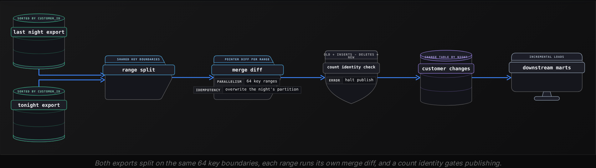

# Two Pointers: Advanced

Priya is 40 minutes into an onsite loop at Google when the interviewer draws 8 bars of uneven height and asks how much rain they would trap. She builds the prefix and suffix max arrays, gets 8, and hears the follow-up: same answer in constant space, and then a proof that the version which never looks ahead cannot be wrong. Two more turns follow. What if the heights arrive from a sensor feed and the far end never shows up? What if there are 2 billion rows partitioned across a cluster? Each turn is the same question in a new costume: which pointer may move next, and what guarantee lets it move without losing part of the answer. This lesson builds that guarantee on a single problem, then carries it into windows, streams and distributed joins.


<br>

### What you will be able to do

Prove the constant-space Trapping Rain Water scan with an invariant, a measure and an exit condition

Design sliding-window state that admits and evicts in O(1) under several constraints at once

Decide from monotonicity whether a window or a prefix-sum approach fits a prompt

Adapt merges and windows to forward-only streams and name their memory bound

Map pointer algorithms to joins, compaction, snapshot diffs and window functions at cluster scale


<br>

---

## Trapping Rain Water

### One formula under every solution

Water above bar i rises to the lower of 2 walls: the tallest bar at or left of i, and the tallest bar at or right of i. The gap between that level and the bar's own height is the water it holds. Every correct solution evaluates this formula. The solutions differ in how they learn the 2 walls, and that difference sets their space cost.

| i | height | left wall | right wall | level | water |
| --- | --- | --- | --- | --- | --- |
| 0 | 2 | 2 | 4 | 2 | 0 |
| 1 | 0 | 2 | 4 | 2 | 2 |
| 2 | 4 | 4 | 4 | 4 | 0 |
| 3 | 1 | 4 | 3 | 3 | 2 |
| 4 | 0 | 4 | 3 | 3 | 3 |
| 5 | 3 | 4 | 3 | 3 | 0 |
| 6 | 1 | 4 | 2 | 2 | 1 |
| 7 | 2 | 4 | 2 | 2 | 0 |

The water column sums to 8. Both wall columns are extra lists of n integers each, and the standard follow-up asks you to delete them without losing the answer.


<br>

### Four ways to learn the walls

| approach | time | extra space | how the walls are learned |
| --- | --- | --- | --- |
| rescan per bar | O(n^2) | O(1) | scan both directions from every bar |
| prefix and suffix arrays | O(n) | O(n) | 2 passes store every wall |
| monotonic stack | O(n) | O(n) | fills water in horizontal layers between a lower bar and the next taller one |
| converging pointers | O(n) | O(1) | commits the side whose current bar is shorter |

The converging version is the one interviewers press on, because nothing in its code shows why it is correct. A bar's water gets committed while the far wall it depends on is still unknown, so the explanation has to come from an argument about the bars already passed.


<br>

### The constant-space scan

Put a pointer at each end and keep a running max per side. On each step the side with the shorter current bar updates its running max, adds that max minus its own height, and steps inward. Ties go to the right side. Watch which side moves and what each bar adds.

https://github.com/user-attachments/assets/efaf8d9b-bc8a-4068-a50e-5f6af0e7a518

*Each line names the side that moved, the bar it settled and the water that bar added.*

The right side commits 2 bars (indices 7 and 6) before the left moves at all, because `h[0]` is 2 and is never shorter than the bar facing it until index 5. At index 4 the right running max is 3, so that bar gains 3, even though the bar at index 2, under the left pointer, is 4. The scan never needed that 4: the right wall was already the lower one, and the argument below shows the same holds on every step.


<br>

### Why committing early is safe

**Invariant:** every bar the scan has already passed is no taller than the taller of h[left] and h[right].

It holds at the start, when nothing has been passed. Suppose `h[left] < h[right]`. Every passed bar is at most the taller current bar, which here is `h[right]`. The bar about to be passed is shorter than `h[right]` as well, and `h[right]` stays where it is, so after the move every passed bar is still at most a bar under a pointer. The else branch is the mirror image, with `h[left]` staying put.

Now ask what the water at `left` truly is during that same step. Its left wall is `left_max` after the update, built from passed left bars and `h[left]`, all at most `h[right]`. Its true right wall is at least `h[right]`, since that bar lies to its right. The left wall is therefore the lower one, and `left_max - h[left]` is exactly the water at `left`, computed without reading a single bar between the pointers.

Termination is the measure `right - left`, which drops by 1 per iteration, so the loop runs `n - 1` times. The bar where the pointers meet is, by the invariant, at least as tall as every passed bar, so it is the tallest bar in the row, holds no water, and skipping it loses nothing.

> Saying the proof in 4 sentences
>
> - Passed bars never exceed the taller of the 2 current bars.
> - Both branches keep that true, because the taller bar never moves.
> - So the shorter side's running max is its lower wall, and its water is final.
> - The gap shrinks by 1 each step, and the meeting bar is the tallest, holding nothing.


<br>

### The 2D follow-up

Given a grid of heights instead of a row, there is no left and right to converge. What carries over is the rule under the pointers: settle the lowest point on the boundary first, because the boundary's minimum caps the water of whatever lies next to it. In 1D the boundary has 2 bars, and moving the shorter pointer is popping the minimum of a heap of size 2. In 2D the boundary starts as the whole outer ring in a min-heap. Pop the lowest cell, raise a running level to its height if it is taller, credit each unvisited neighbour with the level minus its height when positive, and push it. That runs in O(mn log(mn)), and naming the heap as the general form shows you know why the pointers move.


<br>

---

## Multi-Constraint Window State

### Pointers moving in the same direction

Same-direction pointers mark a window from `left` to `right`. The right pointer admits 1 element per step, and the left pointer evicts elements until the window is valid again. Each pointer crosses the input once, so the scan is O(n) as long as admitting and evicting are O(1). That leaves 2 design questions for every window problem: which state supports cheap eviction, and whether validity survives shrinking.


<br>

### State that survives eviction

Counts and sums are invertible: evicting an element subtracts exactly what admitting it added. A window max is not invertible, since evicting the current max leaves no record of the runner-up. Each row below pairs a common window state with its update on each side.

| window state | on admit | on evict | structure |
| --- | --- | --- | --- |
| distinct keys | counts[k] += 1 | counts[k] -= 1, delete the key at 0 | dict, size via len |
| total payload | total += x | total -= x | integer |
| required keys still unmet | missing -= 1 when a count reaches its need | missing += 1 when a count drops below its need | dict plus integer |
| window max and min | pop tail values the new value beats, append | pop the head if it is the leaving index | 2 monotonic deques |

The third row keeps a minimum-window cover O(n): comparing 2 count dicts on every step costs O(alphabet), while `missing` changes only when a single count crosses its requirement. The fourth row keeps each deque ordered, decreasing for max and increasing for min, so its head is the answer. Every index enters and leaves each deque once, which makes the work amortized O(1) per step.

```sql
from collections import deque

def longest_within(values, limit):
    hi, lo = deque(), deque()
    left = best = 0
    for right, v in enumerate(values):
        while hi and values[hi[-1]] <= v:
            hi.pop()
        hi.append(right)
        while lo and values[lo[-1]] >= v:
            lo.pop()
        lo.append(right)
        while values[hi[0]] - values[lo[0]] > limit:
            if hi[0] == left:
                hi.popleft()
            if lo[0] == left:
                lo.popleft()
            left += 1
        best = max(best, right - left + 1)
    return best

print(longest_within([8, 2, 4, 7], 4))
```


<br>

### Several constraints, a single shrink loop

A typical prompt: in a user's event log, find the longest stretch that touches at most 2 product categories with a total payload of at most 10 KB. Each constraint is monotone, meaning every sub-window of a valid window is valid, and an AND of monotone constraints is monotone too. So a single eviction loop serves both: keep moving `left` while any constraint fails, then record the window.

https://github.com/user-attachments/assets/34ee505e-4aca-4e59-8a26-856c5ed15104

*Each event is (category, KB); at most 2 categories and 10 KB per window.*

The first 3 evictions fire on the category count. The last fires on payload alone at index 7, where only 2 categories remain but the total reaches 11 KB. The answer `(3, 7)` is the half-open slice holding events 3 through 6: 4 events, 7 KB, 2 categories. Being able to say which constraint forced each eviction is how you show an interviewer the state is right.


<br>

### When the window breaks

Advancing `left` is only safe if no window it skips could be the answer. Monotone validity guarantees that for longest-window prompts: once the window from `left` to `right` is invalid, every longer window starting at `left` contains it and is invalid too, so that start is finished. Check this property before writing any code. The table sorts common prompts by it.

| prompt | valid after shrinking? | approach |
| --- | --- | --- |
| at most K distinct keys | yes | evict while invalid, record after |
| sum at most B, values never negative | yes | evict while invalid, record after |
| sum at most B, negatives allowed | no | prefix sums plus binary search |
| sum exactly K | no | prefix sums plus a dict of counts |
| count windows with exactly K distinct | no | atMost(K) minus atMost(K - 1) |
| shortest window covering a key set | no, valid after growing | evict while valid, record inside the loop |

> **TIP**
>
> Before coding, say whether a smaller window can lose validity. If it can, `left` would sometimes need to move backward, and the pattern no longer applies. Interviewers add negative values to a sum prompt precisely to see whether you notice.


<br>

---

## Correctness Proofs with Invariants

### The 3 parts of a pointer proof

A pointer algorithm is correct when 3 claims hold. An invariant is true before the loop and after every iteration. A measure, usually `right - left`, strictly decreases, so the loop stops. And the invariant combined with the exit condition implies the returned value is the answer. For pointer algorithms the invariant is almost always about the discarded part of the search space: nothing thrown away could have been the answer, or could have beaten the best one kept.


<br>

### Discarding a row or a column

Sorted pair search shows the argument at its sharpest. On `[1, 3, 4, 6, 9]` with target 9, lay every pair out as a triangle of sums, smaller value down the side and larger value across the top. Each comparison deletes a whole row or column of what remains, and each cell records the step that removed it.

| smaller / larger | 3 | 4 | 6 | 9 |
| --- | --- | --- | --- | --- |
| 1 | 4: gone at step 2 | 5: gone at step 2 | 7: checked at step 2 | 10: checked at step 1 |
| 3 | - | 7: not needed | 9: HIT at step 3 | 12: gone at step 1 |
| 4 | - | - | 10: not needed | 13: gone at step 1 |
| 6 | - | - | - | 15: gone at step 1 |

- **3** — sums the scan computed
- **10** — pairs the proof accounts for

The first comparison, 1 + 9, overshoots, and 9 meets nothing smaller than 1 among the remaining values, so the whole 9 column overshoots too. The second, 1 + 6, falls short, and 1 meets nothing larger than 6 any more, so the whole 1 row falls short. The invariant is that every pair outside the remaining rectangle, rows from `left` down and columns up to `right`, has been ruled out. Pairs marked not needed were never computed and never had to be.


<br>

### One table for the whole family

| algorithm | invariant | measure | at exit |
| --- | --- | --- | --- |
| sorted pair search | no discarded pair sums to the target | right - left | pointers meet: no pair exists |
| container with most water | best is the max over every discarded pair | right - left | best is the global max |
| trapping rain water | passed bars never exceed the taller current bar | right - left | meeting bar is the tallest and holds 0 |
| longest valid window | best covers every window ending before right | n - right | every right end is covered |
| read and write dedup | values[:write] holds the distinct values of values[:read] | n - read | values[:write] is the result |

The container row rests on the same discard step as pair search. When the shorter line moves inward, every container that pairs it with a line still between the pointers is narrower and capped by the same short line, so it cannot beat the container already measured.

The window row is the subtle one. For each `right`, the loop leaves `left` at the smallest start that makes the window valid, and because a valid window stays valid when trimmed, the window from that `left` is the longest valid window ending at `right`. Recording it covers that end completely, and, as the previous section showed, a start that failed never needs revisiting.


<br>

### Predict the output

Proofs catch bugs that tests on friendly inputs miss. Read this pair search and decide what it prints before reading on.

```sql
def pair(values, target):
    left, right = 0, len(values) - 1
    while left <= right:
        s = values[left] + values[right]
        if s == target:
            return left, right
        if s < target:
            left += 1
        else:
            right -= 1
    return None

print(pair([1, 3, 4, 6], 8))
```

It prints `(2, 2)`, pairing the value 4 with itself. The bug is in the exit condition. When `right - left` reaches 0 the loop still runs, and the invariant's subject, pairs of 2 distinct indices, no longer describes the pair being checked. With `left < right` the loop stops after its third comparison and returns `None`, which is correct: no 2 distinct values in `[1, 3, 4, 6]` sum to 8.


<br>

### Checking a proof with code

An invariant you can state is one you can assert. Put the assertion inside the scan, then compare the scan against the rescan solution on every small input. Pointer bugs cluster around ties, equal neighbours and lengths of 1 and 2, and an exhaustive pass over a small domain reaches all of those cases.

```sql
from itertools import product

def brute(h):
    return sum(min(max(h[:i + 1]), max(h[i:])) - h[i] for i in range(len(h)))

def trap_checked(h):
    left, right = 0, len(h) - 1
    left_max = right_max = water = 0
    while left < right:
        passed = h[:left] + h[right + 1:]
        assert all(b <= max(h[left], h[right]) for b in passed)
        if h[left] < h[right]:
            left_max = max(left_max, h[left])
            water += left_max - h[left]
            left += 1
        else:
            right_max = max(right_max, h[right])
            water += right_max - h[right]
            right -= 1
    return water

cases = [list(c) for n in range(1, 7) for c in product(range(4), repeat=n)]
assert all(trap_checked(h) == brute(h) for h in cases)
print(len(cases), "arrays agree")
```


<br>

---

## Streaming Two Pointers

### What a stream takes away

Every algorithm so far relied on random access: `h[right]` reads the last bar in O(1), and an evicting `left` re-reads elements the right pointer passed long ago. A stream offers neither. An iterator yields each element once, in order, and its far end may not exist yet. Adapting a pointer algorithm comes down to 2 questions: which pointer needs data that has not arrived, and what must be buffered so a trailing pointer can still read what it passes.

| ✓ Works forward-only | ✗ Needs a different algorithm |
| --- | --- |
| • Merging sorted inputs: both pointers only advance<br><br>• Sliding windows: the trailing pointer reads from a buffer of the window<br><br>• Dedup of sorted input: compare each value with the last one written | • Sorted pair search: needs both ends of the data at once<br><br>• Converging rain water scan: the right end is unknown, so the stack version takes over<br><br>• Opposite-end palindrome checks: the tail arrives last |


<br>

### Merge join over 2 sorted streams

Joining 2 key-sorted streams is the forward-only case with a single complication: duplicate keys on both sides. Orders carry 2 rows for key 2 and payments carry 2, so the output needs all 4 combinations, yet the payment iterator cannot rewind for the second order. The join therefore buffers the run of equal keys from the payment side and replays it for every matching order.

https://github.com/user-attachments/assets/65f17e1e-5d00-4f1a-982b-10c0044fd68b

*Each feed's pos only moves forward, so only the payment run for the current key is held.*

The buffer peaks at 2 rows, the longest run of a single key on the buffered side, and that is the join's whole memory bound however long the streams get. Remove the buffer and advance `b` inside the order loop instead, and order `o3` arrives to find the payment iterator already past key 2. Its 2 matches disappear without any error, which is the worst way for a join to be wrong.

> The skew follow-up
>
> Give key 2 a run of 40 million payments and that buffer holds 40 million rows. A complete answer names a remedy: buffer the side with shorter runs, spill a run to disk past a size threshold, or split the hot key's rows across workers and send each worker the other side's matching rows.


<br>

### A traceback worth predicting

With more than 2 streams the merge picks the smallest head from a heap, and `heapq.merge` does that lazily. Predict what this program prints.

```sql
import heapq

clicks = [(100, {"user": "u1"}), (105, {"user": "u2"})]
views = [(100, {"user": "u3"}), (102, {"user": "u4"})]
for ts, event in heapq.merge(clicks, views):
    print(ts, event["user"])
```

Nothing prints. The first request for an item heapifies the 2 heads, both timestamps are 100, tuple comparison moves on to the dicts, and the program ends with `TypeError: '<' not supported between instances of 'dict' and 'dict'`. Event streams tie on timestamp all the time, so this code fails on production data and passes tests built from unique timestamps. Passing `key=lambda e: e[0]` fixes it: the keyed merge breaks ties by input position and never compares payloads.


<br>

### Windows over event time

A time window is a deque of buffered timestamps: append each arrival on the right, then pop from the left while the oldest falls outside the window behind the newest. Memory is the number of events in a window, independent of stream length.

```sql
from collections import deque

def rolling_counts(events, width):
    window = deque()
    for ts in events:
        window.append(ts)
        while window[0] <= ts - width:
            window.popleft()
        yield ts, len(window)

print(list(rolling_counts([100, 104, 109, 112, 125], 10)))
```

Out-of-order arrival breaks the forward-only assumption. An event stamped 95 arriving after another stamped 130 belongs to windows the left pointer has already left behind. Streaming systems bound the damage with a watermark, a declared limit on lateness: a window stays open until event time passes its end plus the allowed delay, and anything later goes to a correction path. Choosing that delay trades result latency against the share of events that need correcting.


<br>

---

## System Design Connections

### The same moves as operators

In a design round the pointer algorithms come back as operators inside larger systems, and the questions shift to what bounds each operator's memory and what lets many copies run at once.

| algorithm | system form | memory bound | parallel by |
| --- | --- | --- | --- |
| merge of sorted inputs | sort-merge join | largest group of equal keys | both sides range-split on shared boundaries |
| k-way merge plus dedup | compaction of sorted runs in a log-structured store | 1 head per run being merged | independent key ranges |
| sliding window | windowed aggregation in a stream processor | events per open window per key | key |
| merge with a 3-way outcome | snapshot diff when no change log exists | 1 row per side | shared key ranges |
| prefix and suffix max | SQL window functions with row frames | 1 partition's sorted rows | partition key |

Sort-merge and hash joins are the pair interviewers ask you to compare. A hash join holds the whole smaller side in memory and needs no sort. A sort-merge join holds a single key's group, but pays for sorting unless both inputs arrive sorted. When both sides are too large for memory, or already sorted on the join key by an earlier stage, the merge wins; when either side is small, the hash table wins.


<br>

### Diffing snapshots with a merge

A team receives a full nightly export of 500 million customer rows from a supplier that keeps no change log, and downstream jobs need inserts, updates and deletes. Sort both nights by `customer_id` and walk them together: a key only in tonight's export is an insert, a key only in last night's is a delete, and a key in both with a different row hash is an update. Sorting dominates at O(n log n) per night; the diff after it is a single linear pass.

```sql
def diff(old, new):
    i = j = 0
    while i < len(old) or j < len(new):
        if j == len(new) or (i < len(old) and old[i][0] < new[j][0]):
            yield "delete", old[i][0]
            i += 1
        elif i == len(old) or new[j][0] < old[i][0]:
            yield "insert", new[j][0]
            j += 1
        else:
            if old[i][1] != new[j][1]:
                yield "update", new[j][0]
            i += 1
            j += 1

old = [(1, "a1"), (2, "b1"), (4, "d1")]
new = [(1, "a1"), (2, "b2"), (3, "c1")]
print(list(diff(old, new)))
```



The range split is where the algorithm meets scale. Each of the 64 workers runs the same merge over its slice, and that only works because both nights use identical boundaries, so every key lands in the same range on both sides. The gate checks that last night's count plus inserts minus deletes equals tonight's count: the merge's own accounting turned into a data quality rule.


<br>

### When the sequential trick stops scaling

The constant-space rain water scan is inherently sequential, since each step depends on which side moved last. On a single machine that is ideal. Across a cluster the prefix and suffix formulation wins: a running max is associative, so it can be computed in chunks and combined, and separate series run on separate workers. The O(n) memory removed in the coding round is the shape a distributed engine prefers.

```sql
WITH walls AS (
  SELECT
    series_id,
    pos,
    height,
    MAX(height) OVER (
      PARTITION BY series_id
      ORDER BY pos
      ROWS BETWEEN UNBOUNDED PRECEDING AND CURRENT ROW
    ) AS left_wall,
    MAX(height) OVER (
      PARTITION BY series_id
      ORDER BY pos
      ROWS BETWEEN CURRENT ROW AND UNBOUNDED FOLLOWING
    ) AS right_wall
  FROM bars
)

SELECT
  series_id,
  SUM(LEAST(left_wall, right_wall) - height) AS trapped
FROM walls
GROUP BY series_id
```

| ✓ Do | ✗ Don't |
| --- | --- |
| • State the invariant before the code, then show both branches keep it<br><br>• Ask whether a smaller window can lose validity before choosing a window<br><br>• Name the memory bound: largest key group, window contents, or 1 head per run<br><br>• Put a tiebreaker such as the input index ahead of payloads in heap entries | • Loop while left <= right when a pair needs 2 distinct indices<br><br>• Slide a window over sums that can turn negative<br><br>• Merge-join on a hot key with no plan for its buffered group<br><br>• Offer the sequential pointer scan where partitions must run in parallel |

> **TIP**
>
> When an interviewer multiplies the input by 1000, restate the operator's memory bound first, then name what partitions it. Those 2 sentences turn a coding answer into a design answer.


<br>

---

## Putting It All Together

A payments company reconciles its ledger against a bank's nightly settlement file. Both arrive sorted by transaction id, each holds about 300 million rows, and split settlements make some ids appear several times on the bank side.

- The reconciliation is a merge join whose buffer is the largest group of split settlements for a single id.
- Matched, missing and extra ids come out of the same 3-way merge as a snapshot diff, gated by a count identity.
- Range-splitting both files on identical id boundaries lets each worker run its own merge.
- Proving no id is skipped is the discard invariant: every id behind both pointers has been fully matched or reported.


<br>

---

## Key Takeaways

- Water at a bar is the lower of its 2 walls minus its height, and the shorter pointer's running max is its lower wall.
- Every pointer proof has an invariant, a shrinking measure, and an exit condition that implies the answer.
- Sliding windows need validity that survives shrinking and state that can be evicted in O(1).
- On streams, buffer what the trailing pointer must reread; that buffer's size is the memory bound.
- At scale, merges parallelize over shared key ranges, and prefix scans replace the sequential pointer trick.
