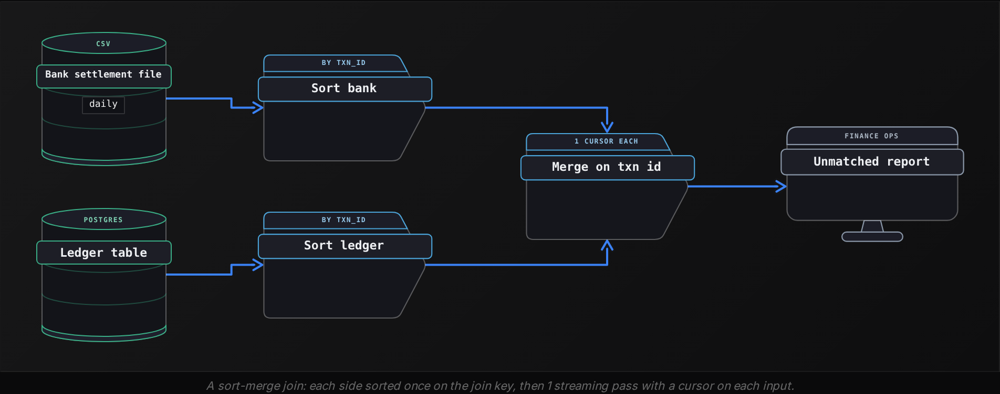

# Two Pointers: Beginner

You are 12 minutes into a phone screen at a payments company.
"I have a list of settlement amounts, already sorted ascending, and a target. Give me the indexes of 2 amounts that add up to the target." He pastes 6 numbers into the shared editor, [1, 2, 4, 7, 9, 11], and types 11 next to them.
The word sorted was said once, as a detail about the data. The first move most candidates make is a nested loop, which returns [1, 4] on the sample and is correct. Then he asks "can you do it in 1 pass without extra memory?", and they have 18 minutes left and nothing prepared, because the loop they wrote has no second act.
What he is listening for is whether that 1 word changed what you did before you typed a line.


<br>

### What you will be able to do

Name the trigger words that mean a two-pointer answer, and the shape each one calls for, within 10 seconds of hearing the question

Write opposite-end convergence for a sorted pair search and state the invariant that makes each pointer move safe

Rewrite a list in place with read and write pointers, return the right count, and say what the tail holds

Detect a cycle or find a midpoint with fast and slow pointers without the guard that crashes on odd-length lists

Recognize the data engineering version of the question in merge joins and in CDC compaction with dedup


<br>

---

## Spotting the Pattern in 10 Seconds

### The word that gives it away

The question names the data and never the pattern. The setup says "sorted" in its first or second sentence, usually as an aside, then asks you to find a pair or count matches, or to merge inputs or rewrite one in place. The order is the gift, and the test is whether you noticed it being handed over. A nested loop is a correct answer to every one of these questions, which is why candidates who write one feel fine until the follow-up "can you do better?" arrives with 20 minutes on the clock.

> Phrasings that mean two pointers
>
> - "sorted array" or "sorted list" anywhere in the setup, even as an aside
> - "find a pair" or "2 elements whose sum equals X", or whose difference does
> - "in place" or "O(1) extra space" stated as a constraint on the answer
> - "remove duplicates" or "compact" over data that already arrives ordered
> - "merge 2 sorted" inputs into 1, from in-memory arrays and lists up to files and streams
> - "palindrome", "symmetric", or anything compared from both ends at once

In a data engineering loop the disguise is operational. "Here are 2 ledgers sorted by transaction id, find the ids present in one and missing from the other." "This event log is sorted by timestamp and holds duplicate rows, drop them without allocating a second list." "Does this chain of job dependencies ever loop back on itself?" The ledgers are a pair search over ordered data and the event log is a rewrite in place. The dependency chain is a walk where you can only follow each link forward, and that one-way constraint is its clue, the way "sorted by" and "without allocating" are the clues in the other 2.


<br>

### The 4 shapes, and how to tell them apart

| Shape | Where the pointers start | What moves them | Question it answers |
| --- | --- | --- | --- |
| Opposite ends converging | index 0 and index n-1 | sum too small moves left up, too large moves right down | pair with a given sum, palindrome check |
| Same direction, read and write | both at index 0 | read every step, write only on a kept element | remove duplicates, move zeroes, compact |
| Fast and slow | both at the head | slow 1 node, fast 2 nodes per step | cycle detection, middle of a linked list |
| Two inputs, one cursor each | index 0 of each list | the smaller head advances | merge 2 sorted lists, sort-merge join |

The shape follows from 2 facts: how many inputs there are, and which way you can move. One sorted list and a pair to find means the ends converge. One list that must be rewritten without a copy means read and write. A linked structure you can only walk forward means fast and slow. Two sorted inputs mean 1 cursor on each. The table is the whole decision, and naming the row out loud is what tells the interviewer you have seen this before.


<br>

### The sentence to say before any code

> **TIP**
>
> Open with: "The input is sorted, so I can start a pointer at each end and move the one that cannot be part of the answer, which gives O(n) time and O(1) extra space." That 1 breath covers recognition and both complexity bounds, and most candidates never say it unprompted.

If the input arrives unsorted and the question still reads like a pair search, the expected answer changes shape: a dict of value to index, checking each number's complement before storing it, runs in O(n) time and O(n) space and keeps the original indexes. Sort-then-converge is the option when memory is the constraint, at O(n log n) time, and it changes the indexes you return. Name both, and ask whether the caller wants positions in the original order. That question is worth more to your score than either code path, because it shows you noticed what sorting destroys.

- **49,995,000** — pairs a nested loop checks at n=10,000
- **10,000** — comparisons the pointer walk needs

The arithmetic behind the tiles is n times n minus 1 over 2 for the nested loop against at most n for the walk, and it is worth saying with the real input size the interviewer gave you. "Ten thousand rows is 50 million pair checks" lands harder than "quadratic", and it is the number that makes the follow-up land on your terms.

> What loses the first minute
>
> - Writing the nested loop first and having no plan for the follow-up
> - Reaching for a set when the question said in place
> - Returning values when the question asked for indexes
> - Starting to type before saying which of the 4 shapes this is


<br>

---

## Opposite-End Convergence

### Why 1 comparison retires many pairs

Take the 6 sorted amounts [1, 2, 4, 7, 9, 11] with a target of 11. Those values form 15 distinct pairs, and a nested loop visits all 15. Start a pointer at each end. The pair 1 and 11 sums to 12, over the target. Every other partner for 11 is at least as large as 1, so no pair holding 11 can reach the target: 1 comparison has retired 5 pairs. The right pointer steps to 9. Now 1 and 9 sum to 10, under the target. Every remaining partner for 1 is at most 9, so no pair holding 1 can work, and 4 more pairs are gone. The left pointer steps to 2, and 2 plus 9 is 11.

- Too large: retire 11 and the 5 pairs it belongs to
- Too small: retire 1 and its 4 remaining pairs
- Match at indexes 1 and 4, and the other 5 pairs are never checked

That's the argument the interviewer waits for, and it fits in 1 sentence: because the list is sorted, each comparison retires 1 element together with every pair that element belongs to, so the loop runs at most n times. Watch the 3 comparisons run over the same 6 amounts. The pointer that moves is always the one whose value caused the sum to miss, and the run stops the moment total == target.

https://github.com/user-attachments/assets/58289b23-683e-4ab4-88fe-52e64475f160

*After 3 comparisons, 9 of the 15 pairs are retired and the pointers sit on the match at indexes 1 and 4.*


<br>

### The function to write from memory

```sql
def two_sum_sorted(nums, target):
    left, right = 0, len(nums) - 1
    while left < right:
        total = nums[left] + nums[right]
        if total == target:
            return [left, right]
        if total < target:
            left += 1    # too small: the left value cannot be in any answer
        else:
            right -= 1   # too large: the right value cannot be in any answer
    return []            # pointers met: every pair has been retired
```

Each iteration has exactly 3 outcomes: the pair matches and the function returns, the sum falls short and `left` moves right, or the sum runs long and `right` moves left. The loop ends when the pointers meet, and by then either a pair came back or every pair was retired. The animation prints `pair at 1 4`, the indexes rather than the values, because the question almost always wants positions, and a candidate who returns `[2, 9]` gets corrected and loses a minute.


<br>

### The invariant, in 1 sentence

An invariant is a fact that holds before and after every iteration, and the one here is: if a matching pair exists, both of its elements sit between `left` and `right` inclusive. When the sum falls short, `nums[left]` paired with the largest value still in range was short, so it can't be half of any answer, and leaving it behind loses nothing. A sum that runs long retires `nums[right]` by the mirror argument. Once the pointers cross, the range is empty and no pair exists, which is why returning `[]` there is a proof rather than a guess.

> **TIP**
>
> Use the word invariant and the phrase "safe to discard" while you narrate. The interviewer notes that you understand the proof and not only the shape, and that note separates a pass from a strong pass. Name the complexity in the same breath: the loop runs at most n times because every iteration moves 1 pointer 1 step, and nothing else is allocated.


<br>

### Palindrome, the same walk on a string

The palindrome check is the phone-screen version of the same convergence. Pointers start at both ends of the string, the characters under them are compared, and both step inward on a match. A mismatch ends the function with `False`, and pointers that meet without a mismatch mean `True`. The cleaning line matters: "A man, a plan, a canal: Panama" is expected to pass, so lowercase the text and keep only letters and digits before the loop, and say that you are doing it.

```sql
def is_palindrome(s):
    s = ''.join(c.lower() for c in s if c.isalnum())
    left, right = 0, len(s) - 1
    while left < right:
        if s[left] != s[right]:
            return False
        left += 1
        right -= 1
    return True
```

| ✓ Reverse and compare: s == s[::-1] | ✗ Converging pointers |
| --- | --- |
| • 1 line, and it's correct<br><br>• Allocates a second string of n characters<br><br>• Shows that you know a slice, which the interviewer assumed<br><br>• Leaves the convergence pattern undemonstrated | • 9 lines, and it is correct<br><br>• Allocates 2 integers after the cleaning step<br><br>• Shows the loop the question was written to test<br><br>• Stops at the first mismatch rather than reversing the whole string |

Write the pointer version first, then mention the slice as the 1-line Python shortcut. The interviewer asked a palindrome question to see the convergence loop; showing the slice and stopping reads as not knowing the pattern, and showing it second reads as knowing both. Both run in O(n) time. The difference is space, and the follow-up asks which one uses extra memory even on a 10-character string where nobody could measure it. The slice builds a reversed copy; the pointers hold 2 positions. The cleaning step also builds a new string, so the accurate claim is "O(1) extra beyond the cleaned copy", and that qualifier, offered unprompted, says you count allocations rather than recite them.


<br>

---

## Read and Write Pointers

The second shape starts both pointers at index 0 and sends them the same way. `read` visits every element, 1 per iteration, with no exceptions. `write` marks the next slot of the output and advances only when the element under `read` deserves to be kept. `write` never passes `read`, so every slot it overwrites is one `read` has already left behind, which is what makes the rewrite safe to do in place. This is the loop behind removing duplicates, dropping a given value and compacting the non-zero entries of a list.

The input holds 8 values in 3 repeated runs. read passes the second 1 because it equals nums[write]. It reaches the first 2, which differs, so write steps to index 1 and receives the 2. The other 2s pass. The 3 and the first 4 each move write forward once more, the last 4 is skipped, and write finishes on index 3.

https://github.com/user-attachments/assets/2f64d4dc-3f78-4946-8296-72f7aba2b8ef

*read visits every slot; write advances only on a new value, and the slots past it keep stale leftovers.*

The function returns `write + 1`, which is 4. The first 4 slots read `[1, 2, 3, 4]`, and the slots after that still hold the leftovers `[2, 3, 4, 4]`, which the caller is told to ignore. Say that out loud, because a candidate who claims the whole list is now clean has not watched the run, and the interviewer has.

```sql
def remove_duplicates(nums):
    if not nums:
        return 0
    write = 0                       # index of the last kept element
    for read in range(1, len(nums)):
        if nums[read] != nums[write]:
            write += 1
            nums[write] = nums[read]
    return write + 1                # count of kept elements
```

The animation started with 8 values, so there was nothing to guard. The function needs its first 2 lines all the same: on an empty list, `write + 1` reports 1 unique element in a list that holds none. The invariant to narrate is "every element from index 0 through `write` is unique and in its final place". It holds before the loop because a single element is unique on its own, which is why `read` starts at 1 rather than 0.


<br>

### Move zeroes, the swap variant

```sql
def move_zeroes(nums):
    write = 0
    for read in range(len(nums)):
        if nums[read] != 0:
            nums[write], nums[read] = nums[read], nums[write]
            write += 1
```

The swap rather than a plain copy is the detail that keeps the zeroes alive. A copy pushes `nums[read]` to the front and leaves a stale duplicate behind it, so a second pass would have to write zeroes over the tail. The swap moves the zero sitting at `write` out to the read position in the same statement, and the list is finished when the loop ends. When `read` and `write` are equal the swap exchanges a slot with itself. That does no harm, and saying so tells the interviewer you saw it.

> What to say while writing it
>
> - "This is a read and write pointer rewrite, so it stays in place."
> - "Everything from 0 through write is unique; read discovers the next unique value."
> - "Empty input returns 0, so I guard that before the loop."
> - "I return the count, and the caller reads the first count slots."
> - "The tail past write holds stale values, and that is expected."


<br>

### The wrong turn at this band

Reaching for a set or a dict. `list(set(nums))` throws away the order the sorted input arrived in, and `list(dict.fromkeys(nums))` keeps it and is correct in 1 line, but either allocates a new container of up to n entries when the question said in place. Write it and the interviewer asks for the in-place version anyway, and now you're writing the loop with 4 minutes less. Mention the 1-liner as the production shortcut after the pointer version is on the screen, in the way the slice follows the palindrome loop.


<br>

---

## Fast and Slow Pointers

The third shape sends 2 pointers from the same start at different speeds through a structure you can only walk forward: `slow` moves 1 node per step, `fast` moves 2. If the structure loops back on itself, the faster pointer comes around and catches the slower one from behind. If the structure ends, `fast` reaches `None` first. The question arrives as "does this linked list contain a cycle?" or "return the middle node", and what gets graded is whether the loop is correct, whether its stopping condition can crash, and whether you can say why the pointers must meet.

```sql
class ListNode:
    def __init__(self, val, next=None):
        self.val = val
        self.next = next


def has_cycle(head):
    slow = fast = head
    while fast is not None and fast.next is not None:
        slow = slow.next
        fast = fast.next.next
        if slow is fast:
            return True
    return False
```


<br>

### The line that crashes

The failure that costs the round is the guard. `fast = fast.next.next` takes 2 hops, which means `fast` has to exist before the line runs and so does `fast.next`. A loop written `while fast:` passes every cyclic test and fails on an acyclic list with an odd number of nodes. There `fast` lands on the last node, where `fast.next` is `None`, so the 2-hop line raises `AttributeError: 'NoneType' object has no attribute 'next'`. The interviewer tests it with 1 node or 3 nodes and no cycle. Even lengths pass by luck, because `fast` steps from the second-to-last node straight onto `None` and the loop exits. The `is` comparison rather than `==` is the second detail: 2 different nodes can carry the same value, and identity is what cycle detection asks about.

The animation stands in for the linked list with an array of next indexes, `nxt[i]` being the node that node `i` points to, with -1 marking the end. Node 5 points back to node 2, so nodes 2 through 5 form a loop of 4. Watch the gap between the 2 pointers close by 1 each step once both are inside the loop.

https://github.com/user-attachments/assets/2531cc5d-69fe-4f50-a26d-ab588d3d7777

*slow gains 1 node a step and fast gains 2; inside the 4-node loop the gap closes by 1 each step until both land on node 4.*


<br>

### Why they must meet

Once both pointers are inside the loop, the distance from `fast` around to `slow` shrinks by exactly 1 each step, because `fast` gains 2 and `slow` gives back 1. A gap that starts at no more than the loop length and shrinks by 1 per step reaches 0 within 1 lap, which is why the meeting is a certainty, and why the whole run is O(n) with 2 references of extra space. The run above meets at node 4 after 4 steps. Say "the gap closes by 1 each step, so they meet within 1 lap of the cycle", and the interviewer hears a proof instead of a hope.

| ✓ Set of visited nodes | ✗ Fast and slow pointers |
| --- | --- |
| • Correct in 4 lines, which is why most candidates write it first<br><br>• O(n) extra memory, 1 entry per node visited<br><br>• Needs the node to be hashable, which a plain object is<br><br>• Answers the question and fails the follow-up about space | • 7 lines, correct, with a guard that must be right<br><br>• O(1) extra memory, 2 references<br><br>• Works on any forward-only structure, including one you cannot store<br><br>• Answers the question and the follow-up in the same loop |


<br>

### Middle node, the same walk with a different stop

```sql
def middle_node(head):
    slow = fast = head
    while fast is not None and fast.next is not None:
        slow = slow.next
        fast = fast.next.next
    return slow
```

The guard and the 2 moves are unchanged, and the function returns `slow` when `fast` runs out. The follow-up is which middle you return on an even length: with 6 nodes `slow` stops on the 4th, and if the question wants the 3rd the guard becomes `fast.next is not None and fast.next.next is not None`, which stops `fast` 1 step earlier. State which middle you return before being asked, because the interviewer has a 6-node test ready and the answer depends on a line you have already written.

> **TIP**
>
> If asked where the cycle begins, that is the second phase of Floyd's algorithm: reset 1 pointer to the head, step both 1 node at a time, and they meet at the entry. Name it as the follow-up you expected, write the 4 lines, and say that the proof of why belongs to a longer conversation.


<br>

---

## Two Pointers in Data Engineering

The 4th shape, 2 inputs with 1 cursor each, is the one you run in production without calling it two pointers. With 2 sorted inputs you make 1 pass and advance whichever head is smaller. That is the merge step of merge sort, the sort-merge join that Postgres and Spark run (as do most warehouse engines), the reconciliation of a bank file against a ledger, and the compaction of a change log. An interviewer on a data platform team asks this version, because it tells them whether you understand what a join costs.


<br>

### Reconciling 2 sorted ledgers

```sql
def reconcile(bank_ids, ledger_ids):
    """Both lists sorted ascending. Returns ids missing from each side."""
    i = j = 0
    missing_from_ledger, missing_from_bank = [], []
    while i < len(bank_ids) and j < len(ledger_ids):
        if bank_ids[i] == ledger_ids[j]:
            i += 1
            j += 1
        elif bank_ids[i] < ledger_ids[j]:
            missing_from_ledger.append(bank_ids[i])
            i += 1
        else:
            missing_from_bank.append(ledger_ids[j])
            j += 1
    missing_from_ledger.extend(bank_ids[i:])
    missing_from_bank.extend(ledger_ids[j:])
    return missing_from_ledger, missing_from_bank
```

Walk it on `bank_ids = [101, 102, 104, 107]` and `ledger_ids = [101, 103, 104, 107, 109]`. The decision at every step reads the 2 heads and moves the smaller, which is the retire-the-element-that-cannot-match argument from the pair search, applied across 2 inputs: a bank id smaller than the ledger head can never match anything later in the ledger, so it's reported and left behind.

| Step | Bank head | Ledger head | Action |
| --- | --- | --- | --- |
| 1 | 101 | 101 | match, both cursors advance |
| 2 | 102 | 103 | 102 missing from ledger, i advances |
| 3 | 104 | 103 | 103 missing from bank, j advances |
| 4 | 104 | 104 | match, both cursors advance |
| 5 | 107 | 107 | match, both cursors advance |
| 6 | exhausted | 109 | tail extend reports 109 missing from bank |

The result is `([102], [103, 109])` after 5 comparisons, and no id was compared against more than 2 others. The same loop with the equality branch emitting a joined row instead of advancing in silence is an inner join; with the smaller-head branches emitting rows it is a full outer join. Say which join your branches implement, because that sentence is the bridge the interviewer is waiting to cross.


<br>

### What the SQL engine does with it



Both inputs are sorted on the join key, at O(n log n) each, and then the merge is 1 pass. The alternative is a hash join: build a dict from the smaller side, probe with the larger, O(n + m) time and O(min(n, m)) memory. The follow-up is when you would choose the merge, and the answer is when neither side fits in memory, or when both arrive already sorted, such as 2 partitioned Parquet files written with a sort order on the key, where the sort is already paid for and the join streams.

| ✓ Hash join | ✗ Sort-merge join |
| --- | --- |
| • Build a dict from the smaller side, probe with the larger<br><br>• O(n + m) time with no sort required<br><br>• Memory holds the whole smaller side<br><br>• Default in Spark and Postgres when one side fits | • 1 cursor on each sorted input, smaller head advances<br><br>• O(n log n) to sort, then 1 streaming pass<br><br>• Once both inputs are sorted, memory holds the current row from each side plus a buffer for runs of equal keys<br><br>• Chosen when neither side fits or both arrive sorted |


<br>

### CDC compaction: keep the last change per key

A change data capture log holds every update to a row, and the serving table wants the latest state per key. Sorted by (key, ts), that is the read and write loop with the comparison on the key, and the write cursor keeping the last row of each run rather than the first. Dedup on a sorted event stream is the same loop keeping the first, with the comparison `recs[read]['event_id'] != recs[write]['event_id']`. In SQL, keep-first dedup is `ROW_NUMBER() OVER (PARTITION BY key ORDER BY ts) = 1`, and keep-last compaction needs `ORDER BY ts DESC` in the same window. The sorted requirement is identical for both: without it, a repeat of an earlier key arrives after a different key, and the check against the last kept record misses it.

```sql
def latest_per_key(changes):
    """changes sorted by (key, ts). Keeps the last change per key, in place."""
    if not changes:
        return 0
    write = 0
    for read in range(1, len(changes)):
        if changes[read]["key"] == changes[write]["key"]:
            changes[write] = changes[read]      # newer change, same key
        else:
            write += 1
            changes[write] = changes[read]
    return write + 1
```

> **TIP**
>
> Say the sort before the loop. "This is correct because the log is sorted by key then timestamp" is the sentence that makes the in-place pass correct rather than a bug, and it is the first thing the interviewer checks when the input is a stream and the sort is somebody else's promise.

| ✓ Do | ✗ Don't |
| --- | --- |
| • Say "the input is sorted, so" before the first line of code<br><br>• Name the shape: converging, read and write, fast and slow, or 1 cursor each<br><br>• State the invariant and which pointer is safe to discard on each branch<br><br>• Return indexes or a count when asked, and say what the tail holds<br><br>• Give the complexity with the real input size, in pairs checked | • Write the nested loop first and wait to be asked for better<br><br>• Reach for a set or dict when the question said in place<br><br>• Guard a 2-hop move with a 1-hop check<br><br>• Claim O(1) space while a cleaning step allocates a copy<br><br>• Run a merge or dedup on input nobody has sorted |


<br>

---

## Putting It All Together

A payments company closes its books nightly. The bank delivers a settlement file sorted by transaction id, the ledger service exports its rows sorted the same way, and a CDC stream of balance updates arrives sorted by account then timestamp with each change delivered at least once. The reconciliation job has to report ids present on only 1 side, collapse the change stream to the latest balance per account without allocating a second copy, and confirm that the chain of downstream jobs it triggers never loops back on itself before it fires.

- The settlement file against the ledger is 2 sorted inputs with 1 cursor each: the smaller head is reported and advanced, and the tails after one side runs out are reported in full.
- Collapsing the CDC stream to the latest balance per account is the read and write rewrite with the comparison on the key and the last row of each run kept, correct only because the stream is sorted by account then timestamp.
- Checking the downstream job chain for a loop is fast and slow pointers over a structure you can only walk forward, with the 2-hop guard that keeps an odd-length chain from crashing.
- Every one of the 3 jobs costs 1 pass over its input and a handful of references, which is the complexity claim the nested loop and the visited set cannot make.


<br>

---

## Key Takeaways

- The word sorted in the setup is the signal: it means each comparison can retire an element and every pair it belongs to, so the walk runs in O(n).
- Pick the shape from how many inputs there are and which direction you can move. Two inputs get 1 cursor each. A single input means converging ends or read and write, unless it is a linked list you can only walk forward, which calls for fast and slow.
- State the invariant and which pointer is safe to discard before the code, because a correct loop with no reason behind it reads as a memorized shape.
- The guard on a 2-hop move and the count returned by an in-place rewrite are where correct-looking answers fail the interviewer's test cases.
- Merge joins and CDC compaction with sorted dedup use the same cursors in production, and the sort that makes them correct is the first thing to name.
