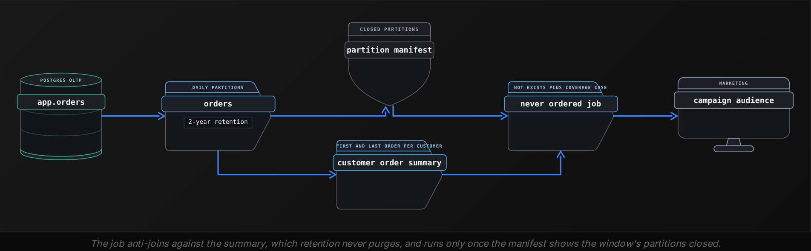

# Anti-Join: Advanced

You are 35 minutes into a data modeling round at an online marketplace.
'Every night at 01:00 we email a win-back coupon to customers with no order in 90 days. Orders is around 6 billion rows, partitioned by day. The job is a NOT IN subquery. Last quarter it ran in 4 minutes. Now it runs for 3 hours, and support says some coupons reached people who ordered that evening. What's going on?'
She turns her laptop toward you. The query text has not changed in a year. Nobody has mentioned when the previous day's orders finish loading, and that one fact accounts for the second complaint on its own.
She is testing whether you can explain 'no matching row' through the plan, the writers and the history the orders table actually holds, before you propose any edit to the SQL.


<br>

### What you will be able to do

Explain why NOT EXISTS plans as a hash anti-join while a nullable NOT IN falls back to a SubPlan or nested loop, and which NULL-keyed rows each form keeps

Contain an anti-join's cost on billions of rows by pruning the excluded side's partitions before the join, then cutting it down to the distinct values of its key

Diff a source against its target in both directions, plus changed rows, in a single pass

Explain why 2 writers running check-then-insert both insert, and name the fix each platform allows

Scope a 'never' answer to the history the excluded table actually holds


<br>

---

## NOT EXISTS vs NOT IN in the Plan

The plan is where this question gets settled. The win-back job keeps customers whose id is NOT IN a subquery over 90 days of `orders`, and its EXPLAIN contains no anti-join: on Postgres the plan attaches a `SubPlan` as a filter, and the same text on Spark plans a `BroadcastNestedLoopJoin`. The interviewer wants to know why the engine declined the join everyone expected, and the answer begins with what NOT IN means, before any operator gets named.


<br>

### What a hash anti-join assumes

A hash anti-join builds a hash table on the excluded side's key, streams the kept side through it, and emits each row whose probe finds no entry. That last step equates 'no equal key' with TRUE. NOT EXISTS means exactly that: for each customer the correlated predicate `o.customer_id = c.customer_id` is TRUE for some order or it is not, and a comparison that comes out UNKNOWN counts as no partner. So engines decorrelate NOT EXISTS into a plain anti-join and then pick the join algorithm on cost, as they would for any other join.

NOT IN means `c.customer_id <> ALL (subquery)`, which is TRUE only when every comparison is TRUE. One NULL among the order keys turns the comparison UNKNOWN for every customer without a partner, and a NULL customer key turns every comparison UNKNOWN whenever the subquery returns any row. A plain probe sees neither case. To run NOT IN as a join, the engine must know 2 more things at probe time: whether the build side holds a NULL, and whether the probing key is NULL. That operator is a null-aware anti-join, and engines differ on whether they have one.

| Engine | NOT EXISTS plans as | Nullable NOT IN plans as |
| --- | --- | --- |
| Postgres | Hash, merge or nested loop anti join, chosen on cost | A hashed SubPlan while the key list fits in memory, else a SubPlan rescanning the keys per outer row |
| Spark SQL 3.x | Broadcast hash or sort-merge left anti join | A nested loop on `a = b OR isnull(a = b)`, except single-column cases small enough to broadcast |
| Oracle | HASH JOIN ANTI | HASH JOIN ANTI NA, a null-aware hash join |
| SQL Server | Left anti semi join | An anti semi join with extra branches that probe for NULLs, often through a row count spool |

If the job runs on Postgres, that first row explains the slowdown. A hashed SubPlan is fast, and the job ran in 4 minutes while 90 days of order keys fit in the memory the session allowed. Order volume grew, the planner's size estimate crossed that limit, and the unchanged query replanned as a SubPlan that rescans the materialized keys once per customer. Every lapsed customer walks all 740 million keys before it can be kept, which is quadratic work that would not finish in days. The 3 hours in the complaint is the scheduler's timeout cancelling a run that was never going to end, and until then nothing errored and nothing warned. NOT EXISTS over the same data plans a Hash Anti Join, which spills to disk in batches when memory runs short and stays linear.


<br>

### The rewrite changes the answer on NULL rows

Saying 'switch to NOT EXISTS' covers half the answer, and the follow-up waits for the rest: the 2 forms return different rows once NULLs exist. A customer with a NULL `customer_id` survives NOT EXISTS, because nothing equals NULL and so no partner is found, while NOT IN discards it. A NULL among the order keys empties the NOT IN result and leaves NOT EXISTS untouched. A rewrite worth defending decides what a NULL key means on each side and writes that decision as a predicate, so the anti-join underneath is a pure equality probe.

https://github.com/user-attachments/assets/865e7759-0b89-4af8-ac3a-d7a56956a412

Over these rows the query returns Dev alone. The outer `IS NOT NULL` removes the `Unknown` customer before any probe, which matches what NOT IN does with a NULL outer key, and the inner filter states that orders 505 and 506 belong to nobody. That inner filter changes no result, since a NULL key matches no customer anyway; it is there so the optimizer's row estimate and the next maintainer both see NULL keys excluded on purpose. Written as NOT IN, the same query over the same 4 orders returns 0 rows.

Expect the pushback 'our NOT IN has returned correct rows for years.' It has, because `orders.customer_id` has never held a NULL. Correctness then depends on a property no constraint enforces, and the null-aware machinery or the per-row SubPlan is paid for every night regardless. The day an upstream change writes one NULL key, the audience becomes 0 rows and the coupon job sends nothing, with a green status.

> **TIP**
>
> The sentence being scored: 'NOT EXISTS is 2-valued, so it decorrelates into a plain anti-join; a nullable NOT IN needs a null-aware one, and Postgres plans it as a SubPlan filter instead.' Follow it, before being asked, with what the rewrite does to NULL keys on each side.

> When NOT IN is still fine
>
> - Both key columns are declared NOT NULL: Oracle and Spark then plan an ordinary anti-join, but Postgres ignores the constraint and keeps the SubPlan, so it still needs NOT EXISTS.
> - The list is literal constants, such as `status NOT IN ('test', 'fraud')`, with no subquery behind it.
> - The subquery is a small, fixed exclusion list of a few hundred rows, which a hashed SubPlan holds comfortably.


<br>

---

## Anti-Joins on Billion-Row Tables

Once the form is settled, the problem becomes cost. At 6 billion order rows it shows up as a symptom: 'the job shuffles 400GB', 'one task runs for an hour while the rest finish', 'it slowed 10x after guest checkout launched'. Each traces back to how much of the excluded side the engine has to read and then shuffle into a hash table, so a strong answer starts with that side rather than with cluster size.


<br>

### Where the cost goes

- Scan: every order partition the subquery cannot prune is read, though only 1 column is used.
- Build: the excluded side becomes the hash table, so its row count after filtering sets the memory bill.
- Shuffle: past the broadcast limit, both sides are repartitioned by key across the network.
- Skew: a key with millions of rows sends all of them to 1 shuffle partition and 1 task.

The build side is the one candidates forget to shrink. An anti-join asks only whether a key exists, so the excluded side can be cut to its distinct keys before the join without changing the result. For the win-back job that turns roughly 740 million orders in the 90-day window into about 30 million customer ids. It also dissolves skew: the placeholder id guest checkout writes, attached to 40 million orders, becomes 1 row.

```sql
WITH recent_buyers AS (
  SELECT DISTINCT
    customer_id
  FROM orders
  WHERE order_date >= DATE '2023-12-16'
    AND customer_id IS NOT NULL
)

SELECT
  c.customer_id,
  c.email
FROM customers AS c
WHERE c.status = 'active'
  AND NOT EXISTS (
    SELECT
      1
    FROM recent_buyers AS r
    WHERE r.customer_id = c.customer_id
  )
```

https://github.com/user-attachments/assets/cfd78445-521d-4878-8992-2924862420f0

Over 4 customers the result is Ben and Dev. Ben does have an order, but order 502 dates from 2023-10-20, and the date predicate inside the subquery removes it before any key is compared; Dev has never ordered. At scale, that placement is the saving: the planner turns the date predicate into a partition filter on the scan, so October's partitions are never opened. If you wrap the column, as in `CAST(order_date AS VARCHAR) >= '2023-12-16'`, the planner can no longer map the predicate to the partition column, and the same query reads every partition in the table.


<br>

### Broadcast, shuffle or spill

With the build side small, the join strategy follows. Spark can broadcast only the right side of a left anti-join, which is the excluded table, and 30 million long keys come to several hundred megabytes, well past the default threshold, so the plan becomes a sort-merge anti-join that shuffles both sides. Postgres builds its hash table and, past its memory limit, splits it into batches written to temp files. Both degrade linearly. The plan to fear is a nested loop: 80 million customers against 30 million unhashed keys is 2.4 quadrillion comparisons.

- **10MB** — Spark's default broadcast threshold
- **200** — Spark's default shuffle partitions

Cutting the probe side helps as much. Filter `customers` to active accounts before the probe, and if the team keeps a `customer_order_summary` table with 1 row per customer and its last order date, run the check against that table and leave `orders` out of the nightly job.

| ✓ Anti-join against orders | ✗ Check against customer_order_summary |
| --- | --- |
| • Reads 90 daily partitions, about 740 million rows<br><br>• Rebuilds 30 million keys on every run<br><br>• Cost grows with order volume<br><br>• Correct as soon as a partition lands | • Reads 80 million rows, 1 per customer<br><br>• Filters on last_order_date, plus customers with no row<br><br>• Cost grows with the customer count<br><br>• Only as fresh as the summary's last update |

On BigQuery the same levers show up on the invoice, because on-demand queries bill bytes scanned. The pruned subquery reads `customer_id` from 90 of roughly 730 daily partitions, about 12% of them and 1 column's bytes from each. The wrapped-column version scans all 730 partitions and bills about 8 times those bytes, so the slower query is also the more expensive one.


<br>

### The follow-up about the plan

Expect 'how would you know the plan changed?' Answer with evidence. EXPLAIN shows the operator (Hash Anti Join or SubPlan; BroadcastHashJoin or BroadcastNestedLoopJoin). Put the build side's estimated rows next to its actual rows, and pull spill and shuffle bytes from the job metrics. An alert when runtime passes 2x the trailing 7-day median catches a plan flip on its first night, while the fix is still a one-line rewrite.

> **TIP**
>
> Stale statistics are the usual trigger for a plan flip. After a large backfill into `orders`, run `ANALYZE orders` in Postgres or `ANALYZE TABLE orders COMPUTE STATISTICS` in Spark, so the build side's estimate matches what the join will see.


<br>

---

## Diffing a Source Against Its Target

Reconciliation questions hide the same anti-join. 'A nightly load copies `app.orders` into `dw.orders`. Daily row counts match, yet finance's revenue total is 0.3% high. Find the bad rows.' Matching counts prove nothing here: a target that is missing 1,200 orders and still holds 1,200 that the source hard-deleted reports the same count as a perfect copy. Only a key-level diff in both directions tells them apart.


<br>

### 3 sets, 2 of them anti-joins

A complete diff produces 3 sets. Missing in target: source keys with no target row, which the next load must insert. Gone from source: target keys with no source row, usually hard deletes upstream, which the target must delete or flag. Changed: keys present on both sides with different values. The first 2 are anti-joins pointing in opposite directions. The common miss in the room is writing only the first, and with revenue running high, the overcount comes from the second.

The 2 tables have to sit in one engine, so the source side is usually a landed snapshot; call it `src_orders`, beside the warehouse copy `dw_orders`. A pair of NOT EXISTS queries is correct but reads each table twice. A full outer join on the key reads each once and labels every row, which is the version to propose on billion-row tables.

https://github.com/user-attachments/assets/7dfb568c-4924-4ab1-89f6-1a87b66590f0

Order 9003 finds no target partner, so `t.order_id` is NULL and it lands in `missing_in_target`; order 9004 is the mirror image; order 9002 matches on key and carries 15 in the source against 18 in the target. Order 9001 agrees on every column, and the WHERE clause drops it. The amount check uses `<>` because these amounts are never NULL. On a nullable column `<>` returns UNKNOWN when either side is NULL, so an amount that changed from 15 to NULL would disappear from the diff: write `s.amount IS DISTINCT FROM t.amount` there.

For the changed set across 40 columns, compare a row hash instead of 40 predicates: `md5` over each side's columns, concatenated in a fixed order. The concatenation breaks it, because `CONCAT_WS('|', a, b, c)` skips NULLs, so ('x', NULL, 'y') and ('x', 'y', NULL) produce the same string and the same hash. Wrap every column in `COALESCE(CAST(col AS VARCHAR), '#null#')` before concatenating, and the hash tells NULL apart from every value.


<br>

### Scoping the diff

Diffing 6 billion rows every night is 2 full scans. Scope the missing and changed checks to the partitions the load claims to have written, usually the last few days. The gone-from-source direction resists that scoping, because an upstream hard delete can hit an order from 2022. Either of 2 answers holds up: anti-join only the keys in the source's CDC delete events, or run a key-only diff weekly across the full range, which hashes 1 column per side and stays cheap.

Each set has its own remedy. Missing rows go back through the load for their partition. Gone rows are best marked `is_deleted = true` with the date the diff found them, since a target that hard-deletes on a reconciliation result can no longer explain last month's revenue. That flag then has to be excluded from the gone check itself, or every soft-deleted order reappears in the gone set every night.

| ✓ Key-based diff | ✗ Whole-row diff with EXCEPT |
| --- | --- |
| • Tells changed rows apart from missing and gone ones<br><br>• Needs an explicit NULL-safe value comparison<br><br>• Can project only the key for a fast full-range pass | • Treats 2 NULLs as equal without extra syntax<br><br>• Reports a changed row as 1 missing plus 1 gone<br><br>• Removes duplicates, so 2 identical target rows count as 1 |


<br>

### Duplicates pass an existence test

An anti-join tests existence, so duplicates slip past it. If `dw_orders` holds order 9001 twice, both copies find their partner, so the diff reports nothing missing or gone while revenue is overstated anyway. Pair the diff with a cardinality check on the target key, and treat any row it returns as a failed load.

```sql
SELECT
  order_id,
  COUNT(*) AS copies
FROM dw_orders
GROUP BY order_id
HAVING COUNT(*) > 1
```

> Keys that can never match
>
> A source row with a NULL `order_id` reappears in `missing_in_target` every night, because no target row can equal it. Route NULL and malformed keys to a quarantine table before the diff and alert on their count separately, so the missing set stays a list of real load failures.

> **TIP**
>
> Give the interviewer an output contract: 3 counts per partition, an alert when missing or gone is above 0 for a partition that has closed, and 20 sample keys per set in the alert.


<br>

---

## Check-Then-Insert Races

This question sounds like data quality: '`dim_customer` should hold 1 row per `customer_id`. The loader inserts only customers not already present, using NOT EXISTS. Last month we found 3,100 duplicated ids, and the query looks right. What happened?' The query is right for 1 writer. The duplicates come from 2 writers running it at once.

```sql
INSERT INTO dim_customer (customer_id, email, first_seen_at)
SELECT s.customer_id, s.email, s.created_at
FROM staging_customers s
WHERE NOT EXISTS (
  SELECT 1 FROM dim_customer d
  WHERE d.customer_id = s.customer_id
);
```


<br>

### 2 snapshots, both empty

Under read committed, which Postgres and SQL Server use by default, as does Oracle, a statement sees only rows that other transactions have committed. When 2 loader runs overlap, each evaluates NOT EXISTS against a `dim_customer` that has no customer 7731 yet, so each inserts it. Neither statement broke a rule: the check and the insert are 2 steps, and the other writer's row landed between them, invisible until it was committed.

| Time | Run A (scheduled) | Run B (retry after a timeout) |
| --- | --- | --- |
| 02:00:04 | Checks: no 7731 | Starts |
| 02:00:05 | Builds its insert | Checks: no 7731 |
| 02:00:06 | Inserts 7731, uncommitted | Builds its insert |
| 02:00:07 | Commits | Inserts 7731, uncommitted |
| 02:00:08 | Done | Commits: 7731 has 2 rows |

The interviewer is listening for whether the bug is placed in that gap rather than in the SQL text. The follow-up then tests a fix, usually one of these.

> Fixes the follow-up tests
>
> - Fails: LEFT JOIN ... IS NULL, or MERGE without a constraint, runs the same check against the same committed data and leaves the same gap.
> - Fails: `SELECT ... FOR UPDATE` before inserting locks nothing in Postgres, since no row exists yet, and both runs proceed.
> - Works, at a cost: under repeatable read, InnoDB gap locks let both runs hold the gap, and when both insert they deadlock. InnoDB rolls 1 of them back, which the loader must retry.
> - Fails: wrapping check and insert in 1 transaction under read committed still cannot see the other run's uncommitted row.


<br>

### A unique constraint closes the gap

The database has to refuse the second row, and the object that refuses it is a unique constraint. With a unique index on `customer_id`, Run B's insert of 7731 waits for Run A's transaction, then raises a unique violation once A commits; `ON CONFLICT DO NOTHING` turns that violation into a skip. NOT EXISTS can stay as a filter that saves conflict work. The constraint is what makes the table correct.

```sql
CREATE UNIQUE INDEX dim_customer_uk
  ON dim_customer (customer_id);

INSERT INTO dim_customer (customer_id, email, first_seen_at)
SELECT s.customer_id, s.email, s.created_at
FROM staging_customers s
ON CONFLICT (customer_id) DO NOTHING;
```

SERIALIZABLE is the second correct answer, and its cost needs naming. Postgres's serializable snapshot isolation notices that each run read a range the other wrote, and aborts 1 with SQLSTATE 40001. Correctness holds without a constraint, but every writer now needs retry logic, and a loader that swallows the error loses customers instead of duplicating them.

A third correct option serializes the writers. `SELECT pg_advisory_xact_lock(42)` at the start of each loader transaction makes Run B wait until Run A commits. Because Run B's INSERT is a new statement, it sees 7731 when it finally runs and skips it. It allows 1 loader at a time, which suits a nightly dimension load and throttles a streaming writer.

The same race shows up in streaming. A Kafka consumer with at-least-once delivery reprocesses a batch after a group rebalance, while the consumer that held the partition before is still finishing its write: 2 processes, 1 message, 1 check-then-insert each. The unique constraint fixes it the same way, keyed on the business id rather than the message offset.


<br>

### Warehouses without enforced keys

Snowflake standard tables accept PRIMARY KEY declarations without enforcing them, as do BigQuery and Databricks. The constraint fix is unavailable, and the race moves up a layer. Any of 3 answers holds up there. One writer per table: the job claims a lock row before writing and checks the warehouse for a running query with its tag. Idempotent overwrite: each run replaces a whole partition, so 2 runs leave one partition written twice instead of 2 copies. Dedup on read: a view keeps `ROW_NUMBER() OVER (PARTITION BY customer_id ORDER BY first_seen_at) = 1`, accepting duplicates in storage and hiding them from consumers.

*An orchestrator timeout kills the task, and the warehouse query it submitted keeps running and commits later. A retry launched after that timeout is Run B in the timeline above, even when the DAG allows only 1 active run.*

> **TIP**
>
> Asked 'how would you prove it was a race?', line up the duplicates' insert timestamps with the scheduler log. Race duplicates arrive in pairs a few seconds apart, on nights with a retry or overlapping run; duplicates from a bad source arrive on any night, often as identical batches.


<br>

---

## An Incomplete Excluded Table

The last variant hides in a definition. 'Marketing wants every customer who has never placed an order, for a first-purchase campaign.' The word never is the problem. An anti-join answers 'no row in this table', which equals 'never happened' only when the table holds every order for every customer in the question. Warehouse tables rarely do, and asking 'never since when?' before writing SQL is the move the interviewer is waiting for.


<br>

### 4 ways the excluded table runs short

| Gap | What the table looks like | What the anti-join reports |
| --- | --- | --- |
| Retention | `orders` keeps 2 years; older rows are purged | A customer whose only order is 3 years old as a non-buyer |
| Late arrival | At 01:00, yesterday's partition is 70% loaded | Customers who ordered last evening as lapsed |
| Backfill boundary | `app_sessions` starts at the 2023-09-01 tracking launch | Every user active before launch as never having logged in |
| Identity split | Guest orders carry NULL or a separate guest id | Customers who only bought as guests as non-buyers |

None of these raises an error. The job finishes with plausible rows and errs in the direction that costs most, because a missing order row is exactly what tells the win-back job to send a coupon. The late-arrival row is the coupon complaint from the win-back job: at 01:00 last evening's orders had not landed, so those customers looked lapsed. A first-purchase coupon sent to someone with 40 orders in 2020 is embarrassing; a purge of 'inactive' accounts that are active is worse.


<br>

### Split the answer by coverage

The fix is to stop asking a 2-valued question of a table that can answer it for only part of the population. Each customer sits inside the excluded table's coverage, where no row means never, or outside it, where no row means unknown, and the query should say which.

https://github.com/user-attachments/assets/aa43521d-e914-4aad-96d6-0afc10856d96

With `orders` retained from 2022-03-16, Ana has 2 orders in range and drops out. Dev and Eli survive the anti-join, and the CASE separates them. Dev signed up on 2023-11-04, inside coverage, so the absence of a row means he has never ordered. Eli signed up on 2020-06-11, and her only order, from 2021, went with everything else retention purged, so the honest label is `unknown`. Marketing gets Dev plus a count of unknowns, instead of a list that includes a returning buyer without saying so.


<br>

### Make coverage something the job can read

Signup date against a retention boundary covers retention. The other gaps need the pipeline to publish what it holds. A partition manifest records whether each daily partition of `orders` is complete, and only waiting until the window's last partition closes removes the false positives, at the cost of a later send. Ending the window at the last closed partition does not: a customer whose only recent order sits in the open partition still has no row inside the shorter window, so they stay in the audience, and the shorter window only makes the audience's as-of date honest. A job that cannot wait also drops every customer with a row already in the open partition, because a row that has landed is evidence of an order. For history retention destroys, the `customer_order_summary` from the billion-row section does the work, with 2 additions: it is never purged, and it keeps `first_order_date` beside `last_order_date`, so 'ever ordered' outlives the raw rows.



Identity gaps need the same treatment at the key. If guest orders carry a NULL `customer_id` and a separate `guest_email`, a registered customer who bought twice as a guest looks like a non-buyer. Anti-join on a resolved id from an identity map, or report those customers as `unknown` until the map exists.

The follow-up is predictable: 'the summary table was built last year, so what about before that?' The answer applies the same split one level up. The summary's coverage starts where its backfill started, customers older than that stay `unknown` until a one-time load from the legacy system closes the gap, and the boundary gets stated out loud with a date.

> Ask before writing the anti-join
>
> - Never since when: on what date does the excluded table's history start?
> - Is the last partition closed when the job runs?
> - Which id do guest and merged-account orders carry?
> - Does a cancelled or refunded order count as an order?

| ✓ Do | ✗ Don't |
| --- | --- |
| • Rewrite a nullable NOT IN as NOT EXISTS and state what NULL keys mean on each side<br><br>• Cut the excluded side to pruned, distinct, non-NULL keys before the probe<br><br>• Diff source and target in both directions, plus changed rows, in 1 full outer join<br><br>• Let a unique constraint, rather than NOT EXISTS, guarantee 1 row per key<br><br>• Label customers outside the excluded table's coverage as unknown | • Trust last quarter's plan after the excluded side has doubled<br><br>• Reconcile a load on row counts alone<br><br>• Lock a missing row with FOR UPDATE and call the race fixed<br><br>• Run an anti-join over a partition that is still loading |


<br>

---

## Putting It All Together

A meal-kit company must delete the stored payment tokens of customers with no box delivered in 18 months, a card-network compliance rule. Deliveries live in a 3-billion-row warehouse table loaded nightly from the logistics database and kept for 2 years, the load job retries on timeout, and the purge job runs at 03:00, writing to a token_purge_queue table that the payments service consumes.

- The purge query is a NOT EXISTS on customer_id against deliveries, because a NULL from a manual courier entry would empty or stall a NOT IN without any error.
- The excluded side is 18 months of delivery partitions reduced to distinct customer ids, which keeps a nightly run over 3 billion rows inside its window.
- A nightly key diff against the logistics database runs first, because a delivery row missing from the warehouse becomes a wrongful token deletion.
- The queue carries a unique key on customer_id, since a load retry overlapping the 03:00 run would otherwise queue the same token twice.
- The job waits for the manifest to close its window's last partition, and if it cannot, spares every customer with a delivery row already in the open partition, since a shorter window alone still purges them.


<br>

---

## Key Takeaways

- NOT EXISTS decorrelates into a plain anti-join; a nullable NOT IN needs a null-aware one, and Postgres plans it as a SubPlan filter instead.
- At billions of rows, shrink the excluded side first: prune its partitions, then reduce it to the distinct, non-NULL values of the key.
- Rows can be missing from the target or gone from the source, and matched rows can have changed; a full outer join on the key finds all 3 sets in one pass.
- NOT EXISTS before INSERT is 2 steps, so 2 runs can insert one key; a unique constraint stops that, and so does serializable isolation or a single writer.
- No row means never only inside the excluded table's coverage; outside it, the honest answer is unknown.
