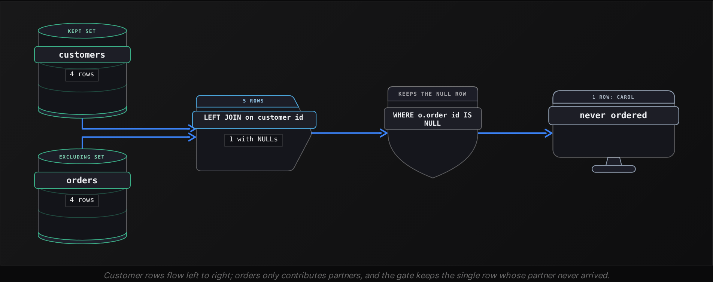

# Anti-Join: Beginner

You are 12 minutes into a SQL screen at a subscription box company. The interviewer shares 2 tables, `customers` and `orders`, and types one line into the chat:
"Give me every customer who has never placed an order."
Then nothing. No sample rows, no word on how `orders` points back to `customers`, no description of what the result should look like. The reflex is to type `SELECT * FROM customers` and hunt for a column that says whether an order exists. There's no such column. `orders` holds a row for every order that did happen, and the fact you need is the row that is missing from it.
What she is testing is whether you hear "never" as "rows with no partner in the other table" and reach for the one join that keeps unmatched rows instead of discarding them.


<br>

### What you will be able to do

Recognize "never", "without" and "missing" as a request for rows that have no match in another table

Write the LEFT JOIN ... WHERE ... IS NULL anti-join and trace which rows survive the filter and why

Test for the NULL on a right-side column that no matched row can leave empty

Explain why a WHERE filter on one table can't find what's absent from another

Name the kept table, the excluding table, the join column and the proof column before writing a line


<br>

---

## "Never" Means an Anti-Join

The word anti-join appears in no interview question. The question arrives as a sentence about something that did not happen: a customer who never ordered, a product nobody viewed, an employee with no training record. The table that would record the event holds a row for every event that did occur, so the thing the question asks about has left no row anywhere. The only evidence is a gap, and a gap can't be selected with a `WHERE` clause on the table that has it.

An anti-join is the query shape that finds the gap. It returns the rows of one table that have no matching row in another table, and only those. The output carries the first table's columns at the first table's grain, 1 row per customer and never more, and the second table is read only to decide which rows survive. An `INNER JOIN` returns a row for every pair that matches and discards the rest, so the anti-join is its complement: the inner join answers "who did", the anti-join answers "who did not". Both start from the same 2 tables and the same key.


<br>

### The disguises it arrives in

- Customers who have never placed an order
- Products that were never added to a cart
- Employees without a completed training record
- Accounts with no row in the login history
- People on the roster who are missing from payroll
- Orders that have no matching shipment

The trigger words are "never", "without", "no", "missing" and "not in". Each sentence names 2 tables and a relationship between them, and asks for the side where the relationship is absent. Hearing the sentence as sets takes the guesswork out: one table supplies the candidates, the other table supplies the evidence, and the answer is every candidate with no evidence against it.

> **TIP**
>
> If the question names only 1 table, ask where the event would be recorded. "Customers who never logged in" is a 2-table question the moment a `sessions` or `logins` table exists, and the interviewer expects you to ask for it.


<br>

### The 2 tables behind the question

customers

orders

The sample has 4 customers and 4 orders. Alice placed 2 orders, Bob and Dana placed 1 each, and no order carries customer_id 5, so Carol is the answer. Counting confirms the shape before any SQL runs: 4 customers, 3 distinct customer_ids present in `orders`, and 4 minus 3 leaves 1 row. Alice's 2 orders earn her 0 rows in the result rather than 2, which is the first fact to keep straight: how many times a customer matches only matters as zero or not zero.

The grain is the check you can do without running anything. The result has the grain of `customers`, so it can have at most 4 rows, and any anti-join that returns more rows than its left table has joined something wrong. In an interview, stating the bound aloud, "this returns at most one row per customer", shows that you know what each output row stands for, which is the thing join and `GROUP BY` questions keep testing from different angles.


<br>

### The sentence to say before typing

Say one sentence that names the shape, the tool and the test: *"This is an anti-join. I keep every customer with no matching row in orders, so I'll* LEFT JOIN *orders onto customers on customer_id and keep the rows where the orders side came back* NULL*."* The interviewer now has your plan, and if the plan is wrong they can redirect you before you have written a line, which costs you far less than a wrong query does.

| ✓ Moves that cost the offer | ✗ Moves that earn it |
| --- | --- |
| • Typing SELECT \* FROM customers and searching for a column that records whether an order exists<br><br>• Writing an INNER JOIN and staring at a result that holds only the customers who did order<br><br>• Going silent for a minute reading the tables instead of restating the question as 2 sets<br><br>• Asking "do you want the ones with orders or without?" after the question said never | • Restating the question as a kept table, an excluding table and a join column between them<br><br>• Naming the join column before writing the join<br><br>• Writing the 6-line LEFT JOIN ... WHERE ... IS NULL form without pausing<br><br>• Tracing 1 matched customer and 1 unmatched customer through the query aloud |


<br>

---

## LEFT JOIN ... WHERE ... IS NULL

A `LEFT JOIN` keeps every row from the table on its left and attaches a partner from the table on its right wherever the `ON` condition is true. Where a left row has 2 partners it appears twice, once per partner. Where a left row has no partner it still appears once, with every column from the right table set to `NULL`. That last rule is the whole anti-join: the join manufactures a row for Carol that no inner join would produce, and the `NULL`s on it are the mark that nothing matched.


<br>

### What the join produces before the WHERE

| c.customer_id | c.name | o.order_id | o.customer_id |
| --- | --- | --- | --- |
| 1 | Alice | 101 | 1 |
| 2 | Bob | 102 | 2 |
| 1 | Alice | 103 | 1 |
| 3 | Dana | 104 | 3 |
| 5 | Carol | NULL | NULL |

The join turns 4 customers into 5 rows. Alice is doubled because 2 orders match her, Bob and Dana appear once, and Carol appears once with `NULL` in both order columns. The join has lost nobody, which is the property that makes the filter possible: every customer is present, and the ones with no orders are the ones whose right-side columns are empty. The `WHERE` now has something to test.


<br>

### The query, clause by clause

https://github.com/user-attachments/assets/081dce5e-cbb7-4187-b343-7912f50beb87

Watch the order of evaluation. The engine builds the 5 joined rows first, then runs the `WHERE` over them, and `o.customer_id IS NULL` is true for exactly 1 of the 5: Carol's. Alice's 2 rows carry 1 in `o.customer_id`, Bob's carries 2, Dana's carries 3, and all 4 are dropped. The result is 1 row, `(5, Carol)`, with the columns of `customers` only. The `SELECT` list reads from `c`, since any column read from `o` on a surviving row would be `NULL` by construction.

| Clause | What it does |
| --- | --- |
| SELECT c.customer_id, c.name | Reads output columns from the kept table only |
| FROM customers c | The kept table: every row here is a candidate |
| LEFT JOIN orders o | The excluding table, attached without dropping any customer |
| ON o.customer_id = c.customer_id | The key that makes a right row a partner |
| WHERE o.customer_id IS NULL | Keeps the candidates whose partner never arrived |

Every engine you will be interviewed on accepts this form unchanged. LEFT OUTER JOIN is the same keyword with OUTER written out, and the result is identical. The only thing that changes between dialects is the quoting of names, so the 6 lines you rehearse are the 6 lines you type.


<br>

### Why LEFT and not INNER

An `INNER JOIN` on the same `ON` condition returns 4 rows: Alice twice, Bob, Dana. Carol is gone before the `WHERE` runs, because an inner join emits a row only for pairs that satisfy the condition, and no pair contains her. A `WHERE o.customer_id IS NULL` on that result tests 4 rows that all carry a real id and returns nothing. The `LEFT` keyword keeps the unmatched row alive long enough for the filter to see it, and that is the sentence to have ready when the interviewer asks why you wrote it.

> Follow-ups that test the mechanism
>
> - "A customer with 10 orders, how many rows?" Zero in the result: all 10 joined rows carry an id, and all 10 fail the filter.
> - "What is in o.order_id on Carol's row?" NULL, like every other column from orders, because no order row was found to copy from.
> - "Why not test c.customer_id IS NULL?" That column comes from the kept table and holds 5 on Carol's row; only the right side went NULL.
> - "Could 2 customers share an output row?" No: a join adds columns and never merges rows, so each result row is exactly 1 unmatched customer.

> **TIP**
>
> Write the join first, run it without the `WHERE`, and look at the `NULL` row. On a whiteboard, saying "before the filter there are 5 rows and Carol's has NULLs" proves you know what the filter is acting on.


<br>

---

## NULLs That Mean "No Match"

A `LEFT JOIN` result can hold 2 kinds of `NULL`, and they look identical in the output. The first kind is produced: the engine found no partner for a left row and filled every right-side column with `NULL` at once, primary key included. The second kind is stored: a column in the right table holds `NULL` as its actual value, on a row that did match. The anti-join filter depends on telling them apart, and `IS NULL` on its own cannot, so the choice of which column to test is what does the telling.


<br>

### One result, 2 kinds of empty

| c.name | o.order_id | o.customer_id | o.shipped_date |
| --- | --- | --- | --- |
| Alice | 101 | 1 | 2024-03-01 |
| Bob | 102 | 2 | NULL |
| Alice | 103 | 1 | 2024-03-05 |
| Dana | 104 | 3 | 2024-03-12 |
| Carol | NULL | NULL | NULL |

Order 102 has shipped_date `NULL` because Bob's order hasn't left the warehouse yet. That `NULL` was written by the application and sits in the `orders` table. Carol's row has `NULL` in `o.shipped_date` too, and also in `o.order_id` and `o.customer_id`, and none of those values exist anywhere in `orders`; the join invented them because there was no order row to copy from. Bob's row is a match with a blank in it. Carol's row is a non-match.


<br>

### The wrong column lets a stored NULL through

https://github.com/user-attachments/assets/5fc63576-3a1a-4361-b2cd-f57b9454f399

The animation runs on a 3-customer slice of the running example: Alice with shipped order 101, Bob with order 102 still waiting on its shipped_date, and Carol with no order at all. The query tests `o.shipped_date IS NULL` and returns 2 rows: Bob and Carol. Bob's row passes because the stored value is `NULL`. Carol's passes because the produced value is `NULL`. The filter asked a column a yes-or-no question and both rows said yes. Bob has placed an order, so he does not belong in "customers who never ordered", and the query has mixed "never ordered" with "ordered and not yet shipped" without raising an error, leaving the row count off by 1.


<br>

### Test a column that is never NULL on a match

On a matched row, 2 right-side columns cannot be `NULL`. The first is the right table's primary key, `o.order_id`, which the table never stores as `NULL`. The second is the join column itself, `o.customer_id`: on any matched row it equals `c.customer_id`, and an equality can only be `TRUE` between 2 real values, so a matched row can't carry `NULL` there. Either column is `NULL` on an unmatched row and only on an unmatched row, which is exactly the test the anti-join needs. The habit to show the interviewer is reaching for `o.order_id IS NULL` or `o.customer_id IS NULL` and never for a business column like `shipped_date`.

```sql
-- Customers who have never ordered, proven by the primary key
SELECT
  c.customer_id,
  c.name
FROM customers AS c
LEFT JOIN orders AS o
  ON o.customer_id = c.customer_id
WHERE o.order_id IS NULL
```

On the full running example in the table above, this returns 1 row, Carol. Bob's row carries 102 in `o.order_id`, fails the filter and is dropped along with Alice's 2 rows and Dana's, whatever `shipped_date` holds. The business column is still in the join output, so if the question later becomes "customers whose orders have all shipped" you can filter on it deliberately, knowing that you're now testing stored values and that the question has changed.


<br>

### A stored NULL in the join column itself

Suppose a bad load inserts order 105 with `customer_id` `NULL`. In the `ON` condition, `NULL = 5` evaluates to `UNKNOWN`, and a join emits a pair only when the condition is `TRUE`, so order 105 pairs with nobody and never appears in the `LEFT JOIN` output at all. Carol's row is still produced with its manufactured `NULL`s, the filter still returns exactly her, and the orphan order has changed nothing. This form of the anti-join is indifferent to `NULL`s stored in the excluding table's join column, which is the sentence to say when the interviewer asks "what if orders has a NULL customer_id?".

| ✓ Produced NULL | ✗ Stored NULL |
| --- | --- |
| • Appears in every right-side column at once, primary key included<br><br>• Exists nowhere in the stored table<br><br>• Means: no row satisfied the ON condition<br><br>• The value the anti-join filter is looking for | • Appears in 1 column, with real values beside it<br><br>• Was written by an application or a load job<br><br>• Means: this fact is unknown or not yet set<br><br>• Invisible to the filter when you test the primary key |

> **TIP**
>
> When the interviewer adds a nullable column to the right table mid-question, the answer is 1 sentence: "I test the primary key, so a stored NULL in a business column cannot pass as a missing match."


<br>

---

## Anti-Join vs Plain Filter

A `WHERE` clause evaluates one row at a time, with the columns that row carries and nothing else. The `customers` row for Carol holds a `customer_id` and a `name`; it has no field that says whether an order exists for her, and the orders that would have said so live in another table and, in her case, do not exist. "Has never ordered" is a fact about the entire `orders` table, and no filter on `customers` alone can see it. Candidates who have not internalized this write 3 queries that each look right for a moment.


<br>

### Filter 1: IS NULL on the wrong table

```sql
-- Looks for missing customers in the wrong place
SELECT
  customer_id,
  name
FROM customers
WHERE customer_id IS NULL
```

This asks which customers have no id, and returns 0 rows because every customer has one. Pointing the same test at `orders` (`SELECT * FROM orders WHERE customer_id IS NULL`) finds orders with a missing customer, which are stored `NULL`s and a different question. No single table has a column whose emptiness means "no order exists for this customer", so no single-table `IS NULL` can find Carol.


<br>

### Filter 2: the inequality join

```sql
-- "Customers whose id differs from an order's customer" is a different question
SELECT DISTINCT
  c.customer_id,
  c.name
FROM customers AS c
JOIN orders AS o
  ON o.customer_id <> c.customer_id
```

This reads as "customers with no matching order" and returns all 4 customers. The join pairs every customer with every order whose customer_id differs: Carol pairs with all 4 orders, Alice with 102 and 104, Bob with 101, 103 and 104, Dana with 101, 102 and 103. That is 12 pairs out of 16 possible, and every customer sits in at least one, so `DISTINCT` hands back the full customer list. The query answered "is there some order that is not this customer's", which is true for anyone as soon as 2 different customers have ordered. "No order matches" and "some order does not match" are different claims, and `<>` can only make the second.


<br>

### Filter 3: INNER JOIN then IS NULL

```sql
-- The filter is right; the join has already removed the row it needed
SELECT
  c.customer_id,
  c.name
FROM customers AS c
JOIN orders AS o
  ON o.customer_id = c.customer_id
WHERE o.customer_id IS NULL
```

The `WHERE` here is the anti-join's own filter, and the query returns 0 rows because, as section 1 showed, the inner join never emits Carol. This is the query a candidate writes after memorizing the `IS NULL` ending without the step that feeds it. The `NULL` this filter tests exists in no stored table. The `LEFT JOIN` produces it, and that is the moment the absence of an order becomes a value on Carol's row. Replace `LEFT` with `INNER` and the filter waits for a value nothing creates. The follow-up an interviewer asks on seeing this is "where did you expect that NULL to come from?", and the answer that recovers the round is "from the outer join, which I need to put back".

| Query | Rows returned | Why |
| --- | --- | --- |
| WHERE customer_id IS NULL on customers | 0 | Tests a stored column; no column records absence |
| JOIN orders ON <> with DISTINCT | 4 | Every customer has some order that is not theirs |
| INNER JOIN ... WHERE o.customer_id IS NULL | 0 | Unmatched rows were dropped before the filter ran |
| LEFT JOIN ... WHERE o.customer_id IS NULL | 1 | The join manufactures the NULL the filter tests |


<br>

### The LEFT JOIN puts the absence on the row

The `LEFT JOIN` converts a property of a set into a property of a row. After it runs, each customer row carries either a partner's id or a `NULL`, and "no order exists for this customer" has become a value in a column on this customer's row. Only then does `WHERE` have something to test. Every anti-join written as a join is this 2-step move: bring the absence onto the row, then filter on it. A candidate who can say that sentence can also explain why the `LEFT` can't be dropped and why the filter column has to come from the right side.

A `has_ordered` flag on `customers` would make the plain filter work, and interviewers sometimes offer one to see what you do. It's a stored answer to the question, and it's correct only while some process updates it on every order and every deletion. The follow-up is "how does that flag stay right?", and the answer is a job that runs the same anti-join on a schedule. Say that, and you have shown you know where derived flags come from and what they cost to keep true.

> If the interviewer asks "why not a plain filter?"
>
> "Absence has no row to filter. The `LEFT JOIN` writes it onto the row as a `NULL`, and only then can the `WHERE` keep it."


<br>

---

## Drawing the Two Sets First

The anti-join is short enough that writing it first feels fast, and that is where the wrong answers come from. Underneath the 6 lines sit 4 decisions: which table's rows you keep, which table supplies the evidence that excludes a row, which columns link the 2, and which right-side column proves a row unmatched. Drawing those 4 before typing takes 20 seconds and settles every clause of the query, so the typing becomes transcription.


<br>

### The sketch for the running example

| Decision | Choice | Clause it fixes |
| --- | --- | --- |
| Kept set | customers, 1 row each | FROM customers c |
| Excluding set | orders | LEFT JOIN orders o |
| Link | customers.customer_id = orders.customer_id | ON o.customer_id = c.customer_id |
| Proof of no match | o.order_id, never NULL on a match | WHERE o.order_id IS NULL |
| Expected rows | at most 4; 1 on this data | the check after running |




<br>

### Swap the sets and you have a different question

Put `orders` on the left and the query answers "orders whose customer is missing from the customers table", an orphan check that a finance team runs after a migration. The link is the same and the proof column moves to the other side: `c.customer_id IS NULL`. On this data it returns 0 rows, because every order points at a real customer, and 0 is the correct answer rather than a bug. Candidates who skip the drawing pick the kept set by whichever table they typed first, and discover the mistake when the result has the wrong columns in it.

```sql
-- Orders with no customer: same tables, the other set is kept
SELECT
  o.order_id,
  o.customer_id
FROM orders AS o
LEFT JOIN customers AS c
  ON c.customer_id = o.customer_id
WHERE c.customer_id IS NULL
```


<br>

### A date condition on the excluding set

The follow-up most interviewers keep ready is a date. Suppose `orders` also carries `order_date`, and the question becomes "customers with no order since 2024-01-01". The kept set is unchanged. The excluding set is now the orders placed since January, and the condition that shrinks it belongs in the `ON` clause, where it decides what counts as a partner. The tempting version keeps the join exactly as it was and adds the date to the outer `WHERE`, next to the proof column.

```sql
-- Wrong: the date filters the joined rows, not the excluding set
SELECT
  c.customer_id,
  c.name
FROM customers AS c
LEFT JOIN orders AS o
  ON o.customer_id = c.customer_id
WHERE o.order_date >= DATE '2024-01-01'
  AND o.order_id IS NULL
```

| Joined row | o.order_id IS NULL | o.order_date >= DATE '2024-01-01' | Kept |
| --- | --- | --- | --- |
| Alice, order 101 | FALSE | TRUE or FALSE | no |
| Bob, order 102 | FALSE | TRUE or FALSE | no |
| Alice, order 103 | FALSE | TRUE or FALSE | no |
| Dana, order 104 | FALSE | TRUE or FALSE | no |
| Carol, no order | TRUE | UNKNOWN | no |

Every joined row fails 1 of the 2 conditions. Matched rows carry a real `o.order_id`, so they fail `IS NULL` whatever their date says. Carol's manufactured row passes `IS NULL`, but its `o.order_date` is `NULL`, so the date comparison is `UNKNOWN`, and `WHERE` keeps only rows where every condition is `TRUE`. No row can pass both halves, so the query returns 0 rows on any data: a filter no row can pass, written to look like an anti-join. Moving the date into the `ON` clause changes what counts as a partner instead of what counts as a result. An order from before January no longer pairs with its customer, so a customer whose orders are all older comes out of the join with manufactured `NULL`s, and the `IS NULL` proof keeps them.

```sql
-- The condition on the excluding set lives in the ON clause
SELECT
  c.customer_id,
  c.name
FROM customers AS c
LEFT JOIN orders AS o
  ON o.customer_id = c.customer_id
    AND o.order_date >= DATE '2024-01-01'
WHERE o.order_id IS NULL
```

Drawn as sets, the rule is immediate: anything that defines which right-side rows count is part of the excluding set and goes in the `ON`; the only thing in the `WHERE` is the `IS NULL` proof, plus any condition on the kept set itself, such as `c.status = 'active'`, which is safe there because kept-set columns are never manufactured. Saying "the date condition is part of what an order means here, so it goes on the join" is the sentence interviewers listen for, because it shows the filter was placed by reasoning.

> The 20-second check before you run it
>
> - Name 1 row that must be in the result (Carol) and 1 that must not (Alice, with 2 orders)
> - State the row-count bound: never more than the kept table has
> - Point at the proof column and say why a match can never leave it NULL
> - Read the ON clause aloud and confirm every condition describes the excluding set

*If the interviewer asks for a second way to write it, NOT EXISTS with a correlated subquery is the other standard form; its mechanics, and the trap inside NOT IN, belong to the intermediate lesson.*

| ✓ Do | ✗ Don't |
| --- | --- |
| • Say the kept set, the excluding set and the join column aloud before writing the join<br><br>• Test IS NULL on the right table's primary key or its join column<br><br>• Put conditions on the excluding set in the ON clause<br><br>• Trace 1 matched and 1 unmatched row through the join before running<br><br>• State the row-count bound from the kept table's grain | • Test IS NULL on a business column that the table can store as NULL<br><br>• Write INNER JOIN and expect the WHERE to find rows the join dropped<br><br>• Use <> in the ON clause to mean "no match"<br><br>• Put a date or status filter on the right table in the outer WHERE<br><br>• Pick the kept table by whichever name you typed first |


<br>

---

## Putting It All Together

A regional bank's compliance team must file a quarterly list of every open account with no identity document on record. The data sits in accounts (account_id, holder_name, opened_at, status) and kyc_documents (document_id, account_id, doc_type, verified_at), where verified_at is NULL for documents received and not yet reviewed, and a handful of documents from a scanner outage carry a NULL account_id.

- The request says "no document on record", which section 0 reads as accounts with no partner in kyc_documents, so the output has 1 row per account and never more.
- Section 1's LEFT JOIN from accounts to kyc_documents keeps every account and marks the undocumented ones with manufactured NULLs that the WHERE can test.
- Section 2 chooses the proof column, d.document_id IS NULL, because testing verified_at IS NULL would list accounts whose documents are merely awaiting review; the documents with a NULL account_id pair with nothing in the ON clause and change no result.
- Section 3 explains why no WHERE on accounts alone could build this list: absence from kyc_documents only becomes a value on an account's row once the LEFT JOIN puts it there.
- Section 4 puts status = 'open' on the kept set in the WHERE and any doc_type restriction on the excluding set in the ON clause, drawn before a line is typed.


<br>

---

## Key Takeaways

- "Never", "without" and "missing" ask for rows with no partner in another table: an anti-join, which keeps the left table's grain.
- LEFT JOIN keeps every left row and fills the right side with NULL where nothing matched; WHERE ... IS NULL keeps only those rows.
- Test IS NULL on the right table's primary key or join column, which no matched row can leave NULL; business columns store NULLs.
- A WHERE sees one row's columns; absence is a fact about the whole other table, and only the join can write it onto the row.
- Decide the kept set, the excluding set, the join column and the proof column before typing, and put conditions on the excluding set in ON.
