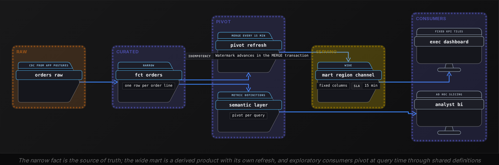

# Conditional Aggregation: Advanced

Forty minutes into a SQL round at an online retailer, the interviewer pastes a schema: `orders(order_id, customer_id, product_id, order_date, region, channel, status, amount)`, roughly 30 million rows a month.
"Finance wants March revenue by region, split by channel and by paid versus refunded, with net figures and subtotals. Growth wants spend per product for every customer, and risk wants refund-heavy orders flagged. Same table. Go."
She caps the marker. Nobody has said how many products exist, or who reads each result: a controller scanning one screen, a dashboard slicing it every way, a model. Most candidates start typing `SUM(CASE WHEN ...)` columns, which serves finance and quietly commits growth to one column per product, however many thousand that turns out to be.
What she is testing is whether you choose the output's shape, and the layer it lives in, before the first CASE.


<br>

### What you will be able to do

Build a multi-level CASE pivot that classifies each row once and proves, with an unclassified column, that nothing fell through

Move a conditional aggregate onto a window frame, choosing ROWS or RANGE and the frame bounds to match the requirement, with ELSE 0 in the CASE

Choose between GROUPING SETS subtotal rows and CASE pivot columns by consumer and by whether the measure adds up

Measure a pivot's width and density, and when columns stop working, switch to long rows or top N plus other, or fall back to a coarser key or a map column

Place a pivot in the warehouse or push it out to a semantic layer or the consumer, and name what each placement costs the people downstream


<br>

---

## Nested CASE for Multi-Level Pivots

The finance version of the question asks for one row per region with paid and refunded revenue for each channel, net revenue per channel, and some proof that nothing fell through. That is a 2-level pivot with channel over status. Every level multiplies the width: 3 channels times 2 statuses is 6 leaf columns, plus 3 net columns, before anyone mentions quarters. The grade goes to the query that stays checkable at 9 columns and is still checkable at 36.


<br>

### Where nested CASE breaks

Most first drafts nest the levels inside each aggregate: an outer CASE on channel wrapping an inner CASE on status. Both columns below compile and run, and both are wrong on real data.

```sql
SELECT
  region,
  COUNT(
    CASE
      WHEN channel = 'app' THEN CASE
        WHEN status = 'refund' THEN 1
        ELSE 0
      END
    END
  ) AS app_refund_orders, -- meant: refunded app orders
  SUM(
    CASE
      WHEN channel = 'web' THEN CASE
        WHEN status = 'paid' THEN amount
        WHEN status = 'refund' THEN - amount
      END
    END
  ) AS web_net -- meant: net web revenue
FROM orders
GROUP BY region
```

The first column counts every app order. The inner `ELSE 0` turns a paid app order into 0 instead of NULL, and `COUNT` counts any non-NULL value, so a 0 counts the same as a 1. The second column returns NULL for a region with no web orders, and it discards any web order whose status is `chargeback` or NULL, because the inner CASE has no branch for it. Both bugs live between the levels: each nested CASE has its own idea of what an unmatched row becomes, and nothing reports the rows that matched neither.


<br>

### Classify once, aggregate flat

The readable shape splits the 2 jobs. A CTE gives every row exactly one label per level, using ordered branches that end in an explicit `ELSE 'other'`. The outer SELECT then tests only those labels, one flat `AND` per leaf column, with `ELSE 0` on every CASE. The hierarchy still exists, but it is decided once per row in one place instead of being restated inside 9 aggregates.

```sql
WITH classified AS (
  SELECT
    region,
    amount,
    CASE
      WHEN channel IN ('web', 'app', 'partner') THEN channel
      ELSE 'other'
    END AS chan,
    CASE
      WHEN status = 'paid' THEN 'paid'
      WHEN status = 'refund' THEN 'refund'
      ELSE 'other'
    END AS kind
  FROM orders
  WHERE order_date >= DATE '2024-03-01'
    AND order_date < DATE '2024-04-01'
)

SELECT
  region,
  SUM(
    CASE
      WHEN chan = 'web'
        AND kind = 'paid' THEN amount
      ELSE 0
    END
  ) AS web_paid,
  SUM(
    CASE
      WHEN chan = 'web'
        AND kind = 'refund' THEN amount
      ELSE 0
    END
  ) AS web_refund,
  SUM(
    CASE
      WHEN chan = 'web'
        AND kind = 'paid' THEN amount
      WHEN chan = 'web'
        AND kind = 'refund' THEN - amount
      ELSE 0
    END
  ) AS web_net,
  SUM(
    CASE
      WHEN chan = 'other'
        OR kind = 'other' THEN amount
      ELSE 0
    END
  ) AS unclassified, -- app_* and partner_* columns follow the same form
  SUM(amount) AS all_amount
FROM classified
GROUP BY region
```

| region | web_paid | web_refund | web_net | unclassified |
| --- | --- | --- | --- | --- |
| East | 42,000 | 3,500 | 38,500 | 0 |
| West | 31,000 | 2,200 | 28,800 | 0 |

The `unclassified` column is the reconciliation check, and naming it is the beat interviewers wait for. It reads 0 today; the day a new status such as `chargeback` ships, it stops reading 0, and the pivot reports its own gap instead of shrinking unnoticed. A second identity holds by construction: the leaf columns plus `unclassified` equal `all_amount` on every row, because the ordered CASE in the CTE puts each row in exactly one leaf.

Nesting is the right call where the inner level depends on the outer branch. Partner orders carry a `partner_tier` that web and app orders lack, so the classifier writes `CASE WHEN channel = 'partner' THEN CASE WHEN partner_tier = 'gold' THEN 'partner_gold' ELSE 'partner_std' END ELSE channel END` once, and the pivot below it never sees the hierarchy. Say the rule out loud in the interview: the hierarchy goes in the classifier, and the aggregates read only leaves.

> Keeping a 3-level pivot readable
>
> - Name columns by level with the outermost level first, and keep that order everywhere, as in `web_paid_q1` and `app_refund_q1`.
> - Build subtotal columns from their own CASE or from `ELSE 0` leaves; adding NULL-able leaves in the outer SELECT returns NULL.
> - Keep one `unclassified` column per pivot and assert it is 0 in a test, so a new category fails loudly.
> - Write each leaf condition as an `AND` of labels in the same order, so a missing leaf shows up as a gap in a visual scan.
> - Once a pivot passes about 30 leaf columns, ask whether the reader needs columns at all.

> **TIP**
>
> When the interviewer adds a level, state its effect on width before writing it: quarters turn 9 columns into 36. That sentence shows you are sizing the output, which is the follow-up that was coming next.


<br>

---

## Window Frames Instead of Groups

The fraud version arrives as "for every order, flag it if refunds made up more than half the amount of that customer's last 3 orders." It reads like a pivot, a conditional sum beside a plain one, but the output grain is one row per order. The word every moves the aggregate out of `GROUP BY` and into `OVER`, and 4 behaviours change with it.

| ✓ Conditional aggregate over a group | ✗ Conditional aggregate over a frame |
| --- | --- |
| • Rows collapse to one output row per group key<br><br>• Every row in the group feeds the sum<br><br>• Answers as of now: one figure per customer<br><br>• The condition can often move to WHERE with the same answer | • Rows survive: every input row gets its own value<br><br>• Only rows inside the frame feed the sum, and the frame moves with each row<br><br>• Answers as of each order: a history per customer<br><br>• Moving the condition to WHERE changes which rows the frame counts |

The query below keeps the CASE where a grouped pivot would put it and wraps a frame around it. The flag pairs it with `total_3`, a plain `SUM(amount)` over the same frame, so the ratio compares like with like.

https://github.com/user-attachments/assets/158969cf-4ae8-4573-aacf-7db1532b427d

The table holds only customer 12345's orders, so the animation omits the `PARTITION BY customer_id` that the full query includes. On 2024-03-15 the frame holds the last 3 orders, 2024-03-11 through 2024-03-15: refunds of 30 and 60 against a frame total of 140, so `refunds_3` is 90 and the refund share is 64.3%, the first order to cross half. Every output row was computed from its own frame, and the paid orders stay in the result with a `refunds_3` of 0, which no grouped query returns.


<br>

### What the frame changes

#### Empty frames return NULL

Without `ELSE 0`, the CASE yields NULL for each paid order, and a frame holding only paid orders sums to NULL. Customer 12345's first 2 rows would carry a `refunds_3` of NULL, so `refunds_3 > 0.5 * total_3` evaluates to unknown: the row is neither flagged nor cleared, and a later `WHERE NOT (...)` drops it. In a grouped pivot a NULL cell is a display problem; in a frame it lands on ordinary rows and poisons whatever reads them next.

#### ROWS counts orders, RANGE counts days

`ROWS BETWEEN 2 PRECEDING AND CURRENT ROW` means 3 orders, however far apart they are. Customer 12345 has no orders on 2024-03-12 or 2024-03-13, so the frame for 2024-03-14 reaches back to 2024-03-10 and gives a refund share of 10.7%. If the requirement says last 3 days, the frame is `RANGE BETWEEN INTERVAL '2' DAY PRECEDING AND CURRENT ROW`, which holds only that day's refund of 30, a share of 100%, so the order is flagged. Postgres 11 and later accept the interval offset; BigQuery's RANGE needs a numeric key, so it orders by `UNIX_DATE(order_date)` with `2 PRECEDING`. Asking which one the business means is part of the answer.

#### No frame clause means a running total

Leave the frame clause off and an `ORDER BY` inside `OVER` defaults to `RANGE BETWEEN UNBOUNDED PRECEDING AND CURRENT ROW`: lifetime refunds to date, with 2 orders on the same date sharing one value because they are peers. The column looks plausible and answers a different question. Writing the frame on every windowed aggregate is the habit that prevents it, and interviewers notice whether it is there.

#### The condition cannot move to WHERE

In a grouped query, `WHERE status = 'refund'` plus a plain `SUM` can stand in for the conditional sum. Over a frame it breaks twice: paid orders vanish from the output, and `2 PRECEDING` now reaches back over the last 3 refunds, however many paid orders sat between them. The CASE inside the window is the one form that keeps both the rows and the meaning of the frame.

Filtering on the result is a separate step. `QUALIFY refunds_3 > 0.5 * total_3` works on Snowflake and BigQuery as well as Databricks, and comparing against half the total avoids a division altogether. Postgres has no QUALIFY, so the window goes in a subquery and the filter outside it, because `WHERE` is evaluated before window functions.

The cost profile changes as well. A frame needs each partition sorted, so the work is a shuffle on `customer_id` plus a sort, where a grouped pivot needs only a hash aggregate. One reseller account with 4 million orders becomes one task doing all of that sorting, and on Spark it shows up as the straggler an interviewer describes as one task running for 40 minutes while 199 finish in seconds.

*Postgres rejects DISTINCT inside any window aggregate, so a count of distinct products refunded in the last 3 orders needs another shape, usually a self-join on the frame bounds.*

> **TIP**
>
> The usual follow-up: "now tell me which customers ever crossed the line." That is the frame result rolled back up, MAX(CASE WHEN refunds_3 > 0.5 \* total_3 THEN 1 ELSE 0 END) grouped by customer. Say which layer each question needs: which orders is a frame, which customers is a group on top of it.


<br>

---

## GROUPING SETS vs CASE Pivots

The question arrives as "add subtotals": revenue by region and channel, a line for each region, and a grand total at the bottom. A CASE pivot can deliver them as columns, and `GROUPING SETS` can deliver them as rows. Both run in one pass over the data, so the choice turns on who reads the output and on whether the measure adds up.


<br>

### Subtotals as rows

```sql
SELECT
  region,
  channel,
  SUM(amount) AS paid_revenue,
  COUNT(DISTINCT customer_id) AS buyers,
  GROUPING(channel) AS g_channel
FROM orders
WHERE status = 'paid'
  AND order_date >= DATE '2024-03-01'
  AND order_date < DATE '2024-04-01'
GROUP BY GROUPING SETS ((region, channel), (region), ())
ORDER BY GROUPING(region), region, GROUPING(channel), channel
```

| region | channel | paid_revenue | buyers | g_channel |
| --- | --- | --- | --- | --- |
| East | app | 18,000 | 340 | 0 |
| East | partner | 6,000 | 45 | 0 |
| East | web | 42,000 | 610 | 0 |
| East | NULL | 66,000 | 870 | 1 |
| West | app | 24,000 | 410 | 0 |
| West | web | 31,000 | 480 | 0 |
| West | NULL | 55,000 | 760 | 1 |
| NULL | NULL | 121,000 | 1,630 | 1 |

The first thing an interviewer probes is the `buyers` subtotals, which are distinct counts taken from the raw rows: East's channels add to 995 buyers while the East row says 870, because a customer who bought through more than one channel counts once. No arithmetic over leaf values can produce that figure. West has no partner row at all, since a combination with no input rows produces no output row. And the NULLs that mark subtotals are ambiguous: an order with a NULL channel produces a leaf row that looks exactly like a subtotal, so the label comes from `GROUPING(channel)`, never from `channel IS NULL`.

`ROLLUP(region, channel)` is shorthand for exactly those 3 sets; `CUBE(region, channel)` adds `(channel)` alone, the channel totals across regions. MySQL 8 has `WITH ROLLUP` and `GROUPING()` but neither `GROUPING SETS` nor `CUBE`.


<br>

### Subtotals as columns

The column form wins when a person reads the result side by side, or when the answer is a ratio across categories within one row, such as the app share of a region's revenue. Its weakness is the bottom line: a grouped CASE pivot has no grand total row. Wrapping its `GROUP BY` in grouping sets fixes that, rows for one dimension and columns for the other.

```sql
SELECT
  CASE
    WHEN GROUPING(region) = 1 THEN 'ALL'
    ELSE region
  END AS region,
  SUM(
    CASE
      WHEN channel = 'web' THEN amount
      ELSE 0
    END
  ) AS web,
  SUM(
    CASE
      WHEN channel = 'app' THEN amount
      ELSE 0
    END
  ) AS app,
  SUM(
    CASE
      WHEN channel = 'partner' THEN amount
      ELSE 0
    END
  ) AS partner,
  SUM(amount) AS total
FROM orders
WHERE status = 'paid'
  AND order_date >= DATE '2024-03-01'
  AND order_date < DATE '2024-04-01'
GROUP BY GROUPING SETS ((region), ())
```

| region | web | app | partner | total |
| --- | --- | --- | --- | --- |
| East | 42,000 | 18,000 | 6,000 | 66,000 |
| West | 31,000 | 24,000 | 0 | 55,000 |
| ALL | 73,000 | 42,000 | 6,000 | 121,000 |

West's partner cell is 0 here, where the row form had no row at all. The column form shows empty combinations, which is what a finance reader wants and what a BI tool filtering rows does not need.

| ✓ Reach for GROUPING SETS rows when | ✗ Reach for CASE columns when |
| --- | --- |
| • The consumer is a BI tool that charts rows, or another query that filters and joins them<br><br>• The dimension's values are open-ended or change month to month<br><br>• There are 3 or more levels of subtotal<br><br>• Measures such as distinct buyers are non-additive at every level | • A person reads the categories side by side on one screen<br><br>• The category set is small and fixed by the business<br><br>• The answer is a ratio or difference across categories within a row<br><br>• The output goes to a spreadsheet with a fixed layout |

On cost, the 2 forms differ most in Spark. Spark implements grouping sets with an Expand operator that copies every input row once per set before the shuffle, so `CUBE` over 4 dimensions is 16 sets and 16 copies of each row. A CASE pivot reads each row once. When the interviewer asks what `CUBE` costs, that multiplier is the answer, followed by the fix: list only the sets the report uses.

> **TIP**
>
> Name the NULL ambiguity before the interviewer does. "I'd label subtotal rows with GROUPING(), because channel can be NULL in the data" is one sentence, and it separates people who have shipped a subtotal report from people who have read about one.


<br>

---

## Pivots Too Wide or Too Sparse

The growth team's request looks like the finance pivot with a different column key: "spend per product for each customer, as a feature table." Before writing a CASE, ask 2 numbers: how many distinct values the column key has, and how many of them a typical row touches. Here the catalog holds 4,000 SKUs, the table has 2 million customers, and customers have bought 6 distinct SKUs on average.

- **99.85%** — of the pivot's cells would be NULL
- **12M** — rows to keep the same data long
- **1,600** — Postgres maximum columns per table

With those figures you can rule out the wide table before any SQL runs. The wide version cannot be created in Postgres at all, and in a columnar warehouse that accepts it, every `SELECT *` drags 4,000 columns through the BI tool to show a handful of non-NULL values. Width and sparsity are separate failures. A 200-column pivot over customers who each touch 3 values is narrow enough to create and still almost empty; a 60-column pivot of daily metrics can be fully dense and still too wide for anyone to read on one screen.


<br>

### Measuring the shape first

```sql
WITH cells AS (
  SELECT
    customer_id,
    product_id
  FROM orders
  WHERE status = 'paid'
  GROUP BY customer_id, product_id
)

SELECT
  COUNT(*) AS filled_cells,
  COUNT(DISTINCT customer_id) AS row_keys,
  COUNT(DISTINCT product_id) AS column_keys,
  COUNT(*) * 1.0 / (
    COUNT(DISTINCT customer_id) * COUNT(DISTINCT product_id)
  ) AS density
FROM cells
```

A rule that holds up in review: keep categories as columns when the set is closed, under around 30 values, and the density is above about 30%. Outside that box, one of 4 other shapes serves the reader better, and naming the choice together with its cost is what this part of the question scores.


<br>

### 4 shapes instead of 4,000 columns

| Shape | Keeps | Costs |
| --- | --- | --- |
| Long rows, one per customer and product | Every value, no NULLs, no schema change for new SKUs | Every consumer writes its own pivot or join |
| Top N columns plus other | A fixed, readable width; totals still reconcile | Products past the cutoff lose their identity |
| Coarser column key, SKU to 25 categories | Dense columns a model or a person can use | Detail below the category level |
| Map column via MAP_AGG or OBJECT_AGG | One row per customer, only the keys present | No column statistics; consumers parse keys at read time |

The top-N shape is the one interviewers push on, because it keeps the CASE pivot and fixes its width. Rank products once, globally, then pivot on rank instead of on product id, with a final column for everything past the cutoff.

```sql
WITH product_totals AS (
  SELECT
    product_id,
    SUM(amount) AS revenue
  FROM orders
  WHERE status = 'paid'
  GROUP BY product_id
)

SELECT
  product_id,
  ROW_NUMBER() OVER (
    ORDER BY revenue DESC, product_id
  ) AS rn
FROM product_totals /* materialized as ranked_products */
```

https://github.com/user-attachments/assets/48a58bad-de01-425f-b19c-9ac7165a67fe

Each order in `ranked_orders` carries its product's rank. With N set to 1, P10 takes the named column and P20 and P30 fall to `other`: East shows 500 and 120 against a total of 620. West shows 0 and 340 against its total of 340. Computing `other` with its own CASE, `rn > 1`, rather than as total minus `top1`, makes `top1 + other = total` a check that can fail: an order with a NULL `rn` lands in neither column, and the gap shows. Subtraction makes the identity hold by construction and hides those rows.

One more trap sits in the join. A SKU launched after the ranking was built has no row in `ranked_products`, so an inner join drops its revenue from the total as well as from every column. Production versions use a `LEFT JOIN` and send `rn IS NULL` to the other bucket.

The map shape suits an API or a model that reads sparse features: `MAP_AGG(product_id, spend)` in Trino or `OBJECT_AGG(product_id, spend)` in Snowflake keeps one row per customer holding only the 6 or so keys that customer touched. The warehouse loses column statistics and pruning on what sits inside the map, so it serves reads by customer, and serves queries that filter by product poorly.


<br>

### Generating the column list

Generating the CASE list from the data, as `dbt_utils.pivot` does with `get_column_values`, or Snowflake's `PIVOT ... IN (ANY)`, removes the hand-editing and moves the schema change to run time. The table's columns now depend on last night's data, so a downstream model or dashboard with a fixed contract breaks the morning a new value appears, and so does a feature store. A generated pivot belongs where the consumer re-reads its schema on every run; anywhere else, a fixed list plus other is safer.

> **TIP**
>
> When the interviewer says "marketing wants all 4,000 as columns", the answer that scores is a question back: what will they do with column 3,999? Usually the answer is filter to a few, which is a long table and a WHERE clause.


<br>

---

## Pivoting Upstream vs in SQL

The last part of the question is rarely asked directly. It shows up as "the dashboard is slow", "finance and growth report different net revenue", or "we added a channel and the export lost it". Each of those is a pivot built in the wrong layer, and the interviewer wants the candidate to place the pivot deliberately and say who pays for the placement.




<br>

### 3 places a pivot can live

Materialized in the warehouse, a refresh job runs the CASE pivot and writes a wide table, so a dashboard read becomes a lookup over a few thousand rows instead of a scan over hundreds of millions. At query time, a view holds the CASE logic and runs it per request against the narrow fact, and semantic layers like LookML and Cube or dbt's MetricFlow do the same. In the consumer, a BI tool's pivot control or pandas `pivot_table` reshapes long rows on the client, which works for thousands of rows and times out on millions.

| Consumer | Where the pivot lives | What it costs them |
| --- | --- | --- |
| Executive dashboard, fixed KPIs, read all day | Materialized wide table on a schedule | Data as old as the last refresh; a new channel waits for a migration |
| Analysts slicing by changing categories | Semantic layer over the narrow fact | Query-time compute on every view, in exchange for one shared definition |
| Feature store or model training | Materialized wide table, versioned schema | A new category is a new feature version, never a silent extra column |
| Finance export to a fixed spreadsheet | Materialized, with an unclassified column | Layout changes need sign-off from whoever owns the sheet |
| Application API | Map or JSON column built upstream | The client parses keys and gets no column-level types |


<br>

### What the wide table hides

A pivot over a narrow table has a quieter failure. A narrow metrics table, `fct_customer_metrics`, holds one row per customer and slice; the query names the slices it knows about, and a row whose slice nobody named is read and then discarded.

https://github.com/user-attachments/assets/8aab35fb-16d6-486e-9288-416cb76d743a

Customer 12345 comes out with 1,200 premium and 450 standard; the `revenue_basic` row worth 80 is scanned and lands in no column, and customer 67890's standard cell is NULL because no row exists for it, all without an error. The same thing happens upstream when a materialized pivot meets a new category: the refresh succeeds and the total quietly understates. That is why the wide table has an `unclassified` column, and why a test asserting it is 0 belongs in the refresh job.


<br>

### Refreshing the wide table

Rebuilding the pivot from scratch on every refresh is idempotent and costs a full scan. A `MERGE` of only the new rows costs the delta, which is what makes a 15-minute cadence affordable on a large fact. Incremental refresh carries 3 conditions the interviewer will test.

```sql
MERGE INTO mart_region_channel AS t
USING (
  SELECT DATE_TRUNC('month', order_date) AS order_month, region,
    SUM(CASE WHEN channel = 'web' AND status = 'paid'   THEN amount ELSE 0 END) AS web_paid,
    SUM(CASE WHEN channel = 'web' AND status = 'refund' THEN amount ELSE 0 END) AS web_refund,
    -- app_*, partner_* and unclassified merge the same way
    SUM(amount)                                                               AS all_amount
  FROM fct_orders
  WHERE loaded_at >  :last_watermark
    AND loaded_at <= :this_watermark
  GROUP BY DATE_TRUNC('month', order_date), region
) AS d
ON t.order_month = d.order_month AND t.region = d.region
WHEN MATCHED THEN UPDATE SET
  web_paid   = t.web_paid   + d.web_paid,
  web_refund = t.web_refund + d.web_refund,
  all_amount = t.all_amount + d.all_amount
WHEN NOT MATCHED THEN INSERT (order_month, region, web_paid, web_refund, all_amount)
  VALUES (d.order_month, d.region, d.web_paid, d.web_refund, d.all_amount);
```

First, the delta is selected by `loaded_at`, never by `order_date`. A refund for a March order that lands on 2 April has a March `order_date`; a watermark on order date skips it forever, and March net revenue stays overstated. Second, adding deltas only works for additive measures. `SUM` and `COUNT` merge by addition; `COUNT(DISTINCT customer_id)` does not, because a customer in this batch may already be counted. The options are recomputing the affected months in full, or storing a mergeable sketch such as BigQuery's `HLL_COUNT.INIT` or Snowflake's `HLL_ACCUMULATE` and accepting an approximate count.

Third, adding deltas assumes each fact row is inserted once and never updated. Under CDC a refund often updates the original order's status, so its amount stays in `web_paid`, lands again in `web_refund` and counts twice in `all_amount`. Either the delta subtracts each prior version's contribution, or the refresh recomputes the affected months.

The `ELSE 0` matters here too: a NULL delta added to a stored value overwrites it with NULL. And a rerun of the same window double-counts unless the watermark advances in the same transaction as the `MERGE`.

Keeping the pivot out of storage has its own bill. Every team that reads the narrow fact writes its own CASE list, and within a quarter finance's net revenue excludes partner fees while growth's does not. A semantic layer exists to hold one definition and generate the pivot per query; it trades storage and refresh jobs for query-time compute on every dashboard view.

The follow-up that tests real experience: "the dashboard needs today's numbers, not 15-minute-old ones." The strong answer prices it. Either the dashboard queries the narrow fact for today and the wide table for history, combined at read time, or a stream processor keeps running conditional sums per region and window and writes them into the same wide table. Both cost more to run than the refresh they replace, and that is the sentence the interviewer wants to hear before the design.

| ✓ Do | ✗ Don't |
| --- | --- |
| • Classify each row once in a CTE, then pivot with flat tests and ELSE 0<br><br>• Ship an unclassified column with every pivot and test that it reads 0<br><br>• Write every window frame out in full, with ROWS or RANGE chosen to fit the requirement<br><br>• Label subtotal rows with GROUPING(), not with IS NULL<br><br>• Keep the narrow fact as the source of truth and treat wide tables as derived | • Don't nest an ELSE 0 inside a CASE that feeds COUNT<br><br>• Don't pivot a column key you haven't measured for cardinality and density<br><br>• Don't select an incremental delta by event date when late rows exist<br><br>• Don't add incremental deltas to a distinct count<br><br>• Don't generate pivot columns for a consumer with a fixed schema |


<br>

---

## Putting It All Together

An online retailer's March close: finance needs the region by channel by status pivot with subtotals in a fixed spreadsheet, risk needs refund-heavy orders flagged as they happen, and growth asks for per-product spend for 2 million customers, all from one orders table loaded every 15 minutes.

- Finance's spreadsheet is a materialized wide table built on a classifier CTE, with GROUPING SETS ((region), ()) adding the ALL row and an unclassified column tested at 0.
- Risk's flag runs over a ROWS frame of each customer's last 3 orders, with ELSE 0 so first orders compare cleanly and QUALIFY filtering on half the frame total.
- Growth's request fails the density check, so it ships as long rows plus a top-N table, with SKUs missing from the ranking routed to other through a LEFT JOIN.
- The refresh MERGE selects deltas by loaded_at so April refunds correct March, while distinct buyer counts are recomputed per month or stored as sketches.


<br>

---

## Key Takeaways

- Classify each row once with ordered branches and an explicit ELSE; the pivot's aggregates then test flat labels and never nest.
- An unclassified column that must read 0 turns silent category drift into a visible number in the same result.
- In a window frame every row survives, and membership comes from the frame bounds. Keep the condition inside the CASE with ELSE 0, and write the frame out explicitly.
- Subtotals as rows fit open-ended dimensions and distinct counts; subtotals as columns fit a small fixed set read side by side.
- Measure cardinality and density before pivoting, and keep the narrow fact as truth with wide tables as refreshed, tested products.
