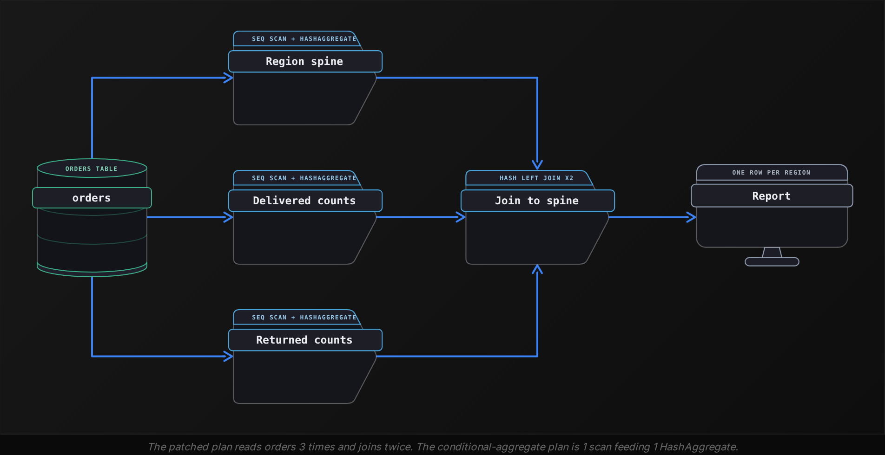

# Conditional Aggregation: Intermediate

Second round, shared editor, PostgreSQL selected in the dropdown.
"Here's an orders table: region, customer_id, status, amount. Per region I want delivered orders, returns, the return rate, and the average value of a delivered order. One row per region."
You have written this pivot before, and your hands are already typing `SUM(CASE WHEN`.
"Oh, and we launched North last week. Every order up there so far got cancelled."
That aside is the interview. North has rows but nothing shipped, so the return rate divides by zero, an average padded with ELSE 0 reports a $0 delivered order, and a join of 2 filtered subqueries leaves North out of the report entirely.
What she is checking is whether your query still tells the truth about a group with nothing in it.


<br>

### What you will be able to do

Choose between FILTER (WHERE ...), CASE and an engine's COUNTIF-style shortcut, and say which dialects run each

Spot the ELSE 0 that silently inflates a conditional COUNT or dilutes a conditional AVG

Answer never, both and every questions with conditional counts compared in HAVING

Guard conditional ratios against zero divisors and explain why NULL is the safer empty result

Collapse joined, separately filtered subqueries into one pass and name the groups they lose


<br>

---

## FILTER (WHERE ...) Across Dialects

The pivot is the warm-up. The interviewer wants delivered, returned and cancelled counts per region side by side, and the moment you type the first conditional column a second, quieter test starts: do you know what this engine accepts. There are 2 spellings of a conditional aggregate, and an answer that names both before committing to one reads as someone who has shipped this on more than one warehouse.

Every query in this lesson runs against the same 7 orders. East has deliveries, a return and a cancellation. West has a delivery and a cancellation. North opened recently and holds a single cancelled order, which makes it the group every guard below exists for.

| order_id | customer_id | region | status | amount |
| --- | --- | --- | --- | --- |
| 1 | 101 | East | delivered | 120 |
| 2 | 101 | East | returned | 80 |
| 3 | 102 | East | delivered | 60 |
| 4 | 103 | East | cancelled | 40 |
| 5 | 104 | West | delivered | 200 |
| 6 | 104 | West | cancelled | 50 |
| 7 | 105 | North | cancelled | 30 |


<br>

### Two spellings of one aggregate

```sql
-- Standard SQL:2003: PostgreSQL, DuckDB, SQLite, Trino, Spark SQL
SELECT
  region,
  COUNT(*) FILTER (WHERE status = 'delivered')    AS delivered,
  COUNT(*) FILTER (WHERE status = 'returned')     AS returned,
  SUM(amount) FILTER (WHERE status = 'delivered') AS delivered_value
FROM orders
GROUP BY region;

-- Portable to every engine
SELECT
  region,
  COUNT(CASE WHEN status = 'delivered' THEN 1 END)    AS delivered,
  COUNT(CASE WHEN status = 'returned' THEN 1 END)     AS returned,
  SUM(CASE WHEN status = 'delivered' THEN amount END) AS delivered_value
FROM orders
GROUP BY region;
```

`FILTER (WHERE ...)` entered the standard in SQL:2003. The aggregate in front of it sees only the rows where the condition evaluates to TRUE, so a FALSE row and a NULL row are both skipped. A `CASE` with no `ELSE` lands in the same place by another route: it returns NULL for every row that fails, and `COUNT(expr)`, `SUM`, `AVG`, `MIN` and `MAX` all ignore NULL. For those 5 aggregates the 2 spellings return identical numbers on any data. Collection aggregates such as `ARRAY_AGG` keep NULL, and they are the exception covered below.

| region | delivered | returned | delivered_value |
| --- | --- | --- | --- |
| East | 2 | 1 | 180 |
| North | 0 | 0 | NULL |
| West | 1 | 0 | 200 |

Read the North row before moving on. Both counts are 0 and `delivered_value` is NULL, because `COUNT` over no qualifying rows returns 0 while `SUM` over no qualifying rows returns NULL. The 2 spellings agree on that too, and it is the first of several places in this lesson where an empty group exposes a choice the query made silently.


<br>

### Which engines run FILTER

| Engine | FILTER (WHERE ...) | Native shortcut |
| --- | --- | --- |
| PostgreSQL 9.4+ | Yes | none; FILTER is the idiom |
| SQLite 3.30+, DuckDB | Yes | DuckDB: `count_if(cond)` |
| Trino, Presto | Yes | `count_if(cond)` |
| Spark SQL 3.0+, Databricks | Yes | `count_if(cond)` |
| BigQuery | No | `COUNTIF(cond)`, `SUM(IF(cond, x, NULL))` |
| Snowflake | No | `COUNT_IF(cond)`, `SUM(IFF(cond, x, NULL))` |
| MySQL 8 | No | `SUM(cond)`, since booleans are 0 and 1 |
| SQL Server, Oracle, Redshift | No | the CASE form |

Shared-editor rounds often run on MySQL or SQL Server, and take-homes frequently target BigQuery or Snowflake. FILTER typed into the wrong one costs a syntax error, a couple of minutes and some of the interviewer's confidence. The move that avoids it is one sentence before you type: "We're on Postgres, so I'll write FILTER; on BigQuery this is COUNTIF, and the CASE version runs anywhere." It tells the interviewer you treat the semantics as fixed and the syntax as the engine's choice, which is the distinction this part of the round is scored on.


<br>

### Where the 2 spellings stop agreeing

The equivalence rests on the aggregate skipping NULL. `ARRAY_AGG` keeps NULL in PostgreSQL, so the CASE form fills the array with a NULL for every non-matching row, and `JSON_AGG` behaves the same way. BigQuery goes further and raises an error when an array in the final result holds a NULL element, unless you write `ARRAY_AGG(x IGNORE NULLS)`.

```sql
-- East only, PostgreSQL
-- via_filter returns {2}
-- via_case returns {NULL,2,NULL,NULL}, in scan order
SELECT
  ARRAY_AGG(order_id) FILTER (
    WHERE status = 'returned'
  ) AS via_filter,
  ARRAY_AGG(
    CASE
      WHEN status = 'returned' THEN order_id
    END
  ) AS via_case
FROM orders
WHERE region = 'East'
```


<br>

### The follow-up: why not WHERE?

Expect this within a minute of writing FILTER: "Why not put `status = 'returned'` in the WHERE clause?" Because WHERE removes rows from every column in the query, and FILTER narrows one column. Move the condition into WHERE and only East survives, showing 1 returned and 0 delivered, while West and North vanish because neither has a returned row. A filter that should apply to every measure, such as a date range, belongs in WHERE; a condition that defines one measure belongs on that measure.

> **TIP**
>
> If the interviewer has not named an engine, ask. If the answer is "whatever you like", write the CASE form, say it is portable, and mention FILTER as the Postgres shorthand. The interviewer hears both, and nothing you write can fail to parse.


<br>

---

## Conditional COUNT and AVG

The phrasing that sets this trap sounds harmless: "average delivered order value per region, next to the return count." Candidates who learned pivots as `SUM(CASE WHEN ... THEN 1 ELSE 0 END)` carry that `ELSE 0` into the next aggregate they write, and the rows that failed the condition walk back into the result as zeros. On East it costs half the average. The query runs, every number looks plausible, and only a reader who knows East's 2 deliveries were 120 and 60 can tell anything is wrong.


<br>

### What ELSE 0 does to each aggregate

A `CASE` without `ELSE` returns NULL for a non-matching row, and every common aggregate other than `COUNT(*)` passes over NULL inputs, so the failed row contributes nothing. `ELSE 0` hands the aggregate a real value for every row in the group. Whether that is harmless depends on what the aggregate does with a value it receives. On East, with the condition `status = 'delivered'`, the 5 common aggregates split like this:

| Aggregate with ELSE 0 | What the 0 does | East result | Verdict |
| --- | --- | --- | --- |
| SUM(... THEN amount ELSE 0 END) | adds nothing | 180 | Correct; North shows 0 rather than NULL |
| COUNT(... THEN 1 ELSE 0 END) | is a non-NULL value, so it is counted | 4 (true answer 2) | Wrong: equals COUNT(\*) |
| AVG(... THEN amount ELSE 0 END) | joins both the sum and the divisor | 45 (true answer 90) | Wrong: diluted |
| MIN(... THEN amount ELSE 0 END) | beats every positive amount | 0 (true answer 60) | Wrong |
| MAX(... THEN amount ELSE 0 END) | loses to any positive amount | 120 | Fragile: a negative amount breaks it |

https://github.com/user-attachments/assets/1f3bfcb0-c82e-414a-be3a-4130ed8d4e84

The animation plays East and North, 5 of the 7 orders. Watch East fold. `ok` receives 120 and 60, 2 values, and lands on 90. `padded` receives 120, 0, 60 and 0: the returned and cancelled orders failed the condition, yet each added 0 to the sum and 1 to the divisor, and East's average delivered order falls to 45. North has no delivered order at all, so `ok` is the honest NULL, and `padded` reports an average delivered value of 0 for a region that never delivered anything. West, left off the stage, halves from 200 to 100 the same way. The COUNT row of the table above is the same mechanism in its purest form: with ELSE 0 it returns East 4, North 1 and West 2, each region's row count, because `COUNT` counts every 0 it is handed.


<br>

### The NULL that SUM leaves behind

Dropping ELSE everywhere has its own cost. `SUM(CASE WHEN status = 'returned' THEN 1 END)` returns NULL for West and North, because `SUM` over no non-NULL inputs is NULL, while `COUNT` of the same CASE returns 0. A dashboard tile reading blank for West's returns looks like a broken feed, and an analyst who adds it to another column gets NULL back. Counts are where you want 0, so count with `COUNT` or keep the ELSE 0 inside `SUM`. For sums of amounts, decide whether an empty group means NULL or 0 and say which you chose.

| ✓ Counts the matching rows | ✗ Counts every row in the group |
| --- | --- |
| • COUNT(CASE WHEN c THEN 1 END)<br><br>• SUM(CASE WHEN c THEN 1 ELSE 0 END)<br><br>• COUNT(\*) FILTER (WHERE c)<br><br>• COUNTIF(c) on BigQuery, COUNT_IF(c) on Snowflake | • COUNT(CASE WHEN c THEN 1 ELSE 0 END)<br><br>• COUNT(c) on a boolean, which counts FALSE as well as TRUE<br><br>• COUNT(IF(c, 1, 0)) in MySQL<br><br>• COUNT(CASE WHEN c THEN 'y' ELSE 'n' END) |


<br>

### When ELSE 0 belongs in an AVG

`AVG(CASE WHEN status = 'returned' THEN 1.0 ELSE 0 END)` is correct, and worth having ready. It returns the share of all orders that were returned: East comes out at 0.25, 1 return over 4 orders. The ELSE 0 is right here because the denominator is meant to hold every row in the group. So the rule is about the denominator, and the sentence that scores is the one that names it: "the denominator for this average is delivered orders, so every other row has to come through as NULL and fall out of the divisor."


<br>

### The follow-up: a delivered order with no amount

The interviewer's next probe is usually "what if `amount` is NULL on a delivered order?" The conditional AVG skips it, so the average covers deliveries with a known amount, and a delivered count shown beside it no longer matches the divisor. Say that out loud, then ask what a NULL amount means. If it is a free replacement, it is a real zero, and the fix goes in the THEN branch, `THEN COALESCE(amount, 0)`, because a zero belongs where the business says zero happened. If it is a late price feed, leave it out and report how many rows were excluded.

> Sentences worth having ready
>
> - COUNT counts non-NULL values, so the ELSE branch has to produce NULL.
> - AVG divides by how many values it received; only delivered orders belong in that divisor.
> - No delivered orders means the average is undefined, so North correctly returns NULL.
> - ELSE 0 is fine in SUM, always wrong in COUNT and MIN, and wrong in AVG unless every row in the group belongs in the divisor.


<br>

---

## Conditional Counts in HAVING

This question rarely mentions aggregation. It arrives as "which customers placed orders but never got one delivered", "users who signed up and never purchased", or "products sold in both the app and the website". Each one is a statement about what a group's rows contain, or fail to contain. WHERE looks at one row at a time and cannot see that a row is missing from the group, which is why the first draft most candidates write returns the wrong customers and looks correct doing it.


<br>

### The answer WHERE gives

```sql
-- Reads like the question, answers a different one
SELECT DISTINCT
  customer_id
FROM orders
WHERE status <> 'delivered'
-- 101, 103, 104, 105
```

Four customers come back. Customers 101 and 104 each have a delivered order; the query found their returned and cancelled orders instead. WHERE answered "who has at least one order that was not delivered", and the question was about the absence of any delivered row in the customer's whole history. Absence is a property of the group, so the test belongs after GROUP BY, as a conditional count compared with 0.

https://github.com/user-attachments/assets/1e461f1d-42e0-4808-8a87-9c1f99d80776

The animation plays 4 of the 7 orders, enough to show both outcomes. With no WHERE, every row reaches GROUP BY and folds into 3 customer groups. The delivered count is computed per group, and HAVING then keeps or drops each group whole: 101, with 2 orders and 1 delivered, goes, while 103 and 105, each holding 1 cancelled order and 0 deliveries, stay. No individual row decided the outcome. The returned row of customer 101 passed no test and failed none; it belonged to a group that had a delivered row somewhere else in it.


<br>

### Both conditions, one customer

Flip the question to "customers who had an order delivered and also returned one" and the WHERE draft becomes `WHERE status = 'delivered' AND status = 'returned'`, which returns 0 rows on every table ever built, because no single row holds 2 statuses. Interviewers like this disguise because the AND reads correctly in English. The group-level version puts each condition in its own count:

```sql
SELECT
  customer_id
FROM orders
GROUP BY customer_id
HAVING COUNT(
    CASE
      WHEN status = 'delivered' THEN 1
    END
  ) >= 1
  AND COUNT(
    CASE
      WHEN status = 'returned' THEN 1
    END
  ) >= 1
-- 101
```

The same shape answers "viewed and purchased", "sold in both stores" and "used feature A but never feature B", where the last is `>= 1` on one count and `= 0` on the other. Each HAVING term is a conditional count with a comparison, and the HAVING as a whole is a boolean sentence about the group. On Postgres the terms can read `COUNT(*) FILTER (WHERE status = 'returned') >= 1` with no change in meaning.

The strongest form is "every": customers who ordered from every region. Compare a distinct count in HAVING with the size of the population, `HAVING COUNT(DISTINCT region) = (SELECT COUNT(DISTINCT region) FROM orders)`. On the sample nobody qualifies, since each customer has ordered in a single region, and saying so before running it shows you read the data.


<br>

### A threshold on a share

"Regions where cancellations are more than a quarter of orders" puts a ratio in HAVING. Write it multiplied out, so there is no divisor to guard and no integer division to turn 1/4 into 0:

```sql
SELECT
  region
FROM orders
GROUP BY region
HAVING COUNT(
  CASE
    WHEN status = 'cancelled' THEN 1
  END
) * 4 > COUNT(*)
-- North (1 of 1) and West (1 of 2) pass
-- East (1 of 4) sits exactly on 25% and drops
```

Naming where the boundary lands, East at exactly 25% and excluded by a strict `>`, tells the interviewer you checked an edge rather than trusting the shape. Ask whether "more than a quarter" includes the quarter itself; the question takes a few seconds and saves a wrong row.


<br>

### WHERE and HAVING in the same query

The engine evaluates FROM, then WHERE, then GROUP BY, then HAVING, then SELECT. Row predicates that should apply to every measure, such as `order_date >= DATE '2024-03-01'`, go in WHERE and shrink the groups before they form. Predicates about what a group contains go in HAVING. Moving the delivered test from HAVING into WHERE reproduces the bug above. One dialect detail trips people live: PostgreSQL rejects a SELECT alias in HAVING with `column "delivered" does not exist`, while MySQL accepts it. Repeat the expression, or compute the counts in a CTE and filter with WHERE in the outer query; the plans come out the same.

> The population HAVING can see
>
> - HAVING only tests groups that exist, and a group exists only if it has at least one row.
> - A customer who registered and never ordered has no row in orders, so `HAVING ... = 0` cannot return them.
> - For "registered but never ordered", start from the customers table and use NOT EXISTS or a LEFT JOIN.
> - Ask which table defines the population before writing the GROUP BY.

> **TIP**
>
> When the question contains "never", "both", "every" or "at least N", reach for GROUP BY and HAVING before writing a WHERE. Those words describe a group, and WHERE only ever sees one row.


<br>

---

## Divide-by-Zero Guards in Ratios

"Return rate by region" sounds like one division. Candidates write returned orders over shipped orders, test it on East, get a third, and move on. Then the interviewer mentions North. A grouped `COUNT(*)` can never be 0, because a group only exists when at least one row landed in it, and that guarantee quietly convinces people their divisors are safe. A conditional count carries no such guarantee: North exists, has 1 row, and has shipped nothing, so its shipped count is 0 inside a group that is very much there.


<br>

### Where a zero divisor comes from

- A conditional denominator: shipped orders in a region where every order was cancelled.
- A funnel step used as the next step's base: purchases per activated user in a week nobody activated.
- An ungrouped aggregate over an empty load: yesterday's partition has 0 rows, so COUNT(\*) returns 0.
- A denominator thinned by an upstream join, such as orders matched to a carrier table that was empty when the job ran.


<br>

### What each engine does with x / 0

| Engine | Integer division by zero |
| --- | --- |
| PostgreSQL | ERROR: division by zero |
| SQL Server | Msg 8134, divide by zero error encountered |
| BigQuery, Snowflake | the query fails with a division-by-zero error |
| MySQL | NULL, with a warning |
| Spark SQL | NULL with ANSI mode off; an error with it on, the default since Spark 4.0 |

An error is the kinder outcome: the job fails and somebody looks at it. The silent failure is integer division. On PostgreSQL and SQL Server, a count divided by a count is integer arithmetic, so East's 1 return over 3 shipped orders comes out as 0, and every rate below 100% reads as 0 for as long as nobody checks. Multiply by `1.0` or cast to `NUMERIC` before the division, and say why as you type it.

https://github.com/user-attachments/assets/dab6764a-8c30-4024-95fb-9053f3f23f91

The animation leaves out East's and West's cancelled orders, which change no number here. East ships 3 and returns 1, for a rate of about 0.333. West ships 1 and returns nothing, so its rate is 0.0, a measured zero. North ships nothing: `NULLIF(0, 0)` turns its divisor into NULL, any number divided by NULL is NULL, and the rate comes back NULL with no error. West and North both have 0 returns, and the result tells them apart: West's customers kept everything they received, and North has no rate to report. That distinction, stated in one sentence, is what the interviewer is waiting to hear.


<br>

### NULL, 0, or a threshold

| ✓ NULL from NULLIF or SAFE_DIVIDE | ✗ 0 from COALESCE or DIV0 |
| --- | --- |
| • Says the rate is undefined, which is true for North<br><br>• Skipped by AVG and by most chart layers<br><br>• Makes the consumer decide how to display it<br><br>• BigQuery SAFE_DIVIDE and Spark try_divide return it | • Says North measured a return rate and it was zero<br><br>• Pulls any average across regions downward<br><br>• Keeps charts free of gaps, which is why it gets requested<br><br>• Snowflake DIV0 returns it, and DIV0NULL also maps a NULL divisor to 0 |

Default to NULL and convert to 0 only where a consumer asks for it, with the column named so the substitution is visible. Engine helpers lean different ways, and reaching for `DIV0` because it is shorter quietly picks the 0 meaning for every downstream reader.

The follow-up after the guard is volume. A region with 1 shipped order and 1 return reports 100%, and on a sorted dashboard it tops the list. Answer with a minimum, `CASE WHEN shipped >= 30 THEN returned * 1.0 / shipped END`, with the threshold agreed with whoever reads the report, and keep `shipped` and `returned` as columns beside the rate. Those columns also make the rate re-aggregable. The overall return rate is `SUM(returned) * 1.0 / NULLIF(SUM(shipped), 0)`, 1 over 4, or 0.25; averaging East's 0.333 and West's 0.0 gives 0.167, a figure no set of orders produced.


<br>

### A ratio with no division sign

There is a form that guards itself, and it leans on how AVG treats NULL. Give the numerator rows a 1, the remaining denominator rows a 0, and every other row NULL:

```sql
SELECT
  region,
  AVG(
    CASE
      WHEN status = 'returned' THEN 1.0
      WHEN status = 'delivered' THEN 0.0
    END
  ) AS return_rate
FROM orders
GROUP BY region
-- East 0.333, North NULL, West 0.0
```

Cancelled orders become NULL and leave the average entirely, so the divisor is shipped orders, and North, holding only a cancelled row, averages over nothing and returns NULL without any NULLIF. It is a good answer to "can you do it without the guard", and a weaker choice for a shared report, because explicit numerator and denominator columns are what make the number checkable.

> **TIP**
>
> Keep the numerator and denominator in the output beside every rate. A reviewer who sees 1 and 3 next to 0.333 trusts it; a lone 0.333 invites a question you would rather not answer live.


<br>

---

## Why This Beats Joined Subqueries

This part of the question often comes as a code review. "Here's a report from our repo. It's slow, and finance says regions are missing from it." On screen is one CTE per metric, each filtering `orders` to one status, joined back together on region. It is also the first draft many candidates write themselves when asked for several filtered counts, because each CTE reads cleanly on its own. The interviewer is watching for 2 things: whether you see which regions the join loses, and whether you collapse it into one pass.

```sql
WITH delivered AS (
  SELECT
    region,
    COUNT(*) AS delivered
  FROM orders
  WHERE status = 'delivered'
  GROUP BY region
),
returned AS (
  SELECT
    region,
    COUNT(*) AS returned
  FROM orders
  WHERE status = 'returned'
  GROUP BY region
)

SELECT
  d.region,
  d.delivered,
  r.returned
FROM delivered AS d
JOIN returned AS r
  ON r.region = d.region
```

Joined CTEs return

One GROUP BY returns

The inner join keeps a region only when both CTEs produced a row for it. West had no returns, so `returned` has no West row and West disappears. North had neither a delivery nor a return, so it is absent from both sides before the join runs. One region of 3 survives, and the report looks complete because nothing in it signals a missing row.


<br>

### Every patch adds a scan

The patches arrive one at a time under follow-up questions. A LEFT JOIN from `delivered` brings West back with `returned` as NULL, which then needs a COALESCE, and North is still missing because it has no delivered row to join from. A FULL OUTER JOIN with `COALESCE(d.region, r.region)` does nothing more for North, which appears in neither filtered set. The only complete version adds a third CTE, `SELECT DISTINCT region FROM orders`, as a spine and LEFT JOINs both metrics onto it: 3 reads of `orders`, 2 joins and 2 COALESCEs to reproduce what one GROUP BY returns.



In PostgreSQL's EXPLAIN, each CTE shows up as its own scan node on `orders`, and on a columnar warehouse each reference reads the `region` and `status` columns again. The conditional version reads the table once and evaluates one CASE per measure per row, which is cheap CPU work next to the I/O of a scan. Adding a third metric to it adds one expression; adding a third metric to the joined design adds a scan, a join and a COALESCE. Put it in those terms: "one pass and N expressions, against N + 1 scans and N joins once the spine is in."


<br>

### How a joined design duplicates groups

Rows multiply when one side's grain is finer than the join key. A returns CTE grouped by `region` and `return_reason`, joined on `region` alone, produces one row per reason, and East's delivered count is copied onto each. With 3 return reasons in a full day of East data, East's 2 deliveries appear on 3 rows, and any downstream `SUM(delivered)` reports 6. The diagnosis to say out loud: the join key is not unique on the returns side.

NULL keys split groups instead. If some orders carry a NULL region, each CTE produces its own NULL-region row, and `NULL = NULL` is never true in an ON clause. The inner join drops both; the FULL OUTER JOIN returns them as 2 separate rows, one holding delivered and one holding returned, for what is a single group. GROUP BY places every NULL region into one group, so the one-pass query keeps them together with no special handling.


<br>

### When joining aggregates is the right call

Different source tables cannot share one GROUP BY pass. Delivered counts from `orders` and refund amounts from a separate `refunds` table at a different grain have to be joined. The safe form aggregates each source to the shared key first, confirms that key is unique on both sides, and joins both onto a spine of every key, so a region with no refunds comes through as NULL or 0 by choice. The rule that closes this part of the interview: same table, same grain, different conditions means one pass; different tables means pre-aggregate, check uniqueness, then join to a spine.

| ✓ Do | ✗ Don't |
| --- | --- |
| • One GROUP BY, one conditional aggregate per metric, when the table and grain match<br><br>• Leave ELSE off any CASE inside COUNT, AVG, MIN or MAX<br><br>• Wrap every conditional denominator in NULLIF and keep it as a visible column<br><br>• Name the engine before choosing FILTER, COUNTIF, COUNT_IF or the CASE form<br><br>• Keep row predicates in WHERE and tests on a group's contents in HAVING | • Join filtered CTEs of one table on a key; groups missing from either side vanish<br><br>• Average per-region rates into an overall rate instead of dividing summed counts<br><br>• Divide 2 integer counts on PostgreSQL or SQL Server without a cast<br><br>• Reach for DIV0 or COALESCE to 0 where undefined is the honest answer |


<br>

---

## Putting It All Together

A marketplace's weekly seller-health report on Snowflake: per seller, orders shipped, returned and cancelled, average shipped order value, return rate, and a flag list of sellers who took orders but shipped none. This week 40 new sellers onboarded, and the current version is built from 4 joined CTEs over the orders table.

- Snowflake has no FILTER clause, so the measures use COUNT_IF and CASE forms, chosen once and stated in the review.
- Average shipped value uses a CASE with no ELSE, so new sellers with nothing shipped show NULL rather than a $0 average.
- The flag list is GROUP BY seller with HAVING on a shipped count equal to 0, which only sees sellers with at least one order row.
- Return rate divides by a NULLIF-guarded shipped count, with both counts kept as columns so the marketplace-wide rate is SUM over SUM.
- Replacing the 4 joined CTEs with one pass stops new sellers without returns from vanishing and cuts 4 reads of orders to 1.


<br>

---

## Key Takeaways

- FILTER (WHERE ...) and a CASE with no ELSE give the same COUNT, SUM, AVG, MIN and MAX; name the engine before choosing FILTER, COUNTIF, COUNT_IF or CASE.
- ELSE 0 is harmless in SUM and wrong in COUNT, AVG and MIN, because it hands the rows that failed the condition back to the aggregate as real values.
- Questions built on never, both or every are tests on a group: conditional counts compared in HAVING, never row conditions in WHERE.
- A conditional denominator can be 0 inside a group that exists; NULLIF makes the rate NULL, which says undefined where 0 would claim a measurement.
- One GROUP BY with a conditional aggregate per metric reads the table once and keeps every group; joined filtered CTEs rescan it and drop or split groups.
