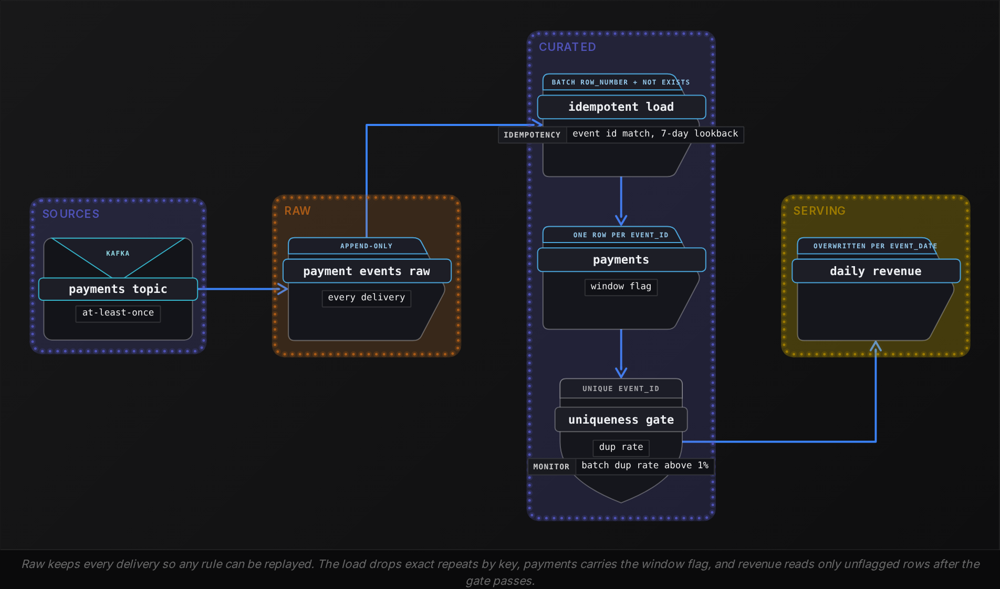

# Deduplication: Advanced

You are 40 minutes into a data platform round at a payments company.
"Card events land in our warehouse from Kafka, about 30 million a day. Finance reconciled yesterday against the processor and we came out 0.3% high. Some rows are duplicates. Design the dedup."
He has not said which duplicates. Kafka redelivering a message gives 2 rows with the same `event_id`. A customer double-tapping Pay gives 2 `event_id`s 900 milliseconds apart, and one of those taps might be a real second purchase. A row that shows up 3 days late can duplicate a partition already cleaned and published.
The usual opening is `ROW_NUMBER() OVER (PARTITION BY event_id)` over the whole table nightly. It catches the first kind, misses the second, ignores the third and rescans a year of history each run.
What he is testing is whether you name each kind of duplicate and the stage that owns it.


<br>

### What you will be able to do

Define a time-window or fuzzy duplicate rule and justify its window and threshold from data

Place each kind of duplicate at the pipeline stage that removes it, and price dedup on read against dedup on write

Design a streaming load that stays idempotent when upstream systems replay, as well as when your own producer or consumer does

Build a column hash for keyless dedup and estimate its collision risk out loud

Scope re-dedup to the keys late rows touch and keep incremental results equal to a full rebuild


<br>

---

## Time-Window and Fuzzy Dedup

Key-based dedup, a `ROW_NUMBER` over a partition key, assumes a duplicate carries the same identifier as its original. The cases here break that assumption. A tap on Pay fires twice and the app mints 2 `event_id`s. A thermostat resends a reading under a new sequence number. The CRM holds "Jon Smith, 14 Elm St" and "John Smith, 14 Elm Street" as 2 customer ids. Every row is unique by its key, and the business still counts each pair as a single event.


<br>

### How the question arrives

- The app sometimes sends the same payment twice, about a second apart.
- Sensors report every 10 seconds, but the table has bursts of identical readings.
- Marketing counts 2.4 million customers and support counts 2.1 million.
- Users double-click Submit and we create 2 orders.
- Fraud wants to know whether these 3 accounts belong to the same person.

Each of these asks you to write down what "the same event" means when no column says so. The definition is a rule over attributes and time: same card, same merchant, same amount, within some number of seconds. State the rule before writing any SQL, then say what evidence chose the window, because that second sentence is the one being scored.


<br>

### Choosing the window from the data

Take every pair of consecutive events that share a card-merchant-amount key, compute the gap between them, and plot a histogram of the gaps. Double taps and client retries pile up under 2 seconds. A second coffee or a split bill is a genuine repeat, and those rarely land inside a minute. The window belongs in the empty stretch between those clusters, and in this pipeline it is 5 seconds. Picking 5 seconds without the histogram is a lucky guess; describing the histogram shows the method.

https://github.com/user-attachments/assets/e2def6e4-e4a9-4c10-b6ca-05686b7c0d92

`e102` sits 1 second after `e101` in the same card-merchant-amount partition, so it is flagged. `e103` repeats all 3 values around 7.5 minutes later. That's outside the window, so it survives as a genuine second purchase. A tap a second later at another merchant would sit in a partition of its own and never be compared. The first row of every partition gets NULL from `LAG`, the comparison evaluates to unknown, and the `CASE` falls through to `keep`. Flip the test to put `'keep'` in the `WHEN` branch and every first row drops into `ELSE` and is marked a duplicate.


<br>

### Chained versus anchored windows

`LAG` compares each row with the row just before it, so the rule chains. Take 4 taps spaced 4 seconds apart, starting at 0: each is within 5 seconds of its predecessor, so the chained rule keeps only the first, though the last arrives 12 seconds after it. An anchored rule measures each row against the last row it kept, so it keeps the taps at 0 and 8. Both are defensible, and they encode different beliefs about how the client misbehaves. The anchored version cannot be written with a single `LAG`; it needs a recursive CTE or a procedural pass, a cost worth naming. The burst is the standard follow-up, so ask which rule the business means before it is asked.

> **TIP**
>
> Grouping on `DATE_TRUNC('second', event_ts)` looks like a shortcut and fails: 2 taps 200 milliseconds apart that straddle a second boundary land in different buckets and both survive. A comparison between neighbouring rows has no boundaries to straddle.


<br>

### Nearly equal values

Fuzzy duplicates differ in the values themselves, and most stop being fuzzy after normalization: `LOWER` and `TRIM` on emails, phone numbers rewritten to E.164, street suffixes mapped to a single spelling, punctuation stripped from names. Normalize, then group on the normalized key; whatever collapses there never needs a similarity score. What remains gets scored across several attributes, with Jaro-Winkler on names and exact matches on birth date and phone, and the weighted total has to clear a threshold.

```sql
SELECT
  a.customer_id AS id_a,
  b.customer_id AS id_b,
  0.5 * JARO_WINKLER_SIMILARITY(a.norm_name, b.norm_name) + 0.3 * CASE
    WHEN a.birth_date = b.birth_date THEN 1
    ELSE 0
  END + 0.2 * CASE
    WHEN a.norm_phone = b.norm_phone THEN 1
    ELSE 0
  END AS match_score
FROM customers_norm AS a
JOIN customers_norm AS b
  ON a.zip = b.zip
    AND EXTRACT(YEAR FROM a.birth_date) = EXTRACT(YEAR FROM b.birth_date)
    AND a.customer_id < b.customer_id
```

Drop the blocking predicate and this compares every customer with every other: 10 million rows is around 50 trillion pairs. Blocking on zip and birth year shrinks the work to the pairs inside each block, and its cost is recall, because 2 records for the same person with a mistyped zip never meet. Production matchers run 2 or 3 blocking passes on different keys to recover those pairs, and naming that turns a correct answer into a credible one.

| ✓ Cost of a false merge | ✗ Cost of a missed merge |
| --- | --- |
| • A real second charge vanishes from revenue<br><br>• A customer's order history shows up for someone else<br><br>• A refund lands in the wrong account<br><br>• Unrecoverable if the merged rows were deleted | • Revenue counts a double tap twice<br><br>• Customer counts run high and per-customer metrics drift<br><br>• Fraud misses a ring of linked accounts<br><br>• Fixed on the next run with a better rule |

Which column of that comparison hurts more sets the threshold, and that sentence answers "how would you tune it?" For money, where a false merge erases a real charge, flag instead of deleting: keep every row and add `dup_of_event_id` so revenue can filter on it. A flag survives a change of window from 5 seconds to 3; a `DELETE` does not.


<br>

---

## Deduplication as a Pipeline Stage

With the rule written down, the conversation moves to placement: "where does this run?" Dedup on write removes duplicates as rows land, so the stored table is clean and every reader can trust it. Dedup on read stores everything and applies the rule in a view or inside each query. The design that scores keeps both properties: an untouched raw copy and a cleaned copy, with the rule applied once between them.

| ✓ Dedup on read | ✗ Dedup on write |
| --- | --- |
| • Raw table holds every delivery; a view applies the rule<br><br>• Every query re-sorts the slice of history it reads<br><br>• A rule change is a view edit, live at once<br><br>• Any consumer that skips the view gets its own count | • The rule runs once per batch; readers scan clean rows<br><br>• Needs a lookup against stored rows to catch repeats<br><br>• A rule change means reprocessing stored history<br><br>• If raw is discarded, a wrong rule is permanent |


<br>

### The cost of read-time dedup

Put this pipeline's numbers on it: 30 million events a day is around 11 billion rows a year. A view built on `ROW_NUMBER() OVER (PARTITION BY event_id ORDER BY ingested_at)` looks cheap until someone queries yesterday through it. A `WHERE event_date = DATE '2024-03-14'` on the view cannot be pushed below the window, because filtering first would change which rows each partition sees; the engine numbers every row in the table and filters afterwards. The time-window rule is worse still, since `LAG` needs neighbours sorted by card and timestamp across the same full history.

> **TIP**
>
> Read-time dedup has one good home: exploring a raw table while the rule is still being argued over. Once the rule is agreed, materialize it.


<br>

### The layered answer



Each layer has a single job. `payment_events_raw` is append-only and never deduplicated, which makes every later rule replayable: when finance decides the window should be 3 seconds, silver is rebuilt from raw and last quarter's numbers are restated with an explanation. The load into `payments` removes exact repeats by `event_id`. The window rule needs neighbouring rows, so it runs inside silver as a flag. `daily_revenue` reads silver and never re-implements either rule.

| Kind of duplicate | Where it is removed | Why there |
| --- | --- | --- |
| Same event_id delivered twice | Load into silver | A key lookup is cheap and needs no neighbours |
| Double tap with a new event_id | Silver, as a flag | Needs the previous row per card and merchant |
| Same customer under 2 ids | Separate identity layer | Cross-source matching with its own mapping table |
| Identical keyless file rows | Load into silver, by row hash | No key exists to compare |

Order matters for correctness. Exact repeats are most of the duplicates, and neither the window rule nor the identity layer should ever see transport noise: a redelivered row left in silver ties with its original under `LAG` and reaches the matcher as a second record.

The identity row deserves its own sentence in the room. Resolving customers across CRM and the payments and support systems leaves every source row untouched and writes a mapping from each `(source_system, source_record_id)` to an `entity_id`, with a golden record per entity built from best-value rules per attribute. Folding that matching into a fact table destroys the evidence a corrected match needs, and leaves nothing other teams can consume.


<br>

### The follow-up about consumers

Expect "why not let the BI layer handle it?" The reply is the 0.3% gap. If 4 dashboards each apply their own rule, the board sees 4 revenue numbers and nobody in finance or product can say which is right. A single silver table with a documented rule turns dedup into a data contract. The contract spells out the key and the window plus which row survives, and a uniqueness test on `event_id` fails the run before `daily_revenue` refreshes.


<br>

### Watching the duplicate rate

The gate does more than assert uniqueness. Raw rows against distinct keys per batch gives a duplicate rate, and that rate is a health signal for every producer upstream. In this pipeline it sits near 0.2%. A jump to 4% inside an hour means a client release started double-submitting or a consumer is crash-looping and replaying, and the dedup stage is the only place in the platform that can see it. Alerting on that rate is the detail that shows you have operated one of these.

```sql
SELECT
  batch_id,
  COUNT(*) AS raw_rows,
  COUNT(DISTINCT event_id) AS unique_events,
  1.0 - COUNT(DISTINCT event_id) * 1.0 / COUNT(*) AS dup_rate
FROM payment_events_raw
WHERE ingested_at >= CURRENT_TIMESTAMP - INTERVAL '1' HOUR
GROUP BY batch_id
HAVING 1.0 - COUNT(DISTINCT event_id) * 1.0 / COUNT(*) > 0.01
```

> Phrases that signal you have run this
>
> - Append-only raw layer, so every dedup rule is replayable
> - Dedup once at a named stage; consumers read the result
> - Uniqueness test on the key as a pipeline gate
> - Duplicate rate as a producer health metric


<br>

---

## Idempotent Streaming Ingests

The streaming version arrives as an incident: "our consumer restarted and revenue doubled for an hour. Make sure it can't happen again." Answering "turn on exactly-once" stops short. Kafka's exactly-once guarantee covers a read-process-write cycle that stays inside Kafka transactions. Once the sink is a warehouse table, delivery is at-least-once unless the write itself is idempotent, and making it idempotent is the design being asked for.


<br>

### 4 sources of repeats

- The consumer writes a batch, crashes before committing offsets, and reprocesses it on restart.
- The producer retries a send whose timeout hid a success, so the broker stores the message twice.
- An upstream team replays the topic from an older offset to repair their own bug.
- The app resubmits after a dropped response, reusing the event_id it already sent.

Every source on that list keeps the `event_id` stable only if the id was minted where the event happened. The trap that sinks otherwise solid answers is a consumer that stamps `uuid()` on each row as it loads: every redelivery becomes a new event, and no rule downstream can ever find it again. Say that the key is created on the device or in the service that took the payment, never at ingest.


<br>

### 2 checks, in this order

An idempotent load can run the same batch twice and leave the table unchanged the second time. That takes 2 checks. Within the batch, an `event_id` can appear more than once, so the batch is collapsed to a single row per key first. Against the target, a key an earlier batch already loaded is skipped. The 2 animations run one check each on a 4-row micro-batch.

https://github.com/user-attachments/assets/9a91d848-90a6-45d0-b537-36a1f086c55d

https://github.com/user-attachments/assets/9298d99d-dc47-4403-9138-be29bdb66ce9

`e205` arrives at offsets 1002 and 1003 because the producer retried, and `ROW_NUMBER` passes only offset 1002 on. `e203` was loaded by the previous batch and comes back at offset 1004; `NOT EXISTS` finds it in `payments` and drops it. Insert the 2 surviving rows, run both steps again over the same batch, and the second returns 0 rows. That empty run is the definition of idempotent, and describing it is stronger than saying the word.

> **TIP**
>
> Write `NOT EXISTS`, never `NOT IN (SELECT event_id FROM payments)`. One NULL `event_id` in the target turns every new key's test unknown instead of true, so no new row passes and the load inserts nothing without raising an error.


<br>

### The MERGE form and its trap

```sql
MERGE INTO payments AS t
USING (
  SELECT event_id, card_id, merchant_id, amount, event_ts, event_date
  FROM (
    SELECT b.*,
           ROW_NUMBER() OVER (
             PARTITION BY event_id ORDER BY kafka_offset) AS rn
    FROM payment_events_batch b
  ) AS ranked
  WHERE rn = 1
) AS s
ON t.event_id = s.event_id
   AND t.event_date >= CURRENT_DATE - INTERVAL '7' DAY
WHEN NOT MATCHED THEN
  INSERT (event_id, card_id, merchant_id, amount, event_ts, event_date)
  VALUES (s.event_id, s.card_id, s.merchant_id, s.amount,
          s.event_ts, s.event_date);
```

Leave out the inner `ROW_NUMBER` and the `MERGE` fails in one of 2 ways. Add a `WHEN MATCHED THEN UPDATE` branch and Delta Lake raises an error when 2 source rows match a single target row, as do BigQuery and Snowflake. On the insert branch the failure is quiet: 2 copies of a key the target has never seen both land in `WHEN NOT MATCHED`, because matching is evaluated against the target as it stood before the statement ran, and both are inserted. Interviewers ask about the quiet one.


<br>

### Bounding the lookback

Checking each incoming key against 11 billion stored rows turns every micro-batch into a full scan. A lookback bounds it, and because it prunes on event date, its length adds 2 clocks: how late an event may first land, and how long after that a replay can redeliver it. Here the late-data policy accepts events up to 4 days old and the topic retains 3 days, so the merge prunes `payments` to 7 event-date partitions. Anything older goes to quarantine instead of the load, since the check can no longer see its first copy.

- **210M** — target rows a 7-day lookback reads

Stream processors make the same trade in memory. Spark Structured Streaming's `dropDuplicatesWithinWatermark`, or Flink keyed state with a time-to-live, remembers each `event_id` for the watermark's duration and then forgets it. A repeat arriving after its key expires passes straight through. The watermark is the lookback under another name, and its state grows with keys per day times days retained, which is the figure to estimate when asked how big the cluster needs to be.


<br>

### The offset follow-up

A common push: "why not store Kafka offsets with the data and skip anything already committed?" Writing each batch and its offsets in one transaction does stop the consumer from double-writing after a crash, and proposing it is right. It does nothing for a producer retry, which lands at a new offset, or for an upstream replay. Offset tracking protects the consumer's own restarts; `event_id` dedup protects the data from every other source of repeats. Name both and the failure each one closes.


<br>

---

## Matching Duplicates by Hash

Sometimes there is no key at all. A card processor's nightly settlement file has 14 columns and no id, and the processor resends overlapping rows whenever a transfer fails. A CDC snapshot arrives with every column and no primary key. The question sounds like "how would you detect rows we have already loaded?", and the answer is a hash over the columns that define the row. Store it beside the row and compare hashes instead of columns.

A fixed-width value is cheaper to compare than 14 columns of mixed types. The join key shrinks, so the shuffle moves less data and the hash table built for the join is smaller, and a stored hash can be clustered for the lookup against history. The price is that the input string has to be assembled carefully, and nearly every hash-dedup bug comes from that assembly.


<br>

### Building the hash input

```sql
SELECT
  SHA2(
    CONCAT_WS(
      '|',
      COALESCE(CAST(processor_ref AS VARCHAR), '#NULL#'),
      COALESCE(merchant_name, '#NULL#'),
      COALESCE(
        CAST(CAST(amount AS DECIMAL(12, 2)) AS VARCHAR),
        '#NULL#'
      ),
      COALESCE(CAST(settled_on AS VARCHAR), '#NULL#')
    ),
    256
  ) AS row_hash,
  s.*
FROM settlement_file AS s
```

> Where hash dedup breaks
>
> - Bare concatenation: ('ab', 'c') and ('a', 'bc') both become abc. A delimiter separates them, and values containing it must be escaped.
> - NULLs: most engines' CONCAT returns NULL on any NULL input. CONCAT_WS skips NULLs in Spark, Postgres and MySQL, so ('a', NULL, 'b') and ('a', 'b', NULL) hash alike; Snowflake's returns NULL.
> - Formatting: 42.0 and 42.00 are equal numbers and different strings. Cast every number to a fixed precision and every timestamp to a fixed zone and format.
> - Metadata: hashing a load timestamp or a Kafka offset makes every redelivery unique. Hash the business columns only.

Which columns go in is the duplicate definition again. A resent settlement row carries a new `file_sent_at`; include it and no resend ever matches. Leave out `amount` and 2 different payouts on the same reference collapse together. The column list is a decision to defend, written next to the hash.

Column order is part of the definition, so the hash expression belongs in a shared macro or function and is never retyped per pipeline. If 2 pipelines list the same columns in different orders, their hashes never match, and nothing errors to tell you.


<br>

### The price of a collision

A collision is 2 different rows with the same hash. Hash dedup treats them as a single row and drops the second, and on a settlement file that is a payout nobody will look for, because the dedup log records it as an ordinary duplicate. The risk is a birthday-problem estimate: for n rows and a b-bit hash, the chance of any collision is roughly `n^2 / 2^(b+1)`. Name the bit width and the row count, then do the arithmetic out loud.

| Hash | Rows hashed | Chance of at least one collision |
| --- | --- | --- |
| 64-bit (xxHash64, FARM_FINGERPRINT) | 100 million | about 0.03% |
| 64-bit | 1 billion | about 2.7% |
| 64-bit | 11 billion, a year here | about 96% |
| 128-bit (MD5) | 11 billion | about 1 in 6 x 10^18 |
| 256-bit (SHA-256) | 11 billion | about 1 in 2 x 10^57 |

- **5.1B** — rows for even odds of a 64-bit collision

A 64-bit hash over a year of this pipeline almost certainly collides somewhere, so the design has to say what happens then. The cheap fix treats the hash as a filter: on every hash match, confirm the rows column by column with `IS NOT DISTINCT FROM`, which counts 2 NULLs as equal. Only candidate pairs pay for the full comparison, so it costs almost nothing, and a collision now leaves 2 kept rows instead of 1 lost one. The alternative is 128 bits or more, with the residual risk stated.

```sql
SELECT
  n.*
FROM settlement_batch_hashed AS n
WHERE NOT EXISTS (
  SELECT
    1
  FROM settlement_rows AS t
  WHERE t.row_hash = n.row_hash
    AND t.processor_ref IS NOT DISTINCT FROM n.processor_ref
    AND t.merchant_name IS NOT DISTINCT FROM n.merchant_name
    AND t.amount IS NOT DISTINCT FROM n.amount
    AND t.settled_on IS NOT DISTINCT FROM n.settled_on
)
```

> **TIP**
>
> If the interviewer says MD5 is broken, agree for the right reason: it is broken against an attacker crafting collisions on purpose. For accidental collisions among business rows only the width matters. Where a hostile party controls the input, such as user-uploaded files, use SHA-256.


<br>

### The change-detection follow-up

The same hash answers the CDC follow-up. Compare each incoming row's hash with the hash stored on the current version and skip rows whose hashes match. A collision means something different there: instead of a lost row, a real change to a customer's address is ignored until the next change arrives.


<br>

---

## Late-Arriving Rows and Re-Dedup

The last push in a dedup round is time. "A phone was offline for 3 days, and its Tuesday events landed on Friday. What happens?" Tuesday's slice of `payments` was deduplicated on Tuesday night and Tuesday's revenue was published Wednesday morning. A late row can be 4 different things, and each one reopens finished work in a different way.

| What the late row is | What it reopens | What has to run |
| --- | --- | --- |
| A redelivery of a row already in payments | Nothing, if the lookback covers its event date | The normal idempotent load drops it |
| A new, unique Tuesday event | Tuesday's revenue total | Insert it, then rebuild Tuesday's revenue partition |
| A window duplicate landing among stored taps | Its own flag, and any stored keeper within 5 seconds after it | Key-scoped re-dedup, then rebuild Tuesday |
| An earlier copy of a row already kept | Which row survives | Swap the survivor, re-point its duplicates, rebuild Tuesday |


<br>

### The survivor can flip

The last row of that table is the one interviewers wait for. The rule keeps the earliest tap in each window. On Tuesday the warehouse saw `e310` at 09:14:07 and `e311` 2 seconds later. It kept `e310` and pointed `e311` at it. The late batch carries `e309` for the same card-merchant-amount key at 09:14:05. It is earlier, so it becomes the survivor, and both rows already stored now point at it.

Tuesday, before the late batch

After re-dedup

Neither `e310` nor `e311` changed. Their status depends on a row they had never been compared with, which is why late data cannot be appended past a dedup stage: it has to be deduplicated together with the rows it might sit next to.


<br>

### Re-dedup only what the late rows touch

Rebuilding all of `payments` for one late batch is the over-built answer, and rebuilding nothing is the wrong one. The scope is the set of keys the late rows touch: each late row's card-merchant-amount key, on its event date and the days either side, so a neighbour across midnight comes along. Pull every stored row for those keys, union the late rows, run the same window rule the nightly load runs, and write back only the rows whose flag or `dup_of_event_id` changed.

```sql
WITH touched AS (
  SELECT DISTINCT
    card_id,
    merchant_id,
    amount,
    event_date
  FROM late_batch
),
candidates AS (
  SELECT
    p.event_id,
    p.card_id,
    p.merchant_id,
    p.amount,
    p.event_ts
  FROM payments AS p
  JOIN touched AS t
    ON p.card_id = t.card_id
      AND p.merchant_id = t.merchant_id
      AND p.amount = t.amount
      AND p.event_date BETWEEN t.event_date - INTERVAL '1' DAY
      AND t.event_date + INTERVAL '1' DAY

  UNION

  SELECT
    event_id,
    card_id,
    merchant_id,
    amount,
    event_ts
  FROM late_batch
)

SELECT
  c.*,
  LAG(event_ts, 1) OVER (
    PARTITION BY card_id, merchant_id, amount
    ORDER BY event_ts, event_id
  ) AS prev_ts
FROM candidates AS c
```

The window's `ORDER BY` lists `event_id` after `event_ts` because the survivor has to be a function of row contents alone. If it depends on arrival order or on an unstable sort among tied timestamps, the incremental run will disagree with a full rebuild from raw, and the first audit that compares them finds the difference. Incremental re-dedup is correct exactly when it reproduces what a full rebuild would produce, and that equality is the test to propose for the pipeline.


<br>

### Downstream and the cutoff

Re-dedup changes silver, so every `daily_revenue` partition built from a touched event date is now stale. Collect the touched dates during the run and overwrite those partitions whole, because a partition overwrite can be replayed safely where an incremental `UPDATE` to a stored total cannot. Then state the cutoff. Rows older than the 7-day lookback would bypass the dedup check, so they land in a quarantine table and are applied in a scheduled restatement that finance signs off, instead of quietly moving last month's revenue.

| ✓ Full rebuild from raw | ✗ Key-scoped re-dedup |
| --- | --- |
| • Recompute every partition from the raw layer<br><br>• Cost follows total history, not the late batch<br><br>• Idempotent and simple to audit<br><br>• Right after a rule change, or nightly on small tables | • Recompute only keys the late rows touch<br><br>• Cost follows the size of the late batch<br><br>• Needs touched-key and touched-date tracking<br><br>• Right for frequent loads over a large history |

| ✓ Do | ✗ Don't |
| --- | --- |
| • Mint event_id where the event happens and carry it through every hop<br><br>• Keep the raw layer append-only so any dedup rule can be replayed<br><br>• Flag window and fuzzy duplicates; delete only exact key repeats<br><br>• Make the survivor depend on row contents, with event_id as the tiebreak<br><br>• Confirm hash matches column by column, or use a hash of 128 bits or more | • Stamp a uuid at ingest, which turns every redelivery into a new event<br><br>• Dedup in a view that every dashboard query re-sorts<br><br>• Bucket time windows with DATE_TRUNC, which splits neighbours across boundaries<br><br>• Use NOT IN against a target column that can hold a NULL<br><br>• Load rows past the lookback without a quarantine and a restatement plan |


<br>

---

## Putting It All Together

A food delivery marketplace pays couriers per completed drop-off. Drop-off events come from the courier app over Kafka, restaurants send a nightly settlement CSV with no row ids, and couriers delivering to basements go offline and sync hours later. Payroll runs every Monday, and a courier must be neither double-paid nor missed.

- The courier tapping Complete twice is a time-window duplicate: same courier and order within seconds, flagged in silver so a dispute can reverse it.
- Redeliveries after a consumer restart are removed at load with a within-batch ROW_NUMBER and NOT EXISTS against a bounded lookback on the drop-off table.
- The restaurant CSV has no key, so its rows are matched by a 128-bit hash with column confirmation, because a collision would silently drop a payout.
- Basement syncs arrive late; re-dedup scoped to the touched orders can flip which completion survives, and Monday's payroll partitions are overwritten before payment.
- Raw keeps every delivery, so when operations shortens the window after a payroll dispute, earnings are rebuilt from raw and restated.


<br>

---

## Key Takeaways

- Define a window or fuzzy duplicate as a rule over attributes and time, and choose the window from the gap histogram.
- Keep raw append-only, drop exact repeats at load, flag window duplicates in silver, and let every consumer read that result.
- Idempotent streaming needs a source-minted key, a within-batch collapse, a NOT EXISTS check against the target and a stated lookback.
- Hash keyless rows over a delimited, fixed-format string with a sentinel for NULL; size the hash from n^2 / 2^(b+1) and confirm matches column by column.
- Late rows can flip the survivor; re-dedup the touched keys and require incremental output to equal a full rebuild.
