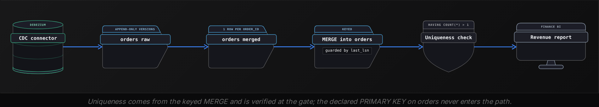

# Deduplication: Intermediate

30 minutes into a SQL round at a payments company, the interviewer shares a Snowflake worksheet. 'Finance says Thursday's revenue on the orders table is about 3% high. The loader retried a batch overnight. order_id is the primary key, so I doubt it's duplicates. Get me the right number, then clean the table.' She stops there. Nobody has said which copy of a repeated order is correct, or whether the copies even agree with each other. The request also bundles a read-time question with a write to stored data. The line most candidates accept at face value is the one about the primary key: Snowflake stores that declaration and never checks it. What she is listening for is whether you settle what counts as the same order, and which copy survives, before you reach for DISTINCT.


<br>

### What you will be able to do

Decide which aggregates survive duplicate rows and which need a deduplicated input before they are summed

Write a ROW_NUMBER ordering that picks a defensible survivor, with a tie-breaker that makes it deterministic

Build a merged record whose columns each follow their own survivorship rule

Remove duplicates from a stored table so exactly 1 copy of each key remains, and verify the counts

Explain what an unenforced primary key lets in and where the real uniqueness guarantee has to live


<br>

---

## When a Distinct Count Is Enough

### The numbers duplicates can move

The prompt rarely contains the word duplicate. It arrives as 'revenue looks high' or 'how many orders did we take on Thursday', and the first thing scored is whether you can say which of those numbers repeated rows are able to move. A distinct count collapses repeats before it counts, so a key that appears 3 times contributes 1. Sums and averages read every row, and so does a plain row count, so each extra copy adds its value again.

```sql
-- orders declares PRIMARY KEY (order_id); a batch was loaded twice
SELECT
  COUNT(*) AS row_count,
  COUNT(DISTINCT order_id) AS order_count,
  SUM(amount) AS revenue
FROM orders
WHERE order_date = DATE '2024-03-14'
```

| row_count | order_count | revenue |
| --- | --- | --- |
| 48,200 | 46,800 | 2,410,200.00 |

Read the result back the way you would in the room. The order_count column is already correct. The retried batch added 1,400 rows, each a copy of an order already present, and COUNT(DISTINCT order_id) folds them away. The revenue column is high by exactly the amounts on those 1,400 copies, 70,200.00 here. No rearrangement of the SELECT list repairs it until something decides which rows count.


<br>

### Aggregates that ignore repeats, and ones that add them

| ✓ Unchanged by identical copies | ✗ Inflated by identical copies |
| --- | --- |
| • COUNT(DISTINCT key): repeats collapse before counting<br><br>• MIN and MAX: a second copy of a value changes neither<br><br>• APPROX_COUNT_DISTINCT: the sketch ignores values it has seen<br><br>• EXISTS and IN tests: a match is a match at any copy count | • SUM(amount): every copy adds its amount again<br><br>• COUNT(\*) and COUNT(col): every copy is a row<br><br>• AVG(amount): drifts toward the duplicated orders<br><br>• Ratios built on these, such as revenue per order |

AVG is the one candidates misjudge. It looks safe because the numerator and the denominator both grow. Only the duplicated orders are counted twice, though, so the average moves toward whatever those orders are worth. If the retried batch held the night's large wholesale orders, AVG(amount) rises even though no order changed at all.


<br>

### When the copies disagree

All of that assumes identical copies, which is what a retried batch produces. A change-data-capture landing table such as orders_raw holds something else: every version of every order. Order 5000 appears once as 'placed' and again as 'shipped'. COUNT(DISTINCT order_id) still counts orders correctly there, right up until the query filters on a column that changes between versions.

```sql
-- orders_raw keeps every version of every order
SELECT
  COUNT(DISTINCT order_id) AS open_orders
FROM orders_raw
WHERE status = 'placed'
```

Order 5000 is counted as open, because its 'placed' version passes the WHERE clause, even though the order shipped 5 minutes later. WHERE runs before any aggregate, so the filter picks rows from the whole history before DISTINCT sees them. A distinct count is enough only when every copy of a key agrees on every column the query filters on, and on any column it groups or joins by. Where copies can disagree, reduce to 1 row per key first and filter afterwards.


<br>

### Deduplicate at the order grain, then sum

```sql
SELECT
  COUNT(*) AS order_count,
  SUM(amount) AS revenue
FROM (
  SELECT DISTINCT
    order_id,
    amount
  FROM orders
  WHERE order_date = DATE '2024-03-14'
) AS one_per_order
```

| order_count | revenue |
| --- | --- |
| 46,800 | 2,340,000.00 |

The subquery works because the retried copies agree on every column it selects, so DISTINCT reduces them to 1 row per order. If 2 copies of an order carried different amounts, the subquery would return both and the sum would stay inflated. At that point you need a ranking that keeps 1 chosen version per key.

The answer that loses the point here is SUM(DISTINCT amount). It deduplicates amounts, while the thing that repeated is orders. Any 2 different orders that each cost 49.99 collapse into 1, and the total comes out low. On a day with 46,800 orders and a few hundred price points, it undercounts heavily. Put DISTINCT inside a subquery at the order grain, never inside the SUM.


<br>

### The sentence that opens the answer

Sort the metrics before touching the data: 'Order count is safe, because it is distinct on the key. Revenue and average order value need 1 row per order first. Let me check whether the copies are identical, because that decides how I collapse them.' Those 3 sentences show the interviewer you know which numbers can move, and the subquery comes next.

> Follow-ups this part draws
>
> - 'Can a join do the same damage?' Yes. Joining orders to order_items fans 1 order into 1 row per item; distinct order counts survive, order-level sums do not.
> - 'The table has 4 billion rows and COUNT(DISTINCT) is slow.' APPROX_COUNT_DISTINCT also ignores repeats; Snowflake documents about 1.6% average relative error.
> - 'How many extra rows are there?' Subtract order_count from row_count, which gives 1,400 here, measured before anything is removed.


<br>

---

## Choosing Which Duplicate to Keep

### The ORDER BY is the business rule

Every keep-one query answers 2 questions. PARTITION BY says which rows are copies of the same thing, and ORDER BY says which copy is the truth. Once the key is agreed, interviewers spend almost no time on the partition and most of their follow-ups on the sort. The sort is where a candidate shows they asked what the data means.

```sql
WITH ranked AS (
  SELECT
    order_id,
    source_lsn,
    status,
    amount,
    ingested_at,
    ROW_NUMBER() OVER (
      PARTITION BY order_id
      ORDER BY source_lsn DESC, ingested_at DESC
    ) AS rn
  FROM orders_raw
)

SELECT
  order_id,
  source_lsn,
  status,
  amount
FROM ranked
WHERE rn = 1
```

The source_lsn column is the log sequence number the source database assigned at commit, so sorting it descending keeps the most recently committed version of each order. Say the claim alongside the code: 'I'm keeping the latest committed state, because the report wants each order as it stands now.' Then say what would change if the business wanted a different row.

| ORDER BY | Survivor | What it asserts |
| --- | --- | --- |
| source_lsn DESC | Latest committed version | Commit order in the source is the truth |
| source_lsn ASC | First version | The original record matters: first touch, signup state |
| CASE WHEN src = 'billing' THEN 1 ELSE 2 END, updated_at DESC | Billing's newest copy | One system is authoritative for this entity |
| updated_at DESC | Newest by application clock | Source clocks agree and never repeat a value |
| ingested_at DESC | Last copy to arrive | Arrival order matches commit order, which replays and late batches break |


<br>

### Replays of a commit, versions of an order

The partition decides what counts as a duplicate, and a CDC table holds 2 kinds. A connector that reconnects after a database failover replays the changes it had not acknowledged. The same commit then lands twice, with the same source_lsn and a later ingested_at. A genuine update lands with a new source_lsn. Partition on order_id and source_lsn together and only the replays collapse:

https://github.com/user-attachments/assets/fbeb2970-0509-4810-bdb5-0d99adfc9daa

Order 5000's commit 81230 arrived at 10:00:01 and again at 10:00:30. The second copy gets rn = 2 and is the one to drop. Commit 81247 sits alone in its partition and keeps rn = 1. The sort barely matters here, since replayed copies carry identical payloads and keeping the earliest arrival is a convention. Now partition on order_id alone and order by source_lsn descending. Version 81247, the 'shipped' one, becomes order 5000's only survivor, because the question changed while the rows did not.


<br>

### Ties make the survivor change between runs

ROW_NUMBER numbers every partition 1, 2, 3 even when the ORDER BY cannot tell 2 rows apart. The engine then breaks the tie itself, and its pick can shift between runs as rows land on different workers. That is how a dashboard shows order 5002 as 'shipped' on Monday and 'cancelled' on Tuesday with no new data loaded.

| order_id | updated_at | status | source_lsn |
| --- | --- | --- | --- |
| 5002 | 2024-03-15 10:12:00 | shipped | 81301 |
| 5002 | 2024-03-15 10:12:00 | cancelled | 81302 |

Ordered by updated_at DESC alone, these rows tie. The source application stamps times to the second, and 2 writes inside 1 second are routine. Adding source_lsn DESC as a second key keeps 'cancelled' on every run. The strong answer adds the tie-breaker unprompted and then raises the data question behind it. When 2 statuses share a second, either the application has a race or its clock lacks precision, and the source's owner should hear about it.

Swap ROW_NUMBER for RANK and the tie becomes visible: both rows rank 1, and WHERE rnk = 1 keeps 2 rows for order 5002. That is wrong for deduplication and useful as a test. Run the RANK version and count keys with more than 1 survivor. You then know whether the ORDER BY is deterministic before it ships.


<br>

### The join-back alternative

Some candidates answer with GROUP BY order_id and MAX(source_lsn), then join back to orders_raw to fetch the full row. It reads the table twice. On orders_raw it also has a hole: if the latest commit for an order was replayed, both copies share the maximum source_lsn and the join returns 2 rows for that order. Mention it as the version for engines without window functions, then move on to ROW_NUMBER.

> **TIP**
>
> A NULL in the sort column moves the survivor. Postgres and Snowflake treat NULL as the largest value, so ORDER BY updated_at DESC ranks a row with no timestamp first; BigQuery puts it last. Write NULLS LAST so the rule reads the same on every engine.

> What the interviewer asks next
>
> - 'Why source_lsn over ingested_at?' Arrival time records when the loader saw a row. A replay or a delayed batch arrives after newer data.
> - 'Can you drop the CTE?' On Snowflake and BigQuery, QUALIFY ROW_NUMBER() OVER (...) = 1 works in the same SELECT. Databricks accepts it too.
> - 'Finance wants each order as first placed.' Flip to source_lsn ASC. The partition stays the same and the claim about the data changes.


<br>

---

## Merging Duplicates Into One Record

### When no single copy is complete

Keeping 1 whole row assumes some row carries every column correctly. A CDC connector configured to send only changed columns breaks that, since its status update arrives with amount and shipping_address empty. So do 2 systems describing the same order or customer, because each tends to be right about different columns: the CRM owns the email, billing owns the payment address. In both cases the surviving record is assembled column by column.

orders_raw: 3 versions of order 5000

Merged: 1 record for order 5000

Apply a keep-the-latest rule to the whole row and you keep version 81247: an order with no amount and no address. Keep the first version instead and you report it as 'placed' at the old address. Neither row is the order. What produces the right record is a survivorship rule per column. That is the master data management term for deciding which source or version wins each attribute, and interviewers who have built this recognize the word.


<br>

### One rule per column

| Rule | Use it for | How in SQL |
| --- | --- | --- |
| Latest non-null | Attributes updated piecemeal: status, amount, address | Rank NULLs last, newest first, read rn = 1 |
| Earliest | First-seen facts: created_at, first channel | MIN(updated_at) |
| Maximum or any-true | Values that only grow: last_lsn, ever_refunded | MAX(...) |
| Authoritative source | Columns one system owns: email from the CRM | Rank by source priority, then newest |
| Sum across rows | Rows that are parts of a whole, never copies | SUM(...) |

```sql
WITH v AS (
  SELECT
    order_id,
    source_lsn,
    status,
    amount,
    shipping_address,
    updated_at,
    ROW_NUMBER() OVER (
      PARTITION BY order_id
      ORDER BY CASE
  WHEN status IS NULL THEN 1
  ELSE 0
END, source_lsn DESC
    ) AS status_rn,
    ROW_NUMBER() OVER (
      PARTITION BY order_id
      ORDER BY CASE
  WHEN amount IS NULL THEN 1
  ELSE 0
END, source_lsn DESC
    ) AS amount_rn,
    ROW_NUMBER() OVER (
      PARTITION BY order_id
      ORDER BY CASE
  WHEN shipping_address IS NULL THEN 1
  ELSE 0
END, source_lsn DESC
    ) AS address_rn
  FROM orders_raw
)

SELECT
  order_id,
  MAX(
    CASE
      WHEN status_rn = 1 THEN status
    END
  ) AS status,
  MAX(
    CASE
      WHEN amount_rn = 1 THEN amount
    END
  ) AS amount,
  MAX(
    CASE
      WHEN address_rn = 1 THEN shipping_address
    END
  ) AS shipping_address,
  MIN(updated_at) AS created_at,
  MAX(source_lsn) AS last_lsn
FROM v
GROUP BY order_id
```

Each window ranks the versions for 1 column. The CASE expression pushes NULLs to the bottom, and then the newest commit wins. The outer query folds each order to 1 row, and MAX(CASE WHEN status_rn = 1 THEN status END) reads the single value that won. The MAX is there only because GROUP BY needs an aggregate, and it sees 1 non-null input. Engines with an IGNORE NULLS option on FIRST_VALUE can replace each ranking with 1 window over the same ordering. Snowflake and BigQuery have that option, and so does Oracle.


<br>

### 2 sources, 1 owner per column

The same shape handles 2 systems. Stack them with UNION ALL, tag each row with its source, and put the owner's priority inside each column's ordering. NULLs still sort last, so when the owning system has no value, the other system's copy fills in. That is usually what the business wants, but confirm it out loud.

```sql
WITH combined AS (
  SELECT
    customer_id,
    email,
    billing_address,
    updated_at,
    'crm' AS src
  FROM crm_customers

  UNION ALL

  SELECT
    customer_id,
    email,
    billing_address,
    updated_at,
    'billing' AS src
  FROM billing_customers
),
ranked AS (
  SELECT
    c.*,
    ROW_NUMBER() OVER (
      PARTITION BY customer_id
      ORDER BY CASE
  WHEN email IS NULL THEN 1
  ELSE 0
END, CASE
  WHEN src = 'crm' THEN 1
  ELSE 2
END, updated_at DESC
    ) AS email_rn,
    ROW_NUMBER() OVER (
      PARTITION BY customer_id
      ORDER BY CASE
  WHEN billing_address IS NULL THEN 1
  ELSE 0
END, CASE
  WHEN src = 'billing' THEN 1
  ELSE 2
END, updated_at DESC
    ) AS address_rn
  FROM combined AS c
)

SELECT
  customer_id,
  MAX(
    CASE
      WHEN email_rn = 1 THEN email
    END
  ) AS email,
  MAX(
    CASE
      WHEN address_rn = 1 THEN billing_address
    END
  ) AS billing_address
FROM ranked
GROUP BY customer_id
```


<br>

### The shortcut that builds the wrong record

The tempting version is GROUP BY order_id with MAX on every column. On text, MAX is alphabetical. 'shipped' beats 'placed' by luck, and 'cancelled' loses to both, so a cancelled order reports as whichever earlier status sorts after it: shipped if it shipped, placed if it never did. Interviewers plant a status that sorts early to see who reaches for this.

The subtler failure comes from rules applied too finely. An address changes as a unit: the street and city move with the postcode. Pick each by its own latest non-null, and a partial update that touched only the postcode pairs the new postcode with the old street: an address nobody ever entered. Columns that form 1 fact take 1 ranking, and all of them are read from its winner. That ranking's NULL test covers the whole group with OR, so a version missing any part sorts below every complete one. Saying 'these 3 columns travel together' tells the interviewer you have shipped a merge.

```sql
ROW_NUMBER() OVER (PARTITION BY customer_id ORDER BY
  CASE WHEN street IS NULL OR city IS NULL
         OR postcode IS NULL THEN 1 ELSE 0 END,
  CASE WHEN src = 'billing' THEN 1 ELSE 2 END,
  updated_at DESC) AS address_rn

-- outer SELECT: every part comes from the same winning row
MAX(CASE WHEN address_rn = 1 THEN street END)   AS street,
MAX(CASE WHEN address_rn = 1 THEN city END)     AS city,
MAX(CASE WHEN address_rn = 1 THEN postcode END) AS postcode
```

> Follow-ups on a merge
>
> - 'How do you tell unchanged from cleared?' A NULL meaning 'not sent' looks like one meaning 'set to empty'. The connector must say which, via a changed-columns list or a full row image.
> - 'CRM and billing disagree on email. Who wins?' The system that owns that column, by a priority ranking, with the newer copy as tie-breaker.
> - 'Why not COALESCE?' COALESCE picks across columns within 1 row; a merge picks across rows within 1 column, which takes a window or an aggregate.

> **TIP**
>
> Keep last_lsn on the merged record. It tells the next load which versions it has already absorbed, and the MERGE that maintains the orders table compares against it.


<br>

---

## Deleting Duplicates in Place

### From a query to a write

'Clean the table' means the copies leave storage, so every downstream reader gets the right answer without knowing a dedup happened. SQL makes this harder than it sounds. DELETE removes every row its WHERE clause matches, and 2 identical copies match every predicate identically. To keep 1, something has to tell the copies apart.


<br>

### The delete that keeps nothing

```sql
-- Removes every copy of every duplicated order, the keeper included
DELETE FROM orders
WHERE order_id IN (
  SELECT order_id
  FROM orders
  GROUP BY order_id
  HAVING COUNT(*) > 1
);
```

This is the most common wrong answer, and it reads as correct. On Thursday's data it deletes 2,800 rows, both copies of each of the 1,400 duplicated orders, and those orders vanish from revenue entirely. The total moves from 70,200.00 too high to 70,200.00 too low. A predicate on the key alone cannot keep 1 copy, and naming that before the interviewer does is worth more than any fix.


<br>

### When each row has an identifier

Postgres gives every physical row a ctid and Oracle gives each a ROWID, and identical copies still carry different ones. Rank the copies, then delete by identifier every row that did not come first:

```sql
-- Postgres: ctid tells identical copies apart
DELETE FROM orders
WHERE ctid IN (
  SELECT ctid
  FROM (
    SELECT ctid,
           ROW_NUMBER() OVER (PARTITION BY order_id
                              ORDER BY ctid) AS rn
    FROM orders
  ) AS ranked
  WHERE rn > 1
);
```

SQL Server can delete through a CTE that computes ROW_NUMBER, because the CTE resolves to the base table's rows. On any engine, a column the loader writes per row, such as a load id or a UUID, gives the same handle. Saying you would add one if the table lacks it is part of the answer. Where copies differ, rank on the ordering the business chose, so the row kept is the row the read-time query would have picked.


<br>

### When nothing tells the copies apart

Snowflake exposes no physical row identifier to SQL, and neither do BigQuery or Redshift, so a table of identical copies offers nothing else to target. The pattern there is stage, delete, reinsert. Set aside 1 copy of each affected key, delete every copy of those keys, then put the single copy back.

```sql
-- Snowflake: DDL commits an open transaction, so stage first
CREATE TEMPORARY TABLE orders_keep AS
SELECT DISTINCT *
FROM orders
WHERE order_id IN (
  SELECT order_id FROM orders
  GROUP BY order_id HAVING COUNT(*) > 1
);

BEGIN;
DELETE FROM orders
WHERE order_id IN (SELECT order_id FROM orders_keep);
INSERT INTO orders SELECT * FROM orders_keep;
COMMIT;
```

Thursday's numbers make the check concrete. The temporary table holds 1,400 rows, the DELETE removes 2,800, the INSERT adds 1,400 back, and Thursday drops from 48,200 rows to 46,800. State those expected counts before running anything, then confirm afterwards that COUNT(\*) equals COUNT(DISTINCT order_id). SELECT DISTINCT \* collapses the copies only because they match in every column. If they differ anywhere, even in a load timestamp, it keeps both copies. Then the staging query needs a ROW_NUMBER filter instead.


<br>

### The NOT IN version that deletes nothing

A popular variant keeps the lowest id per key: DELETE FROM orders WHERE row_id NOT IN (SELECT MIN(row_id) FROM orders GROUP BY order_id). Suppose every copy of any 1 order has a NULL row_id. That group's MIN is NULL, the list contains a NULL, and NOT IN evaluates to unknown for every row that matches no listed id. The statement succeeds and deletes 0 rows. NOT EXISTS, or the ranked IN form above, has no such hole.


<br>

### What a delete costs on columnar storage

Columnar warehouses store a table as immutable files, Snowflake's micro-partitions among them, so a DELETE rewrites every file holding a deleted row. The 1,400 copies from 1 retried batch landed together and touch a handful of files. Duplicates scattered across 3 years of history can touch nearly all of them. At that point it costs about the same to rebuild the table or each affected date partition, and the rebuild is easier to verify. Snowflake's INSERT OVERWRITE INTO truncates and refills a table in 1 transaction and keeps its grants. BigQuery's CREATE OR REPLACE TABLE ... AS SELECT swaps the contents atomically, but the new table has only the options the statement declares.

- **50 to 500 MB** — Snowflake micro-partition, uncompressed
- **1 day** — default Snowflake Time Travel retention

> Say these before you run it
>
> - Expected counts: how many rows get staged and deleted, how many go back in, and the final total for the date.
> - The DELETE and INSERT share 1 transaction, so no reader sees an order with 0 copies.
> - The loader is paused for the fix, so a new copy cannot land between the staging step and the delete.
> - The undo path: Snowflake Time Travel, or Delta Lake RESTORE, back to the version before the delete.
> - Rerunning is safe: on a clean table the staging query finds 0 keys and nothing changes.


<br>

---

## Unenforced Primary Keys

### A key the warehouse records and never checks

The line 'order_id is the primary key' is part of the test. Snowflake records PRIMARY KEY and UNIQUE in the catalog, along with FOREIGN KEY, and enforces none of them; the constraint it enforces is NOT NULL. BigQuery makes you write it down: PRIMARY KEY (order_id) NOT ENFORCED. Redshift and Databricks treat keys as informational. A second order 5000 inserts cleanly on every one of them.

```sql
CREATE TABLE orders (
  order_id         NUMBER NOT NULL,
  order_date       DATE,
  status           VARCHAR,
  amount           NUMBER(12,2),
  shipping_address VARCHAR,
  last_lsn         NUMBER,
  PRIMARY KEY (order_id)
);

INSERT INTO orders VALUES
  (5000, '2024-03-15', 'shipped', 120.00, '14 Elm St, Apt 2', 81247);
INSERT INTO orders VALUES
  (5000, '2024-03-15', 'shipped', 120.00, '14 Elm St, Apt 2', 81247);
-- Snowflake: both succeed; orders now holds 2 rows for order 5000
```

This is how Thursday happened. The loader's INSERT committed and then the loader timed out. The orchestrator retried, so the same 1,400 rows went in again under a declared key that accepted them. A candidate who argues from the constraint ('the key would have rejected them') loses the thread right here.

Postgres backs a primary key with a unique index, so the second INSERT there fails with 'duplicate key value violates unique constraint'. An engineer who learned constraints on Postgres expects that error from the warehouse and never gets it.


<br>

### What trusting the declaration costs

Silent duplicates are the first cost and usually the smallest. The larger costs come from software that believes the declaration and acts on it.

- Optimizers: Snowflake with RELY, and BigQuery, may drop a join the key says can't fan out.
- MERGE: a downstream MERGE reading orders as its source errors when 2 source rows match 1 target row.
- Semantic layers: Looker computes symmetric aggregates from the primary key, so a repeated key returns wrong sums.
- Analysts: anyone who reads the key in the catalog writes sums with no dedup step and inherits every copy.


<br>

### Where uniqueness actually comes from

The sentence the interviewer is waiting for is that the constraint is documentation and uniqueness is a property of the loader. That takes 2 pieces. First, the load is keyed: a MERGE on order_id whose source already holds 1 row per key, so a retried batch updates rows instead of appending them. Second, a check runs after every load and fails the pipeline when any key repeats.



```sql
MERGE INTO orders AS t
USING orders_merged AS s  -- 1 row per order_id
ON t.order_id = s.order_id
WHEN MATCHED AND s.last_lsn > t.last_lsn THEN
  UPDATE SET status = s.status,
             amount = s.amount,
             shipping_address = s.shipping_address,
             last_lsn = s.last_lsn
WHEN NOT MATCHED THEN
  INSERT (order_id, order_date, status, amount, shipping_address, last_lsn)
  VALUES (s.order_id, CAST(s.created_at AS DATE), s.status, s.amount,
          s.shipping_address, s.last_lsn);
```

The MERGE depends on its source, orders_merged, holding exactly 1 row per order_id, which keeps it legal and deterministic. The guard s.last_lsn > t.last_lsn lets a replayed or older batch match and change nothing, so running the same load twice leaves orders as it was. Had Thursday's retry gone through this MERGE instead of an INSERT, revenue would never have been 3% high.

```sql
-- Run after every load; any row returned fails the pipeline
SELECT
  order_id,
  COUNT(*) AS copies
FROM orders
GROUP BY order_id
HAVING COUNT(*) > 1
```

dbt's built-in unique test compiles to essentially this query, so on a dbt project the check is 1 line of YAML. Setting RELY on the key, which lets Snowflake's optimizer act on it, is a separate decision. Grant it only to a key this check verifies after every load, because RELY turns a duplicate from a wrong total into a wrong plan.


<br>

### Keep the declaration anyway

Declare it. The key documents the grain for every engineer and tool that reads the table. Catalogs read it, and so do ERD generators and BI tools. The risk lies in believing it. In the room: 'I'd keep the declared key as a statement of intent, and make the loader and the test the things that make it true.'

| ✓ Do | ✗ Don't |
| --- | --- |
| • Ask which aggregates duplicates can touch before deduplicating anything<br><br>• Order the ROW_NUMBER by commit order and add a tie-breaker that is unique<br><br>• Take columns that change together from the same winning version<br><br>• State expected row counts before a delete and verify them after<br><br>• Back every declared key with a keyed MERGE and a uniqueness test | • Don't write SUM(DISTINCT amount) to fix an inflated total<br><br>• Don't treat arrival time as the order of truth<br><br>• Don't use MAX on a text column to mean latest<br><br>• Don't delete by key with HAVING COUNT(\*) > 1; every copy goes<br><br>• Don't let the optimizer rely on a key nothing checks |


<br>

---

## Putting It All Together

An ecommerce company's finance team finds Thursday's revenue 3% high after a CDC connector failover and a retried load. The data engineer has to give finance a correct number that afternoon, rebuild the current-state orders table from the versioned CDC feed, remove the extra copies already stored, and make sure the next retry cannot repeat the incident.

- The afternoon number comes from reducing to 1 row per order before summing, since the order count was right all along.
- Rebuilding current state ranks versions by source_lsn and merges partial updates column by column into orders_merged.
- The stored copies leave through a staged delete and reinsert whose counts are stated before it runs.
- The fix that lasts is a keyed MERGE plus a uniqueness test, because the declared primary key never stopped anything.


<br>

---

## Key Takeaways

- COUNT(DISTINCT), MIN and MAX ignore identical copies; SUM, AVG and COUNT(\*) need 1 row per key first, and SUM(DISTINCT) is never that fix.
- PARTITION BY defines a duplicate and ORDER BY names the truth; a unique tie-breaker keeps the survivor the same on every run.
- When no copy is complete, merge with a survivorship rule per column, and take columns that change together from the same version.
- DELETE needs something that tells identical copies apart; without a row id, stage 1 copy, delete all, reinsert, in 1 transaction.
- Warehouse primary keys are documentation. Uniqueness comes from a keyed MERGE and a test that fails the load when a key repeats.
