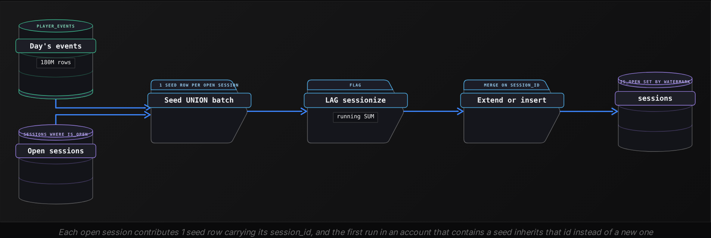

# Gaps and Islands: Advanced

You are 20 minutes into the SQL round at a streaming company.
"An account can play on up to 4 devices at once. I want hours watched per account, meaning wall-clock hours the account was watching anything. Here is the playback table, one interval per play on each device." He adds: "Last quarter the number we shipped was 23% too high."
The sample shows 4 rows, and 3 of them overlap. Most candidates reach for value minus row number, because the words continuous period are in the air. There is no step to subtract here: each row spans a range, and whether 2 rows belong together depends on an interval further back than the previous row.
What he is testing is whether you can tell which island rule the data is asking for before you write it.


<br>

### What you will be able to do

Pack overlapping and touching intervals into continuous periods with a running MAX, and say why LAG gets it wrong

Build tolerance-based sessions with LAG and a running sum, and explain where the difference trick stops holding

Compress a daily snapshot into ranges grouped by run rather than by value, and name the cost the range table adds

Carry an open island from one load into the next with a seed row, and state what closes it

Report missing stretches in an ID or time sequence as ranges with counts, and say when a gap is evidence of loss


<br>

---

## Packing Overlapping Intervals

The question arrives as a metric with a bug in it. "Hours watched per account came out 23% high, and the table it comes from has one row per device per play, with a start and an end." Nothing in the prompt says overlap and nothing says island, but an account playing on 2 devices at once has 2 rows covering the same minutes, and a SUM of their durations counts those minutes twice. The interviewer is listening for whether you say the word overlap before you say the word SUM.

| device_id | start_ts | end_ts | minutes |
| --- | --- | --- | --- |
| tablet | 2024-03-15 09:00:00 | 2024-03-15 10:00:00 | 60 |
| phone | 2024-03-15 09:15:00 | 2024-03-15 09:30:00 | 15 |
| tv | 2024-03-15 09:45:00 | 2024-03-15 10:30:00 | 45 |
| tablet | 2024-03-15 11:00:00 | 2024-03-15 11:20:00 | 20 |

Summing the minutes column for account 1042 gives 140. The account was watching from 09:00 to 10:30 without a break and again from 11:00 to 11:20, which is 110 minutes, so the naive answer is 30 minutes high on 4 rows. The tablet's hour swallows the phone's 15 minutes entirely and covers the TV's first 15, and those 30 minutes are what the metric double counted.


<br>

### A range has no step

The row-number difference needs a sequence that advances by a fixed step. A row that spans a range has no step. The phone's play starts 15 minutes after the tablet's and the TV's 30 minutes after the phone's, and both belong to the same period, while a play starting 1 minute after everything before it has ended opens a new one. Adjacency means the next start falls inside the reach of everything before it: a comparison against a maximum, where the difference trick wants a subtraction against a counter. A candidate who writes `start_ts - ROW_NUMBER()` here has matched the phrase continuous period and missed the shape of the rows.


<br>

### The running reach

For each row in start order, compute the latest end among all earlier rows: MAX(end_ts) OVER (PARTITION BY account_id ORDER BY start_ts ROWS BETWEEN UNBOUNDED PRECEDING AND 1 PRECEDING). Call it the reach. A row whose start is later than the reach cannot touch anything before it, so it opens a new period. A row whose start is at or before the reach is absorbed, even when the row immediately before it ended earlier. The frame has to end at 1 PRECEDING, because a frame that includes the current row compares each start with its own end and never flags anything.

https://github.com/user-attachments/assets/39878555-ea2d-4896-901c-116a31da866d

Watch the TV row. It starts at 09:45, and the phone before it ended at 09:30, so `LAG(end_ts)` would open a new period in the middle of the tablet's hour. The running reach is 10:00, because the tablet is still in the frame, and the TV row is absorbed. The 11:00 row sees a reach of 10:30 and starts the second period. The first row's reach is NULL, and `start_ts > NULL` is NULL, which a CASE would drop to 0, so the production query adds an `IS NULL` test. A long early interval swallowing later short ones is the trap the interviewer plants in the sample, because `LAG` cannot see past it.

```sql
WITH bounded AS (
  SELECT
    account_id,
    device_id,
    start_ts,
    COALESCE(end_ts, CURRENT_TIMESTAMP) AS end_ts
  FROM playback_intervals
),
reach AS (
  SELECT
    *,
    MAX(end_ts) OVER (
      PARTITION BY account_id
      ORDER BY start_ts, end_ts DESC
      ROWS BETWEEN UNBOUNDED PRECEDING AND 1 PRECEDING
    ) AS prev_reach
  FROM bounded
),
flagged AS (
  SELECT
    *,
    CASE
      WHEN prev_reach IS NULL
        OR start_ts > prev_reach THEN 1
      ELSE 0
    END AS new_period
  FROM reach
),
numbered AS (
  SELECT
    *,
    SUM(new_period) OVER (
      PARTITION BY account_id
      ORDER BY start_ts, end_ts DESC
    ) AS period_no
  FROM flagged
)

SELECT
  account_id,
  period_no,
  MIN(start_ts) AS period_start,
  MAX(end_ts) AS period_end
FROM numbered
GROUP BY account_id, period_no
```

A running sum turns the flag into a period number, and `MIN(start_ts)` and `MAX(end_ts)` per period give the packed intervals, 110 minutes for account 1042. State the boundary rule as you write the comparison: `start_ts > prev_reach` merges intervals that touch at the same second and `>=` splits them, and which is right depends on whether this metric's consumer treats a play ending at 10:00:00 and one starting at 10:00:00 as continuous.

> The follow-ups this answer draws
>
> - "What if end_ts is NULL because the play is still running?" MAX skips the NULL, so plays starting during it open false periods and its minutes vanish. COALESCE it to the load time first.
> - "Now tell me how many devices were playing at once." Switch to the sweep: UNION starts as +1 and ends as -1, order by time, a running SUM is the concurrency, and a period ends where it returns to 0.
> - "What if 2 rows tie on start_ts?" Either order merges them correctly. The end_ts DESC tiebreak makes the order deterministic, so reruns number periods identically.

> **TIP**
>
> Open with the rule in 1 sentence: "a row joins the current period when its start is no later than the latest end seen so far, a running MAX rather than the previous row." It names the mistake before the interviewer can ask about it.


<br>

---

## Tolerance Windows for Short Gaps

The phrasing is a tolerance: "a session is a run of player events where no 2 consecutive events are more than 30 minutes apart." The interviewer may say inactivity timeout or idle gap instead, and the 30 is the number Google Analytics made standard in 2005, which is why every analytics team you will meet has it. Events arrive at 09:00, 09:12, 09:45, 10:00 and 10:40, and the question is which of them share a session.


<br>

### Variable gaps break the subtraction

The difference trick depends on the sequence advancing in lockstep with the row number. Events at 09:00 and 09:12 are 12 minutes apart while the row number moved by 1, so timestamp minus row number shifts inside a single session and leaves no constant to group by. The trick holds where consecutive means the next day or the next integer, and nowhere the gap may vary. A tolerance rule is about the previous row, so the query has to read the previous row directly.


<br>

### The 4-step build

- LAG(event_ts) partitioned by account and ordered by event time brings the previous event's time onto each row
- A CASE compares the gap with the tolerance and emits 1 where a new session starts, 0 everywhere else
- SUM(flag) over the same partition and order turns the flags into a session number that climbs by 1 at each start
- GROUP BY account_id, session_no gives MIN, MAX and COUNT per session

The animation runs the first 2 steps over 5 events from 1 account, with timestamps shown as minutes since midnight so the subtraction reads at a glance: 540 is 09:00, 552 is 09:12, 585 is 09:45, 600 is 10:00 and 640 is 10:40.

https://github.com/user-attachments/assets/eb3126f7-c10c-45a8-b68b-f6f394ea03f6

The gaps come out as NULL, 12, 33, 15 and 40, and the flag is 1 at the 33 and the 40, so the 5 events fold into sessions of 2, 2 and 1. On the first row `LAG` found nothing, `NULL > 30` is NULL rather than true, and the CASE falls through to 0. The running sum then starts at 0, every session number is 1 low, and `MAX(session_no)` undercounts sessions by 1 per account. Writing the condition as `prev_ts IS NULL OR gap > 30` fixes it, and an interviewer asking "what does the first row do" is checking exactly this.

```sql
WITH prev AS (
  SELECT
    account_id,
    event_ts,
    event_seq,
    LAG(event_ts, 1) OVER (
      PARTITION BY account_id
      ORDER BY event_ts, event_seq
    ) AS prev_ts
  FROM player_events
),
flagged AS (
  SELECT
    *,
    CASE
      WHEN prev_ts IS NULL
        OR event_ts > prev_ts + INTERVAL '30' MINUTE THEN 1
      ELSE 0
    END AS new_session
  FROM prev
),
numbered AS (
  SELECT
    *,
    SUM(new_session) OVER (
      PARTITION BY account_id
      ORDER BY event_ts, event_seq
    ) AS session_no
  FROM flagged
)

SELECT
  account_id,
  session_no,
  MIN(event_ts) AS session_start,
  MAX(event_ts) AS session_end,
  COUNT(*) AS events
FROM numbered
GROUP BY account_id, session_no
```


<br>

### Rounding to 30-minute buckets

The wrong answer that sounds right is `DATE_TRUNC` to 30-minute buckets, counting distinct buckets as sessions. A bucket is a fixed grid on the clock: events at 09:29 and 09:31 land in different buckets 2 minutes apart, so the grid agrees with the tolerance only by accident. The sentence that gets scored is "relative to the previous event rather than to the clock".

| ✓ Difference trick | ✗ LAG plus running sum |
| --- | --- |
| • Needs a fixed step: next day, next integer<br><br>• Group key is value minus position<br><br>• Breaks the moment a gap inside an island can vary<br><br>• 1 window and no CASE | • Works for any rule about the previous row<br><br>• Group key is a running count of starts<br><br>• Tolerance can be a column: per event type or per account<br><br>• 2 windows on the same partition and order, 1 sort |

The follow-up that tests whether you have run this adds a second rule: "also cap a session at 4 hours." A cap is measured from the session's first event, which the running-sum build does not know until the sum exists, so a cap needs a second pass over the numbered output that splits long sessions, or a recursive CTE carrying the session start forward row by row. Name the second pass and its cost, 1 more sort on the same key, rather than claiming the single pass handles it.


<br>

---

## Compressing Snapshots Into Ranges

The prompt is a table size. "We snapshot every account's plan tier every night, 60 million accounts, 22 billion rows and growing, and analysts join it to find what plan an account was on at any date. Make it smaller without losing a single answer." At 60 million accounts and 365 nights, that is 21.9 billion rows a year, and the tier for most accounts does not change from one night to the next, so almost every row restates its predecessor.


<br>

### The run is in the tier column

The island is a stretch of consecutive nights on which the tier stayed the same. The dates step by 1 day, but the boundary is a change in a second column, which the difference trick cannot read. The build is the previous section's with the comparison moved: `LAG(plan_tier)` brings the previous night's tier onto the row, a CASE flags where it differs, and a running sum numbers the stretches.

https://github.com/user-attachments/assets/5c93f004-46b1-4bb0-a606-0a032c782695

Account 1 shows basic for 2 nights, premium for 2, then basic again for 2. The flag is 1 on March 1, March 3 and March 5, so the stretches number 1, 1, 2, 2, 3, 3 and group into 3 ranges, one per stretch. The first row flags correctly this time: `NULL = 'basic'` is NULL, the CASE falls through to its ELSE, and the ELSE is the 1. Equality in the WHEN and change in the ELSE land the NULL on the right side, the reverse of the tolerance query.

```sql
WITH prev AS (
  SELECT
    account_id,
    snapshot_date,
    plan_tier,
    LAG(plan_tier, 1) OVER (
      PARTITION BY account_id
      ORDER BY snapshot_date
    ) AS prev_tier
  FROM account_plan_daily
),
flagged AS (
  SELECT
    *,
    CASE
      WHEN COALESCE(plan_tier, '~') = COALESCE(prev_tier, '~') THEN 0
      ELSE 1
    END AS new_stretch
  FROM prev
),
numbered AS (
  SELECT
    *,
    SUM(new_stretch) OVER (
      PARTITION BY account_id
      ORDER BY snapshot_date
    ) AS stretch_no
  FROM flagged
)

SELECT
  account_id,
  plan_tier,
  MIN(snapshot_date) AS valid_from,
  MAX(snapshot_date) AS valid_to,
  COUNT(*) AS nights
FROM numbered
GROUP BY account_id, stretch_no, plan_tier
ORDER BY account_id, valid_from
```

The `COALESCE` to a sentinel covers accounts whose tier is NULL for a stretch. Without it, `NULL = NULL` is NULL, every NULL night flags a new stretch, and those accounts come out uncompressed. Choose a sentinel outside the tier domain and say so, because one that collides with a real tier is its own bug.


<br>

### The trap with a correct-looking result

The answer most candidates reach for is `GROUP BY account_id, plan_tier` with `MIN` and `MAX` of the date. On account 1 that returns basic from March 1 to March 6 and premium from March 3 to March 4: 2 overlapping rows, and the basic one claims the 2 nights the account spent on premium. An as-of join against that output returns 2 tiers for March 3. The interviewer puts an account that returns to an earlier tier in the sample for this reason, and a candidate who skips it loses the round without noticing.

Snapshot rows for account 1

Range rows for account 1


<br>

### Ranges pay off when changes are rare

The compression pays when the attribute changes rarely relative to the snapshot cadence. At 1.3 tier changes per account a year, 60 million accounts produce around 138 million range rows against 21.9 billion snapshot rows, a factor around 160. A daily balance that moves most days compresses by almost nothing. The ranges also change the consumer's join: the snapshot matches on account and date, while the range table hashes on `account_id` alone and filters every range of that account with `snapshot_date BETWEEN valid_from AND valid_to`, and date-partition pruning no longer applies to the range side. State that cost before the interviewer raises it.

The output is a type 2 slowly changing dimension, and interviewers give credit for using that name. The open stretch gets a `valid_to` of NULL or 9999-12-31, and that choice decides whether every as-of query needs a COALESCE. A missing snapshot night is invisible here: the nights on either side carry the same tier, so the range bridges it and answers for a night the source never had. The last section returns to that gap.

> **TIP**
>
> Say "I am grouping by the run, not by the value" while writing the SUM. It is the sentence that separates the right answer from the plausible one, and it is short enough to say before the interviewer finishes reading your CASE.


<br>

---

## Extending Islands Across Loads

"Sessionization runs every night over the day's 180 million player events. An account sends an event at 23:50 and the next one at 00:05. What does your pipeline do?" A load that sessionizes its own day in isolation splits that session in 2: the 00:05 event has nothing before it in the batch, so it flags as a new start. Session counts go up, average length goes down, and the bias falls entirely on sessions crossing midnight, which for a streaming service is the evening audience.


<br>

### What the next load needs from the last

The tolerance rule reads 1 row back. That is the whole design: the only state a new batch needs from history is the last event of every session that could still be extended. Everything older is closed and never touched again. Recomputing the full history to fix the seam would re-sort 90 days of events every night to change the tails of roughly 2 million open sessions.

- **16.2B** — rows a 90-day recompute sorts nightly
- **182M** — rows the seeded load reads



```sql
WITH seed AS (
  SELECT
    account_id,
    last_event_ts AS event_ts,
    session_id
  FROM sessions
  WHERE is_open
),
batch AS (
  SELECT
    account_id,
    event_ts,
    NULL AS session_id
  FROM player_events
  WHERE loaded_at >= TIMESTAMP '2024-03-15 00:00:00'
    AND loaded_at < TIMESTAMP '2024-03-16 00:00:00'
),
unioned AS (
  SELECT
    *
  FROM seed

  UNION ALL

  SELECT
    *
  FROM batch
),
flagged AS (
  SELECT
    *,
    CASE
      WHEN LAG(event_ts, 1) OVER (
          PARTITION BY account_id
          ORDER BY event_ts
        ) IS NULL
        OR event_ts > LAG(event_ts, 1) OVER (
          PARTITION BY account_id
          ORDER BY event_ts
        ) + INTERVAL '30' MINUTE THEN 1
      ELSE 0
    END AS new_session
  FROM unioned
),
numbered AS (
  SELECT
    *,
    SUM(new_session) OVER (
      PARTITION BY account_id
      ORDER BY event_ts
    ) AS run_no
  FROM flagged
)

SELECT
  account_id,
  run_no,
  MAX(session_id) AS inherited_session_id,
  MIN(event_ts) AS first_event_ts,
  MAX(event_ts) AS last_event_ts,
  COUNT(*) - COUNT(session_id) AS new_event_count
FROM numbered
GROUP BY account_id, run_no
```

The seed row carries a `session_id` and the batch rows carry NULL in that column. After numbering, a run that contains a seed has exactly 1 non-NULL `session_id`, so `MAX(session_id)` returns it and the run is an extension; a run with no seed returns NULL and is a new session. `COUNT(*) - COUNT(session_id)` counts only the batch events, because `COUNT(column)` skips NULLs, so the seed is never counted twice. The final step is a MERGE: update `last_event_ts` and add `new_event_count` where `inherited_session_id` matches an existing row, insert a fresh row where it is NULL.


<br>

### Closing a session

A session closes when it can no longer be extended, which is a fact about the watermark rather than the session. If the load covers arrivals up to 2024-03-16 00:00:00 and events may arrive 2 hours late, the watermark is 22:00 on March 15, so any session whose last event is before 21:30 is closed by this load. A session last seen at 23:50 stays open, its seed waiting for the next night. A late event stamped after a seed's `last_event_ts` extends its session cleanly; one stamped inside an open session sorts before the seed, so that account's open session is re-sessionized from its first event. Candidates who close every session at the batch end rebuild the midnight split in a different place, and the interviewer will ask about the 23:50 event until the watermark appears.

| island rule | state carried forward | closes when |
| --- | --- | --- |
| Tolerance sessions | last event time and session_id | last event is older than watermark minus tolerance |
| Packed intervals | running reach of the open period | reach is older than the watermark |
| Snapshot ranges | open range's tier and valid_from | a night arrives with a different tier |

Whichever variant the question arrived in, this table is what the interviewer is asking about. Every island rule reads a fixed amount of tail state, and the incremental load keeps that state between runs and nothing else: the open period's running reach seeds the packed intervals, and the open range seeds the snapshot table, which each new night either extends or closes with a `valid_to`. Saying "I carry forward exactly what the rule reads" covers all 3 in 1 sentence.

> Where this design breaks
>
> - An event 3 days late lands inside a closed session whose seed is gone: widen the lateness allowance, or reprocess the affected accounts from their last closed boundary
> - When 2 loads run for the same day, both see the same seeds: the MERGE must be idempotent on session_id and last_event_ts, or the second run doubles event counts
> - A backfill of history needs the open-session table rebuilt from the earliest reprocessed day, because seeds from the present would attach themselves to events from the past


<br>

---

## Gaps as a Data-Quality Signal

"The player SDK stamps every event with a per-device sequence number that increments by 1. How would you know if events are being lost between the device and the warehouse?" This inverts every question before it: the islands are the data you have, and the report is the gaps. The interviewer wants each gap as a row with a start, an end and a count, because "we lost some events" is a feeling and "device 7 lost sequence numbers 104 to 106" is a ticket.


<br>

### The gap is a row between 2 rows

`LEAD(event_seq)` per device in sequence order brings the next received number onto each row. Where it exceeds the current number by more than 1, the numbers in between are missing: the gap starts at `event_seq + 1`, ends at `next_seq - 1`, and holds `next_seq - event_seq - 1` records. Rows where the difference is exactly 1 are the inside of an island and produce no report. The construction is 1 window and 1 filter, and the interviewer is listening for the arithmetic to be stated exactly, because an off-by-1 in a gap report is the difference between 3 lost events and 4.

https://github.com/user-attachments/assets/0b08a5f5-e65b-4c6c-b059-426c84b37820

Device 7 received 101, 102, 103, 107, 108 and 112, and the missing count comes out 0, 0, 3, 0, 3, NULL: gaps at 104 to 106 and 109 to 111. The last row is the one to talk about. Its `LEAD` is NULL because nothing came after 112, so the filter drops it, and if the device sent 113 through 140 and lost every one, this query reports nothing. A trailing gap has no right edge, so it needs a second source that knows where the sequence should have reached.

```sql
WITH nexts AS (
  SELECT
    device_id,
    event_seq,
    LEAD(event_seq, 1) OVER (
      PARTITION BY device_id
      ORDER BY event_seq
    ) AS next_seq
  FROM player_events
)

SELECT
  device_id,
  event_seq + 1 AS gap_start,
  next_seq - 1 AS gap_end,
  next_seq - event_seq - 1 AS missing_count
FROM nexts
WHERE next_seq - event_seq > 1

UNION ALL

SELECT
  m.device_id,
  m.max_seq + 1,
  h.last_seq,
  h.last_seq - m.max_seq
FROM (
  SELECT
    device_id,
    MAX(event_seq) AS max_seq
  FROM player_events
  GROUP BY device_id
) AS m
JOIN device_heartbeat AS h
  ON h.device_id = m.device_id
WHERE h.last_seq > m.max_seq
```


<br>

### Gaps in a time sequence

The time version arrives as "we expect an hourly partition from every producer; find the hours that never landed." A missing hour has no row to carry a LEAD. Cross a calendar of expected hours with the producers and LEFT JOIN the landed partitions: rows with a NULL landed side are the missing hours. Expected hours step by exactly 1, so the difference trick collapses 6 missing hours in a row into 1 outage rather than 6 lines.

```sql
WITH expected AS (
  SELECT
    p.producer_id,
    c.hour_ts
  FROM producers AS p
  CROSS JOIN calendar_hours AS c
  WHERE c.hour_ts >= TIMESTAMP '2024-03-15 00:00:00'
    AND c.hour_ts < TIMESTAMP '2024-03-16 00:00:00'
),
missing AS (
  SELECT
    e.producer_id,
    e.hour_ts,
    ROW_NUMBER() OVER (
      PARTITION BY e.producer_id
      ORDER BY e.hour_ts
    ) AS rn
  FROM expected AS e
  LEFT JOIN landed_partitions AS l
    ON l.producer_id = e.producer_id
      AND l.hour_ts = e.hour_ts
  WHERE l.hour_ts IS NULL
)

SELECT
  producer_id,
  MIN(hour_ts) AS outage_start,
  MAX(hour_ts) AS outage_end,
  COUNT(*) AS hours_missing
FROM missing
GROUP BY producer_id, hour_ts - rn * INTERVAL '1' HOUR
```


<br>

### Sequences that never promised density

A missing stretch is evidence only if the sequence promised to be dense. Database sequences cache blocks of 20 or 1,000 numbers and discard the unused ones on restart, and rolled-back transactions burn numbers. Kafka offsets within a partition are dense, so a hole there means a skipped message; an invoice number from a cached sequence usually means nothing. Ask the interviewer "who generates this number, and does it promise no holes?"

A device that reboots starts again at 1, and the gap query hides it: ordered by `event_seq`, the 2 epochs interleave as 1, 1, 2, 2, so a gap in one epoch is filled by the other's numbers. Order by the device's own timestamp instead, flag each row whose `event_seq` falls below the one before it, and a running sum of the flag numbers the epochs.

```sql
WITH prev AS (
  SELECT
    device_id,
    device_ts,
    event_seq,
    LAG(event_seq, 1) OVER (
      PARTITION BY device_id
      ORDER BY device_ts, event_seq
    ) AS prev_seq
  FROM player_events
)

SELECT
  device_id,
  device_ts,
  event_seq,
  SUM(
    CASE
      WHEN event_seq < prev_seq THEN 1
      ELSE 0
    END
  ) OVER (
    PARTITION BY device_id
    ORDER BY device_ts, event_seq
  ) AS epoch_no
FROM prev
```

The gap query then runs with `PARTITION BY device_id, epoch_no`. The device timestamp is what makes the flag safe: ordered by arrival time, every pair delivered out of order also shows a falling number and reads as a reboot, so without a device clock, flag only a fall to a low number, such as `event_seq <= 5`.


<br>

### Reporting it so someone acts

The report has 1 row per gap: producer, gap start, gap end, missing count, and the load that first saw it. Alert on a rate rather than an absolute: a mobile fleet loses roughly 0.1% of beacons to dropped connections every day, so alerting on any gap pages someone every hour, while a 30% drop after an SDK release is worth the page. Keep the gap table across loads so a gap that later fills in from a retry queue flips to resolved instead of being counted again.

| ✓ Do | ✗ Don't |
| --- | --- |
| • Pick the island rule from the data's shape before writing any window<br><br>• Compare a start against a running MAX when rows span ranges<br><br>• Write the first-row NULL case out explicitly in every CASE flag<br><br>• Carry forward only the tail state the island rule reads<br><br>• Report gaps as ranges with counts, and alert on the rate | • Reach for value minus row number when the gap inside an island can vary<br><br>• Group by the attribute value when the question is about runs of it<br><br>• Close every open island at the end of a batch<br><br>• Report gaps from a generator that never promised density<br><br>• Sum interval durations without packing overlaps first |


<br>

---

## Putting It All Together

A regional electricity utility runs a smart-meter platform: 3 million meters each send a reading every 15 minutes with a per-meter sequence number, the meters are assigned a tariff that is snapshotted nightly, field crews log maintenance visits with overlapping start and end times per substation, and the whole thing is loaded hourly into a warehouse that bills customers and reports outages to the regulator.

- Substation downtime for the regulator comes from packing the crews' overlapping visit intervals with a running reach, so 3 crews on site at once count as 1 outage window rather than 3
- An outage per meter is a run of missing readings, found by generating the expected 15-minute slots and anti-joining the received ones, then collapsing the misses with the difference trick because expected slots step by a fixed 15 minutes
- A meter's sequence numbers expose readings lost in transit as interior gaps from LEAD, and a trailing gap only shows against the meter's last-reported counter, with a reboot reset treated as a new epoch
- The nightly tariff snapshot compresses into valid_from and valid_to ranges grouped by run, so a customer who switched to an off-peak tariff and back gets 2 standard-tariff ranges and billing reads the right one with a BETWEEN
- Each hourly load extends outage windows and tariff ranges that were still open at the end of the previous hour from their seed rows, and closes an outage only once the lateness watermark has passed its last missing slot


<br>

---

## Key Takeaways

- Rows that span ranges pack with a running MAX of the end, compared with each start; LAG misses the long early interval that swallows later ones
- A tolerance rule is a rule about the previous row, so LAG, a CASE flag and a running SUM replace value minus row number
- A snapshot compresses into ranges by grouping on the run number; grouping on the value merges stretches that were never continuous
- Across loads, carry forward only the tail state the island rule reads, and close an island by the watermark rather than by the batch end
- A gap in a sequence is evidence only when the generator promised density, and it reports as a range with a count and an alert on the rate
