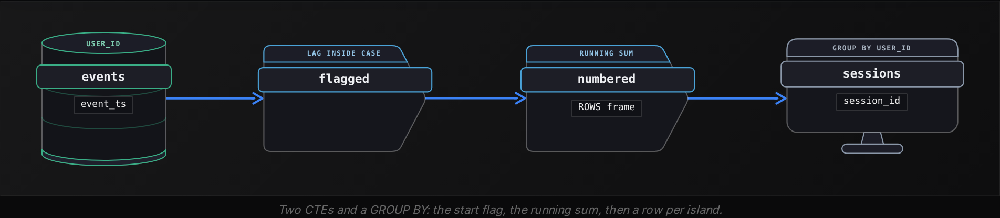

# Gaps and Islands: Intermediate

Second round at a mobile gaming company, shared editor open. The interviewer pastes a schema: `logins(user_id, login_ts)`, about 30 million rows a month.
"For every player, give me their longest streak of consecutive days with a login. And whether it's still alive."
Her sample has a single login per player per day, so subtracting a row number from the date looks finished in 4 lines. Real players open the game 3 times on a Saturday, and every repeated date quietly breaks a streak apart. She also hasn't said which timezone decides where a day ends, or which streak wins when 2 tie for longest.
What she is grading is whether you get the rows to the grain the question is about before numbering anything, and whether you can defend each step of the query as you write it.


<br>

### What you will be able to do

Build island ids with a start flag and a running SUM, and explain in 2 sentences why they number islands in order

Choose the step test for integers and calendar days, and number trading days and months so consecutive ones differ by 1. Cast timestamps in the right timezone first

Return each island's length with its start and end dates, plus whether it is current, in the form the streak question asks for

Keep islands whole and results repeatable when timestamps repeat or tied rows disagree

Partition and group by the entity alongside the island key so no 2 entities share an island


<br>

---

## Flagging the Start of Each Island

Past the textbook version, the question stops promising integers that step by 1. It arrives as "a session ends after 30 minutes without an event", as "the stretches where a subscription stayed active", or as "runs of days the stock closed above its 50-day average". Each phrasing defines a break between a row and the row before it, and a break you can test row against row is everything the flag-and-sum form needs.


<br>

### Mark the break, then count the breaks

Order the rows within each entity. On every row, use `LAG` to read the previous row and write a flag: 1 if this row opens a new island, 0 if it continues the current one. Then take a running `SUM` of the flag in the same order. The running total holds still across every 0 and climbs by exactly 1 at every 1, so all rows of an island share a number, no other island shares it, and the numbers run 1, 2, 3 in the order the islands occur.

Here is the flag running over 6 daily snapshots of a single subscription: active on March 1 and 2, paused on March 3, active on March 4 and 5, cancelled on March 6. The `CASE` returns 0 when a row's status matches the status on the row before, and 1 otherwise.

https://github.com/user-attachments/assets/750ba7fe-b311-4fff-83d0-eb63ea649231

Watch the first row. `LAG` has nothing to return there, so it gives NULL, and `status = NULL` evaluates to NULL instead of false. A `CASE` takes a `WHEN` branch only when its condition is true, so NULL falls through to `ELSE` and the first row is flagged 1 with no special case written for it. The flags come out 1, 0, 1, 1, 0, 1.

| snapshot_date | status | is_new_run | run_id |
| --- | --- | --- | --- |
| 2024-03-01 | active | 1 | 1 |
| 2024-03-02 | active | 0 | 1 |
| 2024-03-03 | paused | 1 | 2 |
| 2024-03-04 | active | 1 | 3 |
| 2024-03-05 | active | 0 | 3 |
| 2024-03-06 | cancelled | 1 | 4 |

Sum the flag in a second CTE, ordered the same way, and the `run_id` column appears: 4 islands, numbered in date order, each ready to collapse into a row with a `GROUP BY`.


<br>

### Write the flag so NULL means new

The tempting version reads the other way round: `CASE WHEN status <> LAG(status) ... THEN 1 ELSE 0 END`. On the first row that comparison is NULL as well, so it lands in `ELSE` and gets 0. Grouping still works, since the first island is the only one numbered 0, but every island number is now 1 short. The moment anyone counts islands with `MAX(run_id)`, or reads `run_id = 1` as the first island, the answer is off by 1. Phrase the condition that continues an island, and let everything else, NULL included, open a new one.


<br>

### The same shape with a 30-minute threshold

Sessionization is this pattern with a different test. Only the `WHEN` line changes: instead of comparing statuses, it asks whether the event falls within 30 minutes of the event before it.

```sql
WITH flagged AS (
  SELECT
    user_id,
    event_ts,
    CASE
      WHEN event_ts <= LAG(event_ts, 1) OVER (
        PARTITION BY user_id
        ORDER BY event_ts
      ) + INTERVAL '30' MINUTE THEN 0
      ELSE 1
    END AS is_new_session
  FROM events
),
numbered AS (
  SELECT
    user_id,
    event_ts,
    SUM(is_new_session) OVER (
      PARTITION BY user_id
      ORDER BY event_ts
      ROWS BETWEEN UNBOUNDED PRECEDING AND CURRENT ROW
    ) AS session_id
  FROM flagged
)

SELECT
  user_id,
  session_id,
  MIN(event_ts) AS session_start,
  MAX(event_ts) AS session_end,
  COUNT(*) AS events
FROM numbered
GROUP BY user_id, session_id
```




<br>

### Filtering before the flag erases the boundary

The usual follow-up on the subscription data is "only the active stretches". Put `WHERE status = 'active'` before the `LAG` and the paused row on March 3 never reaches the flag. March 4 is compared with March 2 instead, which is also active, so it gets a 0. The 2 active stretches of 2 days each come back as a single stretch. A filter on the attribute that defines the break belongs after the island id exists. A filter that drops whole entities, such as a market or a list of test accounts, can run first, because it removes entire sequences instead of rows inside one.

| ✓ Filter, then flag | ✗ Flag, then filter |
| --- | --- |
| • The paused row on March 3 is gone before LAG reads it<br><br>• March 4 sees March 2 as its predecessor and gets flag 0<br><br>• One island from March 1 to 5 that holds only 4 rows<br><br>• Island counts fall and lengths grow, with no error raised | • Every row reaches the flag, so the flip on March 3 opens island 2<br><br>• The active rows carry run_id 1 and 3<br><br>• WHERE status = 'active' runs on the numbered rows<br><br>• Two islands: March 1 to 2 and March 4 to 5 |


<br>

### The subtraction only handles a step of 1

Value minus row number stays constant along a run only when each value sits exactly 1 step past the one before. That covers consecutive integers and, with care, consecutive dates. It cannot express "within 30 minutes", "status changed" or "crossed above the average", because those breaks depend on the values of 2 neighbouring rows instead of a fixed step. The flag accepts any test you can write between a row and its predecessor, which makes it the form to default to once the break is anything other than a step of 1.

The cost follow-up has a short answer. The flag form adds a second window pass, but both windows share the same `PARTITION BY` and `ORDER BY`, so rows leave the first window already partitioned and sorted, and engines such as Spark reuse that order instead of shuffling and sorting again.

> **TIP**
>
> When asked why the running sum works, give the proof in 2 sentences. The flag is 1 on the first row of every island and 0 on the rest, so the running total rises by 1 exactly where an island opens and stays flat inside it. That makes it constant within an island and different between islands, which is all a group key needs.


<br>

---

## Date Gaps vs Integer Gaps

On an integer sequence the next value is the current one plus 1, and both forms of the pattern lean on that: the flag tests `seq_no = LAG(seq_no) + 1`, and the subtraction groups on `seq_no - ROW_NUMBER()`. Calendar sequences keep the pattern and change 3 things around it: the arithmetic you write, what counts as a day, and what counts as the next step.


<br>

### Date arithmetic is a dialect question

A date minus an integer is valid in Postgres and an error in most other engines. Each engine spells "days between" and "shift back n days" its own way, and on a shared editor the interviewer will accept any dialect you name before writing it. The mistake that costs points is argument order: reverse a date difference and every gap comes out negative, every row passes a `<= 1` test, and a user's entire history becomes a single island.

| Engine | Days from d1 to d2 | d shifted back n days |
| --- | --- | --- |
| Postgres | `d2 - d1` | `d - n` |
| Snowflake | `DATEDIFF(day, d1, d2)` | `DATEADD(day, -n, d)` |
| BigQuery | `DATE_DIFF(d2, d1, DAY)` | `DATE_SUB(d, INTERVAL n DAY)` |
| Trino, Presto | `date_diff('day', d1, d2)` | `date_add('day', -n, d)` |
| Spark SQL | `datediff(d2, d1)` | `date_sub(d, n)` |

Standard SQL avoids most of this with interval arithmetic. For the subtraction form, the cleaner move is to turn each date into an integer day number once, as a date difference from a fixed anchor such as 2000-01-01, and run integer logic on that number from then on. Saying "I'll convert to a day number so the rest is integer arithmetic" tells the interviewer you know where the dialect risk sits.

```sql
SELECT
  user_id,
  login_date,
  CASE
    WHEN DATE_DIFF('day', prev_date, login_date) = 1 THEN 0
    ELSE 1
  END AS is_new_streak
FROM lagged
```


<br>

### Calendar days and 24-hour windows disagree

Streak questions almost always mean calendar days. A login at 23:58 on Monday and another at 00:03 on Tuesday are 5 minutes apart and fall on consecutive days. Logins at 00:01 on Monday and 23:59 on Tuesday are 47 hours and 58 minutes apart and are also consecutive. Any test on raw timestamps gets some case wrong: "within 24 hours" breaks the second pair, and "within 48 hours" accepts Monday 00:01 to Wednesday 00:00, which skips Tuesday entirely. Cast each timestamp to a date first and run the pattern on dates. If the question really means rolling 24-hour windows, that is a threshold on timestamps, the 30-minute session shape with a longer interval.

The cast needs a timezone. `CAST(login_ts AS DATE)` on a UTC column draws the day line at midnight UTC. A player in Tokyo, 9 hours ahead, who plays at 23:00 local time on March 14 and 08:00 on March 16 has a gap day in their own week. In UTC those logins fall at 14:00 on March 14 and 23:00 on March 15. Those dates are consecutive, so the app shows a streak the player never had. Ask whose midnight defines the day; for a player-facing streak it is almost always the player's.

```sql
WITH user_days AS (
  SELECT
    l.user_id,
    CAST(l.login_ts AT TIME ZONE u.home_tz AS DATE) AS login_date
  FROM logins AS l
  JOIN users AS u
    ON u.user_id = l.user_id
)
```


<br>

### Trading days and months step over the calendar

Some sequences step over days by design. A stock closes only on trading days, so Friday to Monday is 3 calendar days and 1 step. Test that with "next day" and every weekend breaks the streak; test it with "within 3 days" and a Wednesday holiday followed by a missing Thursday close slips through as unbroken. The answer interviewers want here is a calendar table: number the trading days in order, join each row to its number, and run the integer version of the pattern on that number.

```sql
WITH trading_days AS (
  SELECT
    cal_date,
    ROW_NUMBER() OVER (
      ORDER BY cal_date
    ) AS trading_day_no
  FROM calendar
  WHERE is_trading_day
)

SELECT
  c.ticker,
  c.close_date,
  t.trading_day_no
FROM closes AS c
JOIN trading_days AS t
  ON t.cal_date = c.close_date
```

Weeks and months follow the same idea. Truncate with `DATE_TRUNC('week', login_date)` and consecutive weeks are 7 days apart. Months run from 28 to 31 days, so a "30 days later" test drifts; turn each month into an index with `EXTRACT(YEAR FROM d) * 12 + EXTRACT(MONTH FROM d)` and consecutive months differ by exactly 1.

> **TIP**
>
> Before writing any date logic, ask 2 questions out loud: whose midnight defines a day, and does a weekend or holiday count as a break. Each answer changes the query, and asking them is part of what gets scored.


<br>

---

## Island Length and Boundaries

Once every row carries an island id, a single `GROUP BY` on the entity and the id collapses each island into a row holding its boundaries. The exact phrasing of the question decides which of those columns answers it.

```sql
SELECT
  user_id,
  streak_id,
  MIN(login_date) AS streak_start,
  MAX(login_date) AS streak_end,
  COUNT(*) AS streak_days,
  DATE_DIFF('day', MIN(login_date), MAX(login_date)) + 1 AS span_days
FROM numbered
GROUP BY user_id, streak_id
```

User 42 logged in every day from March 1 to 5 and from March 10 to 14, with a shorter run on March 7 and 8 in between. With today as March 15 and no login yet today, the summary holds 3 streaks, 2 of them 5 days long.

| user_id | streak_id | streak_start | streak_end | streak_days |
| --- | --- | --- | --- | --- |
| 42 | 1 | 2024-03-01 | 2024-03-05 | 5 |
| 42 | 2 | 2024-03-07 | 2024-03-08 | 2 |
| 42 | 3 | 2024-03-10 | 2024-03-14 | 5 |


<br>

### Two measures of length that should agree

`COUNT(*)` counts rows, and the span from start to end plus 1 counts calendar days. With strictly consecutive days and a single row per day the 2 are equal, so returning both is a free integrity check: a `streak_days` larger than `span_days` means duplicate rows got into the island. They part ways by design only when an island may skip short gaps, and then the question has to say which it means. The classic slip is the plus 1, since March 1 to March 5 is a difference of 4 days and a streak of 5.


<br>

### Match the boundary to the question

| The question says | Compute | Where it lives |
| --- | --- | --- |
| "longest streak" | `MAX(streak_days)` per user, or a rank when dates are needed | an aggregate over the islands |
| "current streak" | the island ending today or yesterday | a test on `streak_end` |
| "streaks of at least 7 days" | `COUNT(\*) >= 7` | `HAVING`, after the `GROUP BY` |
| "when did they first reach 7 days" | `streak_start` plus 6 days, on the earliest island of 7 or more | after the `HAVING` |
| "how long were they away" | next start minus previous end, minus 1 | `LAG(streak_end)` over the islands |

The length threshold belongs in `HAVING` because it tests an island, and islands exist only after grouping. A `WHERE` on `login_date` tests rows, and a date cutoff applied before numbering trims the front off any streak that crossed it: a 10-day streak that began 3 days before the window opened is reported as 7 days. Decide out loud whether a streak crossing the window edge counts in full; if it does, number the whole history and filter on `streak_end` afterwards.

The gap between islands is a boundary question too. With a row per island, `LAG(streak_end)` over each user's islands gives the previous end, and the days missed are the new start minus that end, minus 1. User 42 missed 1 day before streak 2 and 1 day before streak 3.

```sql
SELECT
  user_id,
  streak_id,
  DATE_DIFF(
    'day',
    LAG(streak_end, 1) OVER (
      PARTITION BY user_id
      ORDER BY streak_start
    ),
    streak_start
  ) - 1 AS days_missed
FROM streak_summary
```


<br>

### A current streak is a test on the end date

"Is it still alive" is answered by the end boundary alone. A streak is current if it ends today, or yesterday when the player has not logged in yet today. At most 1 island per user passes that test, because consecutive islands are separated by at least 1 missing day and only the latest can end that late. For user 42 on March 15 that island is streak 3, so the current streak is 5. Today has to sit on the same clock as `login_date`. `CURRENT_DATE` is the server's date, so for a Tokyo player at 08:00 on March 16 it still reads March 15, and a streak that ended March 14 passes even though the player has already missed March 15 locally. A local-date streak needs a local-date today. Players with no passing island produce no row at all, so a feature that shows everyone a number needs a `LEFT JOIN` from the users table and a default of 0.

```sql
SELECT
  u.user_id,
  COALESCE(s.streak_days, 0) AS current_streak
FROM users AS u
LEFT JOIN streak_summary AS s
  ON s.user_id = u.user_id
    AND s.streak_end >= CAST(CURRENT_TIMESTAMP AT TIME ZONE u.home_tz AS DATE) - INTERVAL '1' DAY
```


<br>

### Ties for longest

User 42's first and third streaks are both 5 days, so "which is the longest streak" has 2 right answers. The animation ranks each user's streaks by length.

https://github.com/user-attachments/assets/beba5c41-9338-44b8-a9c4-464d8096cf5a

`RANK` gives both 5-day streaks rank 1 and skips to 3 for the 2-day one, so filtering on `streak_rank = 1` returns 2 rows for user 42 and 1 for user 77. `MAX(streak_days)` returns 5 when only the length is asked for, so the tie stays hidden until the follow-up "and when did it start?". If the consumer needs a single row per user, name the tiebreaker out loud: `ROW_NUMBER()` ordered by `streak_days DESC, streak_end DESC` returns the most recent of the tied streaks. Without that second key, `ROW_NUMBER` returns whichever tied row the engine sorts first, which can change between runs.


<br>

---

## Ties and Duplicate Timestamps

The sample in the room has a single row per day, and the follow-up arrives as "what if a player logs in twice on the same day?" or "what if 2 events share a timestamp?" Repeated values in the ordering column damage islands in 3 ways: they split one island into 2, they inflate its row count past its day count, and when tied rows disagree they blur where it starts and ends. A strong answer names all 3 before reaching for a fix.


<br>

### A repeated date splits the subtraction

Take a player who logged in on March 6, twice on March 7, and on March 8: 3 consecutive days in 4 rows. `ROW_NUMBER` advances on the repeated row while the date stands still, so the date-minus-row-number key shifts halfway through the streak.

| login_date | row_number | login_date minus row_number |
| --- | --- | --- |
| 2024-03-06 | 1 | 2024-03-05 |
| 2024-03-07 | 2 | 2024-03-05 |
| 2024-03-07 | 3 | 2024-03-04 |
| 2024-03-08 | 4 | 2024-03-04 |

Two keys come back, so a 3-day streak is reported as 2 islands of 2 days each, March 6 to 7 and March 7 to 8, overlapping on a shared day. Swapping in `DENSE_RANK` gives both March 7 rows the same number and repairs the key, but only the key.


<br>

### The flag splits on = 1 and over-counts on <= 1

The flag form fails the same way when it tests for a gap of exactly 1 day. The second March 7 row has a difference of 0 from its predecessor, misses the `= 1` branch, and opens a new island. Test `<= 1` instead and the repeat continues the island, so the streak stays whole. Both repairs leave a second symptom behind: the island holds 4 rows for 3 days, and `COUNT(*)` reports 4.

The fix for splits and inflated counts is to reduce the rows to the grain the question is about before any window runs. A streak of days is a property of a user and a date, so the input to the pattern is the distinct pairs of user and login date. Once the pairs are unique, `= 1` agrees with `<= 1` and `ROW_NUMBER` with `DENSE_RANK`. The row count also equals the day count.

```sql
WITH user_days AS (
  SELECT DISTINCT
    l.user_id,
    CAST(l.login_ts AT TIME ZONE u.home_tz AS DATE) AS login_date
  FROM logins AS l
  JOIN users AS u
    ON u.user_id = l.user_id
)
```


<br>

### Tied rows that disagree

Some ties carry different values, and those cannot be deduplicated away. Suppose the snapshot job for the subscription from the flag section reran on March 3 and left the original `paused` for that date alongside a stale `active`. An `ORDER BY snapshot_date` cannot order them, so the engine picks, and `LAG` reads whichever came first in that run.

Engine reads active first

Engine reads paused first

The same rows give 2 answers on 2 runs. On the left, the first active island runs March 1 to 3 and March 4 opens a new one; on the right, it ends on March 2 and March 4 joins an island that started on March 3.

Pick one row per key with a rule the business agrees to, usually the latest load: `ROW_NUMBER()` partitioned by the entity and date, ordered by load time descending, keeping row 1. If both rows are real events, say 2 clicks in the same millisecond, keep them both. Adding a unique column like `event_id` as the last `ORDER BY` key makes the order identical on every run, along with every flag computed from it.

```sql
WITH latest AS (
  SELECT
    subscription_id,
    snapshot_date,
    status,
    ROW_NUMBER() OVER (
      PARTITION BY subscription_id, snapshot_date
      ORDER BY loaded_at DESC
    ) AS load_rank
  FROM subscription_snapshots
)

SELECT
  subscription_id,
  snapshot_date,
  status
FROM latest
WHERE load_rank = 1
```


<br>

### The frame clause decides how tied rows sum

A running `SUM` written with `ORDER BY` and no frame defaults to a `RANGE` frame, and `RANGE` treats rows with equal ordering values as peers that all receive the same total. On the double-loaded subscription, both March 3 rows get the total through both of them, so a single island ends up holding an active row and a paused row together, whichever order the engine chose. `ROWS` and `RANGE` return identical sums once the ordering key is unique. Write `ROWS` anyway: it states what you mean, and on SQL Server `RANGE` uses an on-disk worktable where `ROWS` can stay in memory.

> Lines for the duplicate follow-up
>
> - "The streak is defined on days, so I'll reduce to distinct user and date pairs before numbering anything."
> - "These 2 rows tie on the date and disagree on status, so I need a rule for which wins, usually the latest load."
> - "I'm adding `event_id` as the last sort key so every run produces the same flags."
> - "I'm writing `ROWS` on the running sum, because the default `RANGE` frame gives tied rows a shared total."


<br>

---

## Grouping by Entity and Island Key

An island id is unique only inside the sequence it was computed over. The running sum restarts at 1 for every user, and the date-minus-row-number key is a plain date that anyone's streak can land on. The id names an island the way "flat 3" names a flat: correctly, as long as the building comes with it.


<br>

### What GROUP BY streak_id on its own returns

Users 42 and 77 both have a `streak_id` of 1. User 42's first streak runs March 1 to 5, and user 77's runs March 1 to 7, followed by a 3-day streak from March 10 to 12. Group on the id alone and the streaks of both players pool together.

GROUP BY streak_id

GROUP BY user_id, streak_id

The left side passes a glance and fails a review. Island 1 claims 12 days inside a span of 7, which the count-versus-span check catches at once. Island 3 comes out right only because user 77 has no third streak, the kind of result that passes a test on a single user and breaks on the full table.

The subtraction key fails with less warning. For a user whose first login is March 1, row number 1 gives both user 42 and user 77 a key of February 29, 2024. Keys from different users collide whenever date minus position lands on the same day, so a query grouped on the key alone is right on some days and wrong on others.


<br>

### Partition and group by the same entity

The rule has 2 halves. Every window in the chain carries a `PARTITION BY` on the entity, starting with the `LAG` and the running `SUM`. A `ROW_NUMBER`, if the query has one, gets it too. The final `GROUP BY` lists the entity columns followed by the island key. Leave the partition off and the windows run over all users at once: ordered by `login_date` alone, the rows of users 42 and 77 interleave, each `LAG` reads the other player's login, and the islands describe days on which anybody played.

```sql
numbered AS (
  SELECT
    user_id,
    login_date,
    SUM(is_new_streak) OVER (
      PARTITION BY user_id
      ORDER BY login_date
      ROWS BETWEEN UNBOUNDED PRECEDING AND CURRENT ROW
    ) AS streak_id
  FROM flagged
)
SELECT user_id, streak_id, COUNT(*) AS streak_days
FROM numbered
GROUP BY user_id, streak_id
```


<br>

### The question decides the entity

The entity is whatever the question says a streak belongs to, and it is often more than a single column. "Longest streak per player per game" partitions by both and groups by both plus the key. "Longest streak per player across devices" partitions by player only, so the device column has to go first: a phone login and a tablet login on the same day are 2 rows for a single day, the duplicate problem arriving from a new direction. Partition by more columns than the question names and islands split; partition by fewer and they merge.

When islands leave the query for a table or a dashboard filter, the entity has to travel with them. Keep `user_id` and `streak_id` together as a composite key, or build a single key with `CONCAT`. The running-sum id is stable only while history is unchanged: a late login for an old date renumbers every later island for that user, so a downstream join on `streak_id` should not outlive the next recompute.

> **TIP**
>
> Before saying "done", read the final `GROUP BY` against every `PARTITION BY` in the chain. A column in one and not the other is either a bug or a decision you can explain, and interviewers ask this check as a question when you skip it.

| ✓ Do | ✗ Don't |
| --- | --- |
| • Reduce rows to the grain the question names before any window function runs<br><br>• Write the start flag so a NULL predecessor lands in the new-island branch<br><br>• Partition every window by the entity, and group by the entity plus the island key<br><br>• Write ROWS on the running sum and end every ORDER BY on a unique column<br><br>• Return COUNT(\*) beside the start-to-end span and check that they match | • Filter on the attribute that defines the break before the island id exists<br><br>• Cast UTC timestamps to dates for a streak the user sees in their own day<br><br>• Group by the island key alone, even when the test data has a single user<br><br>• Pick a longest streak with ROW_NUMBER and no tiebreaker in the ORDER BY |


<br>

---

## Putting It All Together

A language-learning app is launching a streak badge. Each learner sees their current daily streak and their longest ever, and product wants a weekly report of learners who lost a streak of 30 days or more in the past week. The source is a lessons table of about 50 million completions a month, timestamped in UTC, with several completions per learner on most days, and each learner's timezone sits on the profile table.

- The base CTE converts each completion to the learner's local date and keeps distinct learner and date pairs, so a 3-lesson Sunday counts as a single day and a late-night lesson lands on the right date.
- A LAG-based flag with a <= 1 day test runs in a partition per learner, and a running sum over an explicit ROWS frame turns those flags into streak numbers in order.
- Grouping by learner and streak id gives each streak's length along with its start and end dates; the current streak is the island ending today or yesterday, joined from the learner table with a default of 0.
- The lost-streak report keeps islands with HAVING COUNT ( \* ) >= 30 whose end date falls in the past week but before yesterday, so the streak is over.
- The longest-ever badge uses RANK so tied streaks both count, and the profile page names a tiebreaker on streak_end where it shows a single date.


<br>

---

## Key Takeaways

- A start flag from LAG plus a running SUM numbers islands for any break you can test between a row and the one before it.
- Cast timestamps to dates in the user's own timezone, and turn trading days or months into integer indexes before testing steps.
- COUNT ( \* ) and the span from start to end plus 1 should match; a mismatch means duplicates crept in or the +1 went missing.
- Reduce to the question's grain first, break remaining ties with a rule or a unique sort key, and write ROWS on the sum.
- An island id means something only beside its entity: partition every window by it and group by it plus the key.
