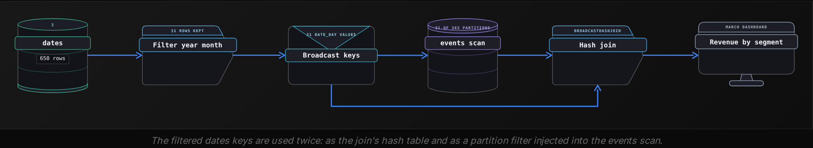

# Multi-Table Joins: Advanced

40 minutes into the round, the interviewer shares a 4-table query: an `events` fact of 40 billion rows and 3 dimensions around it. "This ran in 90 seconds every morning for a year. Since Tuesday it takes 3 hours, and nobody touched the SQL. What happened, and what would you do?" Most candidates reach straight for fixes: add an index, broadcast the customer table, raise executor memory. The question never mentions that the engine chose the join order and the join algorithms itself, from row-count estimates, or that something about those estimates changed on Tuesday. She has the plan open in another tab and shows it to whoever asks. She is testing whether you reason from the plan's evidence to a join strategy, and whether you can defend that strategy when she pushes back.


<br>

### What you will be able to do

Choose hash, sort-merge or nested loop from input sizes, input ordering and the join predicate, and say why the other 2 lose

Explain how a cardinality misestimate becomes a wrong join order, algorithm or build side, and name the fix for each cause

Price broadcast against shuffle for a fact-to-dimension join and handle a hot key without replicating a whole table

Describe how dynamic partition pruning and runtime filters let a star join skip fact partitions and dimension work

Read estimated against actual rows in a plan and turn the gap into a defended join strategy


<br>

---

## When Each Join Algorithm Wins

This question rarely names an algorithm. It arrives as a plan with a challenge attached: "Postgres chose a nested loop here, is that a bug?" or "Spark picked `SortMergeJoin` for a 40-billion-row table and a 20-million-row one, would you change it?" The interviewer is listening for whether each algorithm gets tied to the shape of its inputs: how many rows reach the join after filters, whether either side arrives sorted on the key, how much memory the engine has, and whether the predicate is an equality at all.

The examples run on a single warehouse. `events` holds 40 billion rows in 365 daily partitions, about 110 million a day; `customers` holds 20 million, `products` 300,000, `dates` 3,650 and `promotions` 4,000. Each choice below is judged against the sizes that reach the join, after filters and projection, because the engine sizes what it is about to build rather than the table on disk.


<br>

### Hash join: build small, probe large

A hash join reads its build side whole into an in-memory hash table keyed on the join column, then streams the probe side past it with a lookup per row. Cost is linear in both inputs, so it wins whenever the predicate is an equality and one side fits in memory once filtered. Output order is lost. The enterprise slice of `customers` is 198,407 rows, under 10 MB with 2 columns projected, which makes it a model build side even though the table holds 20 million.

When the build side outgrows its memory, the engine hash-partitions both inputs to disk and joins a partition pair at a time. Postgres reports this as `Batches: 16` in `EXPLAIN ANALYZE`, against a budget of `work_mem` (4 MB by default) times `hash_mem_multiplier` (2.0 since version 15). Every batch beyond the first means part of both inputs is written out and read back, and that is the cost to name when the interviewer asks what memory pressure does to a hash join.


<br>

### Sort-merge: when the order already exists

Sort-merge sorts both inputs on the key and walks them in lockstep. Paying for 2 sorts makes it slower than hash on unsorted inputs, and 3 situations reverse that. Both sides arrive already ordered, from an index scan, a clustered table, or Spark tables bucketed and sorted identically on the join key, which skip the shuffle and the sort. The output must be ordered on the key for a following `GROUP BY` or `ORDER BY`. Or memory is short, because an external sort slows gradually while an overflowing hash table starts rereading its inputs. That third property is why Spark uses `SortMergeJoin` for every equi-join it does not broadcast: `spark.sql.join.preferSortMergeJoin` defaults to true.


<br>

### Nested loop: tiny outer, indexed inner

A nested loop takes each outer row and searches the inner input for matches. Against a full scan that costs outer rows times inner rows, the version everyone remembers. Against an index on the inner key it costs an index lookup per outer row, and with 50 outer rows that beats building a hash table over millions. It is also the only algorithm that accepts any predicate, which makes it the fallback for range and inequality joins: Spark plans those as `BroadcastNestedLoopJoin`, or `CartesianProduct` when neither side can be broadcast. Answers that score state the condition, "small outer side, indexed inner side", instead of reciting the definition.

| Algorithm | Wins when | Loses when | Plan node names |
| --- | --- | --- | --- |
| Hash | One side fits in memory after filters, with an equality predicate | The build side spills into many batches, or the predicate is a range | Postgres `Hash Join`; Spark `BroadcastHashJoin`, `ShuffledHashJoin` |
| Sort-merge | Inputs already sorted or bucketed on the key, output must be ordered, or memory is tight | Both inputs are unsorted and one of them is small | Postgres `Merge Join`; Spark `SortMergeJoin` |
| Nested loop | The outer side is tens or hundreds of rows and the inner side is indexed, or the predicate is not an equality | The outer estimate said 12 rows and 200,000 arrived | Postgres `Nested Loop`; Spark `BroadcastNestedLoopJoin` |


<br>

### The range join trap

The favourite version of this question is "attribute every event to the promotion running when it happened." `promotions` carries `start_ts` and `end_ts` and no shared key, so the condition is `e.event_ts BETWEEN p.start_ts AND p.end_ts`. With no equality there is nothing to hash or merge on, and a week of events, 770 million rows, gets compared against all 4,000 promotions: roughly 3 trillion comparisons. The fix hands the join an equality. Expand each promotion into a row per day it runs, join on the day, and keep the `BETWEEN` as a residual filter over the few promotions left in each day.

```sql
WITH promo_days AS (
  SELECT
    p.promo_id,
    p.start_ts,
    p.end_ts,
    d.date_day
  FROM promotions AS p
  JOIN dates AS d
    ON d.date_day BETWEEN CAST(p.start_ts AS DATE)
    AND CAST(p.end_ts AS DATE)
)

SELECT
  e.event_id,
  pd.promo_id
FROM events AS e
JOIN promo_days AS pd
  ON e.event_date = pd.date_day
    AND e.event_ts BETWEEN pd.start_ts AND pd.end_ts
WHERE e.event_date BETWEEN DATE '2024-03-04'
AND DATE '2024-03-10'
```

> **TIP**
>
> Expect the follow-up "how big does `promo_days` get?" A promotion of at most 14 days spans at most 15 calendar dates when it starts mid-day, so the expansion tops out at 60,000 rows, still small enough to broadcast. Stating that bound shows the expansion was checked before it was trusted.


<br>

---

## Join Reordering and the Optimizer

The disguise is a regression with no code change, the one this lesson opened on: a report that slid from 90 seconds to 3 hours while its SQL sat untouched. Answers that open with indexes or cluster size get a polite nod. The answer that scores starts with "the plan changed because the estimates changed", then says how to prove it and what moved the estimates.

An optimizer treats a multi-table join as a search over orders. For each candidate order it estimates the rows every intermediate join produces, prices each step from those rows, and keeps the cheapest plan. Postgres searches exhaustively with dynamic programming for joins of up to 11 relations and switches to a genetic search at 12 (`geqo_threshold`), and it only reorders across up to 8 `FROM` items (`join_collapse_limit`). Spark keeps the order you wrote unless cost-based optimization is switched on: `spark.sql.cbo.enabled` and `spark.sql.cbo.joinReorder.enabled` both default to false. Trino reorders by default, provided it has table statistics to price the orders with.

- **720** — left-deep join orders for 6 tables
- **30,240** — orders once bushy trees are counted


<br>

### Why order decides the cost

Take the weekly enterprise report: a week of `events` joined to `customers` filtered to `segment = 'enterprise'` (1% of customers), to `products` and to `dates`. Every order returns the same 7.7 million rows, and they differ in how many rows they carry between steps.

| Step | Order A, as written | Rows out | Order B, filters first | Rows out |
| --- | --- | --- | --- | --- |
| 1 | events JOIN products | 40,000,000,000 | dates (1 week) JOIN events | 770,000,000 |
| 2 | JOIN dates (1 week) | 770,000,000 | JOIN customers (enterprise) | 7,700,000 |
| 3 | JOIN customers (enterprise) | 7,700,000 | JOIN products | 7,700,000 |

Order A pushes 40 billion rows through its first join, and Order B never holds more than 770 million. The rule the optimizer applies is to run the most selective joins first, so each intermediate result stays small, and to build each hash table on the smaller input. Both halves of that rule depend on the row estimates being right.


<br>

### Where the estimates come from

For a filter, the optimizer reads per-column statistics: row count, distinct values, null fraction, the most common values and a histogram. For an equi-join it estimates rows(R) \* rows(S) / max(ndv(R.key), ndv(S.key)), where ndv is the number of distinct keys. Both estimates rest on 2 assumptions: values are spread evenly, and predicates on different columns are independent. Production data breaks both, and each break leaves a recognisable signature.

| Cause | Example | What the estimate does |
| --- | --- | --- |
| Stale statistics | Sales created the `enterprise` segment on Tuesday, after the last `ANALYZE` | Estimates 12 rows where 198,407 exist |
| Correlated predicates | `country = 'DE' AND city = 'Berlin'`: every Berlin row is already German | Multiplies 5% by 1% to get 0.05% when the truth is 1%, a 20x miss |
| Skewed keys | The join formula assumes 2,000 events per `customer_id` | Misses customer 7, which matches 3.6 billion |
| Compounding | Each join multiplies its inputs' estimates | A 20x miss feeds the next join, whose own error multiplies onto it |

A misestimate turns into one of 3 bad decisions: a large intermediate result scheduled early, a nested loop chosen because the outer side was predicted at 12 rows, or the larger input placed on the build side or broadcast to every worker. Naming which of the 3 a plan shows is the step most answers skip.


> **TIP**
>
> Asked how you would prove it, describe 2 plans: one where a single node's estimate sits far from its actual row count, and a rerun after `ANALYZE` where that gap closes and the join order or algorithm changes with it.


<br>

### The fixes, cheapest first

> Fix the estimate before pinning the plan
>
> - Refresh statistics: `ANALYZE` in Postgres and Trino, `ANALYZE TABLE ... COMPUTE STATISTICS FOR ALL COLUMNS` in Spark, run by the job that loads the data.
> - Teach correlation: Postgres `CREATE STATISTICS` with `dependencies` and `mcv` on `(country, city)` stops the independence multiply.
> - Count the hard step: write the filtered slice to a temporary table and `ANALYZE` it, so every join above is planned on a counted row number.
> - Pin the plan last: Postgres `join_collapse_limit = 1` keeps the written order, and Spark's `BROADCAST` hint fixes distribution.
> - Every pin freezes a decision against data that keeps changing, so it carries a comment naming the estimate it corrects.


<br>

---

## Broadcast vs Shuffle Joins at Scale

It arrives as a data-movement question: "Join 40 billion events to 20 million customers on a 100-executor cluster. Walk me through what moves where." Naming broadcast because a table is smaller earns partial credit. Full credit prices both strategies against the same 3 things: bytes over the network, memory each executor must hold, and what happens when a single key dominates.


<br>

### Pricing the 2 strategies

| ✓ Broadcast | ✗ Shuffle |
| --- | --- |
| • The small side is collected, built into a hash table and copied to every executor<br><br>• Network: small side times executor count; the big side never moves<br><br>• Memory: the whole hash table on every executor, and in Spark on the driver first<br><br>• Skew on the big side is harmless, because no row is routed by key | • Both sides are repartitioned by a hash of the join key and joined partition by partition<br><br>• Network: both sides cross the network once<br><br>• Memory: a partition of each side per task, so it scales to any size<br><br>• Every row of a key lands in the same task, so a hot key becomes a single slow task |

The filters decide the answer, because they decide what reaches the join. The enterprise slice of `customers`, 198,407 rows at about 9 MB, broadcasts to 100 executors for under 1 GB of network, and broadcast wins. All 20 million customers projected to 2 columns come to about 600 MB: broadcasting them moves 60 GB and puts a hash table of 1 GB or more on every executor, while shuffling a week of events moves about 35 GB, so for the weekly report the shuffle is the cheaper network bill. Over a full year, 1.8 TB of projected events has to move, and the 60 GB broadcast is the bargain again.

- **10 MB** — Spark's default auto-broadcast threshold
- **8 GB** — Spark's hard limit on a broadcast table

Spark's automatic choice reads the optimizer's size estimate, and the bytes that actually arrive can be far smaller. Adaptive Query Execution, on by default since Spark 3.2, re-plans after each shuffle stage and converts a sort-merge join into a broadcast once the measured size of one side falls under the threshold. That runtime switch is worth naming, because it is the reason a plan printed before execution can disagree with the one that ran.


<br>

### Skew: a single key, a single task

Shuffle sends every row of a key to the same task. Spark's default of 200 shuffle partitions gives a year of events about 200 million rows per task; customer 7, a reseller account holding 9% of events, sends 3.6 billion rows to a single task, about 19 times the average, and the stage waits on it. The question arrives as "199 tasks finished in 2 minutes and 1 ran for 50." Open with the evidence: the task duration distribution in the stage view, then the row count per key.

The detection query counts rows per join key alongside each key's share of the total. On this 8-event sample, customer 7 owns 5 rows, 62.5% of the table, and each of the other 3 customers owns 1. In production the same query with `ORDER BY event_count DESC LIMIT 20` puts customer 7 first at 9%, and any key above a few percent of a table being shuffled is worth treating.

https://github.com/user-attachments/assets/91a2aac4-fa26-4b50-a9a5-c477f895855b


<br>

### Fixes for skew and what each costs

Broadcast comes first whenever the other side fits, because a broadcast join never routes the big side by key and skew stops mattering. When both sides are too big, Spark's AQE skew join splits any shuffle partition larger than 5 times the median and above 256 MB into smaller pieces, and pairs each piece with a copy of the matching partition from the other side. It can split only a side the join type allows: either side of an inner join, the left side of a left outer join, and neither side of a full outer join.

Salting is the portable fallback for when broadcast is ruled out. The attribution job below reads every profile column of `customers`, so its build side is about 12 GB, past Spark's 8 GB broadcast limit, and the year of events has to shuffle. The version that scores salts only the hot keys. Salting every key multiplies the whole dimension by the salt count; salting customer 7 alone adds 15 rows. A third route splits the query: hot keys join through a broadcast of their few dimension rows, every other key through the ordinary shuffle, and a `UNION ALL` reassembles the halves.

```sql
WITH events_salted AS (
  SELECT
    e.*,
    CASE
      WHEN e.customer_id = 7 THEN CAST(FLOOR(RAND() * 16) AS INT)
      ELSE 0
    END AS salt
  FROM events AS e
),
customers_salted AS (
  SELECT
    c.*,
    s.salt
  FROM customers AS c
  CROSS JOIN (
    SELECT
      EXPLODE(SEQUENCE(0, 15)) AS salt
  ) AS s
  WHERE c.customer_id = 7

  UNION ALL

  SELECT
    c.*,
    0 AS salt
  FROM customers AS c
  WHERE c.customer_id <> 7
)

SELECT
  e.event_id,
  e.amount,
  c.*
FROM events_salted AS e
JOIN customers_salted AS c
  ON e.customer_id = c.customer_id
    AND e.salt = c.salt
```

> **TIP**
>
> The follow-up is "how many salts?" Size the count so the hot key's slice lands near an average task: 3.6 billion rows over 16 salts is 225 million each, close to the 200 million average.


<br>

---

## Pruning in Star-Schema Joins

The disguise is a cost complaint: "The March revenue dashboard filters on `dates`, yet every refresh scans a year of `events`. Why?" The interviewer is listening for the structural reason: the filter lives on the dimension, the partition column lives on the fact, and the engine has to carry the filter across the join at runtime before the fact scan can skip anything.

```sql
SELECT
  c.segment,
  SUM(e.amount) AS revenue
FROM events AS e
JOIN dates AS d
  ON e.event_date = d.date_day
JOIN customers AS c
  ON e.customer_id = c.customer_id
JOIN products AS p
  ON e.product_id = p.product_id
WHERE d.year_month = '2024-03'
  AND c.segment = 'enterprise'
GROUP BY c.segment
```


<br>

### Static and dynamic partition pruning

Partition pruning skips files using a predicate on the partition column. Written as `WHERE e.event_date >= DATE '2024-03-01'`, the predicate is known when the plan is built, and the planner drops whole partitions before reading anything. In the star query the predicate is `d.year_month = '2024-03'` on another table, and which `event_date` values survive is unknown until `dates` has been read.

Dynamic partition pruning resolves that at runtime. The engine scans and filters `dates` first, 3,650 rows down to 31, broadcasts the result for the join, and reuses the same key set as a partition filter on the `events` scan. The scan opens 31 partitions, about 150 GB of the 1.8 TB that the dashboard's columns occupy across the year. Spark added this in 3.0, and the plan shows it as `dynamicpruningexpression` in the fact scan's `PartitionFilters`. By default Spark applies it only when it can reuse a broadcast of the dimension side (`spark.sql.optimizer.dynamicPartitionPruning.reuseBroadcastOnly`).



- **91%** — of event partitions never opened


<br>

### Runtime filters on keys that are not partitions

`customer_id` is not a partition column, so the enterprise filter cannot skip partitions, but it can still skip data. The engine builds the filtered `customers` side first, sends a bloom filter or a min/max range of its 198,407 keys to the `events` scan, and the scan drops rows that cannot match before they reach the join, along with whole row groups or micro-partitions whose key range misses every key. Trino calls this dynamic filtering and lists `dynamicFilters` on the scan; Snowflake shows a `JoinFilter` operator in the query profile; Spark 3.3 added runtime bloom filters. The payoff depends on layout. With events clustered by `customer_id` inside each day, the ranges are tight and whole files drop; with customers scattered at random, the filter saves join work and little I/O.

> **TIP**
>
> On Snowflake, compare the fact table's partitions scanned with its partitions total in the query profile. A filtered dimension that prunes should leave the scanned count a small fraction of the total.


<br>

### Pruning the dimension side

The dimension side has 2 savings of its own. Filters push down into the dimension scan before its hash table is built, which is what keeps a broadcast at 31 dates or 198,407 customers. And a join that contributes no columns can be removed. The query above never reads `products`, yet an inner join to it would still drop any event whose `product_id` has no match, so the engine may remove the join only when it can trust that every `product_id` matches exactly one product. Snowflake eliminates such joins when the foreign and primary keys are declared with `RELY`; Postgres removes a `LEFT JOIN` to a unique key whose columns go unused.

> What switches pruning off
>
> - A function on the fact's key: `CAST(e.event_ts AS DATE) = d.date_day` joins on an expression instead of the partition column
> - Mismatched key types, such as a string `date_key` against an integer, which put a cast on the fact side
> - A dimension too large to broadcast, on an engine that only prunes from a reused broadcast
> - Filters combined with `OR` across 2 dimensions, which no single key set can express

The follow-up is often "why not copy `year_month` onto `events` and make the pruning static?" Weigh it attribute by attribute. Calendar attributes never change, so copying them costs a few bytes per row and nothing afterwards. `segment` changes whenever sales reassigns an account, so copying it onto 40 billion rows turns every reassignment into a choice between a backfill and history frozen at the old segment, and buys little the runtime filter does not already deliver. Saying which attributes are stable enough to copy is the judgement being scored.


<br>

---

## Reading the Plan to Defend a Join

The interviewer turns the laptop around and shows the plan for the 3-hour run: "Here's what the engine did. Which join strategy do you want instead, and why?" The gentler form is "why did the engine choose this?" Both are answered from the plan, and answers that score quote it: a node, its estimate, its actual, the ratio between them.


<br>

### Estimated against actual, node by node

`EXPLAIN` shows what the optimizer predicted; `EXPLAIN ANALYZE` runs the query and adds what happened. Read from the leaves up and find the lowest node where actual rows differ from the estimate by more than 10x. Every decision above that node, the order, the algorithm, the build side and the distribution, was made on the wrong number, and every decision below it on a sound one.

| Engine | Estimate | Actual |
| --- | --- | --- |
| Postgres | `rows=` in the cost parentheses | `actual ... rows=` times `loops=` |
| Trino | `Estimates: {rows: ...}` per node | `Output: N rows` in `EXPLAIN ANALYZE` |
| Spark | `Statistics(sizeInBytes=...)` in `EXPLAIN COST` | "number of output rows" per operator in the SQL tab |
| Snowflake | Not shown | Rows per operator and partitions scanned of total in Query Profile |

The Postgres row hides a trap. A nested loop's inner node reports rows per loop, so `rows=39 loops=198407` means about 7.7 million rows, and reading it as 39 misses the whole problem.


<br>

### Evidence from the 3-hour run

Here is the weekly enterprise report on Postgres, with `events` partitioned by day, trimmed to the joins that matter. Each node's children sit indented under it, and a nested loop's first child is its outer side.

```sql
Nested Loop  (cost=1.00..506490.08 rows=468 width=44) (actual time=4.913..10513526.880 rows=7702315 loops=1)
  ->  Nested Loop  (cost=0.57..502540.16 rows=468 width=36) (actual time=4.871..10498114.207 rows=7702315 loops=1)
        ->  Seq Scan on customers c  (cost=0.00..500000.00 rows=12 width=16) (actual time=0.412..2861.704 rows=198407 loops=1)
              Filter: (segment = 'enterprise'::text)
              Rows Removed by Filter: 19801593
        ->  Append  (cost=0.57..211.68 rows=39 width=28) (actual time=0.031..52.898 rows=39 loops=198407)
              Buffers: shared hit=1204551 read=8913077
              ->  Index Scan using events_2024_03_04_customer_id_idx on events_2024_03_04 e_1  (cost=0.57..30.24 rows=6 width=28) (actual time=0.029..7.412 rows=6 loops=198407)
                    Index Cond: (customer_id = c.customer_id)
  ->  Index Scan using products_pkey on products p  (cost=0.42..8.44 rows=1 width=12) (actual time=0.002..0.002 rows=1 loops=7702315)
        Index Cond: (product_id = e.product_id)
```

Read it from the leaves up. The `customers` scan estimated 12 rows and returned 198,407, a miss of about 16,500x, with nothing beneath it wrong. That node is the cause. On 12 outer rows the planner priced a nested loop at 12 index probes into the 7 daily partitions, about 470 rows, far cheaper than scanning 770 million events into a hash join. It ran 198,407 probes instead: the `Append` shows `rows=39 loops=198407`, 7.7 million events fetched one index lookup at a time, with 8.9 million pages read from disk at random, close to 1.2 ms each. That is 10,495 of the run's 10,514 seconds. The products join above repeats the pattern over 7.7 million loops and costs only 15 seconds, because `products` stays cached.


<br>

### Turning evidence into a defence

The defence walks the evidence in order: the node, the ratio, the cause, the fix. Then it says what the corrected plan should look like, so the interviewer hears where the work stops.

> The answer, out loud
>
> "The customers filter estimated 12 rows and returned 198,407, so every join above it was planned on a number about 16,500 times too small. The estimate is stale: the enterprise segment was created after the last `ANALYZE`. On 12 rows the planner chose a nested loop into the events indexes, and it ran 198,407 times, reading 8.9 million pages at random: that is the 3 hours. I'd run `ANALYZE` on customers and make it part of the job that writes segments. Afterwards the estimate should sit within 2x of the actual, and the customers join should be a `Hash Join` with the 9 MB enterprise slice as its build side and the week of events as the probe."

Expect the push: "why not turn nested loops off?" `SET enable_nestloop = off` would rescue tonight's run and freeze a decision the planner gets right once its statistics are fresh, including the joins where a nested loop is the correct choice. It is the fallback when statistics cannot be kept current, scoped to one session, and it ships with a comment naming the estimate it works around. The second push is "how do you know it's fixed?" Rerun `EXPLAIN ANALYZE` and read the same node: estimate close to actual, and a `Hash Join` where the nested loop was.

On Spark the same evidence is split across 2 places. `EXPLAIN COST` prints the size estimate the broadcast decision used, and without column statistics a `Filter` keeps its input's size, so the enterprise-filtered `customers` is still estimated at the table's full 2.4 GiB and planned as a sort-merge join. The SQL tab shows actual rows per operator and, with AQE, the final plan (`isFinalPlan=true`), where the join became a `BroadcastHashJoin` once the shuffle measured the real size. The defence keeps the same 3 parts: the estimate, the actual, and what the gap made the engine do.

| ✓ Do | ✗ Don't |
| --- | --- |
| • Pull the plan before proposing a fix, and name the node you are reading<br><br>• Find the lowest node where actual and estimated rows differ by 10x or more<br><br>• Price a broadcast as build size times executor count, after filters and projection<br><br>• Refresh statistics inside the job that changes the data they describe<br><br>• Comment every hint with the estimate it corrects and when to revisit it | • Don't call a nested loop slow when the outer side is tiny and the inner side is indexed<br><br>• Don't salt every key when 1 or 2 hot keys cause the skew<br><br>• Don't read a nested loop's inner rows without multiplying by loops<br><br>• Don't wrap the fact's partition column in a function inside a join condition<br><br>• Don't pin a join order to cover a stale estimate that a fresh ANALYZE would fix |


<br>

---

## Putting It All Together

A marketplace finance team's weekly enterprise revenue report runs over a 40-billion-row events fact with customers, products, dates and promotions around it. The week sales created the enterprise segment, the report went from 90 seconds to 3 hours, the promotion attribution step started timing out, and finance asked why every run still scanned a full year of events.

- The plan comes first: the customers scan estimated 12 rows against 198,407, which locates the cause before any fix is proposed.
- That stale estimate made the planner choose a nested loop that ran 198,407 index probes into events ; a fresh ANALYZE restores the hash join the optimizer should choose.
- With the real size visible, the 198,407 enterprise customers make a 9 MB hash table, small enough to broadcast on a cluster, so customer 7's 9% share of events never lands on one task.
- The full-year scan came from a cast on the fact's partition column; joining on event_date lets dynamic partition pruning open 31 of 365 partitions.
- The promotion step was a range join falling back to nested loops; expanding promotions into days hands it an equality to hash on.


<br>

---

## Key Takeaways

- Hash wins with a small build side and an equality; sort-merge with presorted inputs or tight memory; nested loop with a tiny outer and an indexed inner.
- Join order and algorithm follow row estimates, so a regression with unchanged SQL points at stale statistics, correlated predicates or skewed keys.
- Broadcast costs build size times executor count and ignores skew; shuffle scales to any size but sends each key to a single task, so salt only hot keys.
- Star joins prune at runtime: the filtered dimension's keys become a partition filter or bloom filter on the fact scan, unless a cast blocks them.
- Defend a join from the plan: the lowest node where actual rows miss the estimate by 10x or more caused every bad choice above it.
