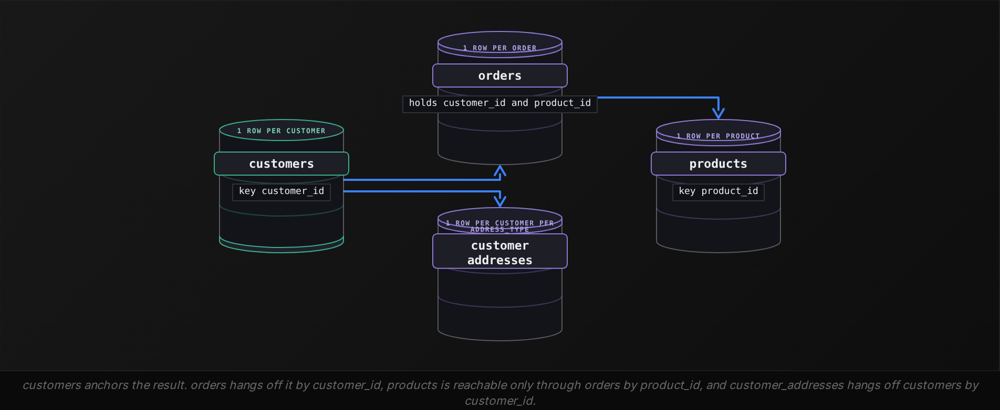

# Multi-Table Joins: Beginner

Forty minutes into a SQL round at an online retailer, the interviewer pastes 4 table names into the shared editor: customers, orders, products, customer_addresses.
'Give me every customer with each of their orders, the product category, and the city we ship to. Customers who haven't ordered still show up.'
She sits back. The editor is empty, and the natural move is to type FROM customers and start chaining JOINs in whatever order the tables come to mind. Nothing she said mentions that some customers keep both a shipping and a billing address, so the query that looks finished returns some orders twice, and nobody notices until someone counts.
She is grading whether you know, before typing a single ON clause, which rows each join will keep, drop and repeat.


<br>

### What you will be able to do

Sketch a join graph from a list of tables and pick the anchor table the requirement implies

Choose INNER or LEFT at each hop of a chain, and spot the INNER that cancels an earlier LEFT

Read foreign keys to write every ON clause against the full key it references

Predict a chain's row count hop by hop and narrate each hop so the interviewer can follow it


<br>

---

## Drawing the Join Graph First

The request names its output columns, and they live in tables that rarely sit next to each other. The name comes from customers, the category from products, the city from customer_addresses, and the only table that touches products is orders. A join graph puts that on the whiteboard before any SQL exists: every table is a node, every foreign key is an edge, and the query is a walk along those edges. Without the drawing, the join order follows the order the prompt listed the tables in, and a missing hop surfaces as an error or, worse, as a join on 2 columns that only look related.


<br>

### The graph for the running question



| Table | Rows used throughout this lesson |
| --- | --- |
| customers | Ana (id 1, West), Ben (id 2, East), Cara (id 3, West), Dev (id 4, East) |
| orders | Order 1001: Ana, product 10, $40. Order 1002: Ben, product 11, $120. Order 1003: Cara, product 13, $85 |
| products | Product 10 Mug (Kitchen), product 11 Lamp (Home), product 12 Kettle (Kitchen) |
| customer_addresses | Ana: shipping Portland, billing Seattle. Ben: shipping Boston. Cara: shipping Denver |

Products sits 2 hops from customers, which a list of table names hides, so no single ON clause connects them, and the route runs through `orders.product_id`. customer_addresses hangs off customers rather than orders, so its ON clause compares against `c.customer_id`, the column that is filled on every row of the result, including Dev's. And 2 edges leave customers toward tables that hold several rows per customer, which marks the 2 places the row count can grow.


<br>

### Choose the anchor before the first JOIN

The anchor is the table whose rows must all reach the result, and it opens the FROM clause. The request names it, usually in a phrase about who has to appear: 'every customer', 'all products, even unsold ones', 'each order'. Here the anchor is customers, because the request keeps people who never bought anything. Say it out loud. An interviewer who hears 'customers is my anchor, since customers with no orders stay in' already expects the first hop to be a LEFT JOIN, and has watched you read the requirement before the schema.

| The request says | Anchor | Why |
| --- | --- | --- |
| every customer, including ones who never ordered | customers | Customers with zero orders must survive every hop |
| revenue per order with its product category | orders | The grain is 1 order; customers and products only add columns |
| each product and how many times it sold | products | Unsold products need a row showing 0 |
| customers who placed an order last week | either side | The match defines the population, so INNER from either end gives the same rows |


<br>

### Mark the many end of every edge

Each edge gets a 1 at one end and a many at the other, read from the keys. customers to orders is 1 to many: 1 customer, any number of orders. orders to products is many to 1: many orders can name the same product, and each order names exactly 1. customers to customer_addresses is 1 to many as well, since a customer can keep separate shipping and billing addresses. Walking an edge from its 1 end toward its many end is the hop that can repeat rows. Walking from the many end toward the 1 end never adds rows, though under INNER it can lose them.

The drawing also exposes the shape that causes the most damage: 2 one-to-many edges leaving the same node. If Ana had 2 orders and 2 addresses, joining both branches would give her 4 rows, every order paired with every address, because nothing in either ON clause relates an order to an address. The 2 edges fanning out of customers on the whiteboard are the cue to ask which address the question means before the address join is written.

If the graph has no route to a table the request needs, say that too. 'I don't see a link from returns to products; is there a product_id on return lines, or does it go through orders?' is a question interviewers plant on purpose, and asking it scores better than inventing a join on a column that happens to share a name.

> What drawing first signals
>
> - You found the path before writing syntax, so no hop is a guess
> - You named the anchor, which ties the first join type to a stated reason
> - You marked the one-to-many edges, so you can predict where rows will repeat
> - You asked about the ambiguous branch before it cost a rewrite

> **TIP**
>
> Ask for the time out loud: 'Let me spend 30 seconds mapping how these tables connect.' Interviewers rarely refuse, and the sketch becomes the outline you narrate from once the query is written.

| ✓ Typing the FROM clause first | ✗ Drawing the graph first |
| --- | --- |
| • Join order follows the order the prompt listed the tables<br><br>• Join types default to habit, usually INNER<br><br>• Repeated rows appear in the output if anyone looks<br><br>• Rewrites start when the interviewer points at a row | • Join order walks the edges outward from the anchor<br><br>• Each hop's join type comes from the requirement<br><br>• Repeated rows are predicted from the many ends<br><br>• The interviewer sees the plan and can redirect early |


<br>

---

## INNER vs LEFT at Each Hop

A chain of joins reads left to right. `customers LEFT JOIN orders LEFT JOIN products` means customers joined to orders, then that whole result joined to products, so the second hop's left side is everything the first hop produced. Each hop therefore has its own question: when a row arriving from the left finds no partner in this table, does it still belong in the answer? INNER JOIN says no and drops the row. LEFT JOIN says yes and keeps it with NULL in every column of this table. The requirement answers the question hop by hop, and the answers do not have to agree.

| Hop | Row with no partner | What the request says | Join |
| --- | --- | --- | --- |
| customers to orders | Dev, who has never ordered | Customers who never ordered still appear | LEFT |
| orders to products | Order 1003, whose product 13 left the catalog | Nothing says drop orders without a category | LEFT |
| customers to customer_addresses | Dev, with no address on file | Every customer appears | LEFT |

The middle row is the hop most answers never examine. Cara bought product 13 before it was delisted, which happens in real catalogs every week, and an INNER JOIN to products removes her order from a result that promised every order. Keeping or dropping it is a requirement question with a real answer, so ask it: 'Should orders for delisted products show with a blank category, or drop out?' Asking at this hop shows the interviewer you checked what a missing match means here, instead of applying a single join type to the whole chain.


<br>

### The hop that cancels the LEFT before it

The most common chain bug is a LEFT JOIN at the first hop and a plain JOIN at the next. The first hop keeps Dev with NULL in every orders column, `o.product_id` included. The second hop then tests `p.product_id = o.product_id` on Dev's row, which becomes `p.product_id = NULL` for every product. A comparison with NULL evaluates to unknown, an INNER JOIN keeps only pairs whose condition is true, and Dev's row is gone. The LEFT at hop 1 did its job, and hop 2 reversed it.

https://github.com/user-attachments/assets/2ac0807d-bd49-40f5-b380-1c4782ebc9bf

The animation starts where hop 1 left off: `customer_orders` is what the LEFT JOIN produced for Ana and Dev, with Dev's order columns all NULL. Hop 2 returns 1 row. Ana survives because order 1001 points at product 10, which exists. Dev drops: his NULL product_id matches nothing. Cara's order for product 13 drops at the same hop for another reason, because no products row has id 13. Across all 4 customers only Ana and Ben survive: the query contains a LEFT JOIN, reads as if it keeps every customer, and keeps half of them.

```sql
-- Both hops LEFT: the preserved rows stay preserved
SELECT
  c.name,
  o.order_id,
  p.category
FROM customers AS c
LEFT JOIN orders AS o
  ON o.customer_id = c.customer_id
LEFT JOIN products AS p
  ON p.product_id = o.product_id
```

| name | order_id | category |
| --- | --- | --- |
| Ana | 1001 | Kitchen |
| Ben | 1002 | Home |
| Cara | 1003 | NULL |
| Dev | NULL | NULL |

The result has 4 rows, 1 per customer. Its 2 NULL categories say different things: Cara's means her product is unknown to the catalog, Dev's means he has no order at all. The rule that falls out is that once a hop preserves rows with LEFT, every later hop whose ON clause reads columns from the preserved side must be LEFT as well, or it filters those rows back out. The exception is deliberate. If the requirement is 'priced orders with their customers', the anchor moves to orders and both hops become INNER. Losing Dev and Cara's order is then the intended result.


<br>

### When INNER is the right choice

INNER JOIN is correct whenever the match defines who belongs. 'Customers who have placed an order', 'orders with a valid product', 'products that sold this month': in each, a row with no partner sits outside the question, and keeping it with NULLs puts rows in the answer the asker did not want. INNER also documents intent for the next reader of the query: this table is required. Interviewers give full credit for either join type when you chose it and can say why; they take points off for a join type nobody chose.

| ✓ INNER at this hop | ✗ LEFT at this hop |
| --- | --- |
| • A missing partner puts the row out of scope<br><br>• Rows can only drop or repeat, never arrive unmatched<br><br>• Every later hop sees only matched rows<br><br>• Cue words: 'who have', 'with a', 'that sold' | • A missing partner means the attribute is absent or unknown<br><br>• Every left row survives at least once, NULLs filling the gap<br><br>• Later hops reading its columns must stay LEFT<br><br>• Cue words: 'every', 'including', 'even if none' |

> RIGHT and FULL OUTER in a chain
>
> RIGHT JOIN is LEFT JOIN with the tables swapped, and halfway down a chain it forces the reader to find the anchor again; rewrite it as a LEFT JOIN with the preserved table first. FULL OUTER JOIN keeps unmatched rows from both sides and belongs to reconciliation, such as comparing 2 snapshots of one table. In a reporting chain with a single anchor, every hop is INNER or LEFT.

> **TIP**
>
> When the request is silent about unmatched rows, pick LEFT. Then name what it keeps: 'I'm keeping orders with no product match so they show a NULL category; if you'd rather drop them, this hop becomes INNER.' That sentence turns an ambiguity into a visible decision the interviewer can confirm.


<br>

---

## Following the Foreign Keys

A foreign key is a column whose values are the primary key of another table. `orders.customer_id` holds values from `customers.customer_id`, and `orders.product_id` holds values from `products.product_id`. Every ON clause in a reporting chain pairs a foreign key with the key it references, so the list of foreign keys is the first draft of the ON clauses, completed wherever the table being joined has a key of more than one column. The graph drew these links as edges; writing the SQL means reading them off the schema exactly, because an ON clause on the wrong pair of columns runs without an error and returns wrong rows.

| Foreign key | References | Partners per FK row | ON clause |
| --- | --- | --- | --- |
| orders.customer_id | customers.customer_id | Exactly 1 | o.customer_id = c.customer_id |
| orders.product_id | products.product_id | Exactly 1, or 0 for product 13 | p.product_id = o.product_id |
| customer_addresses.customer_id | customers.customer_id | Up to 2 per customer (Ana) unless address_type completes the key | a.customer_id = c.customer_id AND a.address_type = 'shipping' |


<br>

### Which way the key points

The foreign key always sits on the many side, so the column a hop joins from gives its direction: from `orders.product_id` to products is a many-to-one lookup, and from customers to `orders.customer_id` is one-to-many, the direction that can repeat rows.

```sql
SELECT
  c.region,
  p.category,
  SUM(o.amount) AS revenue
FROM orders AS o
JOIN customers AS c -- orders.customer_id references customers
  ON c.customer_id = o.customer_id -- many-to-one: still 1 row per order
JOIN products AS p -- orders.product_id references products
  ON p.product_id = o.product_id -- many-to-one, but 1003 finds no product
GROUP BY c.region, p.category
```

https://github.com/user-attachments/assets/56e6dc68-b6e7-436b-a27e-8c248afa3dbe

The animation plays the first hop on the 3 orders. Each order carries a customer_id, finds exactly 1 customers row, and picks up that customer's region, so 3 orders produce 3 joined rows: 1001 and 1003 for West, 1002 for East. The GROUP BY sums them per region, giving West 125 and East 120. The sum can be trusted because the hop was many-to-one: no order met 2 customers, so no amount was counted twice. In the full query above, the INNER hop to products would then drop order 1003 and its 85 from the category report.


<br>

### Inferring keys the schema never declares

Interview schemas usually arrive as column lists in a shared doc, and warehouse tables often carry no enforced constraints, so the foreign keys have to be inferred. A column called `customer_id` in orders points, by its name, at the table named customers. The referenced column is the one that is unique in its own table. And both columns have to describe the same thing: `orders.created_by` and `customers.customer_id` can both be integers and still be unrelated, because created_by holds employee ids. When one of these signals is missing, ask: 'Is customer_id unique in customers, or does that table keep history rows?'


```sql
-- Is customer_id unique in the table I'm about to join?
SELECT
  customer_id,
  COUNT(*) AS rows_per_key
FROM customer_addresses
GROUP BY customer_id
HAVING COUNT(*) > 1
-- customer_id = 1, rows_per_key = 2  (Ana: shipping and billing)
```


<br>

### Match the whole key, never part of it

customer_addresses has no single-column key. Its key is the pair (customer_id, address_type): 1 row per customer per address type. An ON clause that matches only customer_id matches part of the key, and every address row for that customer comes along. Matching the full key, with the address type the question asks about, returns at most 1 row per customer, which is what the request's 'the city we ship to' means:

```sql
LEFT JOIN customer_addresses a
  ON  a.customer_id  = c.customer_id
  AND a.address_type = 'shipping'   -- completes the key: at most 1 match
```

> ON clauses that run and still lie
>
> - `o.id = c.id`: 2 surrogate keys that share a name and nothing else
> - `c.name = a.name`: names repeat and change; join on the id, never the label
> - `a.customer_id = c.customer_id` alone, when the key is customer_id plus address_type
> - `o.order_id = c.customer_id`: a slip that returns rows wherever the numbers overlap

`USING (customer_id)` produces the same matches as the explicit ON clause and saves a few characters, but it hides which table each side comes from and only works when both columns share a name. In an interview, write the explicit ON with both aliases, because that is the line your narration points at.

> **TIP**
>
> Write each ON clause with the new table on the left: `ON p.product_id = o.product_id`. Reading down the joins, the first alias on each ON line is the table that hop adds, and a pairing with the wrong table stands out at a glance. Short aliases that echo the table (c, o, p, a) keep that scan fast; t1, t2, t3 make the interviewer decode them.


<br>

---

## What a Join Produces Row-by-Row

A join emits rows by a single rule: for every row arriving from the left, it outputs 1 row per matching row on the right. With exactly 1 match, the left row comes out once. With several matches, it comes out once per match, its own columns copied onto each. A left row with no match is dropped by INNER; LEFT emits it once with the right side's columns NULL. Every surprising row count traces back to one of those 3 cases.

| Matches on the right | INNER JOIN emits | LEFT JOIN emits |
| --- | --- | --- |
| 0 | Nothing: the left row is dropped | The left row once, right columns NULL |
| 1 | The left row once | The left row once |
| 3 | The left row 3 times | The left row 3 times |
| Left key is NULL | Nothing | The left row once, right columns NULL |

The last row catches people. A NULL key never matches anything, including another NULL, because NULL = NULL evaluates to unknown and a join keeps only pairs whose condition is true. An order with a NULL customer_id never finds a customer. A LEFT chain anchored on orders still carries it forward with every customer column empty.


<br>

### Watching 1 order become 2 rows

Here is the address hop isolated on Ana's order 1001, joined on customer_id alone. Predict it before pressing play. The order carries Ana's id, and customer_addresses holds both her shipping address and her billing address, so the predicted count is 2.

https://github.com/user-attachments/assets/cc91dd32-04d3-4b67-95c0-87f54ca1da2b

Order 1001 comes out once beside Portland and again beside Seattle, and nothing in the output marks the second row as a copy. That is what makes a repeated row dangerous: it looks exactly like data. A report built on this result lists Ana's order twice, and a SUM of amount over it counts her $40 twice. Adding `a.address_type = 'shipping'` to the ON clause gives Ana 1 partner and the count falls back to 1.


<br>

### Predicting the count hop by hop

The full running query starts at customers and makes 3 hops. Each hop's output is the sum, over its input rows, of the match count, where a LEFT hop counts an unmatched row as 1 and an INNER hop counts it as 0. On 4 customers the arithmetic takes seconds, and interviewers ask for it more often than candidates expect.

| Hop | Rows in | Matches per row | Rows out |
| --- | --- | --- | --- |
| FROM customers | n/a | n/a | 4 |
| LEFT JOIN orders | 4 | Ana 1, Ben 1, Cara 1, Dev 0 (kept) | 4 |
| LEFT JOIN products | 4 | Ana 1, Ben 1, Cara 0 (kept), Dev NULL key (kept) | 4 |
| LEFT JOIN customer_addresses on customer_id | 4 | Ana 2, Ben 1, Cara 1, Dev 0 (kept) | 5 |
| LEFT JOIN customer_addresses on the full key | 4 | Ana 1, Ben 1, Cara 1, Dev 0 (kept) | 4 |

The final 4 matches the request's grain: 1 row for each of the 3 orders and 1 for Dev, who has none. A predicted count that matches the grain is the strongest evidence of correctness available before running anything. When prediction and result disagree, the first hop where they part ways is the bug, which turns a wrong total into a search across 3 lines instead of the whole query.

```sql
-- Grain check: each order once, plus 1 row per customer with no order
SELECT
  COUNT(*) AS total_rows,
  COUNT(DISTINCT o.order_id) AS distinct_orders,
  COUNT(*) - COUNT(o.order_id) AS rows_without_order
FROM customers AS c
LEFT JOIN orders AS o
  ON o.customer_id = c.customer_id
LEFT JOIN products AS p
  ON p.product_id = o.product_id
LEFT JOIN customer_addresses AS a
  ON a.customer_id = c.customer_id
    AND a.address_type = 'shipping'
-- 4 | 3 | 1: total equals distinct orders plus orderless rows, so nothing repeated
```

Drop the address_type condition from that query and it returns 5 alongside 3 and 1: 5 rows against 4 accounted for, and the extra row is Ana's order repeated by her billing address. Read together, the 3 numbers from one query tell you that a repeat exists and roughly where to look.


<br>

### Where rows go missing

Lost rows are quieter than repeated ones, because every row that remains looks right and the result is only shorter than it should be. On this schema they come from 3 places: an INNER hop to a table missing the partner row, like order 1003 against a catalog with no product 13; a NULL foreign key, which matches nothing; and an INNER hop placed after a LEFT one, which filters out the rows the LEFT preserved. Each shows up as an actual count below the predicted one, which is why the prediction has to be written down first.

> Reading a count that misses the prediction
>
> - Above the prediction: a hop matched part of a key; check every one-to-many edge
> - Below the prediction: an INNER hop found no partner, or a NULL key reached an ON clause
> - Add joins one at a time and count after each; the first hop that misses is the culprit
> - COUNT(\*) above COUNT(DISTINCT) of the grain's key means some rows repeated


<br>

---

## Talking Through Each Join Hop

A multi-table join written in silence forces the interviewer to reverse-engineer it, and most stop trying around the third ON clause. Narration lets them grade each decision as you make it and gives them a place to step in before a wrong hop eats the remaining minutes. The format that works is the same 4 beats for every hop, said while you write that line.

- The table this hop adds, and the key it joins on
- Which way the key points: many-to-one holds the count, one-to-many can repeat rows
- INNER or LEFT, and the requirement that decided it
- The row count after the hop, worked out from the count before it

Open with the grain and the anchor before you write the FROM line: 'The answer has a row for every order and a row for each customer with no orders. Customers is my anchor.' That sentence tells the interviewer you know what a correct result looks like before any SQL exists, and every later beat refers back to it.


<br>

### The running query, narrated

| Line you write | What you say |
| --- | --- |
| FROM customers c | Customers is the anchor, since every customer appears. Four rows to start. |
| LEFT JOIN orders o ON o.customer_id = c.customer_id | Orders references customers by customer_id, so walking from customers is one-to-many: a customer with 3 orders becomes 3 rows. LEFT, because customers with no orders stay. Here each has 1 order or none, so still 4. |
| LEFT JOIN products p ON p.product_id = o.product_id | Orders points at products, many-to-one, so this hop can't add rows. LEFT, because order 1003 references a delisted product and Dev's row has a NULL product_id; INNER would drop both. Still 4. |
| LEFT JOIN customer_addresses a ON a.customer_id = c.customer_id AND a.address_type = 'shipping' | Addresses are keyed by customer and type, so I match both and get at most 1 row. LEFT, because Dev has no address. Still 4: the 3 orders and Dev. |

The narration leaves the syntax out. Nobody needs to hear 'and now I LEFT JOIN products on product_id'; the interviewer can read that off the screen. What they cannot read is the reason, and the reason is the part being scored. A candidate who gives the reason before the interviewer asks for it has answered the follow-up in advance. Each spoken line runs roughly 15 seconds, so a 3-hop chain costs under a minute of the round.

| ✓ Narrating the syntax | ✗ Narrating the decisions |
| --- | --- |
| • 'Now I join products on product_id'<br><br>• 'Then a LEFT JOIN to addresses'<br><br>• Reasons come out only when the interviewer asks<br><br>• The row count is discovered by running the query | • 'Orders points at products, so this hop can't add rows'<br><br>• 'LEFT, because Dev has no address and still belongs'<br><br>• Every hop arrives with its reason attached<br><br>• The row count is stated before the query runs |


<br>

### The follow-ups, and answers that score

| Interviewer asks | Answer that scores |
| --- | --- |
| What happens to a customer with no orders? | Dev passes every hop with NULLs in the orders, products and address columns, because all 3 hops are LEFT. He gets 1 row. |
| Why not INNER on products? | Dev's NULL product_id would match nothing and drop him, and Cara's order for product 13 would vanish. The request asked for both. |
| How many rows on the real tables? | The number of orders that belong to a customer, plus the number of customers with none, as long as the address hop matches the full key. I'd confirm with COUNT(\*) against COUNT(DISTINCT order_id). |
| What if an order has a NULL customer_id? | It never appears, because the chain starts at customers and a NULL key matches nothing. If those orders matter, the anchor is wrong, and I'd ask before changing it. |
| A customer has 2 shipping addresses. Now what? | Then customer_id and address_type together are not a key, the hop repeats that customer's orders, and I need a rule from you for which address wins. |

The last follow-up separates a memorized query from an understood one. A candidate who knows why the address hop is safe can name the assumption it rests on, and asks for the missing rule instead of patching the result. The patch interviewers watch for is `SELECT DISTINCT` over the repeated rows: it hides the repeat without deciding which address is correct, and when the 2 addresses differ in city it does not even remove the duplicate order.

> **TIP**
>
> Say out loud any cardinality you're assuming and how you'd check it: 'I'm assuming customer_id is unique in customers; on a real table I'd run a GROUP BY with HAVING COUNT(\*) > 1 first.' A stated assumption earns credit even when it turns out wrong, and a hidden one costs the points when it does.

| ✓ Do | ✗ Don't |
| --- | --- |
| • Draw the join graph and name the anchor table before writing FROM<br><br>• Decide INNER or LEFT per hop, from the wording of the requirement<br><br>• Keep every hop after a LEFT as LEFT unless dropping those rows is intended<br><br>• Match the full key of the table each hop joins to<br><br>• Predict the row count after each hop and check it with COUNT(\*) | • Don't join on columns that only share a name, like 2 tables' id<br><br>• Don't put an INNER JOIN after a LEFT on columns from the preserved side<br><br>• Don't patch repeated rows with SELECT DISTINCT before finding the hop<br><br>• Don't narrate syntax; narrate the key and join type of each hop, then its row count |


<br>

---

## Putting It All Together

A marketplace's finance analyst asks for a seller payout report: every active seller, each sale with its listing's category, and the bank account the payout goes to. Some sellers have sold nothing, some listings were removed after they sold, and the bank_accounts table keeps a current and a previous account per seller.

- The join graph anchors on sellers, with sales hanging off sellers, listings reached only through sales, and bank_accounts on a second branch from sellers.
- Sellers with no sales and sales of removed listings both survive only if every hop after the first stays LEFT.
- The bank_accounts key is seller plus account status, so the ON clause matches status = 'current' to keep 1 account per seller.
- The predicted count is 1 row per sale plus 1 per seller without sales; anything higher means the account hop matched part of its key.
- Narrated hop by hop, each decision reaches the analyst as a stated assumption they can confirm or correct before payouts go out.


<br>

---

## Key Takeaways

- Draw the tables and their key links first; the anchor is the table whose every row must reach the result.
- Each hop gets its own INNER or LEFT, and an INNER after a LEFT drops the rows the LEFT preserved.
- Every ON clause pairs a foreign key with the full key it references; matching part of a key repeats rows.
- A left row yields 1 output row per match. INNER drops a row with no match, while LEFT keeps it once. A NULL key matches nothing.
- Narrate the key and direction of each hop along with its join type, and state the row count before the query runs.
