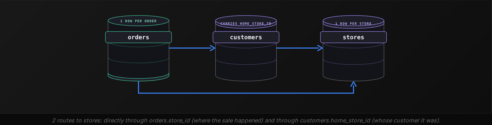
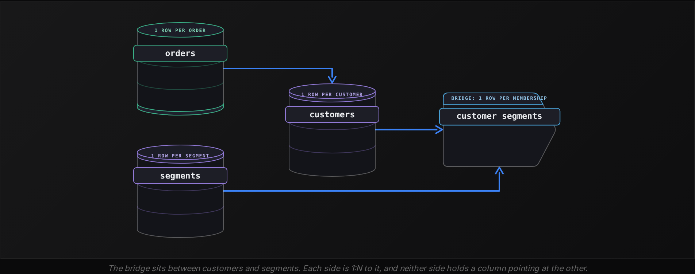

# Multi-Table Joins: Intermediate

You are 20 minutes into the SQL round at a retailer that sells through stores and an app. The interviewer pastes 7 table names into the shared doc: orders, order_items, payments, customers, stores, segments, customer_segments.
"March revenue by store, then by customer segment. A customer can sit in more than one segment."
She stops typing. Nobody has said whether "by store" means the register that took the sale or the store the customer is registered to, and the schema has a key for each. Nobody has said whether an order from a customer in 2 segments counts in both. Every version of the query compiles and returns believable dollars, so the wrong one never announces itself.
What she is grading is whether you pin down what a row means at every join before the joins decide it for you.


<br>

### What you will be able to do

Spot 2 join paths between the same tables and say which question each one answers

Predict the row count after a bridge table join and explain why per-segment totals overlap

Diagnose a double-counted SUM with COUNT(\*) against COUNT(DISTINCT key) and fix it at the right grain

Place each LEFT JOIN filter in ON or WHERE and predict which rows survive

Pre-aggregate child tables to the join key when measures come from more than one of them


<br>

---

## When Two Join Paths Disagree

The question rarely arrives labelled as a join-path problem. It arrives as "March revenue by store" over a schema where customers also carry a home store. Or it arrives as a debugging prompt: "Store revenue is $85 short of finance for March. Here's the query." The second version is the loop described below, and both start from the same fact about the schema.

There are 2 routes from an order to a store. `orders.store_id` records where the sale was rung up. `customers.home_store_id` records the store a shopper signed up at. Both are real foreign keys and both joins compile, but they split the same money differently because each one answers a different question.



Here are the 4 paid March orders, with both store keys resolved to names:

| order_id | customer_id | sold at | home store | amount |
| --- | --- | --- | --- | --- |
| 5001 | 101 | Downtown | Downtown | $90 |
| 5002 | 102 | Downtown | Airport | $25 |
| 5003 | 103 | Mall | Downtown | $60 |
| 5004 | 102 | Airport | Airport | $40 |


<br>

### Same tables, 2 answers

```sql
-- Path A: revenue where the sale was rung up
SELECT s.store_name, SUM(o.amount) AS revenue
FROM orders AS o
JOIN stores AS s ON s.store_id = o.store_id
GROUP BY s.store_name;

-- Path B: revenue by the customer's home store
SELECT s.store_name, SUM(o.amount) AS revenue
FROM orders AS o
JOIN customers AS c ON c.customer_id = o.customer_id
JOIN stores AS s    ON s.store_id = c.home_store_id
GROUP BY s.store_name;
```

| store | Path A: sold at | Path B: home store |
| --- | --- | --- |
| Downtown | $115 | $150 |
| Airport | $40 | $65 |
| Mall | $60 | no row |
| Total | $215 | $215 |

Both columns sum to $215, which is why this bug survives review: the grand total ties out to finance and only the split is wrong. Path A answers "which store earned the sale", the number behind store P&L, staffing and inventory. Path B answers "whose customers are spending", the number a loyalty team uses when each store owns a base of registered shoppers. Mall has no row on Path B because no customer calls it home, so there is nothing to group and it is absent instead of showing $0.


<br>

### Closing the loop drops rows

The weaker answer joins along every edge the diagram shows. Putting both keys on the stores join requires the selling store and the home store to be the same row:

```sql
SELECT
  s.store_name,
  SUM(o.amount) AS revenue
FROM orders AS o
JOIN customers AS c
  ON c.customer_id = o.customer_id
JOIN stores AS s
  ON s.store_id = o.store_id
    AND s.store_id = c.home_store_id -- the second path closes the loop
GROUP BY s.store_name
```

This returns Downtown $90 and Airport $40, a total of $130. Orders 5002 and 5003, the 2 placed away from home, have disappeared. The query now measures "revenue from customers shopping at their own store", a real metric that nobody asked for. A cycle in the join graph acts as a filter, and it is the bug interviewers plant when the schema they hand over carries a redundant key.


<br>

### Need both roles? Alias the table twice

When the question involves both roles, such as "how much do customers spend away from their home store", join `stores` twice under 2 aliases. Each alias follows 1 path, and nothing forces them to agree:

```sql
SELECT
  sold_at.store_name AS sold_at_store,
  home.store_name AS home_store,
  SUM(o.amount) AS revenue
FROM orders AS o
JOIN customers AS c
  ON c.customer_id = o.customer_id
JOIN stores AS sold_at
  ON sold_at.store_id = o.store_id
JOIN stores AS home
  ON home.store_id = c.home_store_id
GROUP BY sold_at.store_name, home.store_name
```

The result has 4 rows, 1 per (sold at, home) pair. The 2 rows where the stores differ, Downtown/Airport at $25 and Mall/Downtown at $60, are the cross-shopping the loop query threw away.


<br>

### The same fork under other names

- Role-playing dates: order_date and ship_date both join the calendar; March revenue depends on which one.
- Two addresses: billing region and shipping region give different regional sales for the same orders.
- Copied attributes: orders.region captured at checkout and customers.region today split after a move.
- Org charts: an employee reaches a department through the manager chain and through a cost center.

> **TIP**
>
> Name the paths before writing any SQL: "An order reaches a store 2 ways, where it was sold and the customer's home store. I'll use where it was sold unless you mean the other." Expect the follow-up "the total matches finance, so it's right?" and answer that a matching total says nothing about the split.


<br>

---

## Bridge Tables and Many-to-Many

The prompt adds a sentence: "customers can be in more than one segment." That rules out a `segment_id` column on customers, which holds 1 value per row, and the same reasoning rules out a `customer_id` column on segments. The relationship needs a table of its own. `customer_segments` holds 1 row per (customer_id, segment_id) membership and is unique on that pair, which turns a many-to-many into 2 one-to-many joins whose row counts you can predict.



The bridge holds 3 memberships, stored as id pairs. A small `segments` lookup names the ids: segment 1 is Loyalty and segment 2 is Student. Customer 101 is in both, customer 102 is in Loyalty, and customer 103 belongs to no segment:

| customer_id | segment_id |
| --- | --- |
| 101 | 1 |
| 101 | 2 |
| 102 | 1 |


<br>

### Predicting the row count

Rows after joining orders to the bridge equal the sum, over orders, of how many memberships each order's customer has. Order 5001 belongs to customer 101 with 2 memberships, so it becomes 2 rows. Orders 5002 and 5004 belong to 102, who has 1 membership, so they stay at 1 row apiece. Order 5003 belongs to 103, who has none, so the inner join drops it. The join takes in 4 orders and returns 4 rows.

> Same row count, different rows
>
> A check that compares only COUNT(\*) before and after sees 4 and 4 and passes. Order 5001 now sits on 2 rows and order 5003 on none. COUNT(\*) against COUNT(DISTINCT o.order_id), 4 against 3, catches both in one query.

With the row count understood, revenue per segment is a 2-hop join through the bridge:

```sql
SELECT
  seg.segment_name,
  SUM(o.amount) AS revenue,
  COUNT(DISTINCT o.customer_id) AS customers
FROM orders AS o
JOIN customer_segments AS cs
  ON cs.customer_id = o.customer_id
JOIN segments AS seg
  ON seg.segment_id = cs.segment_id
GROUP BY seg.segment_name
```

| segment_name | revenue | customers |
| --- | --- | --- |
| Loyalty | $155 | 2 |
| Student | $90 | 1 |

Each row is correct for what it measures: Loyalty customers spent $155 and Student customers spent $90. The column does not answer "what was revenue". It sums to $245 against real revenue of $215, because order 5001's $90 sits in both segments and customer 103's $60 sits in neither. Say both facts before the interviewer finds them: "segments overlap, so these won't add up to revenue, and customers with no segment drop out unless I LEFT JOIN the bridge and label them Unsegmented."


<br>

### What the bridge has to guarantee

> 3 ways a bridge inflates or loses rows
>
> - Duplicate pairs: 2 rows for (101, Loyalty) double customer 101's spend inside Loyalty. Check uniqueness on the pair first.
> - History rows: with joined_at and left_at, a customer who left Student in January still earns Student March revenue unless ON filters to live memberships.
> - Coverage: customers with no membership vanish under an inner join. LEFT JOIN plus COALESCE(segment_name, 'Unsegmented') keeps them.

The point-in-time version carries the order date into ON, so each order matches only the memberships that were live when it was placed:

```sql
JOIN customer_segments AS cs
  ON cs.customer_id = o.customer_id
 AND cs.joined_at <= o.order_date
 AND (cs.left_at IS NULL OR cs.left_at > o.order_date)
```


<br>

### When segment totals must add up

If finance needs segment figures that add to $215, the bridge carries an allocation weight: a column whose values sum to 1 for each customer, such as 0.5 on each of customer 101's 2 memberships. `SUM(o.amount * COALESCE(cs.weight, 1))` over a LEFT JOIN gives Loyalty $110, Student $45 and Unsegmented $60, which add to $215. Kimball's dimensional modeling calls this the weighting factor on a multivalued bridge. Be clear about what changed: weighted figures answer "how much revenue to credit each segment", a different question from "how much did Loyalty customers spend".

| ✓ Unweighted: segment reach | ✗ Weighted: allocation |
| --- | --- |
| • Each segment shows the full spend of its members<br><br>• Segments overlap, so the column does not sum to revenue<br><br>• Right for "how much do Loyalty members spend?" | • Each order's amount is split across its customer's segments<br><br>• Segments plus Unsegmented add to total revenue<br><br>• Right for a P&L or budget split by segment<br><br>• The weights are a business rule someone has to own |


<br>

### The same shape under other names

The bridge shows up as post_tags, user_groups, product_categories, encounter_diagnoses and course_instructors. When an interviewer says "can have multiple", look for the bridge. If the schema has none and stores a comma-separated list or an array instead, say you would explode it into bridge rows with a split or UNNEST before joining, because every rule above then applies.


<br>

---

## Double-Counting After a Fan-Out

This one usually arrives as a debugging prompt: "Revenue for March was $2.1M. I joined order_items so I could filter to Grocery, and the dashboard jumped to $5.4M. Why?" Sometimes there is no prompt at all, and the interviewer watches you write `SUM(o.amount)` 3 joins deep and waits to see whether you notice.

A join to a 1:N child repeats the parent row once per child, and every parent column rides along on each copy. SUM has no way to know the copies are copies. Watch it on 2 orders from the running example:

https://github.com/user-attachments/assets/3654ddc0-6704-41f1-82fc-0f61ba85dce9

Order 5001 has 3 items, so its $90 sits on 3 rows, and order 5002 has 1, so its $25 sits on 1. `SUM(o.amount)` over these rows returns $295 for 2 orders that earned $115. The factor is each order's own item count, so the error is largest on the biggest baskets and no single correction ratio exists. In the prompt, the Grocery filter first dropped every order without a Grocery item, then each surviving order was multiplied by its own count of matching Grocery item rows: the $5.4M is that product, which is why no ratio scales it back to a true figure.


<br>

### Which columns survive the join

A measure is safe to sum at the grain where it lives. After the item join, a row is an item. `oi.line_amount` lives at that grain, so `SUM(oi.line_amount)` returns 40 + 30 + 20 + 25 = $115, the right answer taken from the child side. Everything from orders lives a level above the rows and is repeated.

| column | lives at | after joining order_items |
| --- | --- | --- |
| oi.line_amount | item | safe to SUM |
| COUNT(\*) | row | counts items, so 4 here |
| o.amount | order | SUM repeats it once per item |
| o.order_id | order | COUNT(DISTINCT) is safe; COUNT is not |
| c.customer_id | customer | COUNT(DISTINCT) only |

AVG is hit too, and less visibly. `AVG(o.amount)` over the 4 joined rows returns (90 + 90 + 90 + 25) / 4 = $73.75 against a true average order of $57.50, because order 5001 now votes 3 times. $73.75 looks fine on a dashboard, since an average weighted by basket size is a believable number, so when the interviewer asks for average order value after the item join, the question is whether you catch it.


<br>

### How to tell a total has double counted

> 3 checks for a double-counted total
>
> - Row check: COUNT(\*) next to COUNT(DISTINCT o.order_id). Any gap means every order-level measure in the query is suspect.
> - Hand check: filter to 1 parent with many children, order 5001, and confirm its $90 appears once in the answer.
> - Baseline check: run SUM(amount) FROM orders with no joins. If adding a join moved the grand total, a join changed the rows.

The row check costs a line and belongs in every multi-join query before the SUM goes in. Next, find which parents fan out, and confirm that the tables you treat as lookups really are unique on their join key: a customers table holding 3 history versions per customer fans out silently even though everyone calls it a dimension.

```sql
-- Which parents fan out, worst first
SELECT order_id, COUNT(*) AS items
FROM order_items
GROUP BY order_id
HAVING COUNT(*) > 1
ORDER BY items DESC;

-- Is the "lookup" really unique on its join key?
SELECT customer_id, COUNT(*) AS versions
FROM customers
GROUP BY customer_id
HAVING COUNT(*) > 1;
```


<br>

### Fixes that only look like fixes

| ✓ Looks fixed | ✗ Is fixed |
| --- | --- |
| • SUM(DISTINCT o.amount): merges 2 different $25 orders into a single $25<br><br>• Dividing the total by average items per order: a constant cannot undo a per-order factor<br><br>• SELECT DISTINCT over the joined rows: the item columns keep the copies distinct | • SUM(oi.line_amount) when the rows are at item grain<br><br>• COUNT(DISTINCT o.order_id) for counts of parents<br><br>• Aggregate order_items to 1 row per order before joining<br><br>• EXISTS when the child is only a filter |

`SUM(DISTINCT o.amount)` is the move interviewers wait for. It removes repeated values, and 2 different orders that each cost $25 are repeated values, so on a real day the total comes out wrong in the other direction. If it matches on the 10-row sample, it matched by luck, and the follow-up "what if 2 orders have the same amount?" ends the answer.


<br>

### When the child is only a filter

In the prompt, order_items was joined for one reason: to keep orders containing Grocery items. A filter that only asks whether a matching row exists belongs in a semi-join, which returns each order at most once no matter how many items match:

```sql
SELECT
  SUM(o.amount) AS grocery_order_revenue
FROM orders AS o
WHERE EXISTS (
  SELECT
    1
  FROM order_items AS oi
  JOIN products AS p
    ON p.product_id = oi.product_id
  WHERE oi.order_id = o.order_id
    AND p.category = 'Grocery'
)
```


> **TIP**
>
> Say this before the SUM: "After this join my rows are at item grain, so I'll sum line_amount, and sum amount only after I bring orders back to 1 row each."


<br>

---

## ON vs WHERE in a LEFT JOIN

The prompt: "Every customer and how many paid orders they placed. Customers with none show 0." The candidate writes `customers LEFT JOIN orders`, adds `WHERE o.status = 'paid'`, and the zero rows vanish. The query still says LEFT JOIN, and it now returns exactly what an inner join would.

Evaluation order explains it. FROM and its joins run first: every customer is kept, and a customer with no matching order gets 1 row with NULL in every orders column. WHERE runs next, on those joined rows. `NULL = 'paid'` evaluates to unknown, and WHERE keeps only rows that are true, so the rows the LEFT JOIN existed to preserve are exactly the rows the WHERE removes.

https://github.com/user-attachments/assets/77dcd60d-91fd-4b51-9f5f-5e81a3eb8574

Take 3 customers, 1 of each kind, which produce 3 joined rows. Customer 101 matches its paid order 5001. Customer 104 matches order 5005, which was refunded, and customer 105 matches nothing and survives with NULLs. WHERE keeps 1 of the 3. For 105 the status is NULL, so the comparison is unknown; for 104 it is 'refunded', so the comparison is false. Both were supposed to appear with 0, and across all 5 customers the query returns only 101, 102 and 103.


<br>

### Where the predicate sits decides what it means

In ON, a right-table predicate decides which orders count as a match, and a customer with no qualifying order still survives with NULLs. In WHERE, the same predicate decides which joined rows survive, after the join has already run. The fix moves a single line:

```sql
SELECT
  c.customer_id,
  COUNT(o.order_id) AS paid_orders
FROM customers AS c
LEFT JOIN orders AS o
  ON o.customer_id = c.customer_id
    AND o.status = 'paid'
GROUP BY c.customer_id
```

| customer_id | paid_orders |
| --- | --- |
| 101 | 1 |
| 102 | 2 |
| 103 | 1 |
| 104 | 0 |
| 105 | 0 |

`COUNT(o.order_id)` matters as much as the ON clause. `COUNT(*)` would report 1 for customers 104 and 105, since each still owns a row, the NULL-extended one. Counting a column from the right table skips NULLs and returns 0.

Sums carry the same NULL. Add `SUM(o.amount) AS paid_revenue` to that query and customers 104 and 105 come back with NULL where the report promised $0, because SUM over a group holding only NULLs returns NULL. `COALESCE(SUM(o.amount), 0)` gives the 0, and a total across customers is unaffected either way, since SUM skips NULLs.

| ✓ Right-table predicate in ON | ✗ Right-table predicate in WHERE |
| --- | --- |
| • Filters which right rows can match<br><br>• Every left row survives<br><br>• Unmatched left rows carry NULLs into the result<br><br>• Right for "all customers, with their paid orders" | • Filters joined rows after the join<br><br>• Removes every NULL-extended row<br><br>• Returns what an inner join on that table returns<br><br>• Right only when unmatched rows should go |


<br>

### Under an INNER JOIN, placement is free

The follow-up "does placement matter for an inner join?" has a short answer: no. An inner join keeps only matched rows, so a predicate in ON and the same predicate in WHERE remove exactly the same rows, and the optimizer pushes both below the join either way. Convention keeps join keys in ON and row filters in WHERE so a reader can tell which is which. Placement only changes results on outer joins, which is why a query switched from INNER to LEFT needs every WHERE line on the right table reread.


<br>

### Left-table filters go the other way

The mirror-image mistake puts a left-table condition in ON. `LEFT JOIN orders AS o ON o.customer_id = c.customer_id AND c.region = 'West'` does not remove East customers. All 5 survive, because a LEFT JOIN never drops a left row, and customers 102 and 104 come back with NULLs where their orders should be. A filter on the preserved table belongs in WHERE.


<br>

### In a chain, a WHERE reaches back

With 2 LEFT JOINs, a WHERE on the last table also removes rows that failed at an earlier hop, because their columns from the last table are NULL too:

```sql
SELECT
  c.customer_id,
  o.order_id,
  p.method
FROM customers AS c
LEFT JOIN orders AS o
  ON o.customer_id = c.customer_id
LEFT JOIN payments AS p
  ON p.order_id = o.order_id
WHERE p.method = 'card'
-- customers 104 and 105 are gone, and so is any
-- order paid only by gift card
```

Moving `p.method = 'card'` into the payments ON clause keeps every customer and every order and attaches card payments where they exist. If the intent really is "customers with at least one card payment", write it as an inner join or an `EXISTS`, so whoever reads the query sees the filter was deliberate.

> The deliberate WHERE on a right table
>
> `WHERE o.order_id IS NULL` after a LEFT JOIN keeps only the unmatched left rows: the anti-join for "customers who never ordered". Test a column that is never NULL in a real match, such as the key, or matched rows with a NULL in that column slip through.

> **TIP**
>
> Say where each filter goes as you write it: "status goes in ON so customers with no paid orders still appear." A common follow-up is "move it to WHERE and tell me what changes." The query then behaves as an inner join, so customers 104 and 105 disappear along with the 0 rows the question asked for.


<br>

---

## Pre-Aggregating Before You Join

The prompt that forces it: "One row per order with the amount, the number of items and the total paid." Items and payments are both children of orders and unrelated to each other. Joined in a single FROM, every item row of an order pairs with every payment row of that order. Order 5001 has 3 items and was paid in 2 tenders, $50 on a card and $40 on a gift card:

| order_id | o.amount | oi.product_id | oi.line_amount | p.method | p.paid_amount |
| --- | --- | --- | --- | --- | --- |
| 5001 | 90 | 11 | 40 | card | 50 |
| 5001 | 90 | 11 | 40 | gift_card | 40 |
| 5001 | 90 | 12 | 30 | card | 50 |
| 5001 | 90 | 12 | 30 | gift_card | 40 |
| 5001 | 90 | 13 | 20 | card | 50 |
| 5001 | 90 | 13 | 20 | gift_card | 40 |

Every measure is wrong, each by a different factor. `SUM(o.amount)` returns $540, 6 copies of $90. `SUM(oi.line_amount)` returns $180, each item doubled by the 2 payments. `SUM(p.paid_amount)` returns $270, each payment tripled by the 3 items, and the item count reads 6. No single DISTINCT rescues all 3, because each column is repeated by a different table. BI semantic layers call this shape a chasm trap: 2 independent fan-outs from 1 parent.


<br>

### Aggregate each child to the key, then join

```sql
WITH items AS (
  SELECT
    order_id,
    COUNT(*) AS item_count,
    SUM(line_amount) AS item_total
  FROM order_items
  GROUP BY order_id
),
pays AS (
  SELECT
    order_id,
    SUM(paid_amount) AS paid_total
  FROM payments
  GROUP BY order_id
)

SELECT
  o.order_id,
  o.amount,
  COALESCE(i.item_count, 0) AS item_count,
  COALESCE(i.item_total, 0) AS item_total,
  COALESCE(p.paid_total, 0) AS paid_total
FROM orders AS o
LEFT JOIN items AS i
  ON i.order_id = o.order_id
LEFT JOIN pays AS p
  ON p.order_id = o.order_id
```

For orders 5001 and 5002, the rows come back as:

| order_id | amount | item_count | item_total | paid_total |
| --- | --- | --- | --- | --- |
| 5001 | 90 | 3 | 90 | 90 |
| 5002 | 25 | 1 | 25 | 25 |

Each CTE is grouped by order_id, so it is unique on order_id and both joins are 1:1: nothing multiplies. Line totals and payments both reconcile to the order amount, a check worth saying out loud. The LEFT JOINs keep an order with no payment recorded yet, and COALESCE turns its NULL into the 0 that "total paid" means for it.


<br>

### When to pre-aggregate

> Signals that call for it
>
> - Measures come from 2 or more child tables of the same parent.
> - The output grain is coarser than a child you join: per order over items, per customer over orders.
> - Parents with no children must show 0, which a LEFT JOIN to a summary plus COALESCE gives directly.
> - The child is far larger than the result, so summarizing first shrinks what the join has to match.


<br>

### When it is the wrong move

Skip it when the output grain is the child. An item-level report joins orders to items directly, and the order columns repeat on every item by design, shown as attributes and never summed. Skip it when the child is only a filter, since `EXISTS` keeps 1 row per order without building a summary. And watch for aggregating past the key the next step needs: collapsing order_items to order_id discards product_id, so "revenue by category" cannot come out of that CTE. Aggregate to (order_id, category), or to whatever key the next join or GROUP BY reads.

There is a second correct shape worth naming: a correlated scalar subquery per measure, such as `(SELECT SUM(paid_amount) FROM payments AS p WHERE p.order_id = o.order_id) AS paid_total` in the SELECT list. It cannot fan out, because each subquery returns 1 value per order row. The CTE version still wins the argument: 3 measures mean 3 subqueries the engine has to decorrelate, and each CTE states the grain of its summary in one place, where a reviewer can check it with COUNT(\*) against COUNT(DISTINCT order_id).


<br>

### The follow-ups to expect

| Follow-up | Answer that scores |
| --- | --- |
| "Why not COUNT(DISTINCT)?" | It repairs counts of orders. Payment totals were repeated by items, and no DISTINCT on order_id undoes that. |
| "How do you know the summary is safe to join?" | It is grouped by order_id, so the join is 1:1. I'd assert COUNT(\*) equals COUNT(DISTINCT order_id) on it. |
| "Now break it out by customer segment." | Aggregate orders to customer_id first, then cross the bridge. That fan-out is intended, and segments overlap. |
| "Isn't the extra CTE slower?" | It usually joins less: 1 summary row per order instead of items times payments rows. |

| ✓ Do | ✗ Don't |
| --- | --- |
| • State the grain of every table before joining: per order, per item, per membership.<br><br>• When 2 keys reach the same table, name both paths and ask which one the metric means.<br><br>• Run COUNT(\*) against COUNT(DISTINCT parent_key) before adding any SUM.<br><br>• Put right-table filters of a LEFT JOIN in ON, and left-table filters in WHERE.<br><br>• Aggregate each child table to the join key before joining 2 or more of them. | • Don't join along every foreign key the schema shows; a closed loop filters rows.<br><br>• Don't present per-segment totals over a bridge as if they sum to revenue.<br><br>• Don't reach for SUM(DISTINCT) to fix a fan-out; it merges equal values from different rows.<br><br>• Don't count with COUNT(\*) after a LEFT JOIN; each NULL-extended row counts as 1. |


<br>

---

## Putting It All Together

A meal-kit subscription company asks for a weekly marketing report: revenue and refunds per acquisition channel, by fulfilment kitchen, with every channel listed even if it sold nothing that week. Customers are attributed to several channels through a customer_channels bridge, orders carry both the kitchen that shipped them and the customer's assigned kitchen, and refunds and order lines are separate child tables of orders. The CMO will add the channel column up in a board deck.

- Kitchen: the report is for capacity planning, so it follows the shipping kitchen on orders and never joins the assigned kitchen through the same alias.
- Channel: customer_channels is the bridge, so per-channel revenue overlaps, and the CMO's sum needs a weight column or a stated note that channels do not add to revenue.
- Refunds and order lines both fan out from orders, so each is summed to order_id in its own CTE before either one is joined.
- Every channel listed means channels LEFT JOIN the rest with the week filter in ON, and a COUNT on a key column so empty channels show 0.
- Before shipping, COUNT(\*) against COUNT(DISTINCT order_id) at each hop confirms the only fan-out left is the intended one across channels.


<br>

---

## Key Takeaways

- When 2 keys reach the same table, pick the path the metric means; joining both closes a loop that filters rows, and 2 aliases keep both roles.
- A bridge turns many-to-many into 2 one-to-many joins. Per-segment totals overlap and drop unsegmented rows unless weighted or LEFT JOINed.
- After a 1:N join, only measures at the new row grain are safe to sum. Compare COUNT(\*) with COUNT(DISTINCT parent_key) before any SUM.
- In a LEFT JOIN, right-table filters belong in ON. In WHERE they discard the NULL-extended rows and the join returns what an inner join would.
- When measures come from 2 child tables of one parent, aggregate each to the parent key in its own CTE, then join the summaries 1:1.
