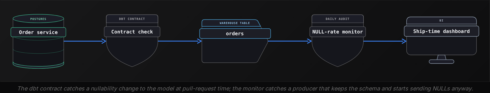

# NULL Handling: Advanced

Forty minutes into the SQL round, the interviewer pastes a MERGE statement and 2 table definitions into the shared editor.
"We merge daily reward events into member_rewards and diff it against yesterday for a change report. Nothing has ever errored. The report never lists a member whose tier was cleared, and some members now hold their base points 4 times. Find both bugs."
The DDL shows `promo_code` as nullable inside a UNIQUE (member_id, promo_code) constraint. Nobody says what a NULL promo code means: base points with no promotion, or a code the feed dropped. Most candidates go straight to the MERGE and patch its ON clause. That fixes the symptom on screen and leaves the design that produced it.
What she is testing is whether you treat every NULL as a decision someone made or failed to make, in the comparison, the constraint, the window and the schema.


<br>

### What you will be able to do

Predict the output of ROW_NUMBER and RANK, and of LAG and frame aggregates, when any key or value in the window is NULL, and fix each case

Name the state a nullable column's NULL stands for (pending, inapplicable, missing or uncollected) and encode it in the schema

Choose between = and IS NOT DISTINCT FROM in change detection and in merge or join conditions, then state the fan-out and planner costs

Explain why UNIQUE admits many NULLs and how that breaks idempotent upserts, including where engines differ

Decide when a sentinel value beats NULL and name what it costs in SQL aggregates and joins and in the tools downstream


<br>

---

## NULLs Inside a Window Frame

Window questions rarely mention NULL. They arrive as "keep the latest record per order", "deduplicate customers by email" or "fill the gaps in this sensor feed", over sample rows that look clean. The interviewer is waiting for you to ask whether the 2 keys, partition and ordering, can be NULL, and whether the value itself can. Each breaks a different part of the window, and none of them raises an error.


<br>

### Every NULL key shares one partition

`PARTITION BY` groups rows the way `GROUP BY` does, so all NULL keys fall into a single partition. In a dedupe, that means losing data. The query below was written to collapse duplicate sign-ups, and it also collapses every customer who never gave an email into 1 surviving row.

```sql
-- Intended: one row per real person
SELECT *
FROM (
  SELECT c.*,
         ROW_NUMBER() OVER (
           PARTITION BY email
           ORDER BY created_at
         ) AS rn
  FROM customers AS c
) AS d
WHERE rn = 1;   -- 9,400 customers with NULL email become 1

-- Fix: NULL-email rows each get their own partition
ROW_NUMBER() OVER (
  PARTITION BY email,
               CASE WHEN email IS NULL THEN customer_id END
  ORDER BY created_at
)
```

Expect the follow-up "how would you have caught this in production?" The answer is a reconciliation on the NULL-key rows. They were never duplicates of each other, so their count before and after the dedupe must match, and a drop from 9,400 to 1 fails that check on its first run.


<br>

### The ordering key picks the winner

Engines disagree on where NULL sorts. Postgres treats it as larger than every value, and so do Oracle and Snowflake; SQL Server and MySQL treat it as smaller, as do BigQuery and Spark. Inside a window that policy chooses rank 1. On Postgres, `ROW_NUMBER() OVER (PARTITION BY order_id ORDER BY updated_at DESC)` ranks the status event with a NULL `updated_at` first, so "latest status" returns the single event that has no timestamp.

Rows with a NULL ordering value are also peers. `RANK` and `DENSE_RANK` give them all the same rank, and `ROW_NUMBER` numbers them in whatever order the engine happened to read them. Running the same dedupe twice can then keep different rows, which shows up weeks later as a reconciliation drifting by a handful of rows with no code change. The fix is 2 clauses written every time: an explicit NULL placement and a unique tiebreaker.

```sql
ROW_NUMBER() OVER (
  PARTITION BY order_id
  ORDER BY updated_at DESC NULLS LAST,
           status_event_id DESC
) AS rn
```


<br>

### Value functions return NULL for 2 reasons

`LAG` and `LEAD` return NULL when the target row does not exist, and so do `FIRST_VALUE` and `LAST_VALUE`; they also return NULL when the row exists and holds NULL. The default in `LAG(price, 1, 0)` covers only the first case: the first row of a partition gets 0, and a row whose predecessor has a NULL price still gets NULL. A price-change column built on `price - LAG(price)` is therefore NULL beside every gap. Wrapping it in `COALESCE(..., 0)` reports those unknown changes as no change, a wrong answer that looks clean.

The standard fix is `IGNORE NULLS`, which skips NULL values while searching for the target row. Oracle and Snowflake accept it on the navigation functions, and so does Redshift, along with Trino and Databricks. Postgres and MySQL have historically lacked it, so interviewers often ask for the portable version, and that is the one to know cold.


<br>

### Carrying the last known value forward

The portable fill depends on one aggregate rule: `COUNT(temp_c)` skips NULLs. As a running window it increases only on rows that carry a reading, so each NULL row inherits the counter of the last reading before it. That counter is a group id. Every group after group 0 holds exactly 1 non-NULL value, and `MAX` spreads it across the group. Group 0 collects the NULLs that arrive before the first reading.

https://github.com/user-attachments/assets/29e42085-1494-49f1-8c85-f6b87836545d

The second step reads that output as a table named `grouped`. In production both steps are one query, with the counter computed in a CTE.

https://github.com/user-attachments/assets/2a4b1750-c519-4173-8641-94c5e6196ee4

Narrate it in that order: counter, groups, spread. The first row has no reading before it, so it lands in group 0, a group with no value, and the fill leaves it NULL instead of inventing a temperature. Candidates who reach for `COALESCE(temp_c, LAG(temp_c))` fill the 14:05 gap and miss 14:10, because the row LAG finds there is itself NULL. Interviewers seed the sample with exactly that pair of consecutive gaps.


<br>

### Frame aggregates shrink their denominator

Aggregates over a frame follow the ordinary aggregate rules, applied frame by frame. `AVG(temp_c) OVER (ORDER BY reading_time ROWS BETWEEN 5 PRECEDING AND CURRENT ROW)` averages only the readings it finds. A 6-row frame with 2 NULLs is therefore a 4-reading average, and a frame of nothing but NULLs returns NULL from both `AVG` and `SUM`. The interviewer usually probes 3 kinds of gap, and each needs a different answer:

| Gap | What the frame does | What to say |
| --- | --- | --- |
| Row present, value NULL | Covers 6 intervals, averages fewer values | Correct in time, thinner in data; publish the count beside the average |
| Row absent | Covers 6 rows that span more than 6 intervals | Wrong in time; densify against a calendar or use a RANGE frame |
| Ordering key NULL, RANGE offset frame | The standard gives it a frame of its NULL-keyed peers only | Undated rows roll among themselves; date or filter them first |

> **TIP**
>
> Pair every rolling average with `COUNT(temp_c)` over the same frame. An average built from 1 reading looks identical to one built from 6, and the count is how a consumer tells them apart.


<br>

---

## Intentional NULLs vs Missing Data

This one arrives dressed as data quality: "`shipped_at` is NULL on 38% of orders. Is that a problem?" Yes and no both miss the point. The strong opening is that 38% means nothing until you know which NULL you are counting, because a single column can carry 4 different facts with the same value.

| Order | Why shipped_at is NULL | Kind | Correct handling |
| --- | --- | --- | --- |
| Placed 2 hours ago | It has not shipped yet | Not yet | Expected; fills in later |
| Gift card, emailed | Nothing ships | Not applicable | Expected forever; exclude from ship-time metrics |
| Status is delivered | The shipping event never arrived | Missing | A defect; alert and backfill |
| Placed before June 2023 | The column did not exist yet | Not collected | Expected for that era; exclude from trends |

The first 2 are intentional: NULL is the true state of the row today. The last 2 are holes in the data. Downstream code must treat them differently, since an average ship time should exclude gift cards and fail loudly on delivered orders without a timestamp. Nothing in the column distinguishes them, so the design question is where that information lives.


<br>

### Making the schema say which NULL

There are 3 places to put it, and naming all 3 is what the interviewer is listening for.

- Tie the NULL to state: a CHECK constraint allows NULL shipped_at only while the order is unshipped.
- Add a reason column: phone_status of provided, declined or not_asked explains every NULL phone.
- Split the table: a shipments row exists only for orders that ship, so absence means not applicable.

Each costs something different. The CHECK needs a status column that is itself NOT NULL, and it only helps where the engine enforces CHECK. The reason column doubles the fields a consumer reads but survives every engine and every export. The split table is the cleanest model and adds a LEFT JOIN to every query that wants the attribute, which is why most teams keep the column and add the CHECK.

The CHECK version has a trap that gets tested. A CHECK constraint rejects a row only when its condition is false, and UNKNOWN passes. `CHECK (shipped_at >= created_at)` therefore accepts every NULL `shipped_at`, including on delivered orders, which are the exact rows it was meant to stop. The condition has to name NULL itself:

```sql
ALTER TABLE orders ADD CONSTRAINT shipped_at_matches_status CHECK (
  order_date < DATE '2023-06-01'
  OR (status IN ('shipped', 'delivered')
      AND shipped_at IS NOT NULL
      AND shipped_at >= created_at)
  OR (status IN ('placed', 'cancelled', 'digital')
      AND shipped_at IS NULL)
);
-- status and order_date must be NOT NULL: a NULL in either
-- turns its branch UNKNOWN, and UNKNOWN passes
```


<br>

### When the engine will not enforce it

Snowflake enforces NOT NULL but no CHECK constraints, and BigQuery and Redshift behave the same way. In the warehouse the same rule becomes a query that classifies every NULL and fails the build when the `missing` bucket is nonzero.

```sql
SELECT
  CASE
    WHEN shipped_at IS NOT NULL THEN 'populated'
    WHEN order_date < DATE '2023-06-01' THEN 'not_collected'
    WHEN status = 'placed' THEN 'not_yet'
    WHEN status IN ('cancelled', 'digital') THEN 'not_applicable'
    ELSE 'missing'
  END AS null_kind,
  COUNT(*) AS orders
FROM orders
GROUP BY 1
```

The `not_collected` branch hardcodes a date, and that date belongs in the catalog or the column description where a consumer can find it. No query can infer why a column added in June 2023 is NULL on older rows. Backfilling them with a default erases the difference between "recorded as zero" and "never recorded" permanently.


<br>

### Nullability is a contract

A NOT NULL column promises consumers they can skip the NULL branch. Relaxing it breaks every consumer that relied on the promise, even though no type changed. A dbt model contract records nullability per column, so a pull request that relaxes NOT NULL on the model fails its build unless the contract version moves with it. That gate covers the dbt model only: holding the order service itself to the promise takes a contract or schema check on the source side. Where no contract exists, a daily NULL-rate check per column is the fallback.



Calibrate that check per column. A column at 0% NULL for 2 years that jumps to 3% is an incident, because a meaning changed upstream. A column that runs at 30% and drifts to 35% is usually more orders sitting in the not-yet bucket, which is why the monitor works best on the classified counts above instead of the raw NULL rate.

When the monitor fires, the interviewer wants a decision. If the NULLs are missing data from a producer bug, roll the producer back. If they carry a deliberate new meaning, such as a new order type that never ships, the change is a contract change: it ships with a version bump, a dated note in the catalog and a deadline for consumers to handle the new NULL.


<br>

---

## Null-Safe Equality

The question arrives as a missed change: "Our nightly diff compares yesterday's customer snapshot with today's. It caught a phone number edit, but it missed customers who added a phone for the first time and customers who removed one." The interviewer wants to hear that `t.phone <> y.phone` is UNKNOWN when either side is NULL, so the WHERE clause drops precisely the rows where a value appeared or disappeared. The animation starts from the 2 snapshots already joined on `customer_id`.

https://github.com/user-attachments/assets/6e308d20-9fc2-4689-8212-553e26db4e3a

Swap `<>` in for `IS DISTINCT FROM` and the result shrinks to customer 102. The null-safe operator never returns UNKNOWN. It calls 2 NULLs not distinct and a NULL against a value distinct; 2 non-NULL values compare as usual. That makes it the right comparison for any "did this field change?" question, because a field going from unknown to known is a change.

| old | new | new <> old | new IS DISTINCT FROM old |
| --- | --- | --- | --- |
| '555-0101' | '555-0101' | FALSE | FALSE |
| '555-0102' | '555-0199' | TRUE | TRUE |
| NULL | '555-0103' | UNKNOWN | TRUE |
| NULL | NULL | UNKNOWN | FALSE |
| '555-0105' | NULL | UNKNOWN | TRUE |


<br>

### Spellings by engine

| Engine | Null-safe equal | Null-safe not equal |
| --- | --- | --- |
| Postgres, Snowflake, BigQuery, Trino, DuckDB, SQL Server 2022+ | a IS NOT DISTINCT FROM b | a IS DISTINCT FROM b |
| MySQL | a <=> b | NOT (a <=> b) |
| Spark, Databricks | a <=> b, or the standard form | a IS DISTINCT FROM b |
| Oracle | DECODE(a, b, 1, 0) = 1 | DECODE(a, b, 1, 0) = 0 |


<br>

### Inside an SCD2 merge

The same comparison decides when a slowly changing dimension opens a new version. Written with `<>`, a customer whose segment goes from NULL to a value never gets a new row, and the history claims the old version is still current.

```sql
MERGE INTO dim_customer AS t
USING staged_customers AS s
  ON t.customer_id = s.customer_id AND t.is_current
WHEN MATCHED AND (
       t.phone   IS DISTINCT FROM s.phone
    OR t.segment IS DISTINCT FROM s.segment
    OR t.city    IS DISTINCT FROM s.city
  ) THEN UPDATE SET is_current = FALSE, valid_to = s.loaded_at;
```

With 30 tracked columns that predicate runs to 30 lines, and the interviewer will ask how you keep it maintainable. That is the cue for hashing, which brings a NULL trap of its own, covered below.


<br>

### When 2 NULLs should match

The decision rests on what the NULL means. When NULL is an intentional state, such as a customer assigned to no region, 2 NULLs describe the same state and matching them is correct. When NULL means missing, 2 NULLs are 2 unknowns, and matching them asserts a fact nobody has.

| ✓ Match NULL to NULL | ✗ Keep = semantics |
| --- | --- |
| • Change detection between snapshots or in an SCD2 merge<br><br>• Reconciling a migrated table against its source, column by column<br><br>• MERGE on a natural key whose nullable part means none, such as (member_id, promo_code)<br><br>• Joining to a mapping table where NULL is a real category, such as no region | • Identity matching on contact details or device ids that are missing<br><br>• Joining facts to dimensions on a key that should never be NULL<br><br>• Any join where both sides hold many NULLs, since every pair matches<br><br>• Entity resolution, where a false match costs more than a miss |

Have the cost of the wrong choice ready as a number. Join 2 customer tables on email with null-safe equality when each side holds 10,000 rows without an email, and those rows pair with each other before a single real match is counted.

- **100,000,000** — joined rows from NULL emails alone


<br>

### What the planner does with it

Null-safe equality carries a planner cost in some engines. Postgres does not treat `IS NOT DISTINCT FROM` as a hashable or mergeable join operator, so a join on it falls back to a nested loop and cannot use an ordinary btree index. Spark plans `<=>` as an equi-join key and runs it through hash and sort-merge joins. Where the engine struggles, `COALESCE(a.k, '#null#') = COALESCE(b.k, '#null#')` is hashable. It stays correct only while the token can never occur in real data.


<br>

### Hashes and set operations

Wide tables are diffed by hashing each row, and the hash input has its own NULL bug, which depends on the engine. `CONCAT_WS` skips NULL arguments in Postgres and MySQL, and in SQL Server too, so 2 different rows can build the same string. In Snowflake it returns NULL when any argument is NULL, so the hash goes NULL and the `<>` comparison against it is UNKNOWN, hiding the row. A token per column fixes both:

```sql
-- Postgres, MySQL, SQL Server: both inputs are 'ana|lisbon'
-- Snowflake: both return NULL
SELECT MD5(CONCAT_WS('|', 'ana', NULL, 'lisbon'));
SELECT MD5(CONCAT_WS('|', 'ana', 'lisbon', NULL));

-- Each column wrapped in a token that cannot appear in the data
SELECT MD5(CONCAT_WS('|',
  COALESCE(first_name, '#null#'),
  COALESCE(middle_name, '#null#'),
  COALESCE(city, '#null#')))
FROM customers;
```

Plain `||` concatenation fails the Snowflake way on every engine: 1 NULL column makes the whole hash NULL. Set operations avoid both. `EXCEPT` treats 2 NULLs as the same value, as `DISTINCT` does, so `SELECT * FROM today EXCEPT SELECT * FROM yesterday` returns new and changed rows with NULLs handled and no per-column logic. Offering it as the first-draft reconciliation, then the hash version for scale, is a strong answer.


<br>

---

## Why UNIQUE Allows Many NULLs

It arrives as a contradiction: "`email` has a UNIQUE constraint and 4,000 customers have no email. Why did the constraint never fire?" The answer is in how the standard defines a violation. A row conflicts with another only if the 2 are equal, NULL compared with NULL is UNKNOWN, and so no pair of NULL rows is ever proven equal. Postgres and Oracle follow that reading, as do MySQL and SQLite, and SQL:2023 added a `NULLS NOT DISTINCT` clause for tables that want the opposite. A primary key sidesteps the question by implying NOT NULL on every column it covers.

The follow-up is the apparent inconsistency: `GROUP BY` puts every NULL in one group, yet UNIQUE treats them as all different. The clean answer is that the 2 ask different questions. Grouping asks whether rows belong together in a report; the constraint asks whether a row is provably a duplicate, and 2 unknown emails prove nothing.

| Engine | Many NULLs in a UNIQUE column | How to change that |
| --- | --- | --- |
| Postgres | Allowed | UNIQUE NULLS NOT DISTINCT (version 15+) allows 1 |
| SQL Server | Only 1 NULL | Filtered unique index WHERE col IS NOT NULL allows many |
| Oracle | Allowed on 1 column; composite keys with equal non-NULL parts collide | Function-based unique index |
| MySQL (InnoDB), SQLite | Allowed | Generated column plus unique index |
| Snowflake, BigQuery, Redshift | Declared, never enforced | A uniqueness test in the pipeline |


<br>

### A nullable column cannot be a key

The consequence for keys is where the time goes. A unique column that admits NULL identifies only its non-NULL rows, so it cannot stand in for a key anywhere a row has to be found again. The usual casualty is an upsert targeting a composite natural key with a nullable part:

```sql
-- member_rewards: UNIQUE (member_id, promo_code)
-- promo_code is NULL for base points
MERGE INTO member_rewards AS t
USING daily_rewards AS s
  ON t.member_id = s.member_id
 AND t.promo_code = s.promo_code      -- NULL never matches
WHEN MATCHED THEN UPDATE SET points = s.points
WHEN NOT MATCHED THEN INSERT (member_id, promo_code, points)
  VALUES (s.member_id, s.promo_code, s.points);
```

Every base-points row fails the ON clause, takes the NOT MATCHED branch and inserts, and the constraint accepts the new row because (42, NULL) is never proven equal to (42, NULL). The load has lost idempotency: run it 4 times, the original load plus 3 reruns after an incident, and member 42 holds base points 4 times. Give both fixes and say why both are needed. `t.promo_code IS NOT DISTINCT FROM s.promo_code` in the ON clause stops this MERGE from inserting duplicates. `UNIQUE NULLS NOT DISTINCT`, or a NOT NULL column with an explicit value for base points, makes the database reject the next writer who forgets the clause.

Foreign keys follow the same reading. Under the default `MATCH SIMPLE`, a composite reference with any NULL column is not checked at all, so a shipment line referencing (order_id, line_no) accepts (99999, NULL) for an order that does not exist. `MATCH FULL` requires every column to be NULL or none, which closes the gap.


<br>

### Many NULLs on purpose

Sometimes many NULLs is exactly what the design wants, because NULL itself encodes the state. Soft deletes are the standard example: `deleted_at` is NULL for active rows, and email must be unique among active customers while deleted ones keep their history.

```sql
-- Postgres: unique among active rows only
CREATE UNIQUE INDEX customers_active_email
  ON customers (email)
  WHERE deleted_at IS NULL;

-- SQL Server: many NULL emails, unique otherwise
CREATE UNIQUE INDEX customers_email
  ON customers (email)
  WHERE email IS NOT NULL;
```


<br>

### In a warehouse, uniqueness is a test

Snowflake and BigQuery accept PRIMARY KEY and UNIQUE declarations and enforce neither. Redshift does the same and goes further: it lets its optimizer trust them, so a declared key with duplicates can return wrong results from a query that relies on it. Uniqueness there is a query the pipeline runs, and its NULL semantics are whatever that query says, which is where tests and constraints quietly disagree.

```sql
-- Flags (42, NULL) twice as a duplicate: GROUP BY puts NULLs together
SELECT
  member_id,
  promo_code,
  COUNT(*) AS copies
FROM member_rewards
GROUP BY member_id, promo_code
HAVING COUNT(*) > 1
```

That test treats NULLs as equal, so it is stricter than the Postgres default constraint and catches the MERGE bug above. dbt's built-in `unique` test filters `WHERE column IS NOT NULL` first, matching the Postgres reading, which is why `unique` and `not_null` are usually declared together. Neither is wrong. The interviewer is checking that you know which semantics your test encodes and that you chose it from what the NULL means.


<br>

---

## Sentinel Values vs NULL

The question usually comes as a provocation: "Why not replace every NULL with -1, 'N/A' or 9999-12-31 and stop worrying about it?" Agreeing loses, and so does a blanket refusal. The strong answer is that a sentinel trades one set of failures for another, and you pick the set by what the column does downstream.

| ✓ What a sentinel gains | ✗ What it costs |
| --- | --- |
| • Equality and joins work without null-safe operators, and so does UNIQUE<br><br>• NOT NULL can be enforced, so every consumer drops a branch<br><br>• Range predicates work: valid_to 9999-12-31 fits a single comparison<br><br>• BI tools show a label such as Unknown where NULL shows a blank | • Aggregates count it as a real value and skew silently<br><br>• It can collide with a legitimate value, such as quantity 0<br><br>• Its meaning lives in convention that each new consumer must learn<br><br>• Concentrated join keys become skewed partitions<br><br>• Tools outside SQL may reject it, such as out-of-range dates |


<br>

### Aggregates absorb sentinels

Take `days_to_ship` for 5 orders: 2 never shipped, and the 3 that did hold 2 and 4 and 6. Stored as NULL, `AVG` returns 4.0 over the 3 real values. Stored as -1, `AVG` returns 2.0, `MIN` returns -1, and nothing flags either result. The 9999-12-31 date does the same to `MAX(valid_to)` and to any date difference computed against it, which produces tenures near 8,000 years.

The sentinel also leaks out of SQL. A Python job loading 9999-12-31 into pandas fails, because nanosecond timestamps cannot represent it, and the common patch, coercing errors to NaT, turns every current SCD2 row back into a missing value.

- **2262-04-11** — last date a pandas ns timestamp holds


<br>

### Where a sentinel is the better design

Defending 2 standard sentinels is part of the answer. The first is the open end of an SCD2 row: `valid_to = DATE '9999-12-31'` lets an as-of join use a single range predicate with no OR branch, which keeps it indexable and readable.

```sql
-- Sentinel end date: one predicate
JOIN dim_customer AS d
  ON d.customer_id = f.customer_id
 AND f.order_date >= d.valid_from
 AND f.order_date <  d.valid_to

-- NULL end date: an OR the planner handles poorly
 AND f.order_date >= d.valid_from
 AND (f.order_date < d.valid_to OR d.valid_to IS NULL)
```

The second is the unknown member of a Kimball dimension: a row with key -1 labelled Unknown, often beside -2 labelled Not Applicable. A fact whose customer could not be resolved points at -1 instead of holding a NULL key, so inner joins keep it and every report's revenue total matches the fact table. The pair also does the job a reason column does, telling consumers which kind of NULL each row was. Both sentinels are safe for the same reason: the column is a key or a range bound, never an input to arithmetic, and the value lies outside any real domain.


<br>

### Sentinel keys and skew

Join keys are where the tradeoff turns physical. With NULL keys, an inner join drops the rows, and Spark infers an `IS NOT NULL` filter on the join keys so those rows never enter the shuffle. Replace them with -1 and every unresolved fact now matches the unknown member and hashes to the same partition. A fact table where 15% of rows are unresolved sends that share of the join to a single task, and the stage runs as long as that task.

The fix keeps the sentinel and splits the path: join the resolved rows normally, cross join the unresolved rows to the 1-row unknown member as a broadcast, and `UNION ALL` the 2 halves. Mention it unprompted whenever the sentinel is a join key, because the interviewer often adds the skew as the next question.


<br>

### Converting at the boundary

Legacy sources arrive full of sentinels. The clean pattern converts them once, at ingestion, with `NULLIF`, then puts sentinels back only where a column needs one. Store NULL where the column feeds arithmetic, store a documented sentinel where it is a key or a range bound, and keep tokens inside computations, such as the hash input from the row diff, never in storage.

```sql
SELECT
  NULLIF(age, - 1) AS age,
  NULLIF(TRIM(region), 'N/A') AS region,
  NULLIF(signup_date, DATE '1900-01-01') AS signup_date,
  COALESCE(customer_key, - 1) AS customer_key
FROM raw_customers
```

| Column's job | Store | Why |
| --- | --- | --- |
| Measure fed to SUM, AVG, MIN, MAX | NULL | Aggregates skip it; a sentinel becomes data |
| Dimension foreign key | Unknown member key, -1 | Inner joins keep every fact |
| SCD2 or validity end date | 9999-12-31 | One range predicate, no OR |
| Attribute shown in BI | NULL, labelled in the view | Label at the edge, keep storage honest |
| Hash or diff input | Token inside the expression only | Never persisted, so it never collides |

| ✓ Do | ✗ Don't |
| --- | --- |
| • Pin NULL placement and add a unique tiebreaker in every window ORDER BY<br><br>• Give NULL keys their own partitions before a ROW_NUMBER dedupe<br><br>• Use IS DISTINCT FROM for change detection and nullable MERGE keys<br><br>• Record what each nullable column's NULL means and the date it starts being populated<br><br>• Convert legacy sentinels with NULLIF at ingestion | • Don't trust a CHECK constraint that never mentions NULL<br><br>• Don't rely on UNIQUE to stop duplicates in a nullable key<br><br>• Don't match missing identifiers null-safely; every NULL pairs with every NULL<br><br>• Don't store -1 or 0 in a column that feeds aggregates<br><br>• Don't let 9999-12-31 reach tools that cannot represent it |


<br>

---

## Putting It All Together

A subscription business rebuilds its churn and revenue reporting. Subscriptions carry cancelled_at, NULL for active subscribers. Plan changes are detected by a nightly snapshot diff. A MERGE upserts discounts into subscription_events keyed on (account_id, coupon_code), where coupon_code is NULL for full-price months. Finance's monthly revenue joins those events to a customer dimension that some accounts cannot be resolved against, and the churn model needs each account's last known plan for months with no event.

- cancelled_at NULL means active, an intentional NULL; a CHECK tying it to status keeps lost cancellation events from reading as active customers.
- The nightly plan diff compares with IS DISTINCT FROM, so a coupon added or removed counts as a change instead of vanishing into UNKNOWN.
- The coupon MERGE matches with IS NOT DISTINCT FROM and the constraint uses NULLS NOT DISTINCT, so reruns after an outage can't double revenue.
- Unresolved accounts map to the -1 unknown member so revenue totals match the fact table, and that path is joined separately to avoid a skewed task.
- The churn model carries each account's last known plan forward with LAST_VALUE IGNORE NULLS or the COUNT-group fill, leaving accounts with no plan yet as NULL.


<br>

---

## Key Takeaways

- In a window, check the partition and ordering keys for NULL separately, and then the value; a NULL in any of them can wreck a dedupe or a ranking, or leave a gap in a fill.
- A nullable column needs a written meaning (pending, inapplicable, missing or uncollected). Encode it with a CHECK or a reason column, or split the table.
- Use IS DISTINCT FROM wherever the question is whether a value changed; keep = wherever a NULL stands for an unknown identity.
- UNIQUE lets NULLs repeat, so a nullable key cannot make a MERGE idempotent; fix the ON clause and the constraint together.
- Sentinels belong in keys and range bounds outside any real domain; NULL belongs in anything an aggregate will touch.
