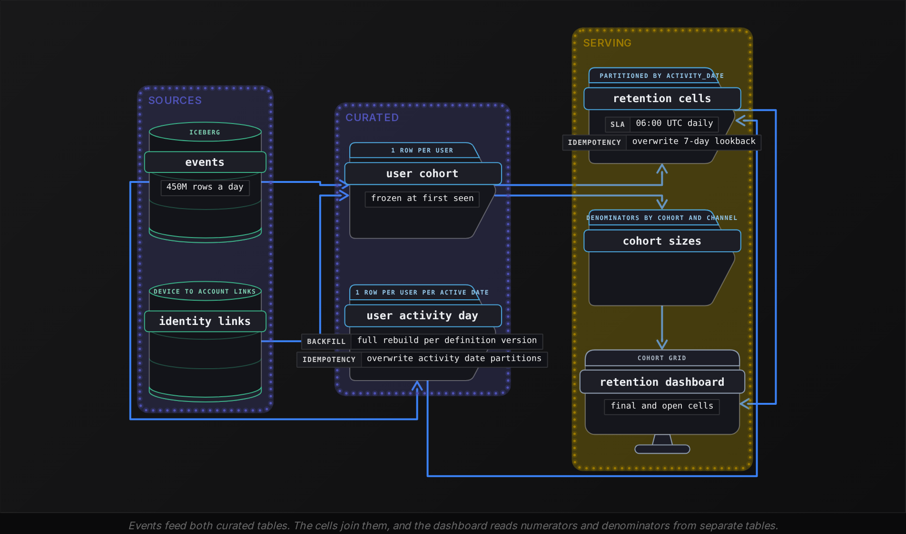

# Retention Queries: Advanced

You are 25 minutes into a data platform round at a grocery delivery company. The interviewer turns her laptop around: a cohort grid, every cell green.
"Day-7 retention went from 34 to 40 percent the week we shipped app version 5.2. Product wants it in the board deck. The query behind this grid scans 450 million events a day and takes 11 minutes. Make it right, and make it fast."
She has not said what an event is. A release can change what the app logs as easily as how people behave. Most candidates go straight to partitioning and sketches, and end up speeding up a number that may be counting background syncs as visits.
What she is testing is whether you settle what the number means before you make it cheaper, and whether you know what each shortcut costs.


<br>

### What you will be able to do

Define which events count as a return, and show how each candidate definition moves day-7 retention

Choose between exact tables, Roaring bitmaps and HLL sketches for cohort counts, and name the intersection error each carries

Size a recompute lookback from a measured lateness profile, and explain why late events reopen cells along activity dates

Design a materialized cohort pipeline with an idempotent refresh and versioned definition changes

Split a change in active users into new, retained, resurrected and churned users, and read the quick ratio


<br>

---

## Which Activity Counts as a Return

The prompt rarely asks you to define a return event. It shows up in other forms: a metric that jumped after a release, product and marketing quoting different day-7 numbers for the same week, or "retention looks great but orders are flat." Every one of these has the same first answer, which is a statement of which events count as the user coming back. The interviewer is listening for whether you ask that before you touch the query, because every later optimization inherits the definition.

Here is one daily cohort from the grocery app: the 26,000 users who signed up on 2024-03-04, scored 4 ways over the same day-7 window.

| Return event definition | Day-7 returners | Day-7 retention |
| --- | --- | --- |
| Any event in the events table | 11,960 | 46.0% |
| Any app_open, including background launches | 10,426 | 40.1% |
| Foreground, user-initiated events only | 8,944 | 34.4% |
| order_placed only | 2,860 | 11.0% |

The same users on the same day give a 35-point spread. The top row counts events nobody caused: `push_received`, `background_sync`, `token_refresh`, and server-side events like `subscription_renewed` that fire whether or not anyone opens the app. The second row explains version 5.2. The release added background prefetch, iOS launched the app silently to run it, and the analytics SDK logged every silent launch as `app_open`. The 6-point rise came from that logging change. Filtering on `is_foreground` brings the cohort back to 34.4%.


<br>

### The tiers a strong answer names

> Three tiers of coming back, plus what never counts
>
> - Presence: any foreground session. Broad and cheap, and the right base for an engagement health metric.
> - Intent: a user-initiated action such as search, browse or add-to-cart. This drops notification taps that bounce within 2 seconds.
> - Value: the action the business is paid for, here order_placed. It has the lowest rate and sits closest to revenue.
> - Never counts: system-generated events, internal and QA accounts, and anything inside the signup session itself.

The recommendation that scores has 3 parts. First, pick one primary definition and tie it to the decision it serves. Second, keep the qualifying set as data, in a return_event_types table with an effective date, instead of an `IN` list pasted into 14 dashboards. Third, treat any change to that table as a new metric version with a backfill. The follow-up is almost always *"and when product adds a new event next quarter?"*, and this is the part that answers it.


<br>

### Where the filter sits decides the number

Retention is a LEFT JOIN from the cohort to activity, and both the event-type condition and the day-7 condition belong in the ON clause. The run below uses 2 users from the 2024-03-04 cohort and an allowlist of 2 event types.

https://github.com/user-attachments/assets/1767916e-a31f-404e-9d97-c87340af65ba

Follow U1 first. An order and an app open on the same day 7 produce 2 joined rows for one user, and only COUNT(DISTINCT e.user_id) stops U1 from counting twice. U2's only day-7 event is push_received. The ON clause rejects it, so U2 survives with NULLs and stays in the denominator. An app_open on day 8 would fail the same way, on the date test instead of the type test. The cohort ends with 2 users and 1 returner, which is 50%.

> The WHERE-clause trap
>
> Move the event_type test from ON into WHERE and every cohort user without a qualifying event is removed before COUNT runs. On these 2 users, the cohort then reports 100%: U2 disappears, leaving 1 user and 1 returner. The denominator has become the returners, and no error is raised.


<br>

### Follow-ups that test whether you have run this

| Follow-up | An answer that holds |
| --- | --- |
| Does a push-notification tap count? | Only if a foreground session follows. A tap that bounces shows the notification working, and that belongs to a different metric. |
| A user browses logged out on day 7. Retained? | Not on account_id. Measure the return on the identity the cohort was assigned on, or stitch device to account first and say that you did. |
| Why not use order_placed for everything? | It reads 11.0% and hides a healthy browsing base. Publish presence and value retention side by side, each labelled with its definition. |
| Who owns the event list? | Product owns what the events mean. Data engineering owns the table and its version history, so trend lines survive the change. |

> **TIP**
>
> Quote the spread. Saying that the same cohort reads 46.0% or 11.0% depending on one IN list tells the interviewer you have defended this metric in a metrics review.


<br>

---

## Bitmap and Sketch Cohort Counts

This part of the question sounds like a performance problem: "the cohort grid takes 11 minutes, and product wants it sliced by channel, platform and region, interactively." Remove the redundancy before you approximate anything. Collapsing 450 million daily events to one row per user per active date leaves 3 million rows a day, a 150x cut, and COUNT(\*) on that grain is exact. Say this first. The interviewer is checking whether you reach for sketches because the problem needs them or because they sound advanced.

The exact table has one limit: its counts do not merge. A distinct count for day 8 and one for day 9 do not add up to week-2 returners, because the same user can appear on both days. Platform totals do not add up to a cohort total either, since a shopper active on both iOS and web counts once in each. Bitmaps and sketches store distinct-count state that can be merged, and they make opposite trades to do it.


<br>

### Roaring bitmaps: exact, and intersection is native

Give every user a dense integer, `user_idx`, assigned in signup order. Store one bitmap per cohort and one per activity date. Day-7 returners are the cardinality of cohort AND active_day, and week-2 returners are cohort AND (day 7 OR ... OR day 13). The answer is exact and every set operation is available. Because ids follow signup order, each cohort is a contiguous run, and Roaring stores a run like that in a single run container.

```sql
-- Built once per activity date
INSERT INTO active_day_bitmaps
SELECT activity_date, groupBitmapState(user_idx) AS users
FROM user_activity_day
GROUP BY activity_date;

-- Day-7 returners per cohort: one AND per cohort
SELECT
  c.cohort_date,
  bitmapCardinality(c.users)             AS cohort_users,
  bitmapAndCardinality(c.users, a.users) AS day7_returners
FROM cohort_bitmaps AS c
JOIN active_day_bitmaps AS a
  ON a.activity_date = c.cohort_date + 7;
```

Bitmaps have real costs. UUID user ids need a mapping table to dense integers, maintained at signup and rewritten when identities merge. A bitmap grows with the number of users in it, and ids scattered across a sparse space lose most of the compression. BigQuery has no native bitmap type, so on some warehouses the platform makes this decision for you.


<br>

### HLL sketches: clean unions, broken intersections

HyperLogLog estimates a distinct count from a fixed array of registers. Precision 14 gives 16,384 registers and a standard error of 1.04 divided by the square root of 16,384, about 0.81%. Union is exact at the register level because it takes a per-position max. That means daily sketches roll up to weeks, and per-platform sketches roll up to totals, with no added error. BigQuery, Snowflake, Redshift, Trino and Spark 3.5 all ship HLL functions.

- **~5MB** — Bitmap of 3M actives in a 40M id space
- **~12KB** — One HLL sketch at precision 14

```sql
-- One sketch per cohort, channel and activity date
CREATE TABLE retention_sketches AS
SELECT
  c.cohort_date,
  c.signup_channel,
  a.activity_date,
  HLL_COUNT.INIT(a.user_id, 14) AS returner_sketch
FROM user_activity_day AS a
JOIN user_cohort AS c USING (user_id)
GROUP BY 1, 2, 3;

-- Week-2 returners (days 7 to 13), merged across channels
SELECT cohort_date, HLL_COUNT.MERGE(returner_sketch) AS week2_returners
FROM retention_sketches
WHERE DATE_DIFF(activity_date, cohort_date, DAY) BETWEEN 7 AND 13
GROUP BY cohort_date;
```


<br>

### The intersection that sinks the answer

The tempting design stores one sketch per cohort and one per active day, then intersects them by inclusion-exclusion: returners = cohort + active_day - union. The error scales with the union. For the 2024-03-04 cohort the union is about 3.03 million users, so one standard error is about 24,500 users, against a true answer of 8,944. The estimate can even come back negative. If you join to the cohort first and sketch only the returners, as the query above does, the same 0.81% works out to about 72 users.

Theta sketches from Apache DataSketches support intersection and set difference directly. Their error still grows as the overlap shrinks relative to the inputs, so a 0.3% overlap is a bad query in any sketch.

| ✓ Roaring bitmaps | ✗ HLL sketches |
| --- | --- |
| • Exact counts, with AND, OR and ANDNOT available<br><br>• Need dense integer ids and a mapping table<br><br>• Size grows with the number of users stored<br><br>• Can list the users in any cell for drill-down | • About 0.81% error at precision 14, and near exact for small counts<br><br>• Work on any id type with no mapping table<br><br>• Fixed size whatever the count<br><br>• Cannot say who the users are |

> Follow-ups and the answers that hold
>
> - "A 300-user cohort shows 62% from the sketch. Trust it?" HLL is near exact at that size. The rate itself is the noisy part: plus or minus 5.5 points at 95%.
> - "List the users who churned after week 1." A bitmap answers with cohort ANDNOT active_week2. A sketch cannot, so go back to the exact table.
> - "When would you skip all of this?" When the exact query on user_activity_day returns in seconds. Sketches pay off when there are many interactive slices.


<br>

---

## Late Events Reopen Old Cohorts

This question usually arrives as an argument between 2 screenshots. "Finance pulled day-7 retention for the March 4 cohort on the morning of March 12 and got 33.9%. Today the dashboard says 34.4%. Which one is wrong?" Neither is wrong. Between those dates, 130 returners arrived late. The interviewer wants 4 things in order: the mechanism, a measured lateness profile, a recompute horizon, and a publication policy.

Most late data comes from mobile clients. The app queues events while the phone is offline and uploads them at the next foreground launch. A shopper who opened the app on the subway on March 11 therefore lands in the warehouse on March 13, with `event_ts` set to March 11 and `ingested_at` set to March 13. An incremental job that loads `WHERE event_date = yesterday` never sees that row, so the undercount becomes permanent.

> Watermark on arrival, recompute on event time
>
> Key incremental reads on ingested_at, the column that only moves forward. Then rebuild results for whatever event dates those rows carry. Pipelines that mix up the 2 columns lose late data and never raise an error.


<br>

### Which cells a late event reopens

A late event dated D, for a user who signed up on S, changes exactly one cell: cohort S at day D minus S. A batch of events from March 11 therefore reopens the March 4 cohort at day 7, the February 26 cohort at day 14, and the January 1 cohort at day 70. Late data cuts diagonally across the cohort grid, following activity dates. The unit of recompute is one activity date across every cohort, and that fact decides how the materialized table is partitioned.


<br>

### Measure the lateness before choosing a horizon

```sql
-- How late do events arrive? 30 days of ingestion
SELECT
  DATE_DIFF(
    'day',
    CAST(event_ts AS DATE),
    CAST(ingested_at AS DATE)
  ) AS days_late,
  COUNT(*) AS events
FROM events
WHERE ingested_at >= TIMESTAMP '2024-02-14 00:00:00'
  AND ingested_at < TIMESTAMP '2024-03-15 00:00:00'
GROUP BY 1
ORDER BY 1
```

| Days late | Share of events | Cumulative |
| --- | --- | --- |
| 0 | 96.80% | 96.80% |
| 1 | 2.10% | 98.90% |
| 2 to 3 | 0.62% | 99.52% |
| 4 to 7 | 0.31% | 99.83% |
| 8 to 30 | 0.14% | 99.97% |
| over 30 | 0.03% | 100.00% |

Read this table with one correction. A late event only moves retention if it is the user's only qualifying event that day, so the effect on returners is smaller than the event share. Running the same profile on `user_activity_day` rows that first appeared late gives the number that matters. Then count the lookback in activity dates, plus one: a refresh that rebuilds the last 7 dates each morning catches events up to 6 days late, because an event that lands after one morning's run falls outside the next run's window. That is slightly under the 99.83% the 4-to-7 bucket reaches, and covering 7 days late takes 8 dates. Either way the morning job costs a week of user-day rows instead of 2 years of them.


<br>

### What to publish while cells are still open

| Policy | Consumers see | Fits when | Costs |
| --- | --- | --- | --- |
| Lock at window close | A number that never moves | Late share is under 1% and quarter-over-quarter comparison matters | Undercounts by the late share, permanently |
| Rolling recompute | The current best number | Late share is material, as in product analytics | Old screenshots disagree with the live dashboard |
| Versioned snapshots | Any past version, pinned by version_id | Finance, audit and experiment readouts that must reproduce | Version lifecycle, storage, and consumers who must pin |

Most production platforms land on a hybrid, and it is worth stating as one sentence: *"Cells inside the 7-day lookback recompute daily and carry is_final = false. Once a cell's activity date passes the lookback it locks, and a monthly job rebuilds the trailing 90 days to catch the roughly 0.2% that arrives later."* Finance reads final cells only. Product reads the live grid, with open cells shaded.


<br>

### The late arrival that moves denominators

Identity stitching is the harder case. A shopper who installed in January and created an account in March has 2 first-seen dates. If the platform re-derives cohorts after stitching, that user leaves the March cohort, joins the January one, and turns 2 months of activity into January returns. Two denominators and dozens of cells change, all outside any lookback. Most teams freeze cohort membership at assignment and let stitching update activity only. State which rule you choose and what it costs: under the frozen rule, stitched users stay in their later cohort, which slightly flatters that cohort's early retention.

> **TIP**
>
> Say the columns out loud: "I read new rows by ingested_at and rebuild by event date." That sentence tells the interviewer you have debugged a pipeline that dropped late data, which is the experience this part of the question probes.


<br>

---

## Materialized Cohorts and Refresh

The 11-minute query does the same 3 things on every run. It scans 2 years of events to find each user's first-seen date, deduplicates activity down to users per day, and joins the two. Over 730 days at 450 million events a day, that is roughly 328 billion input rows for a grid of about 3.2 million cells. A materialized design stores each intermediate grain once and refreshes only what changed. The prompt often reads "the dashboard is slow and the numbers keep changing," and this design answers both halves.



| Table | Grain | Rows | Refresh |
| --- | --- | --- | --- |
| events | one per event | 450M a day | streaming append |
| user_cohort | one per user | 40M | append at signup |
| user_activity_day | one per user per active date | 3M a day | overwrite last 7 activity dates |
| retention_cells | cohort date, channel, activity date | about 3.2M (267K per channel x 12) | overwrite 7 lookback partitions |
| cohort_sizes | cohort date, channel | 8,760 (730 x 12) | rewrite on cohort corrections |

Each grain saves something specific. `user_cohort` turns a full-history MIN into a lookup. `user_activity_day` applies the return-event allowlist once, and its grain of one row per user per date makes COUNT(\*) exact. `retention_cells` holds returners per cohort, channel and activity date, so the dashboard reads at most about 3.2 million pre-aggregated rows, and under 300,000 once it filters to one channel, instead of scanning raw events. Rates are never stored. A stored 34.4% cannot be combined with another channel's rate, while 8,944 returners over 26,000 users can be summed with anything.

Denominators get their own table for a reason. Under the frozen-cohort rule, `cohort_sizes` only grows at signup. Bots and QA accounts, though, are often flagged weeks later. Removing one then rewrites a single `cohort_sizes` row and the few cells that user's activity touched, leaving the rest of the grid alone.


<br>

### The refresh: overwrite the lookback, idempotently

Late events reopen whole activity dates, so `retention_cells` is partitioned by `activity_date` and not by `cohort_date`. The daily refresh then rewrites the 7 partitions late data can still reach, covering every cohort at once, and leaves the other 723 untouched.

```sql
-- Daily refresh on 2024-03-15: rebuild the lookback partitions
DELETE FROM retention_cells
WHERE activity_date >= DATE '2024-03-08';

INSERT INTO retention_cells
SELECT
  c.cohort_date,
  c.signup_channel,
  a.activity_date,
  COUNT(*) AS returners  -- exact: one row per user per date
FROM user_activity_day AS a
JOIN user_cohort AS c
  ON c.user_id = a.user_id
WHERE a.activity_date >= DATE '2024-03-08'
  AND a.activity_date > c.cohort_date
GROUP BY c.cohort_date, c.signup_channel, a.activity_date;
```

The follow-up that tests this is: "The job died after the INSERT and the orchestrator retried. What is in the table?" With the delete and insert in one transaction, the retry rebuilds the same partitions and leaves the same table. With a bare INSERT INTO, or a MERGE that adds new returners to existing counts, every retry doubles the open cells. The dashboard then shows a retention spike across the last 7 days that nobody can explain.

The cells carry one more column for the dashboard: `is_final`, which turns true once the activity date is older than the lookback. Open cells render shaded, so a March 14 cell reading 31% on March 15 looks provisional and is not mistaken for a collapse in retention.


<br>

### What freshness actually demands

| ✓ Nightly full rebuild | ✗ Incremental with lookback |
| --- | --- |
| • Always matches the current definition, with no lookback logic<br><br>• Cost grows every day: all 2.2 billion user-day rows, plus each new day<br><br>• Catches late events of any age<br><br>• Reasonable while user_activity_day stays under about 100 million rows | • Flat cost of about 21 million user-day rows a day<br><br>• Needs a lookback tuned to the lateness profile<br><br>• Events older than the lookback wait for a periodic rebuild<br><br>• A definition change still forces a full backfill |

The last item is the expensive operation the interviewer is fishing for. Adding `wishlist_add` to `return_event_types` changes every `user_activity_day` row since launch, so it ships as a new version. Build `retention_cells_v4` beside v3 from a full scan, compare the 2 grids on a sample of cohorts, and announce the cutover with a migration window. Keep v3 readable for a year so that last year's board deck still reproduces.

> **TIP**
>
> Mention partition pruning by name. The lookback is cheap only because the refresh filters on the partition column, activity_date. A refresh that filters on cohort_date scans every partition even though it writes only 7.


<br>

---

## Growth Accounting for Active Users

Cohort retention explains one cohort at a time. The topline question usually arrives without the word retention in it: "MAU grew 200,000 last month, is the business healthy?" or "signups doubled and DAU is flat, where did the users go?" Growth accounting answers both. It gives every user who was active in the current or previous period exactly one state, so the change in active users breaks down into flows that add up.

> Four states, one per user per period
>
> - New: active this month for the first time. This is the cohort month.
> - Retained: active this month and last month.
> - Resurrected: active this month, inactive last month, and active in some month before that.
> - Churned: active last month and inactive this month, counted against this month.

The states obey 2 identities the interviewer will ask you to check: MAU(t) = MAU(t-1) + new + resurrected - churned and retained = MAU(t-1) - churned. If a query's output breaks either one, the query has a bug, so the identities work as a free test on every run.

The core move is a window over each user's own months. LAG finds the previous month in which the user was active, and the size of the gap names the state: 1 is retained, more than 1 is resurrected, and COALESCE turns a missing previous month into a gap of 0, which reads as new. The run below uses 2 users across months 1 to 3, where `month_idx` counts months from January 2024.

https://github.com/user-attachments/assets/a6035a72-f108-47ca-9206-fc1422f49547

U1 runs new, retained, retained. U2 is new in month 1 and has no row in month 2. Its month 3 lags back to month 1, a gap of 2, so it is resurrected. Say this point out loud: U2's churn in month 2 lives in a row that does not exist, and no LAG can label an absence. Churn has to come from the other direction, through a LEAD that finds no next month, charged to the month after.

```sql
WITH states AS (
  SELECT
    user_id,
    month_idx,
    LAG(month_idx, 1) OVER (
      PARTITION BY user_id
      ORDER BY month_idx
    ) AS prev_month,
    LEAD(month_idx, 1) OVER (
      PARTITION BY user_id
      ORDER BY month_idx
    ) AS next_month
  FROM user_months
),
gains AS (
  SELECT
    month_idx,
    COUNT(
      CASE
        WHEN prev_month IS NULL THEN 1
      END
    ) AS new_users,
    COUNT(
      CASE
        WHEN prev_month = month_idx - 1 THEN 1
      END
    ) AS retained,
    COUNT(
      CASE
        WHEN prev_month < month_idx - 1 THEN 1
      END
    ) AS resurrected
  FROM states
  GROUP BY month_idx
),
losses AS (
  SELECT
    month_idx + 1 AS month_idx,
    COUNT(*) AS churned
  FROM states
  WHERE next_month IS NULL
    OR next_month > month_idx + 1
  GROUP BY month_idx + 1
)

SELECT
  g.month_idx,
  g.new_users + g.retained + g.resurrected AS mau,
  g.new_users,
  g.retained,
  g.resurrected,
  COALESCE(l.churned, 0) AS churned
FROM gains AS g
LEFT JOIN losses AS l
  ON l.month_idx = g.month_idx
```

| Month | MAU | New | Retained | Resurrected | Churned |
| --- | --- | --- | --- | --- | --- |
| 1 | 2 | 2 | 0 | 0 | 0 |
| 2 | 1 | 0 | 1 | 0 | 1 |
| 3 | 2 | 0 | 1 | 1 | 0 |

Month 2 checks out: 2 + 0 + 0 - 1 = 1, and month 3 does too: 1 + 0 + 1 - 0 = 2. Now apply this to the grocery app's March. February closed at 12.00 million monthly actives. March added 0.78 million new users (the 180,000 weekly signups) and 0.95 million resurrected ones, and lost 1.53 million to churn. That leaves 10.47 million retained and 12.20 million active. The headline is +200,000, but the breakdown shows the app replaced 1.53 million departures mostly by winning back people it had already lost.

- **1.13** — March quick ratio

The quick ratio is (new + resurrected) / churned. Social Capital introduced it for revenue and called 4 strong for early-stage SaaS. A mature consumer app sits far lower, so the trend matters more than the threshold. Close to 1, growth is a treadmill: each month's gains go to replacing that month's losses.


<br>

### Where growth accounting goes wrong

> The judgement calls behind the states
>
> - The period must match usage cadence. Grocery shoppers often order every 5 weeks, so monthly states overstate both churn and resurrection.
> - States inherit the return definition. In the 5.2 month, silent background launches showed up as a jump in resurrected users.
> - Late events flip last month's churned users to retained. Lock a month's states only after its lookback closes.
> - HLL sketches cannot produce states, because retained is an intersection. Bitmaps can, with AND and ANDNOT, and so can the exact table.

Duolingo published a version of this model in 2023 with finer states, including reactivated and at-risk users. It found that current-user retention moved daily actives more than acquisition did. That is the kind of conclusion a growth accounting table exists to support, and it is the one to name when the interviewer asks what you would do with the output.

| ✓ Do | ✗ Don't |
| --- | --- |
| • Name the return-event set, kept in a versioned table, before tuning the query<br><br>• Build sketches after the cohort join, never by intersecting 2 sketches<br><br>• Read new rows by ingested_at and recompute a lookback of activity dates<br><br>• Store returners and cohort sizes as counts, and overwrite partitions so a retry is a no-op<br><br>• Check each month's states against MAU(t) = MAU(t-1) + new + resurrected - churned | • Don't count push_received, background_sync or server-side renewals as a return<br><br>• Don't put the event-type filter in WHERE after a LEFT JOIN from the cohort<br><br>• Don't watermark on event time, which skips every event that arrives late<br><br>• Don't append cells without deleting first, which doubles them on every retry<br><br>• Don't report net MAU growth without the churn and resurrection beneath it |


<br>

---

## Putting It All Together

A meal-kit subscription company heads into its quarterly business review with 3 conflicting stories. The growth team says the new skip-a-week feature raised week-4 retention by 5 points. Finance's locked numbers for the same cohorts are 2 points lower than the live dashboard. And the CEO wants to know why monthly actives are up 4% while boxes shipped are flat. The data platform team has 2 days to produce one answer that every team accepts.

- The skip-a-week action writes a server-side week_skipped event that the return-event table counts, so the first step is a versioned definition that drops it and a rebuild of the grid beside the old one.
- Regional slices for the review come from HLL sketches built after the cohort join, and the list of subscribers who churned after week 1 comes from the exact user_activity_day table, which a sketch cannot provide.
- The gap between finance and the dashboard is late data: finance reads cells that locked at window close, while the live grid has picked up events from delivery-app users who synced days later, and the is_final flag explains the difference.
- The refresh that rebuilds the corrected grid overwrites activity_date partitions in one transaction, so the 2 reruns the deadline forces leave the same table each time.
- Growth accounting resolves the CEO's question: most of the 4% comes from resurrected subscribers whom skip reminders bring back to browse without ordering. The activity-based quick ratio looks healthy on those browsing resurrections while order-based value retention stays flat, and the gap between the 2 explains why actives rose and boxes did not.


<br>

---

## Key Takeaways

- Settle which events count as a return before optimizing: one IN list moved the same cohort's day-7 retention anywhere from 11.0% to 46.0%.
- Bitmaps give exact counts and native intersections, and HLL gives fixed-size unions. Sketch returners after the cohort join, never by intersecting sketches.
- Late events reopen cells along activity dates in every cohort. Read new rows by ingested_at and recompute a lookback sized from the lateness profile.
- Partition cells by activity_date, store counts instead of rates, overwrite partitions atomically, and ship definition changes as versioned backfills.
- Growth accounting splits active users into new, retained, resurrected and churned. The MAU identity tests the query, and churn needs LEAD.
