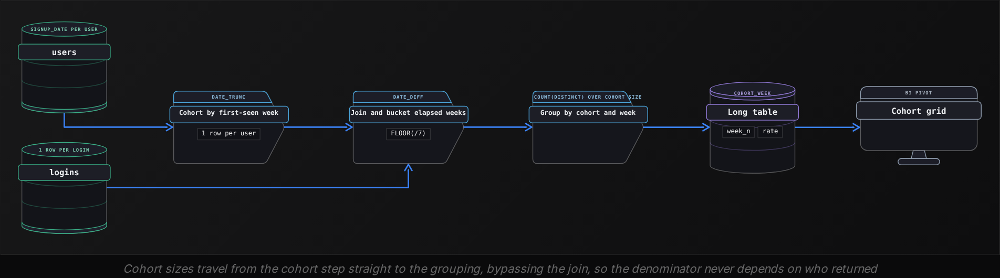

# Retention Queries: Beginner

You are 20 minutes into a SQL screen at a fitness app. The interviewer shares 2 tables: `users` with `user_id` and `signup_date`, and `logins` with `user_id` and `login_date`.
"Of the people who signed up in January, how many came back?"
She stops there. Nobody has said when a user has to log in for it to count as coming back: the next day, a week later, any time at all. Nobody has said whether January is 1 group or 31 of them. The move most candidates make is a `COUNT(DISTINCT user_id)` over `logins` with a January date filter, a figure that answers no version of the question because it never ties a login to the day that user started.
What she is listening for is the word cohort before any SQL appears, and a clear sentence about what the denominator is.


<br>

### What you will be able to do

Recognize a question about who came back as a retention question and name its cohort, return event and window before writing SQL

Build a cohort by first-seen date that places each user in exactly 1 cohort, from a signup column or from the earliest activity row

Write the 2-CTE query that divides distinct returners by cohort size and returns the counts beside the rate

Count day N from signup day 0 and bucket week N as a 7-day span from each user's own start

Sketch the cohort grid and state the long-form grain a retention query produces


<br>

---

## "Came Back" Means Retention

The question arrives wearing the vocabulary of whoever is asking it. A product manager asks how many new users stuck around; a finance analyst, how many of the accounts that onboarded last quarter are still with us; a growth lead, what day-7 looks like this month. A game studio says D1, D7, D30 as though they were 1 word. Each of these is the same question, and the interviewer who picks 1 of them is checking whether you hear the same shape underneath all of them.

- "How many of the users who joined in January are still active?"
- "What is our day-7 retention for the new onboarding flow?"
- "Did the people who signed up last week come back this week?"
- "Our churn is up, can you show me where users are dropping off?"
- "Give me D1, D7 and D30 for the March cohort."


<br>

### A return is measured from a start

A return has no meaning until you know when that user first arrived. The same login on 2024-01-08 is a day-7 return for a user who signed up on 2024-01-01 and a day-3 return for a user who signed up on 2024-01-05. The moment the question needs each user's own start date, it is a cohort question: the users are grouped by when they started, and every later event is measured as elapsed time from that start. That requirement is what separates who came back from who was active. An active-user count has 1 date filter and no memory of where any user began; a retention rate carries the start date of every user in the denominator.

| ✓ Active user count | ✗ Retention rate |
| --- | --- |
| • 1 table, 1 date filter, 1 COUNT(DISTINCT)<br><br>• Includes a user who joined in 2022 and never left<br><br>• No denominator, so no rate<br><br>• Answers how many people used the product in a period | • A cohort fixed by start date, then activity joined to it<br><br>• Only users who started in the cohort window are counted<br><br>• Returners divided by everyone who started<br><br>• Answers how many of the people who started kept using it |


<br>

### The first wrong move

The query most candidates reach for first is a distinct count over the activity table with the January filter on the login date. Against a real table it returns a number such as 3,100, which is the count of users who logged in during January. That figure includes the 2022 signups who log in every morning and excludes the January 30 signup whose first return came on February 3. It divides nothing by anything, so there's no rate, and the interviewer now knows the candidate heard a question about activity where a question about returns was asked.

```sql
-- Users active in January, which is a different question
SELECT
  COUNT(DISTINCT user_id) AS came_back
FROM logins
WHERE login_date >= '2024-01-01'
  AND login_date < '2024-02-01'
```


<br>

### The 3 parts of every retention question

Every retention question has 3 parts, and an answer that names them before writing SQL has already shown the interviewer the shape of the query. The cohort is the set of users who started in a window, defined by a first event such as a signup or a first purchase. The return event is the activity that counts as coming back, usually a login, sometimes a purchase or a session. The window is how long after the start the return event has to fall: on day 7, somewhere in week 1, any time in the first 30 days. Change any 1 of the 3 and the number changes, which is why 3 candidates given the same tables hand back 3 different rates and the interviewer asks each of them which parts they chose.

> The sentence to say before any SQL
>
> - Cohort: users whose signup_date falls in January 2024, from the users table, 1 row per user
> - Return event: a row in logins for that user
> - Window: the login falls exactly 7 days after that user's signup_date
> - Rate: distinct returners divided by the cohort's row count
> - Output: cohort size, retained count and the rate, side by side

Saying the 3 parts also surfaces what the question left open. The interviewer who asked how many came back has not told you the window, and the candidate who asks for it looks like someone who has argued about a dashboard definition before. The candidate who picks a window silently and writes the query looks like someone who will ship the wrong number and find out in a meeting. Both candidates can write the SQL; the question is scored on which one asked.


<br>

---

## Cohorts by First-Seen Date

The running example through this lesson is 3 users: user 1 joined on 2024-01-01, user 2 on 2024-01-05 and user 3 on 2024-01-10. A cohort is a group of users who started in the same period, set by the date each user was first seen, and the rule that makes the arithmetic work is that a user belongs to exactly 1 cohort. The first-seen date exists once per user and never changes, so user 2 is a January 5 user however many times they log in afterward. Every denominator in this lesson rests on that rule, because a user counted in 2 cohorts is a user counted twice.


<br>

### When the start date is a column

The kinder version of the question hands you a `users` table with a `signup_date` column. The cohort is then a filter on that column, and the result has a grain of 1 row per user, which is the grain a denominator needs. Write the window as a half-open range, greater than or equal to the first day and strictly less than the first day of the next month. `BETWEEN '2024-01-01' AND '2024-01-31'` looks equivalent and drops every signup after midnight on January 31 if the column is ever a timestamp, and that's a detail interviewers notice because the dashboards they have debugged were wrong for exactly that reason.

```sql
WITH cohort AS (
  SELECT
    user_id,
    signup_date
  FROM users
  WHERE signup_date >= '2024-01-01'
    AND signup_date < '2024-02-01'
)

SELECT
  COUNT(*) AS cohort_size
FROM cohort
```


<br>

### When the start date has to be derived

The other version hands you only the activity: a `logins` or `events` table with a user and a date on every row and no signup table anywhere. The first-seen date is then the earliest activity date per user, which is `MIN(login_date)` with `GROUP BY user_id`. The `GROUP BY` is what guarantees the 1-cohort-per-user rule: 1 group per user, 1 minimum per group, 1 cohort date per user. Say the phrase first seen while writing it, because the interviewer is listening for it.

```sql
WITH first_seen AS (
  SELECT
    user_id,
    MIN(login_date) AS first_login_date
  FROM logins
  GROUP BY user_id
)

SELECT
  user_id,
  first_login_date
FROM first_seen
WHERE first_login_date >= '2024-01-01'
  AND first_login_date < '2024-02-01'
```

> Activity in a month is not a cohort
>
> - Filtering logins to January and taking DISTINCT user_id gives users active in January
> - That set includes long-time users, whose returns then get measured from the wrong date
> - The filter belongs on MIN(login_date) after the GROUP BY, never on login_date before it
> - The order of the 2 steps is the difference between a cohort and an active-user list


<br>

### Day, week or month cohorts

The first-seen date can stay at day grain or roll up with `DATE_TRUNC` to the week or the month, and the choice decides how many cohorts the answer has. The 3 users form 3 daily cohorts, 2 weekly cohorts of sizes 2 and 1, and 1 monthly cohort. Whatever the grain, each user lands in 1 cell, because truncation is a function of the single first-seen date.

| user_id | signup_date | daily cohort | weekly cohort | monthly cohort |
| --- | --- | --- | --- | --- |
| 1 | 2024-01-01 | 2024-01-01 | 2024-01-01 | 2024-01 |
| 2 | 2024-01-05 | 2024-01-05 | 2024-01-01 | 2024-01 |
| 3 | 2024-01-10 | 2024-01-10 | 2024-01-08 | 2024-01 |

```sql
SELECT
  user_id,
  signup_date,
  DATE_TRUNC('week', signup_date) AS cohort_week,
  DATE_TRUNC('month', signup_date) AS cohort_month
FROM users
```

> **TIP**
>
> The word is first-seen, never seen: a user seen on January 3 and again on January 20 belongs to 1 cohort. If the interviewer says cohort of users active in January, ask whether they mean first active in January.

The interview move for this section is 1 sentence spoken before the CTE: cohort by signup week from the `users` table, or cohort by first login date derived from `logins` with a `MIN` and a `GROUP BY`. It names the source, the grain and the derivation, so the interviewer knows the denominator will be right before seeing a line of it. The usual follow-up takes the `users` table away and asks for the same number from events alone, and the answer is the `first_seen` CTE above with the filter on its minimum.


<br>

---

## Returners Divided by Cohort Size

A retention rate is a fraction whose 2 parts are counts of distinct users. The denominator is every user who started in the cohort, whether they ever came back. The numerator is the subset of those users who performed the return event in the window. The cohort is fixed first, from start dates alone, and the returners are found inside it afterward.


<br>

### The query to write from memory

```sql
WITH cohort AS (
  SELECT
    user_id,
    signup_date
  FROM users
  WHERE signup_date >= '2024-01-01'
    AND signup_date < '2024-02-01'
),
day_7_return AS (
  SELECT DISTINCT
    c.user_id
  FROM cohort AS c
  JOIN logins AS l
    ON l.user_id = c.user_id
      AND l.login_date = c.signup_date + INTERVAL '7 days'
)

SELECT
  COUNT(*) AS cohort_size,
  (
    SELECT
      COUNT(*)
    FROM day_7_return
  ) AS retained_count,
  (
    SELECT
      COUNT(*)
    FROM day_7_return
  ) * 1.0 / NULLIF(COUNT(*), 0) AS day_7_retention_rate
FROM cohort
```

The `cohort` CTE is the denominator population at 1 row per user. The `day_7_return` CTE joins each cohort user to `logins` on 2 conditions: the user matches, and the login date equals that user's signup date plus 7 days. The final `SELECT` counts the cohort, counts the returners with a scalar subquery and divides, multiplying by `1.0` first so integer division does not round the rate down to 0. Each CTE runs on its own, which is how you check a set in the room when a number looks wrong.


<br>

### Watching the join find the returners

Run the join over the 3 users. For user 1, day 7 is 2024-01-08, and `logins` holds 2 rows for user 1 on that date, ids 102 and 103, so user 1 appears twice before `DISTINCT` and once after it. User 2 needed a login on 2024-01-12, but their only login is on 2024-01-13, 1 day late: the equality fails and user 2 contributes nothing to the return set. Login 105 falls on 2024-01-17, user 3's day 7, and matches. The return set is users 1 and 3.

https://github.com/user-attachments/assets/4ce3871b-fa36-4f7e-9529-fe49d7567e5a

| cohort_size | retained_count | day_7_retention_rate |
| --- | --- | --- |
| 3 | 2 | 0.6667 |

Cohort size 3, retained 2, rate 66.7%. Say it as the join tells me who returned and the cohort tells me who could have. User 2 is the row the whole lesson turns on: present in the denominator, absent from the numerator. If the denominator were taken from the `day_7_return` join instead of the `cohort` CTE, user 2 would vanish from both counts and the rate would read 2 of 2, 100%, for a cohort where 1 of 3 users missed their day 7.


<br>

### DISTINCT and NULLIF

`DISTINCT` makes the numerator a count of users rather than a count of logins. Without it, user 1's 2 logins on day 7 give a retained count of 3 against a cohort of 3, which reports 100% from a cohort where 2 of 3 users returned. Say the reason out loud: a user who logs in 5 times on day 7 came back once. `NULLIF(COUNT(*), 0)` turns an empty cohort into a NULL rate instead of a division error, which matters once the query runs for every cohort date, including dates on which nobody signed up.


<br>

### Show the counts beside the rate

| ✓ Rate alone | ✗ Rate with both counts |
| --- | --- |
| • SELECT day_7_retention_rate FROM ...<br><br>• A reader can't recompute it or see the cohort size<br><br>• A cohort of 4 produces a rate that looks as real as a cohort of 100,000<br><br>• A bug in either count is invisible until someone reconciles | • SELECT cohort_size, retained_count, day_7_retention_rate<br><br>• A reader divides the 2 counts and checks the rate in their head<br><br>• A small cohort shows up as a small denominator<br><br>• A wrong count surfaces as a ratio that doesn't match |

A rate without its counts hides how much it is worth. For the users who signed up in the week of January 1 to 7, 2024, the cohort is 1,000 users and 250 of them logged in on day 7, so day-7 retention is 25%. Reported as 250 of 1,000, a reader can recompute it, and a reader looking at another week with 3 of 12 can tell that its 25% means almost nothing. Returning `cohort_size`, `retained_count` and the rate together is the output shape the interviewer reads as production experience.


<br>

### Dividing by everyone who logged in

The common wrong denominator is the set of users who logged in at all. In the week-of-January-1 cohort, 625 of the 1,000 users logged in at least once after signing up. Dividing 250 by 625 gives 40%: the 375 users who never returned never pass a join to `logins`, so a cohort derived from that join never contains them. That's retention among people who came back, which answers a question nobody asked. The denominator is the `cohort` CTE's row count, taken before any join, and nothing in the join is allowed to shrink it. When the interviewer asks why the cohort is a CTE of its own rather than a filter inside the join, the answer is that the denominator has to exist before the numerator can be found inside it.


<br>

---

## Day-N and Week-N Retention Basics

Day N retention asks 1 question per user: did this user perform the return event exactly N days after their start. The counting begins on the signup day, which is day 0, so day 1 is the calendar day after signup and day 7 is a full week later. The off-by-one that follows from this is the most frequent slip in the room: a candidate who counts the signup day as day 1 reports day-7 retention from logins that happened 6 days after signup, and the figure disagrees with the dashboard the interviewer compares it to.

| user_id | signup_date (day 0) | day 1 | day 7 | day 30 |
| --- | --- | --- | --- | --- |
| 1 | 2024-01-01 | 2024-01-02 | 2024-01-08 | 2024-01-31 |
| 2 | 2024-01-05 | 2024-01-06 | 2024-01-12 | 2024-02-04 |
| 3 | 2024-01-10 | 2024-01-11 | 2024-01-17 | 2024-02-09 |


<br>

### Counting N with DATE_DIFF

A fixed `+ INTERVAL '7 days'` in the join answers 1 value of N. The general form computes the elapsed days for every login and then filters, which is how the same join serves day 1, day 7 and day 30 without being rewritten each time. `DATE_DIFF('day', c.signup_date, l.login_date)` takes the start first and the later date second, so the result is positive for any login after signup and 0 for a login on the signup day itself. Name the argument order as you write it, because a reversed `DATE_DIFF` returns negative numbers, the `= 7` filter matches nothing, and the rate reads 0% with no error to point at.

```sql
SELECT
  c.user_id,
  l.login_id,
  l.login_date,
  DATE_DIFF('day', c.signup_date, l.login_date) AS day_n
FROM cohort AS c
JOIN logins AS l
  ON l.user_id = c.user_id
ORDER BY c.user_id, l.login_date
```

| user_id | login_id | login_date | day_n |
| --- | --- | --- | --- |
| 1 | 102 | 2024-01-08 | 7 |
| 1 | 103 | 2024-01-08 | 7 |
| 2 | 104 | 2024-01-13 | 8 |
| 3 | 105 | 2024-01-17 | 7 |

A filter of `day_n = 7` keeps users 1 and 3, the same 2 of 3 the fixed interval found in the previous section. A filter of `day_n = 1` keeps nobody, so day-1 retention for these 3 users is 0 of 3, a legitimate answer to report as it stands, without apologizing. A rate of 0 from a correct query is a finding; a rate of 0 from a reversed `DATE_DIFF` is a bug, and the `day_n` column is how you tell them apart in the room.


<br>

### Week N is a 7-day bucket from signup

Week N retention widens the question from a day to a span: did the user perform the return event on any day from day 7N through day 7N + 6. Week 0 is days 0 to 6 and contains the signup itself, so it's usually left out; week 1 is days 7 to 13; week 4 is days 28 to 34. Weeks count from each user's own signup, so 2 users in one cohort who started on different days have week-1 windows on different calendar dates. The bucket is `FLOOR(day_n / 7)`, written with a floor so that a dialect which keeps decimals and one which truncates integers give the same bucket. Any login in the bucket retains the user, and `DISTINCT` collapses several logins in one week to 1.

```sql
-- Week-1 returners: any login on days 7 through 13 after signup
SELECT DISTINCT
  c.user_id
FROM cohort AS c
JOIN logins AS l
  ON l.user_id = c.user_id
WHERE FLOOR(DATE_DIFF('day', c.signup_date, l.login_date) / 7) = 1
```

The widening changes the running example. User 2's login lands on day 8, 1 day outside the day-7 equality and inside the week-1 bucket, so week-1 retention is 3 of 3 where day-7 retention was 2 of 3. At scale the same effect is routine. The week-of-January-1 cohort of 1,000 has 250 users logging in on day 7 and 420 users logging in somewhere in days 7 to 13, so day 7 reads 25% and week 1 reads 42% from the same 2 tables, and both numbers are correct for the question they answer.


<br>

### Ask which one before writing

Because the 2 definitions diverge this much, the phrase day-7 retention is worth 1 clarifying question: exactly day 7, or any day in the first week after signup? Most product teams run the exact-day version on the headline dashboard and the weekly version in cohort grids, and the interviewer has 1 of them in mind. If the answer is whichever you prefer, pick the exact-day version, say it is the stricter of the 2, and say the week version is the same query with a bucket in place of the equality. Naming the choice is scored; defaulting silently and producing a number 1.7x off the expected one is scored too, in the other direction.

| ✓ Day N | ✗ Week N |
| --- | --- |
| • Return event on exactly day N after signup, day 0 being the signup day<br><br>• Join or filter on day_n = N, 1 calendar date per user<br><br>• Lower figure; a user active on days 6 and 8 doesn't count for day 7<br><br>• The headline D1, D7, D30 numbers | • Return event on any of days 7N through 7N + 6<br><br>• Filter on FLOOR(day_n / 7) = N, a 7-day range per user<br><br>• Higher figure; any login in the span retains the user<br><br>• The columns of a cohort grid |

> **TIP**
>
> If the interviewer says day-1 retention, confirm that day 1 is the calendar day after signup. Some teams count the signup day as day 1, and the only way to find out is to ask; a wrong guess here shifts every column of the answer by a day.


<br>

---

## Sketching the Cohort Grid

The finished product of a retention query is a grid, and drawing it before writing any SQL tells the interviewer what you're about to build. The rows are cohorts, the columns are elapsed periods counted from each cohort's start, and each cell holds the retention rate for that cohort at that age. Reading down a column compares every cohort at the same age, which is how a product team sees whether a change shipped in mid-January made new users stick better than the users who arrived before it.

| cohort (signup week) | size | week 1 | week 2 | week 3 | week 4 |
| --- | --- | --- | --- | --- | --- |
| Jan 1 to 7 | 1,000 | 42% | 31% | 25% | 21% |
| Jan 8 to 14 | 1,200 | 40% | 29% | 24% |  |
| Jan 15 to 21 | 900 | 44% | 33% |  |  |
| Jan 22 to 28 | 1,100 | 39% |  |  |  |


<br>

### Reading the grid

Along the first row, the January 1 cohort decays from 42% in week 1 to 21% in week 4, the curve most consumer products show: a steep early drop, then a flattening toward the users who have made the product a habit. Down the week-1 column, January 15 retains 44% against 39% for January 22, a fair comparison because both cells measure the same age. The blank cells are weeks that hadn't yet finished for every user in the cohort on 2024-02-12, when the grid was drawn. A week finished for only part of a cohort reads lower than it will end up, so a blank is more honest than a number.


<br>

### The grid in long form

The grid is a pivot. What the query produces is the long form: 1 row per cohort and elapsed period, carrying the cohort size, the count of distinct returners and their ratio. The grain is the pair of `cohort_week` and `week_n`, and naming it first sets the `GROUP BY`, because every result column is 1 of the 2 keys or an aggregate over them. Pivoting into side-by-side columns is the BI tool's job; in an interview the long table is the answer.

```sql
WITH cohort AS (
  SELECT
    user_id,
    signup_date,
    DATE_TRUNC('week', signup_date) AS cohort_week
  FROM users
  WHERE signup_date >= '2024-01-01'
    AND signup_date < '2024-02-01'
),
cohort_size AS (
  SELECT
    cohort_week,
    COUNT(*) AS cohort_users
  FROM cohort
  GROUP BY cohort_week
),
returns AS (
  SELECT
    c.cohort_week,
    FLOOR(DATE_DIFF('day', c.signup_date, l.login_date) / 7) AS week_n,
    c.user_id
  FROM cohort AS c
  JOIN logins AS l
    ON l.user_id = c.user_id
  WHERE l.login_date > c.signup_date
)

SELECT
  r.cohort_week,
  r.week_n,
  s.cohort_users,
  COUNT(DISTINCT r.user_id) AS returners,
  COUNT(DISTINCT r.user_id) * 1.0 / s.cohort_users AS retention_rate
FROM returns AS r
JOIN cohort_size AS s
  ON s.cohort_week = r.cohort_week
GROUP BY r.cohort_week, r.week_n, s.cohort_users
ORDER BY r.cohort_week, r.week_n
```

Trace it over the 3 users. The `cohort` CTE puts users 1 and 2 in the week of 2024-01-01 and user 3 in the week of 2024-01-08, so `cohort_size` holds sizes 2 and 1. Every login here lands on day 7 or 8, which is week 1, and the `WHERE` drops any login on the signup day itself. The `GROUP BY` folds the 4 login rows into 2 result rows, and `COUNT(DISTINCT)` counts user 1's pair of logins once. Week 2 has no row for either cohort, though both weeks have long finished. The query starts from `returns`, so a cohort and week with no returners produces no row at all, and a pivot shows that 0% as a blank, the same as a week not yet reached. A complete grid crosses `cohort_size` with the week numbers, left-joins `returns` to that, and lets `COUNT(DISTINCT r.user_id)` return 0 where nothing matched.

| cohort_week | week_n | cohort_users | returners | retention_rate |
| --- | --- | --- | --- | --- |
| 2024-01-01 | 1 | 2 | 2 | 1.0000 |
| 2024-01-08 | 1 | 1 | 1 | 1.0000 |




<br>

### Sketch before you type

On the whiteboard, draw 2 rows and 3 columns, label the rows with cohort weeks and the columns week 1 to week 3, and write a size beside each row. Then say what fills a cell: distinct users from this row with a login in this column's day range, divided by this row's size. Each piece maps to a clause: the row label is the cohort CTE, the column is the week bucket, the cell count is `COUNT(DISTINCT user_id)` grouped by both, and the denominator is the join back to cohort size. With both axes drawn, the `GROUP BY` follows from the sketch, and the interviewer knows the grain is right before a line of the query exists.

| ✓ Do | ✗ Don't |
| --- | --- |
| • Say cohort, return event and window out loud before the first keyword<br><br>• Fix the cohort at 1 row per user, from signup_date or MIN(event_date) with GROUP BY<br><br>• Count day N from signup day 0 and confirm that convention with the interviewer<br><br>• Return cohort size and retained count beside every rate<br><br>• Draw the grid, then write the long-form query with its 2-key grain | • Count distinct users in a calendar window and call it retention<br><br>• Filter the activity table to the cohort month before taking the first-seen minimum<br><br>• Let the join decide the denominator, which drops every user who never returned<br><br>• Forget DISTINCT and count logins where the question asked about users<br><br>• Fill a grid cell for a week that has not finished for the whole cohort |


<br>

---

## Putting It All Together

A language-learning app shipped a redesigned onboarding on 2024-01-15 and the growth lead asks whether the users who signed up after the change are coming back more than the ones before it. The data engineer builds weekly signup cohorts from the users table, joins each cohort to the lessons_completed events, buckets each event into weeks from the user's own signup, and delivers a long table of cohort week, elapsed week, cohort size, returners and rate, which the BI tool pivots into a grid where the January 15 and January 22 cohorts can be read against January 1 and January 8 at the same age.

- The growth lead's phrase coming back more is the retention question in its product disguise, and the first thing the engineer does is state the cohort, the return event and the window
- Signup week from the users table gives each learner exactly 1 cohort, so a learner who completed lessons in 3 different weeks still counts once in the denominator of 1 row
- The cohort sizes are counted before the join to events, so learners who never completed a lesson after signup stay in the denominator and the rates stay honest
- Weeks are bucketed from each learner's own signup date, which is why the week-1 column compares cohorts at the same age even though their calendar dates differ
- The grid drawn on the whiteboard before writing SQL is what fixed the GROUP BY at cohort week and elapsed week, and the blank cells on the right are weeks the newest cohort hasn't yet reached


<br>

---

## Key Takeaways

- A question about who came back needs each user's start date, which makes it a cohort question and never an active-user count
- A cohort is set by the first-seen date, so each user belongs to exactly 1 cohort, from a signup column or MIN(event_date) with GROUP BY
- Retention is distinct returners divided by everyone who started, with the denominator fixed before the join and the counts shown beside the rate
- Day N is exactly N days after signup day 0; week N is days 7N through 7N + 6 from each user's own start, and the 2 figures diverge
- The deliverable is a grid of cohorts against elapsed periods, produced as a long table at the grain of cohort and period
