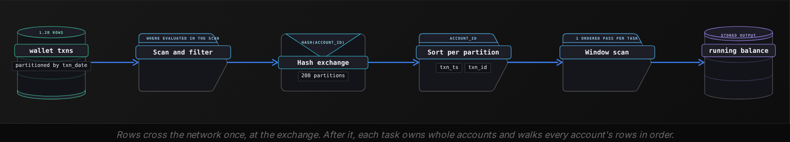
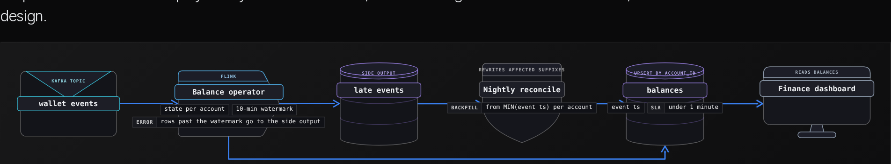

# Running Totals: Advanced

You are 20 minutes into a data modelling round at a payments company. The interviewer pastes a schema, `wallet_txns(account_id, txn_id, txn_ts, txn_date, amount)`, and adds that it holds 1.2 billion rows, 300 million of them from a single merchant settlement account.
"Finance wants each wallet's balance after every transaction, on a dashboard. Wallets can't go negative: if someone withdraws more than they hold, they get what's there."
Your hand is already writing `SUM(amount) OVER`. That second sentence is the trap, because a clipped withdrawal makes each balance depend on the path, and no window sum reproduces a path. She has also left 3 things unsaid: how fresh the dashboard must be, what happens when a payment posts hours late, and whether finance needs every row or only today's number.
She is testing whether you hear the design questions inside a one-line query.


<br>

### What you will be able to do

Explain why a running total held to a floor or cap depends on its path, and compute the floor-only case with a running minimum

Diagnose a skewed window partition from task metrics and fix it by pre-aggregating or splitting the hot account by time

Choose between a live window, a stored running_balance table and a snapshot-plus-delta design, naming what each costs

Describe how late events corrupt a streaming running total and exactly which stored values a correction rewrites

Recognize when a request for a running balance needs only the final value, and replace the window with GROUP BY


<br>

---

## Running Totals With a Floor or Cap

The bound rarely leads the prompt. It trails the part that sounds like a window sum, as a clause about what happens at the edge: a withdrawal pays out only what the wallet holds, accrual stops at a ceiling, stock never drops under zero. The same shape turns up in several costumes, and naming them quickly is part of the answer:

- PTO balance after each pay period, where accrual stops once an employee holds 160 hours
- Stock on hand after each movement, never negative, with oversold units backordered
- Loyalty points that stop accruing at 10,000
- Credit against a limit: an over-limit charge is declined whole, so it rejects instead of clamping and needs the walk


<br>

### Why a window sum cannot hold the bound

`SUM(amount) OVER (...)` builds each row from the inputs before it, and the same earlier amounts in any order give the same total. A bounded balance builds each row from the previous output. When the floor fires it discards the shortfall, and every later row inherits the discard. No frame clause changes this, since every frame still reads inputs and never prior results. Here is wallet W7 in `wallet_txns` under 3 rules: the raw window, a floor at 0, and a floor at 0 plus a cap at 200.

| txn_ts | amount | raw window | floor 0 | floor 0, cap 200 |
| --- | --- | --- | --- | --- |
| 2024-03-01 09:00 | +100 | 100 | 100 | 100 |
| 2024-03-02 12:30 | -150 | -50 | 0 | 0 |
| 2024-03-04 08:15 | +80 | 30 | 80 | 80 |
| 2024-03-06 19:45 | -30 | 0 | 50 | 50 |
| 2024-03-08 10:00 | +250 | 250 | 300 | 200 |
| 2024-03-11 17:20 | -60 | 190 | 240 | 140 |

The 3 rules give 3 answers to the same question, ending at 190, 240 and 140. The floor paid out 100 of a 150 withdrawal on 03-02, and the missing 50 stays missing in every later row. The cap refused 100 of the 250 top-up on 03-08, and that refusal carries forward the same way. Writing the raw window here produces a confident wrong number for every row after the first clamp.

Open by writing the rule as a recurrence, before any SQL: `balance = GREATEST(0, previous_balance + amount)`. With that line on the board, the reference to the previous output is visible, and so is the reason no window sum can produce it. Interviewers tend to score that line above the query that follows it.


<br>

### One floor: subtract the running minimum

With a single floor at 0 and a starting balance of 0, the balance has a closed form. The floor fires only when the raw total sinks below 0 and below every earlier raw total, and the amount it has added back so far equals the depth of the lowest point reached. So the floored balance is the raw running total minus the lower of 0 and the running minimum of that raw total. That is 2 window passes over the same partition and order, which most engines serve from 1 sort. A cap alone is the mirror image: subtract the larger of 0 and the running maximum of the raw total's excess over the cap.

https://github.com/user-attachments/assets/8c6c2863-4be2-44a3-9ba6-c32e5cd57750

Watch the 03-02 row: the raw total falls to -50, the running minimum follows it to -50, and the subtraction lifts the balance back to 0. The minimum then holds at -50, so every later row is its raw total plus 50: 80, 50, 300 and 240. Narrate exactly this in the room. "The running minimum is how much the floor has paid back" is the sentence that shows you derived the trick rather than recalled it.


<br>

### Floor and cap together need a walk

Add the cap and the closed form collapses. The cap removes amounts, the floor adds them back, and whether the floor fires on a later withdrawal depends on how much the cap removed earlier. No fixed set of window functions captures that interaction, because each row needs the previous clamped value. In SQL the honest version is a recursive CTE that steps every account forward 1 transaction per iteration:

```sql
WITH RECURSIVE ordered AS (
  SELECT
    account_id,
    amount,
    ROW_NUMBER() OVER (
      PARTITION BY account_id
      ORDER BY txn_ts, txn_id
    ) AS rn
  FROM wallet_txns
),
walk AS (
  SELECT
    account_id,
    rn,
    LEAST(200, GREATEST(0, amount)) AS balance
  FROM ordered
  WHERE rn = 1

  UNION ALL

  SELECT
    o.account_id,
    o.rn,
    LEAST(200, GREATEST(0, w.balance + o.amount))
  FROM walk AS w
  JOIN ordered AS o
    ON o.account_id = w.account_id
      AND o.rn = w.rn + 1
)

SELECT
  account_id,
  rn,
  balance
FROM walk
```

Its cost is what the interviewer wants named. The recursion runs as many iterations as the longest account history, and each iteration joins the frontier back to `ordered`. The merchant account's 300 million rows mean 300 million iterations, and SQL Server stops a recursive CTE at 100 levels unless `MAXRECURSION` raises the limit. The walk is the right reference implementation for a test over 10 accounts and the wrong production plan.

> Answers that scale
>
> - Apply the bound where money moves: the ledger service clamps at write time and records the applied amount.
> - Run a sequential pass per account outside SQL, such as a sorted groupByKey in Spark or a user-defined aggregate.
> - If asked about parallelism: 2 clamped additions compose into 1 clamped addition, so the step is associative and a custom aggregate can scan in parallel.

> **TIP**
>
> Before modelling any bound, ask whether `amount` holds the requested amount or the amount the ledger applied. If the ledger records what actually moved, the bound is already in the data and a plain window sum is correct.


<br>

---

## Shuffle Cost and Partition Skew

This part arrives as a symptom, usually once the design is on the board: "The nightly balance job used to take 6 minutes. Now 1 task runs for 40 minutes while the other 199 finish in under a minute. Why?" The interviewer is listening for whether you describe the physical plan before reaching for a fix. `PARTITION BY account_id` becomes a hash exchange: each row is routed by a hash of its account to 1 of the shuffle partitions, 200 by default in Spark, and each partition is sorted before a single task walks it in order.




<br>

### Where the skew comes from

The exchange guarantees that all of an account's rows land in the same task, which is what a running total needs and what skew exploits. The merchant settlement account holds 300 million of the 1.2 billion rows, so 1 task receives all 300 million while the other 900 million spread over 199 tasks at around 4.5 million each. A stage finishes when its slowest task does. Other usual hot keys: a payroll processor's funding account, a load-test account nobody filtered out, and rows with a NULL `account_id`, which all hash to the same partition.

- **66x** — hot task's load vs a typical task

Skew costs more than wall-clock time. The hot task sorts 300 million rows on a single executor, so it spills to disk, and on a tight cluster it fails out of memory and retries, restarting the sort each time. NULL keys call for a decision: a running balance for an unknown account means nothing, so route those rows to a quarantine table before the exchange.


<br>

### Diagnose before you fix

Say what you would open first: the stage's task table in the Spark UI, comparing the slowest task's duration and shuffle read size against the median. A ratio in the tens points at a key, and a 5-line query names it. Then retire the fix most answers offer: adaptive query execution splits skewed partitions for sort-merge joins, and it leaves window partitions whole, because a running total needs every row of the key in a single ordered pass.

```sql
SELECT
  account_id,
  COUNT(*) AS txn_count
FROM wallet_txns
GROUP BY account_id
ORDER BY txn_count DESC
LIMIT 20
```


<br>

### First fix: shrink the partition before it moves

If the consumer reads balances by day, aggregate to `(account_id, txn_date)` before the window. A `GROUP BY` combines rows inside each task before the exchange, so what crosses the network is a partial sum per account, day and task, and the window then sorts days instead of transactions:

https://github.com/user-attachments/assets/b0dc2356-9b29-45df-8928-a8b551ec03f5

The 2019-12-30 row fails the `WHERE` and never reaches the exchange, because the filter runs before grouping and is pushed into the scan. Account A's 2 rows on 2020-01-02 fold into a `daily_net` of 175, and B's 500 passes through as its own day. The job stores this output as the table `daily_agg(account_id, txn_date, daily_net)`, holding rows from 2020-01-01 on, and the rest of the lesson builds on it. Scaled up, the merchant account's 300 million transactions become around 1,500 daily rows. Say the catch out loud: the 2020-01-01 filter dropped A's 400 from 2019, so a lifetime balance built on `daily_agg` is short by 400 unless an opening balance is carried in.


<br>

### Second fix: split the hot account by time

When the consumer needs a balance after every transaction, the daily rollup is off the table, and salting the way you would for a `GROUP BY` scatters the order the total depends on. What works is that addition can be regrouped. Split each account into monthly chunks, compute the running total inside each `(account_id, chunk)` in parallel, turn the chunk totals into an offset with a small window, and add the offset back. Over 4 years of history, the merchant account's 300 million rows spread over about 50 partitions instead of 1.

```sql
WITH base AS (
  SELECT
    account_id,
    txn_id,
    txn_ts,
    amount,
    DATE_TRUNC('month', txn_ts) AS chunk
  FROM wallet_txns
),
offsets AS (
  SELECT
    account_id,
    chunk,
    SUM(SUM(amount)) OVER (
      PARTITION BY account_id
      ORDER BY chunk
      ROWS BETWEEN UNBOUNDED PRECEDING AND 1 PRECEDING
    ) AS prior_total
  FROM base
  GROUP BY account_id, chunk
)

SELECT
  b.account_id,
  b.txn_id,
  b.txn_ts,
  b.amount,
  COALESCE(o.prior_total, 0) + SUM(b.amount) OVER (
    PARTITION BY b.account_id, b.chunk
    ORDER BY b.txn_ts, b.txn_id
    ROWS BETWEEN UNBOUNDED PRECEDING AND CURRENT ROW
  ) AS running_balance
FROM base AS b
JOIN offsets AS o
  ON o.account_id = b.account_id
    AND o.chunk = b.chunk
```

The offsets CTE holds a row per account per month, so its window is cheap. Name the limit before the interviewer does. A floor alone survives the split, because its formula uses only `SUM` and `MIN`, and both recombine across chunks with a further small window. A floor and a cap together do not, so a doubly bounded balance on a hot account stays a sequential pass unless you write a custom aggregate.


<br>

---

## Stored Totals vs Live Windows

The prompt is usually a complaint: "The balance dashboard takes 90 seconds to load, and finance opens it 400 times a day." Behind it sits the decision, whether the running total is computed at read time by a window in the dashboard's query or stored by a job and read as rows. What scores here is naming the variables you weigh, with numbers: reads per day, length of history, the freshness finance has agreed to, and how often old rows change.

| ✓ Live window in the read query | ✗ Stored running_balance table |
| --- | --- |
| • Reflects every committed row, backdated ones included<br><br>• Each read re-sorts the account's full history, so cost grows with history<br><br>• Nothing to refresh, monitor or reconcile<br><br>• Fits ad hoc questions, short histories and a handful of accounts | • A dashboard read is an indexed lookup that returns in milliseconds<br><br>• Stale by up to a full refresh interval<br><br>• A backdated row invalidates every stored value after it<br><br>• Fits heavy reads over long histories and a fixed set of metrics |


<br>

### When storing buys nothing

Run the numbers before agreeing to build anything. If the dashboard shows a single account at a time from `daily_agg`, a live window sorts about 1,500 rows per read and returns in milliseconds, and a stored table adds a job, a lag and a reconciliation for no gain. Storing pays when a read spans every account, when it needs transaction grain over long histories, or when 400 reads a day repeat the same large sort.


<br>

### What a stored total costs

Storing moves cost from reads to writes and adds a correctness surface. A stored running total is a chain: each value encodes every row before it, so an amendment to a 2021-06-01 transaction makes every stored day for that account since 2021-06-01 wrong, more than 1,000 rows. The refresh job therefore owns 3 contracts: a cadence that matches the agreed freshness, a rule for how far back each run rewrites, and a check that the stored chain still agrees with its source.


<br>

### Refresh from an anchor, never from 2020

An incremental refresh reads each account's last stored balance and continues the chain, so the window sorts only the new days. It is also what makes the 2020 bound in `daily_agg` honest: the first load seeds each account with its balance as of 2019-12-31, A's 400 included, and every run after that anchors on the previous run's last row.

```sql
-- Refresh the days after the last committed run (2024-03-14)
WITH anchor AS (
  SELECT
    account_id,
    running_balance
  FROM (
    SELECT
      account_id,
      running_balance,
      ROW_NUMBER() OVER (
        PARTITION BY account_id
        ORDER BY txn_date DESC
      ) AS rn
    FROM running_balance
    WHERE txn_date <= DATE '2024-03-14'
  ) AS t
  WHERE rn = 1
)

SELECT
  d.account_id,
  d.txn_date,
  d.daily_net,
  COALESCE(a.running_balance, 0) + SUM(d.daily_net) OVER (
    PARTITION BY d.account_id
    ORDER BY d.txn_date
    ROWS BETWEEN UNBOUNDED PRECEDING AND CURRENT ROW
  ) AS running_balance
FROM daily_agg AS d
LEFT JOIN anchor AS a
  ON a.account_id = d.account_id
WHERE d.txn_date > DATE '2024-03-14'
```

Cost now scales with the delta: a run over 1 new day touches 1 row per active account. Expect 2 follow-ups that test whether you've operated this job. Retries: a run that fails after writing must be safe to rerun, so it overwrites its date partitions instead of appending. Backdated rows: the lookback must reach the oldest date that can still change, and the anchor moves back with it.


<br>

### Sibling columns share a sort

Once the table exists, product asks for more cumulative columns: lifetime, year-to-date, credits only. Write them as sibling window expressions in a single `SELECT`. Windows with identical `PARTITION BY` and `ORDER BY` share an exchange and a sort; a window with a different partition spec, like a year-to-date reset, needs its own sort.

https://github.com/user-attachments/assets/7b36f47f-86f0-4dd6-afcb-82f4c93d018e

Account C's lifetime column runs 80, 20, 220 across the new year, while its year-to-date column tracks it at 80 and 20, then restarts and reads 200 on 2023-01-01. D's lifetime column reads 250 then 210, and its year-to-date column reads 250 then -40, because D's only 2023 row opens a fresh partition.


<br>

### The middle ground: snapshot plus live delta

Most production designs land between a live window and a stored table. Store each account's balance at every month end and compute the current month live: the balance at any moment is the month-start snapshot plus a window over at most 31 days. Reads stay cheap, the current month is never stale, and a backdated row invalidates 1 snapshot per month after it rather than 1 stored row per day.

> **TIP**
>
> Say what "materialized view" means on your engine. PostgreSQL's `REFRESH MATERIALIZED VIEW` recomputes the whole query every time, and Snowflake materialized views do not accept window functions at all, so a stored running total is usually a table your own job owns.


<br>

---

## Late Data in Streaming Totals

The streaming version arrives as an upgrade: "Finance wants balances within a minute, and the events come off a Kafka topic." Once a stream processor holding a balance per account is on the board, the real question follows: "What happens when a payment event shows up 3 hours late?" A stream operator adds each event to the account's state in the order events arrive, while a running total is defined in event-time order. Late data is the gap between arrival order and event-time order.

| arrived | event_ts | amount | emitted balance | event-time balance |
| --- | --- | --- | --- | --- |
| 10:00 | 10:00 | +100 | 100 | 100 |
| 10:05 | 10:05 | -30 | 70 | 110 |
| 10:10 | 10:10 | +50 | 120 | 160 |
| 10:20 | 10:02 | +40 | 160 | 140 |

All 4 events belong to wallet W9 on 2024-03-15. The final value agrees at 160, and that agreement hides the damage: the values emitted at 10:05 and 10:10 were each 40 too low, and the balance at 10:02 was never emitted. Anyone reading the stream at 10:12 saw 120 for a moment whose true balance was 160. Correcting a running total means correcting the suffix, every value for that account with an event time after the late event's.


<br>

### Pick the contract, then pay for it

| contract | what consumers see | what it costs |
| --- | --- | --- |
| Arrival-order total | Values that are never revised | Event-time history is wrong whenever anything arrives late |
| Watermark wait | Final values only, delayed by the lateness bound | Freshness, plus a rule for events past the bound |
| Emit corrections | Provisional values, later overwritten | An upsert sink keyed by account and event_ts, plus a rewritten suffix per late event |
| Stream plus batch reconcile | Fast provisional values, corrected nightly | Two code paths that must agree |

Name the mechanism on the engine you would use. A per-account balance in Flink has no window, so it lives in a `KeyedProcessFunction` that compares each event's timestamp with the current watermark and sends anything behind it to a side output, logic you write yourself; allowed lateness is the equivalent only for windowed aggregates. In Spark Structured Streaming, `withWatermark` declares how far behind the newest event time the engine waits before finalizing state, and rows older than the watermark can be dropped from stateful aggregations. The watermark delay is the number to quote: with 10 minutes, no balance is final until 10 minutes after its event time, and an event 3 hours late lands in the side output or nowhere.

Choose the watermark from measured lateness. Log the gap between event time and arrival time for a week and read its percentiles: if the 99.9th percentile is 4 minutes, a 10-minute watermark finalizes nearly everything and sends the rest to the side output. If mobile clients replay a day of offline events, no streaming watermark covers them, and the batch reconcile becomes the design.



> **TIP**
>
> Late and duplicated events fail the same way. Kafka pipelines commonly deliver at least once, so a replayed +40 raises every later value exactly as a late one does; keying the state update by `txn_id` turns a replay into a no-op.


<br>

### A late event shifts the suffix

In this design `balances` holds the 10:00, 10:05 and 10:10 rows for W9, and the late +40 sits in `late_events`. For a plain sum the repair has a clean shape: the late deposit raises every later value by exactly 40, so it is an `UPDATE` over the suffix and an `INSERT` for the missing row, with no window recomputed.

```sql
UPDATE balances
SET balance = balance + 40
WHERE account_id = 'W9'
  AND event_ts > TIMESTAMP '2024-03-15 10:02:00';

INSERT INTO balances (account_id, event_ts, amount, balance)
SELECT account_id, TIMESTAMP '2024-03-15 10:02:00', 40, balance + 40
FROM balances
WHERE account_id = 'W9'
  AND event_ts = (SELECT MAX(event_ts)
                  FROM balances
                  WHERE account_id = 'W9'
                    AND event_ts < TIMESTAMP '2024-03-15 10:02:00');
```

The shift holds only while the total is a plain sum. Under a floor at 0, a late deposit can stop the floor from firing on a later withdrawal, so values after that withdrawal no longer move by a single constant, and the repair becomes a recompute of the account from the late event's position. A batch reconcile does that per account: take `MIN(event_ts)` over its late rows, read the anchor just before it, and rewrite the suffix. The cost is the suffix length, which on the merchant account can be millions of rows for a single late event.

> When the event is 3 months late
>
> - Ask whether the period is closed; finance rarely reopens a closed month.
> - Post a correcting entry dated today and let the running total absorb it going forward.
> - Keep the original in an adjustments ledger with its true event_ts, for audit.
> - Rewrite history only for open periods, inside the lookback the refresh job already scans.


<br>

---

## Grouped Total vs Full History

The last part is a scoping question dressed as a requirement: "Show every customer's running balance on the account page." The account page shows a single number. Before writing a window, ask whether the consumer needs the value after every row or only the latest, because the answer changes the query, its cost, and its exposure to skew and late data.

| the request says | what it needs | query shape |
| --- | --- | --- |
| Current balance per account | The final value | GROUP BY account with SUM |
| Balance after every transaction | The full history | Window over transactions |
| Balance at each month end | 12 values per year | GROUP BY month, then a window over months |
| First day the balance passed 10,000 | The crossing point | Window, then MIN over qualifying days |
| Current balance, never below 0 | The final value of a bounded path | Window with a running minimum |


<br>

### What the grouped answer saves

A grouped sum needs no order, so it needs no sort, and it can be computed in pieces. Each task sums its rows per account before the exchange, so the merchant account's 300 million rows cross the network as 1 partial per input task, and the skew from the hot account mostly disappears. Late events stop threatening correctness: a late event changes the sum when it arrives, exactly as it would have on time. A grouped total can be stale, and it cannot be wrong about order.

The shortcut carries into streaming. A keyed aggregate holding 1 sum per account, written to an upsert table, serves the account page with no event-time ordering at all, so a late event costs nothing more than an on-time one, provided replays are deduplicated by `txn_id`.

```sql
-- Full history computed, then all but 1 row per account thrown away
SELECT account_id, running_balance AS current_balance
FROM (
  SELECT account_id, txn_date,
         SUM(daily_net) OVER (PARTITION BY account_id ORDER BY txn_date
           ROWS BETWEEN UNBOUNDED PRECEDING AND CURRENT ROW) AS running_balance,
         ROW_NUMBER() OVER (PARTITION BY account_id
                            ORDER BY txn_date DESC) AS rn
  FROM daily_agg
) AS t
WHERE rn = 1;

-- The same numbers
SELECT account_id, SUM(daily_net) AS current_balance
FROM daily_agg
GROUP BY account_id;
```

The first query sorts every account's history twice, once in each direction, to keep 1 row per account. Interviewers plant it by writing "running" into a request for a current value, and the move they reward is spotting that the last value of a running sum is the grouped sum. Say that sentence, and the cost difference, before writing either query.


<br>

### Where the shortcut stops being true

The equality holds only when the running value is a plain sum of the inputs. Wallet W7 in `wallet_txns` sums to 190, while its balance under a floor at 0 ends at 240: the grouped answer is short by the 50 the floor paid back. History is also required for the crossing date, the number of days a balance spent negative, or an auditor's as-of balance on 2023-09-30, each of which needs a value at every row.

Between the grouped total and full history sits a shape interviewers like as a follow-up, the month-end balance. Group first, then run the window over the grouped rows, so the sort handles 12 rows per account per year instead of every day:

```sql
SELECT
  account_id,
  DATE_TRUNC('month', txn_date) AS month_start,
  SUM(SUM(daily_net)) OVER (
    PARTITION BY account_id
    ORDER BY DATE_TRUNC('month', txn_date)
    ROWS BETWEEN UNBOUNDED PRECEDING AND CURRENT ROW
  ) AS month_end_balance
FROM daily_agg
GROUP BY account_id, DATE_TRUNC('month', txn_date)
```

The grouped total has a second job in a design that stores history: it is the reconciliation check. After each refresh, the last stored `running_balance` per account must equal its opening balance plus `SUM(daily_net)` grouped by account. Any account where the 2 disagree has a broken chain, and finding it costs a single aggregation.

| ✓ Do | ✗ Don't |
| --- | --- |
| • Ask whether the consumer needs every row's value or only the latest before writing a window<br><br>• Answer a current-value request with GROUP BY, and say why it equals the last running value<br><br>• Pre-aggregate to the consumer's grain before the window so every partition shrinks<br><br>• Ask whether the ledger stores the applied amount before modelling a floor or cap<br><br>• Check each stored chain against a grouped sum after every refresh | • Don't compute full history and then keep the last row of each account<br><br>• Don't apply the grouped shortcut when a floor or cap shapes the balance<br><br>• Don't salt a running total like a GROUP BY; split it by time and add offsets<br><br>• Don't rewrite closed periods for late events; post a correcting entry instead |


<br>

---

## Putting It All Together

A city transit agency runs stored-value fare cards. Riders top up online, each tap at a gate or on a bus deducts a fare, a card can hold no more than a fixed maximum, and a tap with too little value lets the rider through once and leaves the card at zero. Buses upload their taps when they return to the depot, often hours after the ride. The agency wants a rider app showing each card's current balance and a finance report of every card's balance at each month end.

- The card balance has both a floor and a cap, so the first question is whether the fare system records the fare actually deducted; if it does, a plain sum is correct.
- Depot uploads are late events by design, so stored balances are provisional and each correction rewrites the affected card's suffix.
- The rider app needs 1 number per card, which a grouped sum answers only when deducted amounts are recorded; otherwise it reads the latest stored row.
- Month-end balances group first and window second, stored as snapshots so a late tap invalidates only the months after it.
- Agency test cards and staff cards can dominate tap volume, so check the key distribution before trusting a nightly window job.


<br>

---

## Key Takeaways

- A floor or cap makes a running total depend on its path; a floor alone is the raw total minus the lower of 0 and its running minimum.
- PARTITION BY puts each account in 1 task, so a hot account sets the stage's runtime; pre-aggregate it or split it by time and add offsets.
- Store running totals when heavy reads meet long histories, refresh from an anchor, and check the chain against a grouped sum.
- A late event shifts every later value of a plain sum and can reroute a bounded one; pick the correction contract before drawing the stream.
- When only the latest value matters, GROUP BY SUM gives it with no sort and no order to get wrong, unless a floor or cap applies.
