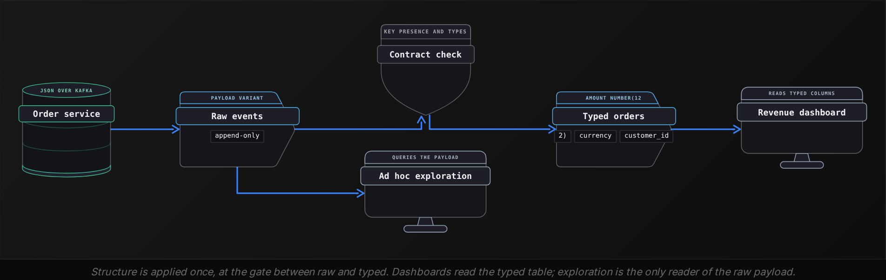

# Semi-Structured Data: Advanced

You are 25 minutes into a platform design round at a marketplace company. The interviewer turns her laptop around.
"Every event we emit lands in a single table: event_id, event_ts, and payload, which holds the JSON. About 50TB now. Finance filters on the order amount inside payload, and their dashboard takes 11 minutes. Last month it also showed revenue down 40% for a day. What would you change?"
She stops there. She hasn't said what payload physically is: JSON text in a string column, a native variant type, or a declared struct. Each of those reads a different number of bytes for that dashboard, and each hides the revenue dip in a different place.
What she is testing is whether you ask where the structure lives, and who pays for it, before you propose anything.


<br>

### What you will be able to do

Name what schema-on-read buys a team and the 4 costs it defers to query time

Decide whether a JSON path deserves an index, and price the write cost of B-tree and GIN options

Explain how a shredded variant or nested Parquet column changes the bytes a one-field query reads

Classify drift by whether it fails loudly or silently, and build a key-profile diff that catches it

Choose which fields get typed columns upstream from query-log and key-profile evidence


<br>

---

## Schema-on-Read Tradeoffs

### How this part gets asked

This part of the round rarely uses the words schema-on-read. It arrives as a defence of the current design ("we land raw JSON so producers never wait on us") or as a symptom ("every team computes revenue a little differently"). Both are the same tradeoff, and the interviewer wants it stated as who pays, and when.


<br>

### What deferring structure buys

Schema-on-read means the table stores each payload exactly as the producer sent it, and every query imposes structure as it reads. Name the gains first. An answer that opens by attacking the raw table sounds like someone who has never had to onboard 30 producer teams.

- Producers ship without coordination: a new key lands the day it is emitted, with no ticket to the data team.
- Ingestion never rejects a row for an unknown key or an unexpected type, so the load job has very few failure paths.
- The raw payload is a replay source: a field nobody modelled in January is backfilled in June from stored history.
- Analysts can explore keys before anyone decides they matter, which is how most useful fields get discovered.


<br>

### What it costs later

The schema still exists. Schema-on-read moves it out of the table definition and into every query that reads the data, then multiplies it by the number of consumers. That move is the source of 4 deferred costs, and a strong answer names each with the consequence a team actually sees.

| Deferred cost | Where it lands | What the team sees |
| --- | --- | --- |
| Type errors | Each query that touches the bad row | One dashboard errors on a cast, another silently drops the row |
| Duplicated parsing | Every consumer's SQL | 6 dashboards, 6 definitions of order amount |
| Scan cost | Every read of a text-stored payload | A filter on a single field reads and parses the whole document |
| No contract | Whoever reads the data next | A renamed key surfaces as a revenue dip, days later |

Duplicated parsing is the cost interviewers probe hardest, because it turns a storage choice into a correctness problem. Finance casts the path with ::NUMBER(12,2), marketing wraps it in TRY_CAST, and product still reads the key's old name. The company now has 3 revenue figures. Finance and product both hard-cast, so either can error on a bad value, but product's usually fails quietly instead, because new events no longer carry the old key at all. Only marketing's query can never raise an error:

```sql
-- finance: the whole query fails on the first row holding text such as 'n/a'
SELECT SUM(payload:order.amount::NUMBER(12,2)) AS revenue FROM events;

-- marketing: unparseable amounts become NULL and drop out of the sum
SELECT SUM(TRY_CAST(payload:order.amount::STRING AS FLOAT)) AS revenue FROM events;

-- product: reads the key's old name, so new events contribute nothing
SELECT SUM(payload:orderAmount::NUMBER(12,2)) AS revenue FROM events;
```

The costs also compound with time. A malformed amount caught at load is a rejected row and a message to the producer. The same row caught at read time has already been summed into 3 months of reports, exported into a finance close and copied into a model's training set. The interviewer is listening for that asymmetry: deferring structure is cheap per row and expensive per incident.


<br>

### The design the interviewer is waiting for

Arguing for either side as a principle wins nothing. The answer that scores is layered: land raw so producers stay unblocked, then publish a typed layer where the contracted fields are parsed once, with a single definition, and every consumer reads that layer instead of the payload. The raw table stays as the replay source and the place exploration happens.



> The follow-up that tests real experience
>
> Expect: "So who finds out when the producer changes something?" Under pure schema-on-read the answer is the reader, at query time, often without an error. Under the layered design it is the contract check, before the typed table loads. Say that sentence, then say what the check does when it fails.

> **TIP**
>
> Over-engineering is scored too. When the same team owns all 3 internal producers, a typed table plus code review on the producer covers the risk. The registry and contract gate, with quarantine tables behind them, are worth building once producers belong to teams the data platform cannot see into.


<br>

---

## When to Index a JSON Path

### A row-store question

Indexing a JSON path is a row-store question. It comes up when a JSON column sits in Postgres or MySQL behind an application or an operational API: "support looks up orders by the payment reference inside the payload, and it takes 4 seconds." Warehouses answer the same need with different machinery, covered at the end of this section, so the first move is to say which kind of system you are in.


<br>

### The options in Postgres

```sql
-- B-tree on an extracted path: equality and range on that path
CREATE INDEX idx_orders_payment_ref
  ON orders_raw ((payload->>'payment_ref'));

-- typed expression index: numeric range filters
CREATE INDEX idx_orders_amount
  ON orders_raw (((payload->'order'->>'amount')::numeric));

-- GIN over the whole document: containment and key existence
CREATE INDEX idx_orders_payload_gin
  ON orders_raw USING GIN (payload);              -- jsonb_ops

-- GIN with the smaller operator class: containment only
CREATE INDEX idx_orders_payload_pathops
  ON orders_raw USING GIN (payload jsonb_path_ops);
```

The B-tree options serve = and < on a single path, along with > and BETWEEN. The GIN options serve @> containment (payload @> '{"status": "refunded"}') across any key, and jsonb_ops adds key existence through ? as well as ?| and ?&. Neither GIN class helps a range filter on the amount, which is the first thing to say when someone proposes a GIN index on the whole column as a general fix.


<br>

### The planner matches expressions, not intent

An expression index is used only when the query contains the same expression the index was built on. Candidates who have read about JSON indexes without running one in production tend to miss this.

| Query predicate | Uses idx_orders_amount? | Why |
| --- | --- | --- |
| (payload->'order'->>'amount')::numeric > 500 | Yes | Same expression, same type |
| payload->'order'->>'amount' > '500' | No | Text comparison, where '90' sorts after '500' |
| (payload #>> '{order,amount}')::numeric > 500 | No | Same value, different expression tree |
| payload @> '{"order": {"amount": 500}}' | No | Containment needs a GIN index |

The fix is organizational as much as technical: expose the typed expression through a view or a generated column so every caller writes it the same way. MySQL makes this explicit. A JSON path is indexed through a generated column or, from 8.0.13, a functional index; arrays of values get a multi-valued index from 8.0.17.

The follow-up is "how do you know the index is used?" Run EXPLAIN on the exact query callers send, not a hand-tidied version of it. The canonical expression produces a Bitmap Index Scan on idx_orders_amount; the text comparison from the second row of the table above produces a Seq Scan with the filter applied to every row. Then check pg_stat_user_indexes: an idx_scan count still at 0 after a week means the index pays its write cost and serves nobody.

```sql
EXPLAIN SELECT order_id
FROM orders_raw
WHERE (payload->'order'->>'amount')::numeric > 5000;

Bitmap Heap Scan on orders_raw
  Recheck Cond: ((((payload -> 'order'::text) ->> 'amount'::text))::numeric > '5000'::numeric)
  ->  Bitmap Index Scan on idx_orders_amount
        Index Cond: ((((payload -> 'order'::text) ->> 'amount'::text))::numeric > '5000'::numeric)
```


<br>

### When the index pays for itself

| ✓ Index the path when | ✗ Skip it when |
| --- | --- |
| • The predicate is selective, returning a handful of rows and well under 5% of the table<br><br>• The lookup runs often and sits on a latency budget, such as an API call or a support tool<br><br>• Reads far outnumber writes, or writes are not latency-sensitive<br><br>• Every caller can be made to use a canonical expression | • The path has few distinct values: on an event_type with 8 values the planner picks a sequential scan<br><br>• The workload is analytic and reads most rows, where an index adds random I/O to a scan<br><br>• The table ingests thousands of events per second and the index sits on the hot write path<br><br>• The payload is patched in place often, which the write costs below make expensive |


<br>

### The cost on writes

Every index is paid for at insert time, and JSON indexes cost more than column indexes because the expression is evaluated against the document on each write.

- B-tree expression index: an extra index entry per row, plus extracting the path from the JSONB on every insert.
- GIN jsonb_ops: an entry per key and per value, so a 40-key event writes roughly 80 index entries.
- GIN jsonb_path_ops: a hashed entry per leaf value, about half as many, and a smaller index.
- GIN fastupdate queues entries in a pending list (4MB by default); the insert that fills it pays for the flush.

The cost interviewers rarely hear named is update amplification. Postgres does a heap-only tuple (HOT) update, which skips index maintenance, only when no indexed column changed. An expression index on payload makes the whole column indexed, so patching any key in the document, even a key no index reads, becomes a non-HOT update that writes to every index on the table. For a table that rewrites a status key inside the payload 10 times per order, that index changes the write profile of the table.


<br>

### The warehouse version of the same decision

Snowflake has no B-tree to add, and neither do BigQuery or Spark, so the question changes form while the economics stay the same. Snowflake's search optimization service accepts a variant path (ADD SEARCH OPTIMIZATION ON EQUALITY(payload:payment_ref)) and bills for the storage of its access structure and the compute that maintains it on every load. Clustering on a path expression reorders micro-partitions so min/max pruning works, paid for in reclustering credits. Name both as the same trade: maintenance on every write, bought to make selective reads cheap.


<br>

---

## Shredding JSON into Columns

### 3 physical layouts behind a logical column

The 11-minute dashboard has its answer here. When someone says "the payload column", the bytes on disk can be laid out in 3 ways, and the layout decides how much a query on a single field reads. The running numbers are 25 billion events of about 2KB each, 50TB in total, with 40 keys per payload. The dashboard filters on order.amount.

| Layout | Where you meet it | What a filter on order.amount reads |
| --- | --- | --- |
| JSON text in a string column | STRING or VARCHAR in Parquet, Hive, Spark, any lake that landed raw text | The whole payload column, then a full parse of every row |
| Shredded semi-structured type | Snowflake VARIANT, BigQuery JSON, Parquet Variant (Spark 4.0, Delta, Iceberg v3) | The extracted sub-column for that path, where extraction succeeded |
| Declared nested columns | STRUCT in Parquet, ORC, Iceberg; RECORD in BigQuery | The order.amount leaf column and nothing else |


<br>

### Why text JSON scans everything

A string column holding JSON is a single column chunk per row group. The engine cannot reach the amount without decompressing the chunk and running a JSON parser over each document, so get_json_object(payload, '$.order.amount') costs the same I/O whether the query needs 1 key or 40. The footer statistics are no help: min and max of a JSON string describe its first characters, which say nothing about the amount inside, so no row group is ever skipped.


<br>

### How shredding works

Shredding splits a document into a separate physical column for each leaf path. Parquet's nested encoding, from Google's Dremel paper, stores every leaf with repetition and definition levels that record where arrays repeat and where a value is missing, so the tree can be rebuilt from flat columns. Each leaf is encoded and compressed on its own and keeps its own min/max statistics, which is what makes projection and pruning possible.

Semi-structured types shred automatically and partially. Snowflake documents that it extracts paths from a VARIANT into columnar form per micro-partition, with 2 exceptions worth knowing by heart: a path that holds a JSON null in some rows, and a path whose values have mixed types. Dates and timestamps are stored as strings. Where a path is not extracted, a query on it reads and parses the full variant for that micro-partition, and that performance cliff is the detail to name in the room. Declared nested columns give the same projection without the extraction exceptions, at the price of a schema someone maintains.

```sql
-- payload declared as STRUCT, nested schema pruning on
FileScan parquet events[payload#12]
  PushedFilters: [IsNotNull(payload.order.amount),
                  GreaterThan(payload.order.amount,500.00)]
  ReadSchema: struct<payload:struct<order:struct<amount:decimal(12,2)>>>

-- payload stored as STRING
FileScan parquet events_raw[payload#40]
  PushedFilters: []
  ReadSchema: struct<payload:string>
```

That difference is the size of the fix. The amount leaf holds 25 billion values of around 8 bytes, about 200GB before compression, against 50TB for the text payload: a 250x cut in bytes read before any pruning. If events land roughly in time order and the dashboard asks for a recent week, min/max pruning on event_ts and on the amount leaf removes most of what is left.

- **128MB** — default Parquet row group in parquet-mr
- **Spark 3.0** — nested schema pruning on by default


<br>

### What defeats pruning

> Predicates that read the whole layout anyway
>
> - A function around the path in WHERE, such as LOWER(payload:category) = 'shoes': the stats describe stored values, not lowered ones.
> - A comparison whose type differs from the stored type, such as a NUMBER leaf tested against a string literal.
> - A path that drifted to mixed types: Snowflake stops extracting it and falls back to the full variant.
> - Text JSON parsed inside a view, which hides that every query beneath it reads the whole payload.

The follow-up is "how would you prove it reads less?" Answer with the metric each engine exposes. In Snowflake's query profile that is partitions scanned against partitions total, plus bytes scanned. BigQuery reports bytes processed, and the Spark UI shows ReadSchema and files read. A layout change proposed without a measurement reads as a guess, and the interviewer marks it that way.


<br>

---

## Schema Drift in JSON Feeds

### What each kind of drift does to a query

Schema drift is any change to the shape of the payload that a downstream query never agreed to. The interviewer cares less about the list of drift types than about which ones fail loudly and which ones produce a believable wrong number, because the quiet ones are what reach a finance dashboard.

| Change in the feed | What extraction returns | How it surfaces |
| --- | --- | --- |
| Key renamed: customer_id becomes customerId | NULL at the old path | Silent: joins drop rows, distinct counts fall |
| Type changed: amount 12.5 becomes "$12.50" | A string where a number was | Loud under CAST, NULL under TRY_CAST; shredding stops |
| Key moved: amount nests under price | NULL at the old path | Silent: sums fall by the share of new rows |
| Scalar became array: tag "a" becomes ["a"] | A JSON array | Silent equality misses, or a cast error |
| Meaning changed: amount sent in cents | A number of the same type | Silent: passes every structural check |
| Key removed | NULL | Silent unless the field is contracted NOT NULL |

Look hardest at the third column. Extraction returns NULL for a path that does not exist, and NULL flows through SUM, COUNT(col) and join conditions without raising anything. A JSON pipeline with no drift detection fails mostly by producing smaller numbers. The retype row depends on the new value: a numeric string such as "12.50" still casts cleanly in Snowflake whether the query uses CAST or TRY_CAST, so no query notices it. That version shows up in only 2 places, a second type for the path in the key profile and a slower query once extraction stops, which is why the profile below tracks type as well as presence.


<br>

### Catching it at the producer

The earliest catch is a schema registry, provided producers serialize with Avro or Protobuf; JSON Schema works too. Confluent Schema Registry checks each new schema version against the previous one under the subject's compatibility mode, which defaults to BACKWARD. A registration that breaks that mode is rejected, so a required field that was renamed or retyped never ships. Say the limits out loud: a registry sees only producers that use it, and it cannot see amounts switching from dollars to cents.


<br>

### Catching it at ingest: the key profile

For JSON that arrives with no registered schema, the workhorse check is a key profile: once a day, record each path that appears with its JSON type and the percentage of rows that carry it. Recursive flattening produces it in a single pass.

```sql
INSERT INTO key_profile
SELECT
  '2024-03-15'                                AS profile_date,
  f.path                                      AS json_path,
  TYPEOF(f.value)                             AS value_type,
  ROUND(100 * COUNT(DISTINCT e.event_id)
        / (SELECT COUNT(*) FROM events
           WHERE event_date = '2024-03-15'))    AS pct_rows
FROM events e,
     LATERAL FLATTEN(input => e.payload, recursive => TRUE) f
WHERE e.event_date = '2024-03-15'
GROUP BY f.path, TYPEOF(f.value);
```

The check compares today's profile with yesterday's. A full outer join on path and type keeps a path that appears only today, or only yesterday, with NULLs on the missing side. Watch what the retype of order.amount does: it splits into 2 rows, one per type.

https://github.com/user-attachments/assets/d170c1ec-01d9-4a28-9dc0-f3f9ddddd7ef

2 rows come back, each its own alert. order.amount lost 42 points as DECIMAL, and its new VARCHAR row has no partner yesterday, so the ABS comparison is NULL and the IS NULL branch of the OR returns the row. Read together, the pair is a retype rolling out, and the same split stops the warehouse shredding that path. promo_code moved a single point and stays quiet, which is the threshold doing its job on a sparse optional key. A rename produces the same signature across 2 different paths: customer_id falling from 100% to 39% while customerId appears at 61% with no row yesterday. Neither alert means much alone, and naming the pair as a rename is the diagnosis the interviewer is waiting for.


<br>

### Catching it at the consumer

The profile catches structural drift. Amounts switching from dollars to cents pass it because neither the key nor its type changes, so contracted fields also get value checks in the typed layer: non-null rate, row count against a trailing 7-day baseline, and the median of each money field against its own history. A 100x jump in median order amount is caught by the last check and by nothing else.


<br>

### When the check fires

The last push is operational: "it fires at 2am, then what?" Answer with a per-field policy. Drift on a contracted field (amount, currency, customer key) blocks the typed load and routes the day's rows to a quarantine table, because for revenue a late correct number beats an on-time wrong one. A new or drifting uncontracted key raises an alert and lands untouched in raw. Then name who gets paged: the producing team, through the contract owner listed for that source.

> **TIP**
>
> FLATTEN reports array elements with their index in the path, such as tags[0] and tags[1]. Replace each index with [] before grouping, or a 50-element array becomes 50 distinct paths and the profile drowns in noise.


<br>

---

## Which Fields to Flatten Upstream

### The losing answers at both ends

Ask which fields deserve typed columns and 2 losing answers arrive fast. Flatten everything, and every new producer key becomes a migration, the table grows to hundreds of mostly-NULL columns, and event types with unrelated shapes share a wide row. Flatten nothing, and every dashboard keeps parsing the payload itself, paying for full-document reads and inventing its own revenue definition.

The interviewer wants a rule that is evidence-based and reversible: promote a field when its usage and stability justify the cost, and keep the raw payload so the rule can be applied again later.


<br>

### The evidence: usage and stability

Usage comes from the query log. Snowflake's QUERY_HISTORY, BigQuery's INFORMATION_SCHEMA.JOBS and Postgres's pg_stat_statements all hold query text; counting the distinct queries and distinct users that reference each JSON path over 30 days gives a usage rank. Stability comes from the key profile: the percentage of rows carrying the path and how many types it has held over the same window.

| Path | Used by (30 days) | Present / types | Decision |
| --- | --- | --- | --- |
| order.amount | 41 queries, 9 teams | 100%, 1 type | Typed NUMBER(12,2) |
| order.currency | 38 queries, 9 teams | 100%, 1 type | Typed CHAR(3) |
| customer_id | 55 queries, 11 teams | 100%, 1 type | Typed, join key |
| order.placed_at (ISO string) | 60 queries, 12 teams | 100%, 1 type | Typed TIMESTAMP, clustering key |
| promo_code | 6 queries, 2 teams | 12%, 1 type | Stays raw |
| experiment_flags (200 keys) | 4 queries, 1 team | Varies by key | Stays raw, or a MAP column |
| device.user_agent | 3 queries, 1 team | 97%, 1 type | Stays raw until a second team asks |

Read the table as 2 filters in sequence. Usage asks whether more than one team joins or filters on the path, or uses it in a metric definition; stability asks whether it sits in nearly every row with a single type for the whole window. order.amount and order.currency clear both, and so do customer_id and order.placed_at. promo_code clears usage with 2 teams but appears in only 12% of rows, and device.user_agent is dense but serves 1 team, which is why its decision names the condition that would flip it.

| ✓ Promote to a typed column | ✗ Keep in the raw payload |
| --- | --- |
| • It is a join key or filter in several teams' queries, where a typed, clustered column lets the engine prune<br><br>• It carries a business definition teams must agree on, so it needs a single owner and cast; amount and currency are the usual examples<br><br>• It needs a type JSON can't hold natively: timestamps and decimals arrive as strings and are re-parsed on every read<br><br>• It is present in nearly every row with a single type, so the column is dense and the contract enforceable<br><br>• It drives a partition or clustering key, which works only on a real column | • Sparse paths present in under 5% of rows, where a column would be mostly NULL<br><br>• Paths read by a single team for exploration, with no agreed meaning yet<br><br>• Open-ended key sets such as feature flags or vendor extensions, better as a MAP or left raw<br><br>• Shapes that differ by event type, which belong in per-type tables rather than a wide row<br><br>• Paths still changing name or type week to week, promoted once the profile settles |


<br>

### Keep the raw payload beside the typed columns

Every promoted field keeps its source in a raw payload column on the typed table. That costs a second, compressed copy of the JSON, which on most warehouses is small next to the cost of a single unpruned scan a day. It buys 2 things: a field promoted next quarter is backfilled from history without a producer replay, and a bad cast in a typed column can be recomputed in place.

```sql
-- promote device.user_agent once a second team depends on it
ALTER TABLE orders_typed ADD COLUMN user_agent VARCHAR;

UPDATE orders_typed
SET    user_agent = payload:device.user_agent::VARCHAR
WHERE  user_agent IS NULL;

-- consumers switch to orders_typed.user_agent,
-- and the contract check adds the path to its watched set
```


<br>

### How to say it in the room

A compact version that scores: "I'd flatten by evidence. Fields that several teams join or filter on, or build revenue definitions from, and that are present and single-typed in the key profile, get typed columns with a named owner. Everything else stays in the payload, which I keep on the typed table so promotion later is a backfill rather than a replay." Then expect "what if a promoted field starts drifting?" The answer: a promoted field is contracted, so drift on it blocks the typed load instead of emptying a column with no error.

| ✓ Do | ✗ Don't |
| --- | --- |
| • Land raw JSON and publish a typed layer where contracted fields are cast once<br><br>• Index a JSON path only for selective, frequent lookups behind a canonical expression<br><br>• Compare bytes scanned and partitions pruned before and after any layout change<br><br>• Profile keys daily and diff each path's type and row percentage against yesterday<br><br>• Promote fields on query-log and profile evidence, and keep the raw payload for backfill | • Don't let each dashboard parse the payload with its own cast<br><br>• Don't put a GIN index on a hot ingest table to fix a range query<br><br>• Don't store JSON as text in a lake that gets filtered on inner fields<br><br>• Don't trust TRY_CAST alone: a NULL from a failed cast is drift you never hear about<br><br>• Don't flatten every key of unrelated event types into a single wide table |


<br>

---

## Putting It All Together

A food-delivery company lands order events in Snowflake as a VARIANT payload, 50TB and growing. The finance revenue dashboard takes 11 minutes, a support tool in Postgres looks up orders by a payment reference inside a JSONB column, and last week revenue dropped 40% for a day after the iOS app renamed customer_id to customerId and started sending amount as a formatted string such as "$12.50".

- The 40% dip is drift: the rename produced NULL customer keys, and "$12.50" amounts became NULL under TRY_CAST, both without an error.
- The same retype stopped Snowflake extracting order.amount, so the dashboard fell back to parsing the full variant and slowed further.
- A daily key profile diff would have flagged customerId and the VARCHAR amount the morning the release shipped.
- Promoting amount and currency to typed columns, along with customer_id and placed_at, under a named owner settles the cast and enables pruning.
- The Postgres lookup gets a B-tree expression index on payload->>'payment_ref', since the table is read-heavy and the predicate selective.


<br>

---

## Key Takeaways

- Schema-on-read moves the schema into every query: land raw for producers, then cast contracted fields once in a typed layer.
- Index a JSON path for selective, frequent lookups behind a canonical expression; every expression or GIN index is paid on each write.
- Layout sets scan cost. Text JSON reads the whole payload; a shredded or nested column reads only its own leaf and prunes on that leaf's stats.
- Most JSON drift arrives as silent NULLs; a daily key profile that diffs each path's type and row share flags it before a dashboard does.
- Promote fields to typed columns on usage and stability evidence, and keep the raw payload so later promotion is a backfill.
