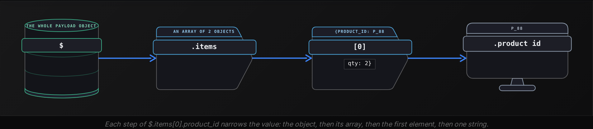

# Semi-Structured Data: Beginner

You are 20 minutes into a SQL screen at a fitness app. The interviewer shares a table with 3 columns: event_id, received_at, payload.
'Every row is one app event. Give me event counts per user and event type for yesterday.'
You scan the column list for user_id and it is not there. It sits inside payload, in a sample value that starts {"user_id": "u_101", "event_type": "page_view"}, and nobody has said which engine this is or whether payload holds a JSON type or plain text. The common first move is `GROUP BY user_id`, which errors before a single row comes back.
She is watching for 3 things: whether you notice the fields live inside a value, whether you know your engine's way of reading them out, and whether you turn them into columns before you count anything.


<br>

### What you will be able to do

Recognise a question whose fields live inside a JSON column, and extract them into named columns before aggregating

Write a JSON path through nested objects and array positions in whichever of the 5 engines you use (Postgres, Snowflake, BigQuery, MySQL, Spark)

Choose between the extraction form that keeps JSON quotes and the one that returns bare text, and explain the choice

Explain what a key inside JSON loses against a typed column: the database never checks its type or constraints, so errors surface late, and every read costs more

Count the elements of a JSON array on each row without exploding the array into rows


<br>

---

## When the Schema Is Inside the Data

### How the question disguises itself

The request almost never contains the word JSON. It names a field instead: count events per user, average order value by platform, crashes by app version. Then the table on screen has a column called payload or properties (sometimes attributes, context, metadata, raw), and the field you need is nowhere in the column list. That gap is the tell. When a noun from the question has no matching column, read the sample rows, because the field is almost always sitting inside one of those values.

| column | type | sample value (event 4) |
| --- | --- | --- |
| event_id | BIGINT | 4 |
| received_at | TIMESTAMP | 2024-03-14 09:12:03 |
| payload | JSONB | {"user_id": "u_101", "event_type": "page_view"} |

Here user_id and event_type exist only as keys inside payload. The database holds that value as one document and keeps no record of the keys within it. WHERE and GROUP BY operate on columns, as does a JOIN condition, so a key inside a document is out of their reach until a function reads it out and returns an ordinary value. Writing `GROUP BY user_id` against this table fails with column does not exist, and that error in the first minute is how many candidates discover the problem.


<br>

### Where the first minute goes wrong

The usual stumble after that error is trying JSON functions until one works: JSON_EXTRACT, then JSON_VALUE, then an arrow operator, each with a slightly different path. The interviewer reads that as unfamiliarity with event data, even when the third attempt is right. The aggregate at the end is usually a plain COUNT. The marks come from reaching the columns that feed it in one clean pass, with a function you named before typing.


<br>

### Extract first, then write ordinary SQL

The boundary is one CTE. It reads payload and turns each key the question needs into a named column; everything after it is the query you would write against a flat table. Say the plan before typing: 'user_id and event_type are keys inside payload, so I'll extract both into columns in a CTE and group on those.' That sentence costs 10 seconds and tells the interviewer you have recognised the pattern.

https://github.com/user-attachments/assets/64da2685-d24e-402a-8b8a-bcf76a530e27

The animation runs on 4 events cut down to the 2 columns and 2 keys this query reads. The CTE produces a user_id and an event_type for every payload, and from that point the outer query never sees JSON. The GROUP BY folds the 4 rows into 3 groups: u_101 with page_view counted twice (events 1 and 4), u_101 with purchase once, and u_102 with page_view once. Events 1 and 4 share a group because, once extracted, their values are equal strings like any other column's.


<br>

### Why the extraction lives in a CTE

| ✓ Extraction repeated inline | ✗ Extraction once, in a CTE |
| --- | --- |
| • payload->>'user_id' written out in SELECT and GROUP BY, then again in every filter<br><br>• Dialect syntax tangled into the business logic<br><br>• A renamed key means finding and fixing every copy<br><br>• Testable only by running the full aggregate | • Each key read out once and given a column name<br><br>• The outer query reads like SQL over a flat table<br><br>• A renamed key or a new engine touches one CTE<br><br>• SELECT \* FROM extracted LIMIT 5 shows the parsed rows first |

The last pair is the one that saves a live round. Run the CTE by itself on 5 rows before writing the aggregate. If user_id comes back NULL on every row, the path is wrong, and you learn it in seconds instead of while explaining an empty result to the interviewer.

```sql
-- Events per user and type for 2024-03-14 (Postgres, payload is JSONB)
WITH extracted AS (
  SELECT
    payload ->> 'user_id' AS user_id,
    payload ->> 'event_type' AS event_type
  FROM events
  WHERE received_at >= DATE '2024-03-14'
    AND received_at < DATE '2024-03-15'
)

SELECT
  user_id,
  event_type,
  COUNT(*) AS event_count
FROM extracted
GROUP BY user_id, event_type
ORDER BY event_count DESC
```


<br>

### Questions worth asking first

> Clarify before you extract
>
> - Which engine? Each of the 5 engines here (Postgres, Snowflake, BigQuery, MySQL, Spark) spells extraction differently, and naming yours is the first signal of fluency.
> - Is payload stored as JSON or as text? Text holding JSON may need `PARSE_JSON(payload)` in Snowflake or `payload::jsonb` in Postgres before any path works.
> - Which keys does the question need, and how deep? A top-level key and one nested 3 levels down use the same function with a longer path.

> **TIP**
>
> If no engine is named, pick the one you know best and say so: 'I'll write Postgres; the shape carries over to Snowflake.' A query that mixes 3 dialects reads worse than a clean one in the wrong dialect.


<br>

---

## JSON_EXTRACT Path Navigation

Every engine reads a value out of JSON by following a path: a route from the top of the document to one value. Most engines write the path as a JSONPath string. `$` is the root, `.key` steps into a key of an object, and `[n]` steps into a position of an array, counted from 0. Postgres spells each step as an operator and Snowflake has its own colon syntax, but all of them walk the route one step at a time, and each step only works if the value it lands on has the shape the next step expects.

Here is event 2 in full. The animation in the previous section showed only its first 2 keys; real purchase payloads also carry an amount alongside 2 nested structures, a device object and an items array.

```sql
{
  "user_id": "u_101",
  "event_type": "purchase",
  "amount": 49.9,
  "device": {
    "platform": "ios",
    "app_version": "7.2.0"
  },
  "items": [
    {
      "product_id": "p_88",
      "qty": 2
    },
    {
      "product_id": "p_12",
      "qty": 1
    }
  ]
}
```



Read the path `$.items[0].product_id` against the diagram. The root is an object, so `.items` is legal and lands on an array. An array has positions, so `[0]` is legal and lands on the first object in the cart. That object has keys, so `.product_id` lands on the string p_88. Each step is a question asked of whatever value the previous step returned.

| Path | What the steps do | Value on event 2 |
| --- | --- | --- |
| `$.user_id` | key at the root | u_101 |
| `$.device.platform` | into device, then its platform key | ios |
| `$.device.app_version` | into device, then app_version | 7.2.0 |
| `$.items[0].product_id` | into items, first element, its product_id | p_88 |
| `$.items[1].qty` | into items, second element, its qty | 1 |
| `$.items[2].product_id` | items holds only positions 0 and 1 | NULL |


<br>

### The same path in 5 engines

```sql
-- First product in the cart: one path, 5 engines

-- MySQL and Trino: JSON_EXTRACT with a JSONPath string
-- returns "p_88" with its JSON quotes; the next section explains why
SELECT JSON_EXTRACT(payload, '$.items[0].product_id') AS first_product FROM events;
-- bare p_88: payload->>'$.items[0].product_id' in MySQL, json_extract_scalar in Trino

-- BigQuery: JSON_VALUE for a scalar at the end of the path
SELECT JSON_VALUE(payload, '$.items[0].product_id') AS first_product FROM events;

-- Postgres: one operator per step, ->> on the last
SELECT payload->'items'->0->>'product_id' AS first_product FROM events;

-- Snowflake: colon into the VARIANT, then dots and brackets
SELECT payload:items[0].product_id::STRING AS first_product FROM events;

-- Spark SQL
SELECT get_json_object(payload, '$.items[0].product_id') AS first_product FROM events;
```

Postgres is the one that looks different. Its operators take one step each: `->` with a key name steps into an object, `->` with an integer steps into an array, and the chain reads left to right in the same order as the path. When the path is long, `#>>` takes all the steps at once as a text array: `payload #>> '{items,0,product_id}'` returns the same p_88. Snowflake starts with a colon after the column and continues with dots and brackets; `::STRING` at the end casts the result.

Keys with a dash or a dot in the name need quoting inside a path string, because the dot would otherwise read as a step. MySQL takes `$."user-agent"` and Snowflake takes `payload:"user-agent"`. Postgres needs nothing extra: `payload->'user-agent'` already passes the key name as a string, so every character in it is part of the name.


<br>

### Path mistakes that cost time

> Where path answers go wrong
>
> - Counting from 1. `$.items[1]` is the second element; the first is `$.items[0]` in every engine above.
> - Skipping a level. `$.platform` returns NULL because platform lives under device; the full path is `$.device.platform`.
> - Text mid-path in Postgres. `payload->>'device'->>'platform'` fails: the first `->>` returns text, and text has no keys to step into.
> - Asking an array for a key. `$.items.product_id` returns NULL in most engines, since items holds positions and a key step needs an object.
> - Wrong case. JSON keys are case-sensitive, so `$.User_Id` misses a key stored as user_id.


<br>

### The follow-up: the last item

A common push once the first item works: 'carts have different lengths, so how do you get the last one?' A fixed index stops working, and the answer depends on the engine. Postgres jsonb accepts a negative index, `payload->'items'->-1`. MySQL paths accept `$.items[last]`. Snowflake takes a computed position through GET: `GET(payload:items, ARRAY_SIZE(payload:items) - 1)`. Naming the engine feature in one sentence scores the point; the array length behind the Snowflake form is the subject of the last section.

> **TIP**
>
> Narrate the path as you type it: 'root, into items, first element, product_id.' The interviewer hears that you can see the document's shape, and you catch a skipped level before they do.


<br>

---

## Quoted JSON Values vs Bare Text

Extract event 2's event_type in 2 ways and you get 2 different answers: `"purchase"`, 10 characters including the double quotes, or `purchase`, 8 characters. The first is a JSON value: the engine cut a piece out of the document and handed it back still written as JSON, and JSON writes a string inside quotes. The second is SQL text: the engine unwrapped the JSON string into a plain value that compares equal to the literal 'purchase'.

| Engine | Returns a JSON value | Returns bare text |
| --- | --- | --- |
| Postgres | `payload->'event_type'` | `payload->>'event_type'` |
| MySQL | `JSON_EXTRACT(payload, '$.event_type')` | `payload->>'$.event_type'` |
| BigQuery | `JSON_QUERY` or `JSON_EXTRACT` | `JSON_VALUE` or `JSON_EXTRACT_SCALAR` |
| Snowflake | `payload:event_type` (a VARIANT) | `payload:event_type::STRING` |
| Trino | `json_extract` | `json_extract_scalar` |

Spark's `get_json_object` offers only one form: it returns a string, with the quotes already stripped from string values. Every other engine has both forms. Only the function or operator name tells you which one you wrote.


<br>

### Why the quoted form exists

You walk the path with the JSON-returning form. Extract `$.device` or `$.items` and there is no bare text to unwrap: the result is an object or an array, and the next step needs it to still be JSON. So the choice splits by job. Containers and intermediate steps stay JSON; the final scalar that a later clause filters or joins on comes out as text. Postgres builds that rule into its operators: `->` on each step that lands on a container, `->>` on the step that lands on the value you want.


<br>

### The comparison that returns nothing

The quoted form is dangerous because it usually runs. In BigQuery, `JSON_EXTRACT` over a STRING payload returns a STRING, so `WHERE JSON_EXTRACT(payload, '$.event_type') = 'purchase'` is a legal comparison between `"purchase"` and `purchase`. It's false on every row, the query reports 0 purchases, and nothing errors. Postgres reaches the same place through a cast: `(payload->'user_id')::text` is the 7-character string `"u_101"`, and a join on it matches no user.

```sql
-- Postgres: 2 ways to join events to users

-- Matches nothing: the left side keeps its JSON quotes
SELECT COUNT(*) AS matched
FROM events e
JOIN users u ON (e.payload->'user_id')::text = u.user_id;  -- '"u_101"' vs 'u_101'

-- Matches: ->> returns bare text
SELECT COUNT(*) AS matched
FROM events e
JOIN users u ON e.payload->>'user_id' = u.user_id;         -- 'u_101' vs 'u_101'
```

Run both against the 4 events from the first section and a users table holding u_101 and u_102. The first query returns 0. The second returns 4, one match per event. The only difference between them is a single character in the operator.

| Postgres expression | Type | Value on event 2 | Characters |
| --- | --- | --- | --- |
| `payload->'event_type'` | jsonb | "purchase" | n/a |
| `(payload->'event_type')::text` | text | "purchase" | 10 |
| `payload->>'event_type'` | text | purchase | 8 |
| `payload->'amount'` | jsonb | 49.90 | n/a |
| `payload->>'amount'` | text | 49.90 | 5 |


<br>

### Numbers have no quotes to strip

Quotes appear only on JSON strings. A JSON number or boolean prints the same in both forms, as does null, which is why both amount rows show 49.90. What differs is the type: one is jsonb and the other text. Neither is NUMERIC. `SUM(payload->>'amount')` fails in Postgres because there is no SUM over text. The habit is to extract with the text form and cast on the same CTE line, `(payload->>'amount')::NUMERIC AS amount`, so every later clause sees a number.


<br>

### MySQL arrows and Snowflake variants

MySQL puts both forms behind arrows that resemble Postgres's but take a path string: `payload->'$.event_type'` is `JSON_EXTRACT` and returns `"purchase"`, while `payload->>'$.event_type'` is `JSON_UNQUOTE(JSON_EXTRACT(...))` and returns purchase. Moving between the 2 engines, say which one you mean, since `payload->>'event_type'` without the `$.` is valid Postgres and an error in MySQL. In Snowflake, `payload:event_type` is a VARIANT that a result grid prints with quotes; `::STRING` at the end gives the column a string type for everything downstream.


<br>

### The sentence that scores

Say why you chose the operator: 'I'm using `->>` because I'm comparing to a string literal; `->` would keep the JSON quotes.' When a filter or join comes back empty, the first suspect worth naming is a quoted JSON value being compared to bare text. Some interviewers plant this deliberately, writing a query with the JSON-returning function and asking why the count is 0.

> **TIP**
>
> To see which form you have, take `LENGTH` of the extraction on a row you know. For event_type on event 2, 8 means bare text and 10 means the quotes came along.


<br>

---

## JSON Columns vs Flat Columns

This one usually arrives as a follow-up once your extraction runs: 'That payload column is flexible. Why don't we store every table like that?' The interviewer is checking whether you know what a column does for you that a key inside a document cannot. The answer that scores names the specific losses, each with a concrete example from the table in front of you.

| ✓ amount as a NUMERIC column | ✗ amount as a key inside payload |
| --- | --- |
| • The type is enforced on write: inserting 'N/A' fails<br><br>• NOT NULL and CHECK (amount >= 0) are enforced by the database<br><br>• A misspelled name fails before the query reads a row<br><br>• Read as stored, already a number<br><br>• Listed in the catalog with its name and type | • Any value is accepted: 49.90, "49.90", "N/A" and true all insert<br><br>• No constraint applies unless someone writes one per key<br><br>• A misspelled path runs and returns NULL<br><br>• Extracted and cast in every query that uses it<br><br>• Known only to whoever reads sample documents |


<br>

### The typo that compiles

A misspelled column fails fast. A misspelled path does not fail at all: the engine cannot know which keys a document holds until it reads it, so asking for a key that never appears is legal and returns NULL on every row. SUM over all NULLs is NULL, COUNT of the extracted value is 0, and a dashboard tile goes blank with no error in any log.

```sql
-- Column typo: stops before reading a row
SELECT SUM(ammount) AS revenue FROM orders;
-- ERROR:  column "ammount" does not exist

-- Path typo: runs over every purchase, returns NULL
SELECT SUM((payload->>'ammount')::NUMERIC) AS revenue
FROM events
WHERE payload->>'event_type' = 'purchase';
-- revenue: NULL
```

This is why the CTE habit matters beyond readability. A typo on one CTE line shows up as a column of NULLs the moment you select from it; the same typo buried in a WHERE clause shows up as a smaller number nobody questions.

There is no catalog entry for a key either. `information_schema.columns` lists amount when it is a column; when it is a key, the only way to learn that it exists, how it is spelled and what values it holds is to read documents. With a 10-row sample in an interview, read the sample aloud before you write a path.


<br>

### Bad values surface when you read

A typed column rejects a bad value at insert, so the producer finds out. A JSON key stores whatever arrives, and the problem appears later, in whichever query casts it. If one client sent `"amount": "N/A"`, then `(payload->>'amount')::NUMERIC` fails the entire query in Postgres with invalid input syntax for type numeric, and the failing row might be one purchase in a full day of events. Snowflake and BigQuery have safe casts that return NULL for that row instead and let the query finish. In Snowflake the VARIANT has to become a string first, because `TRY_CAST` accepts only string input: write `TRY_CAST(payload:amount::STRING AS NUMBER(10,2))` or `TRY_TO_NUMBER(payload:amount::STRING, 10, 2)`. Applied straight to `payload:amount`, `TRY_CAST` raises an error instead of returning NULL. BigQuery's `SAFE_CAST(JSON_VALUE(payload, '$.amount') AS NUMERIC)` already starts from text, since `JSON_VALUE` returns a string.

Name both behaviours and their cost. A failed query is loud: someone looks at it today. A NULL is quiet: the revenue total drops by one order and nobody notices. A strong answer pairs the safe cast with a count of the rows that came back NULL, so the quiet failures get a number attached.

```sql
-- BigQuery: keep the query alive, and measure what the safe cast lost
SELECT
  COUNT(*) AS purchases,
  COUNTIF(
    TRY_CAST(JSON_VALUE(payload, '$.amount') AS NUMERIC) IS NULL
  ) AS missing_or_bad_amounts,
  SUM(
    TRY_CAST(JSON_VALUE(payload, '$.amount') AS NUMERIC)
  ) AS revenue
FROM events
WHERE JSON_VALUE(payload, '$.event_type') = 'purchase'
```


<br>

### Every read pays the extraction

A column is read as stored. A key is found inside its document on every query that touches it, and in a row store such as Postgres that means reading the whole jsonb value, even when it carries 30 keys the query ignores. On 4 sample rows the cost is invisible. On an events table taking 40 million rows a day, a query whose only filter is an extracted key has to open payload on every row of the table before it can tell which rows qualify. The fix within one query is to always include a predicate on a typed column such as received_at. With received_at indexed or used as the partition key, the engine skips every row outside the range before it reads a single payload, so extraction runs over a day of rows instead of the whole table.

The planner picks that plan because the received_at predicate exists, wherever it sits in the WHERE clause: writing the range first or last produces the same plan. Some interviewers test this directly by asking whether the date condition should move to the top. The answer that scores says position does not matter. What limits the scan is a selective predicate on a typed column that is indexed or partitioned, and `EXPLAIN` shows the index scan or partition pruning that proves it.

> Why not JSON everywhere: the answer that scores
>
> - Types: a column rejects 'N/A' at insert; a JSON key stores it and the cast fails at read time.
> - Constraints: NOT NULL and CHECK apply to columns without anyone writing extra rules.
> - Errors: a misspelled column fails to run; a misspelled path runs and returns NULL.
> - Discovery: a column is listed in the catalog; a key is found by reading sample documents.
> - Cost: a column is used as stored; a key is extracted and cast on every read.

> **TIP**
>
> To check a JSON key the way a constraint would, query for violations: `SUM(CASE WHEN payload->>'user_id' IS NULL THEN 1 ELSE 0 END)` grouped by event type. A schema would have refused those rows; with JSON you have to go and count them.


<br>

---

## Counting Elements in a JSON Array

The request sounds like an aggregation: 'how many items were in each order', 'find carts with 3 or more products', 'what's the average basket size'. The reflex is to explode the array into one row per element and count them back up. You don't need to, because a JSON array already knows its own length, and every major engine has a function that returns it as an integer on the same row.

| Engine | Length of the items array | Event 2 |
| --- | --- | --- |
| Postgres | `jsonb_array_length(payload->'items')` | 2 |
| MySQL | `JSON_LENGTH(payload, '$.items')` | 2 |
| BigQuery | `ARRAY_LENGTH(JSON_QUERY_ARRAY(payload, '$.items'))` | 2 |
| Snowflake | `ARRAY_SIZE(payload:items)` | 2 |
| Trino | `json_array_length(json_extract(payload, '$.items'))` | 2 |
| Spark | `json_array_length(get_json_object(payload, '$.items'))` | 2 |

Each function is handed the array itself, which ties back to the 2 forms of extraction. In Postgres the argument is `payload->'items'`, the JSON form, because a container has to stay JSON. Pass `payload->>'items'` and the call fails, since `jsonb_array_length` takes jsonb and the text form is plain text.

```sql
-- Purchases with 2 or more line items (Postgres)
WITH purchases AS (
  SELECT
    event_id,
    payload ->> 'user_id' AS user_id,
    JSONB_ARRAY_LENGTH(payload -> 'items') AS item_count
  FROM events
  WHERE payload ->> 'event_type' = 'purchase'
)

SELECT
  event_id,
  user_id,
  item_count
FROM purchases
WHERE item_count >= 2
```

| event_id | user_id | item_count |
| --- | --- | --- |
| 2 | u_101 | 2 |

The purchase went in as one row and came out as one row, and the count came from a single function call. The query never changed grain: it started with one row per event and ended with one row per event, so any other event-level column in the CTE stays correct beside item_count.


<br>

### Why not unnest and count

| ✓ Unnest, then COUNT(*) GROUP BY event_id | ✗ Array length on each row |
| --- | --- |
| • Event 2 becomes 2 rows, then folds back to 1<br><br>• An event with "items": [] produces no rows and drops out<br><br>• Other event columns repeat once per item until regrouped<br><br>• A GROUP BY over every event column to read one number | • Event 2 stays 1 row with item_count 2<br><br>• An empty array returns 0 and the event stays<br><br>• Event-level columns such as amount stay at one per event<br><br>• A single call you can put inside a CASE or an AVG as easily as in WHERE |

The interviewer is usually listening for the second pair. A count built from unnested rows cannot report 0, because an empty cart contributes no rows to count, so an average basket size computed that way comes out too high. Saying 'the length function returns 0 for an empty array, so empty carts stay in the average' is the line that shows you thought about the empty cart before being asked.


<br>

### Wrong counts that look plausible

> Traps on the array length
>
> - `LENGTH(payload->>'items')` counts characters: 68 for event 2's items text in Postgres, where the answer is 2.
> - MySQL's `JSON_LENGTH` counts the keys of an object and returns 1 for a scalar, so a path that lands on `$.device` returns 2 instead of an error.
> - Postgres `jsonb_array_length` on an object or a scalar raises an error instead of returning a number.
> - An event with no items key passes NULL to the function and gets NULL back; wrap it in `COALESCE(..., 0)` if the question counts that as an empty cart.


<br>

### Lengths compose with the rest of the query

Once item_count is an integer column in the CTE, everything relational works on it: `AVG(item_count)` for average basket size, `SUM(item_count)` for line items across all purchases, a CASE that buckets carts by size with breaks at 2 items and at 5. The path from the second section and the length function combine freely in the same CTE, as the query below shows.

```sql
-- Average basket size per platform (Postgres)
WITH purchases AS (
  SELECT
    payload -> 'device' ->> 'platform' AS platform,
    JSONB_ARRAY_LENGTH(payload -> 'items') AS item_count
  FROM events
  WHERE payload ->> 'event_type' = 'purchase'
)

SELECT
  platform,
  COUNT(*) AS purchases,
  AVG(item_count) AS avg_items,
  SUM(item_count) AS line_items
FROM purchases
GROUP BY platform
```

Ask one clarifying question before you settle on the length: does the interviewer mean line items or units bought? Line items is the array length, 2 for event 2. Units is the sum of each element's qty, 3 for event 2, and reading every element's qty is a different query from counting the elements.

| ✓ Do | ✗ Don't |
| --- | --- |
| • Name your engine and its extraction function before writing the first line<br><br>• Extract each key once into a named, cast column inside a CTE<br><br>• Use the text-returning form for every final value your query compares or groups by<br><br>• Pass the JSON form of an array to the engine's length function<br><br>• Select from the extraction CTE on a few rows before aggregating | • Don't compare a JSON-returning extraction to a string literal<br><br>• Don't write [1] when you mean the first element of an array<br><br>• Don't explode an array into rows only to count its elements<br><br>• Don't call LENGTH on an array's text; it counts characters<br><br>• Don't trust a column of NULLs until the path spelling is checked |


<br>

---

## Putting It All Together

A food delivery company keeps orders in a table with order_id, placed_at and an order_json column holding the restaurant, the customer and a dishes array. The operations lead asks for yesterday's orders with 4 or more dishes, counted by restaurant city, and wants the result joined to the team's cities dimension for regional managers.

- City appears in no column, so the first move is spotting it inside order_json and extracting it in a CTE, with placed_at filtered as a typed column first.
- City sits at $.restaurant.address.city, a 3-step path through 2 objects, written in the engine's own syntax and narrated step by step.
- City is joined to the cities dimension, so it comes out with the text-returning form; the JSON form would keep its quotes and match no city.
- Dish count is the length of the dishes array, so a single length call per order feeds the filter of 4 or more without changing the grain.
- Nothing in order_json is typed, so a misspelled $.restaurant.adress.city returns NULL; selecting from the CTE first catches it before counts go out.


<br>

---

## Key Takeaways

- When a field in the question has no column, it lives inside a JSON value; extract it into a named column in a CTE before any GROUP BY or JOIN.
- A path walks from the root one step at a time: .key into objects, [n] into arrays counted from 0, and each step needs the shape it expects.
- Keep containers in the JSON form and pull compared values out as text; a quoted value compared to bare text matches nothing.
- Nothing checks a JSON key's type or constraints, so a typo returns NULL and a bad value fails only when it is cast.
- Count array elements with the engine's length function on the JSON array: one row per parent, and 0 for an empty array.
